# Bab 2 – Dasar penggunaan (berlaku untuk semua peran)

Bab ini berisi hal-hal yang sama untuk semua pengguna: cara masuk, mengenal layar, berpindah aplikasi, mengganti kata sandi, dan cara kerja umum formulir. Baca bab ini dulu sebelum membuka buku peran Anda.

## 2.1 Yang Anda perlukan

- Komputer, laptop, atau HP dengan peramban terbaru (Chrome, Edge, Firefox, atau Safari).
- Alamat SimLahan instansi Anda.
- **Nama pengguna** dan **kata sandi awal** dari pengelola SimLahan (superuser). Pemohon dan investor portal membuat akun sendiri dengan alamat surel.
- Untuk petugas lapangan: HP dengan GPS dan kamera, serta izin lokasi untuk peramban.

## 2.2 Masuk ke SimLahan

Ada empat halaman masuk. Pakai yang sesuai pekerjaan Anda; semuanya memakai akun yang sama (kecuali portal yang memakai akun pemohon).

### A. Aplikasi utama (petugas kantor)

1. Buka alamat SimLahan, misalnya `https://simlahan.instansi-anda.go.id/`.
2. Ketik nama pengguna Anda di kotak **Nama pengguna** (nomor 1 di gambar).
3. Ketik kata sandi di kotak **Kata sandi** (nomor 2).
4. Klik tombol biru **Masuk** (nomor 3).
5. Anda langsung dibawa ke halaman kerja peran Anda (lihat bagian "Halaman awal" di buku peran Anda).

Tautan di bawah kotak masuk (nomor 4: **⇄ Pusat Komando**, **⇄ Panel admin**, **⇄ Portal**) membawa Anda ke halaman masuk aplikasi lain.

### B. Panel admin

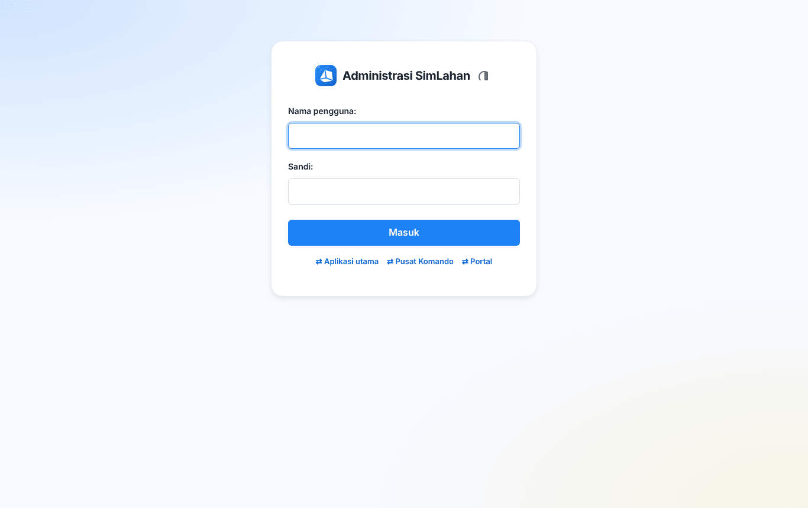

1. Buka alamat SimLahan diikuti `/admin/`, misalnya `https://simlahan.instansi-anda.go.id/admin/`.
2. Isi **Nama pengguna** (nomor 1) dan **Sandi** (nomor 2).
3. Klik **Masuk** (nomor 3).

Bila Anda sudah masuk di aplikasi utama, panel admin langsung terbuka tanpa masuk ulang.

### C. Pusat Komando (petugas lapangan)

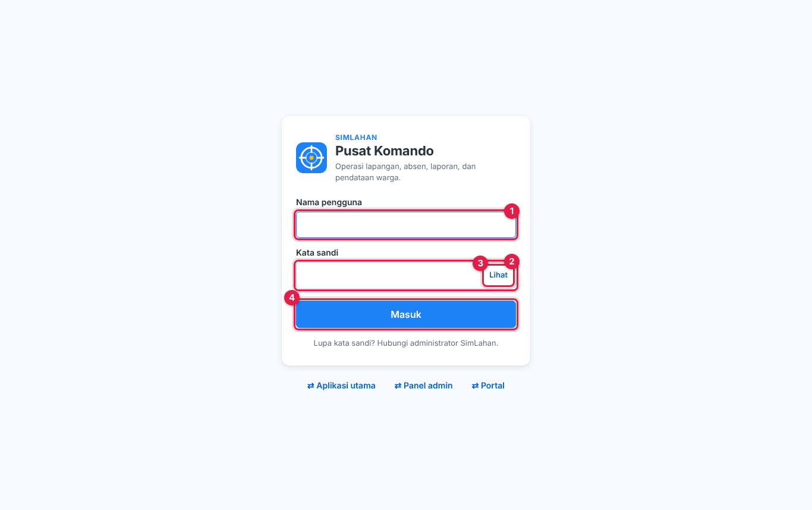

1. Buka alamat SimLahan diikuti `/komando/masuk/` di HP atau komputer.
2. Isi **Nama pengguna** (nomor 1) dan **Kata sandi** (nomor 2).
3. Ketuk **Lihat** (nomor 3) bila ingin memeriksa sandi yang Anda ketik.
4. Ketuk **Masuk** (nomor 4).

Di HP, halaman masuk tampil seperti ini:

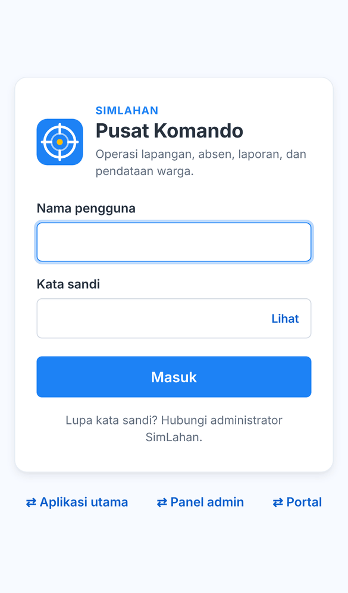

### D. Portal (pemohon dan investor)

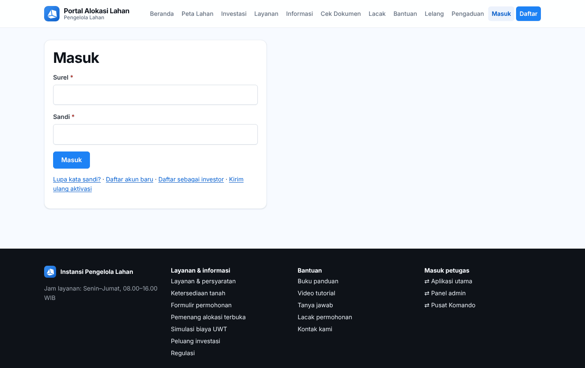

1. Buka alamat SimLahan diikuti `/portal/masuk/`, atau klik **Masuk** di menu atas portal.
2. Isi **Surel** (nomor 1) dengan alamat surel akun Anda dan **Sandi** (nomor 2).
3. Klik **Masuk** (nomor 3).

Lupa sandi? Klik **Lupa kata sandi?** (nomor 4). Belum punya akun? Klik **Daftar akun baru** (nomor 5); caranya ada di [Bab 12.11](50-portal-publik.md#1211-mendaftar-akun).

> **Kode OTP.** Bila instansi mengaktifkan OTP, setelah mengisi sandi Anda diminta memasukkan kode 6 angka yang dikirim ke surel Anda. Buka surel, salin kodenya, lalu klik lanjut. Kode hanya berlaku sebentar; minta kode baru bila kedaluwarsa.

> **Terlalu banyak percobaan.** Setelah beberapa kali salah sandi dalam waktu singkat, sistem menolak percobaan berikutnya selama sekitar satu menit. Tunggu sebentar lalu coba lagi dengan sandi yang benar.

## 2.3 Mengenal layar aplikasi utama

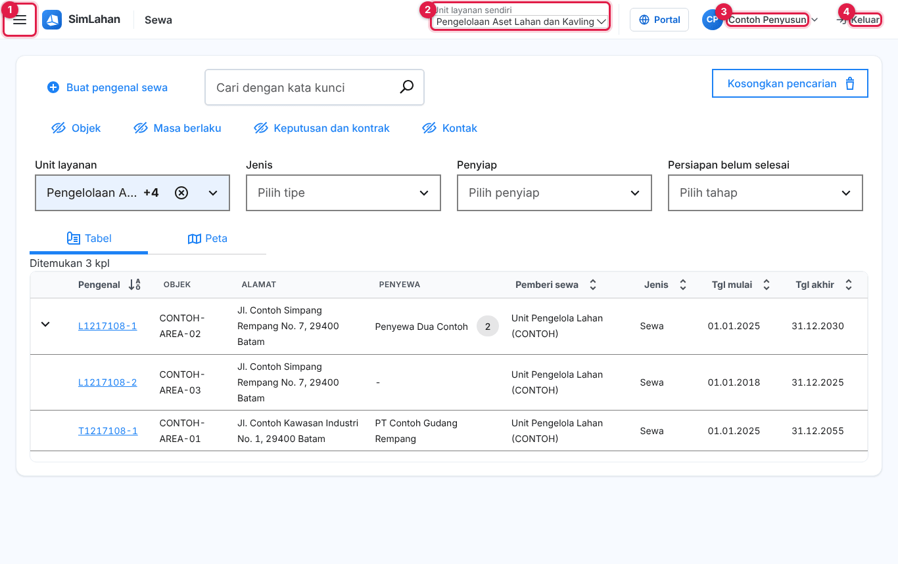

Nomor pada gambar:

1. **Tombol menu (☰)**: membuka menu samping berisi semua halaman yang boleh Anda buka.
2. **Unit layanan sendiri**: unit layanan aktif Anda. Data baru yang Anda buat masuk ke unit ini. Bila Anda punya lebih dari satu unit, pilih di sini.
3. **Nama Anda**: membuka menu akun (grup pengguna, unit layanan, **Panduan peran**, **Ganti sandi**).
4. **Keluar**: mengakhiri sesi di perangkat ini.

Petugas yang boleh membuka aplikasi lain juga melihat tombol pindah aplikasi di bilah atas:

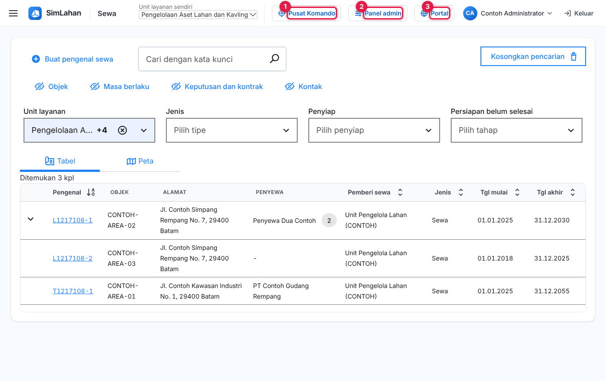

Tombol **Pusat Komando** (nomor 1), **Panel admin** (nomor 2), dan **Portal** (nomor 3) membuka aplikasi itu tanpa perlu masuk ulang.

### Menu samping

Klik **☰** untuk membuka menu. Menu yang memiliki tanda **›** berisi submenu; klik untuk membukanya, lalu klik **Kembali** untuk kembali ke daftar utama.

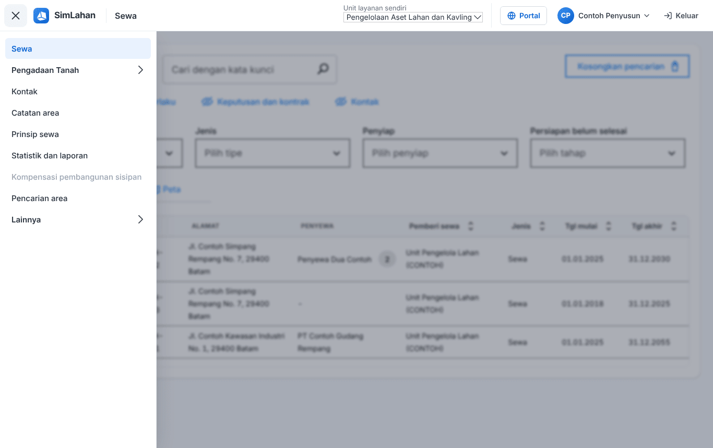

### Menu nama Anda

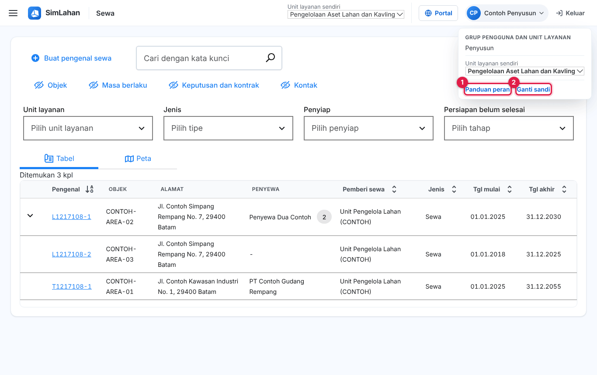

Klik nama Anda di kanan atas. Kotak yang terbuka menampilkan grup pengguna (peran) Anda dan pilihan unit layanan, serta tautan **Panduan peran** (nomor 1) dan **Ganti sandi** (nomor 2).

## 2.4 Mengenal layar panel admin

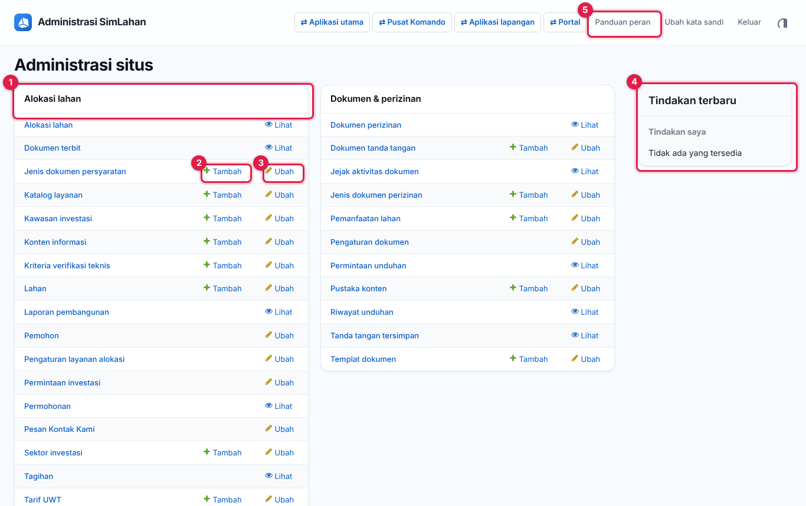

Beranda panel admin berisi kotak per modul. Nomor pada gambar:

1. **Judul modul** (misalnya **Alokasi lahan**). Di bawahnya ada daftar menu modul itu; klik nama menu untuk membuka daftarnya.
2. **Tambah**: langsung membuka formulir data baru untuk menu itu.
3. **Ubah** (atau **Lihat** bila Anda hanya boleh membaca): membuka daftar data menu itu.
4. **Tindakan terbaru**: data yang terakhir Anda tambah atau ubah.
5. Bilah atas: tombol **⇄ Aplikasi utama**, **⇄ Pusat Komando**, **⇄ Aplikasi lapangan**, **⇄ Portal** (sesuai hak), lalu **Panduan peran**, **Ubah kata sandi**, **Keluar**, dan tombol tema (terang/gelap/otomatis).

Setelah Anda membuka salah satu menu, daftar semua menu tampil di **kolom kiri**. Kotak **Mulai mengetik untuk menyaring…** di atasnya membantu mencari menu dengan cepat; tanda **«** menyembunyikan kolom itu.

### Halaman daftar

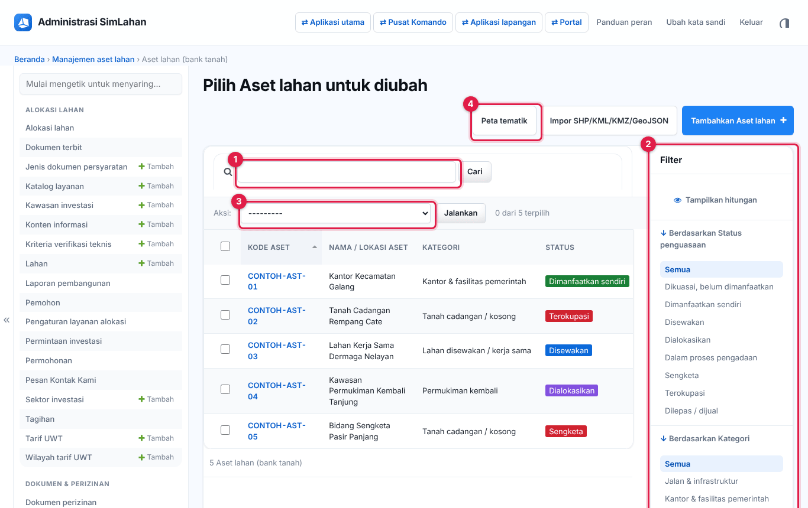

Nomor pada gambar:

1. **Kotak cari**: ketik kata kunci (nomor, nama, kode) lalu klik **Cari**.
2. **Filter** (kanan): klik pilihan untuk menyaring daftar, misalnya per status. Klik **Semua** untuk menghapus saringan.
3. **Aksi**: centang kotak di awal satu atau beberapa baris, pilih aksi (misalnya "Ekspor ke Excel"), lalu klik **Jalankan**.
4. **Tombol di kanan atas**: tombol khusus halaman itu, misalnya **Peta tematik**, **Impor…**, atau **Tambahkan …**.

Klik judul kolom untuk mengurutkan. Klik kode/nomor di baris untuk membuka datanya.

### Formulir (tambah atau ubah data)

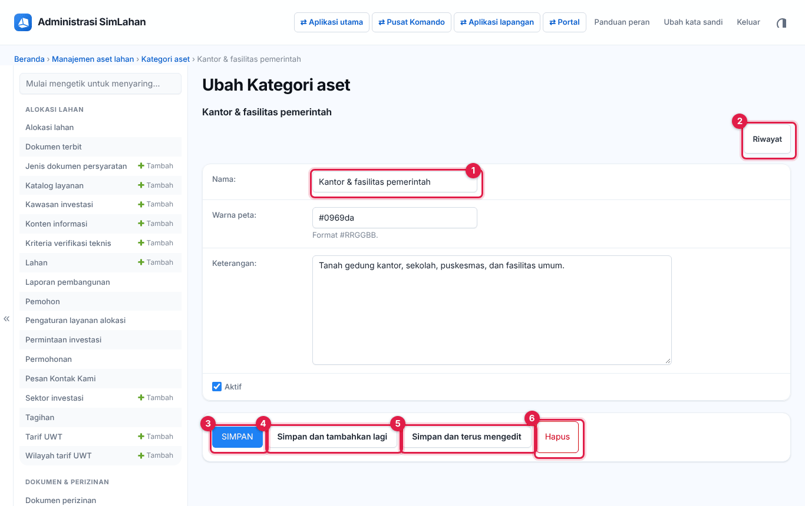

Contoh pada gambar adalah formulir **Kategori aset**. Semua formulir di panel admin bekerja sama:

1. Isi kolom yang diperlukan (nomor 1 menunjuk kolom **Nama**). Kolom berlabel tebal wajib diisi.
2. Tombol **Riwayat** (nomor 2, kanan atas) menampilkan siapa mengubah apa dan kapan.
3. Pilih salah satu tombol di bagian bawah:
   - **Simpan** (nomor 3): menyimpan lalu kembali ke daftar.
   - **Simpan dan tambahkan lagi** (nomor 4): menyimpan lalu membuka formulir kosong baru.
   - **Simpan dan terus mengedit** (nomor 5): menyimpan dan tetap di formulir ini.
   - **Hapus** (nomor 6): menghapus data. Muncul halaman konfirmasi; klik **Ya, saya yakin** untuk menghapus atau **Tidak, bawa saya kembali** bila batal.

Formulir yang lebih panjang punya dua bagian tambahan:

- **Kolom peta**: gambar atau ubah batas bidang langsung di peta (klik untuk menambah titik, klik titik pertama untuk menutup bentuk).
- **Tabel di bawah formulir** (misalnya "Dokumen & arsip"): untuk menambah beberapa baris sekaligus; klik **Tambahkan … lagi** untuk baris baru.

> Bila ada kesalahan isian, kotak merah muncul di atas formulir dan di samping kolom yang salah. Perbaiki lalu simpan lagi.

## 2.5 Cara kerja umum di aplikasi utama

Pola yang sama berlaku di halaman Sewa, Kontak, Prinsip sewa, dan lainnya:

1. **Cari** di kotak kata kunci atau saring dengan pilihan di bawahnya. **Kosongkan pencarian** menghapus semua saringan.
2. Klik **pengenal/nomor** di daftar untuk membuka data.
3. Data terbuka dalam **mode baca**. Klik **Ubah** untuk masuk **mode ubah**.
4. Ubah isian, lalu klik **Simpan**. Klik **Batalkan perubahan** bila tidak jadi.
5. Data yang panjang dibagi ke beberapa **tab** (misalnya Ringkasan, Penyewa, Penagihan). Tab yang sedang dibuka bergaris bawah.
6. Ikon **gelembung percakapan** di kanan atas data sewa membuka **komentar**: catatan antarpetugas pada data itu.

Bagian **Pengadaan Tanah** memakai pola yang sedikit berbeda: tombol **+ Tambah …** membuka jendela formulir, dan setiap baris punya tautan **Ubah** dan **Hapus**. Rinciannya di [Bab 4](11-pengadaan-tanah.md).

## 2.6 Pindah antaraplikasi

Setiap aplikasi punya tombol **⇄** ke aplikasi lain yang boleh Anda buka:

| Dari | Tombol |
|---|---|
| Aplikasi utama | **Pusat Komando**, **Panel admin**, **Portal** di bilah atas |
| Panel admin | **⇄ Aplikasi utama**, **⇄ Pusat Komando**, **⇄ Aplikasi lapangan**, **⇄ Portal** |
| Pusat Komando | **⇄ Utama** di bilah atas; Menu → tombol aplikasi lain |
| Aplikasi lapangan | Tautan **⇄** di bagian bawah |
| Portal | Tautan di kaki halaman (untuk petugas yang sedang masuk) |

**Keluar** di salah satu aplikasi petugas mengakhiri sesi di semua aplikasi petugas pada perangkat itu.

## 2.7 Panduan peran di dalam aplikasi

Ringkasan singkat peran Anda selalu tersedia di dalam aplikasi:

- Aplikasi utama: klik nama Anda → **Panduan peran**.
- Panel admin: tautan **Panduan peran** di kanan atas.
- Pusat Komando: **Menu** → **📘 Panduan peran**.
- Alamat langsung: `/akun/panduan/`.

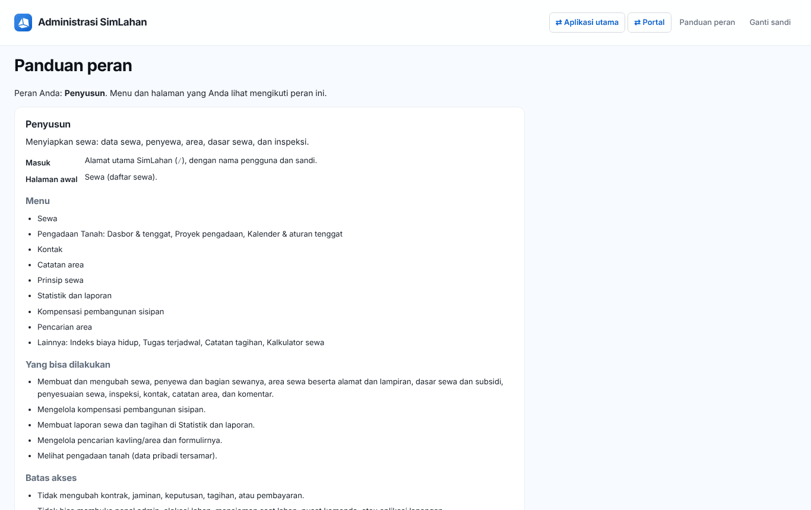

## 2.8 Mengganti kata sandi

Ganti sandi awal segera setelah pertama kali masuk.

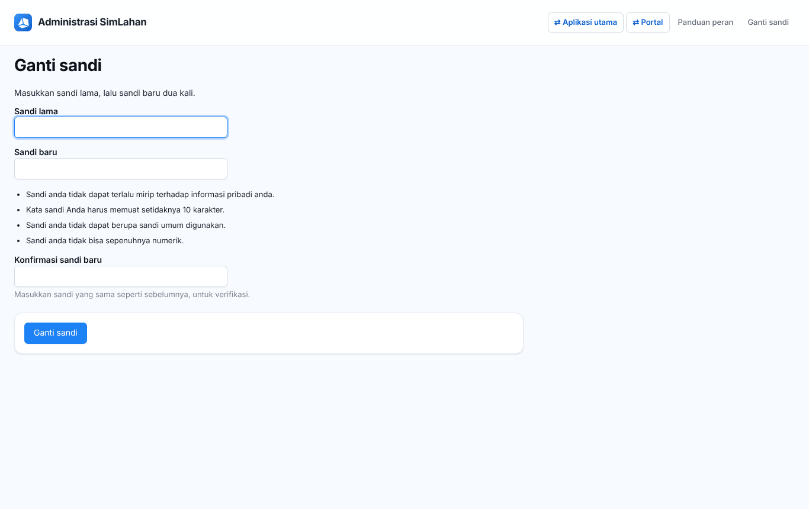

1. Buka halaman **Ganti sandi**: klik nama Anda lalu **Ganti sandi** (aplikasi utama), tautan **Ubah kata sandi** (panel admin), **Menu → 🔑 Ganti sandi** (Pusat Komando), atau buka alamat `/akun/sandi/`.
2. Ketik sandi yang sekarang di **Sandi lama** (nomor 1).
3. Ketik sandi baru di **Sandi baru** (nomor 2), lalu ketik sekali lagi di **Konfirmasi sandi baru** (nomor 3).
4. Klik **Ganti sandi** (nomor 4). Pesan "Sandi berhasil diganti" muncul.

Aturan sandi: minimal 10 karakter, tidak mirip nama pengguna atau nama Anda, bukan sandi yang umum dipakai, dan tidak hanya berisi angka. Setelah sandi diganti, aplikasi lain yang masih terbuka dengan sandi lama akan meminta Anda masuk ulang.

**Lupa sandi?** Petugas: hubungi superuser SimLahan untuk dibuatkan sandi baru. Pemohon/investor portal: klik **Lupa sandi** di halaman masuk portal (lihat [Bab 13](51-portal-pemohon.md#lupa-kata-sandi)).

## 2.9 Memakai SimLahan di HP

- **Pusat Komando** dan **Aplikasi lapangan** dirancang untuk HP. Ketuk tombol **Pasang** di bilah atas (atau menu peramban → *Tambahkan ke Layar Utama*) agar muncul sebagai ikon aplikasi.
- Izinkan **Lokasi** dan **Kamera** saat peramban meminta. Tanpa izin lokasi, absen dan laporan tidak bisa mencatat koordinat GPS.
- **Bekerja tanpa sinyal**: laporan yang disimpan saat luring masuk ke **Antrean kirim** dan terkirim otomatis begitu ada sinyal. Tanda **Daring/Luring** di bilah atas menunjukkan status sambungan.
- Aplikasi utama dan panel admin juga bisa dibuka di HP; tabel lebar dapat digeser ke samping.

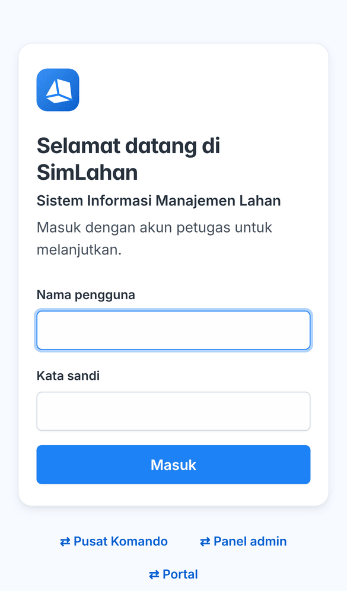

## 2.10 Batas akses dan pesan "Tidak berhak"

Menu hanya menampilkan halaman yang boleh Anda buka. Bila Anda membuka alamat lain secara langsung, muncul halaman **Tidak berhak** atau **Akses ditolak** beserta tautan kembali. Itu bukan kerusakan; mintalah hak tambahan kepada superuser bila pekerjaan Anda memerlukannya.

Data juga dibatasi:

- **Unit layanan**: data sewa dan aset hanya dari unit layanan Anda.
- **Penugasan proyek**: Penilai dan Instansi hanya melihat proyek pengadaan yang mencantumkan akunnya.
- **Korwil**: petugas lapangan dan koordinator hanya melihat Korwil tempatnya bertugas.
- **Data pribadi** (NIK, nomor rekening, nomor KK) tersamar bagi peran yang tidak memerlukannya.

## 2.11 Tips keamanan

- Jangan berikan sandi atau kode OTP kepada siapa pun, termasuk yang mengaku petugas.
- Klik **Keluar** setelah memakai komputer bersama.
- Setiap unduhan dokumen penting tercatat dan diberi tanda air; jangan meneruskan dokumen ke pihak yang tidak berhak.
