# Bab 3 – Sewa lahan (aplikasi utama)

Modul sewa dipakai untuk mencatat dan mengelola sewa/pemanfaatan lahan: data sewa, penyewa, area, besaran sewa, kontrak dan keputusan, tagihan, serta laporan. Modul ini dibuka di **aplikasi utama** (`/`).

**Siapa memakai bab ini:** Penelusur, Penyusun, Penyusun Kontrak, Operator Entri Data, Ahli Hukum Penagihan, Petugas Penagihan, dan Administrator. Setiap peran melihat halaman yang sama, tetapi tombol **Ubah**/**Buat** hanya aktif pada bagian yang menjadi tugasnya. Tabel di bawah merangkum siapa mengubah apa.

| Bagian | Bisa mengubah |
|---|---|
| Data sewa, penyewa, area sewa, inspeksi, kontak, catatan area | Penyusun, Operator Entri Data, Administrator |
| Kontrak, perubahan kontrak, jaminan | Penyusun Kontrak, Operator Entri Data, Administrator (jaminan juga Petugas Penagihan) |
| Keputusan dan syaratnya, besaran sewa & jatuh tempo, prinsip sewa | Operator Entri Data, Administrator (sebagian juga Penyusun/Penyusun Kontrak) |
| Tagihan, pembayaran, catatan tagihan | Petugas Penagihan, Administrator |
| Surat penagihan, putusan pengadilan penagihan, bunga denda | Ahli Hukum Penagihan, Administrator |
| Semua bagian (hanya melihat) | Penelusur |

## 3.1 Daftar sewa

Halaman **Sewa** adalah halaman awal peran sewa.

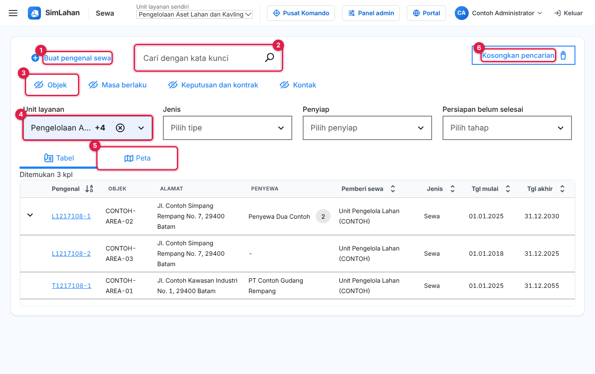

Nomor pada gambar:

1. **Buat pengenal sewa**: membuat sewa baru (lihat 3.2).
2. **Cari dengan kata kunci**: ketik pengenal sewa, nama penyewa, alamat, atau pengenal objek, lalu tekan Enter.
3. **Objek**, **Masa berlaku**, **Keputusan dan kontrak**, **Kontak**: klik salah satu untuk membuka kolom pencarian tambahan.
4. **Saringan**: Unit layanan, Jenis, Penyiap, dan Persiapan belum selesai. Klik kotak lalu pilih isinya.
5. **Peta**: mengganti tampilan daftar menjadi peta lokasi sewa. Klik **Tabel** untuk kembali.
6. **Kosongkan pencarian**: menghapus semua kata kunci dan saringan.

Klik **pengenal sewa** (misalnya `L1217108-1`) untuk membuka datanya. Tanda **˅** di awal baris menampilkan sewa lain yang terkait. Angka bulat di kolom Penyewa menunjukkan jumlah penyewa.

Tampilan peta:

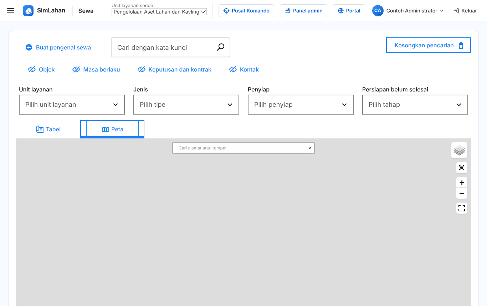

## 3.2 Membuat sewa baru

*Peran: Penyusun, Operator Entri Data, Administrator.*

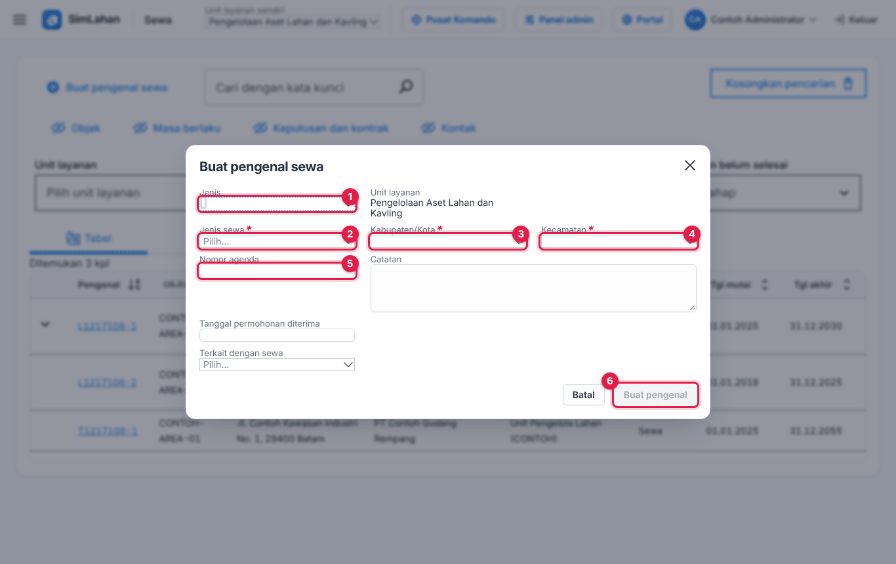

1. Di halaman Sewa, klik **Buat pengenal sewa**. Jendela seperti gambar di atas terbuka.
2. Pilih **Jenis** (nomor 1), misalnya Sewa.
3. Pilih **Jenis sewa** (nomor 2). Wajib.
4. Pilih **Kabupaten/Kota** (nomor 3) dan **Kecamatan** (nomor 4). Wajib. **Unit layanan** terisi otomatis dari unit aktif Anda.
5. Bila perlu isi **Nomor agenda** (nomor 5), **Catatan**, **Tanggal permohonan diterima**, dan **Terkait dengan sewa** (untuk perpanjangan atau pemecahan dari sewa lama).
6. Klik **Buat pengenal** (nomor 6). Tombol ini baru aktif setelah semua kolom wajib terisi. Sistem membuat pengenal sewa baru dan membuka halaman sewanya.
7. Lengkapi tab-tab sewa (lihat 3.3): klik **Ubah**, isi, lalu klik **Simpan**.

## 3.3 Halaman data sewa

Di bagian atas tampak ringkasan: pengenal sewa, jenis, tanggal mulai/akhir, kondisi, pengenal objek, dan alamat. Di bawahnya ada sembilan tab.

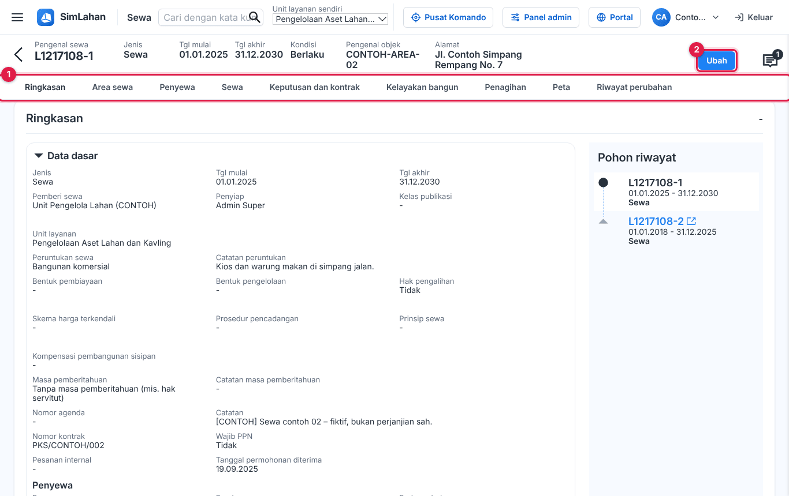

1. **Tab** (nomor 1): klik untuk berpindah bagian.
2. **Ubah** (nomor 2): masuk mode ubah untuk tab yang sedang dibuka.

### Mengubah data sewa

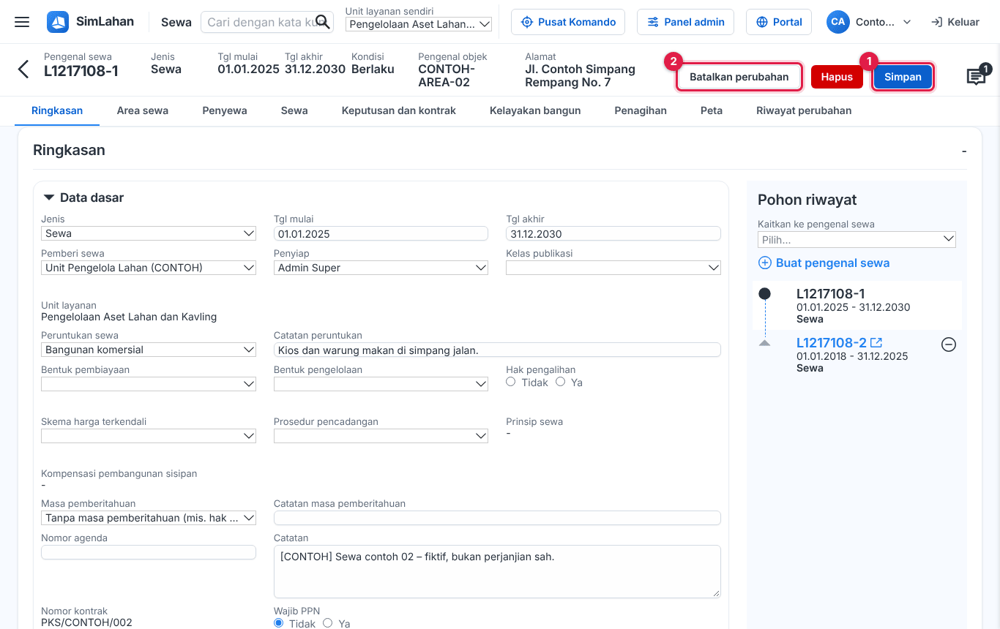

1. Buka tab yang akan diubah, lalu klik **Ubah** di kanan atas.
2. Ubah isian. Kolom bertanda **\*** wajib diisi.
3. Klik **Simpan** (nomor 1). Klik **Batalkan perubahan** (nomor 2) bila tidak jadi.
4. Tombol merah **Hapus** menghapus seluruh sewa (hanya untuk sewa yang belum berjalan dan bila Anda berhak).

### Isi setiap tab

| Tab | Isi dan kegunaan |
|---|---|
| **Ringkasan** | Data dasar: jenis, tanggal, pemberi sewa, penyiap, peruntukan, bentuk pembiayaan/pengelolaan, masa pemberitahuan, nomor kontrak, wajib PPN, catatan. Kolom kanan **Pohon riwayat** menunjukkan sewa sebelumnya/berikutnya; tautkan sewa lain di **Kaitkan ke pengenal sewa**. |
| **Area sewa** | Objek yang disewa: pengenal objek, definisi, luas, lokasi, alamat, bidang tanah, unit rencana, rencana detail. Tombol **Tambah objek**, **Tambah alamat**, **Tambah bidang tanah**, **Tambah unit rencana**, dan **Salin ke kontrak**. |
| **Penyewa** | Siapa penyewanya, porsi bagian sewa (misalnya 1/2), penagih/kontak lain, dan masa berlakunya. Penyewa dipilih dari data **Kontak**. |
| **Sewa** | Jenis sewa (tetap/indeks), tanggal, pembagian tagihan, jatuh tempo, sewa kontrak per peruntukan, potongan dan kenaikan. **Perhitungan sewa**: pilih tahun atau periode tagihan lalu klik **Hitung** untuk melihat total terutang. Ada juga **Kalkulator sewa** di bawahnya. |
| **Keputusan dan kontrak** | Keputusan beserta syarat-syaratnya, kontrak dan perubahannya, jaminan, serta **Pemeriksaan dan catatan** (inspeksi). |
| **Kelayakan bangun** | Status kelayakan bangun/konstruksi lahan; tombol **Kirim email** untuk mengirim informasi kepada pihak terkait. |
| **Penagihan** | Daftar tagihan per periode, pembayaran, dan penagihan hukum (lihat 3.4). |
| **Peta** | Lokasi area sewa di peta. |
| **Riwayat perubahan** | Siapa mengubah apa: tanggal, nama, jenis perubahan, nilai lama dan baru. |

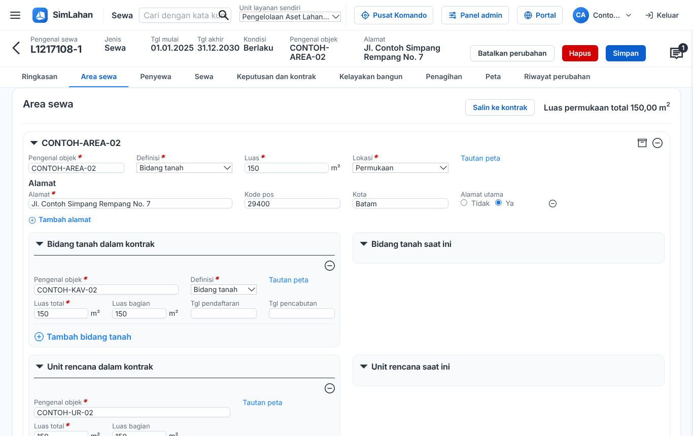

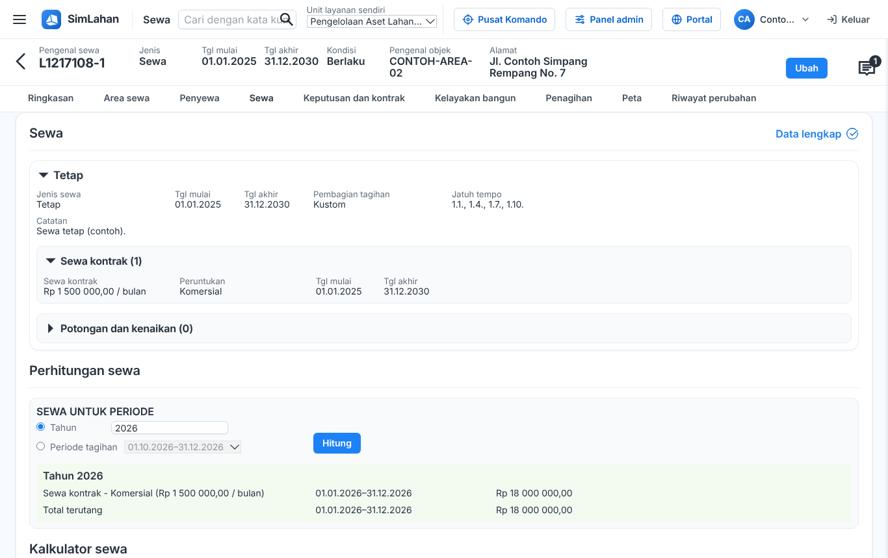

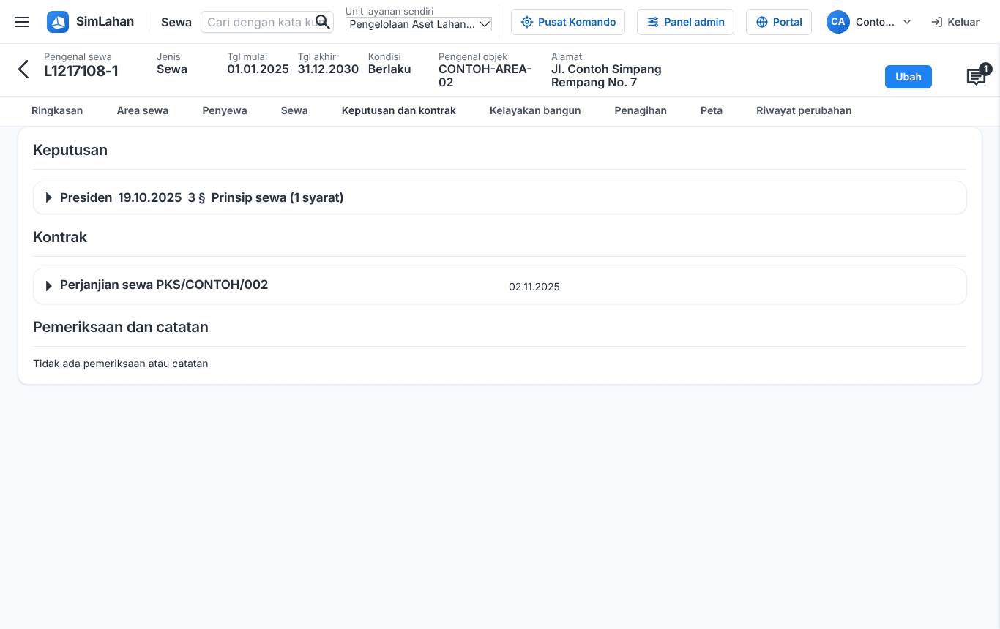

## 3.4 Penagihan sewa

*Peran: Petugas Penagihan dan Administrator mengelola tagihan; Ahli Hukum Penagihan mengelola surat penagihan dan putusan pengadilan; peran lain hanya melihat.*

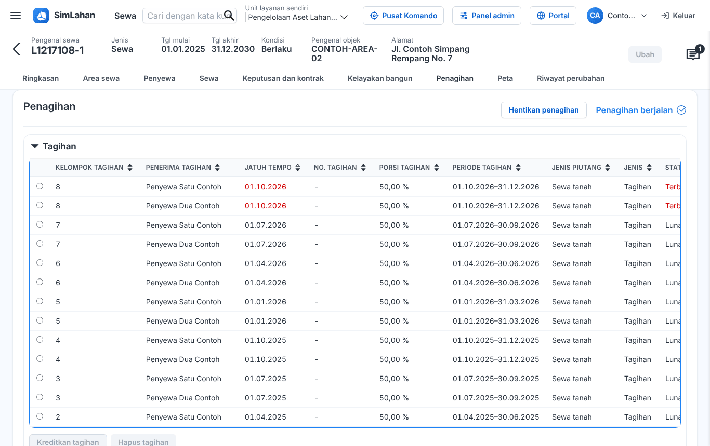

**Melihat tagihan.** Tabel **Tagihan** menampilkan kelompok tagihan, penerima, jatuh tempo (merah = sudah lewat), nomor, porsi, periode, jenis piutang, status, nilai ditagih, dan sisa belum dibayar. Klik baris untuk membuka rincian tagihan di sebelah kanan.

**Membuat tagihan manual**

1. Buka tab **Penagihan**, lalu klik **Buat tagihan** (nomor 2) di bawah tabel.
2. Pilih penerima, periode, jenis piutang, dan isi nilainya.
3. Klik **Simpan**. Tagihan baru muncul di tabel.

**Mencatat pembayaran**

1. Klik baris tagihan. Panel rincian tagihan terbuka.
2. Klik ikon pensil (ubah) di panel itu, lalu klik **Tambah pembayaran**.
3. Isi jumlah dan tanggal bayar, lalu klik **Simpan**. Sisa tagihan berkurang otomatis.

**Mengkreditkan atau menghapus tagihan**

1. Klik bulatan di awal baris tagihan yang salah.
2. Klik **Kreditkan tagihan** (nomor 3) atau **Hapus tagihan** (nomor 4). Kedua tombol abu-abu sampai ada tagihan yang dipilih.
3. Ikuti jendela konfirmasinya.

**Menghentikan atau menjalankan penagihan otomatis**: klik **Hentikan penagihan** (nomor 1). Tulisan **Penagihan berjalan** di sebelahnya berubah menjadi penagihan berhenti. Klik lagi tombolnya untuk menjalankan kembali.

**Penagihan hukum** (Ahli Hukum Penagihan), di bagian **Penagihan** paling bawah:

1. Di **Pembuatan surat penagihan**, pilih **Penyewa** dan **Jenis tuntutan pembayaran**, tambahkan tagihan yang dituntut dengan **Tambah tagihan**, lalu klik **Buat surat penagihan** (nomor 5).
2. Catat putusan dengan **Tambah putusan pengadilan** (nomor 6).
3. Tambahkan catatan dengan **Tambah catatan**. Bunga denda dihitung otomatis dari tagihan yang terlambat.

## 3.5 Kontak

Kontak adalah daftar orang, badan usaha, perkumpulan, atau unit yang menjadi penyewa, pemberi sewa, atau penagih.

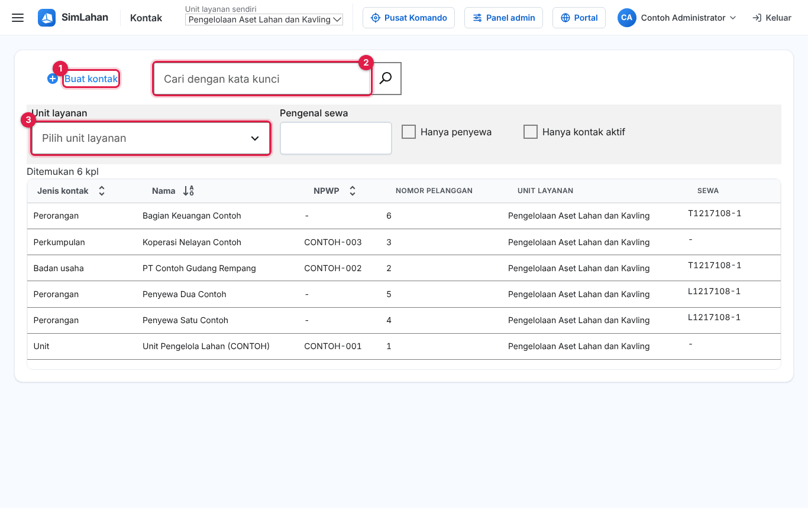

- **Buat kontak** (nomor 1): menambah kontak baru.
- **Cari dengan kata kunci** (nomor 2): ketik nama, NPWP, atau nomor pelanggan.
- Saringan **Unit layanan** (nomor 3), **Pengenal sewa**, **Hanya penyewa**, atau **Hanya kontak aktif**.
- Klik baris kontak untuk melihat datanya dan **Sewa kontak** (daftar sewa yang melibatkan kontak itu, beserta tunggakan).

**Menambah kontak** (Penyusun, Operator, Penagihan, Administrator)

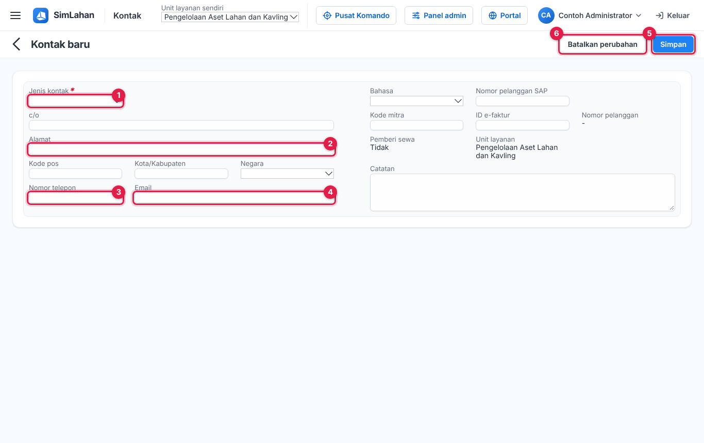

1. Di daftar kontak, klik **Buat kontak**.
2. Pilih **Jenis kontak** (nomor 1): perorangan, badan usaha, perkumpulan, atau unit. Kolom nama dan NIK/NPWP muncul sesuai jenisnya.
3. Isi nama dan NIK/NPWP, lalu **Alamat** (nomor 2), **Nomor telepon** (nomor 3), **Email** (nomor 4), dan kolom lain yang diperlukan.
4. Klik **Simpan** (nomor 5) di kanan atas. Klik **Batalkan perubahan** (nomor 6) bila tidak jadi.

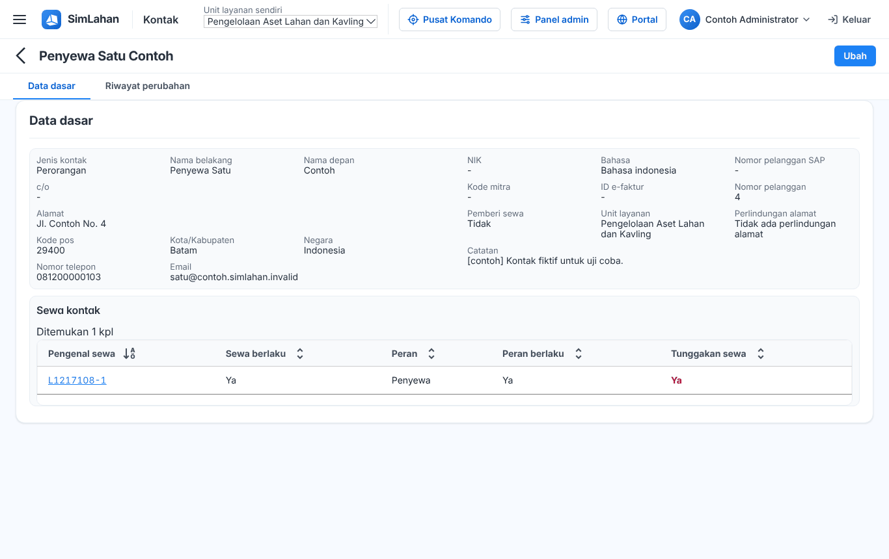

## 3.6 Catatan area

Catatan area adalah catatan yang ditandai langsung di peta, misalnya "lahan rawan banjir".

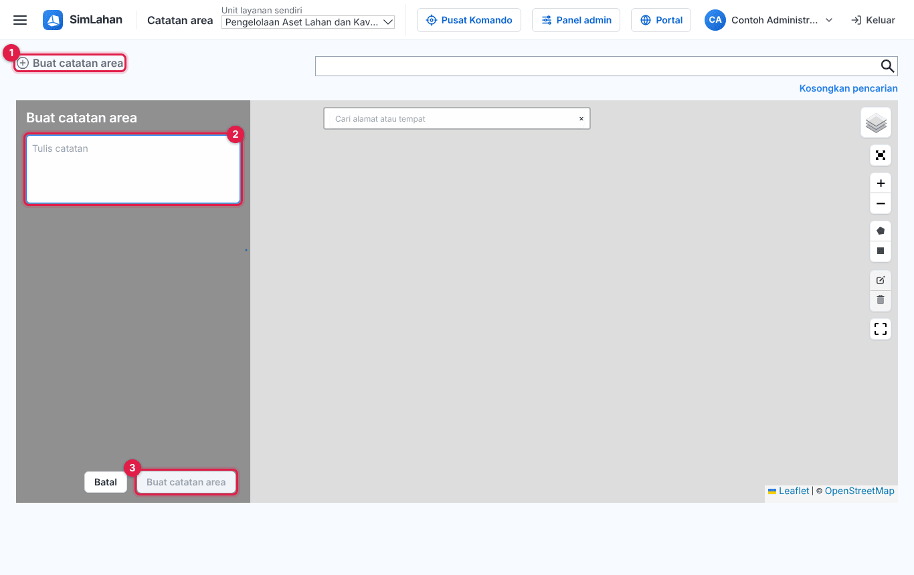

1. Buka **☰ → Catatan area**.
2. Klik **Buat catatan area** (nomor 1). Panel isian terbuka di kiri peta.
3. Gambar area di peta: klik ikon segi lima di kolom alat kanan peta, klik titik-titik batas area, lalu klik titik pertama untuk menutup bentuknya.
4. Tulis catatannya di kotak **Tulis catatan** (nomor 2).
5. Klik **Buat catatan area** (nomor 3) di bawah panel. Klik area di peta kapan saja untuk membaca atau mengubah catatannya.

## 3.7 Prinsip sewa (dasar sewa)

Prinsip sewa adalah dasar penentuan tarif untuk satu objek atau kawasan.

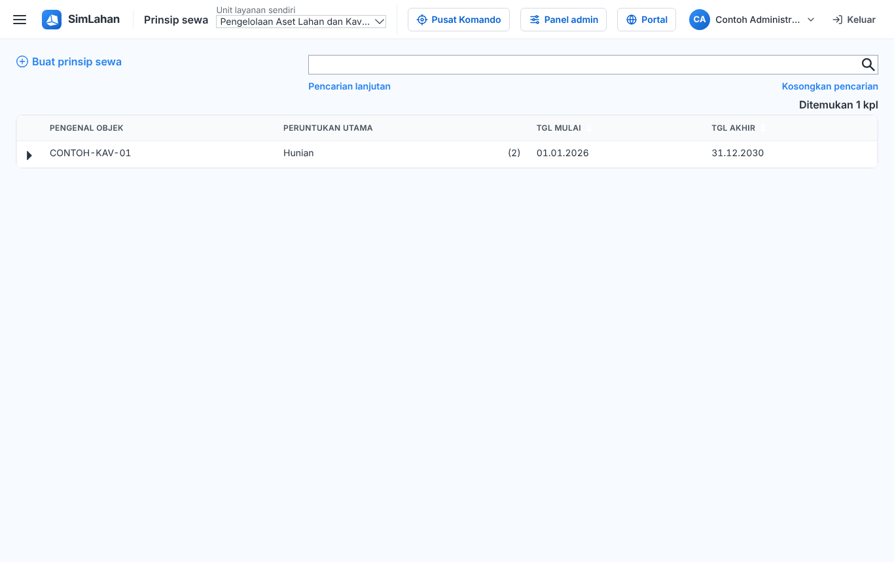

1. Buka **☰ → Prinsip sewa**. Klik **Buat prinsip sewa** (nomor 1) untuk menambah, atau cari di kotak cari (nomor 2) lalu klik pengenal objek untuk membuka.
2. Isi peruntukan utama, tanggal mulai/akhir, tarif dan keputusan terkait.
3. Klik **Simpan**.

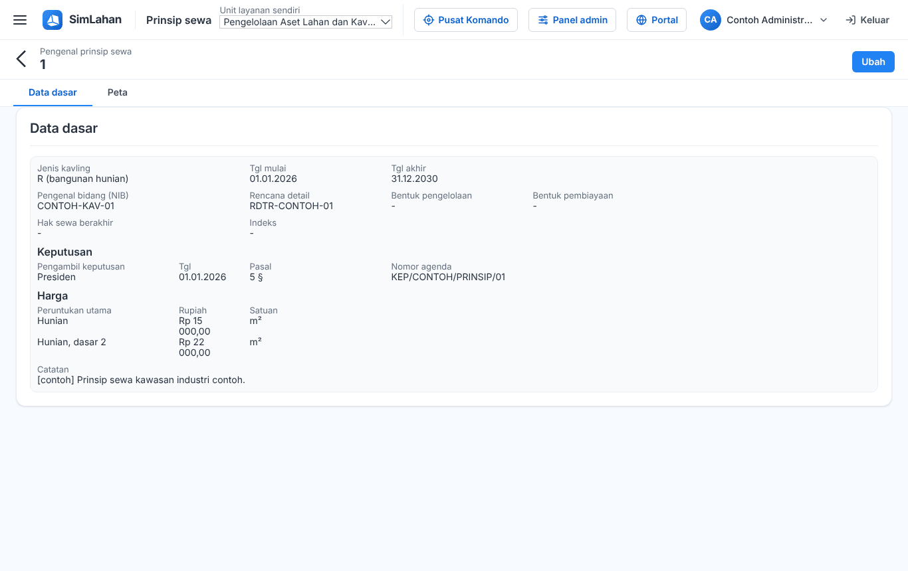

## 3.8 Statistik dan laporan

*Peran: Penyusun, Penyusun Kontrak, Operator, Ahli Hukum Penagihan, Petugas Penagihan, Administrator (Penelusur tidak).*

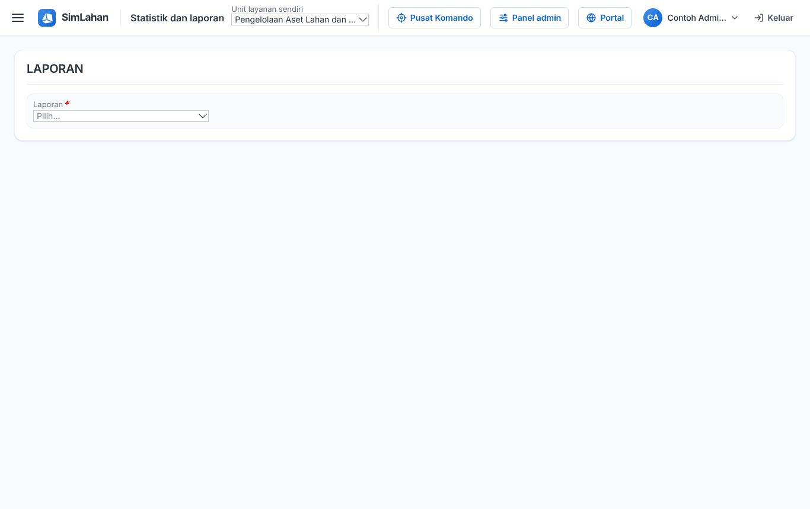

1. Buka **☰ → Statistik dan laporan**.
2. Pilih jenis laporan di kotak **Laporan** (nomor 1). Pada gambar dipilih **Tagihan terbuka**. Laporan yang tersedia: Tagihan terbuka, Tagihan dalam periode, Jaminan, Pembayaran tagihan, Tagihan yang dibayar kontak, Sewa dengan penagihan nonaktif, Sewa per jenis indeks, Sewa kontak, Persyaratan keputusan, Perbandingan sewa, Proyeksi sewa, Pencadangan, Laporan statistik sewa, Jumlah sewa, Penyesuaian sewa, Dasar sewa, dan Sewa per jenis sewa. Laporan tagihan hanya muncul untuk peran yang berhak.
3. Isi saringan laporan yang muncul (misalnya **Unit layanan**, **Tanggal mulai**, **Tanggal berakhir**).
4. Klik **Buat laporan** (nomor 2). Laporan kecil langsung tampil dan bisa diunduh; laporan besar dibuat di latar belakang dan dikirim ke surel Anda.

## 3.9 Kompensasi pembangunan sisipan

Mencatat kompensasi atas pembangunan tambahan di lahan sewa (negosiasi dan keputusan).

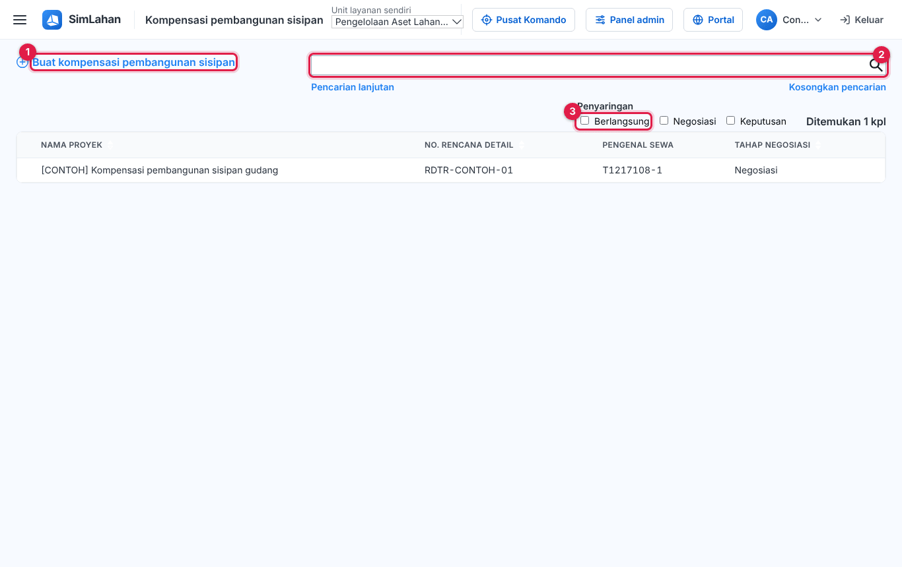

1. Saring dengan kotak centang **Berlangsung** (nomor 3), **Negosiasi**, atau **Keputusan**, atau cari di kotak cari (nomor 2).
2. Klik **Buat kompensasi pembangunan sisipan** (nomor 1) untuk data baru (Penyusun, Administrator).
3. Klik nama proyek untuk membuka, lalu **Ubah** dan **Simpan**.

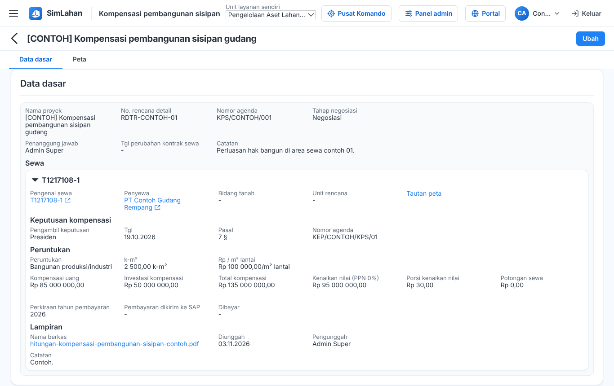

## 3.10 Pencarian area (permohonan area)

Menampung permohonan pemakaian area dari pemohon (misalnya untuk kegiatan sementara).

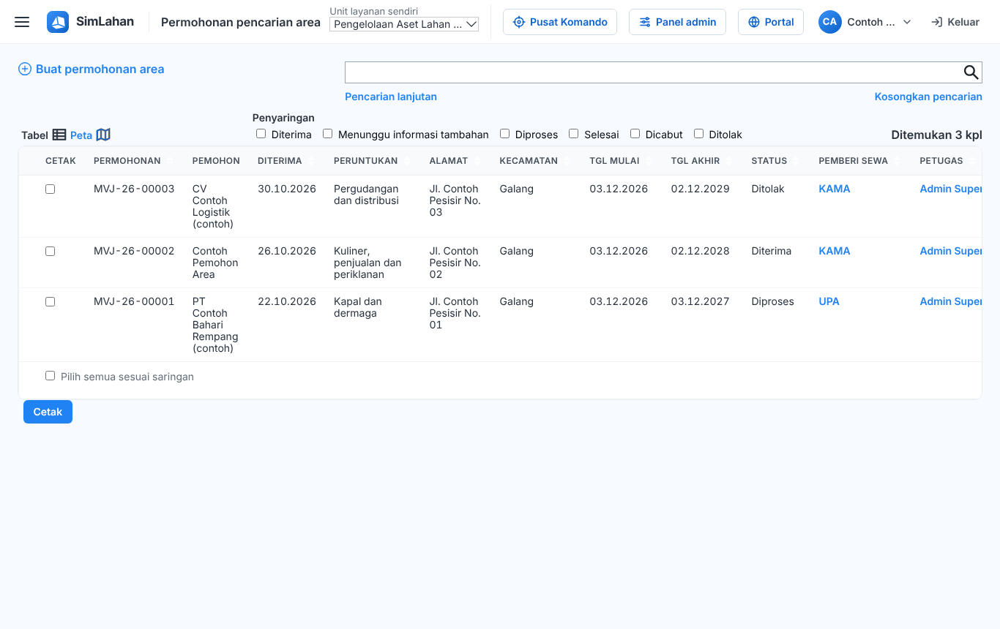

1. Cari di kotak cari (nomor 2) atau saring per status dengan kotak centang (nomor 3): Diterima, Menunggu informasi tambahan, Diproses, Selesai, Dicabut, Ditolak.
2. Klik nomor permohonan untuk membuka: data **Permohonan**, **Dokumen yang diperiksa**, dan **Data pemrosesan**.
3. Klik **Ubah** untuk memproses: isi petugas, status, dan keputusan, lalu **Simpan**.
4. Centang beberapa baris lalu klik **Cetak** untuk mencetak.
5. **Buat permohonan area** (nomor 1) untuk memasukkan permohonan yang datang lewat loket.

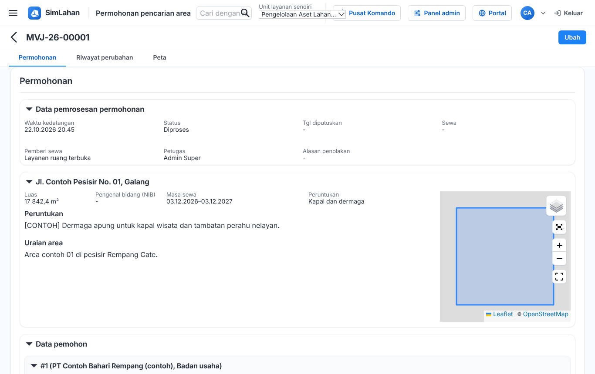

Halaman **Pencarian kavling** dan **Permohonan kavling** (bila ditampilkan untuk peran Anda) bekerja dengan cara yang sama untuk seleksi kavling.

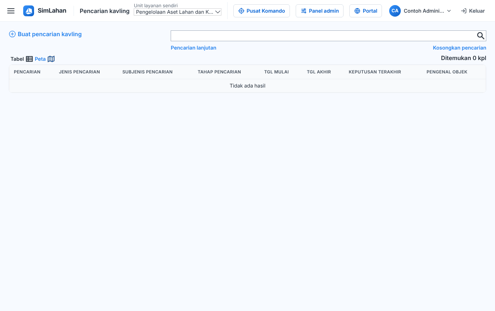

## 3.11 Menu "Lainnya"

| Menu | Kegunaan |
|---|---|
| **Indeks biaya hidup** | Tabel indeks per bulan dan tahun yang dipakai untuk penyesuaian sewa berindeks. Hanya dibaca. |
| **Tugas terjadwal** | Riwayat (**Eksekusi**) dan **Jadwal** proses otomatis, misalnya pembuatan tagihan dan pengingat. Hanya dibaca; mengubah jadwal hanya oleh superuser. |
| **Catatan tagihan** | Pengumuman yang dicetak pada tagihan per sewa dan periode. Klik **Buat pengumuman** (nomor 1 di gambar Catatan tagihan) untuk menambah. |
| **Kalkulator sewa** | Menghitung perkiraan sewa tanpa menyimpan ke data sewa. Pilih **Jenis kalkulator** (nomor 1 di gambar Kalkulator sewa), isi nilai yang muncul, lalu lihat hasilnya. **Tambah kalkulator sewa** (nomor 2) menambah perhitungan kedua untuk dibandingkan. |

> Di sistem latihan, tabel **Indeks biaya hidup**, **Tugas terjadwal**, dan **Pencarian kavling** tampak kosong karena data contoh belum berisi indeks, riwayat proses otomatis, atau seleksi kavling. Di sistem yang sudah berjalan, tabelnya terisi dengan kolom seperti pada gambar.

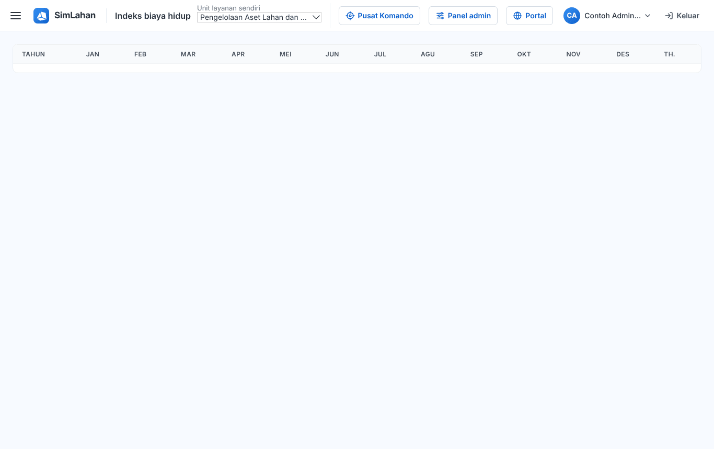

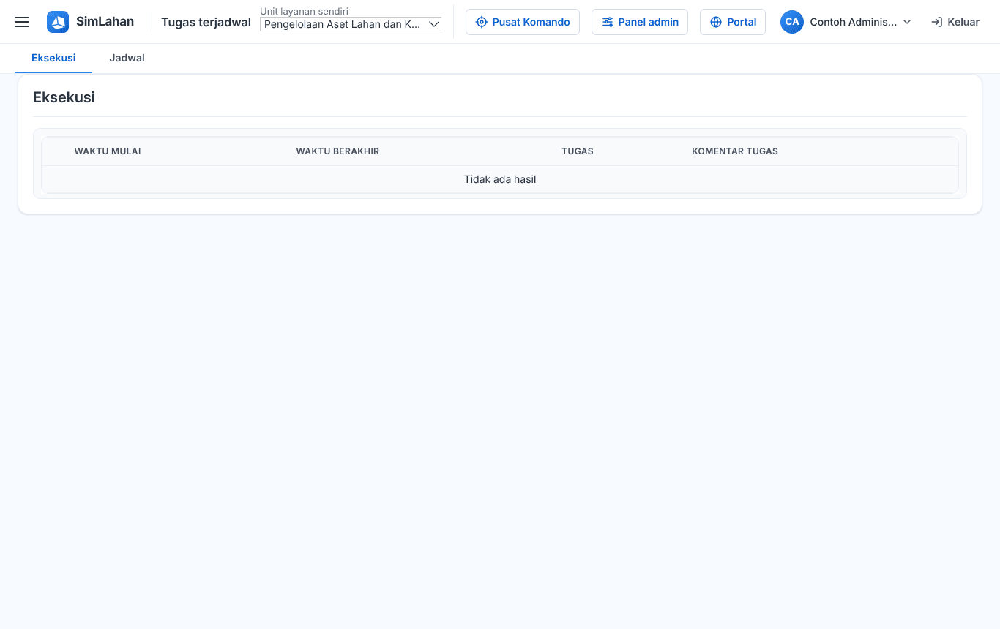

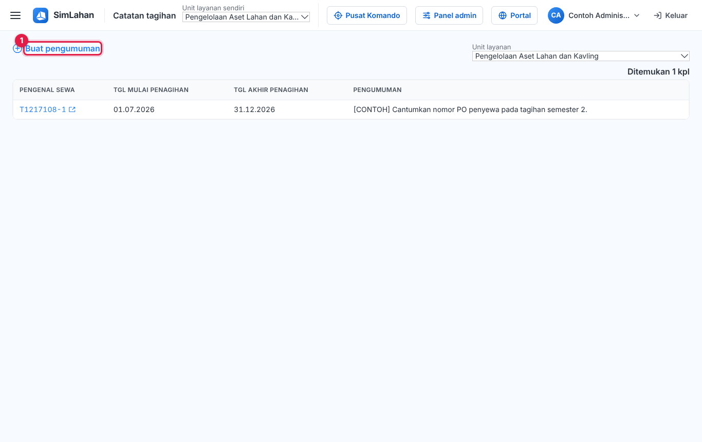

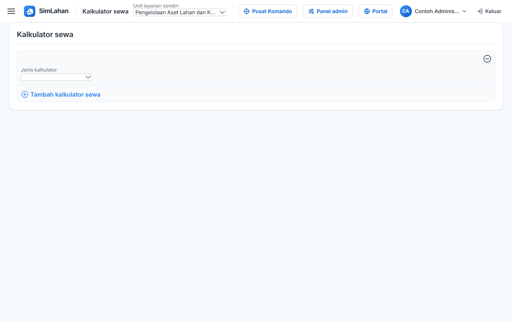

## 3.12 Pertanyaan umum

**Tombol Ubah abu-abu/tidak bisa diklik.** Bagian itu bukan tugas peran Anda, atau data sedang dikunci karena sudah final. Tanyakan kepada petugas yang berwenang.

**Sewa tidak ditemukan.** Periksa saringan **Unit layanan**; data sewa dibatasi per unit. Klik **Kosongkan pencarian** lalu cari lagi.

**Perubahan tidak tersimpan.** Pastikan Anda menekan **Simpan** sebelum pindah tab. Kolom wajib (tanda \*) yang kosong menyebabkan simpan gagal; periksa tulisan merah di bawah kolom.
