# Bab 4 – Pengadaan tanah (aplikasi utama)

Modul pengadaan tanah mengikuti tahapan pengadaan tanah untuk kepentingan umum (UU 2/2012 dan aturan turunannya): proyek, bidang, inventarisasi, pengumuman, penilaian, musyawarah, keberatan, konsinyasi, ganti kerugian, pembayaran, pelepasan hak, penyerahan hasil, relokasi, dokumen, dan pemantauan tenggat hukum.

**Siapa memakai bab ini:**

| Peran | Yang dikerjakan |
|---|---|
| **Pelaksana Pengadaan Tanah** | Semua tahapan; memvalidasi ganti kerugian (Ketua Pelaksana); mengatur kalender libur dan aturan tenggat. |
| **Satgas Pengadaan Tanah** | Pendataan lapangan: bidang, pihak, inventarisasi, pengumuman, musyawarah, pelepasan hak, rumah tangga terdampak, tonggak. |
| **Penilai Pertanahan** | Mengisi penilaian ganti kerugian pada proyek yang ditugaskan. |
| **Instansi Yang Memerlukan Tanah** | Memantau proyek miliknya dan mengunggah dokumen (DPPT, studi kelayakan, BAST, foto). |
| **Ahli Hukum Penagihan** | Mencatat keberatan, konsinyasi, dan dokumen. |
| **Petugas Penagihan** | Mencatat pembayaran ganti kerugian yang sudah divalidasi. |
| **Peran sewa lain & Penelusur** | Hanya melihat (data pribadi tersamar). |
| **Administrator** | Semua. |

Buka menu **☰ → Pengadaan Tanah**. Isinya: **Dasbor & tenggat**, **Proyek pengadaan**, dan **Kalender & aturan tenggat**.

## 4.1 Dasbor & tenggat

Halaman awal peran pengadaan tanah. Menampilkan jumlah proyek per tahap, bidang per status, dan daftar **tenggat hukum** yang dihitung dalam **hari kerja** (libur nasional dan cuti bersama sudah diperhitungkan).

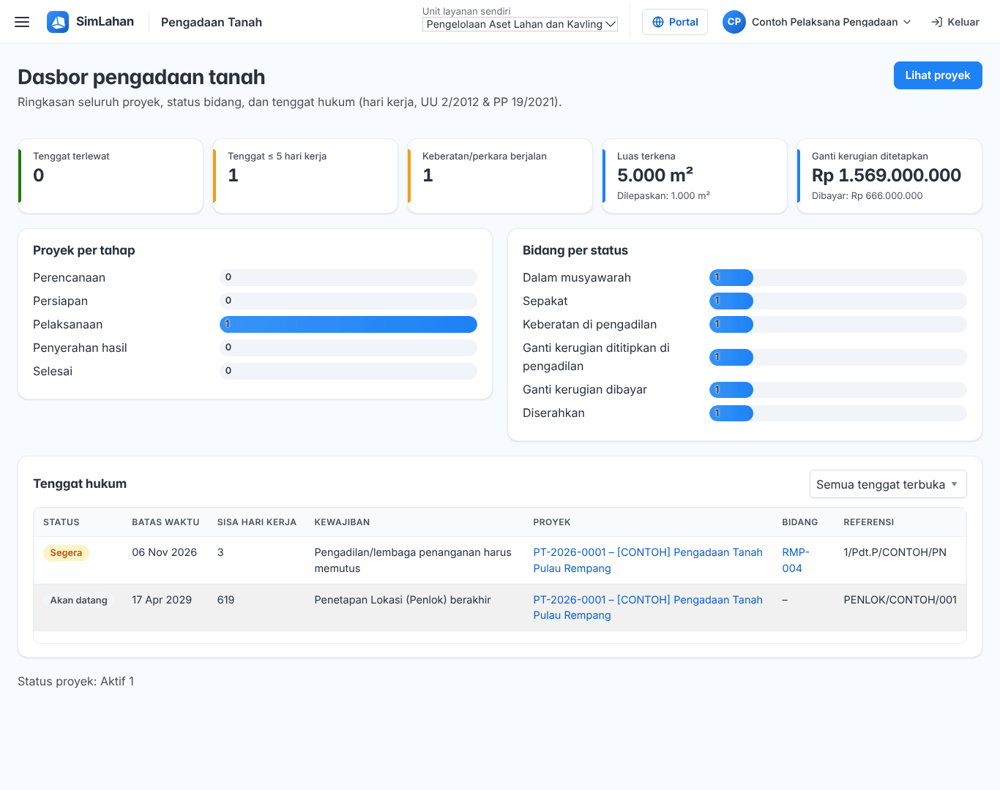

- Kolom **Status** berwarna: merah = terlambat, kuning = segera jatuh tempo, hijau = aman.
- **Sisa hari kerja** menunjukkan berapa hari kerja lagi sampai batas waktu.
- Klik nama proyek atau bidang untuk langsung membukanya.

Setiap hari kerja pukul 07.00 WIB sistem mengirim surel pengingat tenggat kepada petugas terkait.

## 4.2 Daftar proyek

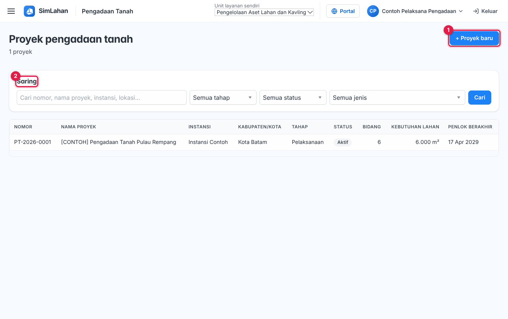

1. **+ Proyek baru**: membuat proyek (Pelaksana, Administrator).
2. **Saring**: cari berdasarkan nomor/nama, tahap, status, atau kabupaten/kota, lalu klik **Cari**.

Klik nama proyek untuk membukanya. Penilai dan Instansi hanya melihat proyek yang mencantumkan akunnya di **Pengguna yang ditugaskan**.

### Membuat proyek baru

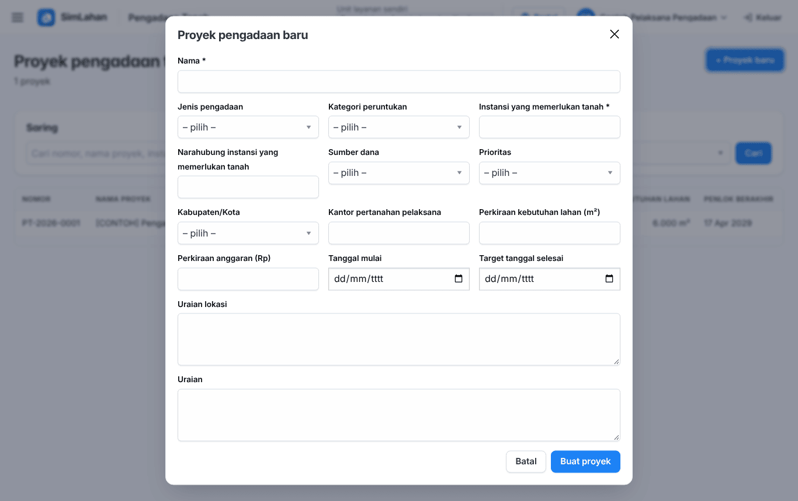

1. Klik **+ Proyek baru**.
2. Isi **Nama** dan **Instansi yang memerlukan tanah** (wajib).
3. Lengkapi jenis pengadaan, kategori peruntukan, narahubung instansi, sumber dana, prioritas, kabupaten/kota, kantor pertanahan pelaksana, perkiraan kebutuhan lahan (m²), perkiraan anggaran, dan tanggal-tanggal penetapan lokasi.
4. Klik **Buat proyek**. Nomor proyek (misalnya `PT-2026-0001`) dibuat otomatis, beserta daftar tonggak tahapan standar.

## 4.3 Halaman proyek

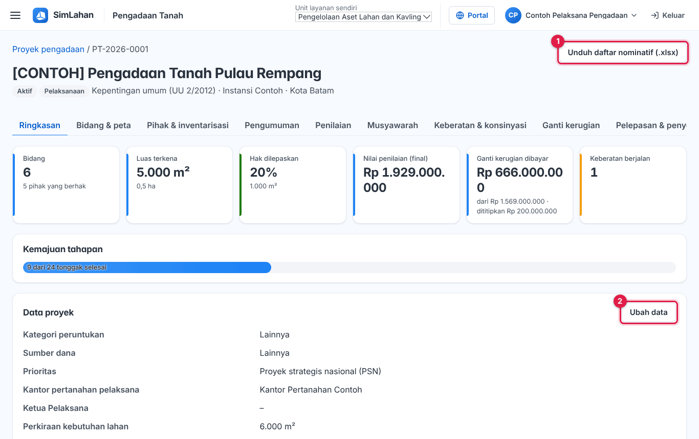

Di bagian atas: nomor, nama, status, tahap, dasar hukum, instansi, dan lokasi. Kartu angka menampilkan jumlah bidang, luas terkena, persentase hak dilepaskan, nilai penilaian final, ganti kerugian dibayar, dan keberatan berjalan.

1. **Unduh daftar nominatif (.xlsx)**: mengunduh daftar bidang dan pihak yang berhak dalam format Excel.
2. **Ubah data**: mengubah data proyek, termasuk **Pengguna yang ditugaskan** (akun Penilai dan Instansi).
3. **+ Tambah tonggak**: menambah tonggak tahapan.

Tab-tab proyek: **Ringkasan**, **Bidang & peta**, **Pihak & inventarisasi**, **Pengumuman**, **Penilaian**, **Musyawarah**, **Keberatan & konsinyasi**, **Ganti kerugian**, **Pelepasan & penyerahan**, **Relokasi**, **Dokumen**, **Tenggat** (angka di samping "Tenggat" = jumlah tenggat yang perlu perhatian).

> **Pola kerja di semua tab:** klik tombol **+ Tambah …** untuk membuka jendela formulir, isi, lalu klik **Simpan**. Setiap baris tabel punya tautan **Ubah** dan **Hapus**. Kolom bertanda **\*** wajib diisi. Tautan yang tidak tampil berarti peran Anda tidak berhak.

### Tonggak tahapan (tab Ringkasan)

Tonggak adalah kegiatan per tahap (perencanaan, persiapan, pelaksanaan, penyerahan) dengan tanggal rencana dan realisasi. Bilah **Kemajuan tahapan** menunjukkan berapa tonggak selesai.

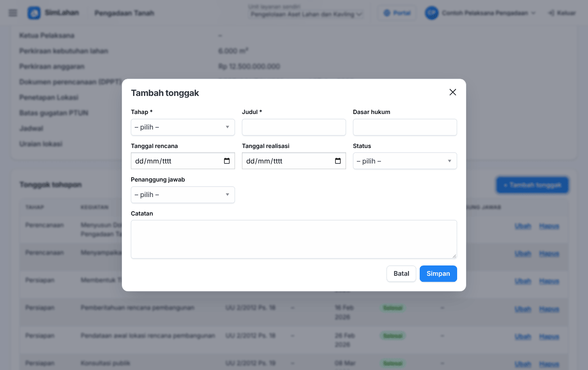

1. Klik **+ Tambah tonggak** (atau **Ubah** pada baris tonggak).
2. Isi **Tahap**, **Judul**, dasar hukum, tanggal rencana, tanggal realisasi, status, penanggung jawab, dan catatan.
3. Klik **Simpan**.

Satgas boleh memperbarui tonggak inventarisasi, musyawarah, dan pelepasan hak (status, tanggal realisasi, catatan).

## 4.4 Bidang & peta

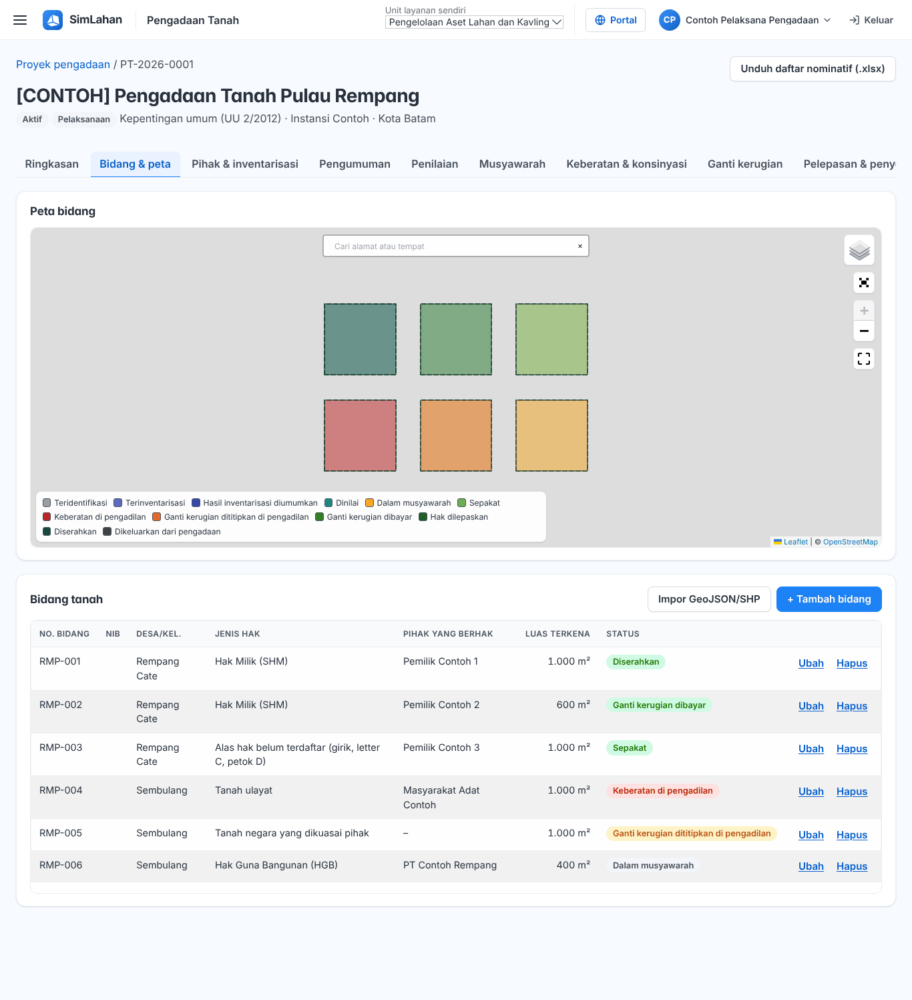

Peta menampilkan batas setiap bidang dengan warna status (teridentifikasi, terinventarisasi, keberatan di pengadilan, ganti kerugian, diserahkan, dikeluarkan dari pengadaan). Tabel di bawahnya berisi nomor bidang, NIB, desa/kelurahan, jenis hak, pihak yang berhak, luas terkena, dan status.

### Menambah bidang

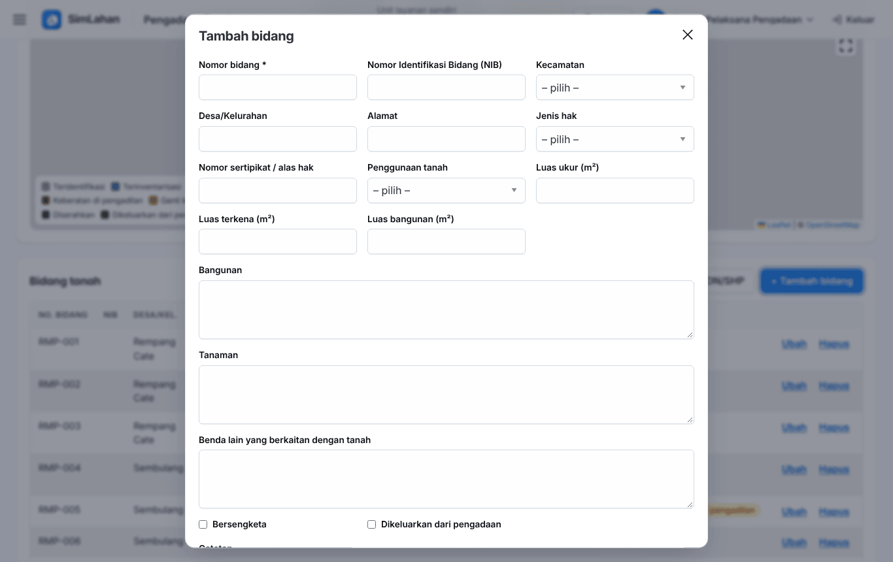

1. Klik **+ Tambah bidang**.
2. Isi **Nomor bidang** (wajib), NIB, kecamatan, desa/kelurahan, alamat, jenis hak, nomor sertipikat/alas hak, penggunaan tanah, luas ukur, luas terkena, luas bangunan.
3. Uraikan **Bangunan**, **Tanaman**, dan **Benda lain** yang ada di atas tanah.
4. Centang **Bersengketa** atau **Dikeluarkan dari pengadaan** bila berlaku.
5. Klik **Simpan**. Batas bidang dapat digambar pada halaman bidang atau diimpor.

### Mengimpor batas bidang dari berkas peta

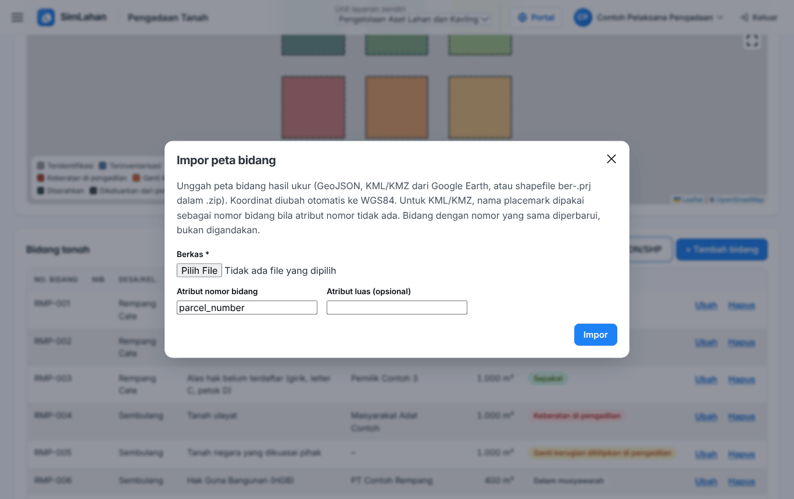

1. Klik **Impor GeoJSON/SHP**.
2. Pilih **Berkas** (GeoJSON, atau Shapefile dalam ZIP).
3. Tulis nama **Atribut nomor bidang** (kolom di berkas yang berisi nomor bidang) dan, bila ada, **Atribut luas**.
4. Klik **Impor**. Bidang dengan nomor yang sama diperbarui; nomor baru ditambahkan.

### Halaman bidang

Klik nomor bidang untuk membuka halaman bidang: data bidang, peta, pihak yang berhak, inventarisasi, **objek inventarisasi** (rincian bangunan, tanaman, kolam, dan lain-lain beserta pemiliknya), penilaian, dan ganti kerugian bidang itu.

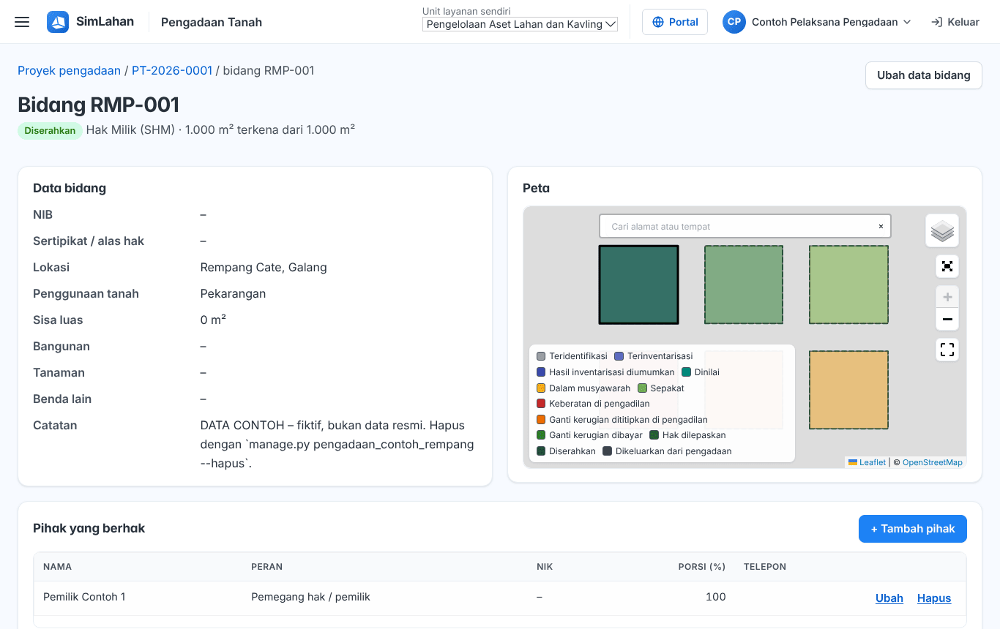

Tombol **Ubah data bidang**, **+ Tambah pihak**, **+ Tambah survei**, **+ Tambah objek**, dan **+ Tambah penilaian** tersedia langsung dari halaman ini.

## 4.5 Pihak & inventarisasi

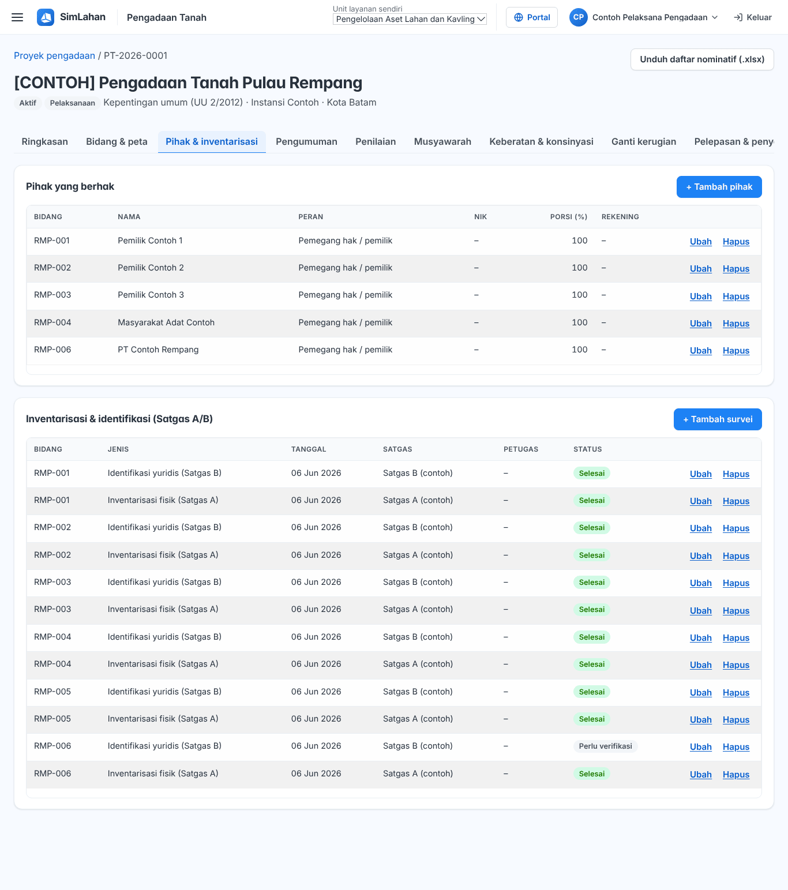

### Menambah pihak yang berhak

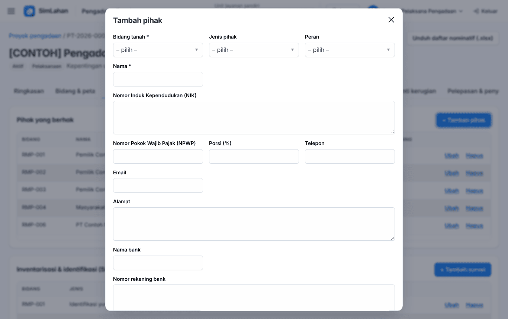

1. Klik **+ Tambah pihak**.
2. Pilih **Bidang tanah** dan isi **Nama** (wajib), jenis pihak, peran (pemilik, ahli waris, penggarap, dsb.), NIK, NPWP, **Porsi (%)** bagiannya, telepon, surel, alamat.
3. Isi data rekening bank (nama bank, nomor rekening, nama pemilik rekening) untuk pembayaran.
4. Klik **Simpan**.

> NIK dan nomor rekening disimpan terenkripsi. Peran yang tidak berhak melihat data ini (misalnya Penilai, Penelusur, peran sewa) melihatnya tersamar.

### Mencatat inventarisasi (Satgas A/B)

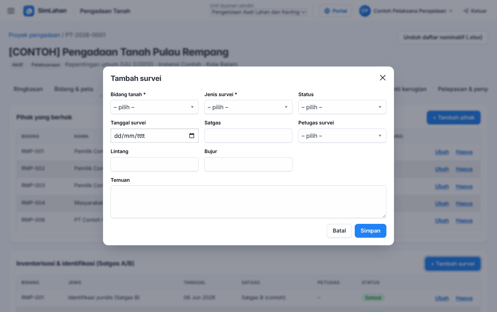

1. Klik **+ Tambah survei**.
2. Pilih **Bidang tanah** dan **Jenis survei**: inventarisasi fisik (Satgas A) atau identifikasi yuridis (Satgas B).
3. Isi status (dijadwalkan, selesai, perlu verifikasi), tanggal survei, Satgas, petugas survei, koordinat (lintang/bujur), dan **Temuan**.
4. Klik **Simpan**.

## 4.6 Pengumuman

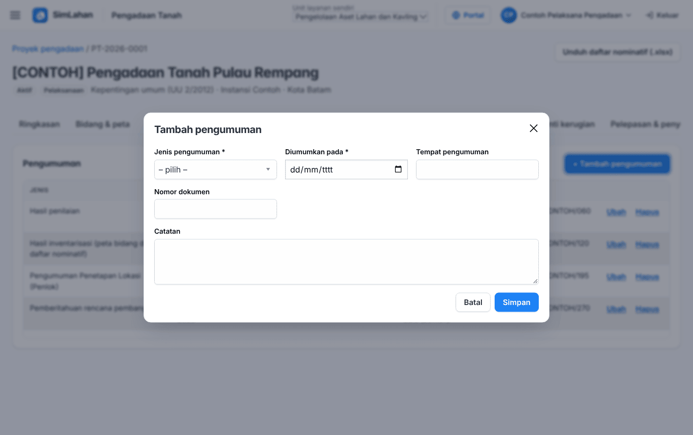

1. Buka tab **Pengumuman**, klik **+ Tambah pengumuman**.
2. Pilih **Jenis pengumuman** (pemberitahuan rencana pembangunan, penetapan lokasi, hasil inventarisasi berupa peta bidang dan daftar nominatif, hasil penilaian, atau lainnya) dan **Diumumkan pada** (wajib), lalu tempat dan nomor dokumen.
3. Klik **Simpan**. Sistem menghitung **masa pengumuman** dan **batas keberatan** otomatis dalam hari kerja, dan menambahkannya ke daftar tenggat.

## 4.7 Penilaian (KJPP)

*Peran: Penilai Pertanahan (hanya proyek yang ditugaskan), Pelaksana, Administrator.*

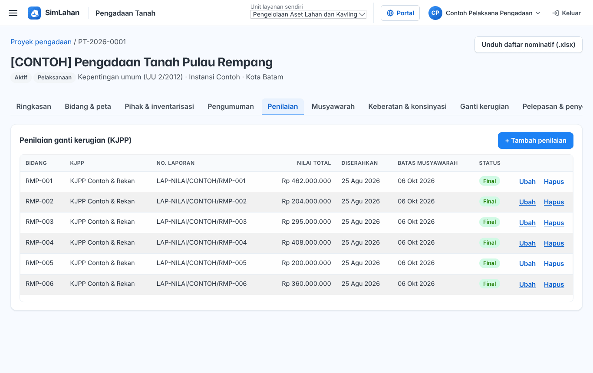

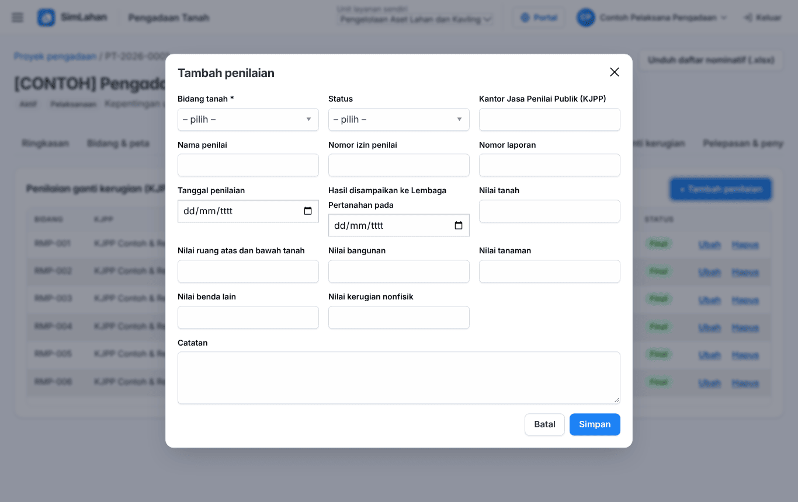

1. Buka tab **Penilaian**, klik **+ Tambah penilaian** (atau **Ubah** pada baris yang ada).
2. Pilih **Bidang tanah** dan **Status** (draf, final, atau direvisi).
3. Isi KJPP, nama penilai, nomor izin penilai, nomor dan tanggal laporan, serta tanggal hasil disampaikan.
4. Isi nilai per komponen: tanah, ruang atas/bawah tanah, bangunan, tanaman, benda lain, kerugian nonfisik. **Nilai total** dihitung otomatis.
5. Klik **Simpan**. Laporan penilaian diunggah di tab **Dokumen**.

> Penilaian berstatus **final** tidak bisa diubah lagi oleh Penilai. Setelah hasil disampaikan, sistem menghitung **batas musyawarah**.

## 4.8 Musyawarah

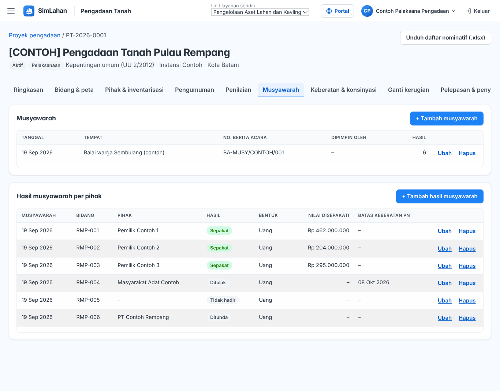

**Mencatat pelaksanaan musyawarah**

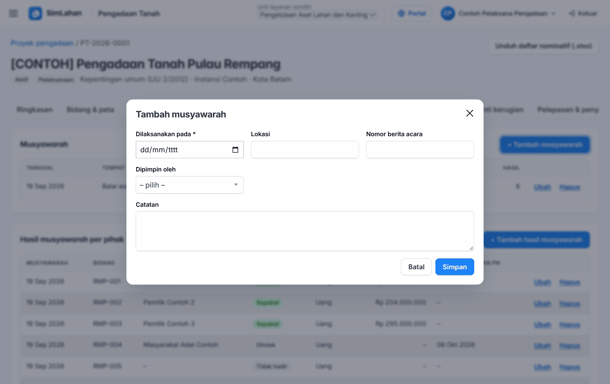

1. Klik **+ Tambah musyawarah**; isi **Dilaksanakan pada** (wajib), lokasi, nomor berita acara, pemimpin, dan catatan.
2. Klik **Simpan**.

**Mencatat hasil per pihak**

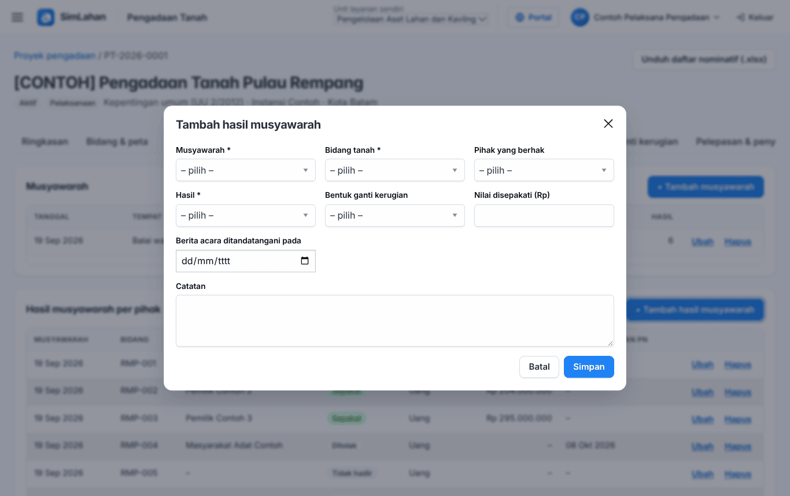

1. Klik **+ Tambah hasil musyawarah**.
2. Pilih **Musyawarah**, **Bidang tanah**, dan pihak yang berhak.
3. Pilih **Hasil** (sepakat, menolak, tidak hadir, atau ditunda), bentuk ganti kerugian (uang, tanah pengganti, permukiman kembali, kepemilikan saham, atau bentuk lain yang disepakati), nilai disepakati, dan tanggal berita acara ditandatangani.
4. Klik **Simpan**. Bila pihak menolak, sistem menghitung **batas keberatan ke Pengadilan Negeri**.

## 4.9 Keberatan & konsinyasi

*Peran: Ahli Hukum Penagihan, Pelaksana, Administrator.*

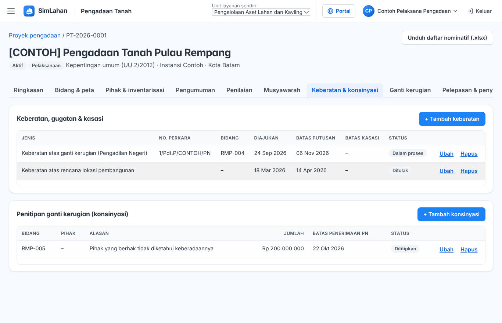

**Mencatat keberatan, gugatan, atau kasasi**

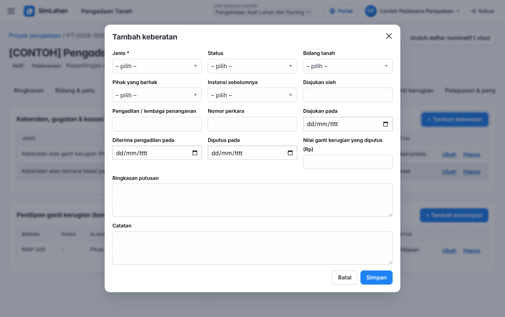

1. Klik **+ Tambah keberatan**.
2. Pilih **Jenis** (keberatan rencana lokasi, gugatan PTUN, keberatan hasil inventarisasi, keberatan ganti kerugian ke Pengadilan Negeri, kasasi ke Mahkamah Agung, sengketa kepemilikan, atau perkara lain) dan status (diajukan, diproses, dikabulkan, ditolak).
3. Isi bidang, pihak, pengadilan, nomor perkara, tanggal diajukan/diterima/diputus, nilai yang diputus, dan ringkasan putusan.
4. Klik **Simpan**. Batas putusan dan batas kasasi dihitung otomatis.

**Mencatat penitipan (konsinyasi)**

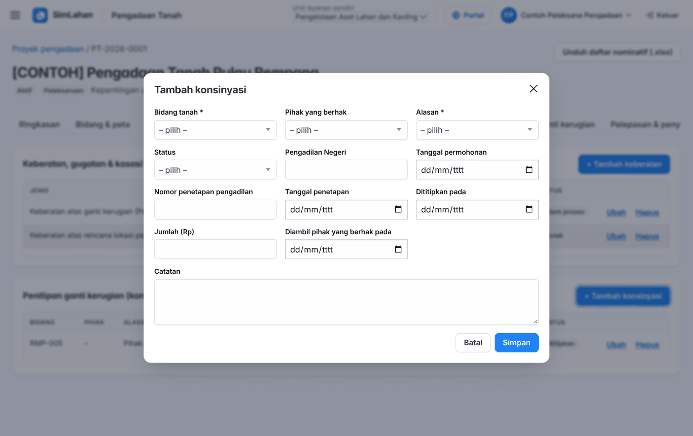

1. Klik **+ Tambah konsinyasi**.
2. Pilih bidang dan pihak, **Alasan** (pihak menolak, keberadaan tidak diketahui, sengketa kepemilikan, sedang berperkara, disita, atau menjadi jaminan bank), dan status (diajukan ke pengadilan, dititipkan, diambil pihak yang berhak).
3. Isi Pengadilan Negeri, tanggal permohonan, nomor dan tanggal penetapan, tanggal dititipkan, jumlah, dan tanggal diambil pihak yang berhak.
4. Klik **Simpan**.

## 4.10 Ganti kerugian dan pembayaran

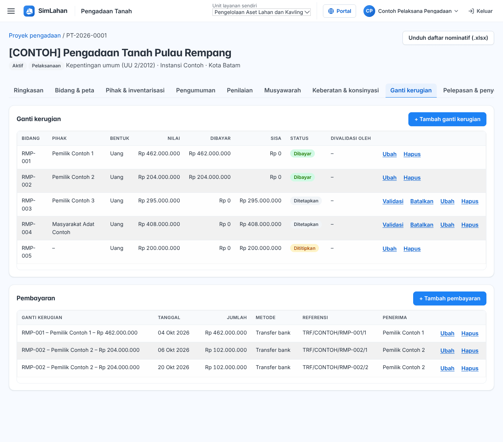

**Menetapkan ganti kerugian** (Pelaksana, Administrator)

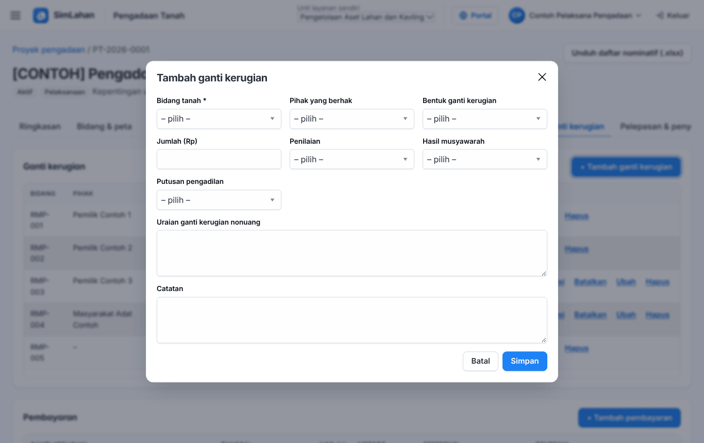

1. Klik **+ Tambah ganti kerugian**.
2. Pilih **Bidang tanah**, pihak, bentuk ganti kerugian, dan jumlah (Rp).
3. Tautkan ke **Penilaian**, **Hasil musyawarah**, atau **Putusan pengadilan** yang menjadi dasarnya.
4. Klik **Simpan**. Status menjadi **Ditetapkan**.

**Memvalidasi** (Ketua Pelaksana – peran Pelaksana Pengadaan, Administrator)

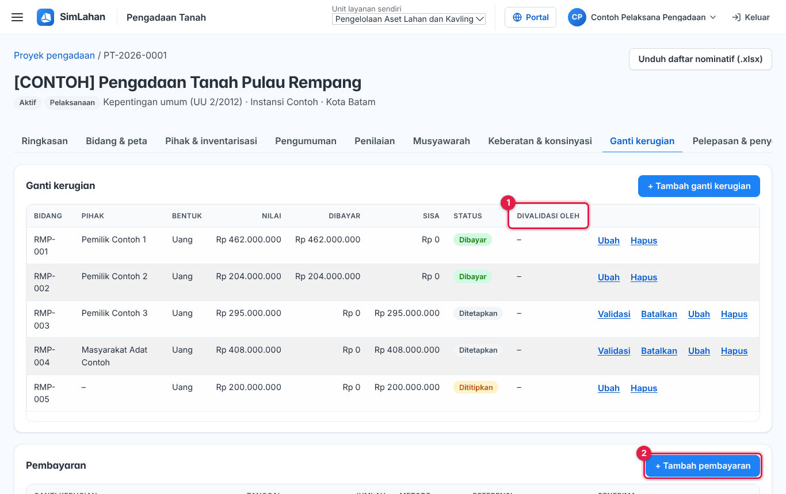

1. Pada baris berstatus **Ditetapkan**, klik **Validasi** (1). Nama Anda tercatat di kolom **Divalidasi oleh**.
2. Klik **Batalkan** bila penetapan harus dibatalkan.

**Mencatat pembayaran** (Petugas Penagihan, Pelaksana, Administrator) – hanya untuk ganti kerugian yang sudah divalidasi.

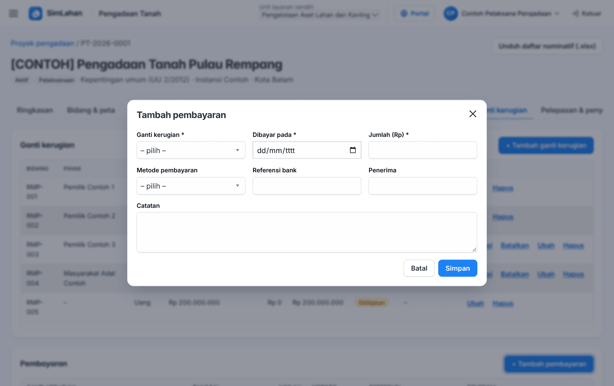

1. Klik **+ Tambah pembayaran** (2 pada gambar validasi).
2. Pilih **Ganti kerugian**, isi **Dibayar pada** dan **Jumlah** (wajib), metode, referensi bank, penerima, dan catatan.
3. Klik **Simpan**. Kolom **Dibayar** dan **Sisa** diperbarui; status menjadi **Dibayar** bila lunas.

## 4.11 Pelepasan hak & penyerahan hasil

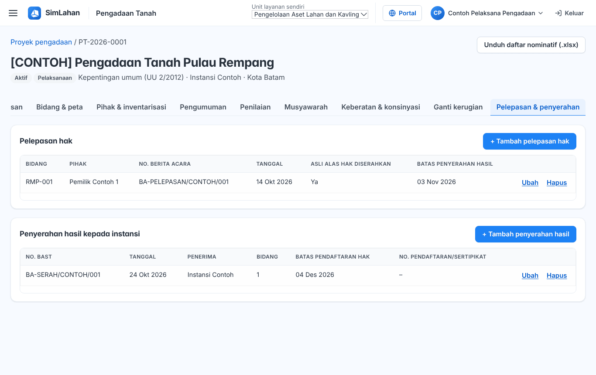

**Pelepasan hak**

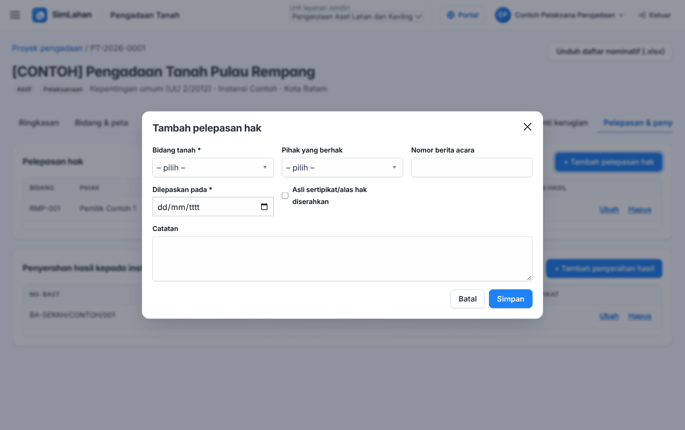

1. Klik **+ Tambah pelepasan hak**; pilih bidang dan pihak, isi nomor berita acara dan **Dilepaskan pada** (wajib).
2. Centang **Asli sertipikat/alas hak diserahkan** bila sudah.
3. Klik **Simpan**. Sistem menghitung **batas penyerahan hasil**.

**Penyerahan hasil kepada instansi**

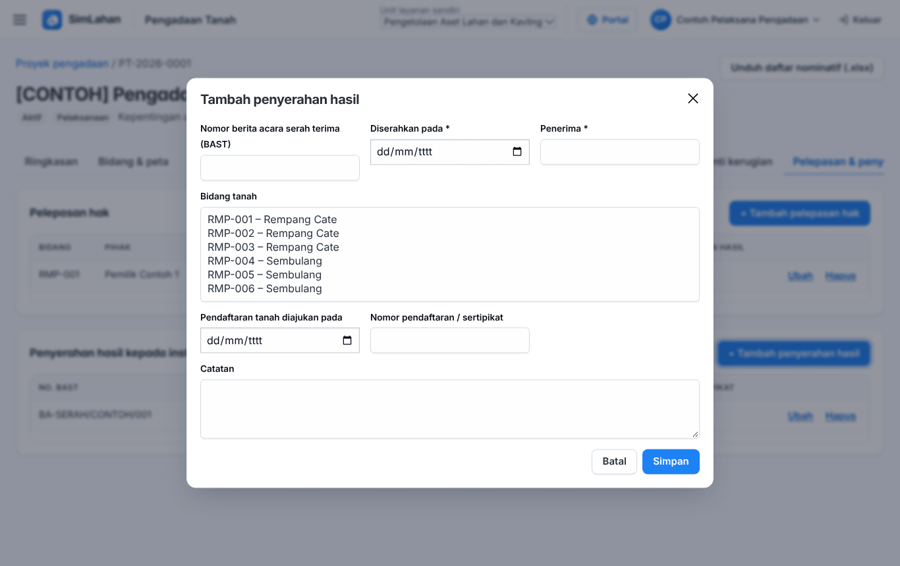

1. Klik **+ Tambah penyerahan hasil**; isi nomor BAST, **Diserahkan pada** dan **Penerima** (wajib), bidang, tanggal pengajuan pendaftaran tanah, dan nomor pendaftaran/sertipikat.
2. Klik **Simpan**.

## 4.12 Relokasi (rumah tangga terdampak)

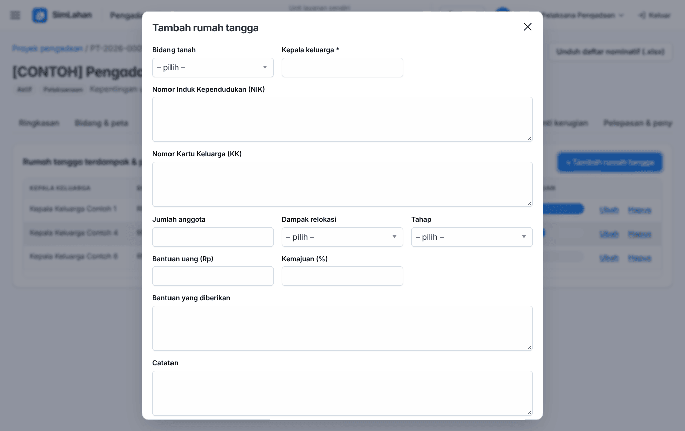

1. Buka tab **Relokasi**, klik **+ Tambah rumah tangga**.
2. Isi **Kepala keluarga** (wajib), bidang, NIK, nomor KK, jumlah anggota, dampak relokasi, tahap, bantuan uang, kemajuan (%), dan bantuan yang diberikan.
3. Klik **Simpan**.

## 4.13 Dokumen proyek

*Semua peran pengadaan bisa mengunggah dokumen sesuai haknya; Instansi mengunggah dokumen perencanaan, BAST, foto, dan dokumen lain.*

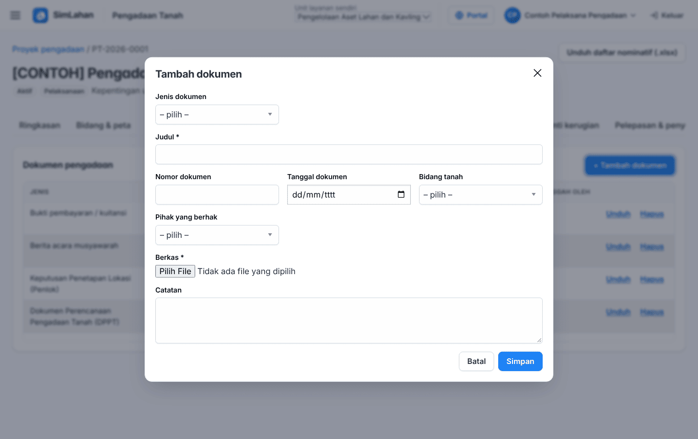

1. Buka tab **Dokumen**, klik **+ Tambah dokumen**.
2. Pilih jenis dokumen, isi **Judul** (wajib), nomor dan tanggal dokumen, kaitkan ke bidang/pihak bila perlu.
3. Pilih **Berkas** (wajib), lalu **Simpan**.
4. Klik **Unduh** pada baris dokumen untuk membukanya.

Berkas diperiksa jenisnya saat diunggah; berkas yang isinya tidak sesuai ekstensinya ditolak.

## 4.14 Tenggat proyek

Tab **Tenggat** berisi semua tenggat hukum proyek ini: kewajiban, batas waktu, sisa hari kerja, bidang, dan referensi dasar hukumnya.

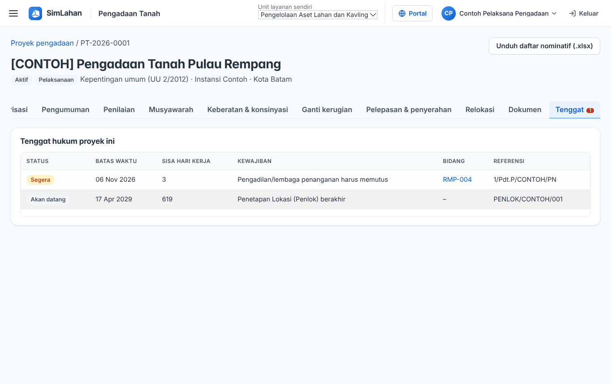

## 4.15 Kalender & aturan tenggat

*Mengubah: Pelaksana Pengadaan, Administrator. Peran lain hanya melihat.*

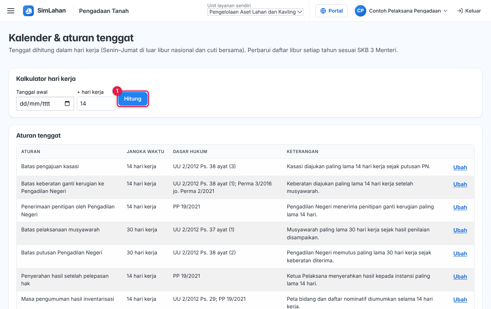

- **Kalkulator hari kerja** (1): isi tanggal awal dan jumlah hari kerja, klik **Hitung** untuk mengetahui tanggal jatuh tempo.
- **Aturan tenggat**: jangka waktu setiap kewajiban beserta dasar hukumnya. Klik **Ubah** pada baris untuk menyesuaikan.
- **Hari libur & cuti bersama**: daftar libur yang tidak dihitung sebagai hari kerja.

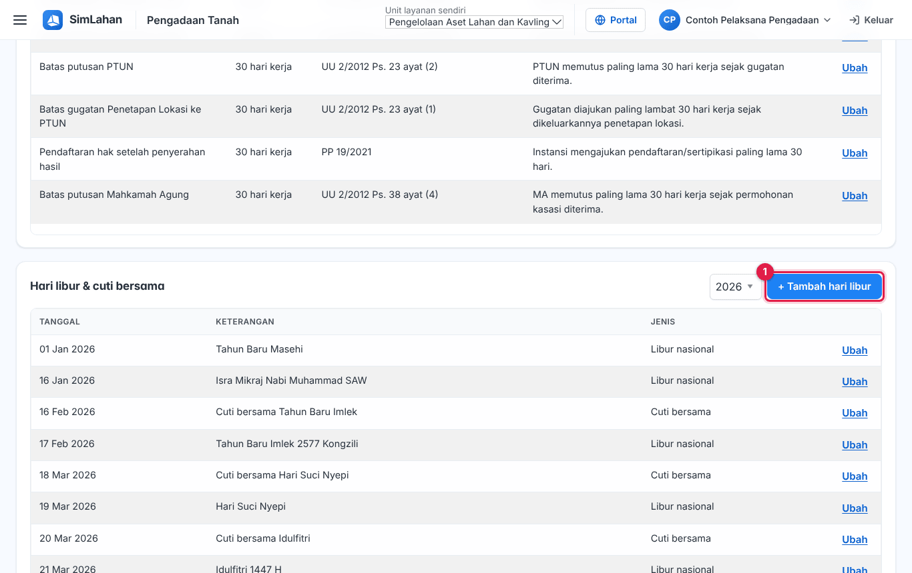

**Menambah hari libur** (lakukan setiap tahun sesuai SKB 3 Menteri):

1. Gulir ke **Hari libur & cuti bersama**, klik **+ Tambah hari libur** (1).
2. Isi tanggal, jenis (libur nasional/cuti bersama), dan keterangan, lalu simpan.
3. Untuk menghapus, klik **Hapus** pada barisnya.

## 4.16 Perbedaan tampilan per peran

**Penilai** melihat tombol **+ Tambah penilaian** dan **Ubah** di tab Penilaian, tetapi data pihak (NIK, rekening) tersamar dan tidak ada tombol ubah di tab lain:

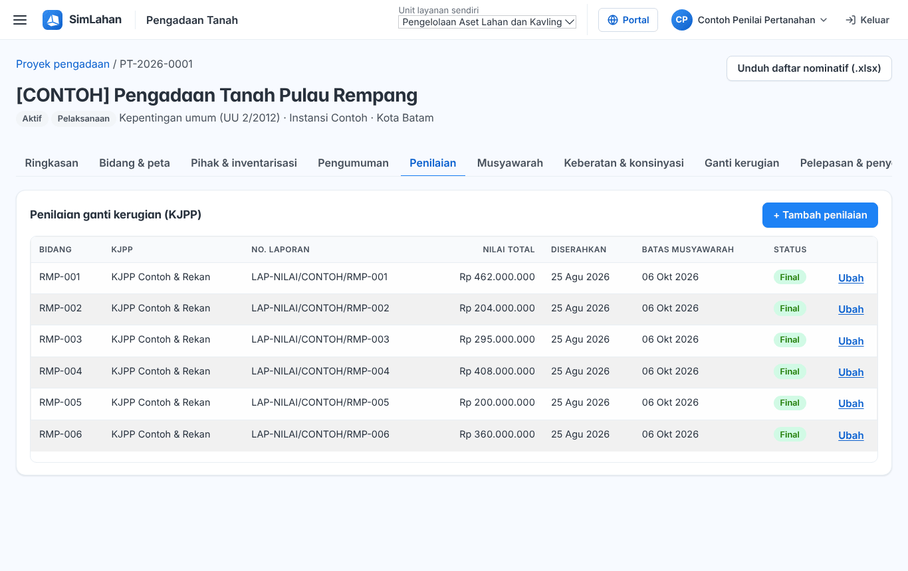

**Instansi** melihat ringkasan tanpa nilai uang dan tanpa data pihak, dan bisa menambah dokumen:

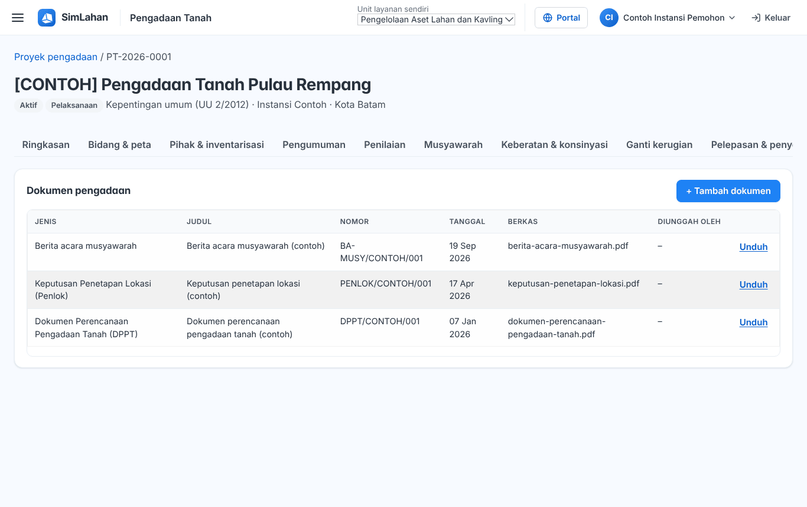

**Petugas Penagihan** hanya bisa menambah pembayaran di tab Ganti kerugian:

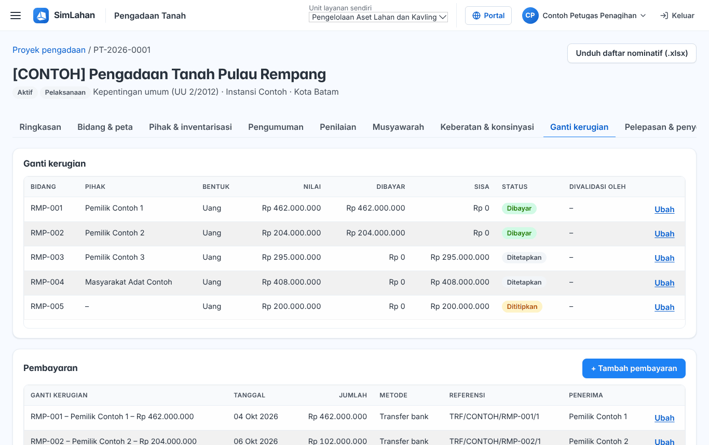

**Ahli Hukum Penagihan** menambah keberatan dan konsinyasi:

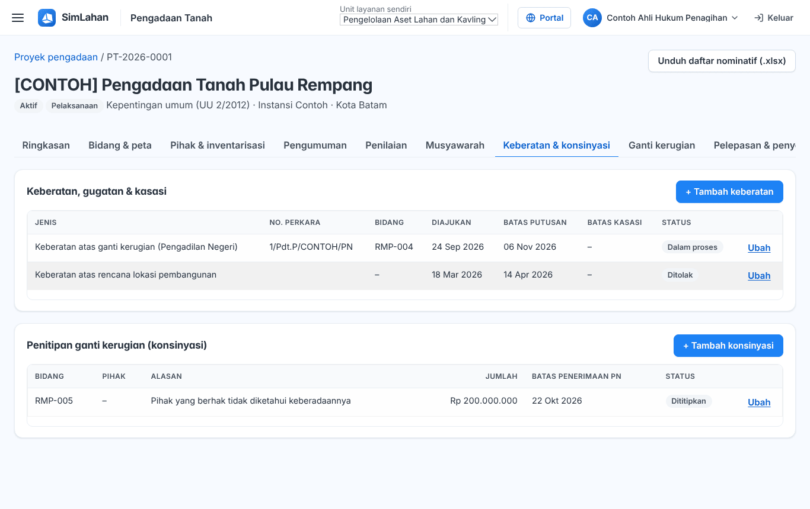

**Satgas** menambah pihak dan survei, tetapi tidak memvalidasi ganti kerugian:

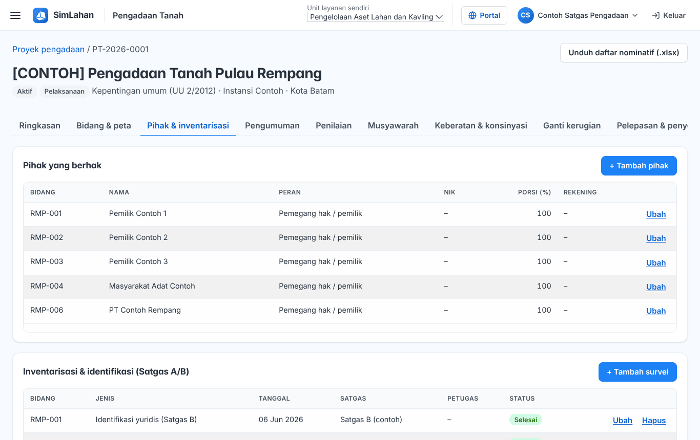

## 4.17 Pertanyaan umum

**Proyek tidak muncul di daftar (Penilai/Instansi).** Akun Anda belum dicantumkan di **Pengguna yang ditugaskan**. Minta Pelaksana menambahkannya lewat **Ubah data** proyek.

**Tombol Validasi tidak ada.** Hanya Pelaksana Pengadaan (Ketua Pelaksana) dan Administrator yang memvalidasi, dan hanya untuk baris berstatus **Ditetapkan**.

**Tanggal tenggat jatuh di hari libur.** Periksa daftar hari libur tahun berjalan di **Kalender & aturan tenggat**; tambahkan libur yang belum ada.
