# Bab 5 – Alokasi lahan (panel admin)

Modul alokasi lahan memproses permohonan yang diajukan pemohon lewat portal: dari pemeriksaan kelengkapan, verifikasi teknis, persetujuan, tagihan, sampai terbitnya dokumen keputusan (KPT, PPT, PL) dan pemantauan setelah alokasi. Modul ini dibuka di **panel admin** (`/admin/alokasi/`).

**Siapa memakai bab ini:**

| Peran | Yang dikerjakan |
|---|---|
| **Petugas Alokasi Lahan** | Memeriksa, meminta perbaikan, meneruskan ke verifikasi, menyetujui/menolak, memverifikasi pembayaran, memblokir/mencabut alokasi, mengelola data lahan dan konten portal. |
| **Tim Verifikasi Teknis** | Membaca permohonan dan memberi **nilai verifikasi teknis** per kriteria. |
| **Administrator** | Semua, termasuk pengaturan layanan. |

Alur status permohonan:

```
Draf → Diajukan → Verifikasi teknis → Disetujui, menunggu pembayaran → Pembayaran terverifikasi → Dokumen terbit
            ↘ Perlu perbaikan (pemohon memperbaiki lalu mengajukan ulang) ↗
            ↘ Ditolak                         Pemohon dapat membatalkan → Dibatalkan pemohon
```

## 5.1 Daftar permohonan

Halaman awal Petugas Alokasi dan Tim Verifikasi. Buka **Panel admin → Alokasi lahan → Permohonan**.

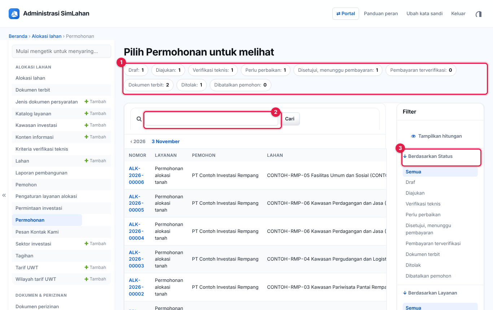

Nomor pada gambar:

1. **Jumlah per status**: banyaknya permohonan di setiap status. Klik salah satu, misalnya **Diajukan: 1**, untuk menampilkan permohonan berstatus itu saja.
2. **Kotak cari**: ketik nomor permohonan, nama pemohon, atau kode lahan, lalu klik **Cari**.
3. **Filter** di kanan: saring per **Status**, **Layanan**, atau **Jenis alokasi**. Bagi Tim Verifikasi ada juga filter **Berdasarkan penilaian saya** (sudah atau belum saya nilai).

Klik nomor permohonan (misalnya `ALK-2026-00003`) untuk membukanya.

## 5.2 Memproses permohonan (Petugas Alokasi)

Halaman permohonan menampilkan status di bagian atas. Bila ada dokumen wajib yang belum diunggah, daftarnya tampil di kotak status dengan tulisan merah. Di bawahnya berturut-turut: data permohonan, data alokasi tanah (lahan, rencana kegiatan, nilai investasi, tenaga kerja, jangka waktu pembangunan), peralihan hak (khusus layanan peralihan), keputusan, dokumen persyaratan, nilai verifikasi teknis, tagihan, dokumen terbit, dan riwayat.

### Langkah 1 – Periksa kelengkapan (status *Diajukan*)

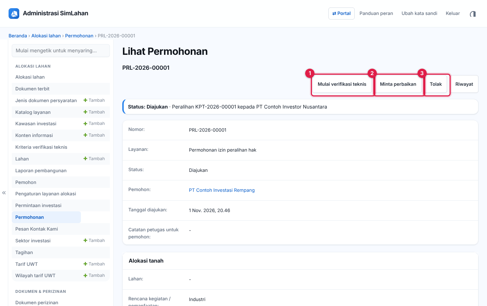

1. Di daftar permohonan, klik **Diajukan** di baris jumlah per status, lalu buka permohonannya.
2. Gulir ke bawah dan periksa data serta setiap **dokumen persyaratan**. Klik nama berkas untuk membukanya.
3. Gulir kembali ke atas dan klik salah satu tombol di kanan atas:
   - **Mulai verifikasi teknis** (nomor 1) bila data lengkap dan benar. Permohonan diteruskan ke Tim Verifikasi.
   - **Minta perbaikan** (nomor 2) bila ada data atau dokumen yang kurang atau salah. Pemohon menerima surel dan bisa memperbaikinya di portal.
   - **Tolak** (nomor 3) bila permohonan tidak dapat diproses. Lahan kembali tersedia dan alasan Anda dikirim ke pemohon.
4. Halaman konfirmasi terbuka. Contoh untuk **Mulai verifikasi teknis**:

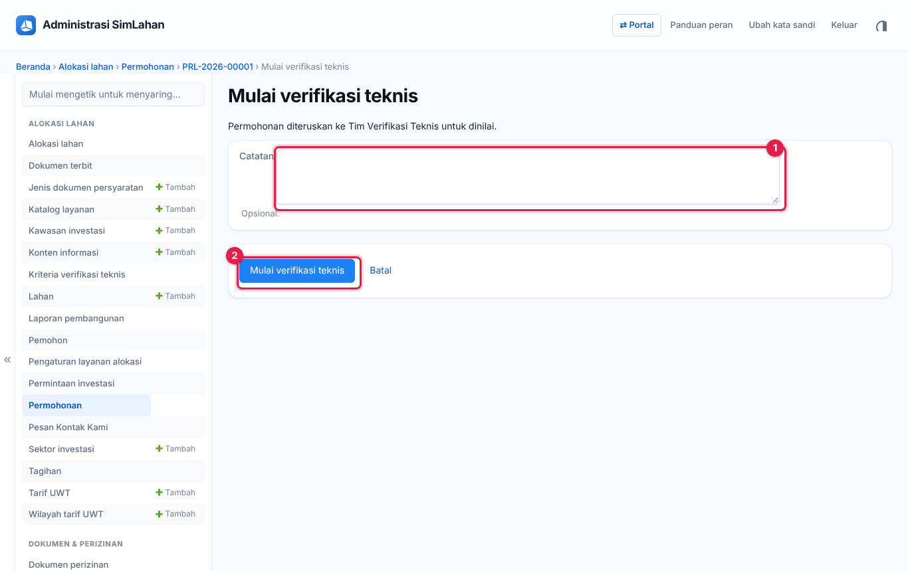

5. Tulis **Catatan** (nomor 1). Untuk **Mulai verifikasi teknis** dan **Setujui**, catatan boleh dikosongkan (tertulis "Opsional"). Untuk **Minta perbaikan** dan **Tolak**, catatan wajib diisi karena dikirim kepada pemohon sebagai alasan.
6. Klik tombol biru di bawahnya (nomor 2) untuk menegaskan. Klik **Batal** bila tidak jadi.

### Langkah 2 – Verifikasi teknis (Tim Verifikasi)

Tim Verifikasi menilai permohonan (lihat 5.3). Petugas Alokasi menunggu sampai semua kriteria dinilai. Selama belum lengkap, kotak status menampilkan pesan "Nilai akhir belum lengkap" beserta jumlah kriteria yang sudah dinilai.

### Langkah 3 – Putuskan (status *Verifikasi teknis*)

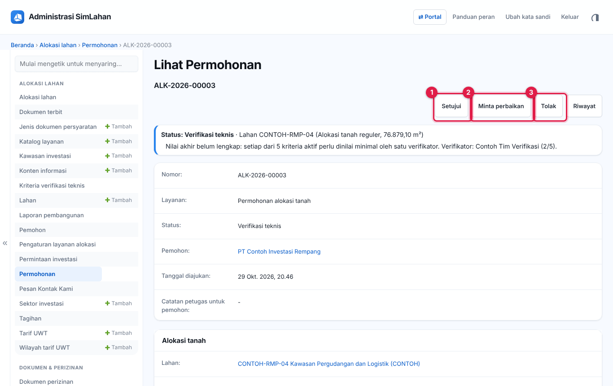

1. Buka permohonan berstatus **Verifikasi teknis**. Gulir ke bagian **Nilai verifikasi teknis** untuk melihat nilai per kriteria dan nilai akhir.
2. Klik salah satu tombol di kanan atas:
   - **Setujui** (nomor 1) bila nilai memenuhi syarat.
   - **Minta perbaikan** (nomor 2) bila pemohon harus melengkapi sesuatu.
   - **Tolak** (nomor 3) bila permohonan tidak layak.
3. Di halaman konfirmasi, isi **Catatan** (nomor 1) dan klik tombol biru (nomor 2).

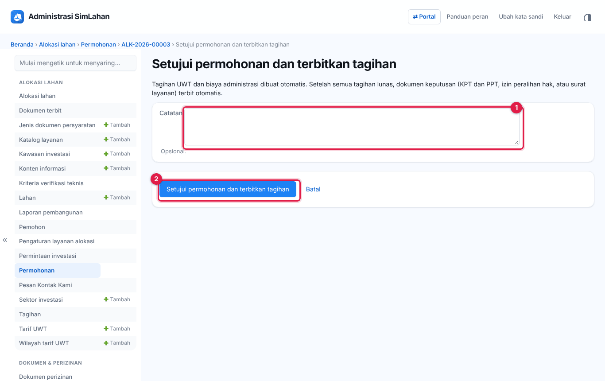

Saat Anda menyetujui, sistem otomatis membuat **tagihan UWT** dan **biaya administrasi**, lalu mengirimkannya kepada pemohon. Persetujuan ditolak sistem (muncul pesan merah) bila:

- belum semua kriteria verifikasi teknis dinilai;
- nilai akhir di bawah **nilai minimum** yang diatur di **Pengaturan layanan alokasi**;
- untuk peralihan hak: penerima hak belum menyetujui peralihan di portal.

Halaman konfirmasi **Minta perbaikan** terlihat seperti ini:

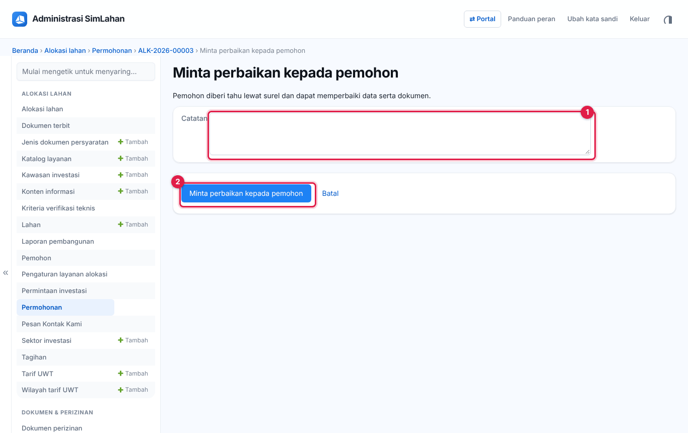

Kolom **Catatan** (nomor 1) wajib diisi dengan hal yang harus diperbaiki pemohon, lalu klik **Minta perbaikan kepada pemohon** (nomor 2).

### Langkah 4 – Verifikasi pembayaran

Periksa bukti bayar pemohon (lihat 5.4). Setelah **semua tagihan lunas**, dokumen keputusan (KPT dan PPT, PL dengan sketsa bidang, izin peralihan hak, atau surat layanan) **terbit otomatis** lengkap dengan kode QR verifikasi. Pemohon langsung bisa mengunduhnya di portal.

## 5.3 Menilai verifikasi teknis (Tim Verifikasi)

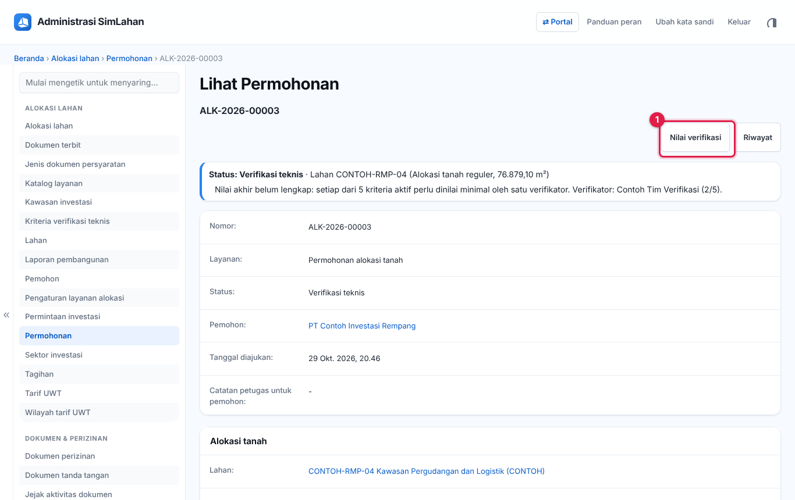

1. Buka **Panel admin → Alokasi lahan → Permohonan**. Di filter kanan, klik **Verifikasi teknis** pada **Berdasarkan Status**, lalu **belum dinilai** pada **Berdasarkan penilaian saya**.
2. Klik nomor permohonan, lalu klik **Nilai verifikasi** (nomor 1) di kanan atas.
3. Halaman penilaian terbuka. Kotak paling atas berisi ringkasan lahan dan rencana usaha pemohon. Klik nama dokumen di baris **Dokumen** untuk membaca berkas pemohon.

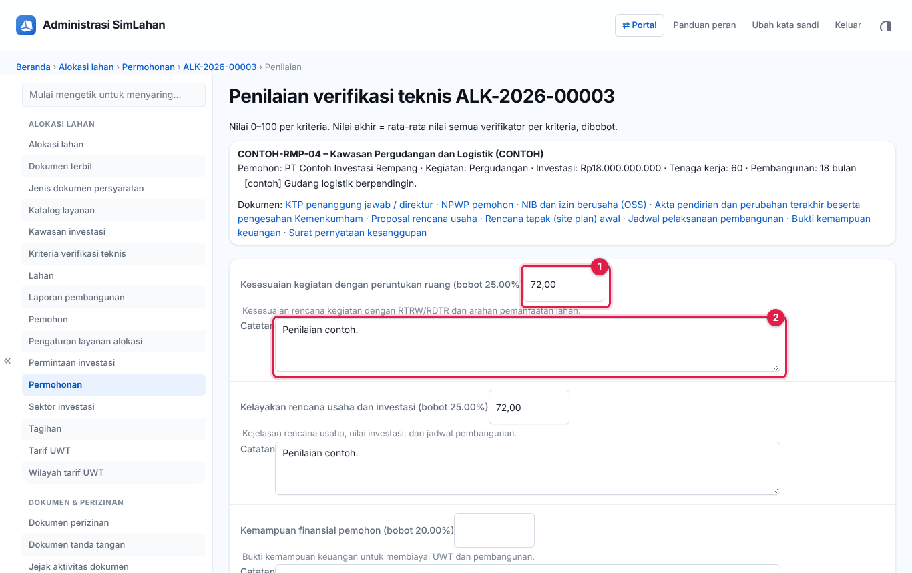

4. Untuk setiap kriteria, isi nilai **0 sampai 100** di kotak sebelah nama kriteria (nomor 1). Bobot kriteria tertulis dalam kurung, misalnya "(bobot 25.00%)".
5. Tulis alasan penilaian di **Catatan** di bawahnya (nomor 2).
6. Ulangi untuk semua kriteria, lalu gulir ke bawah dan klik **Simpan nilai**.

Nilai akhir = rata-rata nilai semua verifikator untuk setiap kriteria, dikalikan bobotnya, lalu dijumlahkan. Selama permohonan masih berstatus *Verifikasi teknis*, Anda bisa membuka lagi halaman ini untuk memperbaiki nilai.

## 5.4 Tagihan dan pembayaran

Buka **Panel admin → Alokasi lahan → Tagihan**.

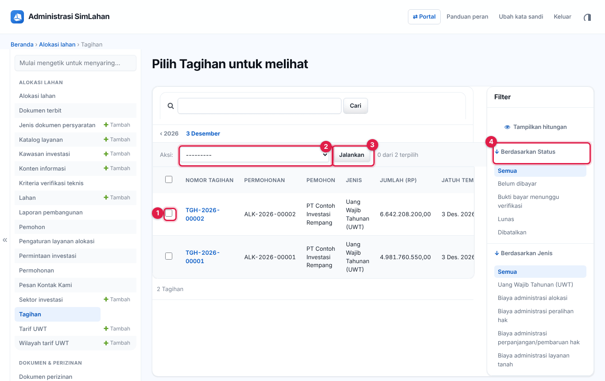

Di filter kanan (nomor 4), saring per **Status** (Belum dibayar, Bukti bayar menunggu verifikasi, Lunas, Dibatalkan) atau **Jenis** (UWT, biaya administrasi alokasi, biaya administrasi peralihan hak, dan lainnya).

**Memverifikasi satu tagihan**

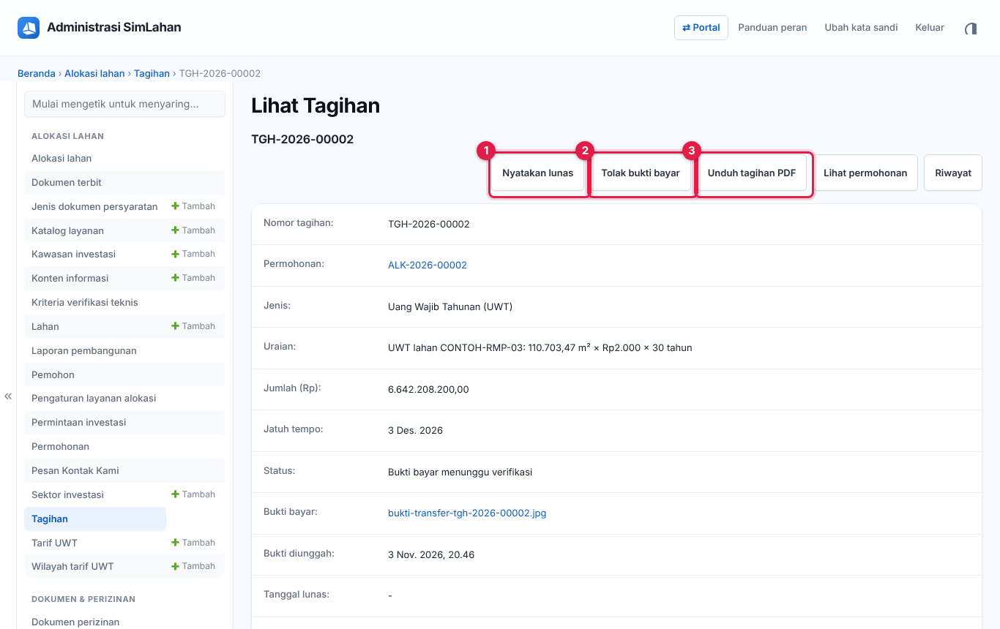

1. Di filter, klik **Bukti bayar menunggu verifikasi**, lalu klik nomor tagihan.
2. Klik nama berkas di baris **Bukti bayar** untuk membuka bukti transfer dari pemohon. Cocokkan jumlah dan tanggalnya dengan rekening penerimaan.
3. Bila sesuai, klik **Nyatakan lunas** (nomor 1). Di halaman konfirmasi, isi catatan bila perlu, lalu klik **Nyatakan lunas** sekali lagi.
4. Bila tidak sesuai, klik **Tolak bukti bayar** (nomor 2), tulis alasannya (wajib), lalu tegaskan. Pemohon diminta mengunggah ulang bukti bayar.
5. Klik **Unduh tagihan PDF** (nomor 3) bila perlu mencetak tagihan.

**Memverifikasi banyak tagihan sekaligus** (gambar daftar tagihan di atas):

1. Centang kotak di awal baris setiap tagihan yang buktinya sudah diperiksa (nomor 1).
2. Di **Aksi** (nomor 2), pilih **Verifikasi lunas (bukti bayar sudah diunggah)**.
3. Klik **Jalankan** (nomor 3).

## 5.5 Alokasi & lahan tidur

Buka **Panel admin → Alokasi lahan → Alokasi lahan**. Halaman ini berisi semua alokasi yang sudah terbit: nomor KPT, pemegang hak, lahan, masa berlaku, dan progres pembangunan.

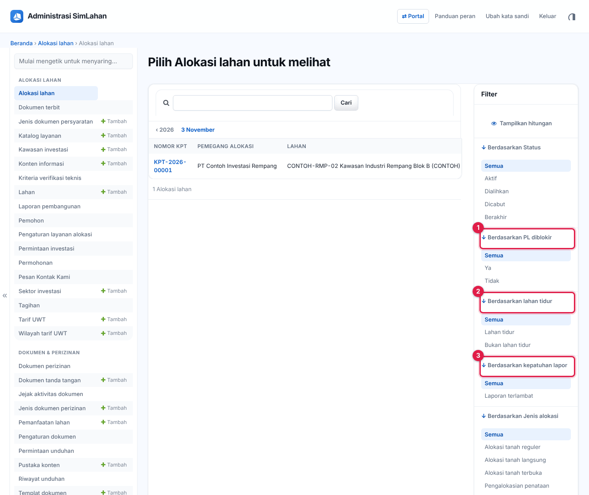

Filter penting di kanan:

- **Berdasarkan PL diblokir** (nomor 1): alokasi yang penetapan lokasinya sedang diblokir.
- **Berdasarkan lahan tidur** (nomor 2): alokasi aktif yang sudah lewat batas waktu (diatur di pengaturan) tetapi belum mulai konstruksi.
- **Berdasarkan kepatuhan lapor** (nomor 3): pemegang hak yang terlambat mengirim laporan progres pembangunan.

Klik nomor KPT untuk membuka alokasi.

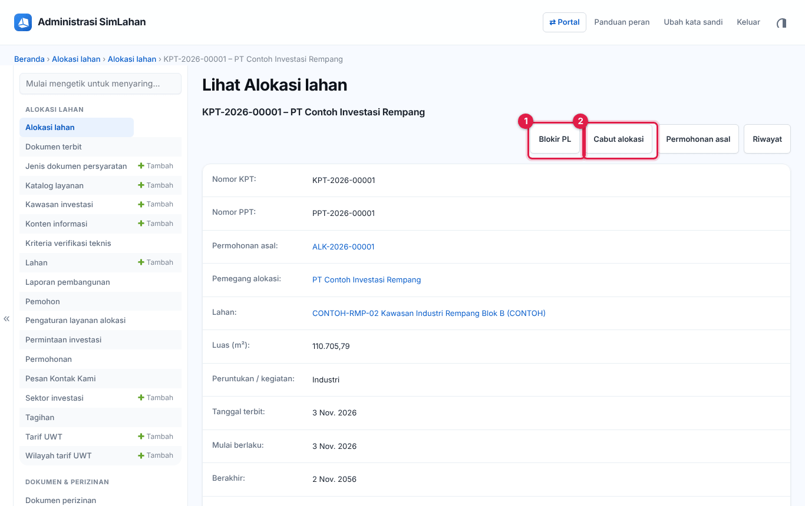

- **Blokir PL** (nomor 1): memblokir penetapan lokasi, misalnya karena sengketa. Selama diblokir, pemegang hak hanya bisa mengajukan layanan **pembukaan blokir**. Setelah diblokir, tombol ini berganti menjadi **Buka blokir PL**.
- **Cabut alokasi** (nomor 2): mencabut alokasi, misalnya karena lahan tidur atau pelanggaran. Lahan kembali tersedia untuk dimohon.
- **Permohonan asal**: membuka permohonan yang menghasilkan alokasi ini.

Kedua tindakan meminta konfirmasi. Contoh untuk **Blokir PL**:

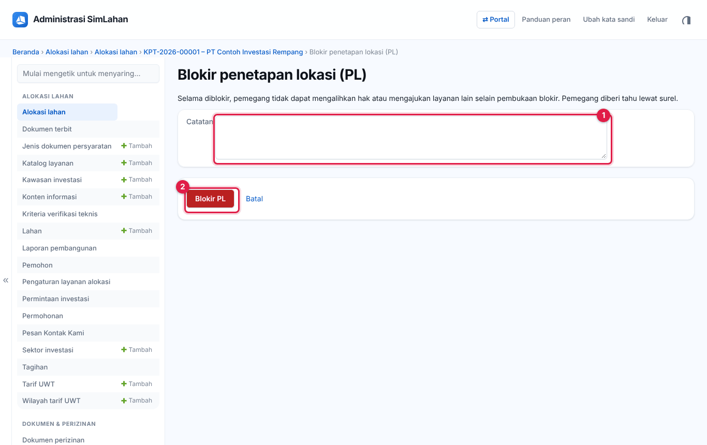

1. Tulis alasan di **Catatan** (nomor 1). Alasan ini dikirim lewat surel kepada pemegang hak.
2. Klik **Blokir PL** (nomor 2). Klik **Batal** bila tidak jadi.

Gulir ke bawah halaman alokasi untuk melihat **Dokumen terbit** (dokumen keputusan) dan **Progres pembangunan** (laporan dari pemegang hak).

Setiap Senin pukul 07.30 WIB sistem menjalankan **pemantauan mingguan**: alokasi yang berakhir, peringatan lahan tidur, laporan progres terlambat, dan tagihan yang segera atau sudah lewat jatuh tempo. Pengingat dikirim ke pemegang hak, dan ringkasannya ke surel petugas alokasi.

## 5.6 Data lahan

Buka **Panel admin → Alokasi lahan → Lahan**. Di sini dikelola lahan yang tampil di peta portal dan dapat dimohon.

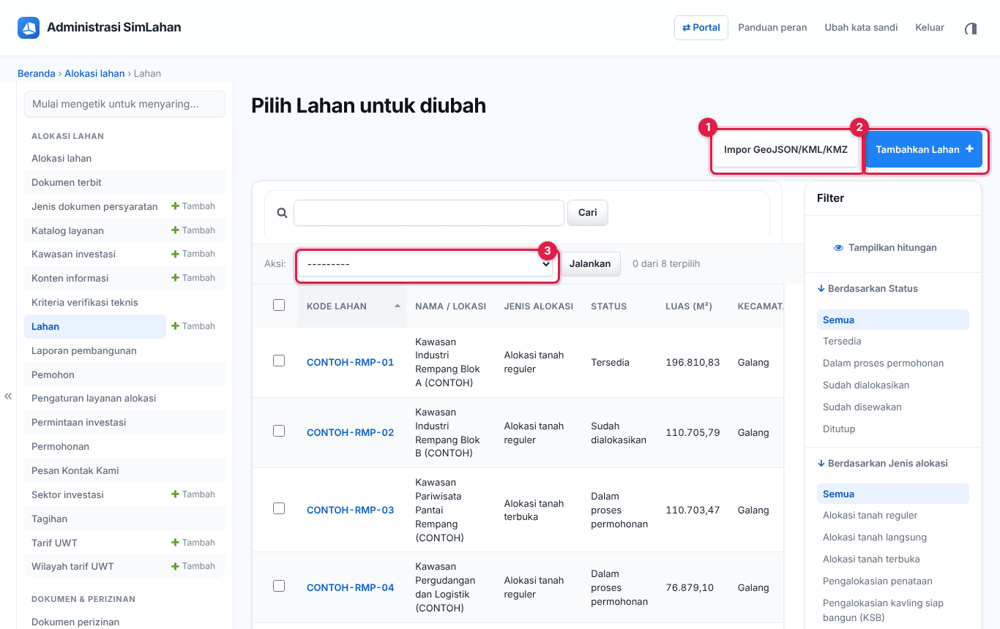

- **Impor GeoJSON/KML/KMZ** (nomor 1): menambah atau memperbarui banyak lahan sekaligus dari berkas peta.
- **Tambahkan Lahan** (nomor 2): menambah satu lahan.
- **Aksi** (nomor 3): centang lahan di tabel, pilih aksi, lalu klik **Jalankan**. Pilihannya: Tampilkan di portal, Sembunyikan dari portal, Tutup lahan (tidak menerima permohonan), Buka kembali lahan yang ditutup, Tandai sebagai lahan unggulan portal investasi, dan Akhiri sewa (lahan kembali tersedia).

### Menambah atau mengubah lahan

Klik **Tambahkan Lahan**, atau klik kode lahan di tabel untuk mengubahnya.

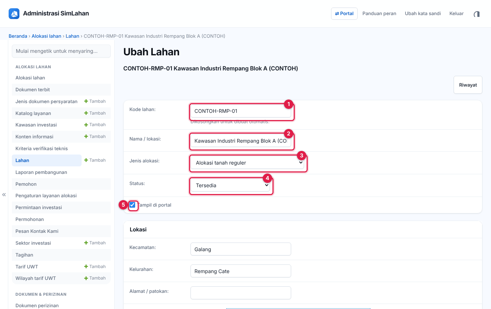

1. Isi **Kode lahan** (nomor 1). Kosongkan bila ingin dibuat otomatis.
2. Isi **Nama / lokasi** (nomor 2), misalnya "Kawasan Industri Blok A".
3. Pilih **Jenis alokasi** (nomor 3) dan **Status** (nomor 4): Tersedia, Dalam proses permohonan, Sudah dialokasikan, Sudah disewakan, atau Ditutup. Lahan baru biasanya **Tersedia**.
4. Centang **Tampil di portal** (nomor 5) agar lahan terlihat oleh masyarakat di peta portal.
5. Gulir ke bagian **Lokasi**: isi kecamatan, kelurahan, dan alamat, lalu gambar batas lahan di peta.
6. Bagian **Data teknis**: isi **Luas (m²)**, peruntukan (RTRW/RDTR), arahan pemanfaatan, kelengkapan dokumen teknis, infrastruktur, uraian, dan foto.
7. Bagian **Tarif**: isi tarif UWT per m² per tahun dan jangka waktu (tahun).
8. Bagian **Profil investasi** (untuk portal investasi): pilih sektor dan kawasan, centang **unggulan** bila perlu, pilih skema yang ditawarkan (alokasi dan/atau sewa) beserta tarif dan masa sewa, lalu isi keunggulan lokasi, insentif, utilitas yang tersedia, dan jarak ke pelabuhan, bandara, jalan, dan kota.
9. Klik **Simpan** di bagian paling bawah.

> Lahan yang sudah terikat permohonan, alokasi, atau sewa dikunci ukuran dan tarifnya, dan impor tidak menimpanya.

### Mengimpor lahan dari berkas peta

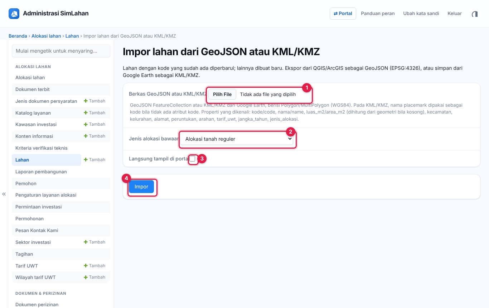

1. Di daftar lahan, klik **Impor GeoJSON/KML/KMZ**.
2. Klik **Pilih File** (nomor 1) dan pilih berkas peta: GeoJSON atau KML/KMZ (misalnya dari Google Earth) berisi poligon dalam koordinat WGS84.
   - Pada KML/KMZ, nama *placemark* dipakai sebagai kode lahan bila tidak ada atribut kode.
   - Impor ulang dengan kode yang sama memperbarui lahan itu, bukan menggandakannya.
   - Luas dihitung dari bentuk poligon bila tidak diisi di berkas.
3. Pilih **Jenis alokasi bawaan** (nomor 2) untuk lahan yang tidak menyebutkan jenisnya.
4. Centang **Langsung tampil di portal** (nomor 3) bila lahan boleh langsung dilihat masyarakat.
5. Klik **Impor** (nomor 4). Pesan "Impor selesai: … lahan baru, … diperbarui" menandakan berhasil.

## 5.7 Pemohon

Buka **Panel admin → Alokasi lahan → Pemohon**. Isinya daftar akun pemohon portal (badan usaha, instansi, perorangan, investor).

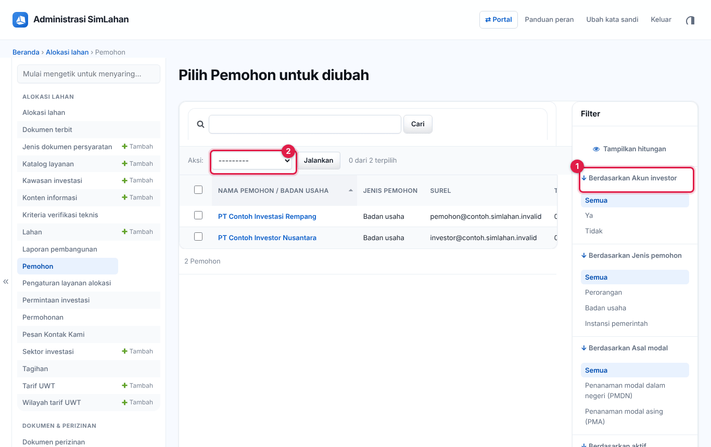

- **Filter** (nomor 1): saring per **Akun investor**, **Jenis pemohon**, **Asal modal**, atau **aktif**.
- **Aksi** (nomor 2): centang pemohon, pilih **Aktifkan akun** atau **Nonaktifkan akun**, lalu klik **Jalankan**. Pakai **Aktifkan akun** bila surel aktivasi tidak sampai ke pemohon.
- Klik nama pemohon untuk melihat profil, permohonan, dan permintaan investasinya.

## 5.8 Laporan pembangunan dan dokumen terbit

- **Laporan pembangunan**: laporan progres yang dikirim pemegang hak dari portal (tahap, progres %, nilai investasi, tenaga kerja, foto/lampiran). Saring per **Tahap**.
- **Dokumen terbit**: semua KPT, PPT, PL, izin peralihan, dan surat layanan yang terbit, beserta PDF dan **halaman verifikasi** QR-nya. Dokumen yang diganti (karena layanan revisi/pengganti) ditandai **Diganti pada**.

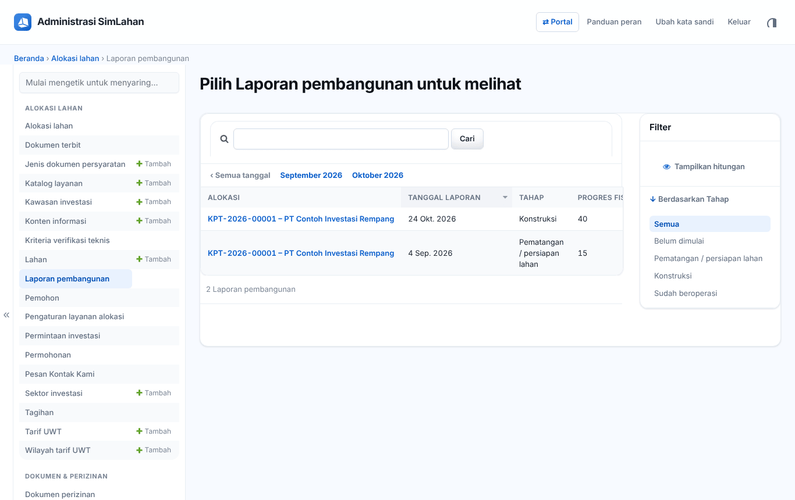

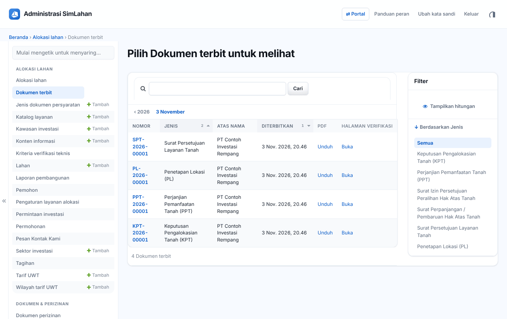

## 5.9 Konten portal dan data master

| Menu | Kegunaan |
|---|---|
| **Katalog layanan** | Daftar layanan yang tampil di portal (deskripsi, syarat, alur, durasi, tarif, dasar hukum) dan jenis permohonan daringnya. |
| **Jenis dokumen persyaratan** | Dokumen yang wajib/opsional diunggah per layanan dan jenis alokasi. |
| **Kriteria verifikasi teknis** | Kriteria dan bobot penilaian verifikasi teknis. |
| **Konten informasi** | Halaman informasi portal: regulasi, persyaratan, prosedur, pengumuman, video tutorial, buku panduan, unduhan, tanya jawab, panduan investasi. Centang **Sematkan di beranda** dan **Terbit**. |
| **Wilayah tarif UWT** dan **Tarif UWT** | Tarif UWT per wilayah dan jenis pengurusan, dipakai di **Simulasi biaya UWT** portal (termasuk denda per bulan keterlambatan dan batas maksimumnya). |
| **Pesan Kontak Kami** | Pesan yang dikirim masyarakat dari portal; ubah status setelah dijawab. |
| **Pengaturan layanan alokasi** *(Administrator)* | Otoritas & penandatangan, tarif & tagihan, ketentuan alokasi (nilai minimum, batas lahan tidur, interval lapor), kop surat, portal & Kontak Kami, simulasi UWT, portal investasi. |

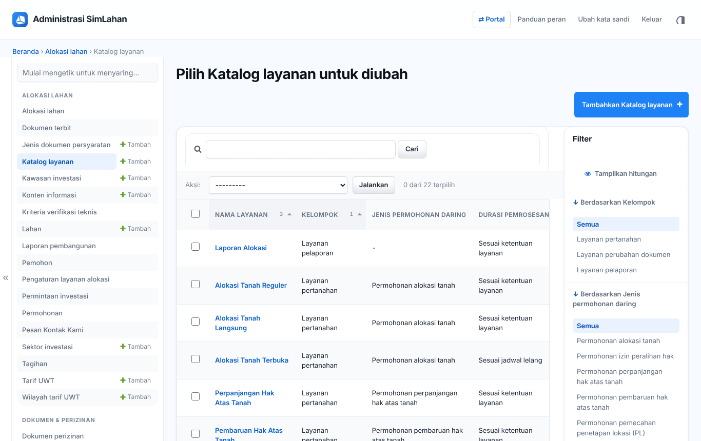

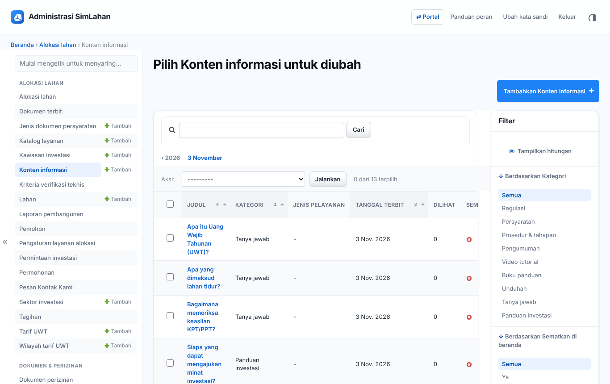

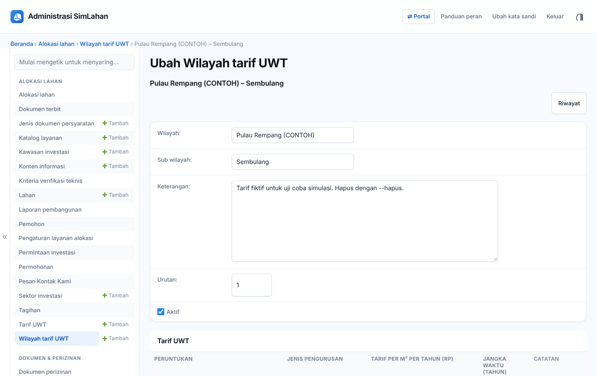

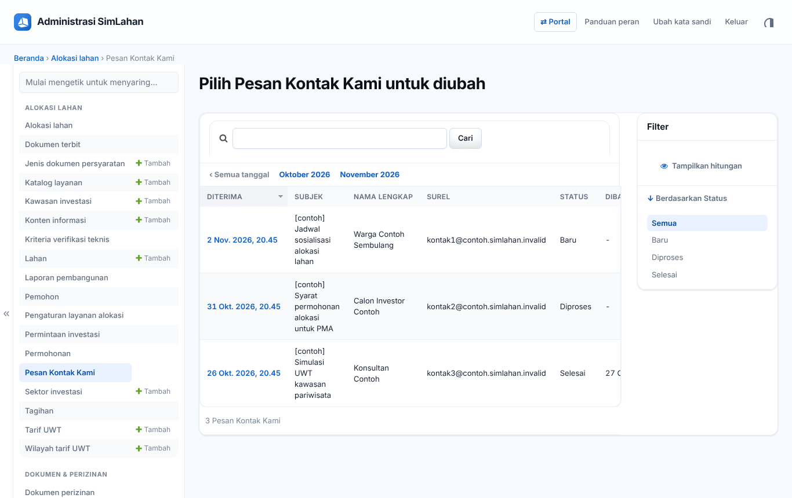

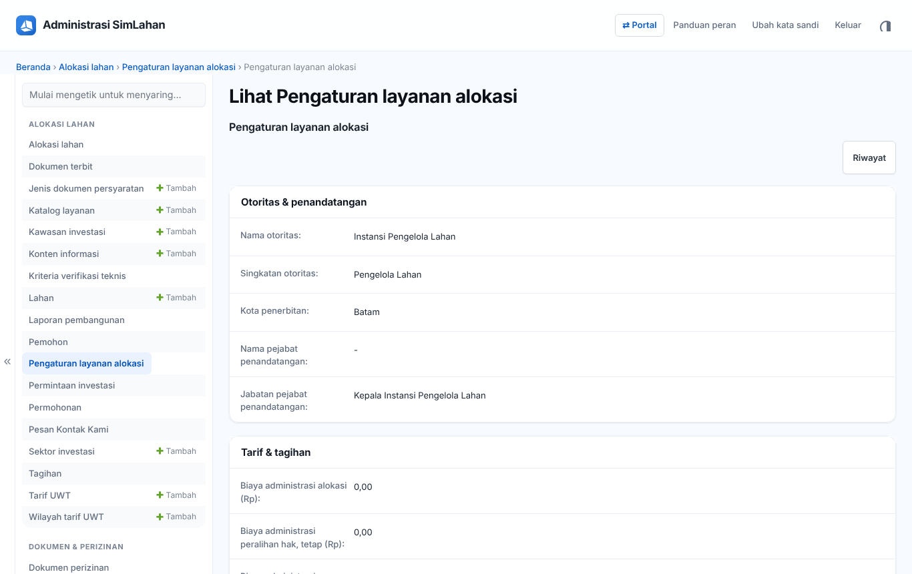

## 5.10 Pertanyaan umum

**Tombol Setujui tidak muncul.** Permohonan belum berstatus *Verifikasi teknis*. Untuk permohonan *Diajukan*, klik **Mulai verifikasi teknis** dulu.

**Muncul pesan "Semua kriteria verifikasi teknis harus dinilai".** Minta Tim Verifikasi melengkapi nilai di halaman **Nilai verifikasi**.

**Dokumen keputusan belum terbit padahal sudah disetujui.** Dokumen terbit otomatis setelah **semua** tagihan berstatus **Lunas**. Periksa tagihan yang masih menunggu verifikasi.

**Pemohon tidak menerima surel aktivasi.** Aktifkan akunnya lewat **Pemohon → aksi Aktifkan akun**, dan minta pengelola memeriksa pengaturan surel (SMTP).
