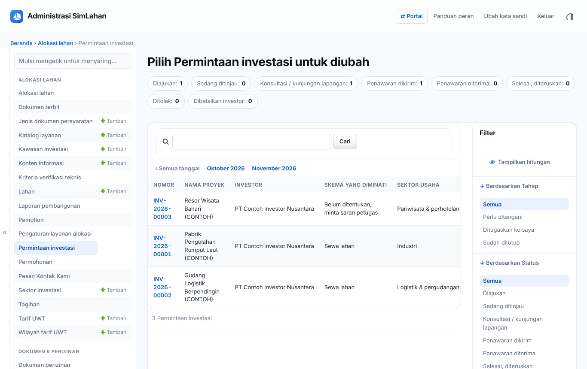
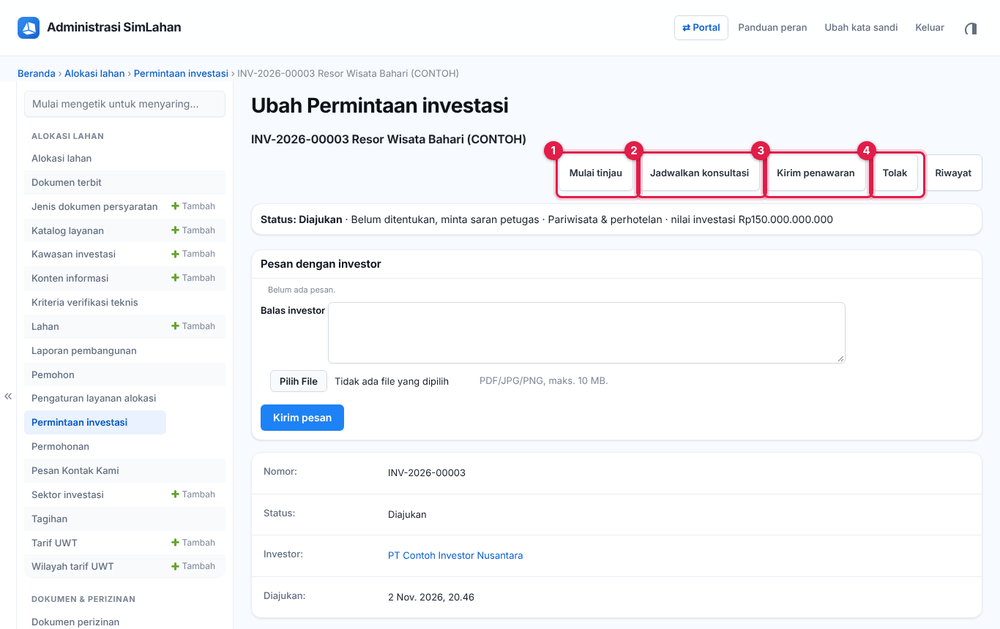
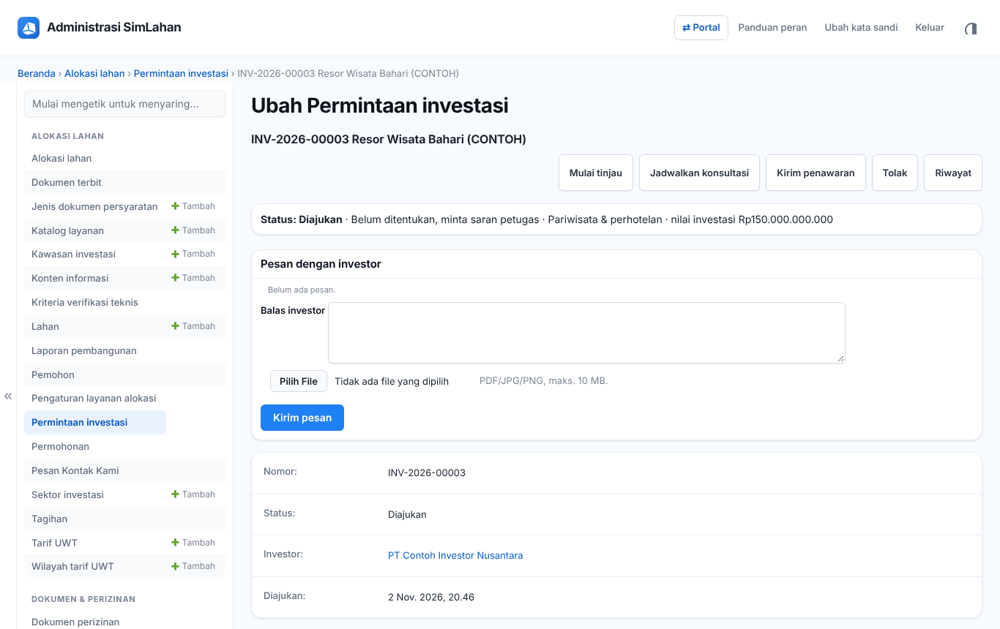
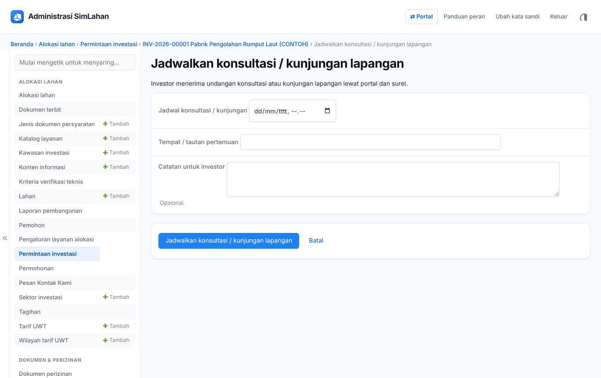
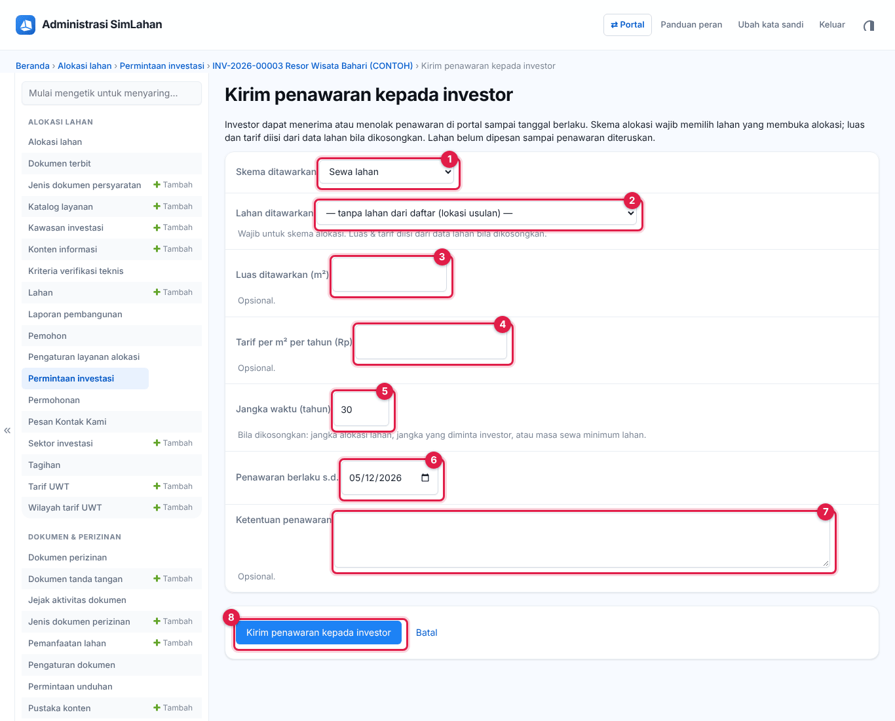
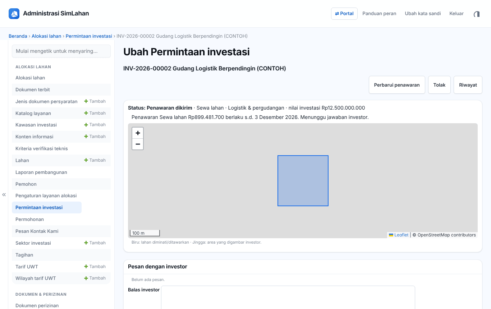
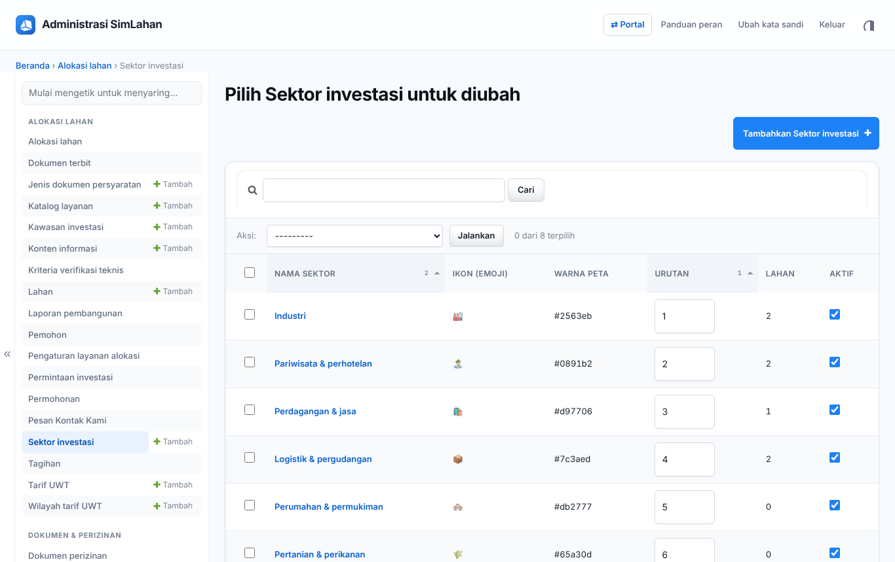
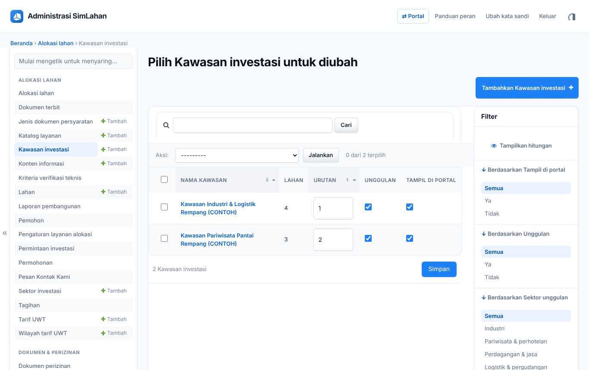

# Bab 6 – Permintaan investasi (panel admin)

Investor mengajukan minat sewa, alokasi, atau kerja sama pemanfaatan lahan lewat portal investasi (`/portal/investasi/`). Petugas menindaklanjutinya di **Panel admin → Alokasi lahan → Permintaan investasi**: meninjau, menjadwalkan konsultasi, mengirim penawaran, berkirim pesan, lalu menyelesaikan (menjadi kontrak atau permohonan alokasi) atau menolak.

**Siapa memakai bab ini:** Petugas Alokasi Lahan dan Administrator memproses; Tim Verifikasi Teknis hanya membaca.

Alur status:

```
Diajukan → Sedang ditinjau → Konsultasi / kunjungan lapangan → Penawaran dikirim → Penawaran diterima → Selesai, diteruskan
                        ↘ Ditolak (oleh petugas)                 ↘ Dibatalkan investor
```

## 6.1 Daftar permintaan



Saring per **Tahap**, **Status**, **Skema yang diminati** (sewa, alokasi/UWT, kerja sama, belum ditentukan), **Sektor usaha**, **Kawasan**, atau **Asal modal**. Klik nomor (misalnya `INV-2026-00003`) untuk membuka.

## 6.2 Halaman permintaan



Isi halaman dari atas ke bawah:

- **Status** dan ringkasan (skema, sektor, nilai investasi).
- **Pesan dengan investor**: percakapan dua arah beserta lampiran (lihat 6.3).
- **Penanganan**: petugas penanggung jawab dan **catatan internal**. Catatan internal tidak terlihat oleh investor.
- **Rencana investasi**: nama proyek, kegiatan, nilai, tenaga kerja, jadwal.
- **Lokasi**: lahan yang dipilih investor, atau area yang digambar investor di peta.
- **Konsultasi**, **Penawaran**, **Penutupan**, dan **Riwayat status**.

Tombol tindakan di kanan atas muncul sesuai status:

- **Mulai tinjau** (nomor 1): menandai permintaan sedang ditinjau dan menjadikan Anda petugas penanggung jawab (bila belum ada). Investor diberi tahu lewat surel.
- **Jadwalkan konsultasi** (nomor 2): mengirim undangan konsultasi atau kunjungan lapangan (lihat 6.4).
- **Kirim penawaran** (nomor 3): mengirim penawaran sewa, alokasi, atau kerja sama (lihat 6.5). Bila sudah pernah dikirim, tombolnya bernama **Perbarui penawaran**.
- **Tolak** (nomor 4): menutup permintaan. Alasan wajib ditulis dan dikirim ke investor.

Setelah investor menerima penawaran, muncul tombol **Selesaikan** (lihat 6.6).

**Mengisi penanggung jawab dan catatan internal:** gulir ke bagian **Penanganan**, pilih petugas di **Petugas penanggung jawab**, tulis catatan di **Catatan internal petugas**, lalu klik **Simpan** di bagian bawah halaman.

## 6.3 Membalas pesan investor



1. Gulir ke bagian **Pesan dengan investor**. Pesan lama tampil berurutan dari yang terlama.
2. Tulis balasan di kotak **Balas investor** (nomor 1).
3. Bila perlu, klik **Pilih File** (nomor 2) untuk melampirkan berkas PDF, JPG, atau PNG (maksimal 10 MB).
4. Klik **Kirim pesan** (nomor 3). Investor menerima pemberitahuan dan bisa membalas dari portal.

## 6.4 Menjadwalkan konsultasi



1. Klik **Jadwalkan konsultasi** di kanan atas halaman permintaan.
2. Isi **Jadwal konsultasi / kunjungan** (nomor 1): tanggal dan jam pertemuan.
3. Isi **Tempat / tautan pertemuan** (nomor 2): alamat kantor, titik kumpul kunjungan lapangan, atau tautan rapat daring.
4. Tulis **Catatan untuk investor** (nomor 3), misalnya dokumen yang perlu dibawa.
5. Klik **Jadwalkan konsultasi / kunjungan lapangan** (nomor 4). Investor menerima undangan di portal dan lewat surel.

## 6.5 Mengirim penawaran



1. Klik **Kirim penawaran** di kanan atas halaman permintaan.
2. Pilih **Skema ditawarkan** (nomor 1): sewa lahan, alokasi lahan (UWT), atau kerja sama pemanfaatan.
3. Pilih **Lahan ditawarkan** (nomor 2). Skema alokasi wajib memakai lahan yang membuka skema alokasi. Pilih "tanpa lahan dari daftar" bila yang ditawarkan adalah lokasi usulan investor.
4. Isi **Luas ditawarkan (m²)** (nomor 3) dan **Tarif per m² per tahun (Rp)** (nomor 4). Bila dikosongkan, keduanya diambil dari data lahan.
5. Isi **Jangka waktu (tahun)** (nomor 5) dan **Penawaran berlaku s.d.** (nomor 6), yaitu batas waktu investor menjawab.
6. Tulis **Ketentuan penawaran** (nomor 7), misalnya syarat pembayaran dan kewajiban investor.
7. Klik **Kirim penawaran kepada investor** (nomor 8).

Investor dapat **menerima** atau **menolak** penawaran di portal sampai tanggal berlaku. Lahan belum dipesan sampai permintaan diselesaikan. Status permintaan kini **Penawaran dikirim**:



## 6.6 Menyelesaikan permintaan

Hanya untuk penawaran yang sudah **diterima** investor.

1. Buka permintaan berstatus **Penawaran diterima**, lalu klik **Selesaikan** di kanan atas.
2. Bila skemanya **alokasi**: klik tombol penegasan. Sistem membuat **draf permohonan alokasi** atas nama investor dengan rencana usaha yang sudah terisi. Investor melengkapi dokumen lalu mengajukannya di portal; prosesnya berlanjut seperti [Bab 5](20-alokasi-lahan.md).
3. Bila skemanya **sewa** atau **kerja sama**: isi **nomor kontrak** sewa atau perjanjian kerja sama, lalu klik tombol penegasan. Lahan yang ditawarkan ditandai **Sudah disewakan**.
4. Status menjadi **Selesai, diteruskan**. Investor dapat mengelola dokumen perizinan kontraknya di portal (lihat [Bab 15](53-portal-dokumen.md)).

## 6.7 Sektor dan kawasan investasi

- **Sektor investasi**: daftar sektor (industri, pariwisata, logistik, dsb.) beserta ikon yang dipakai sebagai saringan di peta investasi.
- **Kawasan investasi**: kawasan yang ditampilkan di portal (deskripsi, insentif, infrastruktur, foto, sektor unggulan). Centang **Tampil di portal** dan **Unggulan** sesuai kebutuhan.





## 6.8 Pertanyaan umum

**Tombol Selesaikan tidak muncul.** Investor belum menerima penawaran. Tunggu jawaban investor atau perbarui penawarannya.

**Investor tidak melihat catatan saya.** Catatan di bagian **Penanganan** memang internal. Gunakan **Pesan dengan investor** untuk berkomunikasi.
