# Bab 7 – Dokumen & perizinan (panel admin)

Modul ini mencatat **pemanfaatan lahan** (alokasi, sewa, kerja sama), memantau **dokumen perizinan** yang wajib dimiliki pemegang hak, menyusun **templat**, mengirim **dokumen untuk ditandatangani elektronik**, dan mengatur **permintaan unduh** dokumen. Semua menu ada di **Panel admin → Dokumen & perizinan**.

**Siapa memakai bab ini:**

| Peran | Yang boleh dilakukan |
|---|---|
| Administrator | Semua, termasuk mengatur jenis dokumen wajib, templat, pengaturan modul, menyetujui dokumen tanda tangan sebelum dikirim, dan menyetujui unduhan dokumen **rahasia**. |
| Petugas Alokasi Lahan | Mencatat pemanfaatan lahan, menentukan dokumen wajib, memverifikasi atau meminta revisi dokumen, membuat dan mengirim dokumen tanda tangan, menyetujui unduhan dokumen **biasa**. Tidak mengubah pengaturan modul. |
| Tim Verifikasi Teknis | Memverifikasi atau meminta revisi dokumen perizinan; mengajukan permintaan unduh. Tidak membuat templat atau dokumen tanda tangan. |
| Petugas Hukum | Menyusun templat dan blok isi, membuat dan mengirim dokumen tanda tangan (kontrak, perjanjian), membaca dokumen perizinan; mengajukan permintaan unduh. Tidak memverifikasi dokumen perizinan. |

> **Aturan unduh:** mengunduh berkas asli selalu lewat **permintaan unduh** yang disetujui orang lain. Setiap unduhan diberi tanda air (nama pengunduh, waktu, nomor permintaan) dan tercatat. Melihat **pratinjau** boleh langsung, juga dengan tanda air.

## 7.1 Dasbor dokumen & perizinan

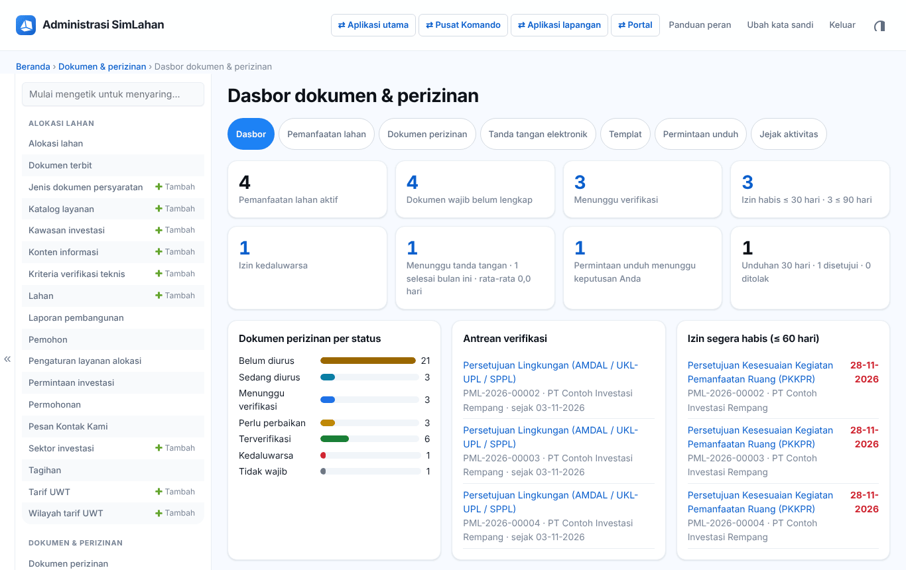

Buka **Dokumen & perizinan → Dasbor dokumen & perizinan**. Baris tombol di atas (**Dasbor, Pemanfaatan lahan, Dokumen perizinan, Tanda tangan elektronik, Templat, Permintaan unduh, Jejak aktivitas**) adalah jalan pintas ke tiap daftar.

Kartu angka di atas:

- **Pemanfaatan lahan aktif**, **Dokumen wajib belum lengkap**, **Menunggu verifikasi**.
- **Izin habis ≤ 30 hari · ≤ 90 hari** dan **Izin kedaluwarsa**.
- **Menunggu tanda tangan** (beserta jumlah selesai bulan ini dan rata-rata hari penyelesaian).
- **Permintaan unduh menunggu keputusan Anda** dan **Unduhan 30 hari**.

Panel di bawahnya:

- **Dokumen perizinan per status**: Belum diurus, Sedang diurus, Menunggu verifikasi, Perlu perbaikan, Terverifikasi, Kedaluwarsa, Tidak wajib.
- **Antrean verifikasi**: dokumen yang sudah diunggah pemegang hak dan menunggu diperiksa. Klik judulnya untuk langsung memeriksa.
- **Izin segera habis (≤ 60 hari)**: tanggal merah berarti perlu segera diperpanjang.
- **Pemanfaatan aktif per skema**, **Dokumen tanda tangan per status**, dan **Aktivitas terbaru** (gulir ke bawah).

Gulir sedikit ke bawah untuk melihat panel-panel itu:

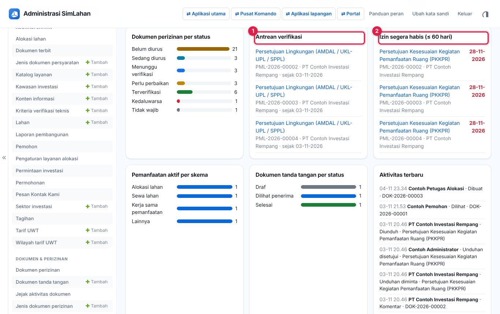

- **Antrean verifikasi** (nomor 1): klik judul dokumen untuk langsung memeriksanya (lihat 7.3).
- **Izin segera habis** (nomor 2): tanggal merah di kanan adalah tanggal izin berakhir. Hubungi pemegang hak agar segera memperpanjang.

## 7.2 Pemanfaatan lahan

Satu **pemanfaatan lahan** mewakili satu hak pakai lahan: alokasi, sewa, kerja sama, atau lainnya. Nomornya berformat `PML-2026-00001`. Pemanfaatan dari alokasi dan permintaan investasi dibuat otomatis oleh sistem; pemanfaatan lain bisa dibuat manual.

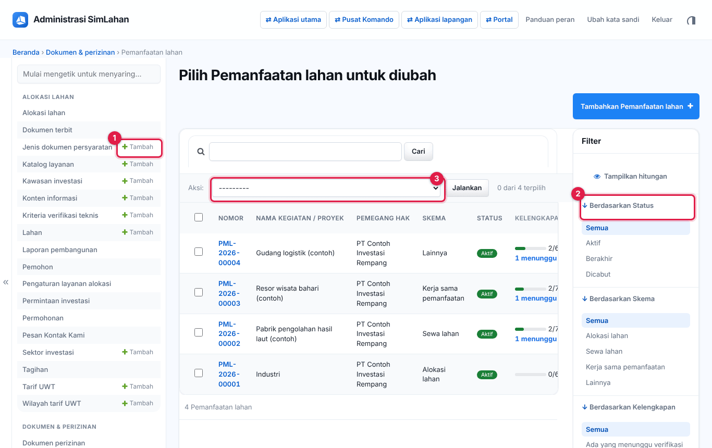

- **Tambahkan Pemanfaatan lahan** (nomor 1): membuat pemanfaatan lahan baru.
- **Filter** (nomor 2): saring per **Status** (Aktif, Berakhir, Dicabut), **Skema**, **Kelengkapan** dokumen, dan **Sektor**.
- **Aksi** (nomor 3): tindakan untuk baris yang dicentang, misalnya kirim dokumen tanda tangan massal (lihat di bawah).

### Menambah pemanfaatan lahan

1. Di daftar **Pemanfaatan lahan**, klik **Tambahkan Pemanfaatan lahan** di kanan atas.
2. Isi **Nama kegiatan / proyek**, **Skema**, dan **Status**.
3. Isi pemegang hak: pilih **Pemegang hak (akun portal)** bila ia punya akun portal (ia lalu bisa melihat dan mengunggah dokumennya sendiri), atau isi **Nama pemegang hak** secara manual.
4. Isi **Lahan**, **Sektor**, **Nomor dasar hak / kontrak**, **Luas (m²)**, **Mulai**, **Berakhir**, dan **Petugas penanggung jawab**. Bila berasal dari alokasi atau permintaan investasi, isi juga kolom **Alokasi** atau **Permintaan investasi**.
5. Klik **Simpan**. Sistem otomatis membuat daftar **dokumen perizinan wajib** sesuai skema dan sektor (lihat 7.6).

### Halaman pemanfaatan lahan

Klik nomor pemanfaatan di daftar untuk membukanya.

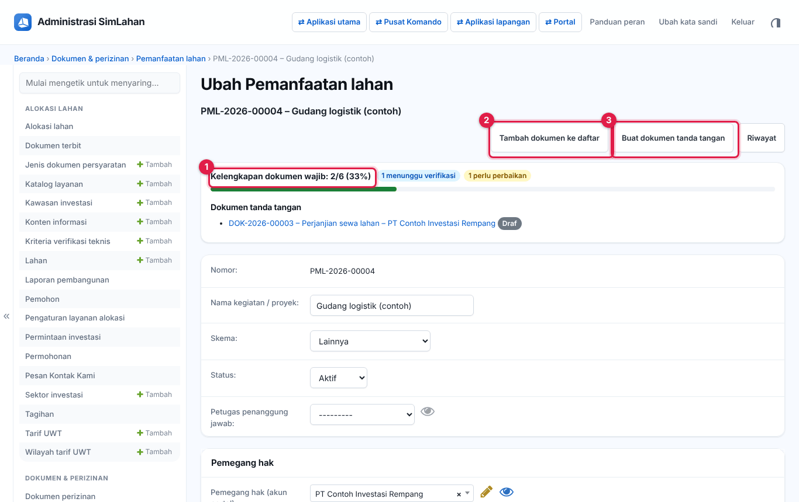

- **Kelengkapan dokumen wajib** (nomor 1): berapa dokumen wajib sudah terverifikasi, beserta jumlah yang menunggu verifikasi atau perlu perbaikan. Di bawahnya tampil dokumen tanda tangan milik pemanfaatan ini.
- **Tambah dokumen ke daftar** (nomor 2): menambah dokumen yang tidak otomatis masuk daftar, misalnya izin khusus.
- **Buat dokumen tanda tangan** (nomor 3): membuat dokumen tanda tangan dengan data pemanfaatan ini terisi otomatis (lihat 7.4).
- Tautan **Lihat alokasi** atau **Lihat permintaan investasi** muncul bila pemanfaatan berasal dari sana.

Gulir ke bawah sampai bagian **Dokumen perizinan**. Di sini tampil semua dokumen wajib beserta status, nomor izin, dan tanggal berlakunya. Klik nama dokumen untuk memeriksanya.

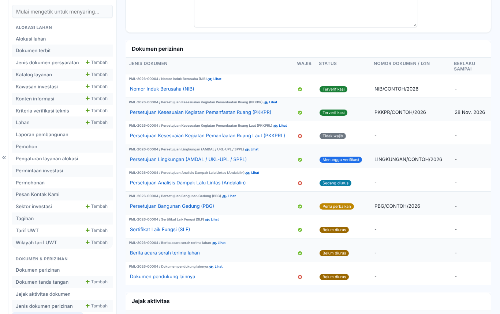

### Kirim dokumen tanda tangan massal

Untuk mengirim dokumen yang sama (misalnya surat pernyataan) ke banyak pemegang hak sekaligus:

1. Di daftar pemanfaatan lahan, centang pemanfaatan yang dituju (maksimal 200).
2. Pilih aksi **Kirim dokumen tanda tangan massal (satu per pemanfaatan)**, lalu klik **Jalankan**.
3. Pilih **Templat**, isi **Judul dokumen** dan **Pesan untuk penerima**.
4. Bila perlu, pilih **Penanda tangan kedua (petugas)** dan isi **Peran penanda tangan kedua**. Ia menandatangani setelah pemegang hak.
5. Kirim. Sistem membuat satu dokumen per pemanfaatan dan mengirimkannya ke masing-masing pemegang hak.

## 7.3 Dokumen perizinan

Setiap baris adalah satu dokumen wajib untuk satu pemanfaatan lahan, misalnya PKKPR atau persetujuan lingkungan.

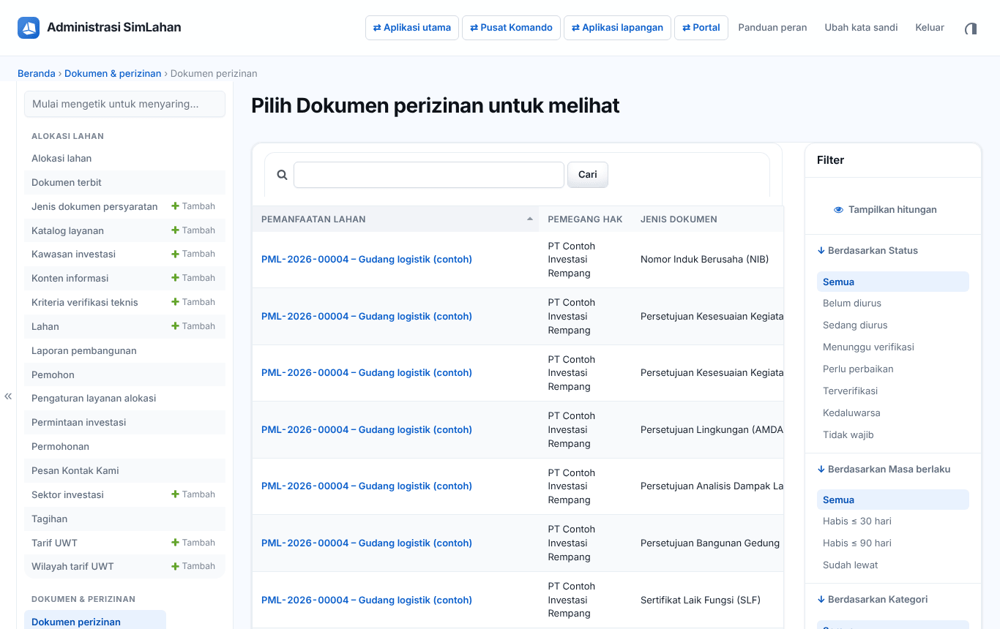

Saringan: **Status**, **Masa berlaku**, **Kategori**, **Jenis dokumen**, **Skema**.

Arti status:

| Status | Arti |
|---|---|
| Belum diurus | Pemegang hak belum mulai. |
| Sedang diurus | Pemegang hak sedang mengurus ke instansi penerbit. |
| Menunggu verifikasi | Berkas sudah diunggah, menunggu diperiksa petugas. |
| Perlu perbaikan | Petugas meminta revisi; pemegang hak mengunggah ulang. |
| Terverifikasi | Berkas sah dan diterima. |
| Kedaluwarsa | Tanggal **Berlaku sampai** sudah lewat. |
| Tidak wajib | Dikecualikan untuk pemanfaatan ini. |

### Memeriksa dokumen

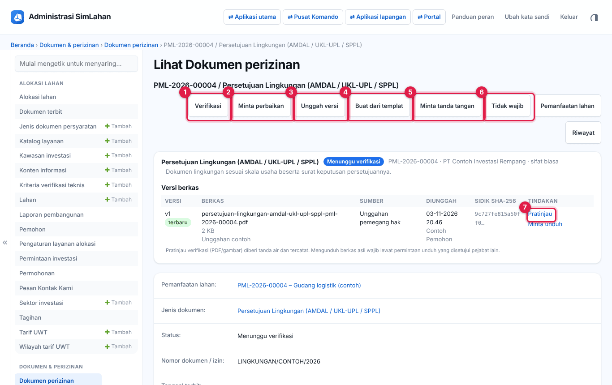

1. Buka dokumen berstatus **Menunggu verifikasi** dari **Antrean verifikasi** di dasbor, atau dari daftar dengan filter status itu.
2. Di bagian **Versi berkas**, klik **Pratinjau** (nomor 7) untuk melihat berkas yang diunggah. Pratinjau diberi tanda air dan tercatat.
3. Bila berkas sah, klik **Verifikasi** (nomor 1). Halaman verifikasi terbuka (lihat **Menyatakan terverifikasi** di bawah).

Tombol lain di halaman ini:

- **Minta perbaikan** (nomor 2): tulis apa yang harus diperbaiki, lalu kirim. Pemegang hak diberi tahu dan mengunggah ulang.
- **Unggah versi** (nomor 3): petugas mengunggah berkas atas nama pemegang hak, misalnya bila berkas dikirim lewat surel.
- **Buat dari templat** (nomor 4): membuat berkas dari templat jenis dokumen ini.
- **Minta tanda tangan** (nomor 5): membuat dokumen tanda tangan untuk dokumen ini. Setelah selesai ditandatangani, PDF-nya otomatis menjadi versi baru dokumen ini.
- **Tidak wajib** (nomor 6): mengecualikan dokumen ini untuk pemanfaatan ini, dengan alasan.
- **Buka kembali**: muncul pada dokumen yang sudah terverifikasi atau tidak wajib, untuk membukanya lagi dengan alasan.

**Menyatakan terverifikasi**

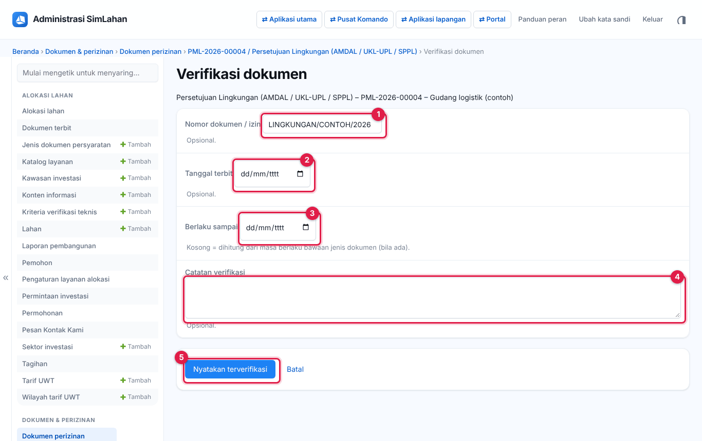

1. Periksa atau isi **Nomor dokumen / izin** (nomor 1) sesuai berkas.
2. Isi **Tanggal terbit** (nomor 2) dan **Berlaku sampai** (nomor 3). Bila **Berlaku sampai** dikosongkan, sistem menghitungnya dari masa berlaku bawaan jenis dokumen.
3. Bila perlu, tulis **Catatan verifikasi** (nomor 4).
4. Klik **Nyatakan terverifikasi** (nomor 5). Status menjadi **Terverifikasi**.

Setiap tindakan tercatat di **Riwayat** dan **Jejak aktivitas**. Sistem mengirim peringatan otomatis sebelum izin kedaluwarsa (jumlah harinya diatur di **Pengaturan dokumen**).

## 7.4 Dokumen tanda tangan elektronik

Dokumen tanda tangan dipakai untuk kontrak, berita acara, surat pernyataan, dan dokumen lain yang perlu ditandatangani atau disetujui pihak lain. Nomornya berformat `DOK-2026-00001`.

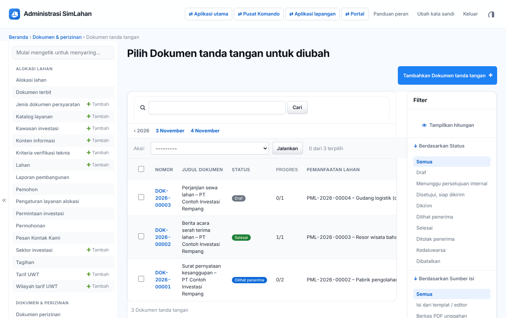

Alur status:

```
Draf → (Menunggu persetujuan internal → Disetujui, siap dikirim) → Dikirim → Dilihat penerima → Selesai
                                                                  ↘ Ditolak penerima / Kedaluwarsa / Dibatalkan
```

Tahap persetujuan internal hanya ada bila **Wajib persetujuan internal sebelum dikirim** dicentang.

### Langkah 1 – Buat draf

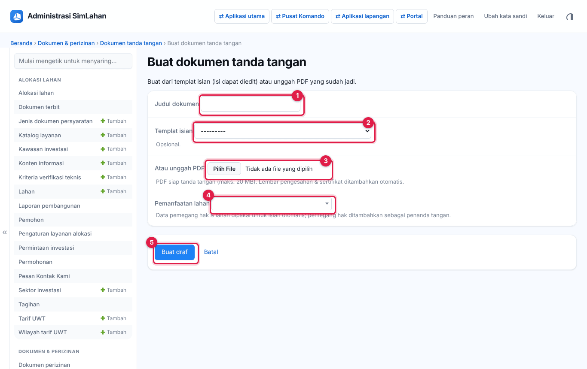

1. Buka **Dokumen tanda tangan**, lalu klik **Tambahkan Dokumen tanda tangan**. Cara lain: klik **Buat dokumen tanda tangan** di halaman pemanfaatan lahan atau di halaman templat.
2. Isi **Judul dokumen** (nomor 1).
3. Pilih isi dokumen, salah satu saja:
   - **Templat isian** (nomor 2): isi disusun dari templat dan masih bisa disunting.
   - **Atau unggah PDF** (nomor 3): klik **Pilih File** dan pilih PDF yang sudah jadi (maksimal 20 MB).
4. Pilih **Pemanfaatan lahan** (nomor 4): ketik nomor atau nama kegiatan, lalu klik pilihannya. Data pemegang hak dan lahan dipakai untuk isian otomatis, dan pemegang hak langsung ditambahkan sebagai penanda tangan.
5. Klik **Buat draf** (nomor 5). Halaman draf terbuka.

### Langkah 2 – Lengkapi draf

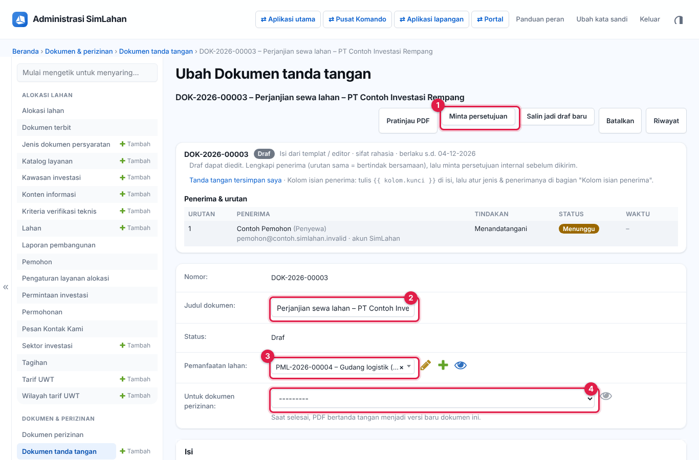

Bagian atas halaman draf menampilkan status **Draf** dan ringkasan penerima. Periksa dan lengkapi:

1. **Judul dokumen** (nomor 2) dan **Pemanfaatan lahan** (nomor 3).
2. Bila dokumen ini untuk memenuhi satu dokumen perizinan, pilih di **Untuk dokumen perizinan** (nomor 4). Setelah selesai ditandatangani, PDF-nya otomatis menjadi versi baru dokumen perizinan itu.
3. Gulir ke bagian **Isi**. Sunting **Isi dokumen** dengan bilah alat editor bila perlu. Isian otomatis seperti nama pemegang hak dan kode lahan sudah terisi sendiri.
4. Gulir ke bagian **Pengiriman**:

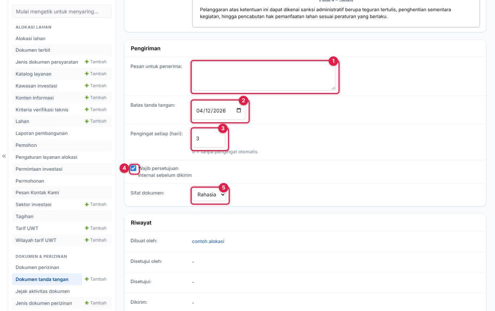

5. Tulis **Pesan untuk penerima** (nomor 1). Pesan ini ikut di surel undangan.
6. Atur **Batas tanda tangan** (nomor 2), yaitu tanggal terakhir penerima boleh bertindak.
7. Atur **Pengingat setiap (hari)** (nomor 3). Isi 0 bila tidak perlu pengingat otomatis.
8. Centang **Wajib persetujuan internal sebelum dikirim** (nomor 4) bila dokumen harus disetujui pejabat lain sebelum dikirim.
9. Pilih **Sifat dokumen** (nomor 5): **Biasa** atau **Rahasia**. Unduhan dokumen rahasia hanya dapat disetujui Administrator.
10. Gulir ke bagian **Penerima (urutan tanda tangan)**. Isi satu baris per orang. Tabelnya lebar; geser ke kanan untuk melihat semua kolom.

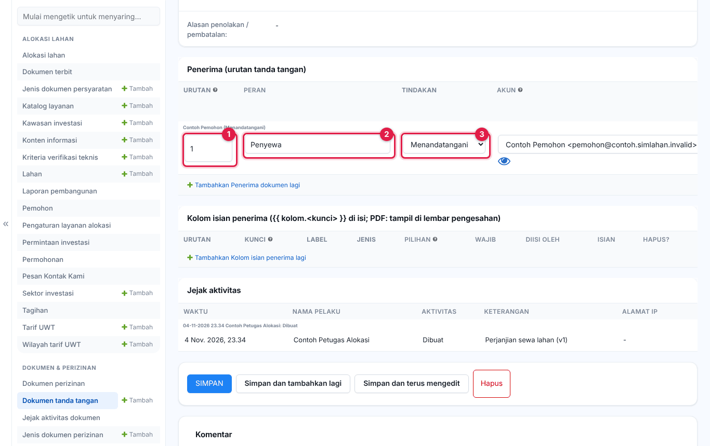

11. **Urutan** (nomor 1): penerima dengan urutan sama bertindak bersamaan; urutan berikutnya menunggu yang sebelumnya selesai.
12. **Peran** (nomor 2), misalnya "Pemegang hak" atau "Pejabat penandatangan".
13. **Tindakan** (nomor 3): **Menandatangani**, **Menyetujui**, atau **Menerima salinan**.

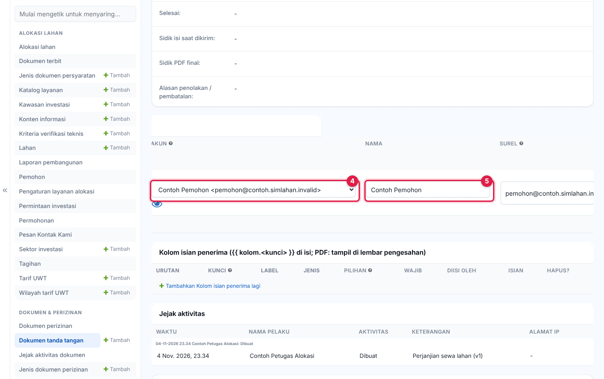

14. **Akun** (nomor 4): pilih akun bila penerima punya akun SimLahan atau portal. Penerima berakun wajib masuk dulu sebelum menandatangani.
15. **Nama** (nomor 5) penerima.

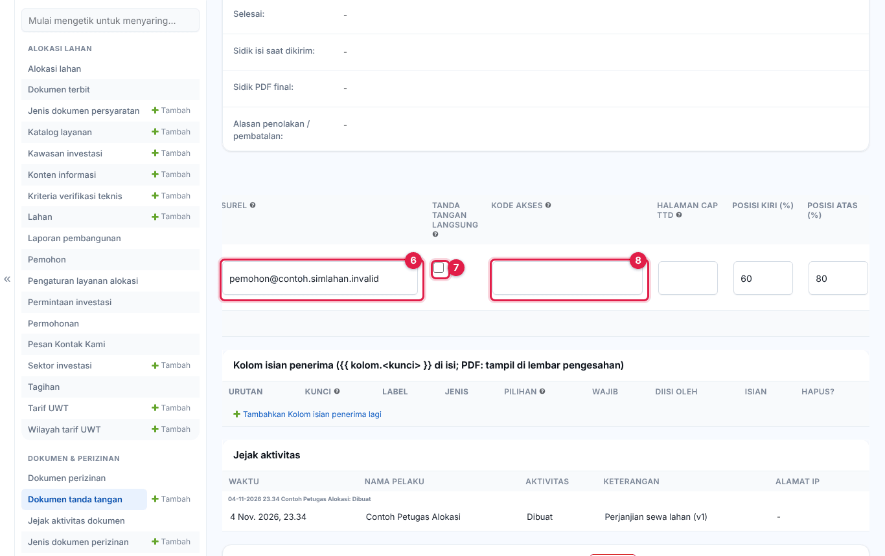

16. **Surel** (nomor 6): alamat tujuan undangan.
17. **Tanda tangan langsung** (nomor 7): centang bila penerima menandatangani di perangkat petugas setelah identitasnya diperiksa, misalnya warga tanpa surel. Surel undangan tidak dikirim.
18. **Kode akses** (nomor 8, opsional): kode tambahan yang Anda sampaikan lewat telepon. Isi `-` untuk menghapus kode yang ada.
19. Khusus PDF unggahan, kolom di kanannya menentukan letak gambar tanda tangan di PDF: **Halaman cap TTD** (1 = halaman pertama, -1 = terakhir), **Posisi kiri (%)**, **Posisi atas (%)**, dan **Lebar cap (%)**.
20. Untuk penerima berikutnya, klik **Tambahkan Penerima dokumen lagi**.
21. Bila penerima perlu mengisi sesuatu, isi tabel **Kolom isian penerima** di bawahnya: **Kunci**, **Label**, **Jenis** (Teks singkat, Teks panjang, Tanggal, Angka, Kotak centang, Pilihan, Paraf, Lampiran berkas), **Diisi oleh**, dan **Wajib**. Di isi dokumen, tulis `{{ kolom.<kunci> }}` di tempat isian itu harus muncul.
22. Klik **Simpan dan terus mengedit** di bagian bawah, lalu klik **Pratinjau PDF** di kanan atas untuk memeriksa hasilnya.

### Langkah 3 – Kirim dan pantau

1. Bila **Wajib persetujuan internal** dicentang, klik **Minta persetujuan** (nomor 1 pada gambar draf). Pejabat lain (bukan pembuat) membuka dokumen lalu klik **Setujui**, atau **Kembalikan ke draf** dengan alasan.
2. Klik **Kirim untuk ditandatangani** di kanan atas. Tombol ini muncul setelah draf disetujui (atau langsung, bila tidak wajib persetujuan). Penerima urutan pertama menerima surel berisi tautan.

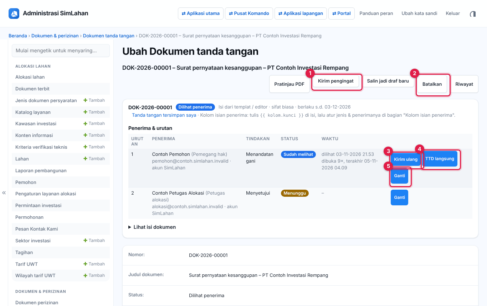

3. Pantau tabel **Penerima & urutan**: status tiap penerima (Menunggu, Sudah melihat, Selesai, Menolak) dan waktunya.
4. Untuk penerima yang belum bertindak:
   - **Kirim ulang** (nomor 3): mengirim ulang surel undangan.
   - **TTD langsung** (nomor 4): membuka sesi tanda tangan di perangkat Anda untuk penerima yang hadir. Catat bukti identitasnya, misalnya "KTP diperiksa".
   - **Ganti** (nomor 5): mengganti penerima, misalnya karena pejabatnya berganti.
5. **Kirim pengingat** (nomor 1) mengirim pengingat ke semua penerima yang belum bertindak.
6. **Batalkan** (nomor 2) menghentikan proses. Alasan wajib ditulis.
7. Gulir ke bawah ke **Komentar** untuk catatan bersama. Centang **Internal (hanya petugas)** bila komentar tidak boleh dilihat penerima.

Setelah semua penerima selesai, status menjadi **Selesai**:

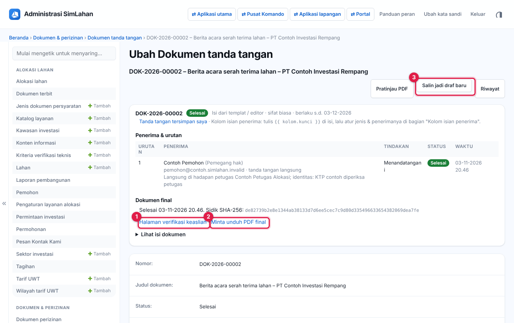

- Bagian **Dokumen final** menampilkan waktu selesai dan **Sidik SHA-256** (sidik digital PDF final).
- **Halaman verifikasi keaslian** (nomor 1): halaman publik untuk memeriksa keaslian PDF.
- **Minta unduh PDF final** (nomor 2): mengajukan permintaan unduh PDF final (lihat 7.7).
- **Salin jadi draf baru** (nomor 3): membuat salinan dokumen, misalnya untuk penerima lain atau setelah ditolak.

### Yang dialami penerima

Penerima membuka tautan di surel. Penerima dengan akun portal cukup masuk dengan akunnya; penerima tanpa akun memasukkan **kode verifikasi 6 angka** yang dikirim ke surelnya (berlaku 10 menit) dan, bila diatur, **kode akses** dari petugas. Ia lalu membaca dokumen, mengisi kolom isian, mencentang persetujuan, menggambar atau mengetik tanda tangan (atau memakai tanda tangan tersimpan), dan klik **Tanda tangani** atau **Setujui**. Ia juga bisa **Tolak dokumen** dengan alasan. Alamat IP dan perangkat tercatat. Rinciannya untuk pemegang hak ada di [Bab 15](53-portal-dokumen.md).

Siapa pun yang memegang PDF final bisa memeriksa keasliannya di portal (**Verifikasi dokumen**, lihat [Bab 12](50-portal-publik.md)).

## 7.5 Templat dokumen dan pustaka konten

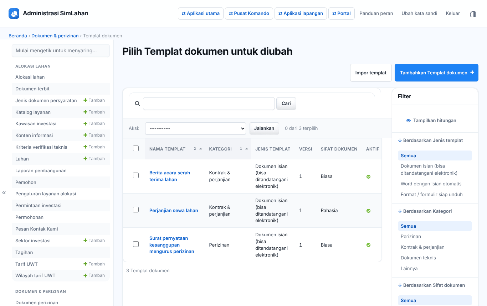

Jenis templat:

- **Dokumen isian (bisa ditandatangani elektronik)**: disusun di editor SimLahan.
- **Word dengan isian otomatis**: berkas .docx yang isiannya diganti otomatis.
- **Format / formulir siap unduh**: berkas apa adanya, untuk diunduh pemegang hak.

### Menyusun templat di editor

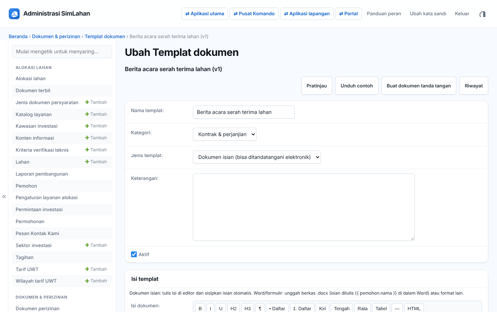

1. Klik **Tambahkan Templat dokumen**. Isi **Nama templat**, **Kategori**, **Jenis templat**, dan **Keterangan**.
2. Tulis **Isi dokumen** dengan bilah alat editor (**B**, **I**, **U**, **H2**, **H3**, **¶**, **• Daftar**, **1. Daftar**, **Kiri**, **Tengah**, **Rata**, **Tabel**, **—** garis, **HTML** untuk melihat kode).
3. Sisipkan isian otomatis, misalnya `{{ pemohon.nama }}` atau `{{ lahan.kode }}`. Sisipkan blok dari pustaka konten dengan `{{ blok.<kode> }}`.
4. Isi **Peran penerima bawaan** (satu peran per baris, berurutan, misalnya "Pemegang hak" lalu "Pejabat penandatangan"), **Sifat dokumen**, **Wajib persetujuan internal sebelum dikirim**, dan **Batas waktu tanda tangan (hari)** (kosong = pengaturan umum).
5. Klik **Simpan dan terus mengedit**. Gunakan **Pratinjau** atau **Unduh contoh** untuk melihat hasil dengan data contoh. Setiap perubahan isi menaikkan **Versi**.
6. Dari templat yang siap, klik **Buat dokumen tanda tangan**.

### Mengimpor templat

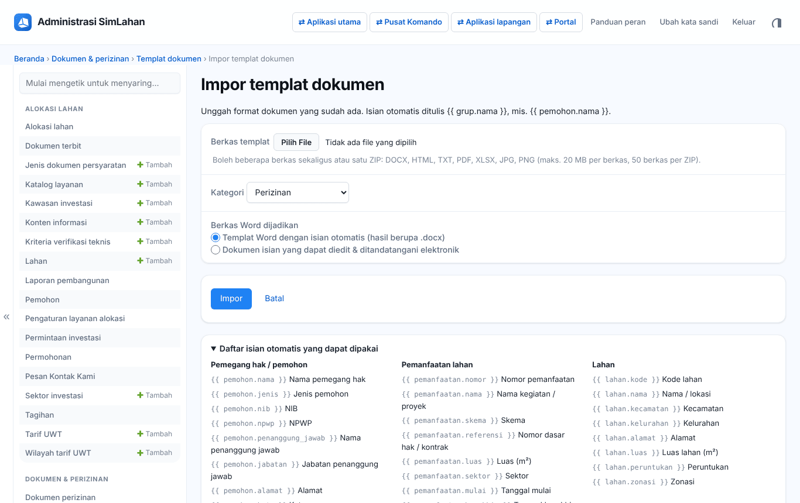

1. Di daftar templat, klik **Impor templat**.
2. Pilih satu atau beberapa berkas (DOCX, HTML, PDF, atau ZIP berisi berkas-berkas itu) dan **Kategori**.
3. Pilih **Berkas Word dijadikan**: **Templat Word dengan isian otomatis** (hasil .docx) atau **Dokumen isian yang dapat diedit & ditandatangani elektronik**.
4. Klik impor. Sistem melaporkan berapa templat diimpor dan berkas mana yang dilewati.

### Pustaka konten

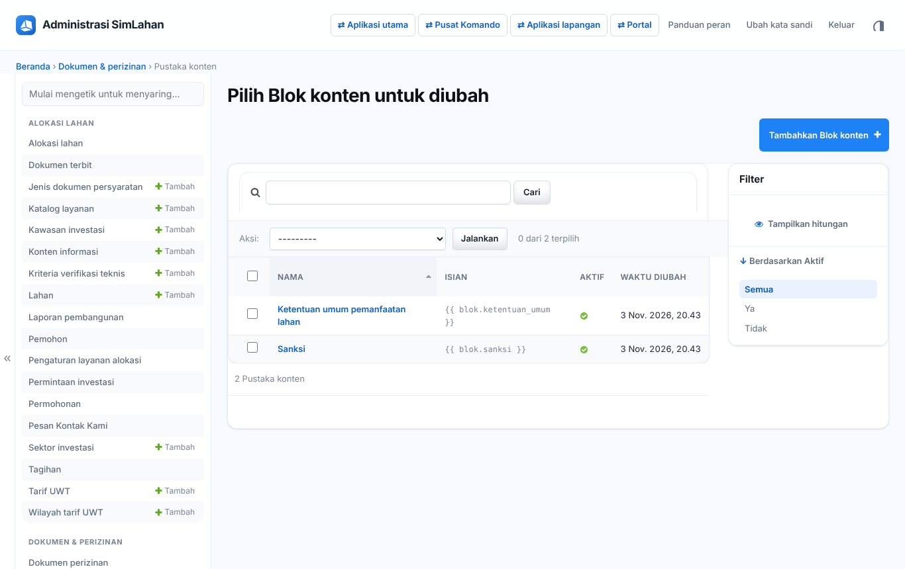

**Pustaka konten** berisi blok teks yang dipakai ulang (misalnya pasal sanksi, kop surat). Isi **Kode** (huruf kecil, angka, garis bawah), **Nama**, dan **Isi**. Di templat, tulis `{{ blok.<kode> }}`. Kolom **Isian** menunjukkan isian otomatis yang dipakai blok itu.

## 7.6 Jenis dokumen perizinan

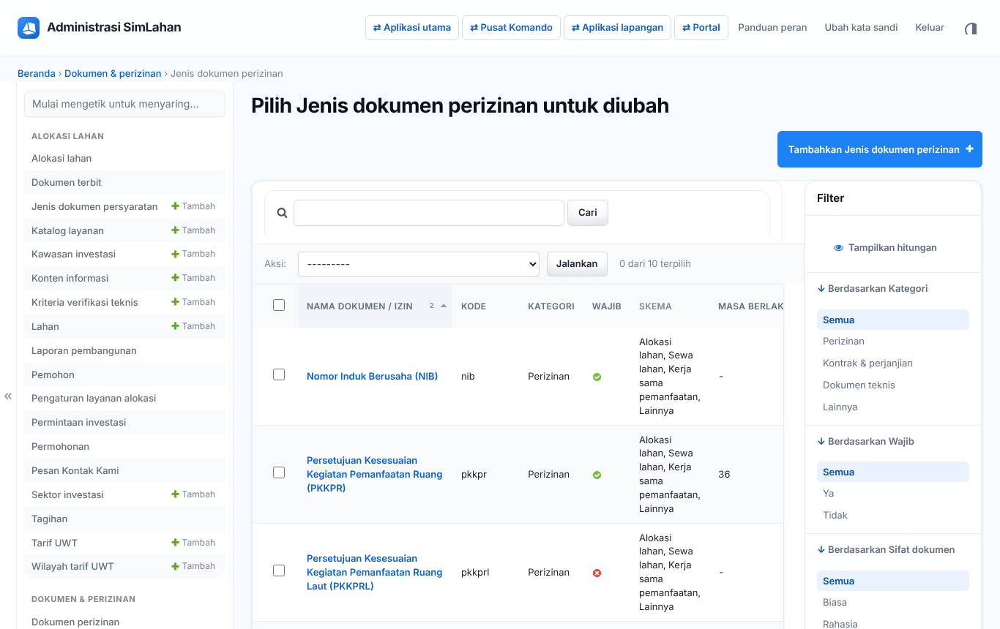

Menentukan dokumen apa saja yang wajib untuk setiap pemanfaatan lahan:

1. Klik **Tambahkan Jenis dokumen perizinan**.
2. Isi **Kode**, **Nama dokumen / izin**, **Kategori**, **Instansi penerbit**, dan **Persyaratan & cara mengurus** (tampil ke pemegang hak di portal).
3. Centang skema yang berlaku: **Berlaku untuk alokasi**, **sewa**, **kerja sama**, **pemanfaatan lainnya**. Batasi ke sektor tertentu di **Hanya untuk sektor** (kosong = semua sektor).
4. Isi **Wajib**, **Masa berlaku bawaan (bulan)** (kosong = tidak kedaluwarsa), **Sifat dokumen**, **Templat / format** (format yang bisa diunduh pemegang hak), dan **Urutan**.
5. Simpan. Untuk menambahkannya ke pemanfaatan lahan yang sudah ada, centang jenis dokumen di daftar, pilih aksi **Terapkan ke pemanfaatan lahan aktif**, lalu klik **Jalankan**.

## 7.7 Permintaan unduh

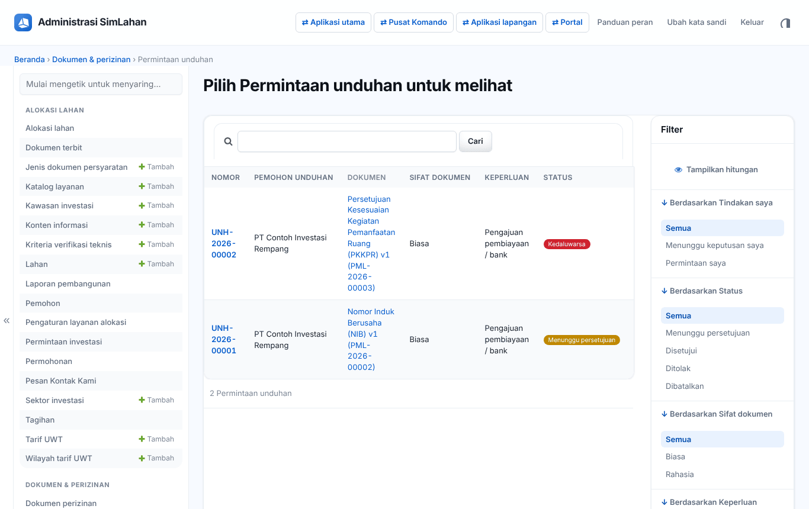

Saringan **Tindakan saya** menampilkan permintaan yang menunggu keputusan Anda.

**Mengajukan permintaan unduh:**

1. Di halaman dokumen perizinan atau dokumen tanda tangan, klik **Minta unduh** (atau **Minta unduh PDF final**).
2. Pilih **Keperluan**: Arsip / administrasi, Pengurusan izin ke instansi lain, Pengajuan pembiayaan / bank, Keperluan hukum / pengadilan, Pemeriksaan / audit, atau Lainnya. Tulis **Alasan**.
3. Kirim, lalu tunggu keputusan. Lihat statusnya di **Permintaan unduh saya**.
4. Setelah **Disetujui**, klik **Unduh sekarang** sebelum masa berlakunya habis. Permintaan yang belum diputuskan bisa dibatalkan dengan **Batalkan permintaan**.

**Memutuskan permintaan unduh:**

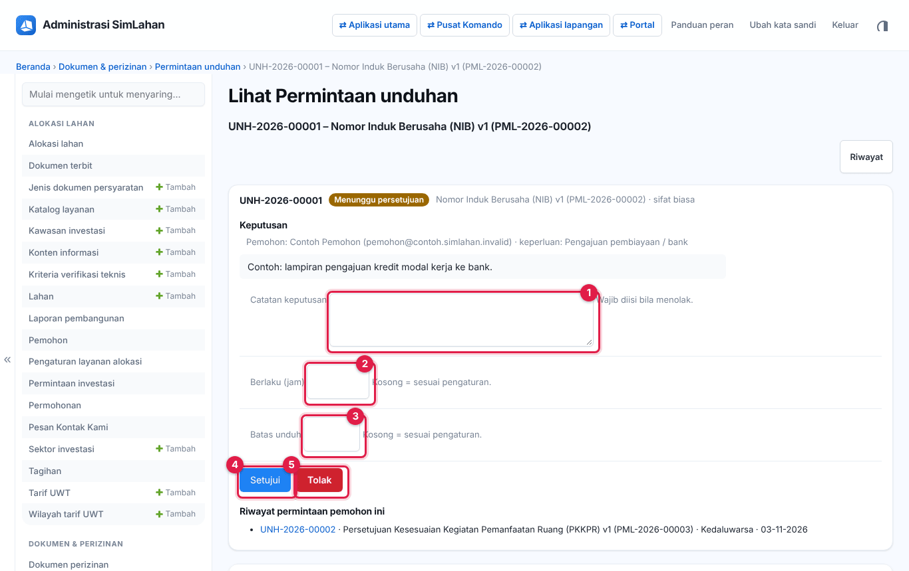

1. Buka permintaan berstatus **Menunggu persetujuan** dari saringan **Tindakan saya** atau dari kartu di dasbor.
2. Di bagian **Keputusan**, baca keperluan dan alasan pemohon. Periksa juga **Riwayat permintaan pemohon ini** di bawahnya.
3. Bila perlu, tulis **Catatan keputusan** (nomor 1). Catatan wajib diisi bila Anda menolak.
4. Bila perlu, ubah **Berlaku (jam)** (nomor 2), yaitu berapa jam izin unduh berlaku, dan **Batas unduh** (nomor 3), yaitu berapa kali berkas boleh diunduh. Kosongkan untuk memakai pengaturan umum.
5. Klik **Setujui** (nomor 4) atau **Tolak** (nomor 5). Pemohon diberi tahu.

Permintaan Anda sendiri harus diputuskan pejabat lain. Dokumen **rahasia** hanya dapat disetujui Administrator.

**Riwayat unduhan** mencatat setiap pratinjau dan unduhan (saringan **Pratinjau** dan **Bertanda air**).

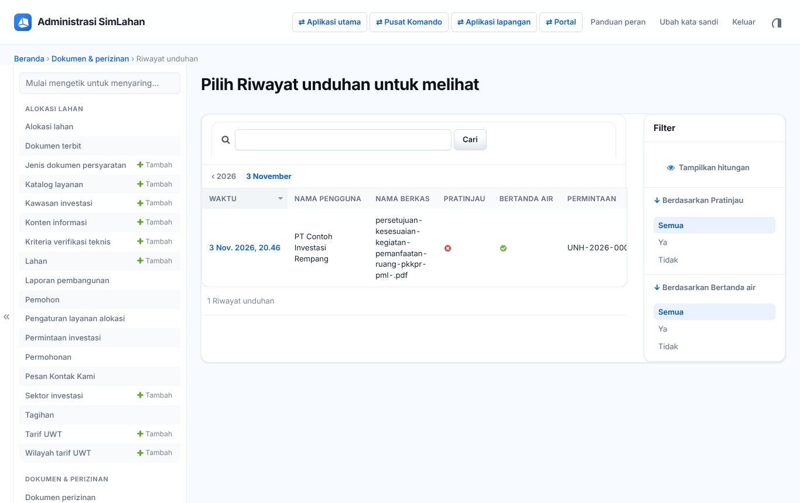

## 7.8 Jejak aktivitas

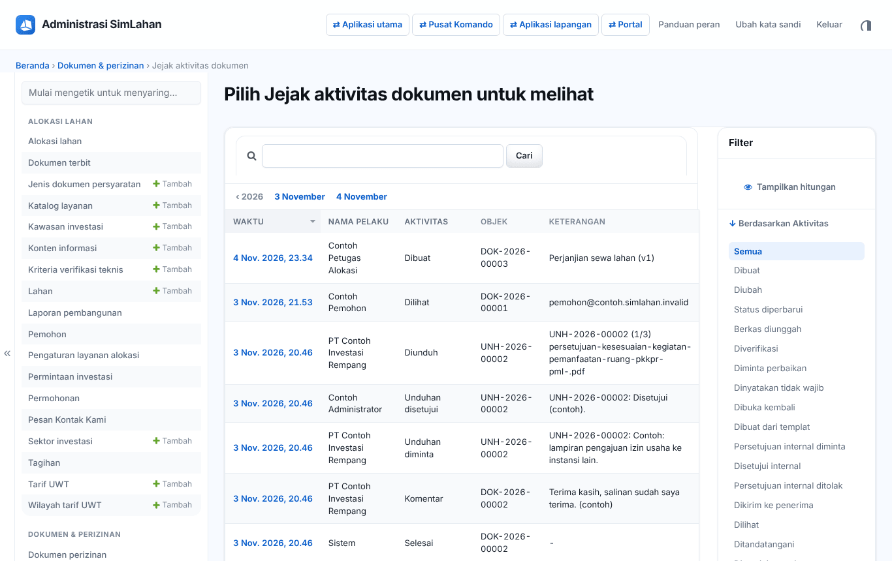

Catatan lengkap semua kejadian di modul ini: dibuat, diubah, berkas diunggah, diverifikasi, diminta perbaikan, dikirim, dilihat, ditandatangani, ditolak, unduhan diminta/disetujui/ditolak, diunduh, dan lainnya. Saring per **Aktivitas**. Catatan ini tidak bisa diubah atau dihapus.

## 7.9 Pengaturan dokumen (Administrator)

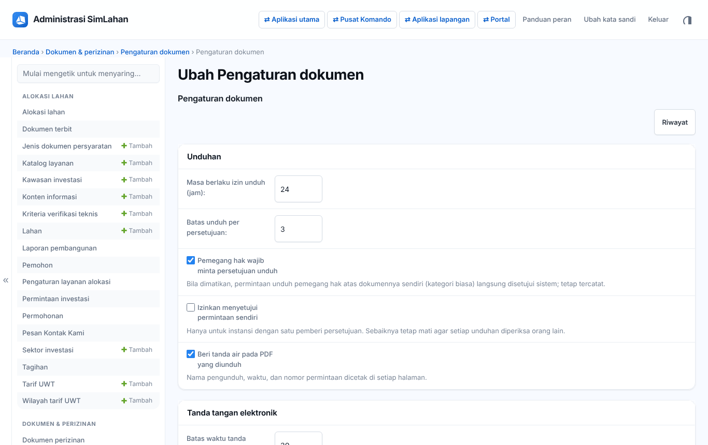

| Bagian | Isian |
|---|---|
| Unduhan | **Masa berlaku izin unduh (jam)**, **Batas unduh per persetujuan**, **Pemegang hak wajib minta persetujuan unduh** (bila dimatikan, unduhan pemegang hak atas dokumen biasanya sendiri langsung disetujui sistem, tetap tercatat), **Izinkan menyetujui permintaan sendiri** (sebaiknya tetap mati), **Beri tanda air pada PDF yang diunduh**. |
| Tanda tangan elektronik | **Batas waktu tanda tangan bawaan (hari)**, **Pengingat penanda tangan setiap (hari)**. |
| Masa berlaku izin | **Peringatan izin akan kedaluwarsa (hari sebelumnya)**. |

## 7.10 Pertanyaan umum

**Tombol Kirim untuk ditandatangani tidak muncul.** Dokumen wajib persetujuan internal dan belum disetujui. Klik **Minta persetujuan** dan minta pejabat lain menyetujuinya.

**Saya tidak bisa menyetujui permintaan unduh.** Permintaan itu milik Anda sendiri, dokumennya rahasia (hanya Administrator), atau peran Anda tidak berhak menyetujui.

**Penerima tidak menerima surel.** Periksa alamat **Surel**, lalu klik **Kirim ulang**. Bila penerima hadir di kantor, gunakan **TTD langsung**.

**Dokumen baru wajib tidak muncul di pemanfaatan lama.** Jalankan aksi **Terapkan ke pemanfaatan lahan aktif** pada jenis dokumen itu.
