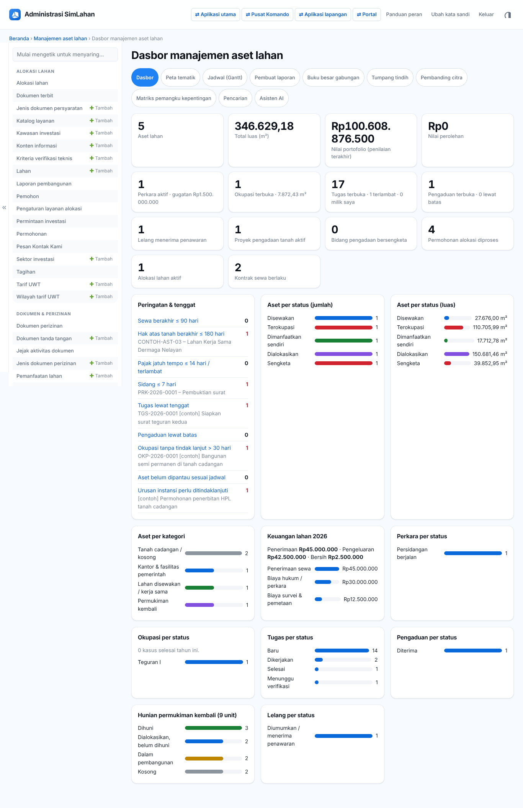
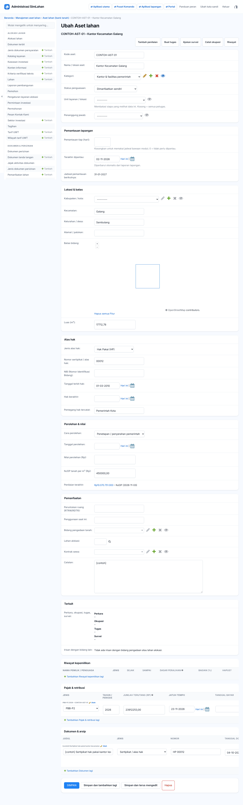

# Bab 8 – Manajemen aset lahan (panel admin)

Modul ini adalah **bank tanah**: daftar seluruh aset lahan beserta alas hak, nilai, pajak, transaksi, perkara, okupasi, permukiman kembali, pengaduan, lelang, survei, dokumen, dan tugas. Semua menu ada di **Panel admin → Manajemen aset lahan**.

**Siapa memakai bab ini:**

| Peran | Yang boleh dilakukan |
|---|---|
| Petugas Aset Lahan | Membuat dan mengubah aset, penilaian, pajak, transaksi, okupasi, permukiman kembali, pengaduan, lelang, dokumen, dan tugas. Membaca perkara. Hanya data unit layanannya. |
| Petugas Hukum | Mengelola perkara, advokat, jadwal sidang, dan dokumen perkara; menindaklanjuti okupasi dan pengaduan; mengelola urusan instansi dan tugas. Membaca aset, kepemilikan, pemangku kepentingan, dan survei. Tidak melihat penilaian, pajak, transaksi, dan peta berbagi. |
| Administrator | Semua, termasuk **Pengaturan modul aset lahan**. |
| Petugas Lapangan | Membuat laporan lapangan, okupasi dan tindakan teguran; menindaklanjuti pengaduan, survei, dan tugas (lihat [Bab 9](31-aplikasi-lapangan.md) dan [Bab 10](40-pusat-komando.md)). |

> **Unit layanan:** setiap data punya kolom **Unit layanan / lokasi**. Petugas hanya melihat data unit layanannya sendiri. Data dengan unit layanan kosong terlihat oleh semua petugas.

## 8.1 Dasbor aset lahan

Buka **Manajemen aset lahan → Dasbor**. Baris tombol di atas adalah jalan pintas ke alat analisis: **Dasbor, Peta tematik, Jadwal (Gantt), Pembuat laporan, Buku besar gabungan, Tumpang tindih, Pembanding citra, Matriks pemangku kepentingan, Pencarian, Asisten AI**.

Kartu angka: jumlah **Aset lahan**, **Total luas (m²)**, **Nilai portofolio (penilaian terakhir)**, **Nilai perolehan**, **Perkara aktif** (dan nilai gugatan), **Okupasi terbuka** (dan luasnya), **Tugas terbuka** (terlambat dan milik saya), **Pengaduan terbuka** (lewat batas), **Lelang menerima penawaran**, serta ringkasan modul lain: **Proyek pengadaan tanah aktif**, **Bidang pengadaan bersengketa**, **Permohonan alokasi diproses**, **Alokasi lahan aktif**, dan **Kontrak sewa berlaku**.

Panel **Peringatan & tenggat** mengumpulkan yang perlu segera ditangani. Klik baris untuk membuka daftarnya:

- Sewa berakhir ≤ N hari, Hak atas tanah berakhir ≤ N hari, Pajak jatuh tempo ≤ N hari / terlambat, Sidang ≤ N hari.
- Tugas lewat tenggat, Pengaduan lewat batas, Okupasi tanpa tindak lanjut > N hari.
- Aset belum dipantau sesuai jadwal, Urusan instansi perlu ditindaklanjuti.

Angka N diatur di **Pengaturan modul aset lahan** (8.14). Di bawahnya ada grafik **Aset per status (jumlah/luas)**, **Aset per kategori**, **Perkara per status**, **Hasil putusan**, **Okupasi per status**, **Tugas per status**, **Pengaduan per status**, **Lelang per status**, dan ringkasan keuangan (**Penerimaan · Pengeluaran · Bersih**).

## 8.2 Data aset lahan

Saringan: **Status penguasaan**, **Kategori**, **Jenis alas hak**, **Cara perolehan**, **Unit layanan / lokasi**, **Kabupaten / kota**. Kolom **Irisan dengan bidang lain** memberi tanda bila batas aset bertumpang tindih.

Status penguasaan: Dikuasai, belum dimanfaatkan · Dimanfaatkan sendiri · Disewakan · Dialokasikan · Dalam proses pengadaan · Sengketa · Terokupasi · Dilepas / dijual.

### Menambah aset

1. Klik **Tambahkan Aset lahan**.
2. Isi **Kode aset**, **Nama / lokasi aset**, **Kategori**, **Status penguasaan**, **Unit layanan / lokasi**, dan **Penanggung jawab**.
3. **Pemantauan lapangan**: **Pemantauan tiap (hari)**. Kosong = jadwal bawaan modul; 0 = tidak perlu dipantau.
4. **Lokasi & batas**: alamat, wilayah, luas, dan gambar batas di peta (klik titik-titik sudut, klik dua kali untuk selesai).
5. **Alas hak**: jenis (SHM, HGB, HGU, Hak Pakai, HPL, girik, belum bersertipikat, lainnya), nomor hak, NIB, tanggal berakhir hak, cara perolehan, nilai perolehan.
6. Di bagian bawah, tambah baris **Riwayat kepemilikan**, **Pajak & retribusi**, dan **Dokumen** bila ada.
7. Klik **Simpan**.

Di halaman aset, tombol kanan atas mempercepat pekerjaan terkait aset itu: **Tambah penilaian**, **Buat tugas**, **Ajukan survei**, dan **Catat okupasi**. Kolom ringkasan menampilkan **Penilaian terakhir** dan jumlah **Perkara, okupasi, tugas, survei**.

### Mengimpor aset dari peta

1. Di daftar aset, klik **Impor SHP/KML/KMZ/GeoJSON**.
2. Pilih berkas hasil ekspor QGIS/ArcGIS: GeoJSON, KML/KMZ (juga dari Google Earth), GeoPackage, atau Shapefile (berkas .shp/.shx/.dbf/.prj dalam satu ZIP).
3. Atribut yang dikenali: `kode`, `nama`, `alamat`, `kecamatan`, `kelurahan`, `nib`, `njop`, `nomor_hak`, `pemegang_hak`, `penggunaan`, `peruntukan`.
4. Aset dengan kode yang sudah ada **diperbarui**; tanpa kode dibuat baru dengan nomor otomatis.

**Ekspor ke Excel:** centang aset di daftar, pilih aksi **Ekspor ke Excel**, klik **Jalankan**.

## 8.3 Peta tematik

1. Klik **Peta tematik** (di dasbor atau daftar aset).
2. Saring dengan **Status penguasaan**, **Kategori**, dan centang **Termasuk okupasi selesai** bila perlu, lalu klik **Terapkan**.
3. Pilih peta dasar, citra, dan lapisan di kotak kanan atas peta: aset, okupasi, bidang pengadaan, lahan alokasi, permukiman kembali, survei, laporan lapangan, dan lapisan peta referensi.
4. Klik bidang untuk melihat rincian dan tautannya.

## 8.4 Keuangan: penilaian, pajak, transaksi, buku besar

**Penilaian aset** mencatat nilai tanah, bangunan & benda, dan total. Metode: NJOP, Penilai publik (KJPP), Penilai internal, Data pasar / pembanding. Rincian benda (bangunan, tanaman, sarana pelengkap) diisi di tabel di bawah formulir.

**Pajak & retribusi**: PBB-P2, BPHTB, Uang Wajib Tahunan, Retribusi daerah, Sewa tanah, Lainnya. Kolom **Status bayar** menunjukkan lunas, belum, atau terlambat. Untuk mencatat pembayaran sekaligus: centang baris, pilih aksi **Tandai lunas hari ini & catat transaksi**, klik **Jalankan**. Sistem membuat transaksi pengeluaran otomatis.

**Transaksi keuangan lahan**: pembelian, penjualan/pelepasan, penerimaan dan pembayaran sewa, ganti kerugian, biaya permukiman kembali, pajak, biaya survei, biaya hukum, biaya lain. Untuk sistem akuntansi, pilih aksi **Ekspor jurnal ERP (CSV)** atau **Ekspor jurnal ERP (Excel)**. Kode akun kas/bank diatur di pengaturan modul.

**Buku besar gabungan** menggabungkan transaksi aset, pembayaran ganti kerugian pengadaan tanah, dan tagihan alokasi yang lunas. Isi **Dari** dan **Sampai**, klik **Tampilkan**, lalu **Ekspor Excel** atau **Ekspor CSV**. Layar menampilkan 1.000 baris pertama; ekspor memuat semua baris.

> Jangan mencatat ulang pembayaran ganti kerugian sebagai transaksi aset, karena sudah otomatis masuk buku besar.

## 8.5 Perkara & litigasi

Saringan: **Status**, **Jenis perkara**, **Forum**, **Hasil**, **Unit layanan / lokasi**. Kolom **Sidang berikutnya** dan **Kasus okupasi terkait** membantu memantau.

Menambah perkara (Petugas Hukum):

1. Klik **Tambahkan Perkara**.
2. Isi nomor perkara pengadilan, pokok perkara, **Jenis perkara** (perdata, TUN, pidana, sengketa batas, eksekusi, keberatan ganti kerugian, lainnya), dan forum (Pengadilan Negeri, PTUN, Pengadilan Tinggi, Mahkamah Agung, Arbitrase, Mediasi, Kepolisian).
3. **Para pihak**: posisi kita (penggugat, tergugat, turut tergugat, pemohon, termohon), pihak lawan, dan **Kuasa hukum** (pindahkan nama dari kotak kiri ke kanan dengan panah).
4. **Objek**: pilih **Aset terkait** dengan cara yang sama, dan nilai gugatan.
5. **Perkembangan**: status (Persiapan, Persidangan berjalan, Putusan tingkat pertama, Banding, Kasasi, Peninjauan kembali, Berkekuatan hukum tetap, Eksekusi, Selesai) dan hasil (Belum ada, Menang, Kalah, Damai, Gugur).
6. Tambah baris **Jadwal sidang** (tanggal, agenda) dan **Dokumen**. Sistem mengingatkan sebelum sidang.

**Advokat / kuasa hukum** dicatat di menunya sendiri (saringan **Biro hukum internal** dan **Aktif**).

## 8.6 Okupasi & perambahan

Saringan: **Status**, **Cara ditemukan**, **Bentuk okupasi**, **Tingkat**, **Unit layanan / lokasi**. Kolom **Tanpa tindak lanjut** menandai kasus yang terlalu lama tidak ditangani.

1. Klik **Tambahkan Kasus okupasi / perambahan** (atau **Catat okupasi** dari halaman aset).
2. **Temuan**: judul, nama pelaku, **Cara ditemukan** (patroli, laporan masyarakat, perbandingan citra, drone, survei, analisis tumpang tindih), bentuk (bangunan permanen/semi permanen, kebun, pagar/patok, galian/timbunan), dan tingkat.
3. **Lokasi**: titik, gambar area, dan luas yang diokupasi.
4. **Bukti citra**: citra sebelum dan sesudah, serta tautan pembanding.
5. Tambah baris **Tindakan penanganan** sesuai urutan: Verifikasi lapangan → Surat teguran I → II → III → Mediasi → Penertiban → Laporan polisi → Lahan kembali dikuasai. Status kasus ikut berubah (Dilaporkan, Terverifikasi, Teguran I–III, Penertiban, Dilimpahkan ke perkara, Selesai / lahan kembali, Tidak terbukti).
6. Bila harus ke pengadilan: centang kasus di daftar, pilih aksi **Limpahkan ke perkara baru**, klik **Jalankan**. Perkara baru dibuat dan ditautkan.

## 8.7 Pengaduan masyarakat

Pengaduan masuk dari portal (`/portal/pengaduan/`), telepon/WhatsApp, surat, datang langsung, atau petugas lapangan. Pelapor menerima nomor pengaduan untuk dicek di portal.

1. Buka pengaduan. Periksa **Pelapor** dan isi **Pengaduan**.
2. Hubungkan ke aset, proyek pengadaan, atau kasus okupasi di bagian **Terkait**.
3. Ubah status: Diterima → Diverifikasi → Ditindaklanjuti → Selesai (atau Tidak dapat ditindaklanjuti).
4. Di **Tindak lanjut**, isi **tanggapan** (terlihat pelapor saat cek status di portal), **catatan internal**, dan tanggal selesai.
5. Bila pengaduan berisi laporan penyerobotan lahan, pilih aksi **Jadikan kasus okupasi** di daftar.

Kolom **Lewat batas** menyala bila melewati batas penyelesaian (diatur per **Kategori pengaduan** atau di pengaturan modul).

## 8.8 Lelang & seleksi lahan

1. Klik **Tambahkan Lelang / seleksi lahan**. Pilih metode **Lelang harga tertinggi** atau **Seleksi proposal (beauty contest)**, objek (aset/lahan), **Nilai limit**, jadwal, dan syarat. Lampirkan dokumen.
2. Di daftar, centang lelang, pilih aksi **Umumkan di portal**. Lelang tampil di `/portal/lelang/` dan peminat bisa mengirim penawaran.
3. Setelah batas waktu, pilih aksi **Tutup penerimaan penawaran**.
4. Evaluasi di menu **Penawaran**: ubah status tiap penawaran menjadi **Lolos evaluasi** atau **Gugur**.
5. Pilih aksi **Tetapkan pemenang (penawaran lolos tertinggi)**. Nama pemenang tampil di halaman lelang di portal.

## 8.9 Permukiman kembali

**Kawasan permukiman kembali** mencatat lokasi relokasi; kolom **Unit**, **Dihuni**, dan **Kosong** dihitung otomatis. **Unit / kavling permukiman kembali** mencatat setiap rumah/kavling dengan status hunian: Kosong, Dalam pembangunan, Dialokasikan (belum dihuni), Dihuni, serta **Rumah tangga terdampak** yang menempatinya.

## 8.10 Kepemilikan, pemangku kepentingan, ahli waris

**Pemangku kepentingan** mencatat instansi, tokoh masyarakat/adat, warga/pemilik, LSM, perusahaan, dan media, beserta **Pengaruh**, **Kepentingan**, **Sikap** (mendukung, netral, menolak, belum diketahui), dan riwayat pertemuan (rapat, sosialisasi, kunjungan, surat, telepon). Tombol **Matriks pengaruh × kepentingan** menampilkan peta strategi pendekatan.

**Silsilah ahli waris** mencatat pewaris dan ahli warisnya (anak, suami/istri, cucu, saudara kandung, orang tua, lainnya). Klik tautan di kolom **Silsilah** untuk melihat pohon keluarga.

## 8.11 Survei, citra, lapisan peta, fasilitator, urusan instansi

**Survei & pemetaan** (pengukuran batas, topografi, drone, inventarisasi, identifikasi pemilik, objek ganti kerugian, digitalisasi warkah). Status: Diajukan → Dijadwalkan → Berlangsung → Selesai. Setelah hasil ukur diunggah, pilih aksi **Terapkan batas hasil ukur ke aset** agar batas aset diperbarui.

**Citra satelit & foto udara** mencatat pengadaan citra (diminta, dipesan, tersedia, batal), wahana (satelit, drone, pesawat), jenis data, dan penyedia. Isi URL ubin/WMS agar citra muncul di peta. **Pembanding citra** menampilkan dua citra berdampingan: pilih dua citra, klik **Bandingkan**, lalu geser pembatas. Area kasus dan batas aset ditandai kuning.

**Lapisan peta referensi** (batas administrasi, kadaster, sungai, jalan, kawasan hutan, RTRW/RDTR, utilitas, dsb.) diunggah sekali lalu tampil di peta tematik. Centang **Tampil di pusat komando** agar muncul juga di peta komando.

**Fasilitator & pendamping** (pendamping masyarakat, mediator, konsultan, penghubung instansi, penilai, surveyor berlisensi) dan **Urusan instansi pemerintah** (mutasi hak, cek sertipikat, pengukuran BPN, KKPR, PBG, persetujuan lingkungan, urusan pajak, dsb.; status Persiapan berkas → Diajukan → Diproses instansi → Selesai/Ditolak).

## 8.12 Dokumen & arsip, tugas, tim, laporan lapangan

**Dokumen & arsip**: unggah sertipikat, akta, putusan, surat, peta, foto, laporan, perjanjian, izin, bukti pajak. Untuk membaca teks pindaian, centang dokumen dan pilih aksi **Baca teks dokumen (OCR)**. Setelah terbaca, buka dokumen dan klik **Terapkan data ke aset** untuk mengisi kolom aset yang masih kosong. Teks hasil OCR juga ikut dicari di **Pencarian**.

**Tugas & perintah kerja**: judul, jenis (survei, verifikasi, administrasi, hukum, patroli, pemeliharaan aset), **Prioritas** (Rendah, Normal, Tinggi, Mendesak), penerima, **Kontributor lapangan**, tenggat, Korwil, dan objek terkait. Status: Baru → Dikerjakan → Menunggu verifikasi / Menunggu pihak lain → Selesai (atau Batal). Tugas untuk petugas lapangan juga muncul di tab **Tugas** pusat komando. **Tampilan Gantt** menampilkan tugas dan tonggak pengadaan pada garis waktu (isi **Dari**/**Sampai**, centang **Tugas saya saja**, klik **Terapkan**).

**Tim internal** mengelompokkan petugas; kolom **Anggota** dan **Tugas terbuka** dihitung otomatis.

**Laporan lapangan** dikirim petugas dari aplikasi lapangan (patroli rutin, temuan okupasi, kondisi aset, catatan survei, patok batas) beserta foto dan titik GPS. Bila berisi temuan penyerobotan, centang laporan dan pilih aksi **Jadikan kasus okupasi**.

## 8.13 Alat analisis

**Pembuat laporan:** pilih dataset (aset, pajak, transaksi, perkara, jadwal sidang, okupasi, survei, tugas, pengaduan, urusan instansi, lelang, hunian permukiman kembali, pemangku kepentingan, kontrak sewa, bidang pengadaan tanah), saring dengan **Kata kunci**, status, **Dari**/**Sampai**, centang **Kolom** yang dibutuhkan, klik **Tampilkan**, lalu **Ekspor Excel**, **Ekspor CSV**, atau **Ekspor PDF**. Dataset yang tidak boleh Anda lihat tidak muncul.

**Tumpang tindih:** daftar aset yang batasnya saling beririsan (≥ 1 m²) dan aset yang beririsan dengan bidang pengadaan atau lahan alokasi. Irisan menandakan klaim ganda atau kesalahan ukur; perbaiki batas atau ajukan survei ulang.

**Pencarian:** ketik kata kunci lalu klik **Cari**. Sistem mencari kode, nama, nomor hak, NIB, pihak, dan isi teks dokumen hasil OCR di semua modul yang boleh Anda akses.

**Asisten AI:** ketik pertanyaan biasa (misalnya "sewa yang berakhir 90 hari lagi" atau "okupasi terbuka di Galang"), klik **Tanya**. Jawaban berupa teks dan tabel yang bisa diunduh sebagai **Excel**, **PDF**, atau **CSV**. Klik **Mulai percakapan baru** untuk topik lain. Bila layanan AI belum diaktifkan Administrator, asisten tetap menjawab pertanyaan umum dengan pencocokan pola (sewa, okupasi, alokasi, pemantauan, sidang, pajak, tugas, pengaduan, perkara, keuangan, lokasi).

**Peta berbagi (tautan publik):** membuat tautan peta untuk pihak luar tanpa akun. Isi **Judul peta**, pilih **Aset ditampilkan**, **Bidang proyek pengadaan**, atau **Kawasan permukiman kembali**, centang **Tampilkan nama pemegang hak** bila boleh, isi **Berlaku sampai**, lalu simpan. Salin **Tautan publik** dan bagikan. Hapus centang **Aktif** untuk mematikan tautan. Kolom **Dilihat** menghitung kunjungan. Contoh tampilannya ada di [Bab 9](31-aplikasi-lapangan.md#92-peta-berbagi).

## 8.14 Kategori dan pengaturan modul

**Kategori aset** (nama, **Warna peta** format #RRGGBB, aktif) dan **Kategori pengaduan** (dengan **Batas penyelesaian (hari)**; kosong = pengaturan modul).

**Pengaturan modul aset lahan** (Administrator):

| Bagian | Isian |
|---|---|
| Modul aktif | Nyalakan/matikan: Kepemilikan, silsilah & pemangku kepentingan · Penilaian, pajak & keuangan · Perkara & advokat · Okupasi & citra satelit · Permukiman kembali · Survei, fasilitator & urusan instansi · Tugas & tim · Pengaduan masyarakat · Lelang / seleksi lahan. Menu yang dimatikan hilang dari panel. |
| Pengingat & batas waktu | Pengingat sewa berakhir, hak atas tanah berakhir, jatuh tempo pajak, sidang (hari sebelumnya); batas penyelesaian pengaduan (hari); okupasi tanpa tindak lanjut ditandai setelah (hari); pemantauan lapangan aset tiap (hari). |
| Jurnal ERP | Kode akun kas/bank untuk ekspor jurnal. |

## 8.15 Pertanyaan umum

**Saya tidak melihat aset yang dibuat rekan.** Aset itu milik unit layanan lain. Minta Administrator memeriksa **Unit layanan / lokasi** aset atau akun Anda.

**Menu Penilaian/Pajak tidak ada.** Peran Anda (misalnya Petugas Hukum) tidak berhak, atau modulnya dimatikan di pengaturan.

**Citra tidak muncul di pembanding.** Citra belum punya URL ubin/WMS. Lengkapi di **Citra satelit & foto udara**.
