# Bab 8 – Manajemen aset lahan (panel admin)

Modul ini adalah **bank tanah**: daftar seluruh aset lahan beserta alas hak, nilai, pajak, transaksi, perkara, okupasi, permukiman kembali, pengaduan, lelang, survei, dokumen, dan tugas. Semua menu ada di **Panel admin → Manajemen aset lahan**.

**Siapa memakai bab ini:**

| Peran | Yang boleh dilakukan |
|---|---|
| Petugas Aset Lahan | Membuat dan mengubah aset, penilaian, pajak, transaksi, okupasi, permukiman kembali, pengaduan, lelang, dokumen, dan tugas. Membaca perkara. Hanya data unit layanannya. |
| Petugas Hukum | Mengelola perkara, advokat, jadwal sidang, dan dokumen perkara; menindaklanjuti okupasi dan pengaduan; mengelola urusan instansi dan tugas. Membaca aset, kepemilikan, pemangku kepentingan, dan survei. Tidak melihat penilaian, pajak, transaksi, dan peta berbagi. |
| Administrator | Semua, termasuk **Pengaturan modul aset lahan**. |
| Petugas Lapangan | Membuat laporan lapangan, okupasi dan tindakan teguran; menindaklanjuti pengaduan, survei, dan tugas (lihat [Bab 9](31-aplikasi-lapangan.md) dan [Bab 10](40-pusat-komando.md)). |

> **Unit layanan:** setiap data punya kolom **Unit layanan / lokasi**. Petugas hanya melihat data unit layanannya sendiri. Data dengan unit layanan kosong terlihat oleh semua petugas.

## 8.1 Dasbor aset lahan

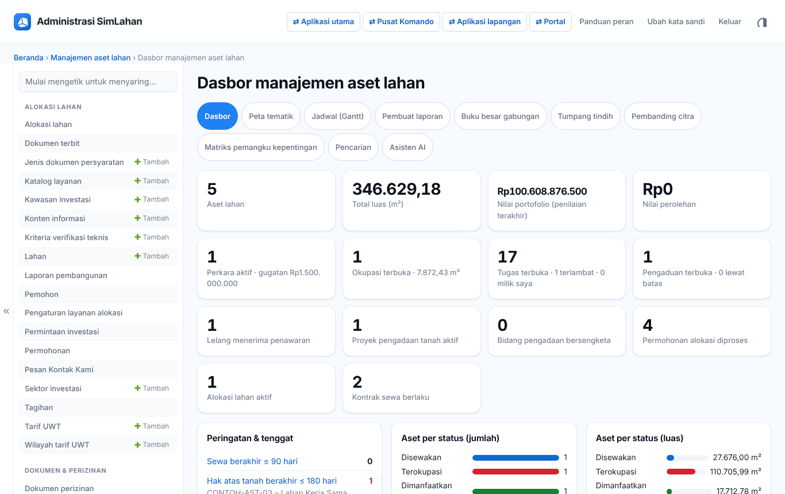

Buka **Manajemen aset lahan → Dasbor**. Baris tombol di atas adalah jalan pintas ke alat analisis: **Dasbor, Peta tematik, Jadwal (Gantt), Pembuat laporan, Buku besar gabungan, Tumpang tindih, Pembanding citra, Matriks pemangku kepentingan, Pencarian, Asisten AI**.

Kartu angka: jumlah **Aset lahan**, **Total luas (m²)**, **Nilai portofolio (penilaian terakhir)**, **Nilai perolehan**, **Perkara aktif** (dan nilai gugatan), **Okupasi terbuka** (dan luasnya), **Tugas terbuka** (terlambat dan milik saya), **Pengaduan terbuka** (lewat batas), **Lelang menerima penawaran**, serta ringkasan modul lain: **Proyek pengadaan tanah aktif**, **Bidang pengadaan bersengketa**, **Permohonan alokasi diproses**, **Alokasi lahan aktif**, dan **Kontrak sewa berlaku**.

Panel **Peringatan & tenggat** mengumpulkan yang perlu segera ditangani. Klik baris untuk membuka daftarnya:

- Sewa berakhir ≤ N hari, Hak atas tanah berakhir ≤ N hari, Pajak jatuh tempo ≤ N hari / terlambat, Sidang ≤ N hari.
- Tugas lewat tenggat, Pengaduan lewat batas, Okupasi tanpa tindak lanjut > N hari.
- Aset belum dipantau sesuai jadwal, Urusan instansi perlu ditindaklanjuti.

Angka N diatur di **Pengaturan modul aset lahan** (8.14).

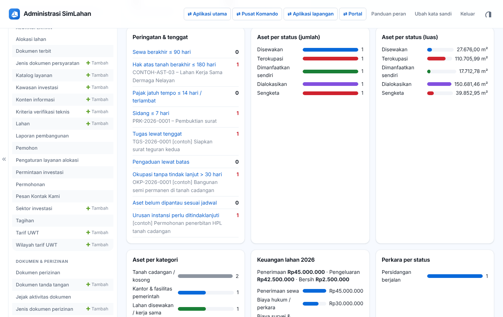

Di bawahnya ada grafik **Aset per status (jumlah/luas)**, **Aset per kategori**, **Perkara per status**, **Hasil putusan**, **Okupasi per status**, **Tugas per status**, **Pengaduan per status**, **Lelang per status**, dan ringkasan keuangan (**Penerimaan · Pengeluaran · Bersih**).

## 8.2 Data aset lahan

Buka **Manajemen aset lahan → Aset lahan**.

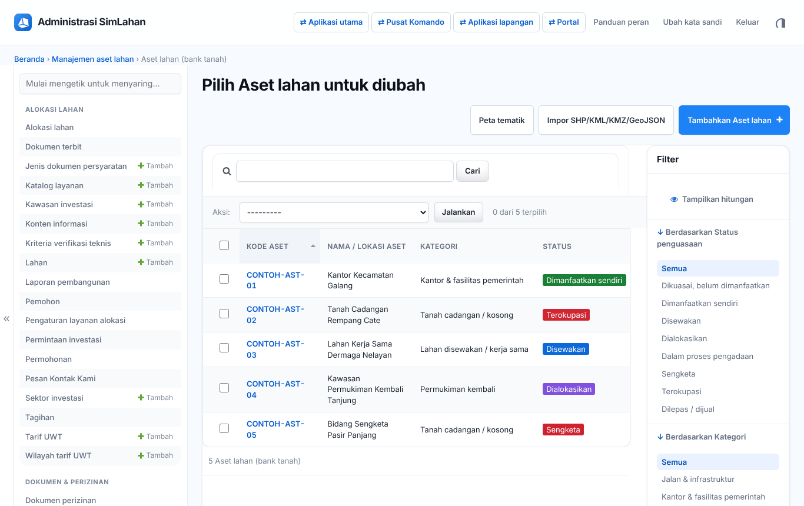

- **Tambahkan Aset lahan** (nomor 1): menambah satu aset.
- **Impor SHP/KML/KMZ/GeoJSON** (nomor 2): menambah atau memperbarui banyak aset dari berkas peta.
- **Peta tematik** (nomor 3): menampilkan semua aset di peta (lihat 8.3).
- **Kotak cari** (nomor 4): cari kode, nama, nomor hak, atau NIB, lalu klik **Cari**.
- **Filter** (nomor 5) di kanan: saring per **Status penguasaan**, **Kategori**, **Jenis alas hak**, **Cara perolehan**, **Unit layanan / lokasi**, atau **Kabupaten / kota**.
- **Aksi** (nomor 6): tindakan untuk aset yang dicentang, misalnya **Ekspor ke Excel**.

Kolom **Irisan dengan bidang lain** memberi tanda bila batas aset bertumpang tindih.

Status penguasaan: Dikuasai, belum dimanfaatkan · Dimanfaatkan sendiri · Disewakan · Dialokasikan · Dalam proses pengadaan · Sengketa · Terokupasi · Dilepas / dijual.

### Menambah atau mengubah aset

Klik **Tambahkan Aset lahan**, atau klik kode aset di daftar untuk mengubahnya.

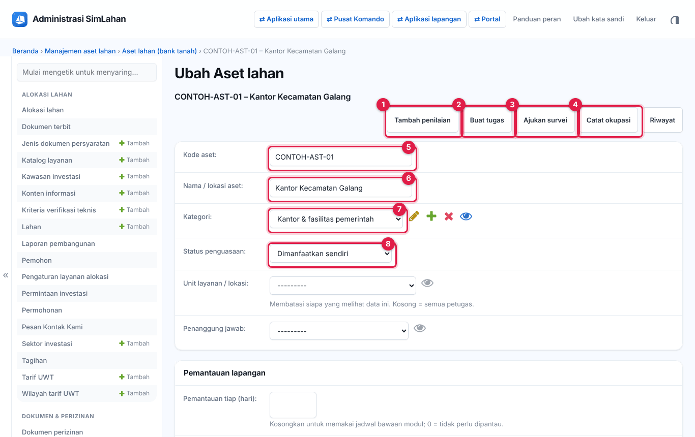

Tombol di kanan atas halaman aset (muncul setelah aset disimpan) mempercepat pekerjaan terkait aset itu:

- **Tambah penilaian** (nomor 1): membuka formulir penilaian dengan aset ini sudah terpilih.
- **Buat tugas** (nomor 2): membuat tugas atau perintah kerja untuk aset ini.
- **Ajukan survei** (nomor 3): mengajukan survei atau pengukuran.
- **Catat okupasi** (nomor 4): mencatat temuan okupasi di aset ini.

Mengisi data aset:

1. Isi **Kode aset** (nomor 5) dan **Nama / lokasi aset** (nomor 6).
2. Pilih **Kategori** (nomor 7) dan **Status penguasaan** (nomor 8). Di bawahnya, pilih **Unit layanan / lokasi** dan **Penanggung jawab**.
3. Bagian **Pemantauan lapangan**: isi **Pemantauan tiap (hari)**. Kosongkan untuk memakai jadwal bawaan modul; isi 0 bila aset tidak perlu dipantau.
4. Gulir ke bagian **Lokasi & batas**:

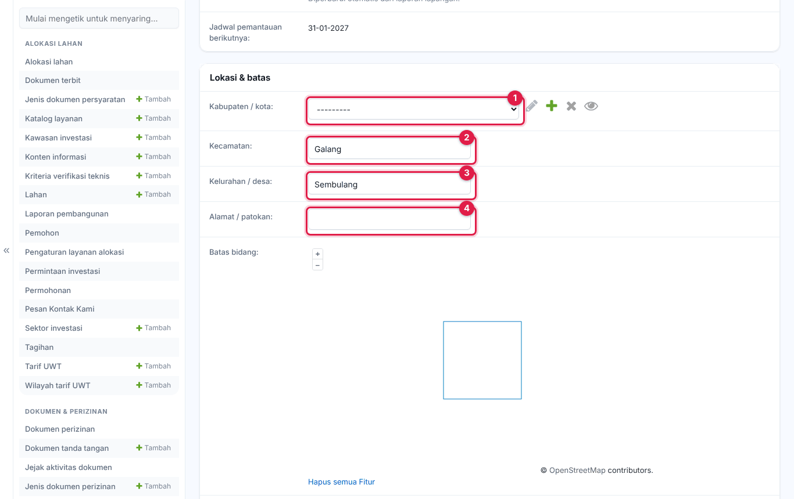

5. Pilih **Kabupaten / kota** (nomor 1), lalu isi **Kecamatan** (nomor 2), **Kelurahan / desa** (nomor 3), dan **Alamat** (nomor 4).
6. Di peta di bawahnya, gambar batas aset: klik titik-titik sudut satu per satu, lalu klik dua kali di titik terakhir untuk selesai. Isi **Luas (m²)** bila tidak ingin dihitung dari gambar.
7. Bagian **Alas hak**: pilih jenis (SHM, HGB, HGU, Hak Pakai, HPL, girik, belum bersertipikat, lainnya), lalu isi nomor hak, NIB, dan tanggal berakhir hak.
8. Bagian **Perolehan & nilai** dan **Pemanfaatan**: isi cara perolehan, nilai perolehan, dan penggunaan aset saat ini.
9. Gulir ke bagian paling bawah:

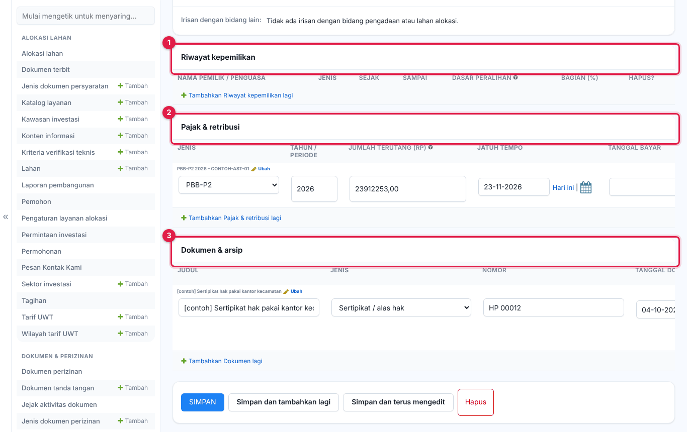

   Tambah baris **Riwayat kepemilikan** (nomor 1), **Pajak & retribusi** (nomor 2), dan **Dokumen & arsip** (nomor 3) bila ada. Klik **Tambahkan … lagi** di bawah tiap tabel untuk baris berikutnya.

10. Klik **Simpan**.

Kolom ringkasan di halaman aset menampilkan **Penilaian terakhir** dan jumlah **Perkara, okupasi, tugas, survei** yang terkait.

### Mengimpor aset dari peta

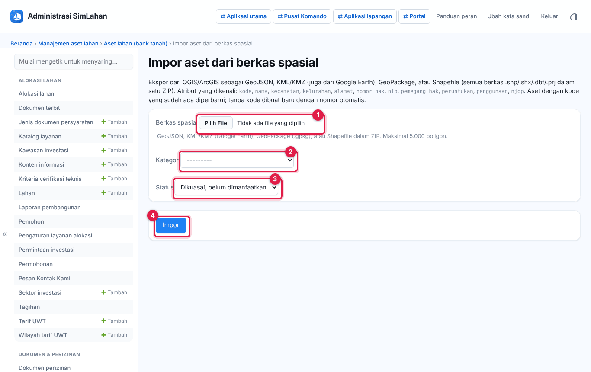

1. Di daftar aset, klik **Impor SHP/KML/KMZ/GeoJSON**.
2. Klik **Pilih File** (nomor 1) dan pilih berkas hasil ekspor QGIS/ArcGIS: GeoJSON, KML/KMZ (juga dari Google Earth), GeoPackage, atau Shapefile (berkas .shp/.shx/.dbf/.prj dalam satu ZIP). Atribut yang dikenali: `kode`, `nama`, `alamat`, `kecamatan`, `kelurahan`, `nib`, `njop`, `nomor_hak`, `pemegang_hak`, `penggunaan`, `peruntukan`.
3. Pilih **Kategori** (nomor 2) dan **Status penguasaan** (nomor 3) untuk aset yang tidak menyebutkannya di berkas.
4. Klik **Impor** (nomor 4). Aset dengan kode yang sudah ada **diperbarui**; aset tanpa kode dibuat baru dengan nomor otomatis.

**Ekspor ke Excel:** centang aset di daftar, pilih aksi **Ekspor ke Excel**, klik **Jalankan**.

## 8.3 Peta tematik

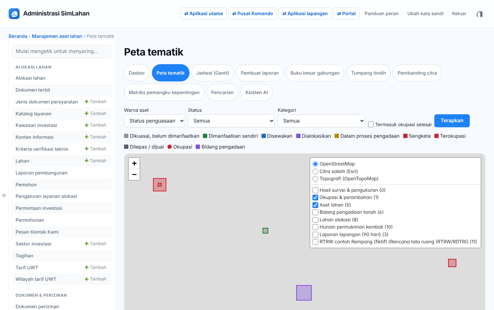

1. Klik **Peta tematik** (di dasbor atau daftar aset).
2. Pilih **Warna aset** (nomor 1): warnai bidang menurut **Status penguasaan** atau **Kategori**.
3. Saring dengan **Status** (nomor 2) dan **Kategori** (nomor 3). Centang **Termasuk okupasi selesai** bila kasus yang sudah selesai juga ingin ditampilkan.
4. Klik **Terapkan** (nomor 4).
5. Arahkan tetikus ke kotak lapisan di kanan atas peta (nomor 5) untuk memilih peta dasar, citra, dan lapisan yang tampil: aset, okupasi, bidang pengadaan, lahan alokasi, permukiman kembali, survei, laporan lapangan, dan lapisan peta referensi.
6. Klik bidang di peta untuk melihat rincian dan tautannya.

> Di sistem latihan, peta dasar bisa tampak abu-abu bila komputer tidak terhubung ke internet. Batas bidang tetap tampil.

## 8.4 Keuangan: penilaian, pajak, transaksi, buku besar

**Penilaian aset**

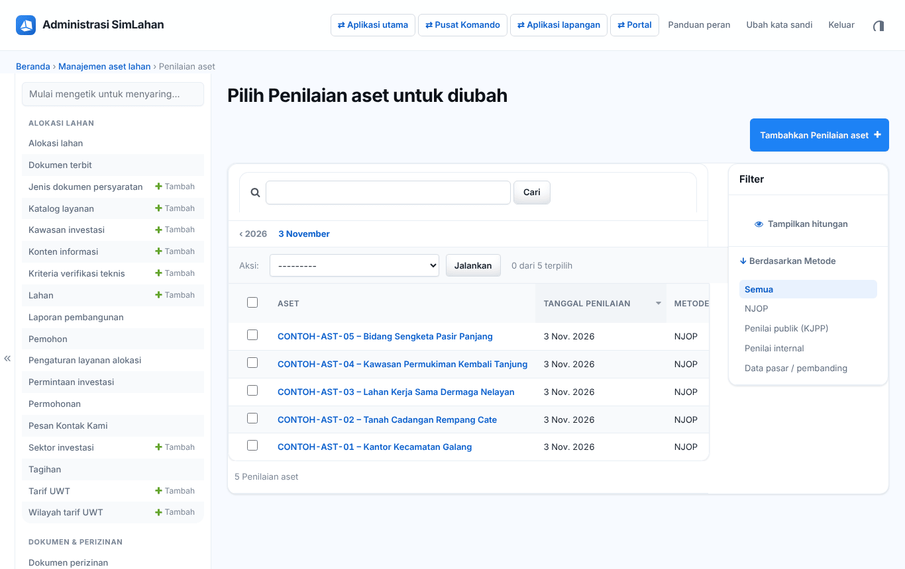

Penilaian mencatat nilai tanah, bangunan & benda, dan total. Metode: NJOP, Penilai publik (KJPP), Penilai internal, Data pasar / pembanding. Rincian benda (bangunan, tanaman, sarana pelengkap) diisi di tabel di bawah formulir. Klik **Tambahkan Penilaian aset** untuk mencatat penilaian baru.

**Pajak & retribusi**

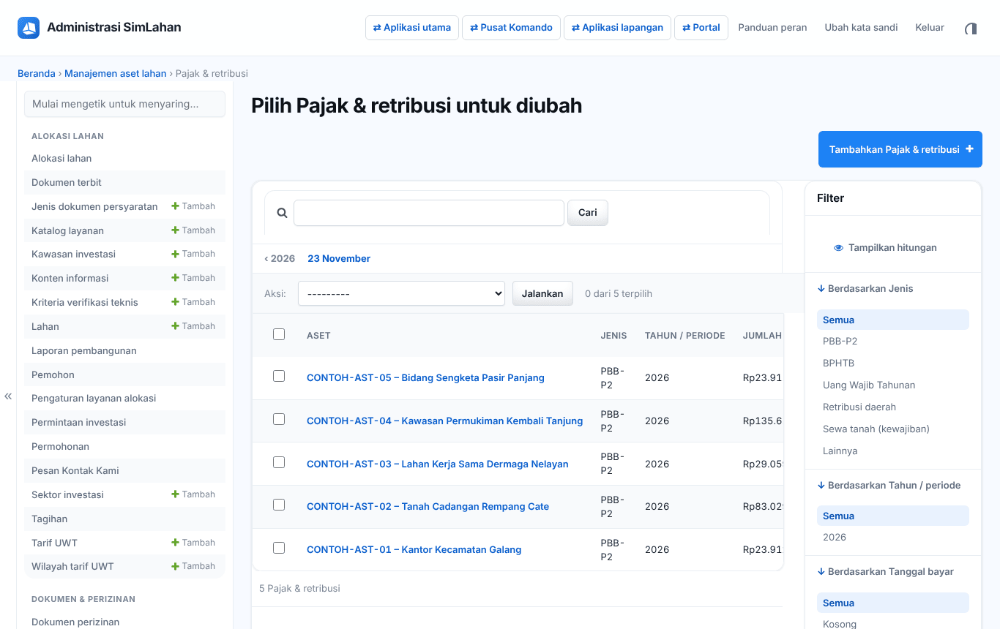

Jenisnya: PBB-P2, BPHTB, Uang Wajib Tahunan, Retribusi daerah, Sewa tanah, Lainnya. Kolom **Status bayar** menunjukkan lunas, belum, atau terlambat. Untuk mencatat pembayaran sekaligus: centang baris, pilih aksi **Tandai lunas hari ini & catat transaksi** di kotak **Aksi** (nomor 1), lalu klik **Jalankan**. Sistem membuat transaksi pengeluaran otomatis.

**Transaksi keuangan lahan**

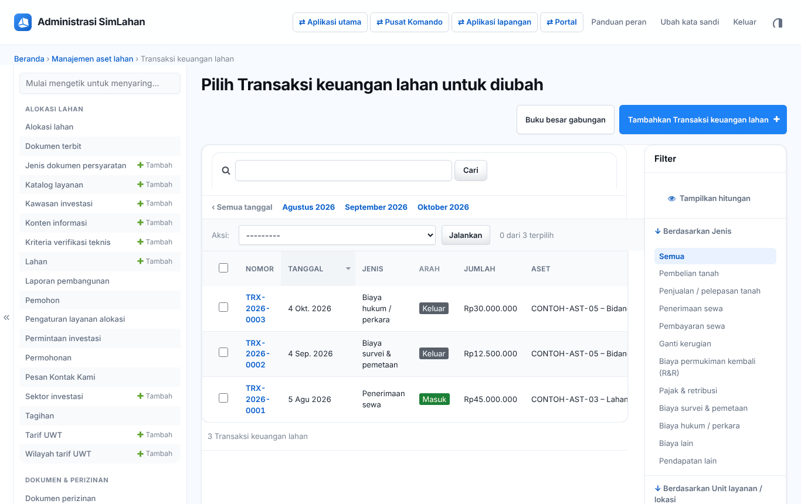

Jenisnya: pembelian, penjualan/pelepasan, penerimaan dan pembayaran sewa, ganti kerugian, biaya permukiman kembali, pajak, biaya survei, biaya hukum, biaya lain. Untuk sistem akuntansi, centang transaksi, pilih aksi **Ekspor jurnal ERP (CSV)** atau **Ekspor jurnal ERP (Excel)** di kotak **Aksi** (nomor 1), lalu klik **Jalankan**. Kode akun kas/bank diatur di pengaturan modul.

**Buku besar gabungan** menggabungkan transaksi aset, pembayaran ganti kerugian pengadaan tanah, dan tagihan alokasi yang lunas.

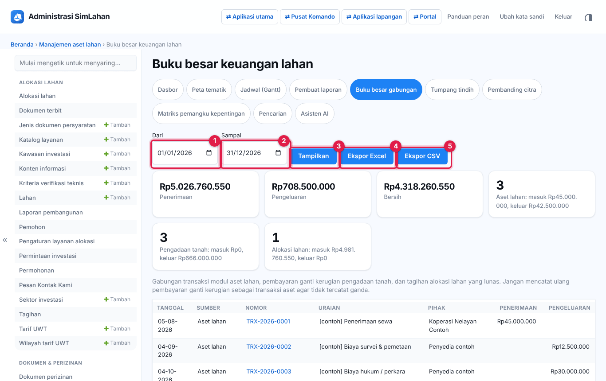

1. Isi tanggal **Dari** (nomor 1) dan **Sampai** (nomor 2).
2. Klik **Tampilkan** (nomor 3). Layar menampilkan 1.000 baris pertama.
3. Klik **Ekspor Excel** (nomor 4) atau **Ekspor CSV** (nomor 5) untuk mengunduh semua baris.

> Jangan mencatat ulang pembayaran ganti kerugian sebagai transaksi aset, karena sudah otomatis masuk buku besar.

## 8.5 Perkara & litigasi

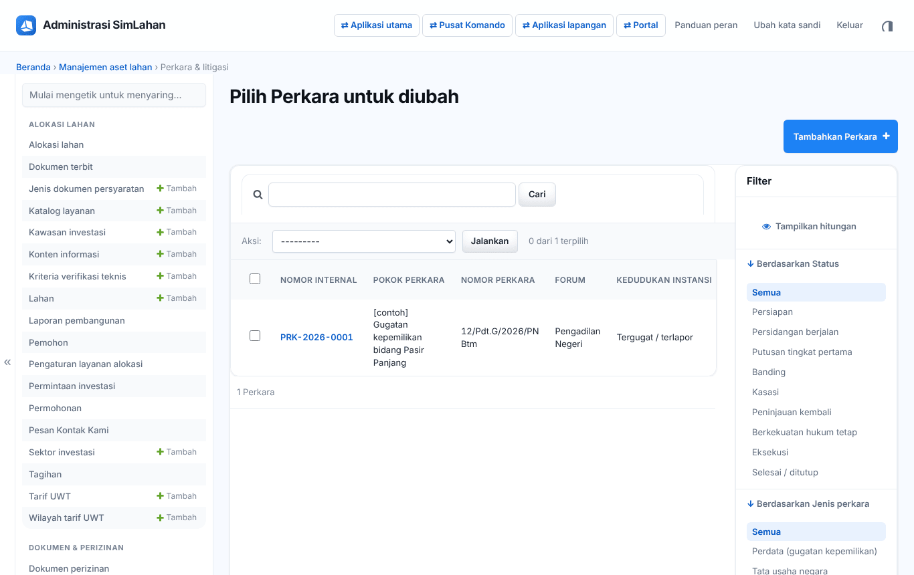

Saringan: **Status**, **Jenis perkara**, **Forum**, **Hasil**, **Unit layanan / lokasi**. Kolom **Sidang berikutnya** dan **Kasus okupasi terkait** membantu memantau.

**Menambah perkara** (Petugas Hukum): klik **Tambahkan Perkara**, atau klik judul perkara di daftar untuk mengubahnya.

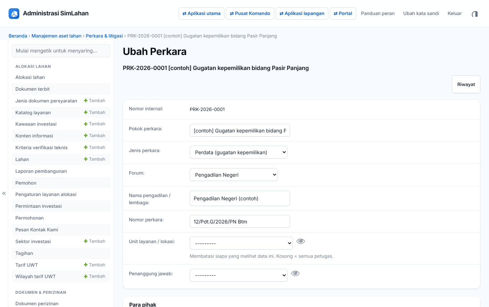

1. Isi **Pokok perkara** (nomor 1).
2. Pilih **Jenis perkara** (nomor 2): perdata, TUN, pidana, sengketa batas, eksekusi, keberatan ganti kerugian, atau lainnya.
3. Pilih **Forum** (nomor 3): Pengadilan Negeri, PTUN, Pengadilan Tinggi, Mahkamah Agung, Arbitrase, Mediasi, atau Kepolisian. Isi nama pengadilannya di kolom berikutnya.
4. Isi **Nomor perkara pengadilan** (nomor 4), lalu pilih unit layanan dan penanggung jawab.
5. Gulir ke bagian **Para pihak**:

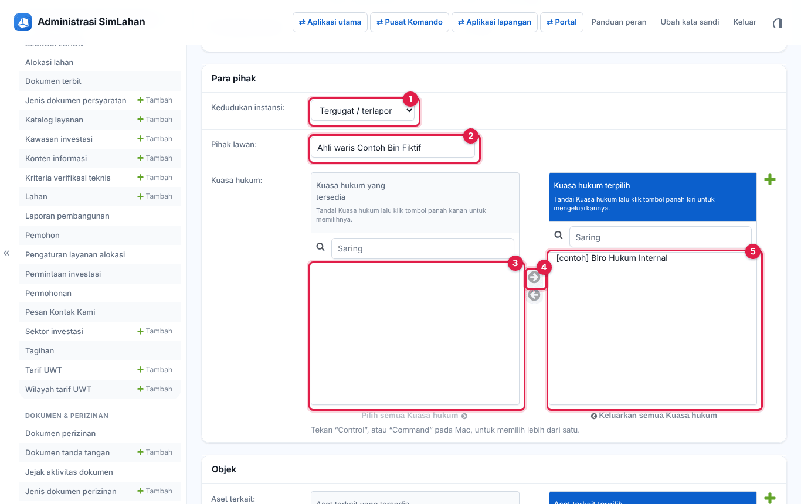

6. Pilih **Kedudukan instansi** (nomor 1): penggugat, tergugat, turut tergugat, pemohon, atau termohon. Isi **Pihak lawan** (nomor 2).
7. Pilih **Kuasa hukum**. Kotak kiri (nomor 3) berisi advokat yang belum dipilih: klik namanya, lalu klik panah ke kanan (nomor 4). Nama pindah ke kotak kanan **Kuasa hukum terpilih** (nomor 5). Pada contoh, satu-satunya advokat sudah terpilih sehingga kotak kiri kosong. Untuk melepas, klik nama di kotak kanan lalu klik panah ke kiri.
8. Bagian **Objek**: pilih **Aset terkait** dengan cara yang sama, lalu isi nilai gugatan.
9. Bagian **Perkembangan**:

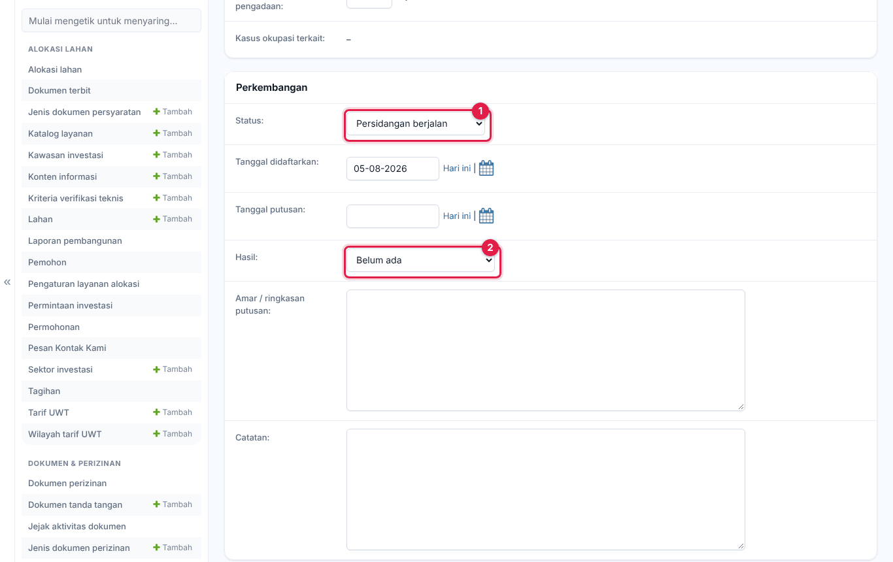

10. Pilih **Status** (nomor 1): Persiapan, Persidangan berjalan, Putusan tingkat pertama, Banding, Kasasi, Peninjauan kembali, Berkekuatan hukum tetap, Eksekusi, atau Selesai.
11. Pilih **Hasil** (nomor 2): Belum ada, Menang, Kalah, Damai, atau Gugur.
12. Di bawahnya, tambah baris **Jadwal sidang** (tanggal dan agenda) dan **Dokumen** perkara. Sistem mengingatkan petugas sebelum tanggal sidang.
13. Klik **Simpan**.

**Advokat / kuasa hukum** dicatat di menunya sendiri (saringan **Biro hukum internal** dan **Aktif**).

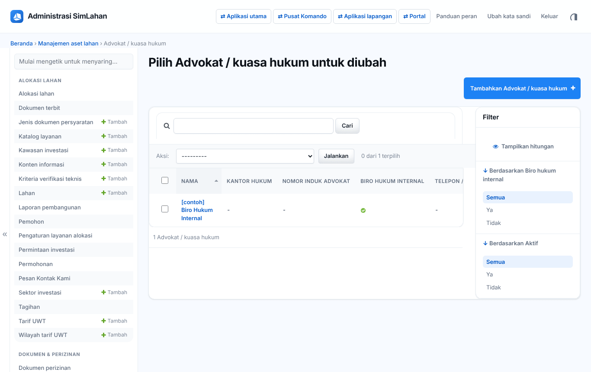

## 8.6 Okupasi & perambahan

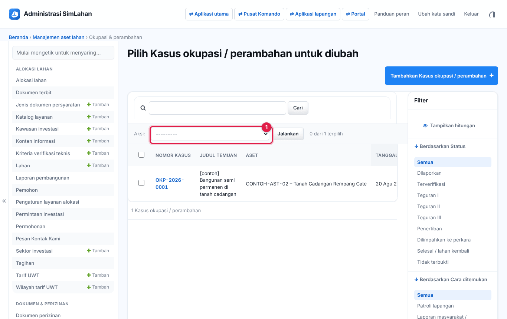

Kotak **Aksi** (nomor 1) menjalankan perintah untuk baris yang dicentang, misalnya **Limpahkan ke perkara baru** (lihat langkah 8 di bawah).

Saringan: **Status**, **Cara ditemukan**, **Bentuk okupasi**, **Tingkat**, **Unit layanan / lokasi**. Kolom **Tanpa tindak lanjut** menandai kasus yang terlalu lama tidak ditangani.

Klik **Tambahkan Kasus okupasi / perambahan** (atau **Catat okupasi** dari halaman aset).

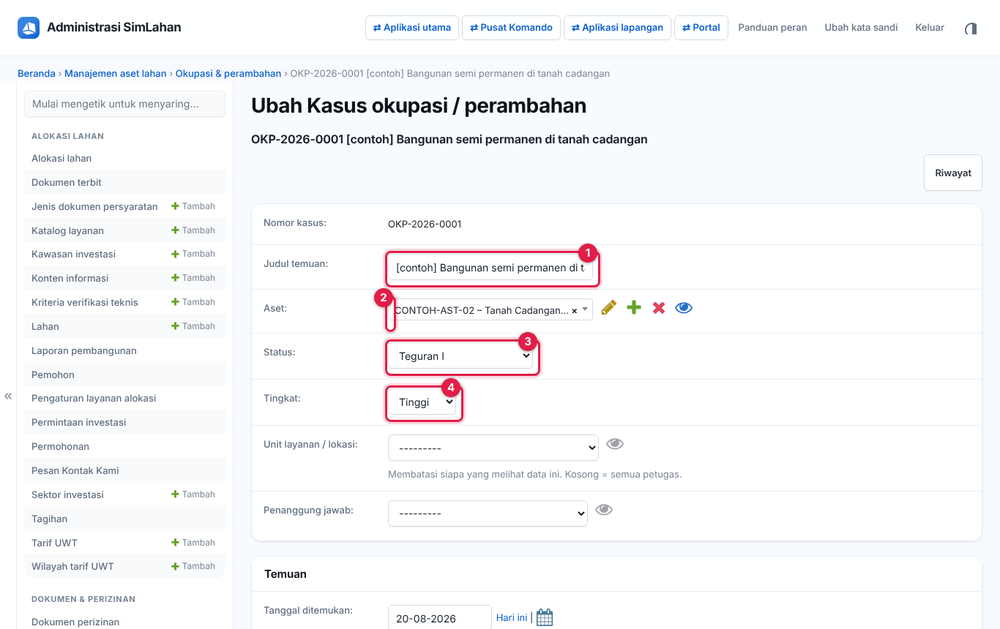

1. Isi **Judul** kasus (nomor 1) dan pilih **Aset** yang diokupasi (nomor 2).
2. Pilih **Status** (nomor 3) dan **Tingkat** keparahan (nomor 4), lalu unit layanan dan penanggung jawab.
3. Bagian **Temuan**: isi tanggal ditemukan, **Cara ditemukan** (patroli, laporan masyarakat, perbandingan citra, drone, survei, analisis tumpang tindih), **Bentuk okupasi** (bangunan permanen/semi permanen, kebun, pagar/patok, galian/timbunan), nama pelaku, dan jumlah penghuni.
4. Bagian **Lokasi**: tandai titik dan gambar area di peta, lalu isi luas yang diokupasi.
5. Bagian **Bukti citra**: pilih citra sebelum dan sesudah, serta tautan pembanding.
6. Gulir ke **Tindakan penanganan** (nomor 1 pada gambar di bawah). Tambah satu baris untuk setiap langkah yang sudah dilakukan, berurutan: Verifikasi lapangan → Surat teguran I → II → III → Mediasi → Penertiban → Laporan polisi → Lahan kembali dikuasai.

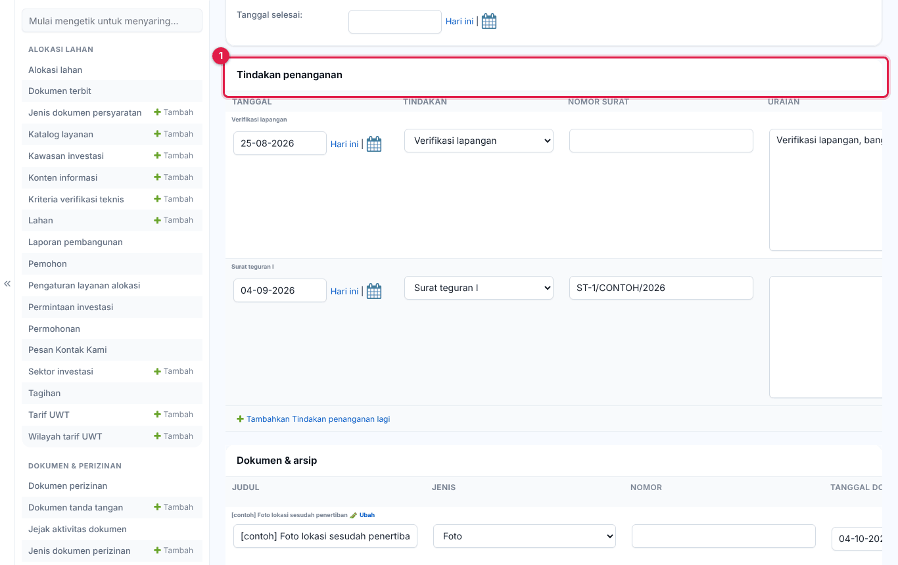

7. Klik **Simpan**. Status kasus ikut berubah sesuai tindakan terakhir (Dilaporkan, Terverifikasi, Teguran I–III, Penertiban, Dilimpahkan ke perkara, Selesai / lahan kembali, Tidak terbukti).
8. Bila kasus harus dibawa ke pengadilan: di daftar okupasi, centang kasusnya, pilih aksi (nomor 1 pada gambar daftar) **Limpahkan ke perkara baru**, lalu klik **Jalankan**. Perkara baru dibuat dan ditautkan.

## 8.7 Pengaduan masyarakat

Pengaduan masuk dari portal (`/portal/pengaduan/`), telepon/WhatsApp, surat, datang langsung, atau petugas lapangan. Pelapor menerima nomor pengaduan untuk dicek di portal.

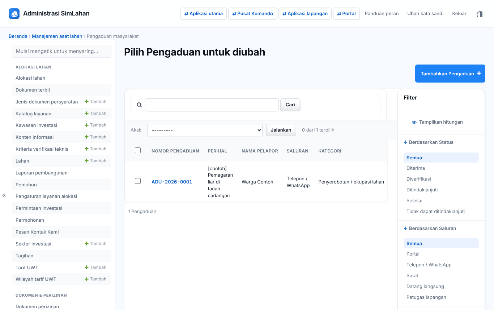

Kotak **Aksi** (nomor 1) menjalankan perintah untuk baris yang dicentang, misalnya **Jadikan kasus okupasi** (lihat langkah 8 di bawah).

Klik nomor pengaduan untuk membukanya.

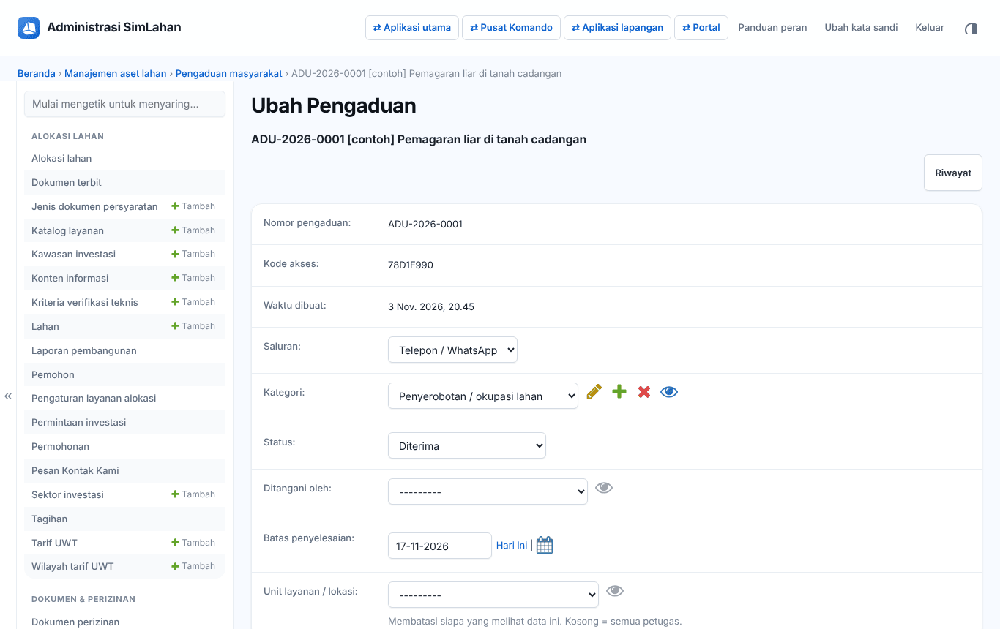

1. Periksa **Saluran** masuknya (nomor 1) dan pilih **Kategori** (nomor 2).
2. Ubah **Status** (nomor 3) sesuai kemajuan: Diterima → Diverifikasi → Ditindaklanjuti → Selesai (atau Tidak dapat ditindaklanjuti).
3. Pilih petugas di **Ditugaskan kepada** (nomor 4). **Batas penyelesaian** (nomor 5) terisi otomatis dari kategori; ubah bila perlu.
4. Gulir ke bawah dan baca bagian **Pelapor** (nama, telepon, surel) dan **Pengaduan** (judul, uraian, lokasi, lampiran).
5. Di bagian **Terkait** (nomor 1 pada gambar di bawah), hubungkan pengaduan ke aset, proyek pengadaan, atau kasus okupasi.
6. Di bagian **Tindak lanjut** (nomor 2), isi **tanggapan** (terlihat oleh pelapor saat cek status di portal), **catatan internal**, dan tanggal selesai.

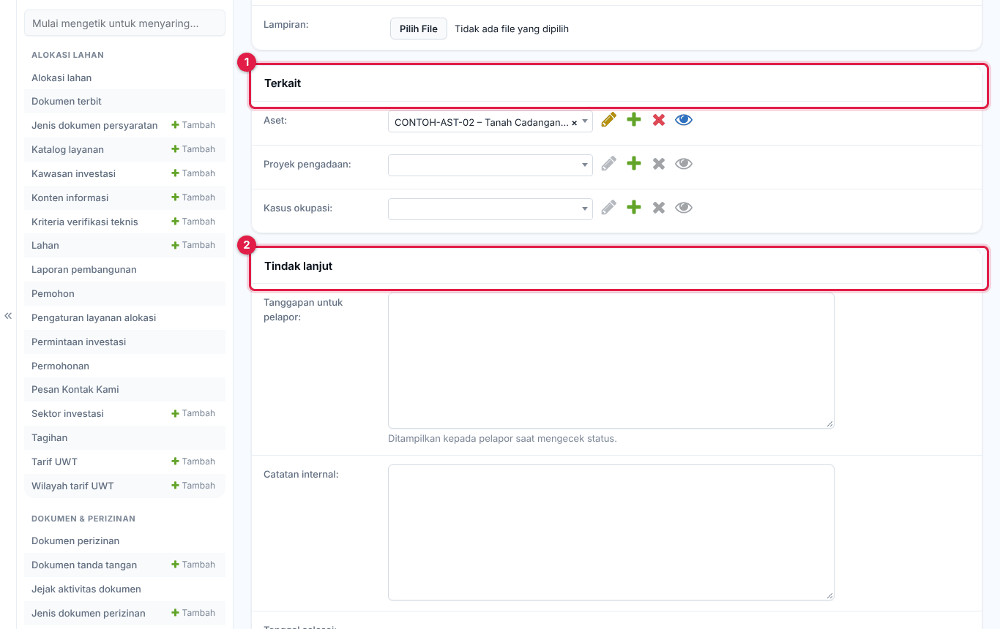

7. Klik **Simpan**.
8. Bila pengaduan berisi laporan penyerobotan lahan: di daftar pengaduan, centang pengaduannya, pilih aksi (nomor 1 pada gambar daftar) **Jadikan kasus okupasi**, lalu klik **Jalankan**.

Kolom **Lewat batas** di daftar menyala bila pengaduan melewati batas penyelesaian (diatur per **Kategori pengaduan** atau di pengaturan modul).

## 8.8 Lelang & seleksi lahan

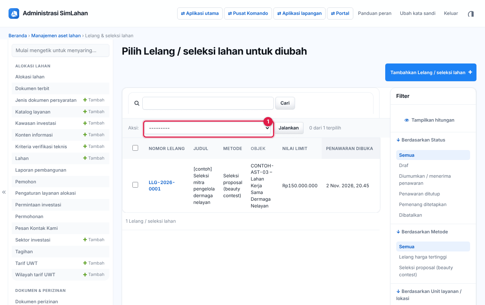

Kotak **Aksi** (nomor 1) menjalankan perintah lelang (umumkan, tutup penawaran, tetapkan pemenang) untuk baris yang dicentang; caranya di **Menjalankan lelang** di bawah.

**Membuat lelang:** klik **Tambahkan Lelang / seleksi lahan**.

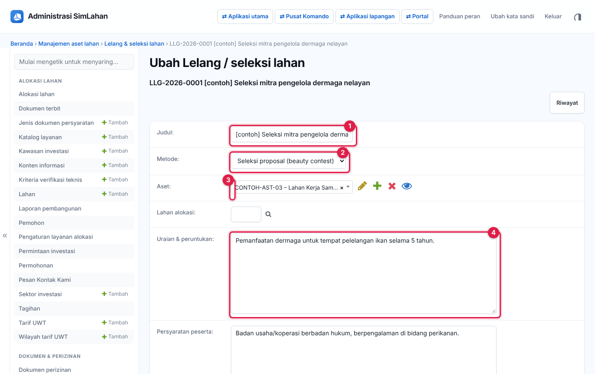

1. Isi **Judul** (nomor 1).
2. Pilih **Metode** (nomor 2): **Lelang harga tertinggi** atau **Seleksi proposal (beauty contest)**.
3. Pilih objeknya: **Aset** (nomor 3), atau lahan alokasi di kolom berikutnya.
4. Tulis **Uraian** (nomor 4) dan syarat peserta di kolom di bawahnya.
5. Gulir ke bawah: isi **Nilai limit**, uang jaminan, **Penawaran dibuka** dan **Penawaran ditutup** (tanggal dan jam), serta status dan unit layanan. Lampirkan dokumen di bagian **Dokumen & arsip**.
6. Klik **Simpan**.

**Menjalankan lelang** dari daftar lelang (centang lelangnya, pilih aksi di nomor 1, lalu klik **Jalankan**):

1. Aksi **Umumkan di portal**: lelang tampil di `/portal/lelang/` dan peminat bisa mengirim penawaran.
2. Setelah batas waktu, aksi **Tutup penerimaan penawaran**.
3. Buka menu **Penawaran**. Ubah status tiap penawaran menjadi **Lolos evaluasi** atau **Gugur**.
4. Kembali ke daftar lelang, pilih aksi **Tetapkan pemenang (penawaran lolos tertinggi)**. Nama pemenang tampil di halaman lelang di portal.

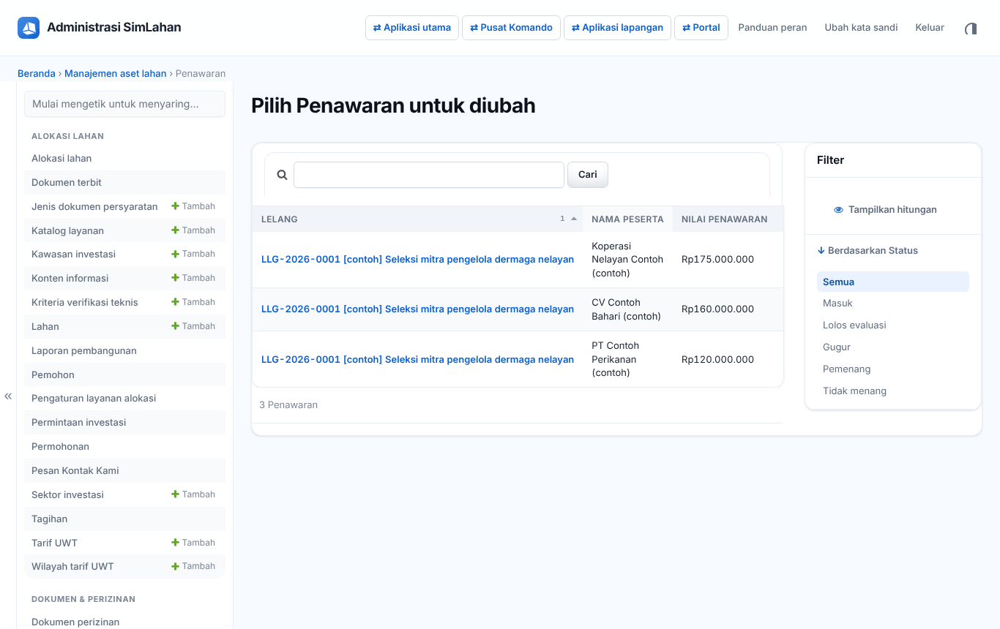

## 8.9 Permukiman kembali

**Kawasan permukiman kembali** mencatat lokasi relokasi; kolom **Unit**, **Dihuni**, dan **Kosong** dihitung otomatis. **Unit / kavling permukiman kembali** mencatat setiap rumah/kavling dengan status hunian: Kosong, Dalam pembangunan, Dialokasikan (belum dihuni), Dihuni, serta **Rumah tangga terdampak** yang menempatinya.

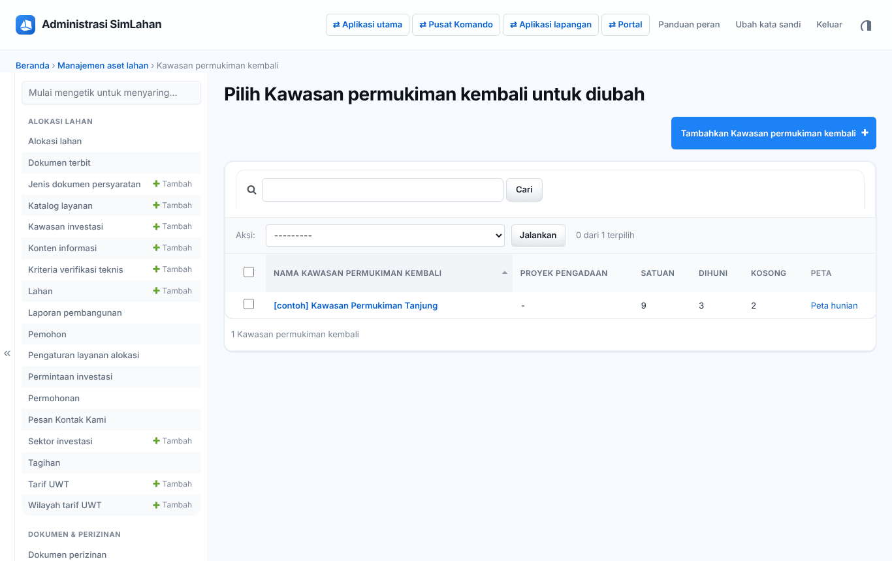

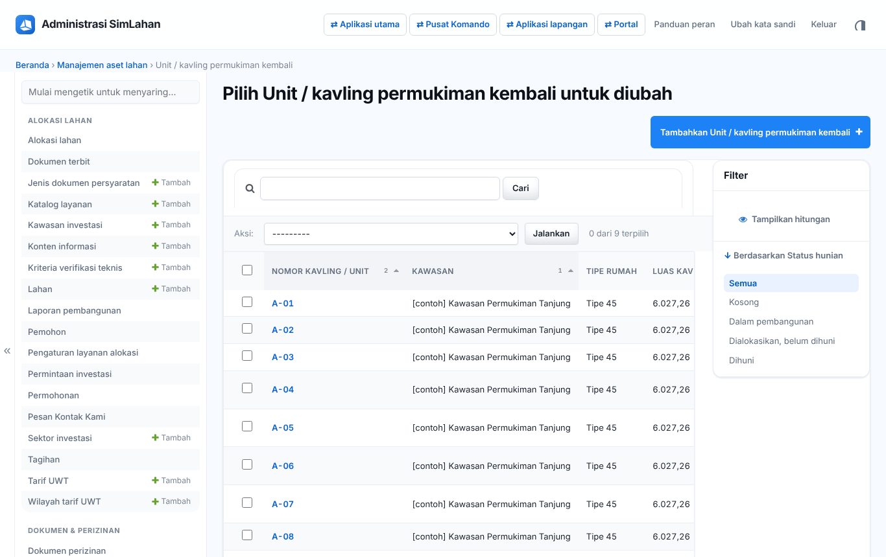

## 8.10 Kepemilikan, pemangku kepentingan, ahli waris

**Pemangku kepentingan** mencatat instansi, tokoh masyarakat/adat, warga/pemilik, LSM, perusahaan, dan media, beserta **Pengaruh**, **Kepentingan**, **Sikap** (mendukung, netral, menolak, belum diketahui), dan riwayat pertemuan (rapat, sosialisasi, kunjungan, surat, telepon). Tombol **Matriks pengaruh × kepentingan** menampilkan peta strategi pendekatan.

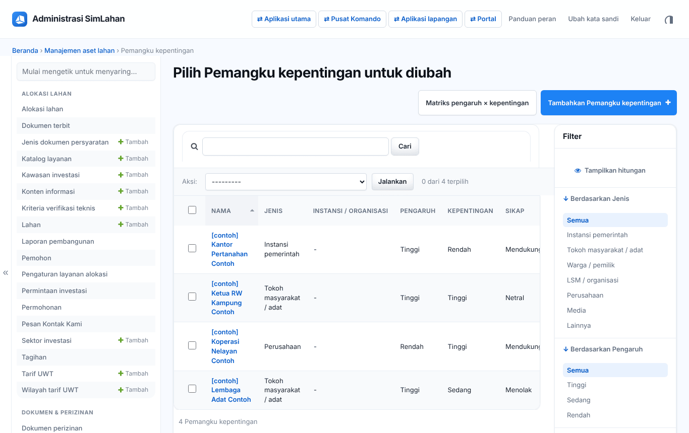

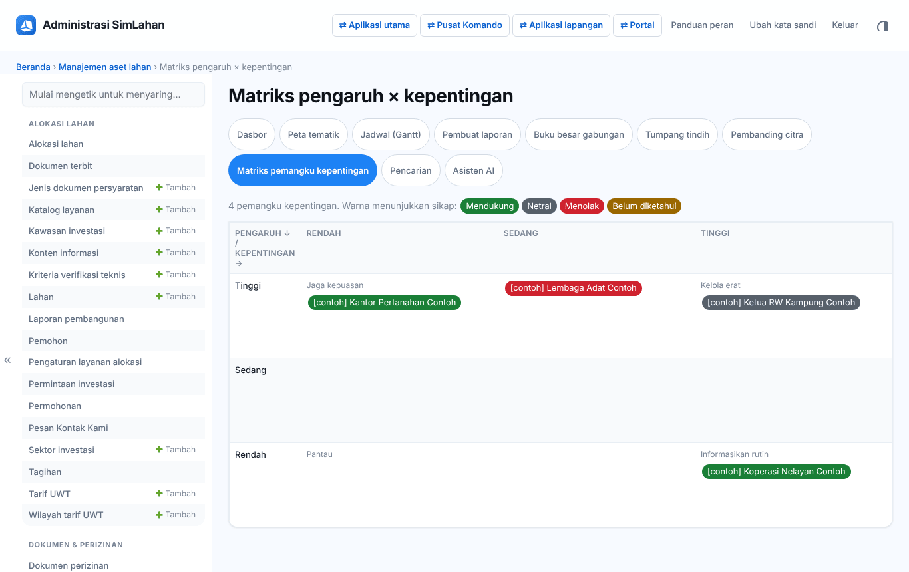

**Silsilah ahli waris** mencatat pewaris dan ahli warisnya (anak, suami/istri, cucu, saudara kandung, orang tua, lainnya). Klik tautan di kolom **Silsilah** untuk melihat pohon keluarga.

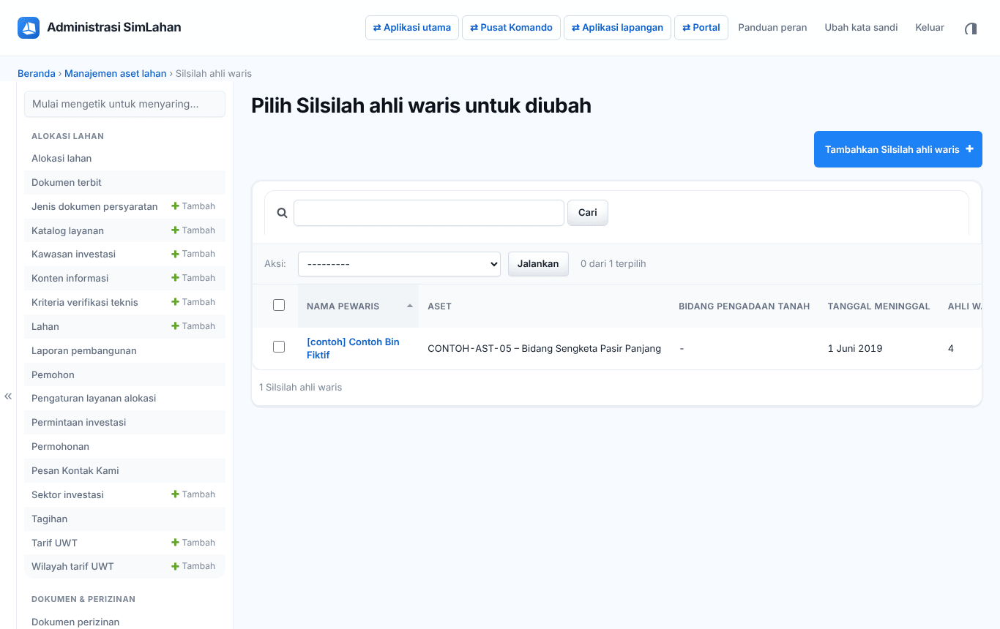

## 8.11 Survei, citra, lapisan peta, fasilitator, urusan instansi

**Survei & pemetaan**

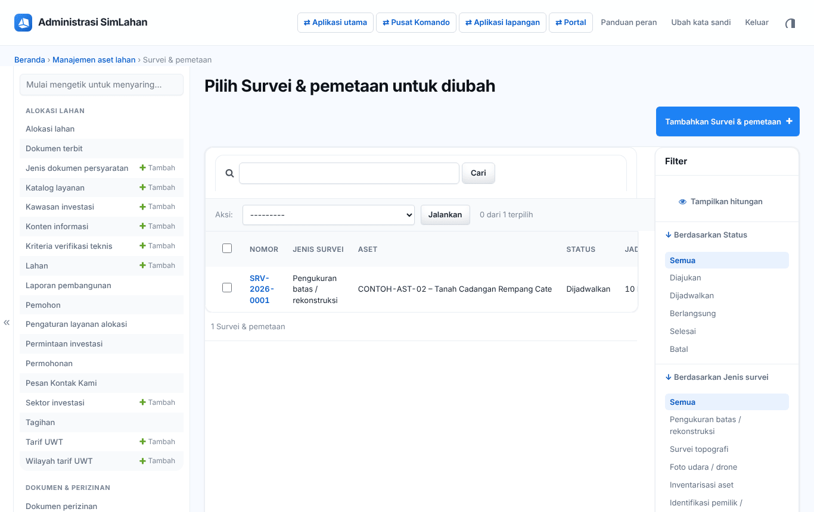

Jenis survei: pengukuran batas, topografi, drone, inventarisasi, identifikasi pemilik, objek ganti kerugian, digitalisasi warkah. Status: Diajukan → Dijadwalkan → Berlangsung → Selesai. Setelah hasil ukur diunggah, centang surveinya dan pilih aksi **Terapkan batas hasil ukur ke aset** agar batas aset diperbarui.

**Citra satelit & foto udara**

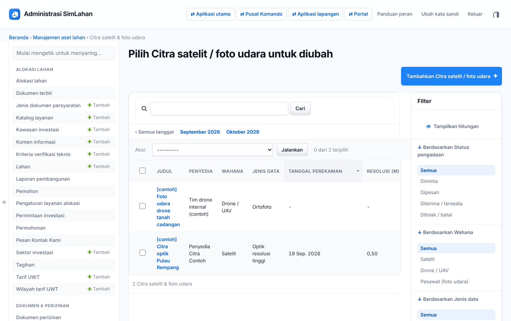

Daftar ini mencatat pengadaan citra (diminta, dipesan, tersedia, batal), wahana (satelit, drone, pesawat), jenis data, dan penyedia. Isi URL ubin/WMS agar citra muncul di peta.

**Pembanding citra** menampilkan dua citra di satu peta:

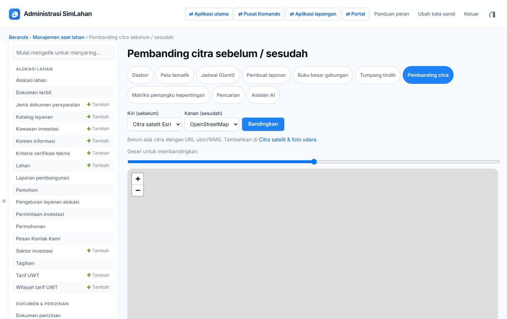

1. Pilih citra **Kiri (sebelum)** (nomor 1) dan **Kanan (sesudah)** (nomor 2).
2. Klik **Bandingkan** (nomor 3).
3. Geser penggeser (nomor 4) ke kiri dan kanan untuk membandingkan. Area kasus dan batas aset ditandai kuning.

**Lapisan peta referensi** (batas administrasi, kadaster, sungai, jalan, kawasan hutan, RTRW/RDTR, utilitas, dsb.) diunggah sekali lalu tampil di peta tematik. Centang **Tampil di pusat komando** agar muncul juga di peta komando.

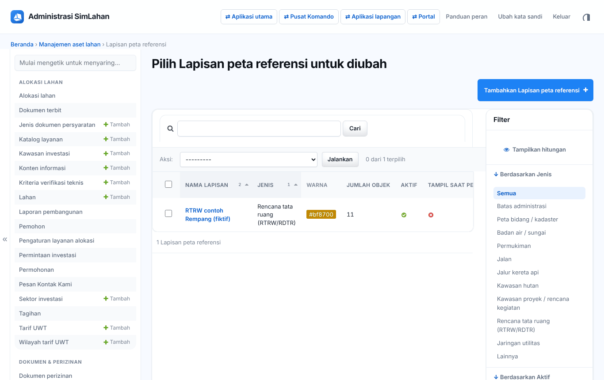

**Fasilitator & pendamping** (pendamping masyarakat, mediator, konsultan, penghubung instansi, penilai, surveyor berlisensi) dan **Urusan instansi pemerintah** (mutasi hak, cek sertipikat, pengukuran BPN, KKPR, PBG, persetujuan lingkungan, urusan pajak, dsb.; status Persiapan berkas → Diajukan → Diproses instansi → Selesai/Ditolak).

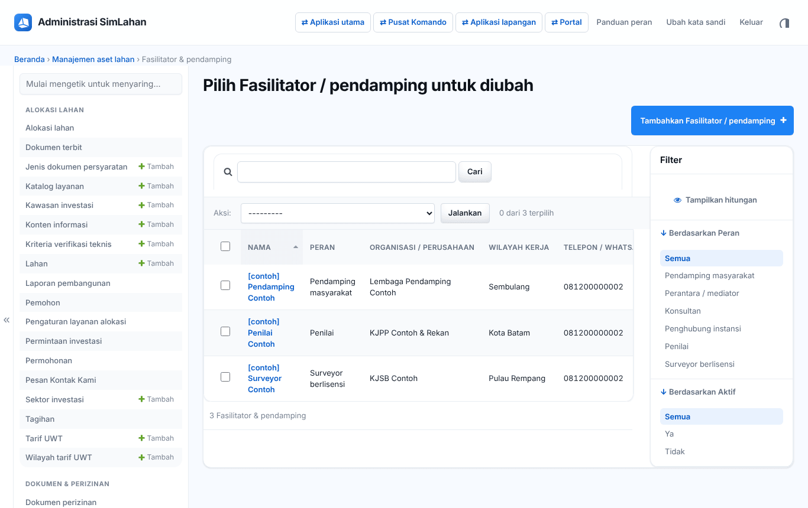

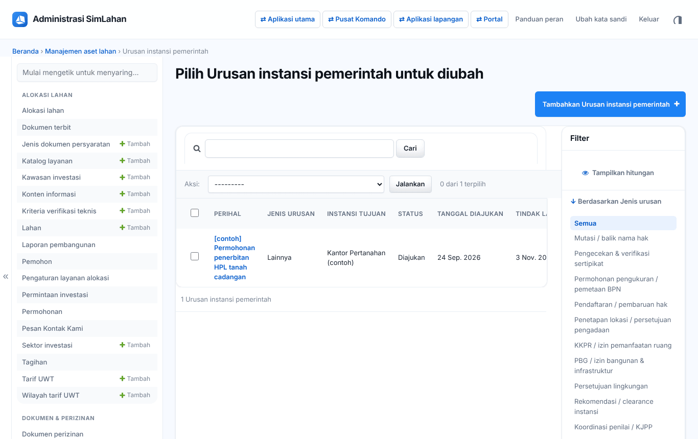

## 8.12 Dokumen & arsip, tugas, tim, laporan lapangan

**Dokumen & arsip**

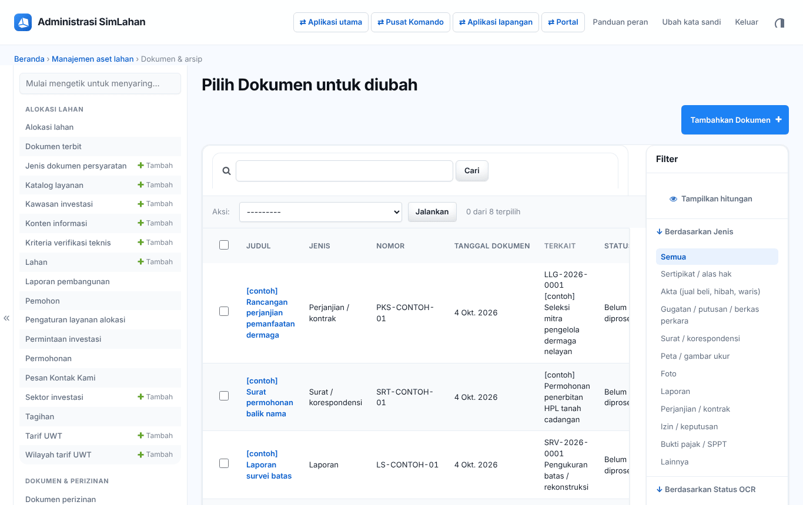

Unggah sertipikat, akta, putusan, surat, peta, foto, laporan, perjanjian, izin, dan bukti pajak. Untuk membaca teks pindaian, centang dokumen dan pilih aksi **Baca teks dokumen (OCR)**. Setelah terbaca, buka dokumen dan klik **Terapkan data ke aset** untuk mengisi kolom aset yang masih kosong. Teks hasil OCR juga ikut dicari di **Pencarian**.

**Tugas & perintah kerja**

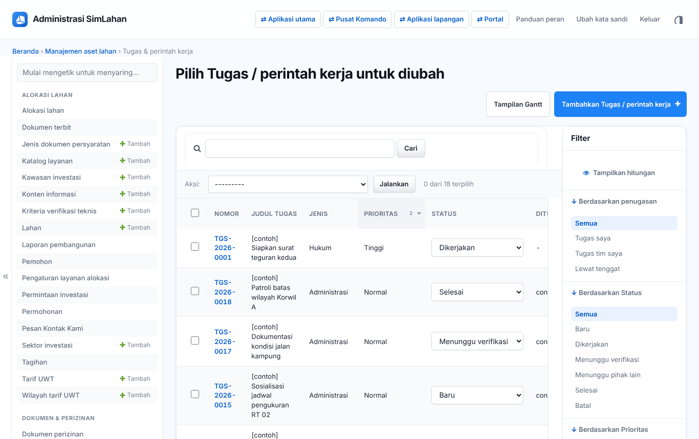

Isi tugas: judul, jenis (survei, verifikasi, administrasi, hukum, patroli, pemeliharaan aset), **Prioritas** (Rendah, Normal, Tinggi, Mendesak), penerima, **Kontributor lapangan**, tenggat, Korwil, dan objek terkait. Status: Baru → Dikerjakan → Menunggu verifikasi / Menunggu pihak lain → Selesai (atau Batal). Tugas untuk petugas lapangan juga muncul di tab **Tugas** pusat komando.

**Tampilan Gantt** menampilkan tugas dan tonggak pengadaan pada garis waktu:

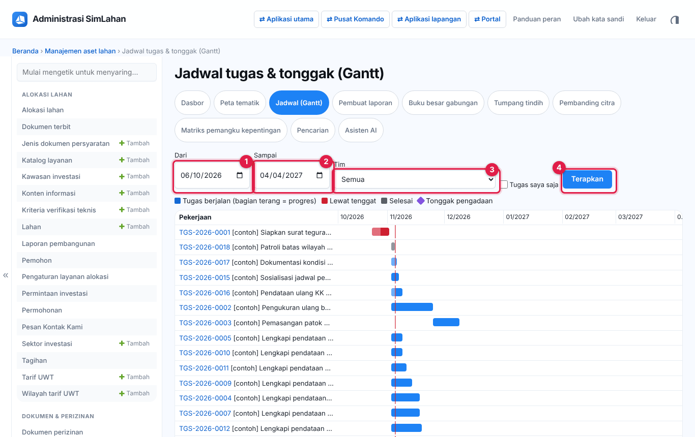

1. Isi **Dari** (nomor 1) dan **Sampai** (nomor 2).
2. Pilih **Tim** (nomor 3). Centang **Tugas saya saja** bila perlu.
3. Klik **Terapkan** (nomor 4).

**Tim internal** mengelompokkan petugas; kolom **Anggota** dan **Tugas terbuka** dihitung otomatis.

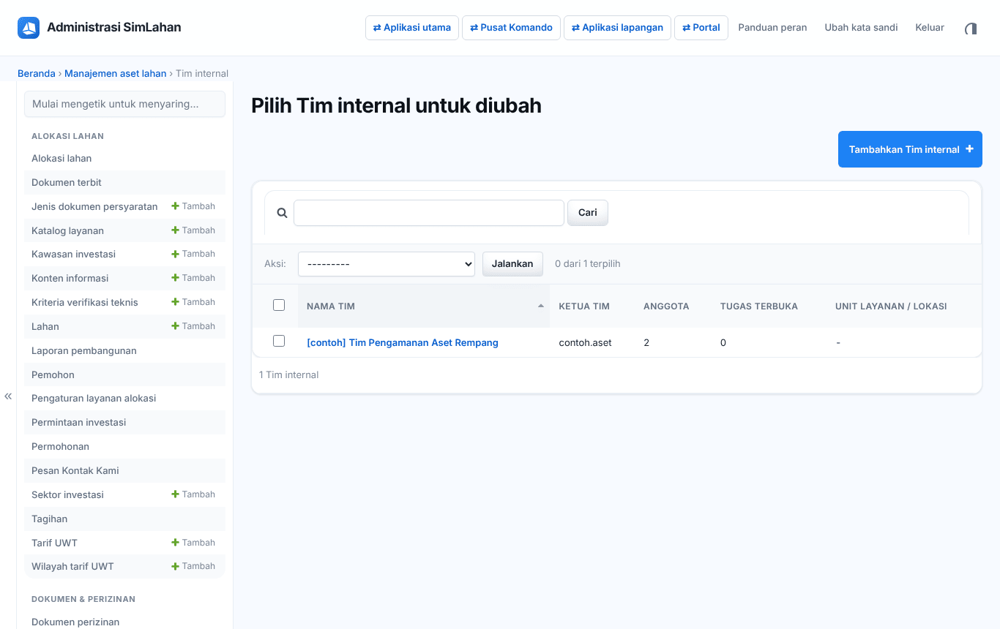

**Laporan lapangan** dikirim petugas dari aplikasi lapangan (patroli rutin, temuan okupasi, kondisi aset, catatan survei, patok batas) beserta foto dan titik GPS. Bila berisi temuan penyerobotan, centang laporan dan pilih aksi **Jadikan kasus okupasi**.

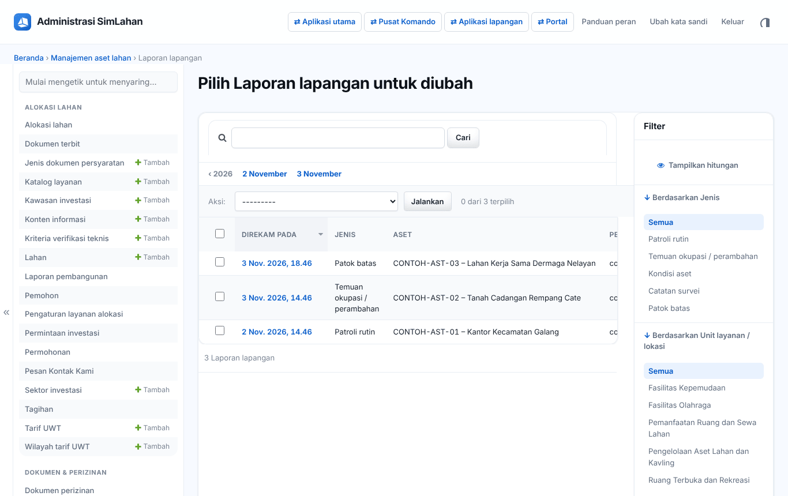

## 8.13 Alat analisis

**Pembuat laporan:**

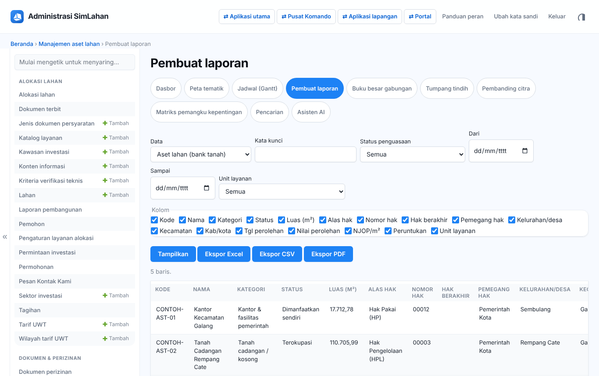

1. Pilih **Data** (nomor 1): aset, pajak, transaksi, perkara, jadwal sidang, okupasi, survei, tugas, pengaduan, urusan instansi, lelang, hunian permukiman kembali, pemangku kepentingan, kontrak sewa, atau bidang pengadaan tanah. Dataset yang tidak boleh Anda lihat tidak muncul.
2. Saring dengan **Kata kunci** (nomor 2), **Status** (nomor 3), dan rentang tanggal **Dari** (nomor 4) sampai **Sampai** (nomor 5).
3. Centang **Kolom** yang ingin dimuat di laporan.
4. Klik **Tampilkan** (nomor 6) untuk melihat hasilnya di layar.
5. Klik **Ekspor Excel** (nomor 7), **Ekspor CSV**, atau **Ekspor PDF** untuk mengunduh.

**Tumpang tindih:** daftar aset yang batasnya saling beririsan (≥ 1 m²) dan aset yang beririsan dengan bidang pengadaan atau lahan alokasi. Irisan menandakan klaim ganda atau kesalahan ukur; perbaiki batas atau ajukan survei ulang.

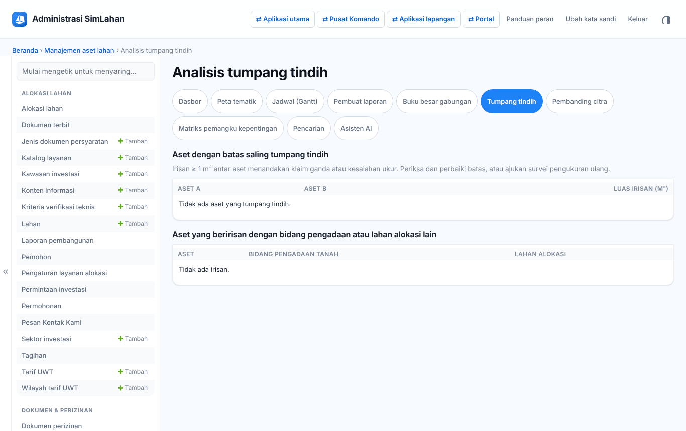

**Pencarian:** ketik kata kunci lalu klik **Cari**. Sistem mencari kode, nama, nomor hak, NIB, pihak, dan isi teks dokumen hasil OCR di semua modul yang boleh Anda akses.

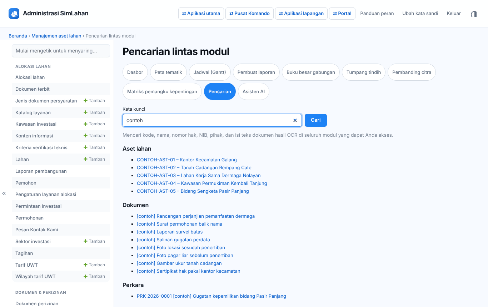

**Asisten AI:**

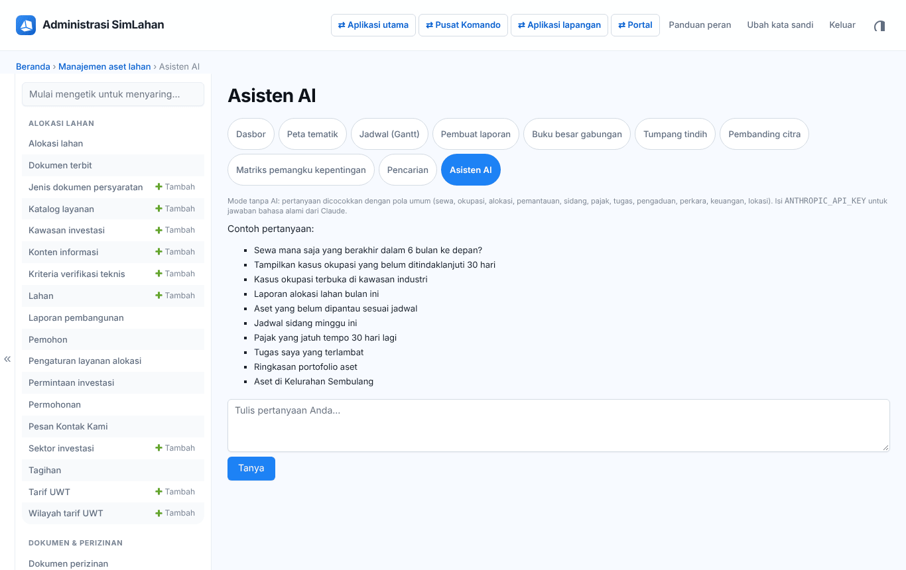

1. Ketik pertanyaan biasa di kotak pertanyaan (nomor 1), misalnya "sewa yang berakhir 90 hari lagi" atau "okupasi terbuka".
2. Klik **Tanya** (nomor 2).
3. Jawaban tampil di atas kotak pertanyaan, seperti gambar berikut.

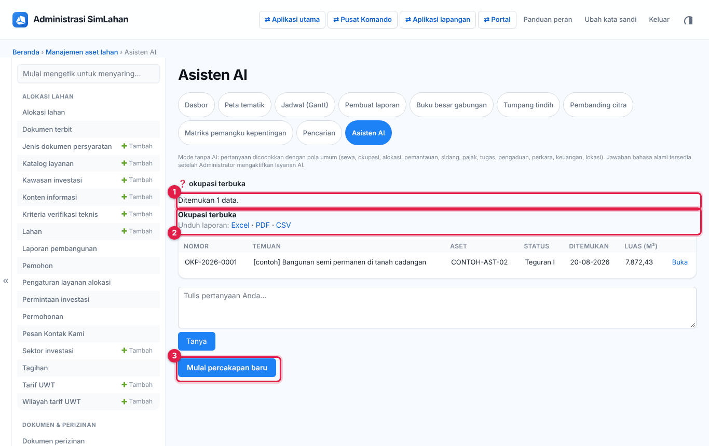

4. Baca ringkasan jawaban (nomor 1) dan tabel datanya. Klik **Buka** di ujung baris untuk membuka datanya.
5. Untuk mengunduh tabel, klik **Excel**, **PDF**, atau **CSV** di baris **Unduh laporan** (nomor 2).
6. Ketik pertanyaan lanjutan di kotak di bawahnya, atau klik **Mulai percakapan baru** (nomor 3) untuk topik lain.

Bila layanan AI belum diaktifkan Administrator, asisten tetap menjawab pertanyaan umum dengan pencocokan pola (sewa, okupasi, alokasi, pemantauan, sidang, pajak, tugas, pengaduan, perkara, keuangan, lokasi).

**Peta berbagi (tautan publik):** membuat tautan peta untuk pihak luar tanpa akun. Isi **Judul peta**, pilih **Aset ditampilkan**, **Bidang proyek pengadaan**, atau **Kawasan permukiman kembali**, centang **Tampilkan nama pemegang hak** bila boleh, isi **Berlaku sampai**, lalu simpan. Salin **Tautan publik** dan bagikan. Hapus centang **Aktif** untuk mematikan tautan. Kolom **Dilihat** menghitung kunjungan. Contoh tampilannya ada di [Bab 9](31-aplikasi-lapangan.md#92-peta-berbagi).

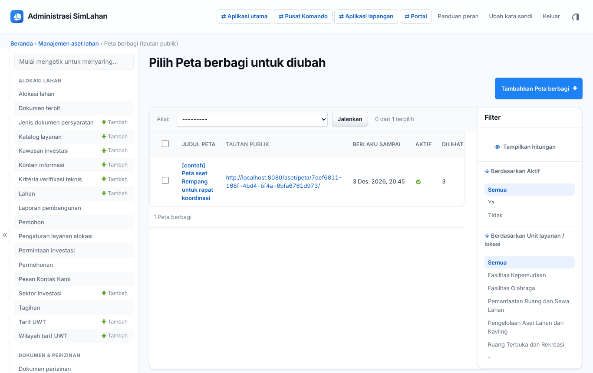

## 8.14 Kategori dan pengaturan modul

**Kategori aset** (nama, **Warna peta** format #RRGGBB, aktif) dan **Kategori pengaduan** (dengan **Batas penyelesaian (hari)**; kosong = pengaturan modul).

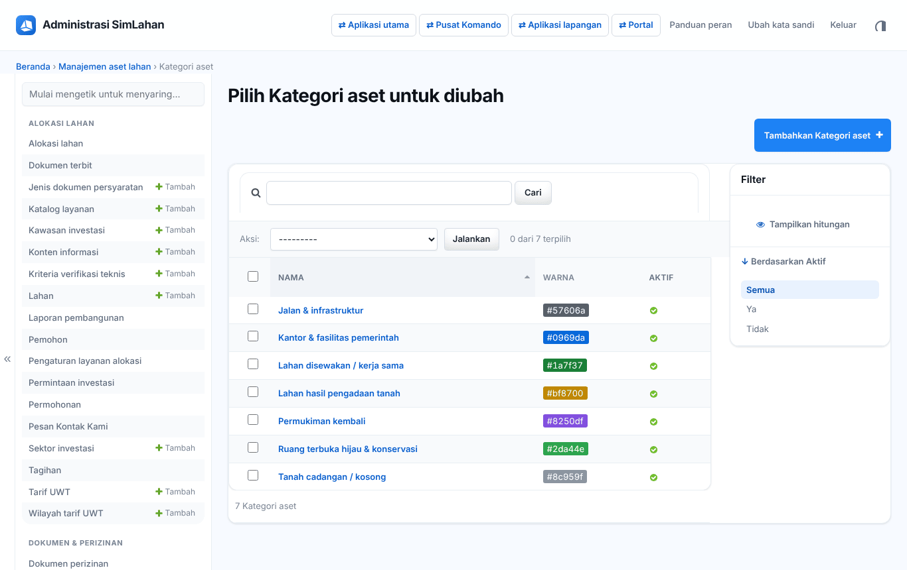

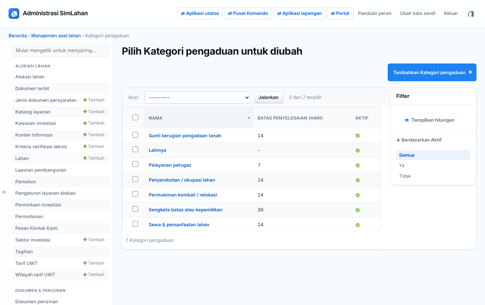

**Pengaturan modul aset lahan** (Administrator):

| Bagian | Isian |
|---|---|
| Modul aktif | Nyalakan/matikan: Kepemilikan, silsilah & pemangku kepentingan · Penilaian, pajak & keuangan · Perkara & advokat · Okupasi & citra satelit · Permukiman kembali · Survei, fasilitator & urusan instansi · Tugas & tim · Pengaduan masyarakat · Lelang / seleksi lahan. Menu yang dimatikan hilang dari panel. |
| Pengingat & batas waktu | Pengingat sewa berakhir, hak atas tanah berakhir, jatuh tempo pajak, sidang (hari sebelumnya); batas penyelesaian pengaduan (hari); okupasi tanpa tindak lanjut ditandai setelah (hari); pemantauan lapangan aset tiap (hari). |
| Jurnal ERP | Kode akun kas/bank untuk ekspor jurnal. |

## 8.15 Pertanyaan umum

**Saya tidak melihat aset yang dibuat rekan.** Aset itu milik unit layanan lain. Minta Administrator memeriksa **Unit layanan / lokasi** aset atau akun Anda.

**Menu Penilaian/Pajak tidak ada.** Peran Anda (misalnya Petugas Hukum) tidak berhak, atau modulnya dimatikan di pengaturan.

**Citra tidak muncul di pembanding.** Citra belum punya URL ubin/WMS. Lengkapi di **Citra satelit & foto udara**.
