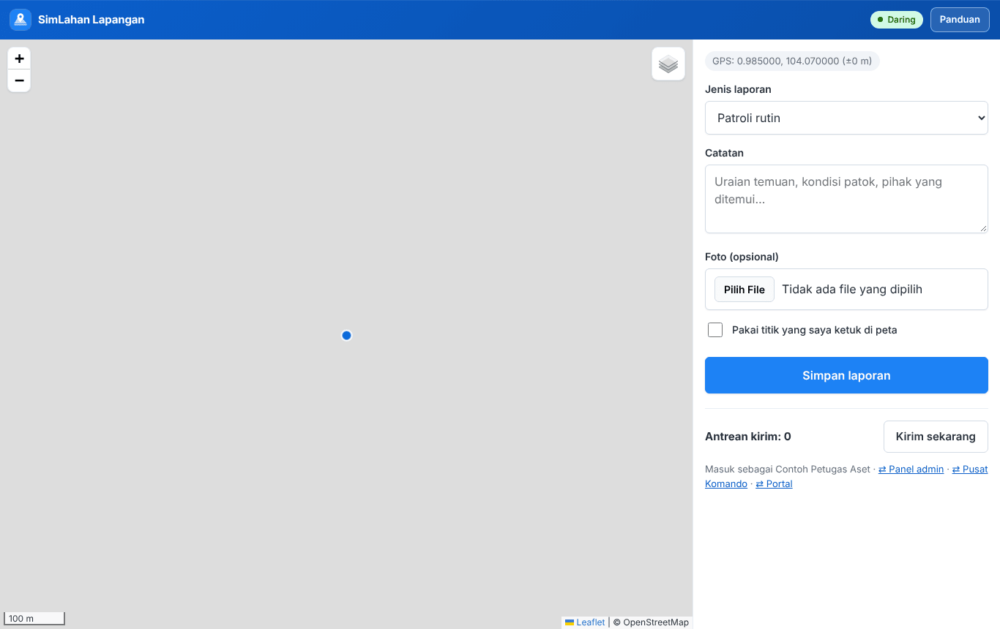
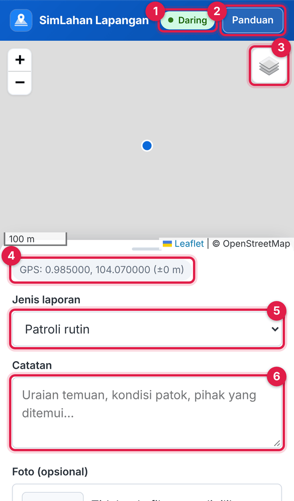
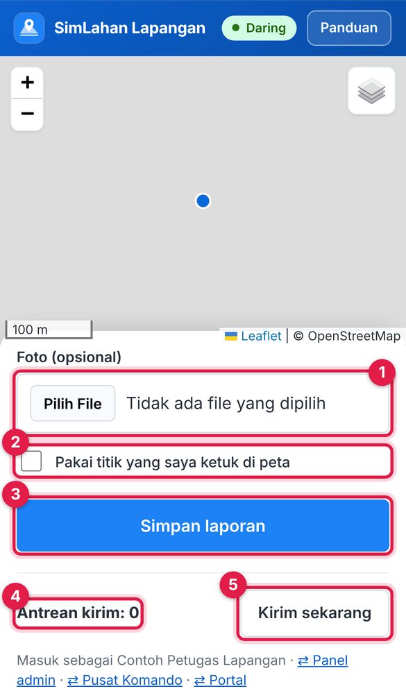
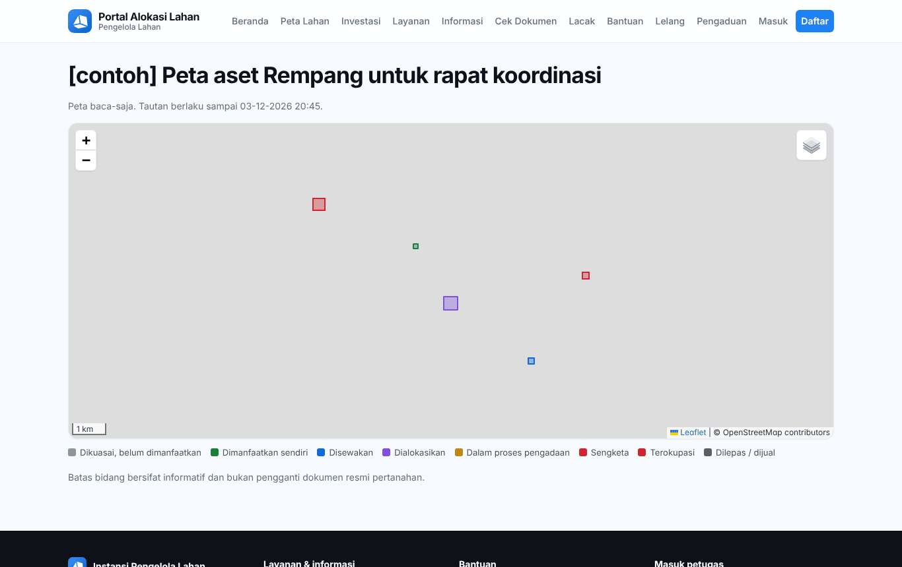

# Bab 9 – Aplikasi lapangan dan peta berbagi

## 9.1 Aplikasi lapangan (`/aset/lapangan/`)

Aplikasi ringan di HP untuk mengirim **laporan lapangan** (patroli, temuan okupasi, kondisi aset, catatan survei, patok batas) lengkap dengan titik GPS dan foto. Aplikasi tetap bisa dipakai **tanpa sinyal**: laporan disimpan di HP dan dikirim otomatis saat sinyal kembali.

**Siapa memakai:** Petugas Lapangan dan Petugas Aset Lahan. Peran lain yang membuka alamat ini melihat pesan "tidak berhak".

### Membuka dan memasang aplikasi

1. Di HP, buka `https://<alamat-simlahan>/aset/lapangan/`. Bila belum masuk, Anda diarahkan ke halaman masuk panel admin; masuk dengan nama pengguna dan kata sandi Anda.
2. Izinkan akses **lokasi** saat diminta browser. Titik biru di peta adalah posisi Anda.
3. Klik **Pasang** (bila muncul) agar aplikasi punya ikon sendiri di layar HP. Buka aplikasi sekali saat ada sinyal agar batas bidang tersimpan untuk dipakai luring.

Di komputer, formulir tampil di sebelah kanan peta:

Bagian layar di HP:

Nomor pada gambar:

1. **Daring** / **Luring**: status sinyal. Saat **Luring**, laporan disimpan di HP dulu.
2. **Panduan**: membuka panduan peran Anda.
3. **Tombol lapisan**: pilih **Peta jalan**, **Citra satelit**, dan **Batas aset & okupasi**. Titik biru di peta adalah posisi Anda.
4. **GPS:** koordinat posisi Anda dan ketelitiannya (misalnya `±5 m`).
5. **Jenis laporan**.
6. **Catatan**.

### Mengirim laporan

1. Tunggu sampai baris **GPS:** (nomor 4 pada gambar HP di atas) menampilkan koordinat dan ketelitian. Bila GPS tidak tersedia, ketuk peta untuk menandai titik.
2. Pilih **Jenis laporan** (nomor 5 pada gambar HP di atas): Patroli rutin, Temuan okupasi / perambahan, Kondisi aset, Catatan survei, atau Patok batas.
3. Tulis **Catatan** (nomor 6 pada gambar HP di atas): uraian temuan, kondisi patok, pihak yang ditemui.
4. Geser formulir ke atas untuk melihat bagian bawahnya:

5. Ketuk **Foto (opsional)** (nomor 1) untuk memotret atau memilih foto.
6. Bila lokasi laporan bukan posisi Anda sekarang, ketuk titik yang benar di peta, lalu centang **Pakai titik yang saya ketuk di peta** (nomor 2).
7. Ketuk **Simpan laporan** (nomor 3).
   - Saat daring: muncul "Laporan tersimpan, mengirim…" lalu "laporan terkirim".
   - Saat luring: muncul "Laporan tersimpan di perangkat; akan dikirim saat daring".
8. **Antrean kirim** (nomor 4) menunjukkan jumlah laporan yang belum terkirim. Setelah sinyal ada, ketuk **Kirim sekarang** (nomor 5). Laporan di antrean bisa dihapus dengan tombol hapus di barisnya.

Laporan yang terkirim masuk ke **Panel admin → Manajemen aset lahan → Laporan lapangan** (lihat [Bab 8.12](30-aset-lahan.md#812-dokumen--arsip-tugas-tim-laporan-lapangan)). Petugas Aset dapat menjadikannya kasus okupasi.

### Bila ada masalah

| Pesan | Yang harus dilakukan |
|---|---|
| Lokasi belum ada. Tunggu sinyal GPS atau ketuk titik di peta. | Tunggu beberapa detik di tempat terbuka, atau ketuk peta. |
| GPS tidak tersedia (izin lokasi ditolak) | Izinkan lokasi di pengaturan browser HP, lalu muat ulang. |
| Sesi masuk berakhir. Masuk lagi | Ketuk **Masuk lagi**. Laporan tetap tersimpan di HP. |
| Pengiriman tertunda; akan dicoba lagi saat sinyal stabil. | Tidak perlu apa-apa; laporan dikirim otomatis. |
| Batas bidang belum tersedia luring. | Buka aplikasi sekali saat ada sinyal. |

> Batas bidang di peta bersifat informatif dan bukan pengganti dokumen resmi pertanahan.

Tautan di bawah formulir (**⇄ Panel admin**, **⇄ Pusat Komando**, **⇄ Portal**) berpindah ke aplikasi lain tanpa masuk ulang. Laporan kegiatan harian, absen, dan tugas Korwil dikerjakan di **Pusat komando** ([Bab 10](40-pusat-komando.md)), bukan di aplikasi ini.

## 9.2 Peta berbagi

Peta berbagi adalah tautan peta **baca-saja** untuk pihak luar (misalnya peserta rapat koordinasi) tanpa akun. Tautan dibuat Petugas Aset Lahan di **Panel admin → Manajemen aset lahan → Peta berbagi (tautan publik)** (lihat [Bab 8.13](30-aset-lahan.md#813-alat-analisis)).

Yang dilihat penerima tautan:

- Judul peta dan tanggal **Tautan berlaku sampai**.
- Batas aset berwarna sesuai status penguasaan (legenda di bawah peta), bidang pengadaan, atau kawasan permukiman kembali yang dipilih petugas.
- Klik bidang untuk melihat kode dan nama aset, status, luas, dan alas hak. Nama pemegang hak hanya tampil bila petugas mengizinkannya.
- Tombol lapisan di kanan atas untuk memilih **Peta jalan** atau **Citra satelit**.

Setelah lewat tanggal berlaku atau dimatikan petugas, tautan tidak bisa dibuka lagi.
