# Bab 10 – Pusat komando (`/komando/`)

Pusat komando adalah aplikasi operasi lapangan: peta wilayah, absen, laporan kegiatan, pendataan warga, tugas berpoin, kinerja (KPI), chat, laporan harian berjenjang, dan analisis spasial. Aplikasi ini dirancang untuk HP, tetapi bisa juga dibuka di komputer.

**Siapa memakai bab ini:**

| Peran | Pemakaian |
|---|---|
| Petugas Lapangan | Absen, lapor kegiatan dan uji tanah, mendata warga, mengerjakan tugas, laporan harian, chat, SOS. Hanya Korwil tempatnya menjadi anggota. |
| Koordinator Wilayah (Korwil) | Semua hak petugas, ditambah: memberi dan memverifikasi tugas, menyetujui izin, memverifikasi laporan, menangani SOS, merangkum laporan harian, Historis, zona ancaman, jejak GPS anggota, audit data. Hanya Korwil yang dipimpinnya. |
| Petugas Aset Lahan | Pengawas: melihat peta, absen, laporan tim, warga, tugas, kinerja, chat, persetujuan, laporan harian, historis. Tidak melapor kegiatan. |
| Administrator | Semua Korwil, termasuk NIK warga, tiket, dan pengaturan. |

> **Korwil** (koordinator wilayah) adalah pembagian wilayah kerja lapangan, misalnya Korwil A sampai K. Siapa anggota dan koordinator setiap Korwil diatur di panel admin ([Bab 11](41-panel-pusat-komando.md)).

## 10.1 Masuk dan memasang aplikasi

1. Buka `https://<alamat-simlahan>/komando/masuk/` di HP.
2. Isi nama pengguna dan kata sandi, lalu klik **Masuk** (lihat [Bab 2](02-dasar-penggunaan.md#c-pusat-komando-petugas-lapangan)).
3. Izinkan akses **lokasi**, **kamera**, dan **mikrofon** bila diminta. Lokasi wajib untuk absen dan laporan.
4. Klik **Pasang** di bilah atas agar aplikasi punya ikon sendiri di layar HP dan bisa dibuka luring.

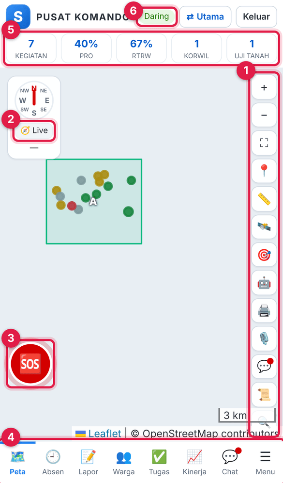

Bagian layar (nomor merah di gambar):

1. **Tombol alat peta** di kanan (lihat 10.2).
2. **Kompas** dan tombol **Live**: menyalakan pembagian posisi Anda ke pusat komando.
3. Tombol **SOS** darurat.
4. **Bilah tab** di bawah: **Peta, Absen, Lapor, Warga, Tugas, Kinerja, Chat, Menu**.

Di atas peta ada kartu ringkasan: jumlah **Kegiatan**, persentase **Pro**, persentase **RTRW** sesuai, jumlah **Korwil**, dan **Uji tanah**. Ketuk kartu untuk menyalakan atau mematikan lapisannya. Di bilah atas: status **Daring/Luring**, jumlah antrean kirim (⏳), **⇄ Utama** (pindah aplikasi), dan **Keluar**.

## 10.2 Peta

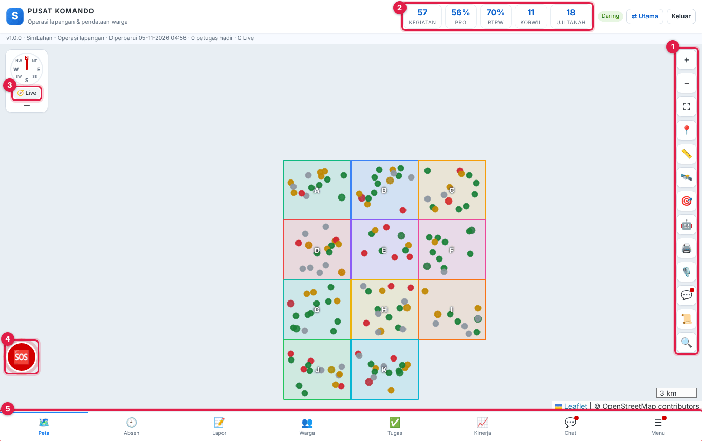

Tombol alat di kanan peta (dari atas):

| Tombol | Fungsi |
|---|---|
| + / − | Perbesar / perkecil. |
| ⛶ Layar penuh | Peta memenuhi layar. |
| 📍 Lokasi saya | Memusatkan peta ke posisi Anda. |
| 📏 Ukur jarak | Klik titik awal, lalu titik berikutnya; jarak tampil di bawah. **Ulang** untuk mulai lagi. |
| 🛰️ Citra satelit | Mengganti peta dasar ke citra satelit. |
| 🎯 Gaya peta taktis | Tampilan peta gelap untuk operasi. |
| 🤖 AI Satelit | Tahan lalu seret untuk menggambar kotak area; AI menganalisis tutupan lahan dan bangunan di kotak itu. |
| 🖨️ Cetak / export peta | Lihat 10.2.2. |
| 🎙️ Perintah suara | Ucapkan perintah, misalnya "korwil A" untuk memusatkan peta ke Korwil A, atau nama warga/tempat untuk mencarinya. Perlu izin mikrofon (paling baik di Chrome). |
| 💬 Chat internal | Membuka chat. |
| 📜 Legenda & lapisan | Lihat 10.2.1. |
| 🔍 Cari (Ctrl+K) | Mencari warga, Korwil, tugas, atau perintah. Awali dengan `>` untuk perintah. |

### 10.2.1 Legenda dan lapisan

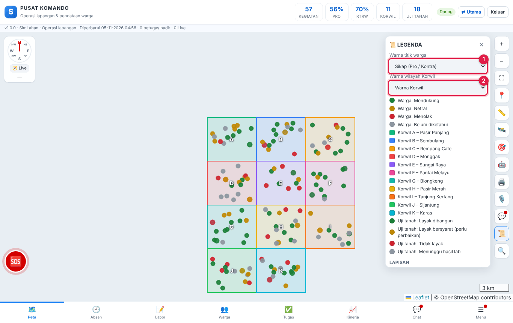

- **Warna titik warga**: Sikap (Pro / Kontra), Status lahan (sudah / belum dibebaskan), atau Kesesuaian RTRW.
- **Warna wilayah Korwil**: warna Korwil, persentase Pro, persentase RTRW sesuai, atau persentase lahan sudah.
- **Lapisan**: Warga, Pro %, RTRW sesuai, Lahan belum, Lahan sudah, Kegiatan, serta lapisan Temuan ilegal, Patroli SMART, Penguasaan lahan, Zona ancaman, Foto situs 360°, dan lapisan referensi (RTRW, hutan, kawasan proyek) bila tersedia.
- Tombol **🔎 Fokus** (memusatkan ke wilayah kerja), **🖨️ Cetak**, dan **👥 Warga**.

Ketuk titik atau wilayah di peta untuk membuka rinciannya (warga, Korwil, bidang, titik uji, foto 360°).

### 10.2.2 Cetak peta

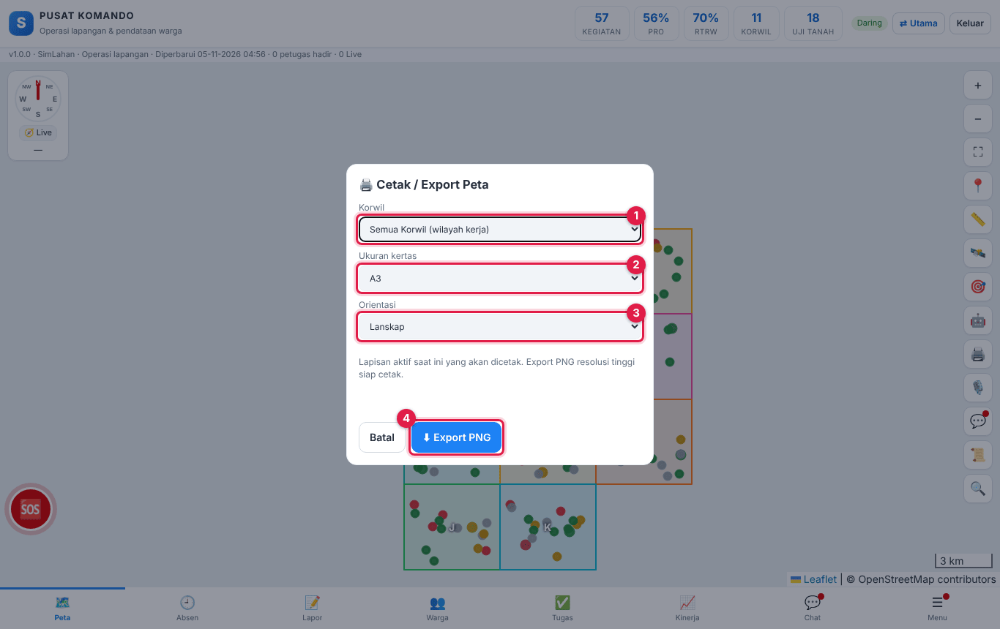

1. Klik 🖨️.
2. Pilih **Korwil** (atau Semua Korwil), **Ukuran kertas** (A3, A2, A1, A0), dan **Orientasi** (Lanskap/Potret).
3. Klik **⬇ Export PNG**. Lapisan yang sedang aktif dicetak dalam resolusi tinggi siap cetak.

### 10.2.3 Mode Live dan SOS

- **Live**: ketuk **🧭 Live** untuk membagikan posisi Anda ke pusat komando selama bertugas. Jejaknya tersimpan (titik tiap ±1 menit atau 25 m) selama 60 hari dan bisa dilihat koordinator. Ketuk lagi untuk mematikan.
- **SOS**: ketuk **🆘**, isi **Pesan (opsional)**, lalu **KIRIM SOS**. Lokasi Anda dikirim ke koordinator, Administrator, dan petugas Korwil Anda di chat. Tetap di lokasi aman bila memungkinkan.

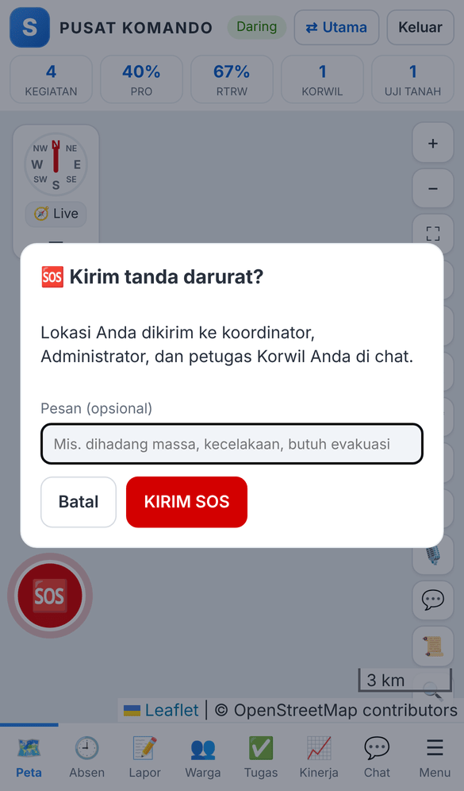

## 10.3 Absen

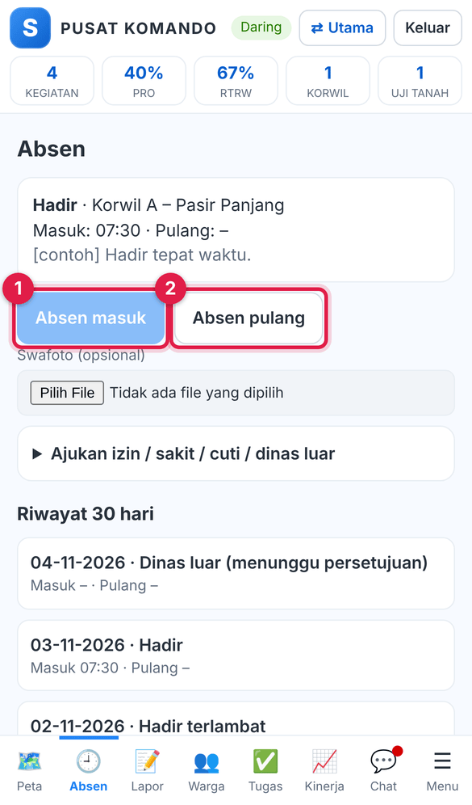

1. Buka tab **Absen**. Status hari ini tampil di atas.
2. Ambil **Swafoto** bila diminta (bisa wajib, tergantung pengaturan).
3. Ketuk **Absen masuk** saat mulai bekerja dan **Absen pulang** saat selesai. Lokasi GPS wajib; absen di luar wilayah Korwil bisa ditolak (tergantung pengaturan). Absen butuh koneksi internet.
4. **Riwayat 30 hari** menampilkan kehadiran Anda (Hadir, Hadir terlambat, Izin, Sakit, Cuti, Dinas luar).

**Mengajukan izin, sakit, cuti, atau dinas luar:**

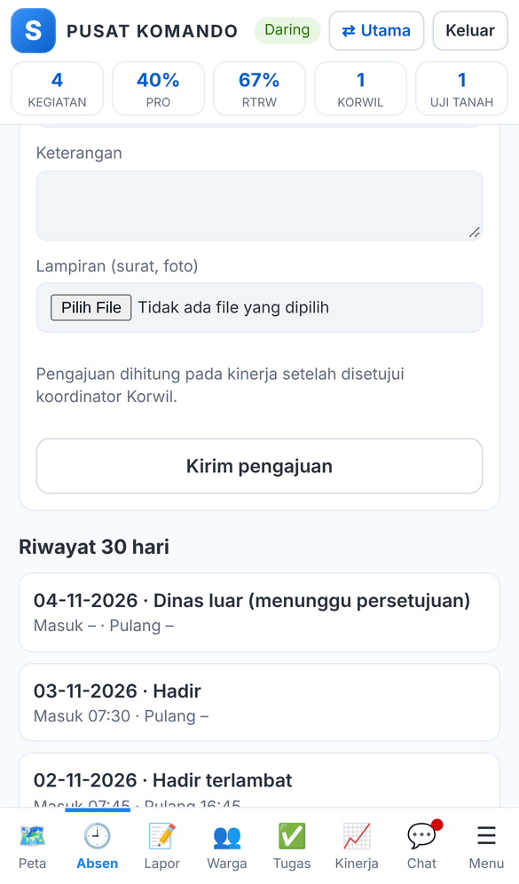

1. Ketuk **Ajukan izin / sakit / cuti / dinas luar**.
2. Pilih **Jenis**, **Tanggal**, tulis **Keterangan**, dan lampirkan surat/foto di **Lampiran**.
3. Ketuk **Kirim pengajuan**. Pengajuan dihitung pada kinerja setelah disetujui koordinator Korwil.

Koordinator melihat bagian **Persetujuan izin tim** di tab yang sama dan menyetujui atau menolak pengajuan anggota.

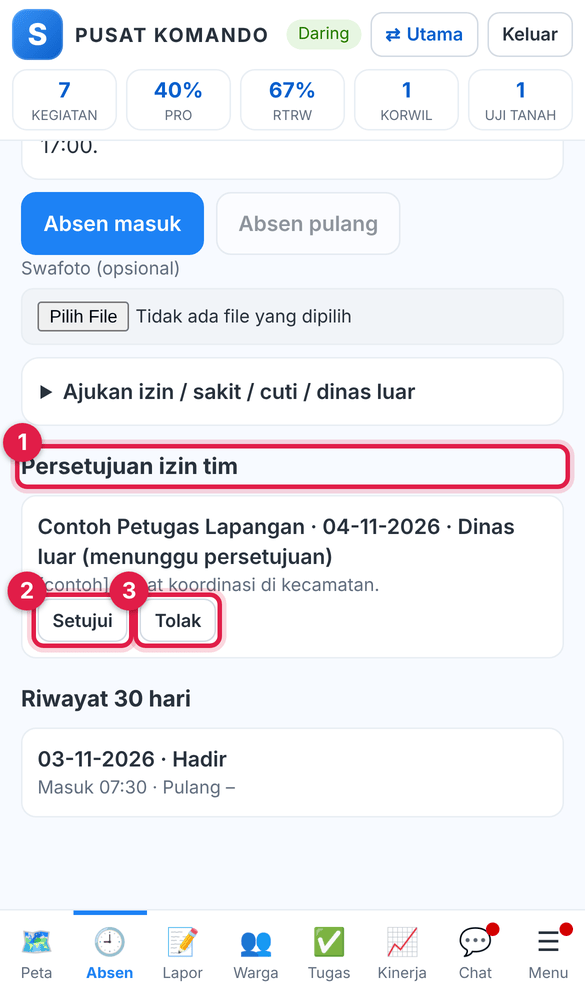

## 10.4 Lapor kegiatan

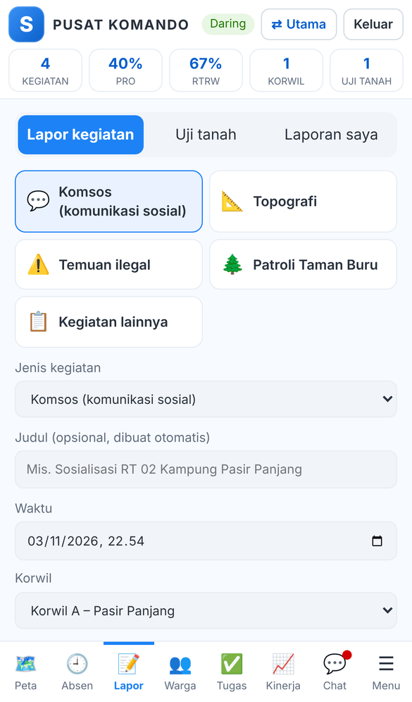

Tab **Lapor** punya tiga bagian: **Lapor kegiatan**, **Uji tanah**, dan **Laporan saya**.

### Langkah umum

1. Pilih **Jenis kegiatan**: Komsos (komunikasi sosial), Topografi, Temuan ilegal, Patroli Taman Buru, Pemetaan / penguasaan lahan, Sosialisasi, Pendataan warga, Kunjungan / pendekatan warga, Verifikasi data, Pengukuran / pematokan, Uji tanah, Patroli, Mediasi / musyawarah, Rapat koordinasi, Pendampingan relokasi, atau Kegiatan lainnya. Isian di bawahnya menyesuaikan jenis yang dipilih.
2. Isi **Judul**, **Waktu**, **Korwil**, **Personil pendamping**, dan **Nama lokasi**.
3. Isi **Uraian / narasi**, **Durasi (menit)**, **Warga hadir / ditemui**, dan **Hasil & tindak lanjut**. Bila kegiatan ini mengerjakan tugas, pilih **Tugas terkait**.
4. Tambah **Warga terkait** (warga yang sudah terdata), **Foto (maks. 5)**, dan **Rekaman suara (opsional, maks 10 MB)**.
5. Lokasi diambil dari GPS. Bila kegiatan di titik lain, ketuk peta dan centang **Pakai titik yang saya ketuk di peta**.
6. Ketuk **Simpan laporan**. Saat luring, laporan masuk **Antrean kirim** dan terkirim otomatis saat ada sinyal (atau ketuk **Kirim sekarang**).

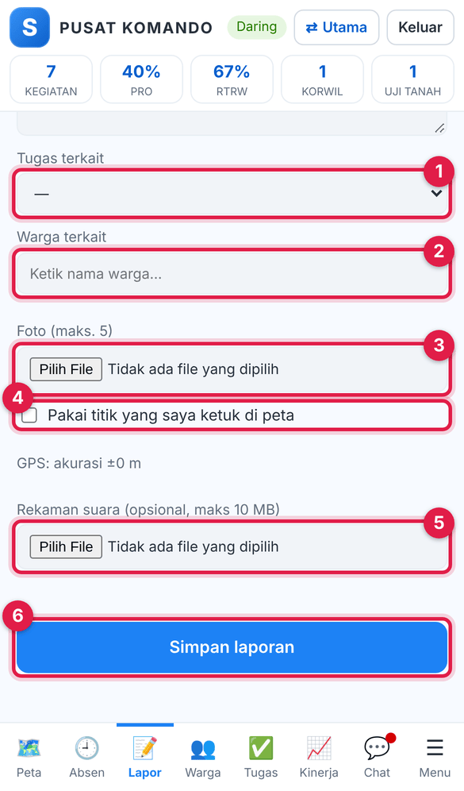

> **Poin usaha:** setiap laporan memberi poin sesuai bobot jenis kegiatan, ditambah bonus kelengkapan (temuan, foto, narasi lengkap, jarak tempuh, lokasi GPS). Mengisi **Data tambahan (poin lebih)** menambah poin.

### Komsos (komunikasi sosial)

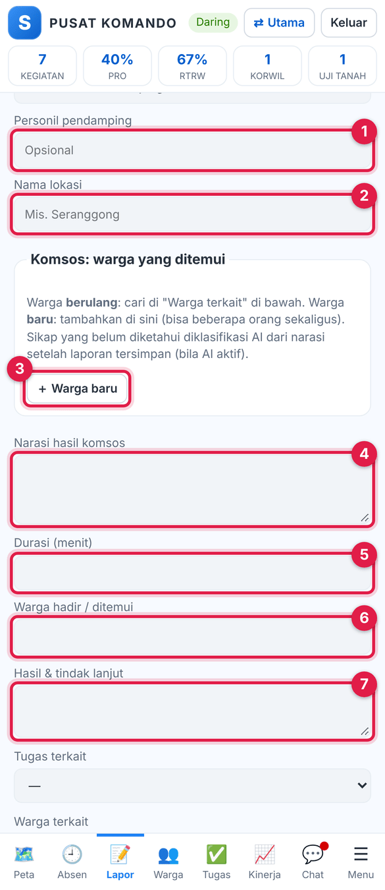

1. Pilih jenis **Komsos**.
2. Warga yang sudah pernah ditemui: cari di **Warga terkait**.
3. Warga baru: ketuk **＋ Warga baru**, isi **Status responden**, **Nama**, **Jenis kelamin**, **Pekerjaan**, **Umur**, **No. kontak**, **Alamat**, **Kampung**, **Asal**, **Lama menetap (tahun)**, dan **Sikap**. Bagian **Data tambahan (poin lebih)**: Nama/Pekerjaan pasangan, Jumlah anak, Luas lahan (m²), Status penggarapan, Data anak, Kondisi lahan. Ketuk **Tambahkan ke laporan**. Ulangi untuk warga lain; beberapa warga baru bisa dalam satu laporan.
4. Sikap yang belum diketahui diklasifikasi AI dari narasi setelah laporan tersimpan (bila AI aktif).

### Temuan ilegal

Pilih **Temuan baru** atau **Kunjungan berulang** (untuk lokasi yang pernah dilaporkan). Isi **Aktivitas** (pembalakan liar, tambang ilegal, perambahan, pembukaan lahan, pembangunan liar), **Lokasi temuan**, **Pemilik** dan kontaknya, **Pengurus**, **Luas lahan (ha)**, **Status hutan**, **Mulai usaha berjalan**, lalu **Data kunjungan ini**: Izin usaha, Kegiatan usaha, Oknum yang terlibat, Peralatan usaha, Bangunan, Tindak lanjut.

### Patroli Taman Buru

Pilih **Cara isi**: manual, unggah berkas **SMART Mobile / CyberTracker (.json)**, atau gabungan. Dari berkas SMART, jalur, observasi, foto, dan data tim terisi otomatis; periksa lalu simpan. Isi **Grid**, **Jarak tempuh (km)**, **Hasil temuan** (＋ Temuan: flora, fauna, aktivitas ilegal), dan **Bibit** (＋ Bibit dirawat / ＋ Bibit diproduksi). **Data tambahan**: situasi, kondisi personil dan materiil, cuaca pagi/siang/sore, objektif, ketua tim, regu, pos, transportasi, waktu mulai/selesai, kendala, saran.

### Kegiatan lainnya: penilaian dampak

Untuk **Kegiatan lainnya**, isi **Penilaian dampak**: **Cakupan / siapa terdampak**, **Risiko / urgensi bila tidak dilakukan**, dan **Hasil konkret**. Poin ditentukan dari substansi kegiatan, bukan dari foto. Klaim **Signifikan** atau **Kritis** dihitung 6 poin sampai dikonfirmasi atasan.

### Uji tanah

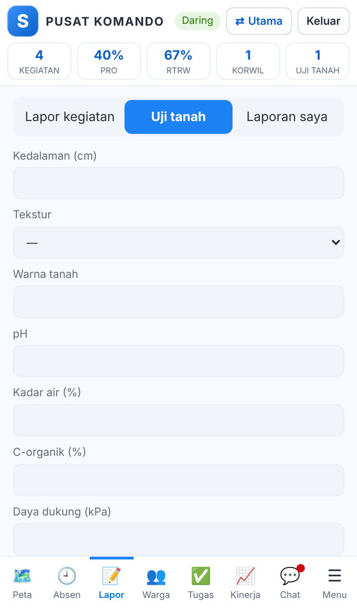

Isi **Kedalaman (cm)**, **Tekstur** (lempung, lanau, pasir, kerikil, gambut, laterit, campuran), **Warna tanah**, **pH**, **Kadar air (%)**, **C-organik (%)**, **Daya dukung (kPa)**, **CBR (%)**, **Kelayakan** (layak dibangun, layak bersyarat, tidak layak, menunggu hasil lab), **Laboratorium**, **Catatan**, **Foto sampel**, dan **Laporan lab (PDF)**. Ketuk **Simpan uji tanah**.

### Laporan saya

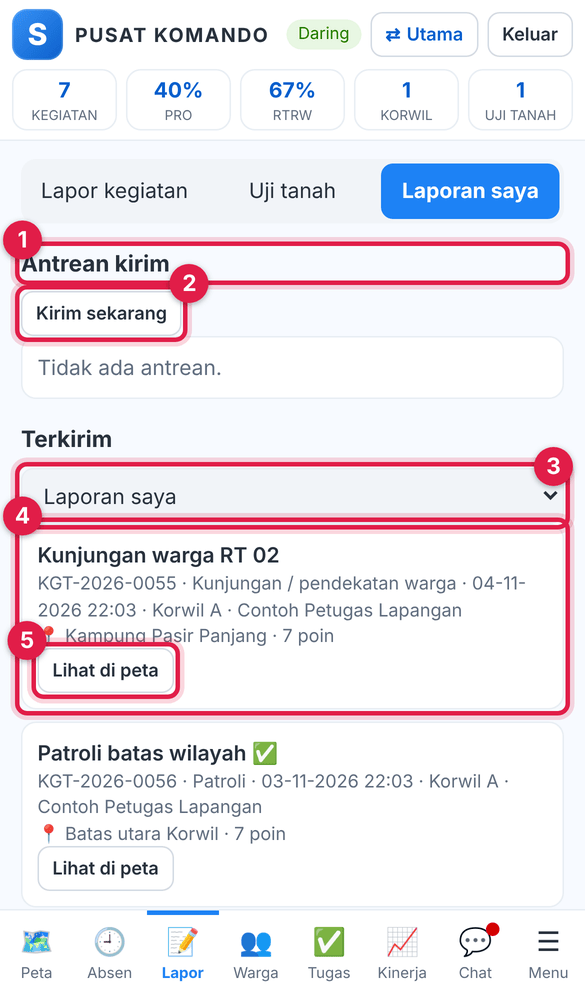

Daftar laporan yang **Terkirim** dan yang masih di **Antrean kirim**. Pilih tampilan **Laporan saya**, **Korwil saya**, atau **Semua** (sesuai hak). Koordinator dapat membuka laporan anggota dan memverifikasinya.

## 10.5 Warga

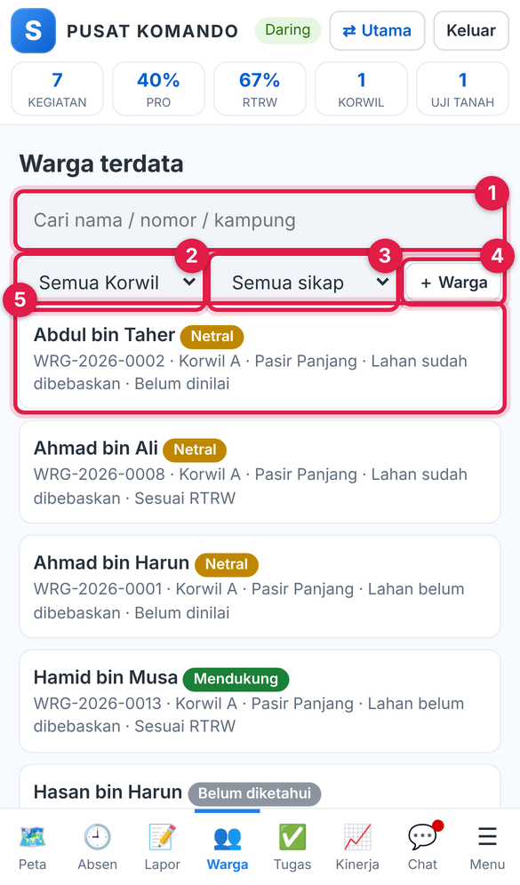

1. Saring dengan **Semua Korwil** dan **Semua sikap**, atau ketik nama.
2. Ketuk warga untuk membuka **Dossier warga**: data, riwayat sikap, kegiatan yang terkait, dan lokasi di peta.
3. Ketuk **＋ Warga** untuk menambah: **Nama kepala keluarga**, **NIK** (hanya terlihat Administrator), **Jumlah jiwa**, **Telepon / WA**, **Kampung**, **Alamat**, **Sikap**, **Status lahan**, **RTRW**, **Zona RTRW**, **Pilihan** penyelesaian (relokasi, ganti kerugian uang, pergeseran dalam kampung, lainnya), **Penggarapan lahan**, dan data lain. Centang **Simpan lokasi GPS saat ini sebagai lokasi rumah** bila Anda sedang di rumah warga. Ketuk **Simpan warga**.

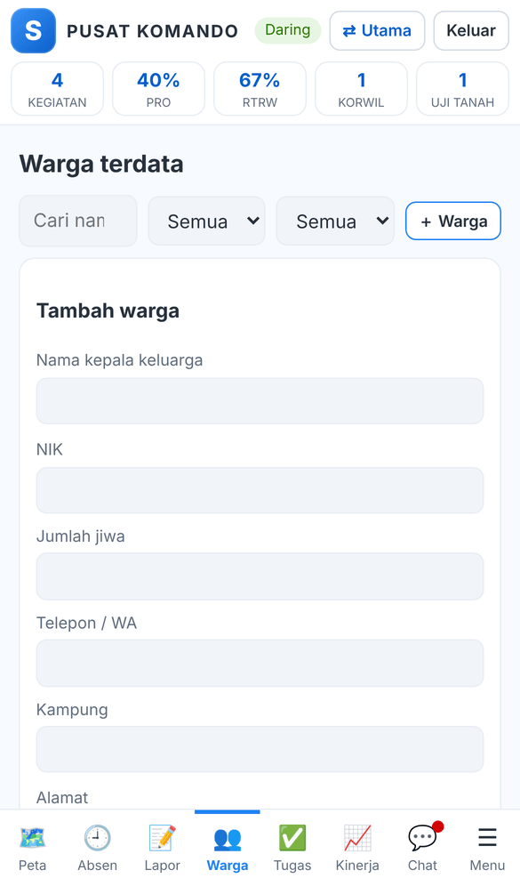

## 10.6 Tugas

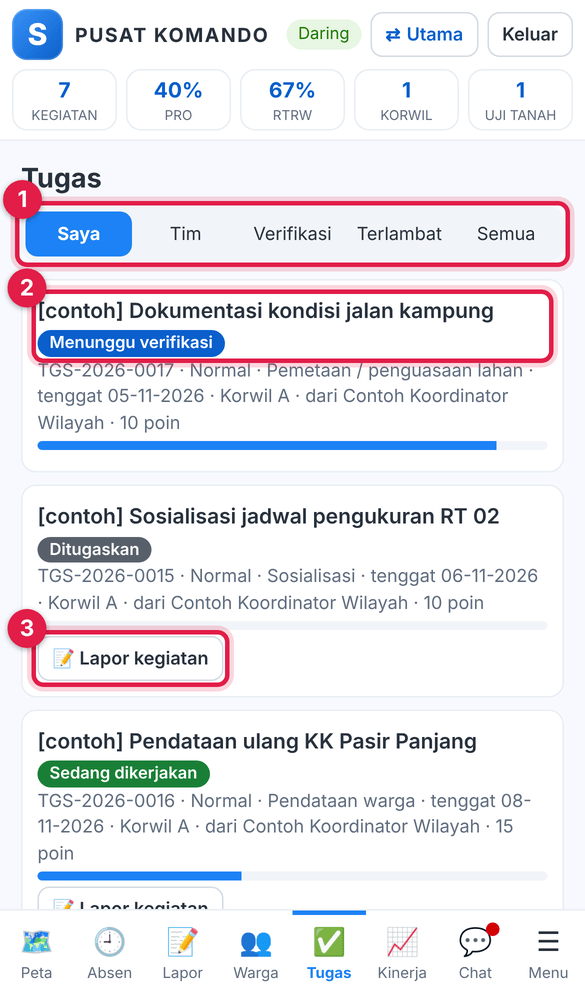

Saring dengan tombol **Saya**, **Tim**, **Verifikasi**, **Terlambat**, **Semua**. Ketuk tugas untuk membuka rinciannya.

**Mengerjakan tugas (petugas):**

1. Ketuk **▶ Mulai kerjakan**.
2. Setelah selesai, ketuk **📤 Laporkan selesai**. Isi catatan pekerjaan, lampirkan **Foto bukti (maks 3)**; lokasi GPS ikut tercatat.
3. Bila terhambat, ketuk **⚠ Ada kendala** dan tulis kendalanya (wajib). Lanjutkan dengan **▶ Mulai / lanjut**.
4. Tugas yang dilaporkan selesai menunggu verifikasi pemberi tugas atau atasan. Anda tidak bisa memverifikasi tugas sendiri.

**Memberi tugas (koordinator):**

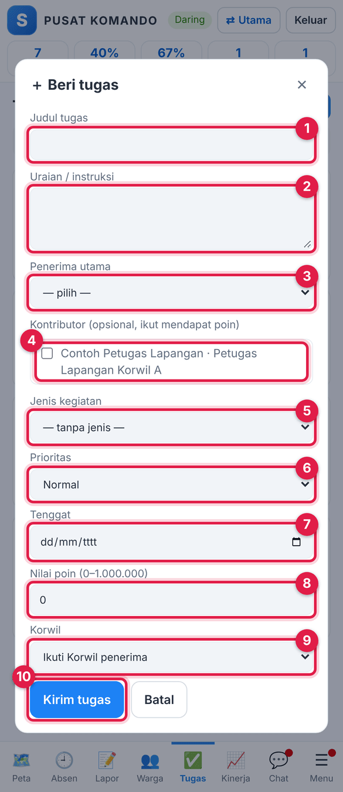

1. Ketuk **＋ Beri tugas**.
2. Isi **Judul tugas**, **Uraian / instruksi**, **Penerima utama**, **Kontributor** (opsional, ikut mendapat poin), **Jenis kegiatan**, **Prioritas**, **Tenggat**, **Nilai poin (0–1.000.000)**, dan **Korwil**.
3. Ketuk **Kirim tugas**. Penerima mendapat pemberitahuan.
4. Saat tugas dilaporkan selesai, buka dari filter **Verifikasi**, lalu ketuk **✔ Verifikasi selesai** atau **↩ Kembalikan untuk revisi** (wajib dengan catatan). Poin tugas yang diverifikasi masuk KPI penerima, kontributor, dan pemberi tugas. **✕ Batalkan tugas** membatalkan tugas.

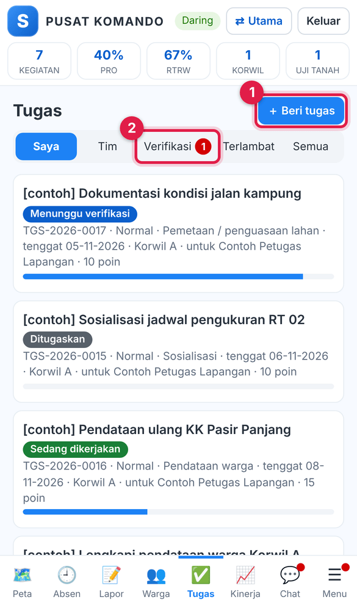

## 10.7 Kinerja (KPI)

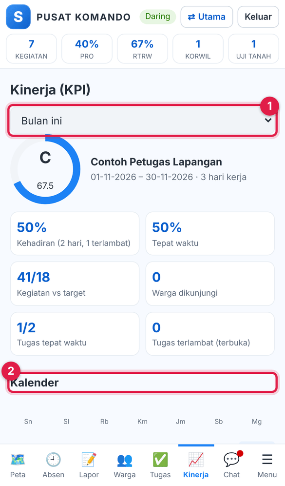

1. Pilih periode: Hari ini, Minggu ini, Bulan ini, Bulan lalu, Kuartal ini, Tahun ini.
2. Lihat skor Anda (gabungan kehadiran, kegiatan, dan tugas sesuai bobot di pengaturan), grafik batang dan tren, **Radar kinerja**, **Kalender** aktivitas 90 hari, dan sebaran titik kerja di peta.
3. Ketuk **Susun wawasan** untuk ringkasan kekuatan, kelemahan, dan saran.
4. **Peringkat tim** di bawahnya: kolom Petugas, Skor, Hadir, Kegiatan, Tugas. Petugas biasa hanya melihat skornya sendiri.

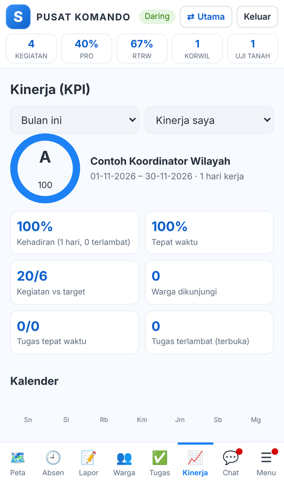

## 10.8 Chat

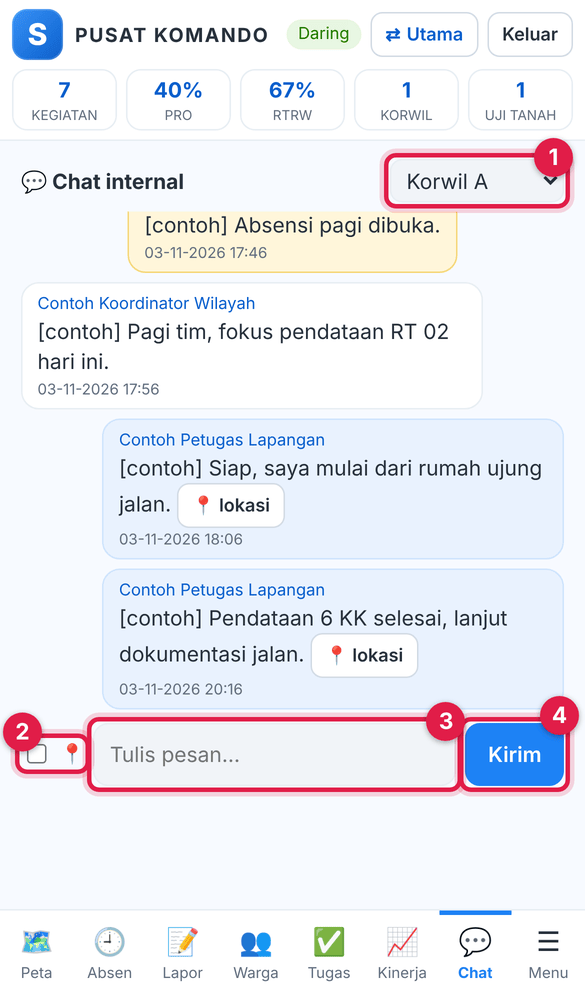

Pilih kanal (**Kanal umum** atau kanal Korwil), tulis pesan, lalu **Kirim**. Ketuk 📍 untuk menyertakan lokasi. Pesan sistem (misalnya SOS) juga muncul di sini. Titik merah di tab Chat berarti ada pesan baru.

## 10.9 Menu lainnya

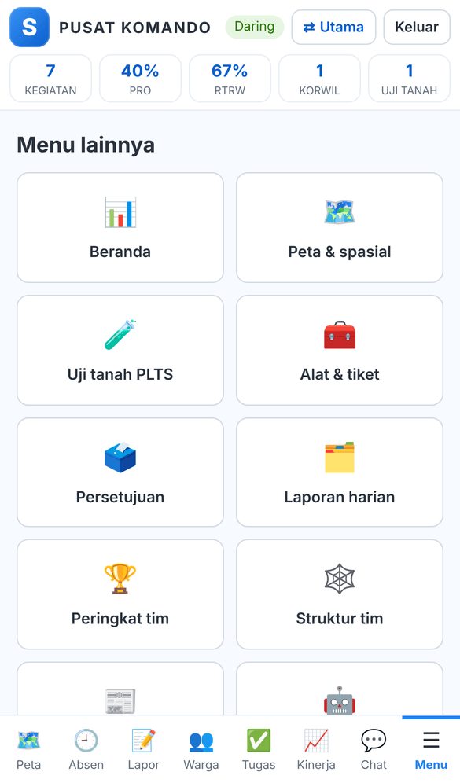

Tab **Menu** berisi: **📊 Beranda**, **🗺️ Peta & spasial**, **🧪 Uji tanah PLTS**, **🧰 Alat & tiket**, **🗳️ Persetujuan**, **🗂️ Laporan harian**, **🏆 Peringkat tim**, **🕸️ Struktur tim**, **🕰️ Historis**, **📰 Feed aktivitas**, **🤖 Asisten AI**, serta **📘 Panduan peran** dan **🔑 Ganti sandi**, dan tautan pindah aplikasi.

### Beranda

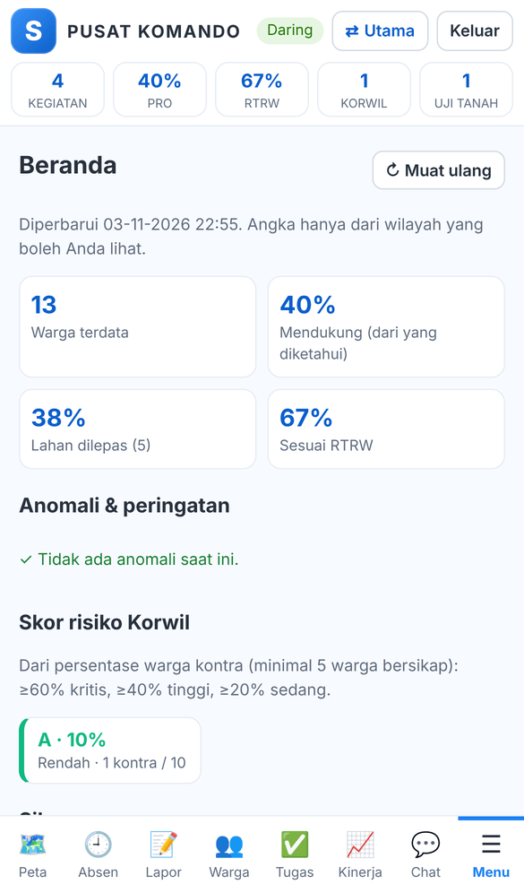

Ketuk **↻ Muat ulang** untuk data terbaru. Isi: **Anomali & peringatan**, **Skor risiko Korwil** (dari persentase warga kontra, minimal 5 warga bersikap: ≥60% kritis, ≥40% tinggi, ≥20% sedang), **Sikap warga**, **Tren dukungan (12 pekan)**, **Per Korwil** (Warga/target, Sikap, Pro, Lepas, Kegiatan 7 hari; ketuk baris untuk detail Korwil), **Kegiatan 7 hari**, dan **Uji tanah**.

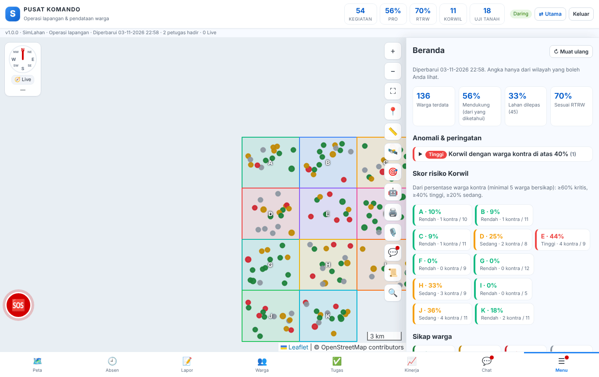

### Peta & spasial

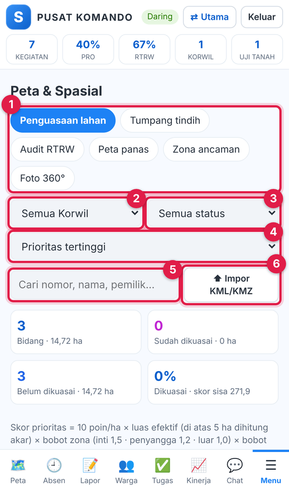

| Bagian | Isi |
|---|---|
| Penguasaan lahan | Daftar bidang dengan **Skor prioritas** (10 poin/ha × luas efektif × bobot zona × bobot urgensi). Saring per Korwil dan status; urutkan Prioritas tertinggi / Terluas / Nomor. **⬆ Impor KML/KMZ** untuk bidang baru atau hasil penguasaan (dicocokkan otomatis). Ketuk bidang untuk **Perbarui penguasaan**. |
| Tumpang tindih | Pilih **Lapisan A** dan **Lapisan B**, ketuk **Analisis**. Luas irisan tampil; **⬇ CSV** untuk unduh. Pilih lapisan yang sama untuk mencari bidang yang saling tumpang tindih. |
| Audit RTRW | Mencocokkan titik warga dengan lapisan tata ruang, hutan, dan kawasan proyek. Ketuk **Jalankan audit**. |
| Peta panas | Pilih periode, ketuk **Tampilkan di peta**. Sel ±250 m; makin pekat makin banyak data. |
| Jejak GPS | Pilih petugas, ketuk **Tampilkan** (koordinator/pimpinan). |
| Zona ancaman | Koordinator mengisi **Nama zona**, **Tingkat** (rendah–kritis), **Radius (m)**, **Korwil**, **Keterangan**, lalu **Simpan zona**. |
| Foto 360° | Isi **Judul**, **Tanggal pengambilan**, pilih foto equirectangular (JPG/PNG, maks. 20 MB), lalu **Unggah**. Ketuk **Lihat 360°** untuk memutar foto. |

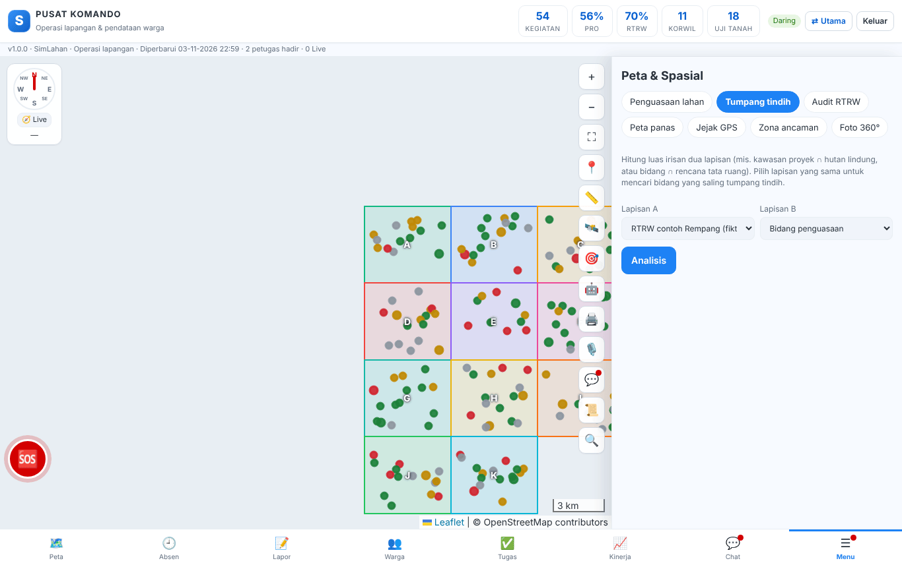

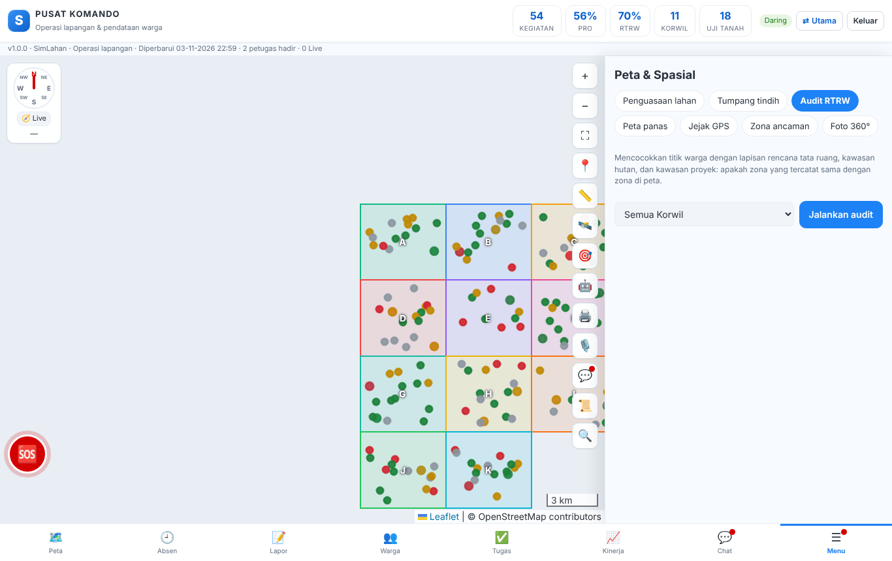

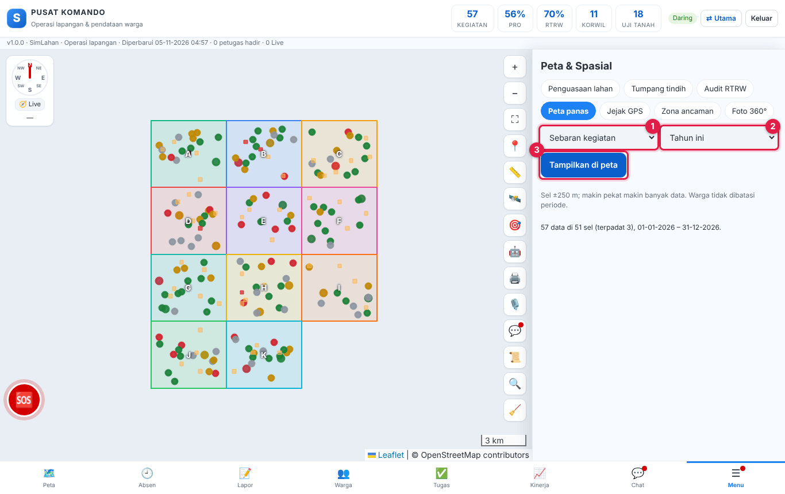

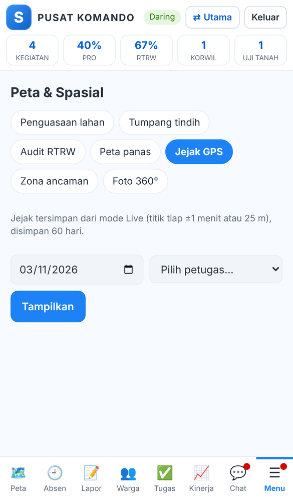

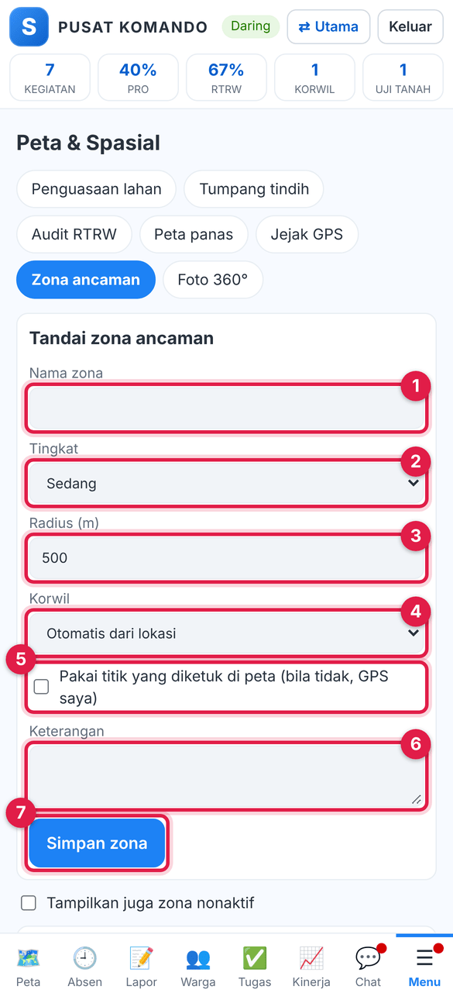

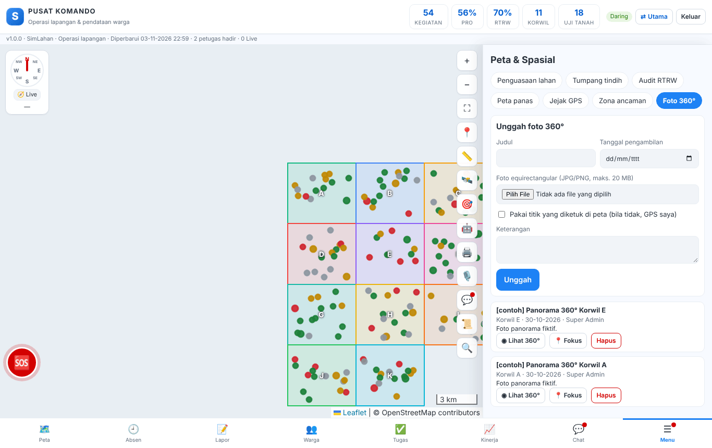

### Uji tanah PLTS

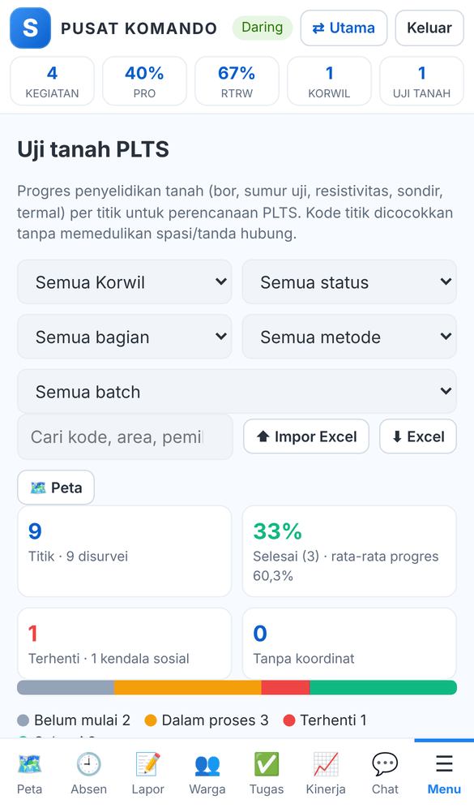

Progres penyelidikan tanah (bor, sumur uji, resistivitas, sondir, termal) per titik untuk perencanaan PLTS.

1. Saring per Korwil, status, bagian, metode, atau batch.
2. Ketuk titik untuk **Detail titik**. Di **Aksi cepat**, ubah status pekerjaan (Belum mulai, Dalam proses, Terhenti, Selesai), progres, status survei, dan kondisi sosial. Catatan wajib bila terhenti. Tambah foto.
3. **⬇ Excel** mengunduh data; **⬆ Impor Excel** memperbarui progres dari berkas (pilih **Perbarui titik terdaftar** atau **Perbarui + tambah titik baru**, lalu **Pratinjau** dan **Terapkan pilihan**). Kolom yang dikenali antara lain Kode titik, Metode, Area/Paket, Batch, Korwil, Status survei, Kondisi sosial, Status pekerjaan, Progres, Kendala, tanggal, dan Lintang/Bujur. Sel kosong tidak mengubah data.
4. Koordinator dapat menambah titik dengan **＋ Titik**. **🗺️ Peta** menampilkan titik di peta.

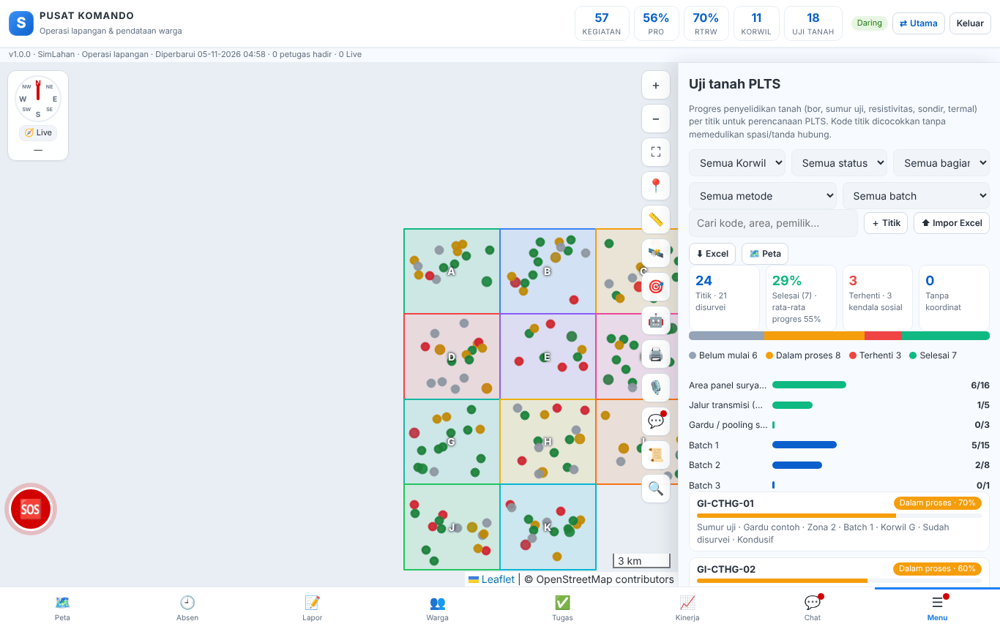

### Alat & tiket

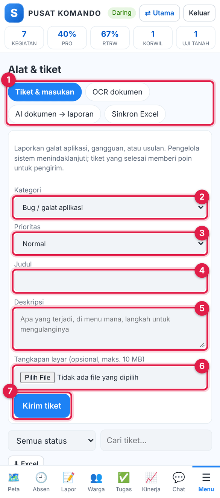

| Alat | Cara pakai |
|---|---|
| Tiket & masukan | Pilih **Kategori** (galat aplikasi, gangguan layanan, saran fitur, ulasan, lainnya), **Prioritas**, isi **Judul**, **Deskripsi**, lampirkan tangkapan layar, lalu **Kirim tiket**. Tiket yang selesai memberi poin untuk pengirim. |
| OCR dokumen | Unggah foto/PDF (maks. 20 MB), ketuk **Baca teks**. Teks bisa disalin. |
| AI dokumen → laporan | Unggah dokumen (PDF, Word, Excel, CSV, TXT, foto), isi **Fokus analisis**, ketuk **Analisis**. Hasil: ringkasan, temuan utama, data kunci, rekomendasi. |
| AI foto lapangan | Unggah foto lapangan/drone, isi **Konteks**, ketuk **Analisis foto**. AI menandai pembukaan lahan, bangunan, kebun, air, akses, alat berat. Wajah orang tidak dianalisis. |
| Audit data | (Koordinator) **Jalankan audit data**: titik tanpa koordinat atau di luar wilayah, bidang ganda, warga tanpa lokasi, kegiatan tanpa GPS, petugas tanpa Korwil. **✨ Ringkas dengan AI** untuk ringkasan. |
| Cek perangkat | **Periksa perangkat**: memeriksa koneksi internet, antrean luring, penyimpanan luring, mode aplikasi luring, izin lokasi GPS, dan ruang penyimpanan terpakai di HP Anda. |
| Sinkron Excel | **⬇ Unduh Excel lengkap** (ringkasan Korwil, bidang lahan, titik uji PLTS, tiket); **⬆ Impor progres uji PLTS** dari lembar yang sudah diedit. |

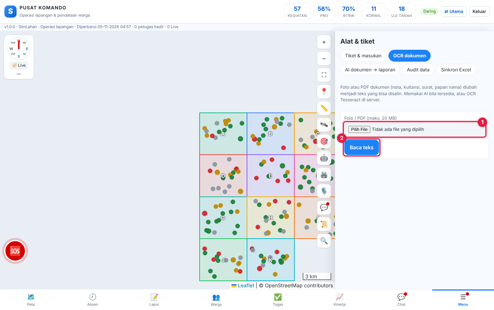

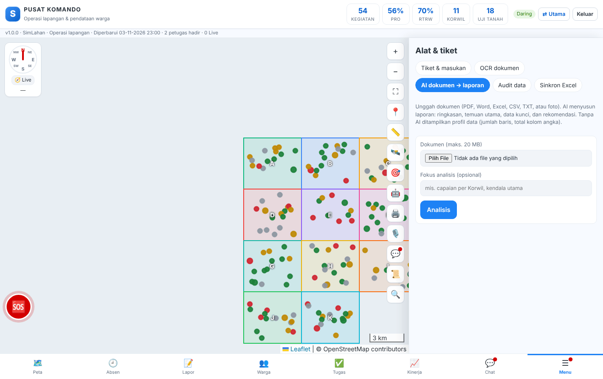

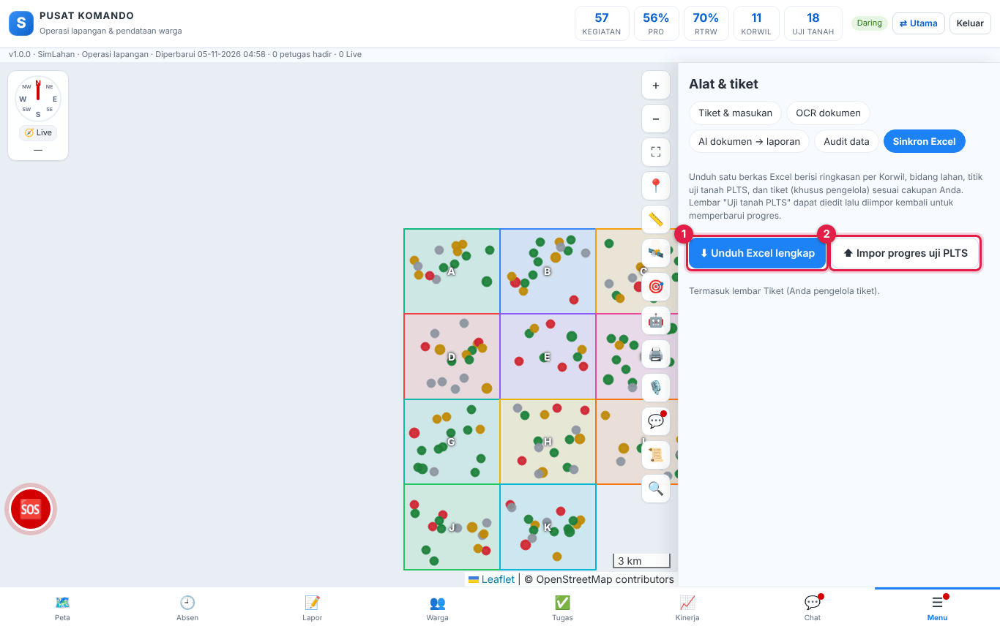

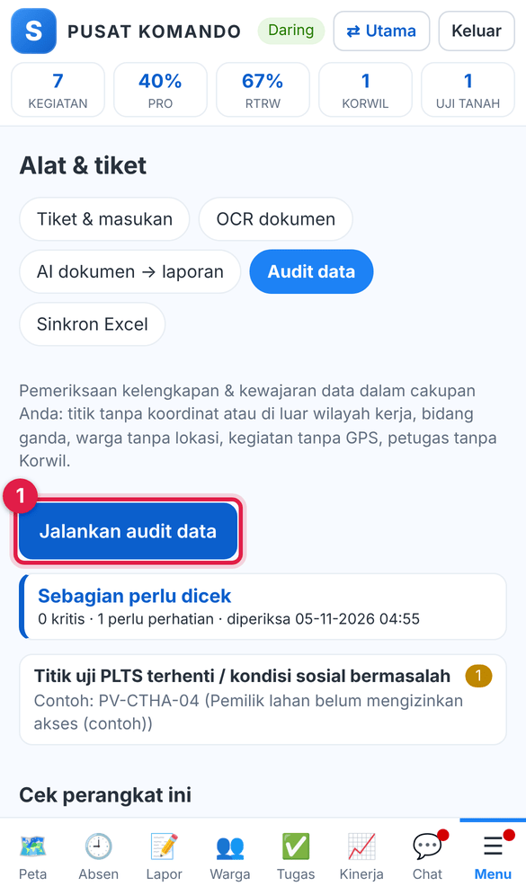

### Persetujuan

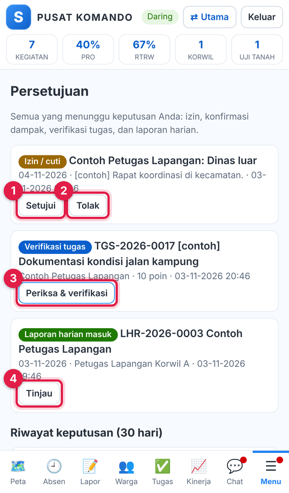

Semua yang menunggu keputusan Anda di satu tempat: izin anggota, konfirmasi dampak tinggi, verifikasi tugas, dan laporan harian. Ketuk **Setujui** / **Tolak** / **Verifikasi** / **Konfirmasi dampak** sesuai jenisnya. **Riwayat keputusan (30 hari)** di bawah. Petugas biasa melihat halaman ini kosong.

### Laporan harian berjenjang

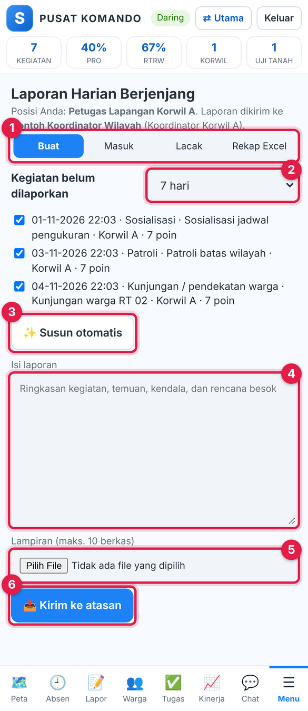

Laporan harian dikirim ke **atasan langsung** (diatur di **Jabatan & atasan petugas**), lalu dirangkum ke atas sampai pimpinan.

| Tombol | Fungsi |
|---|---|
| **Buat** | Menyusun laporan. Bagian **Kegiatan belum dilaporkan** (pilih rentang Hari ini – 31 hari) dan **Laporan bawahan yang dirangkum** terisi otomatis. Ketuk **✨ Susun otomatis** agar isi tersusun, sunting **Isi laporan**, tambah **Lampiran (maks. 10 berkas)**, lalu **📤 Kirim ke atasan**. **Perlu revisi dari Anda** menampilkan laporan yang dikembalikan. |
| **Masuk** | (Atasan) laporan dari bawahan. Pilih **↩ Kembalikan untuk revisi** (dengan catatan) atau rangkum ke laporan Anda. Pimpinan puncak menandai **✔ Tandai terpilih selesai ditinjau**. |
| **Lacak** | Posisi laporan Anda dan bawahan 14 hari terakhir. |
| **Rekap Excel** | Pilih **Periode**, **Korwil**, **Jenis kegiatan**, lalu **⬇ Unduh Excel** (rekap kegiatan, ringkasan per Korwil/jenis/petugas, absensi, tugas). |

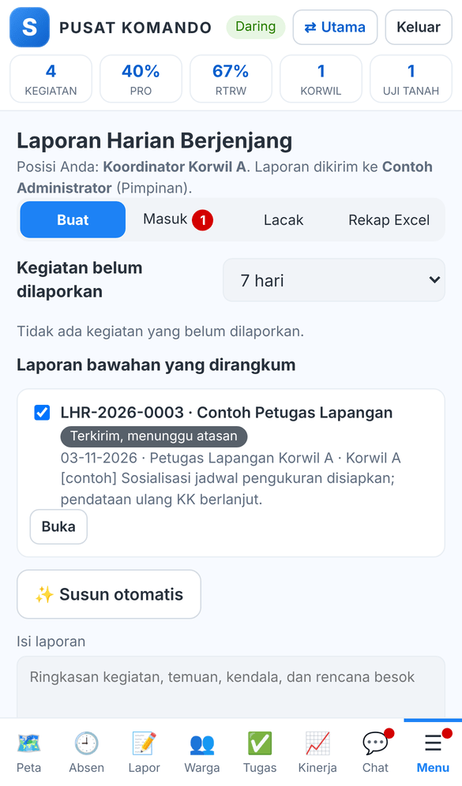

### Peringkat tim

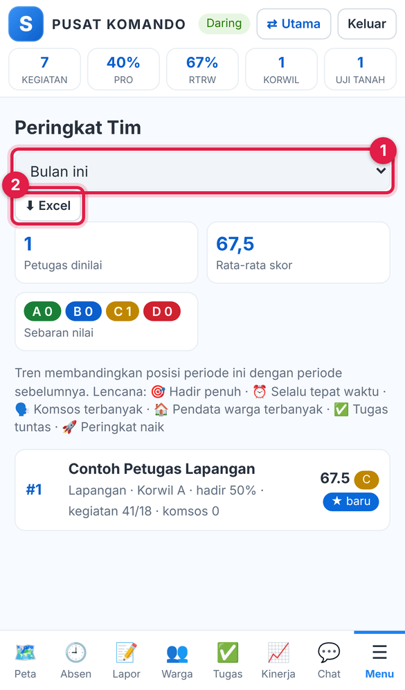

Pilih periode, Korwil, dan tingkat; tombol **Semua**, **10 teratas**, **10 terbawah**; **⬇ Excel** untuk unduh. Kolom tren membandingkan posisi dengan periode sebelumnya. **Susun wawasan** memberi ringkasan siapa yang menonjol dan siapa yang perlu didampingi.

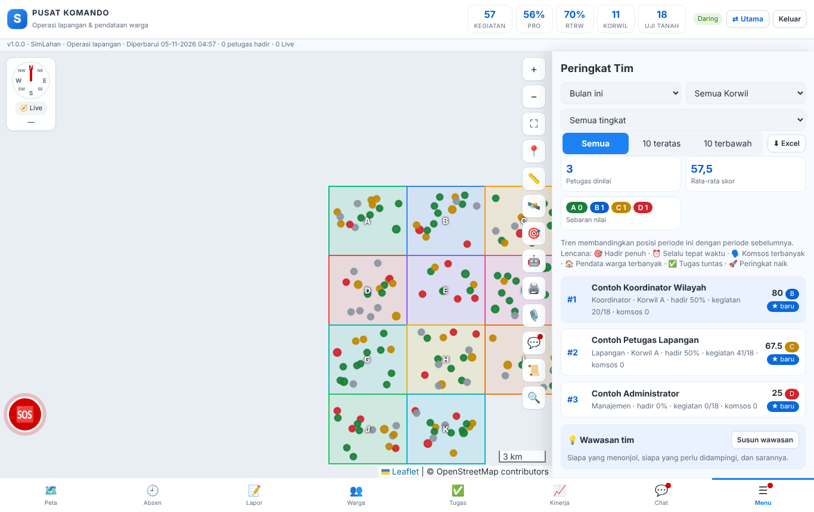

### Struktur tim, Historis, Feed, Asisten AI

- **Struktur tim**: ketuk Korwil untuk melihat anggota, kinerja, dan warganya.

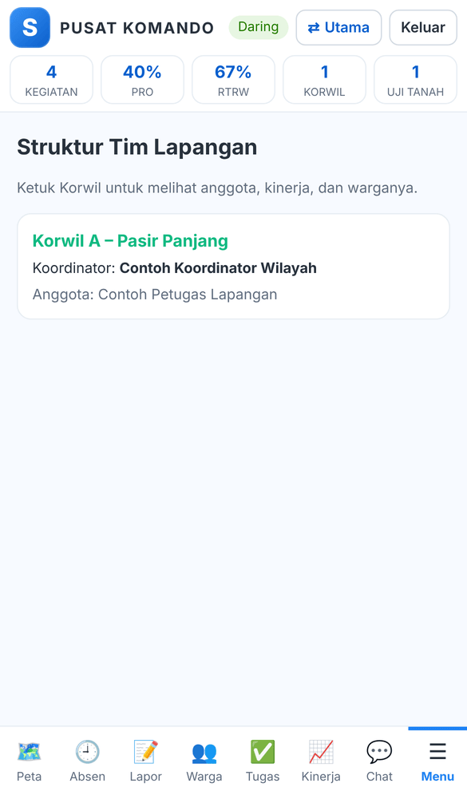

- **Historis** (koordinator dan atasan): pilih periode dan Korwil, lalu **Komsos** (warga baru dan kunjungan berulang per petugas), **Perubahan sikap**, atau **Luas lahan**.

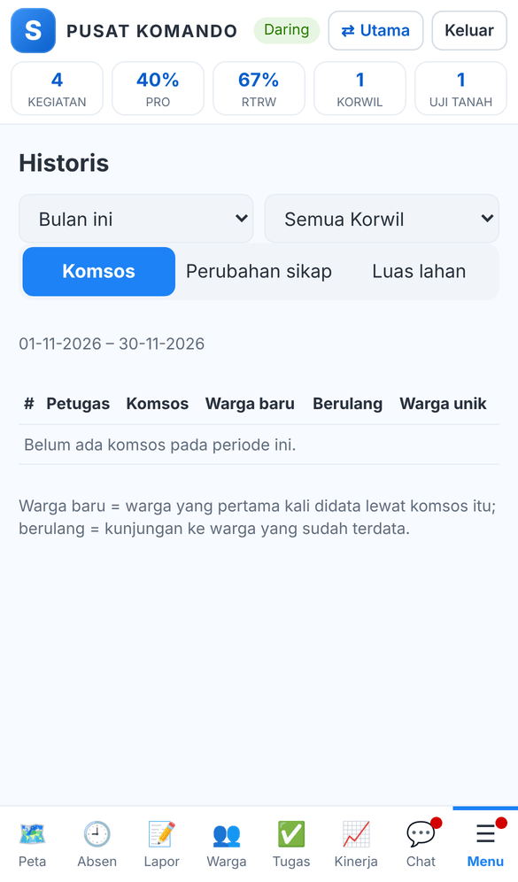

- **Feed aktivitas**: aliran kegiatan terbaru, bisa disaring per Korwil.

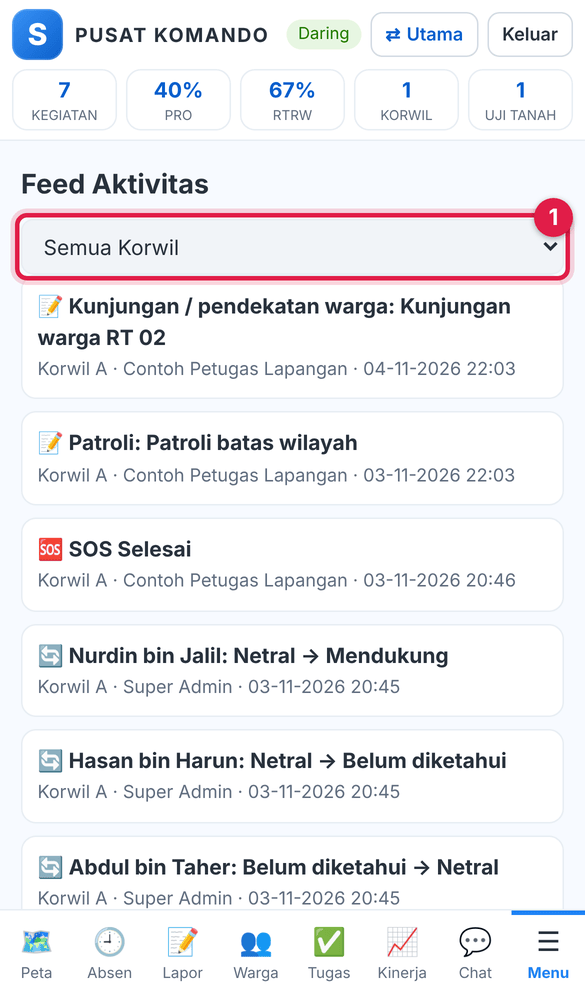

- **Asisten AI**: tanyakan data wilayah dengan bahasa sehari-hari, lalu ketuk **Tanya**. Jawaban hanya dari data yang boleh Anda lihat.

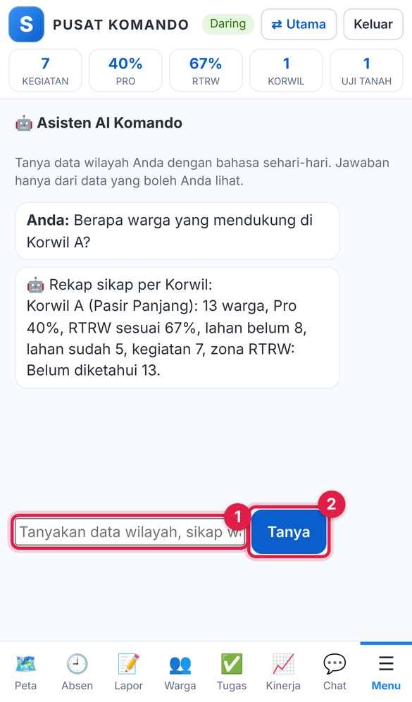

## 10.10 Pertanyaan umum

**Absen ditolak karena di luar wilayah.** Pastikan GPS aktif dan Anda berada di wilayah Korwil. Bila bertugas di luar, ajukan **Dinas luar**.

**Laporan belum terkirim.** Lihat angka ⏳ di bilah atas. Laporan terkirim otomatis saat ada sinyal, atau ketuk **Kirim sekarang** di **Laporan saya**.

**Saya tidak melihat tombol Beri tugas.** Hanya koordinator dan atasan yang bisa memberi tugas.

**Muncul layar "KUNCI SISTEM AKTIF".** Fitur darurat yang hanya bisa dinonaktifkan superuser. Hubungi Administrator.
