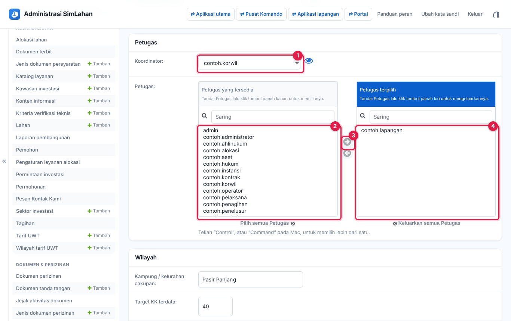
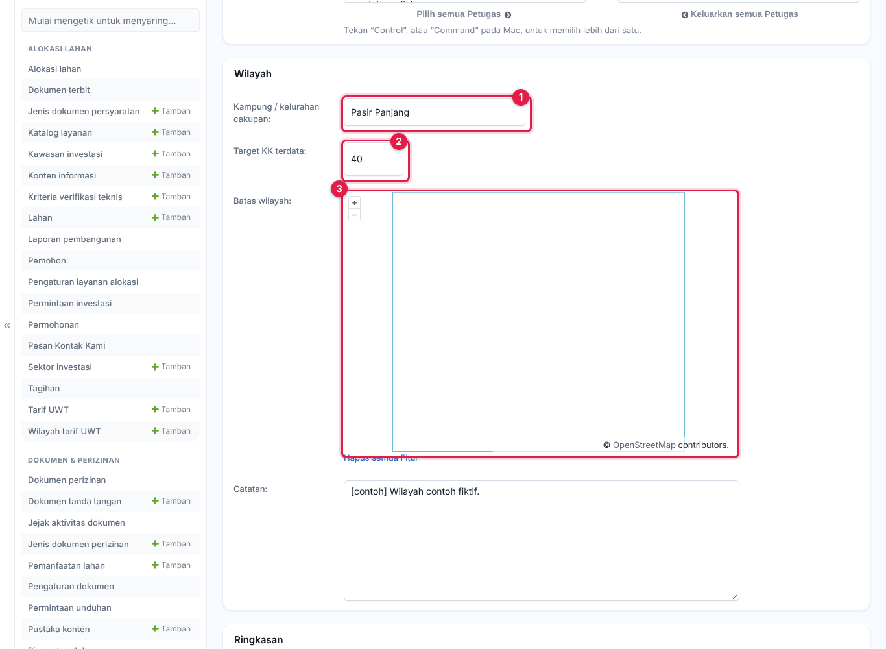
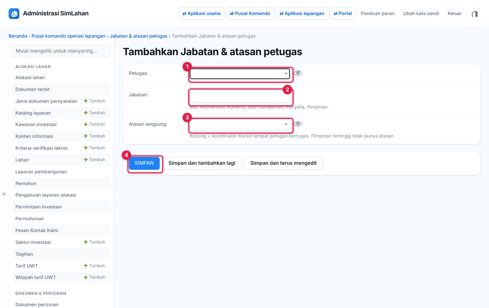
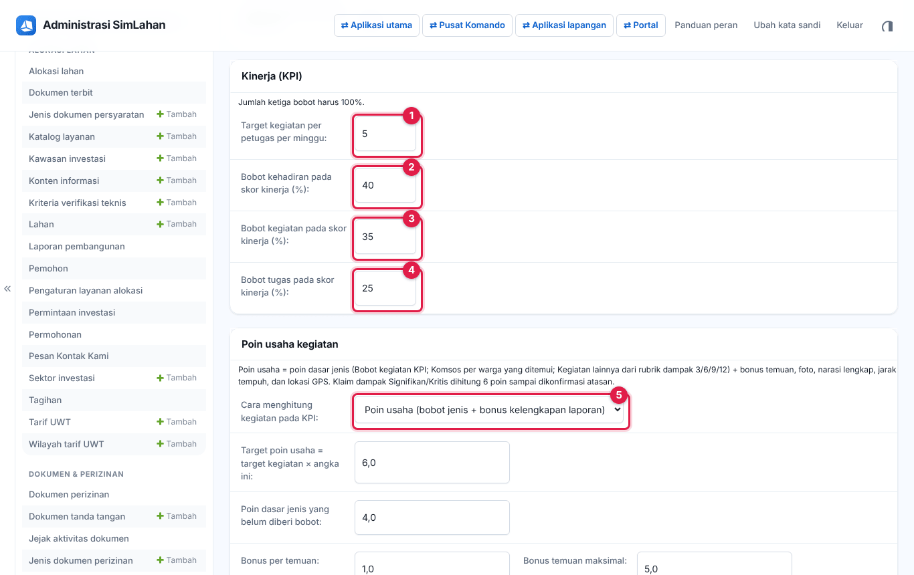
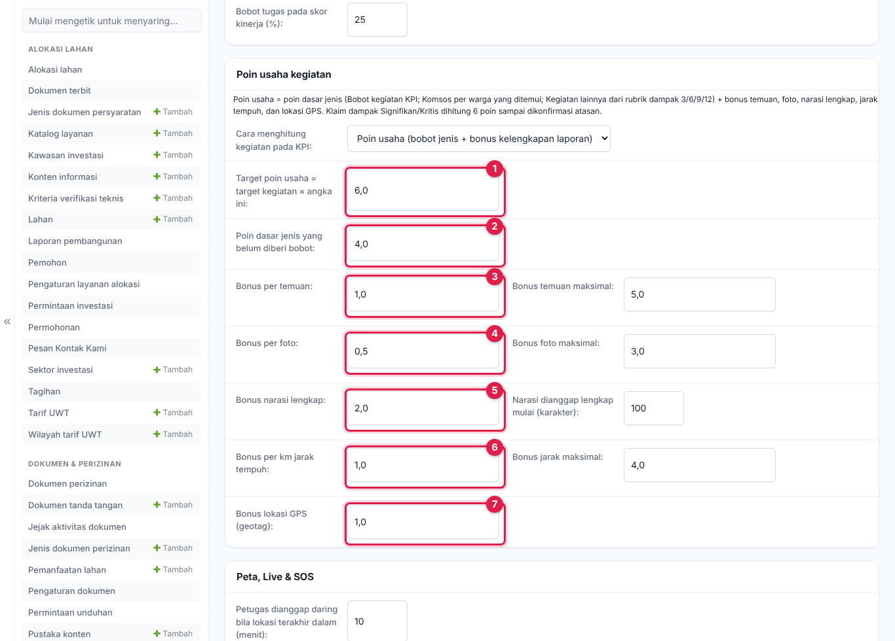
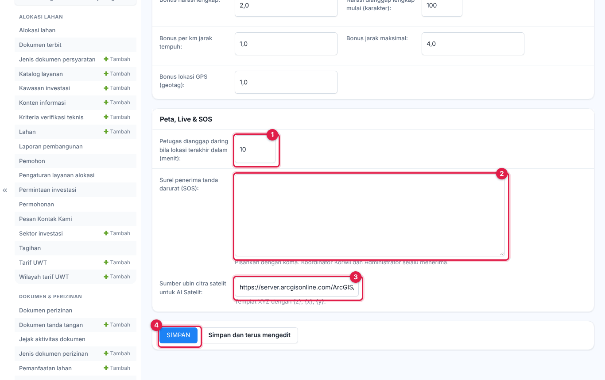

# Bab 11 – Data pusat komando di panel admin

Semua data pusat komando juga bisa dikelola dalam bentuk tabel di **Panel admin → Pusat komando operasi lapangan**. Di sini Administrator menyiapkan Korwil, anggota, atasan, bobot poin, dan pengaturan; petugas dan koordinator bisa membaca, menyaring, dan mengekspor data dalam cakupannya.

**Siapa memakai bab ini:** Administrator (semua), Koordinator Wilayah dan Petugas Lapangan (data Korwilnya, sesuai hak di [Bab 10](40-pusat-komando.md)), Petugas Aset Lahan (membaca untuk unit layanannya).

## 11.1 Korwil (koordinator wilayah)

Nomor pada gambar:

1. **Buka pusat komando**: membuka peta Korwil di pusat komando.
2. **Impor batas SHP/KML/KMZ/GeoJSON**: mengimpor batas banyak Korwil sekaligus (lihat di bawah).
3. **Tambahkan Korwil (koordinator wilayah)**: membuat Korwil baru.
4. Kotak cari: ketik kode atau nama Korwil, lalu tekan Enter.

**Menambah atau mengubah Korwil:**

1. Klik **Tambahkan Korwil (koordinator wilayah)** (nomor 3 di atas), atau klik nama Korwil di daftar untuk mengubahnya.

2. Isi **Kode** (nomor 1), misalnya A, B, sampai K.
3. Isi **Nama wilayah** (nomor 2) dan **Warna peta** (nomor 3) dalam format #RRGGBB, misalnya #1d82f5.
4. Biarkan **Aktif** tercentang (nomor 4). Hapus centangnya untuk menyembunyikan Korwil dari pusat komando.
5. Pilih **Unit layanan / lokasi** (nomor 5).
6. Gulir ke bagian **Petugas**:

7. Pilih **Koordinator** (nomor 1), yaitu petugas yang memimpin Korwil ini.
8. Di kotak **Petugas yang tersedia** (nomor 2), klik nama anggota, lalu klik panah ke kanan (nomor 3). Nama pindah ke kotak **Petugas terpilih** (nomor 4). Tahan Ctrl (atau Command di Mac) untuk memilih beberapa nama sekaligus. Hanya anggota terpilih yang bisa melapor untuk Korwil ini.
9. Gulir ke bagian **Wilayah**:

10. Isi **Kampung / kelurahan cakupan** (nomor 1) dan **Target KK terdata** (nomor 2).
11. Gambar **Batas wilayah** di peta (nomor 3): klik titik-titik batas satu per satu, lalu klik dua kali pada titik terakhir untuk menutup bidang. Untuk mengulang, klik **Hapus semua fitur** di bawah peta. Batas juga bisa diisi lewat impor (lihat di bawah). Pada gambar, latar peta tampil abu-abu karena peta dasar dari internet tidak dimuat saat gambar dibuat.
12. Klik **Simpan** di bagian bawah halaman.

**Mengimpor batas:**

1. Klik **Impor batas SHP/KML/KMZ/GeoJSON** (nomor 2 pada gambar daftar).
2. Pilih berkas GeoJSON, KML/KMZ, GeoPackage, atau Shapefile dalam ZIP yang berisi poligon. Atribut yang dikenali: `kode` (wajib), `nama`, `warna`, `kampung`.
3. Klik tombol impor. Korwil dengan kode yang sudah ada diperbarui batasnya; kode baru dibuat sebagai Korwil baru.

## 11.2 Warga terdata

Nomor pada gambar:

1. **Buka di pusat komando**: membuka peta warga.
2. **Impor CSV / SHP**: mengimpor data warga (lihat di bawah).
3. **Tambahkan Warga terdata**: mengisi satu warga lewat formulir.
4. Kotak cari: nama, nomor, atau kampung.
5. Saringan di kanan, mulai dari **Korwil**. Di bawahnya ada **Sikap terhadap program**, **Status lahan**, **Kesesuaian RTRW**, **Pilihan penyelesaian**, dan **Kampung**. Klik salah satu pilihan untuk menyaring daftar.

Kolom NIK dan KK hanya tampil untuk Administrator. Setiap perubahan sikap tercatat di riwayat warga.

**Mengimpor warga:**

1. Klik **Impor CSV / SHP** (nomor 2).
2. Pilih berkas CSV (pemisah koma atau titik koma) atau berkas titik (GeoJSON, KML/KMZ, GeoPackage, Shapefile ZIP), lalu klik tombol impor.

Kolom yang dikenali:

`nama` (wajib), `nik`, `kk`, `jiwa`, `telepon`, `kampung`, `alamat`, `korwil`, `lat`, `lng`, `sikap` (pro/netral/kontra), `status_lahan` (sudah/belum), `rtrw` (sesuai/tidak), `pilihan` (relokasi/uang/geser), `catatan`, `zona` (lindung/budi daya/khusus/lainnya), `jenis_kelamin` (L/P), `umur`, `pekerjaan`, `asal`, `lama_menetap`, `pasangan`, `anak`, `luas_lahan` (m²), `penggarapan` (digarapi/disewakan/tidak), `kondisi_lahan`.

Warga dengan NIK yang sudah ada diperbarui; baris dengan NIK yang tidak dapat dipakai dilewati. Untuk mengunduh data, centang kotak di depan baris yang diinginkan, pilih aksi **Ekspor CSV**, lalu klik **Jalankan** (cara yang sama seperti di 11.3).

## 11.3 Laporan kegiatan

Menjalankan aksi pada laporan:

1. Centang kotak di depan laporan yang ingin diproses (nomor 1). Centang kotak di judul kolom untuk memilih semua baris di halaman.
2. Pilih aksi di kotak **Aksi** (nomor 2):
   - **Tandai sudah diverifikasi** (koordinator): memverifikasi laporan anggota.
   - **Konfirmasi dampak tinggi (Kegiatan lainnya)** (atasan): mengakui klaim dampak Signifikan/Kritis sehingga poin penuh dihitung.
   - **Ekspor CSV**: mengunduh baris yang dicentang.
3. Klik **Jalankan** (nomor 3).

Saringan di kanan (nomor 4): **Jenis kegiatan**, **Korwil**, **Diverifikasi koordinator**, **Dampak tinggi dikonfirmasi atasan**, **Waktu kegiatan**.

## 11.4 Absensi

Menyetujui atau menolak izin anggota (koordinator):

1. Di saringan kanan, klik **Berdasarkan Persetujuan izin → Menunggu persetujuan** agar hanya pengajuan yang belum diputus yang tampil. Saringan lain (nomor 4): **Status**, **Korwil**, **Lupa absen pulang**, **Masuk di wilayah**, **Tanggal**.
2. Centang pengajuan yang akan diputus (nomor 1).
3. Pilih aksi **Setujui pengajuan izin** atau **Tolak pengajuan izin** (nomor 2). Aksi **Ekspor CSV** mengunduh baris yang dicentang.
4. Klik **Jalankan** (nomor 3).

## 11.5 SOS

Daftar tanda darurat dengan status **Aktif – butuh bantuan**, **Sedang ditangani**, **Selesai**, atau **Alarm palsu**. Untuk memperbarui status (koordinator atau Administrator):

1. Centang SOS yang ditangani (nomor 1).
2. Pilih aksi **Tandai sedang ditangani**, **Tandai selesai**, atau **Tandai alarm palsu** (nomor 2).
3. Klik **Jalankan** (nomor 3).

## 11.6 Temuan, patroli, dan uji tanah

| Menu | Isi dan tindakan |
|---|---|
| Temuan ilegal | Temuan pembalakan, tambang, perambahan, pembukaan lahan, pembangunan liar beserta kunjungan berulangnya. Saringan **Aktivitas**, **Korwil**. Aksi **Ekspor CSV**. |
| Laporan patroli Taman Buru | Patroli beserta temuan dan bibit. Saringan **Situasi**, **Korwil**, **Waktu kegiatan**. |
| Jejak patroli SMART | Jalur patroli dari SMART Mobile / CyberTracker. Berkas diimpor dengan tombol **Impor patroli SMART (.json)** (lihat gambar di bawah). |
| Uji tanah | Hasil uji tanah lapangan. Saringan **Kelayakan**, **Jenis / tekstur tanah**, **Korwil**, **Waktu pengambilan**. Aksi **Ekspor CSV**. |
| Titik uji tanah PLTS | Titik penyelidikan tanah PLTS. Saringan **Status pekerjaan**, **Status survei**, **Kondisi sosial**, **Bagian proyek**, **Metode**, **Batch**, **Korwil**. Aksi **Unduh Excel**. |

Klik **Impor patroli SMART (.json)** (nomor 1) untuk mengunggah berkas GeoJSON dari SMART Mobile / CyberTracker (maks. 15 MB). Jalur, observasi, dan foto tampil di lapisan **Patroli SMART** pusat komando.

## 11.7 Data spasial

| Menu | Isi |
|---|---|
| Bidang lahan (penguasaan) | Bidang yang dikuasai atau belum, dengan **Urgensi** (rendah–mendesak) dan skor prioritas. Aksi **Ekspor CSV**. |
| Zona ancaman | Zona dengan **Tingkat ancaman** dan radius; hapus centang **Aktif** untuk menonaktifkan. |
| Foto situs 360° | Foto panorama per lokasi dan tanggal pengambilan. |
| Analisis AI Satelit | Riwayat analisis area dari tombol 🤖 di peta. |
| Posisi petugas (Live) dan Jejak GPS petugas | Posisi terakhir dan jejak dari mode Live (disimpan 60 hari). |

## 11.8 Jabatan, tugas, dan laporan harian

**Jabatan & atasan petugas** (Administrator) menentukan ke mana laporan harian setiap petugas dikirim dan siapa boleh memberi tugas kepadanya:

1. Klik **Tambahkan Jabatan & atasan petugas** (nomor 1).

2. Pilih **Petugas** (nomor 1). Ketik sebagian nama untuk mencarinya.
3. Isi **Jabatan** (nomor 2), misalnya Koordinator Korwil A, Staf manajemen, Penyelia, atau Pimpinan.
4. Pilih **Atasan langsung** (nomor 3). Kosongkan untuk pimpinan puncak.
5. Klik **Simpan** (nomor 4). Ulangi untuk setiap petugas sampai pimpinan puncak.

Menu lain (baca saja untuk sebagian besar peran):

- **Riwayat tugas**: setiap peristiwa tugas (ditugaskan, mulai, dilaporkan selesai, terkendala, dilanjutkan, diverifikasi, dikembalikan, dibatalkan).
- **Poin tugas**: poin per peran (penerima utama, kontributor lapangan, pemberi tugas).
- **Laporan harian berjenjang**: saringan **Status**, **Korwil**, **Tanggal laporan**, **Disusun dengan AI**.

## 11.9 Tiket dan chat

- **Tiket & masukan**: arsip tiket dari pusat komando. Saringan **Status**, **Kategori**, **Prioritas**, **Waktu dibuat**. Petugas hanya melihat tiket miliknya. Administrator memproses tiket di pusat komando (**Menu → Alat & tiket**): Diproses, Selesai (memberi poin untuk pengirim), atau Ditolak dengan alasan.
- **Chat internal**: arsip pesan. Saringan **Pesan sistem**, **Kanal Korwil**, **Dikirim**.

## 11.10 Pengaturan pusat komando (Administrator)

Buka **Pengaturan pusat komando**. Halaman ini hanya satu formulir; ubah isian yang perlu, lalu klik **Simpan** di bagian bawah.

**Absensi:**

1. **Jam masuk** (nomor 1) dan **Jam pulang** (nomor 3): ketik jamnya, misalnya 08.00, atau klik ikon jam di sebelahnya untuk memilih.
2. **Toleransi terlambat (menit)** (nomor 2): absen masuk setelah jam masuk ditambah toleransi ini dicatat **Hadir terlambat**.
3. **Wajib swafoto saat absen** (nomor 4): centang bila petugas harus mengambil swafoto.
4. **Tolak absen di luar wilayah Korwil** (nomor 5) dan **Toleransi jarak dari batas Korwil (m)** (nomor 6): absen ditolak bila petugas lebih jauh dari jarak ini di luar batas Korwilnya.

**Kinerja (KPI):**

5. **Target kegiatan per petugas per minggu** (nomor 1).
6. **Bobot kehadiran**, **Bobot kegiatan**, dan **Bobot tugas pada skor kinerja (%)** (nomor 2–4). Jumlah ketiganya harus 100.
7. **Cara menghitung kegiatan pada KPI** (nomor 5): poin usaha, atau jumlah kegiatan × bobot jenis.

**Poin usaha kegiatan:**

8. **Target poin usaha = target kegiatan × angka ini** (nomor 1).
9. **Poin dasar jenis yang belum diberi bobot** (nomor 2).
10. Bonus kelengkapan laporan, masing-masing dengan batas maksimal di sebelahnya: **Bonus per temuan** (nomor 3), **Bonus per foto** (nomor 4), **Bonus narasi lengkap** (nomor 5) beserta panjang minimal narasi, **Bonus per km jarak tempuh** (nomor 6), dan **Bonus lokasi GPS (geotag)** (nomor 7).

**Peta, Live & SOS:**

11. **Petugas dianggap daring bila lokasi terakhir dalam (menit)** (nomor 1).
12. **Surel penerima tanda darurat (SOS)** (nomor 2): satu alamat surel per baris.
13. **Sumber ubin citra satelit untuk AI Satelit** (nomor 3): templat XYZ dengan `{z}`, `{x}`, `{y}`.
14. Klik **Simpan** (nomor 4).

Bobot poin per jenis kegiatan diatur di menu **Bobot kegiatan (KPI)**.

**Kunci sistem** hanya bisa diatur superuser (lihat [Bab 16](60-superuser.md)).
