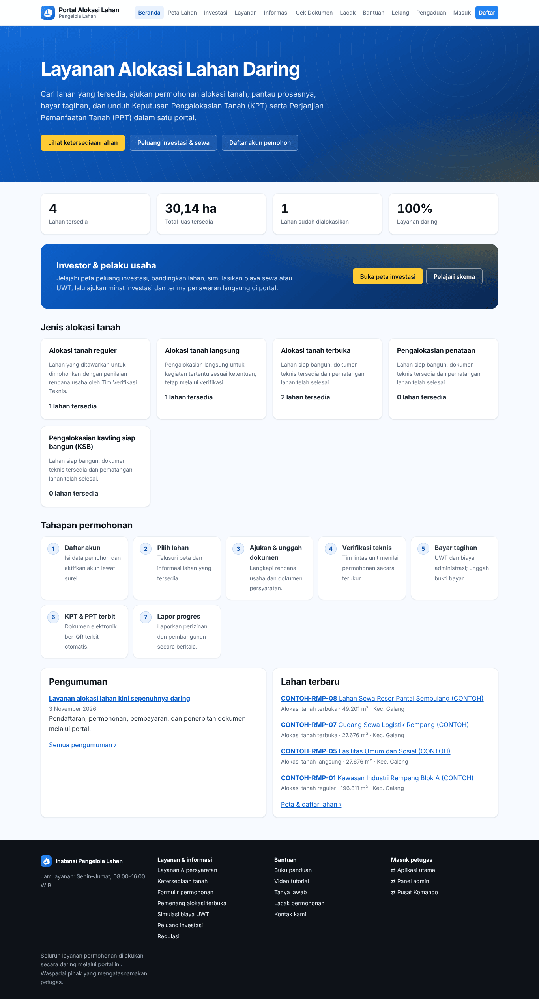
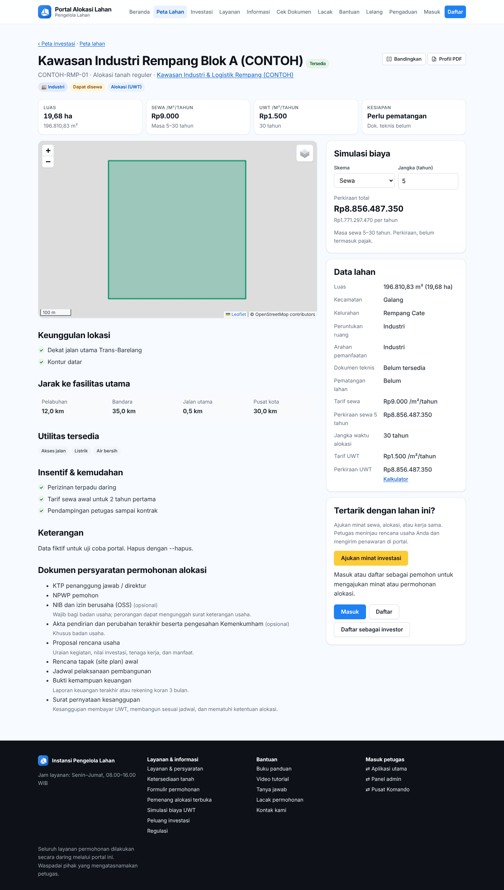
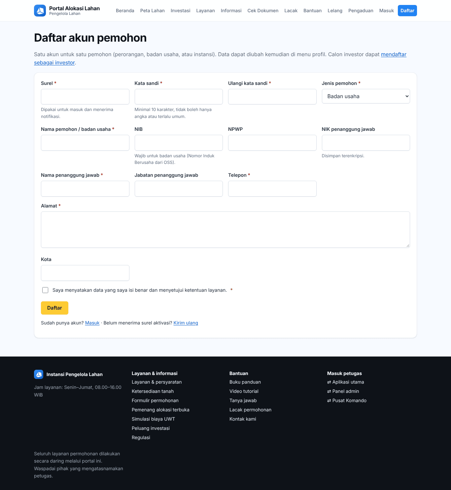

# Bab 12 – Portal publik (`/portal/`)

Portal adalah halaman SimLahan untuk masyarakat dan pelaku usaha. Bagian di bab ini bisa dibuka **tanpa akun**: melihat lahan, layanan, informasi, kalkulator UWT, lelang, pengaduan, melacak permohonan, dan mengecek keaslian dokumen.

Menu atas portal: **Beranda, Peta Lahan, Investasi, Layanan, Informasi, Cek Dokumen, Lacak, Bantuan, Lelang, Pengaduan, Masuk, Daftar**. Di HP, menu ini dibuka lewat tombol **Menu**.

## 12.1 Beranda

Beranda menampilkan:

- Tombol **Lihat ketersediaan lahan**, **Peluang investasi & sewa**, dan **Daftar akun pemohon** (atau **Akun saya** bila sudah masuk).
- Angka **Lahan tersedia**, **Total luas tersedia**, dan **Lahan sudah dialokasikan**.
- **Layanan daring**, bagian **Investor & pelaku usaha** (**Buka peta investasi**, **Pelajari skema**), **Jenis alokasi tanah**.
- **Tahapan permohonan**: Daftar akun → Pilih lahan → Ajukan & unggah dokumen → Verifikasi teknis → Bayar tagihan → KPT & PPT terbit → Lapor progres.
- **Pengumuman**, **Lahan terbaru**, dan **Video tutorial**.

## 12.2 Peta lahan dan detail lahan

1. Klik **Peta Lahan**.
2. Saring dengan **Cari** (kode atau nama), **Jenis alokasi**, **Status**, dan **Kecamatan**, lalu klik **Terapkan**.
3. Lahan tampil di peta dan di tabel (**Kode, Nama / lokasi, Jenis, Luas, Arahan pemanfaatan, Status**). Klik kode lahan untuk membuka detailnya.

Halaman detail lahan:

- Label **Dapat disewa**, **Alokasi (UWT)**, **Siap bangun**; tombol **Bandingkan** dan **Profil PDF** (unduh profil lahan).
- **Luas**, **Sewa /m²/tahun**, **UWT /m²/tahun**, **Kesiapan**.
- **Simulasi biaya**: pilih **Skema** dan **Jangka (tahun)**; **Perkiraan total** dihitung langsung.
- **Keunggulan lokasi**, **Jarak ke fasilitas utama**, **Utilitas tersedia**, **Insentif & kemudahan**, **Sarana & prasarana**.
- **Dokumen persyaratan permohonan alokasi** dan **Data lahan** (kecamatan, kelurahan, alamat, peruntukan ruang, arahan pemanfaatan, dokumen teknis, pematangan lahan, tarif, jangka waktu).
- Bagian **Tertarik dengan lahan ini?**: tamu melihat tombol **Masuk**, **Daftar**, dan **Daftar sebagai investor**. Setelah masuk, muncul **Ajukan minat investasi** dan **Langsung ajukan permohonan alokasi** (lihat [Bab 13](51-portal-pemohon.md) dan [Bab 14](52-portal-investor.md)).

## 12.3 Investasi

- **Beranda investasi**: kotak **Cari lahan**, tombol **Jelajahi peta**, **Bandingkan**, **Ajukan minat investasi**, dan **Daftar sebagai investor**.
- **Peta investasi**: saring per skema (**Semua skema**, **Sewa**, **Alokasi**) dan sektor (Industri, Pariwisata & perhotelan, Perdagangan & jasa, Logistik & pergudangan, Perumahan & permukiman, Pertanian & perikanan, Energi & utilitas, Fasilitas umum & sosial). **Urutkan** hasil, **Atur ulang** saringan. Tidak menemukan lahan? Klik **Lahan belum ada? Ajukan usulan lokasi**.

- **Kawasan**: halaman setiap kawasan investasi (deskripsi, insentif, infrastruktur, foto) dengan tombol **Buka di peta investasi**, **Ajukan minat di kawasan ini**, dan **Bandingkan**.

- **Bandingkan**: klik **Bandingkan** di beberapa lahan (atau ikon di peta), lalu buka halaman **Bandingkan**. Tabel membandingkan status, sektor, kawasan, lokasi, luas, peruntukan, skema dan biaya (tarif sewa, masa sewa, perkiraan sewa, tarif UWT, perkiraan UWT), kesiapan, dan jarak. **Hapus** atau **✕** mengeluarkan lahan dari perbandingan.

## 12.4 Layanan, ketentuan umum, kalkulator UWT

**Layanan** berisi katalog layanan alokasi (nomor, layanan, ringkasan). Klik **Selengkapnya** untuk melihat dokumen persyaratan (dokumen, keterangan, wajib/tidak).

**Ketentuan umum** menjelaskan tahapan dan **kriteria penilaian** verifikasi teknis beserta bobotnya. Tombol **Cari lahan** membuka peta lahan.

**Kalkulator UWT** (Uang Wajib Tahunan) menghitung perkiraan biaya:

1. Pilih tab **Per lahan tersedia** (pilih **Lahan**, isi **Luas (m²)** dan **Jangka waktu (tahun)**) atau **Per wilayah & peruntukan** (pilih **Wilayah**, **Sub wilayah**, **Peruntukan**, **Jenis pengurusan**, isi **Luas**).
2. Klik **Hitung**. Hasil menampilkan tarif, biaya administrasi, dan **Total perkiraan**. Angka bersifat simulasi; tagihan resmi terbit setelah permohonan disetujui.

## 12.5 Informasi dan formulir

**Informasi** berisi pengumuman, regulasi, dan berita (cari dengan kotak **Cari** atau pilih kategori). **Formulir** berisi formulir permohonan yang bisa diunduh. **Pemenang alokasi terbuka** mengumumkan hasil penilaian lelang/seleksi lahan alokasi terbuka (bila sudah dibuka untuk publik).

## 12.6 Lelang

1. Klik **Lelang**. Tabel menampilkan nomor, judul, metode, lokasi, **Nilai limit**, **Batas penawaran**, dan status.
2. Klik lelang untuk melihat rincian: jaminan penawaran, jadwal buka/tutup, jumlah peserta, uraian dan peruntukan, persyaratan peserta, dan (setelah ditetapkan) **Pemenang**.
3. Untuk menawar, **Masuk** dengan akun pemohon (atau **Daftar** dahulu). Caranya ada di [Bab 13.9](51-portal-pemohon.md#139-mengikuti-lelang).

## 12.7 Pengaduan masyarakat

1. Klik **Pengaduan**.
2. Isi **Nama pelapor**, **Telepon / WhatsApp**, **Surel**, pilih **Kategori**, tulis **Perihal** dan **Uraian pengaduan**.
3. Tandai **Lokasi** di peta (atau klik **Gunakan lokasi saya**; **Hapus titik** untuk mengulang). Tambahkan **Lampiran** bila ada.
4. Klik **Kirim pengaduan**. Catat **Nomor pengaduan** dan **Kode akses** yang tampil, serta **Batas penyelesaian**.
5. Untuk memeriksa perkembangan, klik **Cek status** (atau buka **Pengaduan → cek**), isi **Nomor pengaduan** dan **Kode akses**, lalu klik **Periksa**. Tanggapan petugas tampil di sana.

## 12.8 Lacak permohonan

Pemohon bisa melihat status permohonan tanpa masuk:

1. Klik **Lacak**.
2. Isi **Nomor permohonan** dan **PIN pelacakan** (tercantum di halaman permohonan di portal, bagian **Lacak tanpa login**).
3. Klik **Lacak**. Tampil layanan, lahan, status, tanggal diajukan, dan riwayat. Rincian lengkap, dokumen, dan tagihan hanya terlihat setelah masuk.

## 12.9 Cek keaslian dokumen

Ada dua halaman pemeriksaan:

**Cek Dokumen** (dokumen terbit alokasi: KPT, PPT, Penetapan Lokasi, Surat Izin Peralihan Hak, surat layanan lain):

1. Pindai kode QR pada dokumen, atau buka **Cek Dokumen** dan ketik **Kode verifikasi**, lalu klik **Periksa**.
2. Hasil: **Dokumen terdaftar dan sah**, **terdaftar tetapi sudah diganti**, **terdaftar tetapi hak sudah dialihkan**, atau **Kode tidak terdaftar; dokumen mungkin tidak sah**. Tampil juga jenis, nomor, atas nama, tanggal terbit, luas, pemegang hak saat ini, dan status alokasi (misalnya **PL diblokir**).

**Verifikasi dokumen elektronik** (dokumen bertanda tangan elektronik dari modul dokumen):

1. Masukkan kode verifikasi yang tercetak di bawah kode QR pada lembar pengesahan, lalu klik **Periksa**.
2. Hasil menampilkan nomor, status, waktu kirim, **Sidik SHA-256**, dan daftar penanda tangan.
3. Di **Cocokkan berkas**, unggah PDF yang Anda terima lalu klik **Cocokkan**. **Cocok** berarti isinya sama persis dengan dokumen asli; **Tidak cocok** berarti berkas sudah diubah. Berkas tidak disimpan.

## 12.10 Bantuan dan kontak

**Bantuan** berisi tanya jawab, regulasi, video tutorial, buku panduan untuk diunduh, panduan investor, dan panduan cepat (tautan ke ketentuan umum, kalkulator UWT, formulir, pemenang alokasi terbuka, lacak, dan cek dokumen).

**Kontak** (klik **Kirim pesan ke petugas**): isi **Nama lengkap**, **Surel**, **No. telepon**, **Subjek**, **Isi pesan**, lalu klik **Kirim pesan**. Pesan masuk ke petugas di **Panel admin → Alokasi lahan → Pesan Kontak Kami**.

## 12.11 Mendaftar akun

1. Klik **Daftar** di menu atas (investor: **Daftar sebagai investor**, lihat [Bab 14](52-portal-investor.md)).
2. Isi **Surel**, **Kata sandi**, **Ulangi kata sandi**.
3. Pilih **Jenis pemohon** (perorangan atau badan usaha), lalu isi **Nama pemohon / badan usaha**, **NIB**, **NPWP**, **NIK penanggung jawab**, **Nama penanggung jawab**, **Jabatan penanggung jawab**, **Telepon**, **Alamat**, **Kota**.
4. Centang **Saya menyatakan data yang saya isi benar dan menyetujui ketentuan layanan**, lalu klik **Daftar**.
5. Buka surel Anda dan klik tautan aktivasi (berlaku 3 hari). Tidak menerima surel? Periksa folder spam, atau klik **kirim ulang tautan aktivasi**.
6. Setelah aktif, klik **Masuk** dan isi surel serta kata sandi.

**Lupa kata sandi:** lihat [Bab 13.1](51-portal-pemohon.md#lupa-kata-sandi).
