# Bab 12 – Portal publik (`/portal/`)

Portal adalah halaman SimLahan untuk masyarakat dan pelaku usaha. Semua bagian di bab ini bisa dibuka **tanpa akun**: melihat lahan, layanan, informasi, kalkulator UWT, lelang, pengaduan, melacak permohonan, dan mengecek keaslian dokumen.

Angka merah pada setiap gambar menunjukkan tempat yang Anda klik atau isi. Langkah yang menyebut "(nomor 3)" berarti lihat angka 3 pada gambar tepat di atasnya.

## 12.1 Beranda

Buka alamat portal (misalnya `https://simlahan.contoh.go.id/portal/`).

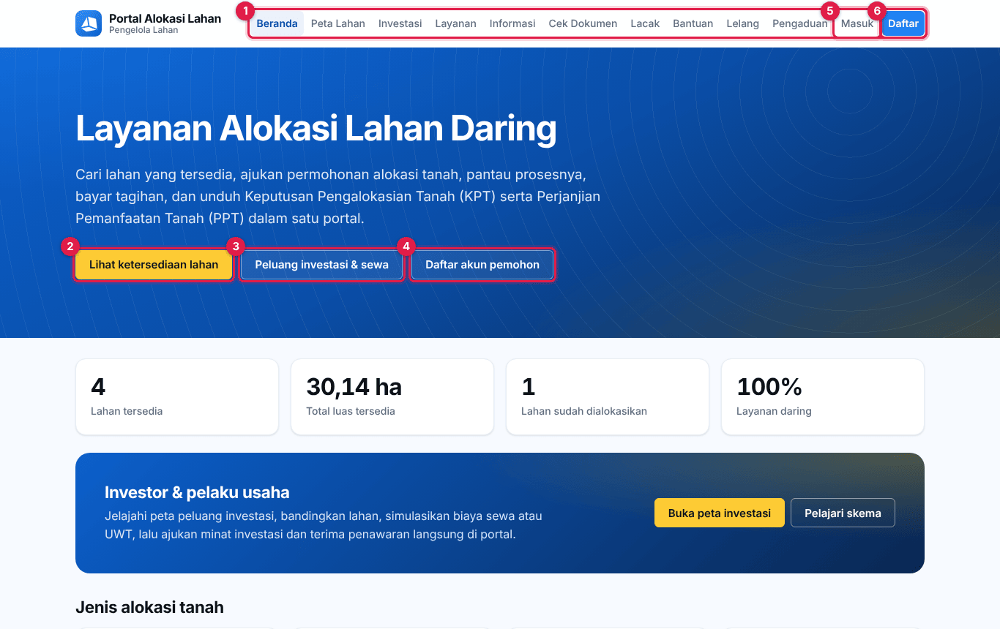

Nomor pada gambar:

1. **Menu atas**: Beranda, Peta Lahan, Investasi, Layanan, Informasi, Cek Dokumen, Lacak, Bantuan, Lelang, Pengaduan. Menu yang sedang dibuka diberi warna biru muda.
2. **Lihat ketersediaan lahan** membuka peta lahan ([12.2](#122-peta-lahan-dan-detail-lahan)).
3. **Peluang investasi & sewa** membuka beranda investasi ([12.3](#123-investasi)).
4. **Daftar akun pemohon** membuka formulir pendaftaran ([12.11](#1211-mendaftar-akun)). Setelah Anda masuk, tombol ini berganti menjadi **Akun saya**.
5. **Masuk** untuk pemohon atau investor yang sudah punya akun.
6. **Daftar** sama dengan nomor 4.

Di bawah tombol ada angka **Lahan tersedia**, **Total luas tersedia**, **Lahan sudah dialokasikan**, dan **Layanan daring**. Gulir ke bawah untuk bagian berikutnya:

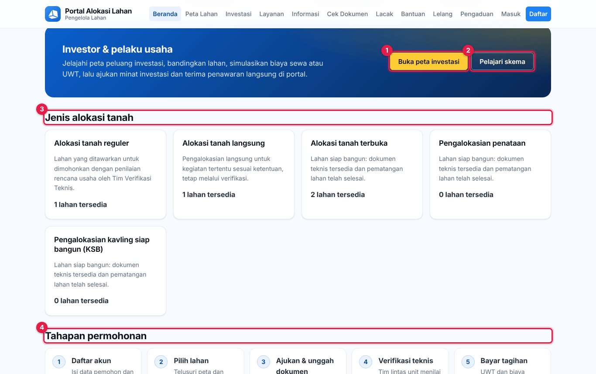

1. **Buka peta investasi** membuka peta khusus investor.
2. **Pelajari skema** menjelaskan pilihan sewa, alokasi, dan kerja sama.
3. **Jenis alokasi tanah**: lima jenis alokasi beserta jumlah lahan yang tersedia untuk masing-masing.
4. **Tahapan permohonan**: urutan Daftar akun → Pilih lahan → Ajukan & unggah dokumen → Verifikasi teknis → Bayar tagihan → KPT & PPT terbit → Lapor progres.

Paling bawah ada **Pengumuman**, **Lahan terbaru**, dan **Video tutorial**.

**Di HP**, menu atas disembunyikan:

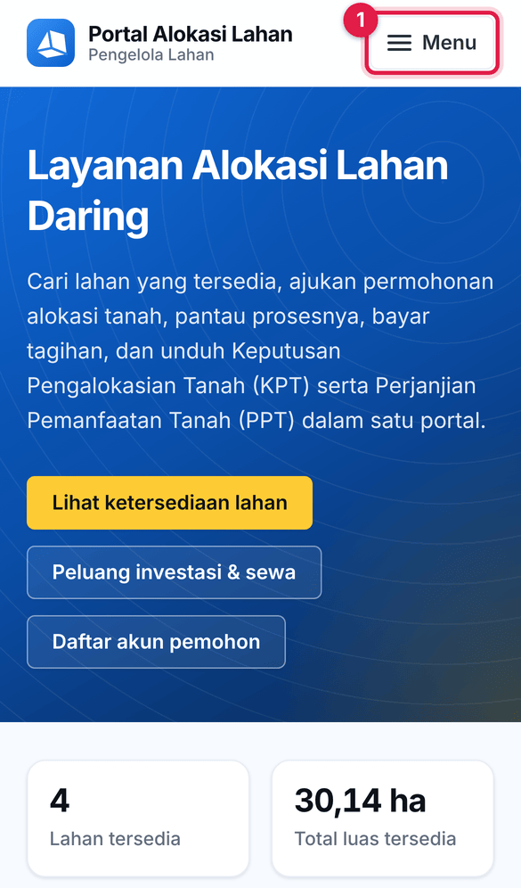

Ketuk **Menu** (nomor 1) untuk membukanya. Daftar menu lalu tampil memanjang ke bawah:

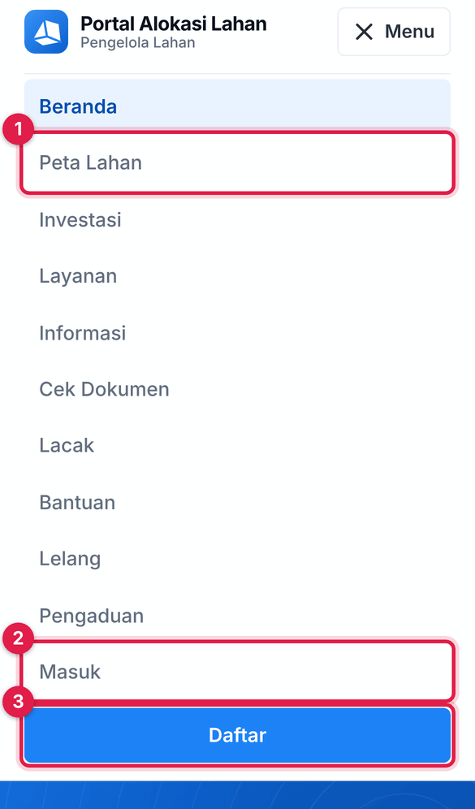

Ketuk nama halaman, misalnya **Peta Lahan** (nomor 1). **Masuk** (nomor 2) dan **Daftar** (nomor 3) ada di paling bawah. Ketuk **✕ Menu** untuk menutup.

## 12.2 Peta lahan dan detail lahan

Klik **Peta Lahan** di menu atas.

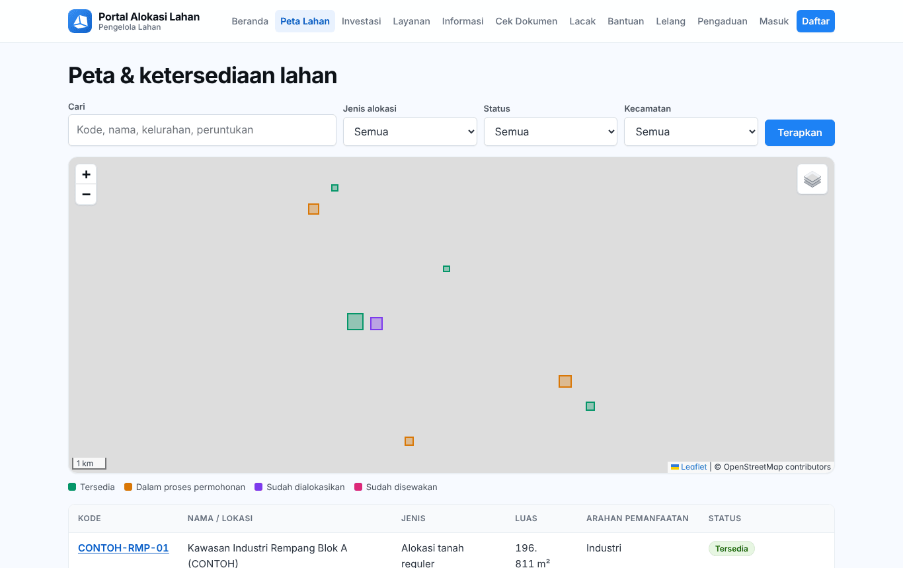

1. Ketik kode, nama, kelurahan, atau peruntukan di kotak **Cari** (nomor 1). Boleh dikosongkan.
2. Bila perlu, pilih **Jenis alokasi** (nomor 2), **Status** (nomor 3), dan **Kecamatan** (nomor 4).
3. Klik **Terapkan** (nomor 5). Peta dan tabel di bawahnya hanya menampilkan lahan yang cocok.
4. Warna kotak di peta menunjukkan status: hijau **Tersedia**, oranye **Dalam proses permohonan**, ungu **Sudah dialokasikan**, merah muda **Sudah disewakan**. Klik kotak di peta untuk melihat namanya. (Latar peta tampil abu-abu karena peta dasar dari internet tidak dimuat saat gambar dibuat.)
5. Klik **kode lahan** di tabel (nomor 6) untuk membuka detailnya.

Di HP, kotak saringan tersusun ke bawah. Cara pakainya sama: isi, lalu ketuk **Terapkan**.

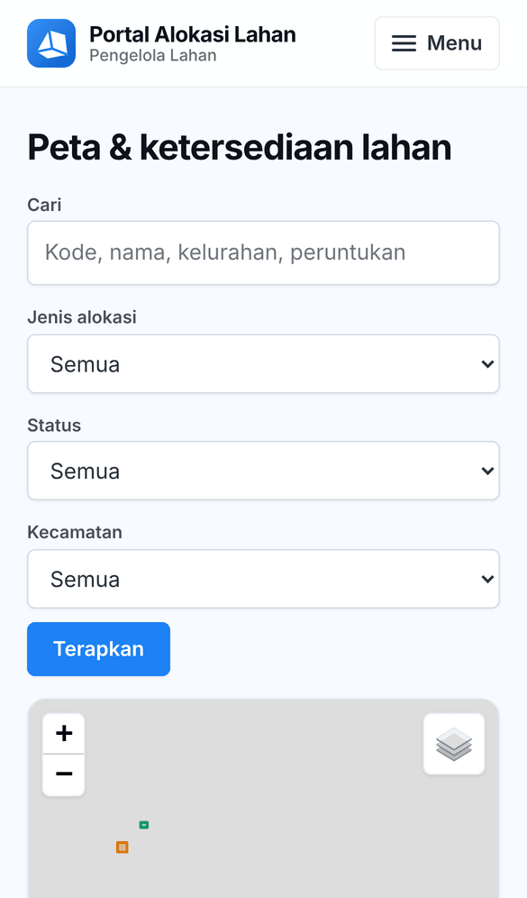

Halaman detail lahan:

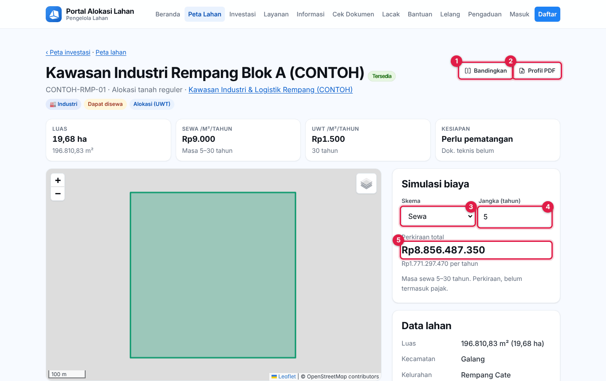

1. **Bandingkan** memasukkan lahan ini ke daftar perbandingan ([12.3](#123-investasi)).
2. **Profil PDF** mengunduh profil lahan dalam satu berkas PDF.
3. Di **Simulasi biaya**, pilih **Skema** (nomor 3): **Sewa** atau **Alokasi (UWT)**.
4. Isi **Jangka (tahun)** (nomor 4).
5. **Perkiraan total** (nomor 5) langsung berubah. Angka per tahun tampil di bawahnya. Ini hanya perkiraan; tagihan resmi terbit setelah permohonan disetujui.

Di bagian atas juga ada label (misalnya **Dapat disewa**, **Alokasi (UWT)**) dan kartu **Luas**, **Sewa /m²/tahun**, **UWT /m²/tahun**, serta **Kesiapan**. Gulir ke bawah:

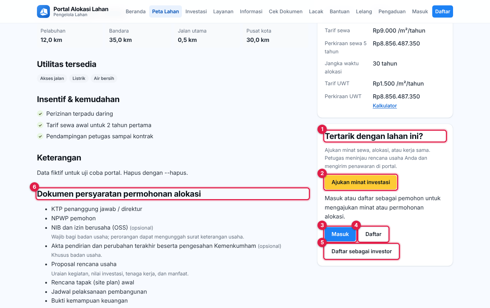

1. **Tertarik dengan lahan ini?** adalah tempat mengajukan minat atau permohonan.
2. **Ajukan minat investasi** (untuk investor, perlu masuk dulu; lihat [Bab 14](52-portal-investor.md)).
3. **Masuk** bila sudah punya akun. Setelah masuk, di sini muncul juga tombol **Langsung ajukan permohonan alokasi** ([Bab 13](51-portal-pemohon.md)).
4. **Daftar** untuk membuat akun pemohon.
5. **Daftar sebagai investor** untuk membuat akun investor.
6. **Dokumen persyaratan permohonan alokasi**: daftar berkas yang harus Anda siapkan sebelum mengajukan. Yang bertanda **(opsional)** boleh tidak diunggah.

Bagian lain di halaman ini: **Keunggulan lokasi**, **Jarak ke fasilitas utama**, **Utilitas tersedia**, **Insentif & kemudahan**, dan **Data lahan** (kecamatan, kelurahan, peruntukan ruang, tarif, jangka waktu).

## 12.3 Investasi

Klik **Investasi** di menu atas.

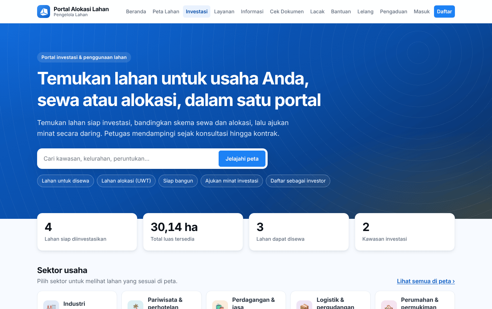

1. Ketik kawasan, kelurahan, atau peruntukan di kotak pencarian (nomor 1).
2. Klik **Jelajahi peta** (nomor 2) untuk melihat hasilnya di peta investasi.
3. Pintasan **Lahan untuk disewa** (nomor 3), **Lahan alokasi (UWT)** (nomor 4), dan **Siap bangun** (nomor 5) langsung membuka peta dengan saringan itu.
4. **Ajukan minat investasi** (nomor 6) dan **Daftar sebagai investor** (nomor 7); lihat [Bab 14](52-portal-investor.md).

Di bawahnya ada **Sektor usaha**, **Kawasan investasi**, **Lahan pilihan**, **Pilih skema pemanfaatan lahan**, **Alur investasi**, dan **Pertanyaan umum investor**.

**Peta investasi:**

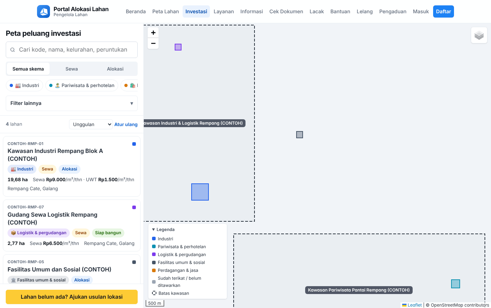

1. Ketik kata kunci di kotak **Cari** (nomor 1). Daftar di kiri dan peta di kanan langsung tersaring.
2. Pilih skema (nomor 2): **Semua skema**, **Sewa**, atau **Alokasi**.
3. Klik sektor (nomor 3), misalnya **Industri**. Geser deretan sektor ke samping untuk melihat sektor lain.
4. **Filter lainnya** (nomor 4) membuka saringan kawasan, kecamatan, luas minimum dan maksimum, serta centang **Siap bangun (pematangan lahan selesai)**, **Dokumen teknis tersedia**, dan **Tampilkan juga lahan yang sudah terikat**.
5. **Urutkan** hasil (nomor 5), misalnya **Luas terbesar**.
6. **Atur ulang** (nomor 6) menghapus semua saringan.
7. Lahan yang Anda butuhkan belum ada? Klik **Lahan belum ada? Ajukan usulan lokasi** (nomor 7).

Klik kartu lahan di daftar kiri untuk membuka detailnya. Kotak bergaris putus-putus di peta adalah batas kawasan (latar peta tampil abu-abu karena peta dasar dari internet tidak dimuat saat gambar dibuat).

**Kawasan investasi:** klik nama kawasan di beranda investasi.

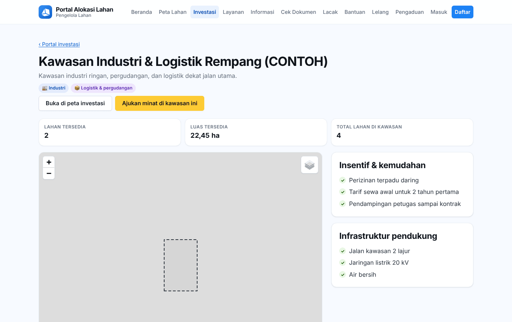

1. **Buka di peta investasi** menampilkan kawasan ini di peta.
2. **Ajukan minat di kawasan ini** membuka formulir minat dengan kawasan sudah terisi.

Halaman kawasan juga berisi **Insentif & kemudahan**, **Infrastruktur pendukung**, **Tentang kawasan**, dan **Lahan di kawasan ini** (masing-masing dengan tombol **Bandingkan**).

**Membandingkan lahan:**

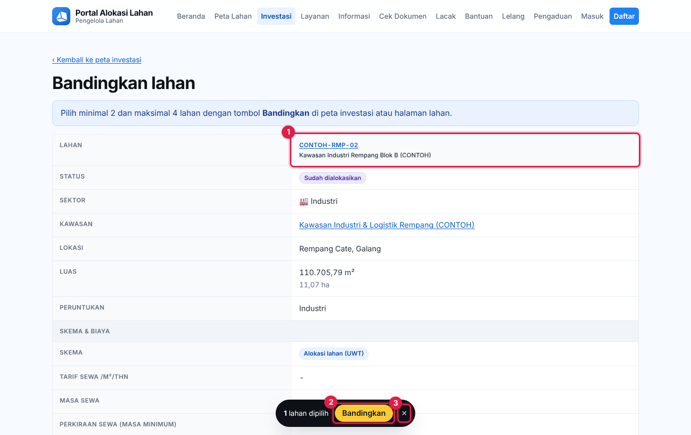

1. Klik **Bandingkan** di 2 sampai 4 lahan (di halaman detail lahan, kartu lahan, atau halaman kawasan).
2. Bilah hitam muncul di bawah layar, misalnya "2 lahan dipilih". Klik **Bandingkan** di bilah itu (nomor 2).
3. Tabel membandingkan lahan berdampingan (nomor 1 adalah kolom lahan pertama): status, sektor, kawasan, lokasi, luas, peruntukan, skema dan biaya, kesiapan, serta jarak.
4. Klik **Hapus** di bawah kolom lahan untuk mengeluarkannya, atau **✕** (nomor 3) untuk mengosongkan semua pilihan.

## 12.4 Layanan, ketentuan umum, kalkulator UWT

Klik **Layanan** di menu atas.

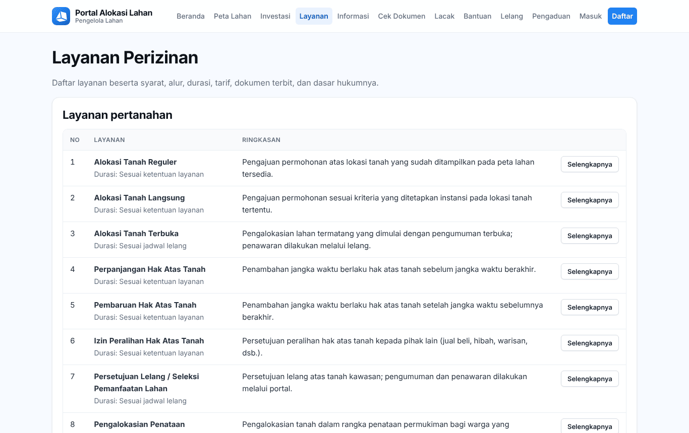

1. Layanan dikelompokkan, misalnya **Layanan pertanahan** (nomor 1), **Layanan perubahan dokumen**, dan **Layanan pelaporan**.
2. Klik **Selengkapnya** (nomor 2) di baris layanan untuk melihat persyaratannya.

Halaman detail layanan berisi syarat, alur, durasi, tarif, dokumen yang terbit, dasar hukum, dan tabel dokumen persyaratan (dokumen, keterangan, wajib atau tidak).

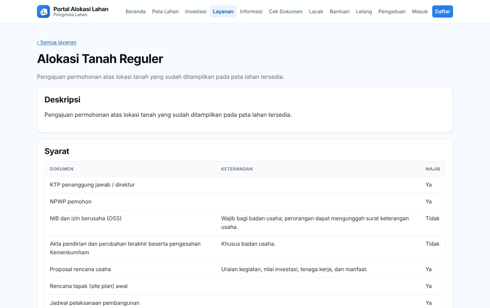

**Ketentuan umum** menjelaskan tahapan dan **kriteria penilaian** verifikasi teknis beserta bobotnya. Tombol **Cari lahan** membuka peta lahan.

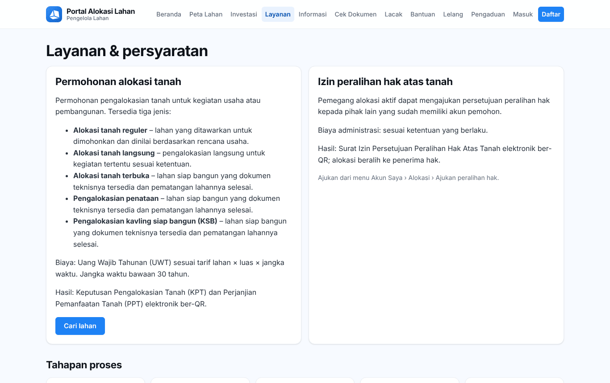

**Kalkulator UWT** (Uang Wajib Tahunan) menghitung perkiraan biaya. Buka dari tautan **Simulasi biaya UWT** di halaman Informasi, atau **Simulasi biaya UWT** di kaki halaman portal.

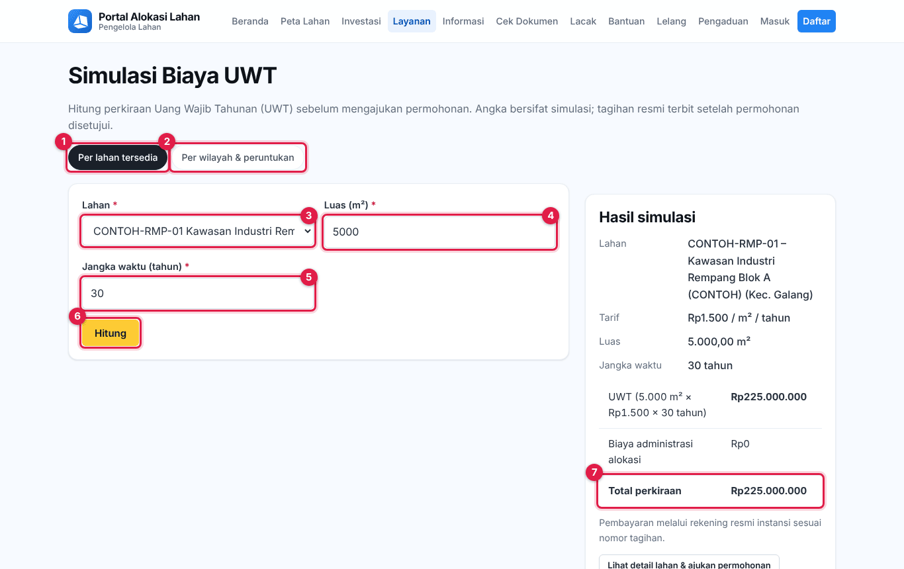

1. Pilih cara menghitung: **Per lahan tersedia** (nomor 1) atau **Per wilayah & peruntukan** (nomor 2).
2. Untuk **Per lahan tersedia**: pilih **Lahan** (nomor 3), isi **Luas (m²)** (nomor 4) dan **Jangka waktu (tahun)** (nomor 5).
3. Untuk **Per wilayah & peruntukan**: pilih **Wilayah**, **Sub wilayah**, **Peruntukan**, dan **Jenis pengurusan**, lalu isi **Luas**.
4. Klik **Hitung** (nomor 6).
5. **Hasil simulasi** tampil di kanan: tarif, luas, jangka waktu, rincian UWT, biaya administrasi, dan **Total perkiraan** (nomor 7). Angka ini simulasi; tagihan resmi terbit setelah permohonan disetujui.

## 12.5 Informasi dan formulir

Klik **Informasi** di menu atas.

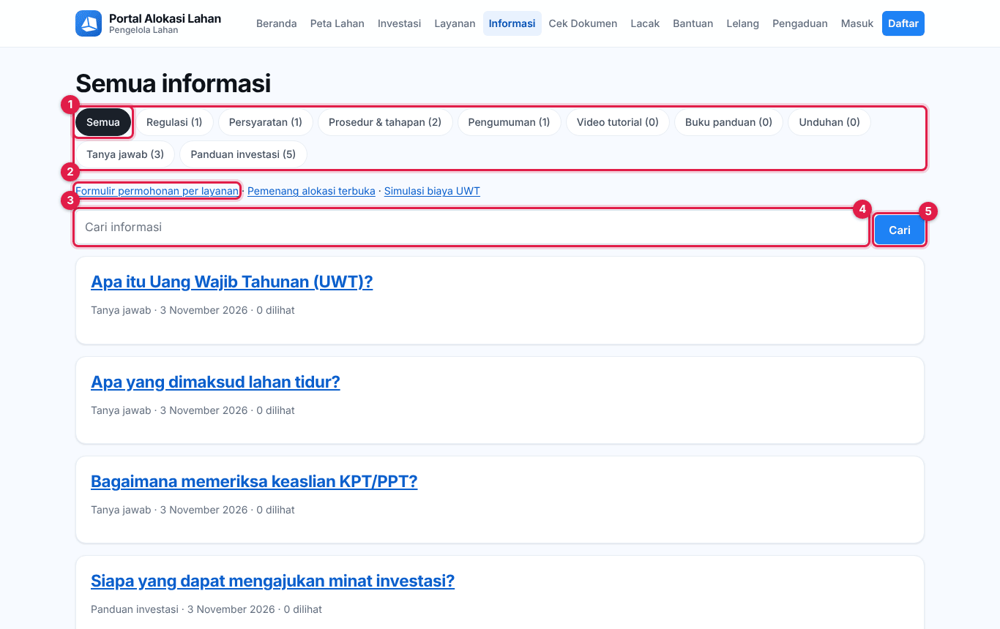

1. **Semua** (nomor 1) menampilkan semua tulisan.
2. Klik kategori (nomor 2), misalnya **Regulasi**, **Pengumuman**, atau **Tanya jawab**. Angka di dalam kurung adalah jumlah tulisannya.
3. **Formulir permohonan per layanan** (nomor 3) membuka daftar formulir. Di sebelahnya ada **Pemenang alokasi terbuka** dan **Simulasi biaya UWT**.
4. Ketik kata kunci di kotak **Cari informasi** (nomor 4), lalu klik **Cari** (nomor 5).
5. Klik judul tulisan untuk membacanya.

**Formulir** berisi formulir permohonan yang bisa diunduh, dikelompokkan per layanan.

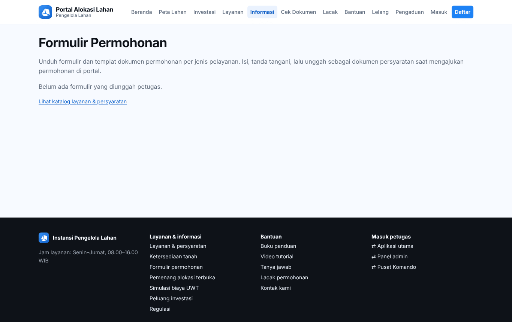

**Pemenang alokasi terbuka** mengumumkan hasil penilaian seleksi lahan alokasi terbuka, bila sudah dibuka untuk publik.

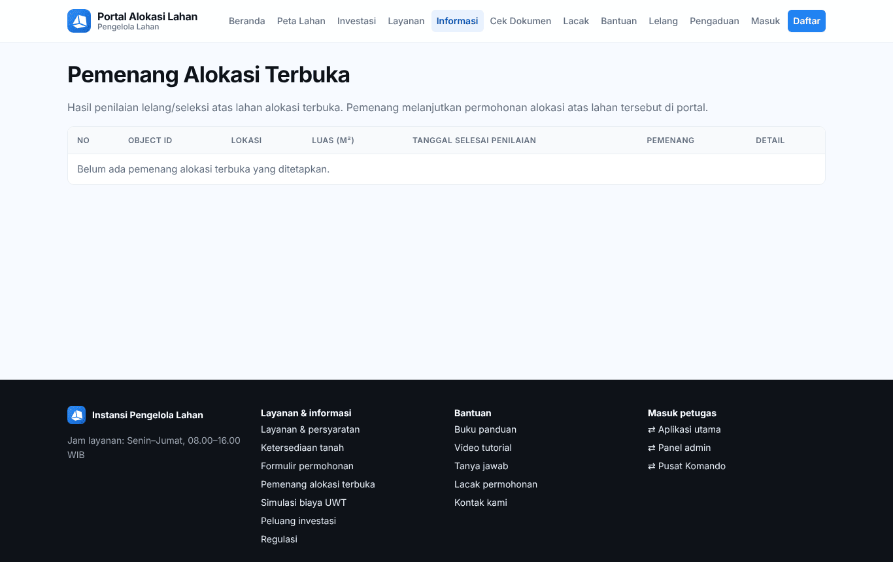

## 12.6 Lelang

Klik **Lelang** di menu atas.

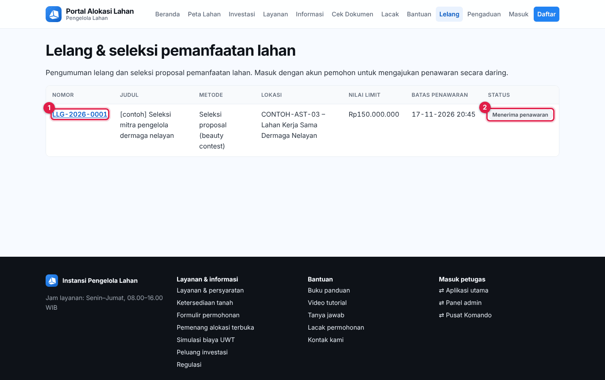

1. Tabel menampilkan nomor, judul, metode, lokasi, **Nilai limit**, **Batas penawaran**, dan status (nomor 2). **Menerima penawaran** berarti lelang masih dibuka.
2. Klik **nomor lelang** (nomor 1) untuk membuka rinciannya.

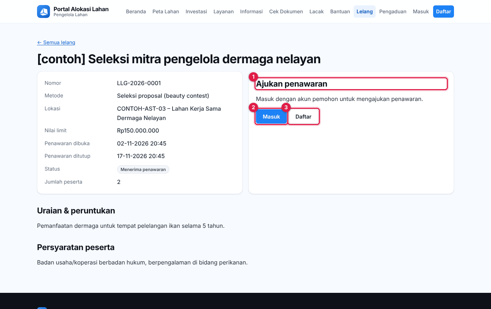

3. Kiri: nomor, metode, lokasi, nilai limit, jadwal buka dan tutup, status, dan jumlah peserta. Di bawahnya **Uraian & peruntukan** dan **Persyaratan peserta**.
4. Kotak **Ajukan penawaran** (nomor 1): klik **Masuk** (nomor 2) dengan akun pemohon, atau **Daftar** (nomor 3) bila belum punya akun. Cara menawar ada di [Bab 13.9](51-portal-pemohon.md#139-mengikuti-lelang).

## 12.7 Pengaduan masyarakat

Klik **Pengaduan** di menu atas.

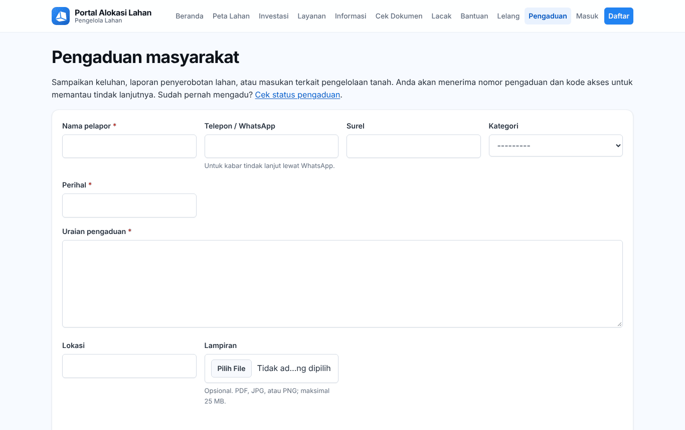

1. Isi **Nama pelapor** (nomor 1). Wajib.
2. Isi **Telepon / WhatsApp** (nomor 2) dan **Surel** (nomor 3) agar petugas bisa mengabari Anda.
3. Pilih **Kategori** (nomor 4).
4. Tulis **Perihal** (nomor 5), yaitu judul singkat, dan **Uraian pengaduan** (nomor 6), yaitu cerita lengkapnya. Keduanya wajib.
5. Isi **Lokasi** (nomor 7) dengan nama tempat, misalnya kampung atau RT.
6. Bila ada foto atau dokumen, klik **Pilih File** di **Lampiran** (nomor 8). Boleh PDF, JPG, atau PNG, paling besar 25 MB.
7. Di **Titik lokasi (opsional)**, klik peta di tempat kejadian, atau klik **Gunakan lokasi saya** (nomor 9) bila Anda sedang berada di sana. **Hapus titik** (nomor 10) mengulang.
8. Klik **Kirim pengaduan** (nomor 11).
9. Halaman berikutnya menampilkan **Nomor pengaduan**, **Kode akses**, dan **Batas penyelesaian**. **Catat atau foto nomor dan kode akses ini**; keduanya diperlukan untuk mengecek tanggapan.

**Mengecek tanggapan pengaduan:** klik tautan **Cek status pengaduan** di halaman pengaduan.

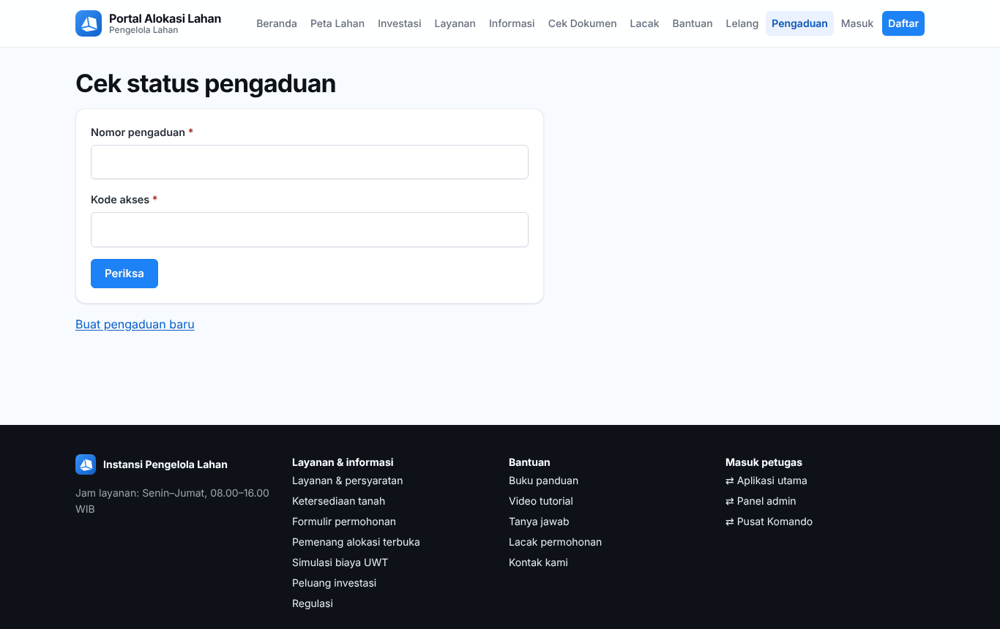

1. Isi **Nomor pengaduan** (nomor 1) dan **Kode akses** (nomor 2).
2. Klik **Periksa** (nomor 3). Status dan tanggapan petugas tampil di bawahnya.

## 12.8 Lacak permohonan

Pemohon bisa melihat status permohonan tanpa masuk. Klik **Lacak** di menu atas.

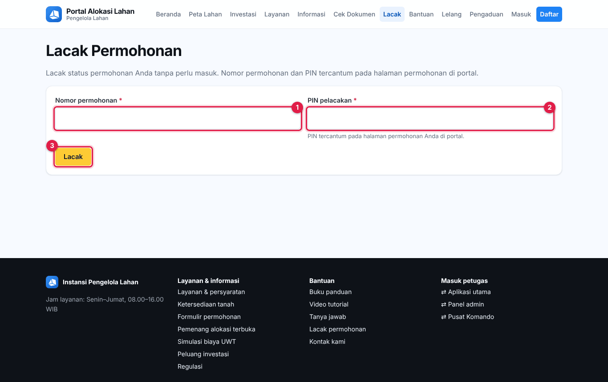

1. Isi **Nomor permohonan** (nomor 1), misalnya `ALK-2026-00001`.
2. Isi **PIN pelacakan** (nomor 2). PIN tercantum di halaman permohonan Anda di portal, bagian **Lacak tanpa login**.
3. Klik **Lacak** (nomor 3). Tampil layanan, lahan, status, tanggal diajukan, dan riwayat. Rincian lengkap, dokumen, dan tagihan hanya terlihat setelah masuk.

## 12.9 Cek keaslian dokumen

Ada dua halaman pemeriksaan. Pilih sesuai jenis dokumen yang Anda pegang.

**A. Cek Dokumen** untuk dokumen terbit alokasi: KPT, PPT, Penetapan Lokasi, Surat Izin Peralihan Hak, dan surat layanan lain.

Cara tercepat: pindai kode QR pada dokumen dengan kamera HP; hasilnya langsung terbuka. Cara manual: klik **Cek Dokumen** di menu atas.

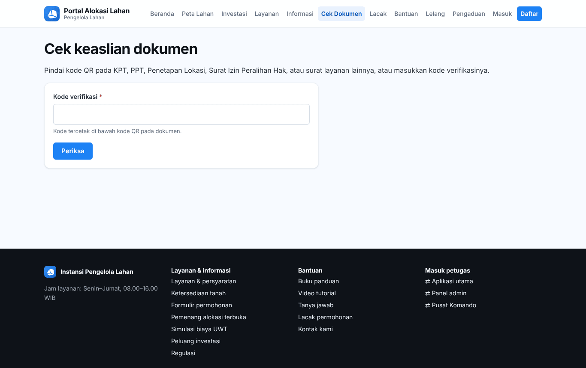

1. Ketik **Kode verifikasi** (nomor 1). Kode tercetak di bawah kode QR pada dokumen.
2. Klik **Periksa** (nomor 2).

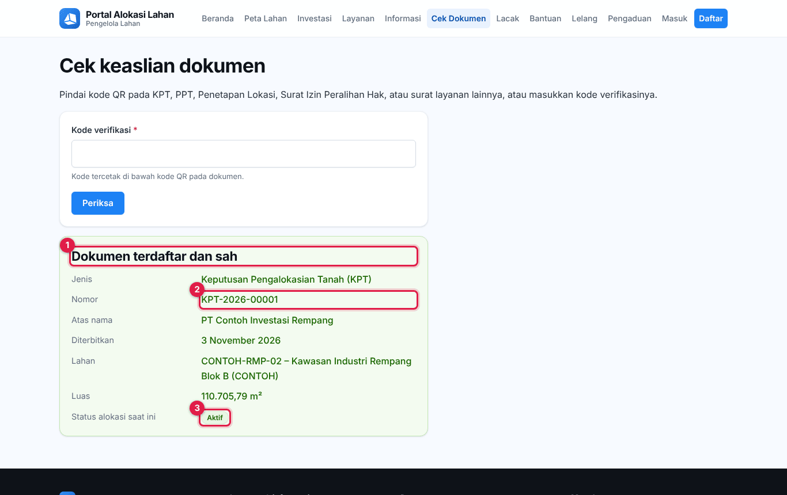

3. Baca judul hasil (nomor 1):
   - **Dokumen terdaftar dan sah**: dokumen asli dan masih berlaku.
   - **Dokumen terdaftar, tetapi sudah diganti**: ada dokumen pengganti yang lebih baru.
   - **Dokumen terdaftar, tetapi hak sudah dialihkan**: hak sudah berpindah ke pihak lain; nama **Pemegang hak saat ini** ditampilkan.
   - **Dokumen tidak ditemukan**: kode tidak terdaftar, dokumen mungkin tidak sah.
4. Cocokkan **Nomor** (nomor 2), atas nama, tanggal terbit, lahan, dan luas dengan dokumen yang Anda pegang.
5. Lihat **Status alokasi saat ini** (nomor 3), misalnya **Aktif** atau **PL diblokir**.

**B. Verifikasi dokumen elektronik** untuk dokumen bertanda tangan elektronik (perjanjian, berita acara, surat pernyataan). Pindai kode QR pada lembar pengesahan, atau buka **Bantuan → Panduan cepat → Verifikasi dokumen bertanda tangan elektronik**.

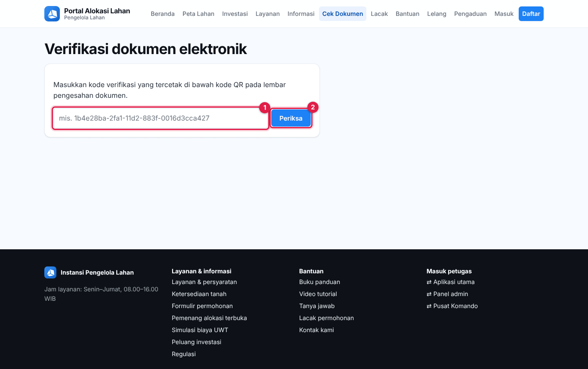

1. Ketik kode verifikasi (nomor 1) yang tercetak di bawah kode QR pada lembar pengesahan.
2. Klik **Periksa** (nomor 2).

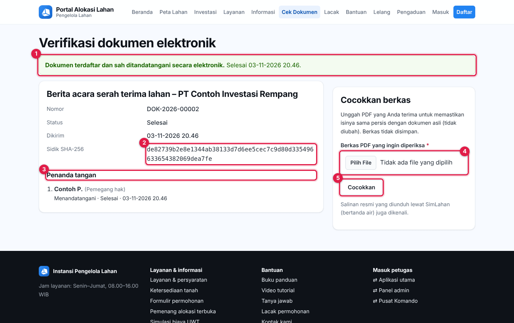

3. Kotak hijau (nomor 1) **Dokumen terdaftar dan sah ditandatangani secara elektronik** berarti dokumen asli dan sudah selesai. Kotak kuning berarti dokumen belum selesai ditandatangani.
4. **Sidik SHA-256** (nomor 2) adalah "sidik jari" isi berkas asli.
5. **Penanda tangan** (nomor 3) menampilkan siapa yang menandatangani dan kapan.
6. Untuk memastikan PDF yang Anda terima tidak diubah: di **Cocokkan berkas**, klik **Pilih File** (nomor 4), pilih PDF-nya, lalu klik **Cocokkan** (nomor 5). **Cocok** berarti isinya sama persis dengan dokumen asli; **Tidak cocok** berarti berkas sudah diubah. Berkas tidak disimpan.

## 12.10 Bantuan dan kontak

Klik **Bantuan** di menu atas.

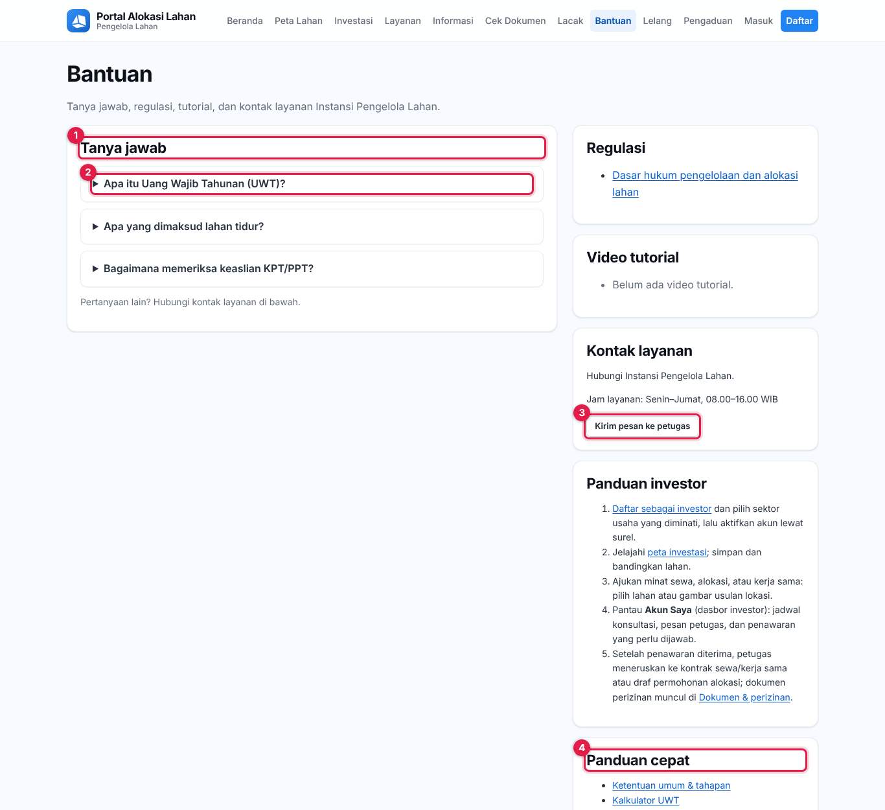

1. **Tanya jawab** (nomor 1): klik pertanyaan (nomor 2) untuk membuka jawabannya.
2. Kanan: **Regulasi**, **Video tutorial**, **Kontak layanan** (jam layanan), dan **Panduan investor**.
3. **Kirim pesan ke petugas** (nomor 3) membuka formulir Kontak Kami.
4. **Panduan cepat** (nomor 4) berisi tautan ke ketentuan umum, kalkulator UWT, formulir, pemenang alokasi terbuka, lacak, cek dokumen, dan verifikasi dokumen elektronik. Buku panduan yang bisa diunduh juga ada di halaman ini.

**Mengirim pesan ke petugas:**

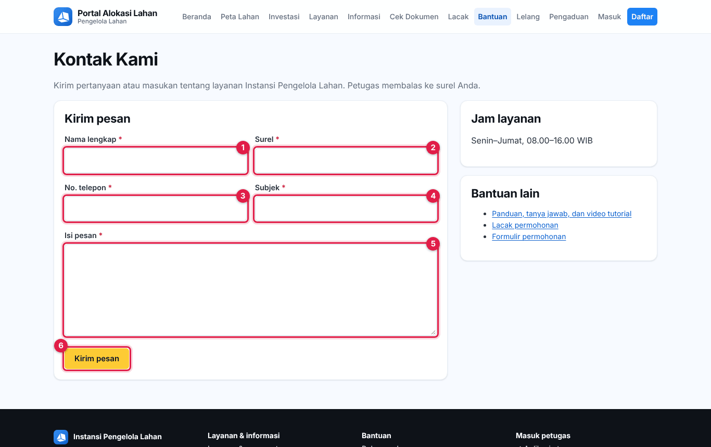

1. Isi **Nama lengkap** (nomor 1), **Surel** (nomor 2), **No. telepon** (nomor 3), dan **Subjek** (nomor 4).
2. Tulis pertanyaan Anda di **Isi pesan** (nomor 5).
3. Klik **Kirim pesan** (nomor 6). Petugas membalas ke surel Anda. (Bagi petugas: pesan masuk ke **Panel admin → Alokasi lahan → Pesan Kontak Kami**.)

## 12.11 Mendaftar akun

Klik **Daftar** di menu atas. Calon investor sebaiknya memakai **Daftar sebagai investor** ([Bab 14](52-portal-investor.md)) agar bisa langsung memilih sektor minat.

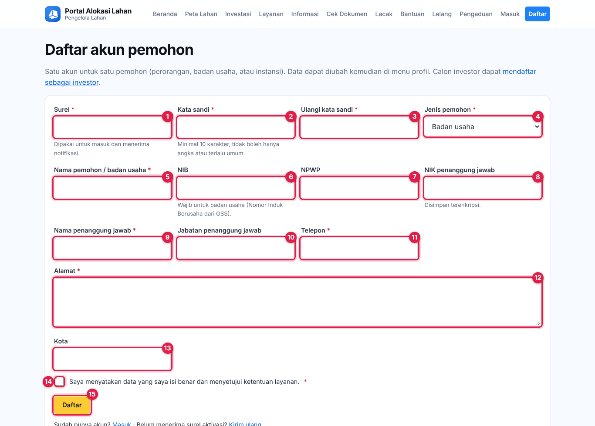

1. Isi **Surel** (nomor 1). Surel ini dipakai untuk masuk dan menerima pemberitahuan.
2. Isi **Kata sandi** (nomor 2) dan ulangi di **Ulangi kata sandi** (nomor 3). Minimal 10 karakter, tidak boleh hanya angka atau kata yang terlalu umum.
3. Pilih **Jenis pemohon** (nomor 4): **Perorangan**, **Badan usaha**, atau **Instansi pemerintah**.
4. Isi **Nama pemohon / badan usaha** (nomor 5).
5. Badan usaha wajib mengisi **NIB** (nomor 6). Isi juga **NPWP** (nomor 7) dan **NIK penanggung jawab** (nomor 8, disimpan terenkripsi).
6. Isi **Nama penanggung jawab** (nomor 9), **Jabatan penanggung jawab** (nomor 10), dan **Telepon** (nomor 11).
7. Isi **Alamat** (nomor 12) dan **Kota** (nomor 13).
8. Centang pernyataan **Saya menyatakan data yang saya isi benar dan menyetujui ketentuan layanan** (nomor 14).
9. Klik **Daftar** (nomor 15).
10. Buka kotak surel Anda dan klik tautan aktivasi (berlaku 3 hari), lalu tekan tombol **Aktifkan akun** di halaman yang terbuka. Tidak menerima surel? Periksa folder spam, atau klik **Kirim ulang** di bawah tombol Daftar.
11. Setelah aktif, klik **Masuk** dan isi surel serta kata sandi.

**Lupa kata sandi:** di halaman **Masuk**, klik **Lupa kata sandi?**.

1. Isi **Surel** akun Anda (nomor 1).
2. Klik **Kirim tautan** (nomor 2).
3. Buka surel dari SimLahan, klik tautannya, lalu buat kata sandi baru. Langkah lengkapnya ada di [Bab 13.1](51-portal-pemohon.md#lupa-kata-sandi).
