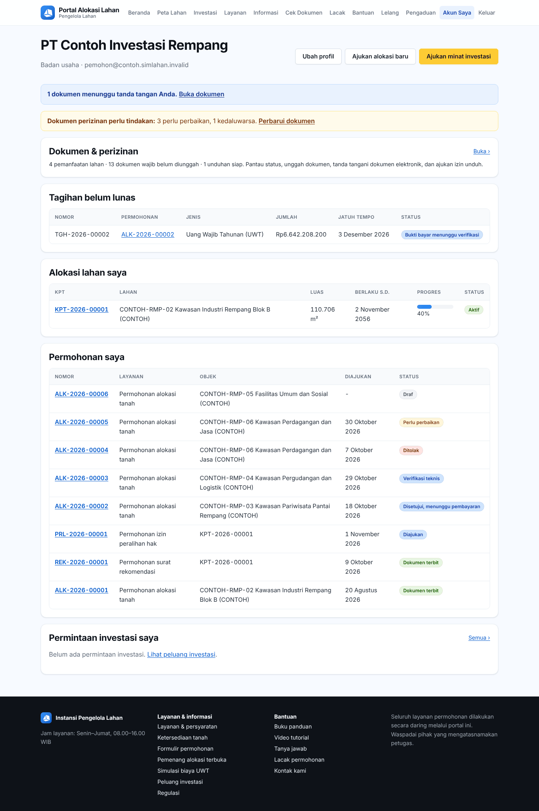
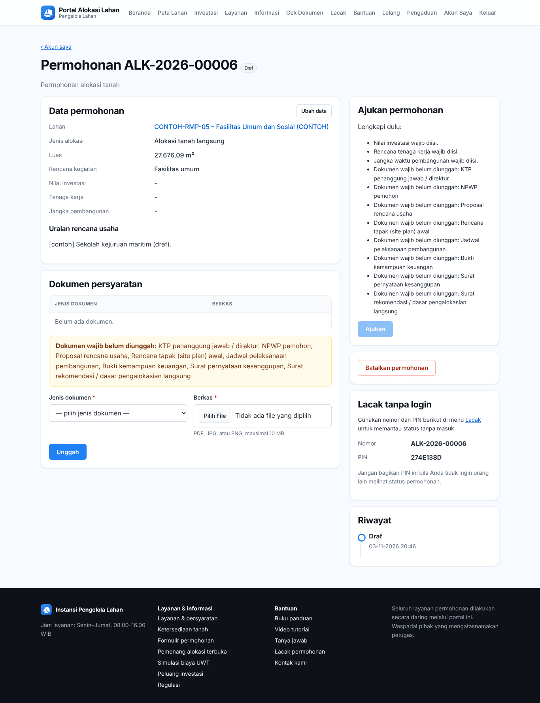

# Bab 13 – Portal untuk pemohon alokasi lahan

Bab ini untuk **pemohon** (perorangan, badan usaha, atau instansi) yang mengajukan alokasi lahan dan layanan alokasi lewat portal: dari membuat permohonan, mengunggah dokumen, membayar tagihan, mengunduh KPT dan PPT, sampai melaporkan progres pembangunan.

Belum punya akun? Daftar dulu (lihat [Bab 12.11](50-portal-publik.md#1211-mendaftar-akun)).

## 13.1 Masuk ke portal

1. Klik **Masuk** di menu atas portal.
2. Isi surel dan kata sandi, lalu klik **Masuk**.
3. Anda diarahkan ke **Akun saya**.

### Lupa kata sandi

1. Di halaman masuk, klik **Lupa kata sandi?**.
2. Isi **Email** akun Anda, lalu klik **Kirim tautan**.
3. Buka surel dari SimLahan dan klik tautan atur ulang sandi.
4. Di halaman **Atur kata sandi baru**, isi kata sandi baru dua kali, lalu klik **Simpan kata sandi**. Masuk dengan kata sandi baru. Bila tautan sudah tidak berlaku, klik **Minta tautan baru**.

## 13.2 Akun saya

Tombol di atas: **Ubah profil**, **Ajukan alokasi baru** (membuka peta lahan), dan **Ajukan minat investasi**. Bagian halaman:

- **Langkah berikutnya** dan pemberitahuan (misalnya dokumen yang perlu diperbaiki atau tagihan jatuh tempo).
- **Tagihan belum lunas**: nomor, permohonan, jenis, jumlah, jatuh tempo, status.
- **Alokasi lahan saya**: nomor KPT, lahan, luas, berlaku s.d., progres.
- **Permohonan saya**: nomor, layanan, objek, tanggal diajukan, status.
- **Peralihan hak kepada saya**: peralihan yang menunggu persetujuan Anda sebagai penerima.
- **Dokumen & perizinan**, **Permintaan investasi saya**, dan **Lahan tersimpan**.

## 13.3 Mengajukan permohonan alokasi

**Langkah 1 – Pilih lahan dan buat draf**

1. Klik **Ajukan alokasi baru** (atau **Peta Lahan** di menu atas) dan buka lahan yang diinginkan.
2. Periksa data lahan, tarif, dan **Dokumen persyaratan permohonan alokasi**.
3. Klik **Langsung ajukan permohonan alokasi**. Sistem membuat **draf**; lahan baru dipesan setelah permohonan diajukan.

**Langkah 2 – Lengkapi data**

1. Di halaman permohonan, klik **Ubah data**.
2. Isi **Rencana kegiatan / pemanfaatan**, **Nilai investasi (Rp)**, **Rencana tenaga kerja (orang)**, **Rencana jangka waktu pembangunan (bulan)**, dan **Uraian rencana usaha**.
3. Klik **Simpan**.

**Langkah 3 – Unggah dokumen persyaratan**

1. Di bagian **Dokumen persyaratan**, pilih **Jenis dokumen** dan **Berkas**, lalu klik **Unggah**.
2. Ulangi untuk setiap dokumen wajib. Dokumen yang salah bisa dihapus dengan **Hapus**.

**Langkah 4 – Ajukan**

1. Bagian **Ajukan permohonan** menampilkan **Lengkapi dulu:** bila masih ada yang kurang.
2. Bila semua lengkap, klik **Ajukan**. Setelah diajukan, data tidak dapat diubah kecuali petugas meminta perbaikan.
3. Catat **Nomor** dan **PIN** di bagian **Lacak tanpa login** bila ingin memantau tanpa masuk (lihat [Bab 12.8](50-portal-publik.md#128-lacak-permohonan)).

Permohonan yang belum disetujui bisa dibatalkan dengan **Batalkan permohonan**.

**Status permohonan:**

| Status | Arti | Yang Anda lakukan |
|---|---|---|
| Draf | Belum diajukan. | Lengkapi data dan dokumen, lalu **Ajukan**. |
| Diajukan | Menunggu pemeriksaan petugas. | Tunggu. |
| Verifikasi teknis | Dinilai tim lintas unit. | Tunggu. |
| Perlu perbaikan | Ada yang harus diperbaiki. | Lihat 13.4. |
| Disetujui, menunggu pembayaran | Tagihan sudah terbit. | Bayar dan unggah bukti (13.5). |
| Pembayaran terverifikasi | Pembayaran diterima. | Tunggu dokumen terbit. |
| Dokumen terbit | KPT dan PPT sudah terbit. | Unduh dokumen (13.6). |
| Ditolak / Dibatalkan pemohon | Proses berhenti. | Baca alasan di **Riwayat**. |

## 13.4 Memperbaiki permohonan

1. Anda menerima surel bahwa permohonan perlu diperbaiki. Buka permohonan dari **Akun saya**.
2. Baca catatan petugas di **Riwayat**.
3. Perbaiki dengan **Ubah data**, **Hapus** dokumen yang salah, lalu **Unggah** dokumen yang benar.
4. Klik **Ajukan ulang**.

## 13.5 Membayar tagihan

1. Setelah permohonan disetujui, bagian **Tagihan** menampilkan nomor, jenis (UWT, biaya administrasi), jumlah, dan jatuh tempo. Tanda **Lewat jatuh tempo** muncul bila terlambat.
2. Klik **Unduh tagihan (PDF)** dan bayar sesuai petunjuk pembayaran di halaman itu.
3. Klik **Unggah bukti bayar**, pilih berkas **Bukti pembayaran** (PDF, JPG, atau PNG; maks. 10 MB), lalu simpan. Status tagihan menjadi **Bukti bayar menunggu verifikasi**.
4. Bila petugas menolak bukti bayar, baca **Catatan petugas**, lalu klik **Unggah ulang bukti bayar**. **Lihat bukti bayar** membuka bukti yang sudah Anda kirim.

## 13.6 Mengunduh KPT dan PPT

Setelah pembayaran diverifikasi, status menjadi **Dokumen terbit**. Di bagian **Dokumen terbit**, klik dokumen (KPT, PPT, Penetapan Lokasi beserta sketsa bidang) untuk mengunduhnya. Setiap dokumen ber-QR; siapa pun bisa memeriksa keasliannya di **Cek Dokumen** (lihat [Bab 12.9](50-portal-publik.md#129-cek-keaslian-dokumen)).

## 13.7 Alokasi saya: progres, layanan, peralihan hak

Buka alokasi dari **Akun saya → Alokasi lahan saya**.

Bagian halaman: **Dokumen perizinan** (tombol **Kelola dokumen**, lihat [Bab 15](53-portal-dokumen.md)), **Progres pembangunan**, **Data alokasi**, **Dokumen**, **Layanan alokasi**, dan **Peralihan hak**.

### Melaporkan progres pembangunan

1. Di **Progres pembangunan**, isi **Kirim laporan pembangunan**: tanggal laporan (tidak boleh di masa depan), tahap (Belum dimulai, Pematangan / persiapan lahan, Konstruksi, Sudah beroperasi), progres (%), investasi terealisasi, tenaga kerja, uraian, dan foto.
2. Klik **Kirim laporan**. Laporan tampil di tabel (Tanggal, Tahap, Progres, Investasi, Tenaga kerja, Uraian).

> Laporkan secara berkala. Lahan yang tidak dibangun dapat ditandai **lahan tidur** dan berisiko dicabut alokasinya.

### Mengajukan layanan alokasi

1. Di **Layanan alokasi**, pilih **Jenis layanan**: perpanjangan hak, pembaruan hak, pemecahan PL, pengukuran ulang, revisi PL, penggabungan PL, penyesuaian dokumen alokasi, surat rekomendasi, pembukaan blokir PL, dokumen pengganti, persetujuan hak tanggungan, persetujuan lelang, KPT dan PPT perubahan, atau KPT dan PPT baru.
2. Tulis **Alasan / uraian permohonan**.
3. Klik **Buat draf permohonan**. Lengkapi dokumen dan ajukan seperti 13.3 langkah 3–4.

### Mengalihkan hak (peralihan hak)

1. Penerima hak harus sudah mendaftar di portal.
2. Di **Peralihan hak**, isi **Surel akun penerima hak** dan **Alasan / dasar peralihan**, lalu klik **Buat draf permohonan**.
3. Lengkapi dokumen dan ajukan. Penerima hak menerima surel dan harus menyetujui peralihan di portal (bagian **Persetujuan penerima hak** pada permohonan).

**Bila Anda penerima hak:** buka **Akun saya → Peralihan hak kepada saya**, buka permohonannya, lalu klik **Setujui peralihan** di bagian **Persetujuan penerima hak**. Dengan menyetujui, Anda menerima seluruh kewajiban pemegang alokasi. Tanpa persetujuan Anda, petugas tidak bisa memproses peralihan.

## 13.8 Dokumen & perizinan

Menu **Dokumen & perizinan** (di **Akun saya**) untuk memantau dokumen perizinan wajib, mengunggah dokumen, menandatangani dokumen elektronik, dan meminta izin unduh. Caranya di [Bab 15](53-portal-dokumen.md).

## 13.9 Mengikuti lelang

1. Buka **Lelang** dan pilih lelang berstatus **Diumumkan / menerima penawaran**.
2. Di bagian **Ajukan penawaran**, isi **Nama peserta**, **Surel**, **Telepon**, **Nilai penawaran (Rp)**, dan unggah **Dokumen penawaran**.
3. Klik **Simpan penawaran**. Sebelum penawaran ditutup, Anda bisa mengubah penawaran; unggah dokumen lagi hanya bila ingin menggantinya.
4. Setelah penawaran ditutup dan dievaluasi, pemenang tampil di halaman lelang.

## 13.10 Profil dan kata sandi

- **Ubah profil**: ubah jenis pemohon, nama, NIB, NPWP, data penanggung jawab, telepon, alamat, kota. Centang **Akun investor** dan pilih sektor usaha bila ingin memakai fitur investor ([Bab 14](52-portal-investor.md)). Klik **Simpan**.
- **Ubah kata sandi** (tautan di halaman profil): isi **Sandi lama**, **Sandi baru**, **Konfirmasi sandi baru**, lalu **Simpan**.

## 13.11 Pertanyaan umum

**Tombol Ajukan tidak bisa diklik.** Baca daftar **Lengkapi dulu:** di bagian **Ajukan permohonan**; ada data atau dokumen wajib yang belum diisi.

**Lahan tidak bisa diajukan.** Lahan sedang diproses pemohon lain, sudah dialokasikan, atau ditutup. Klik **Cari lahan lain**.

**Surel aktivasi tidak datang.** Periksa folder spam, lalu gunakan **kirim ulang tautan aktivasi** di halaman pendaftaran.
