# Bab 13 – Portal untuk pemohon alokasi lahan

Bab ini untuk **pemohon** (perorangan, badan usaha, atau instansi) yang mengajukan alokasi lahan dan layanan alokasi lewat portal: dari membuat permohonan, mengunggah dokumen, membayar tagihan, mengunduh KPT dan PPT, sampai melaporkan progres pembangunan.

Belum punya akun? Daftar dulu (lihat [Bab 12.11](50-portal-publik.md#1211-mendaftar-akun)). Angka merah pada gambar menunjukkan tempat yang Anda klik atau isi; "(nomor 2)" berarti angka 2 pada gambar tepat di atasnya.

## 13.1 Masuk ke portal

Klik **Masuk** di menu atas portal.

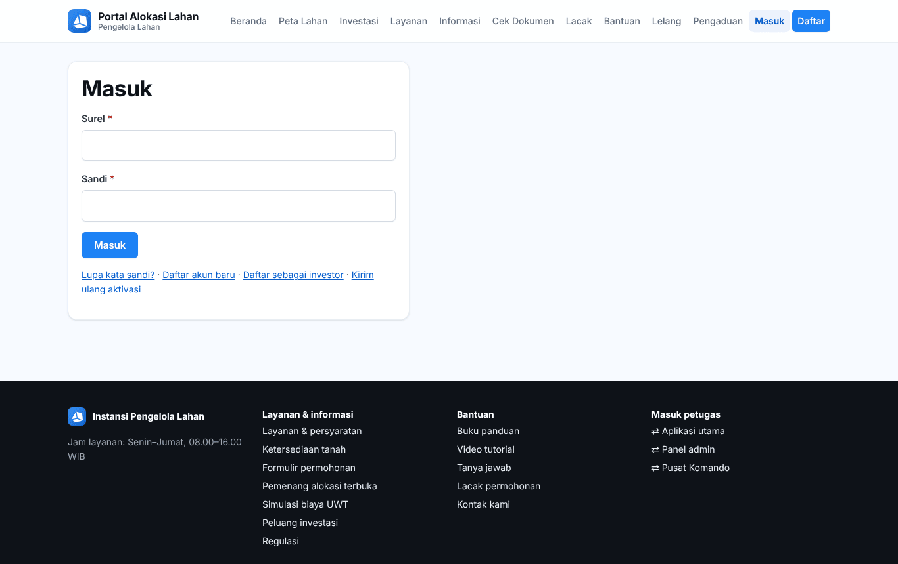

1. Isi surel akun Anda (nomor 1).
2. Isi kata sandi (nomor 2).
3. Klik **Masuk** (nomor 3). Anda diarahkan ke **Akun saya** ([13.2](#132-akun-saya)).
4. **Lupa kata sandi?** (nomor 4) dan **Daftar akun baru** (nomor 5) ada di bawah tombol.

### Lupa kata sandi

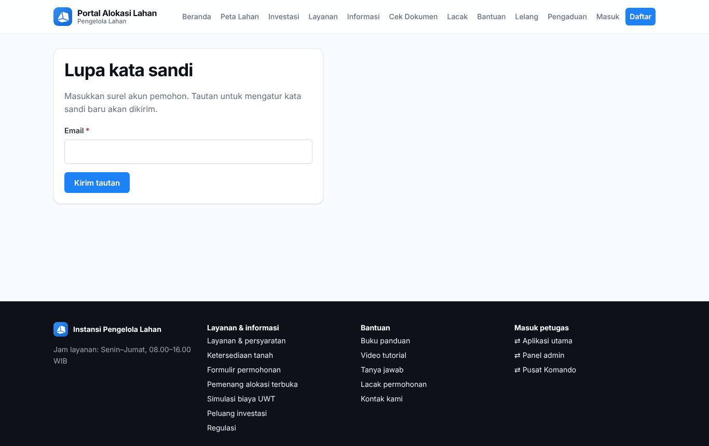

1. Di halaman masuk, klik **Lupa kata sandi?**.
2. Isi **Surel** akun Anda (nomor 1), lalu klik **Kirim tautan** (nomor 2).
3. Buka surel dari SimLahan dan klik tautan atur ulang sandi.
4. Di halaman **Atur kata sandi baru**, isi kata sandi baru dua kali, lalu klik **Simpan kata sandi**. Masuk dengan kata sandi baru. Bila tautan sudah tidak berlaku, klik **Minta tautan baru**.

## 13.2 Akun saya

**Akun saya** adalah halaman utama pemohon. Bukalah setiap kali masuk.

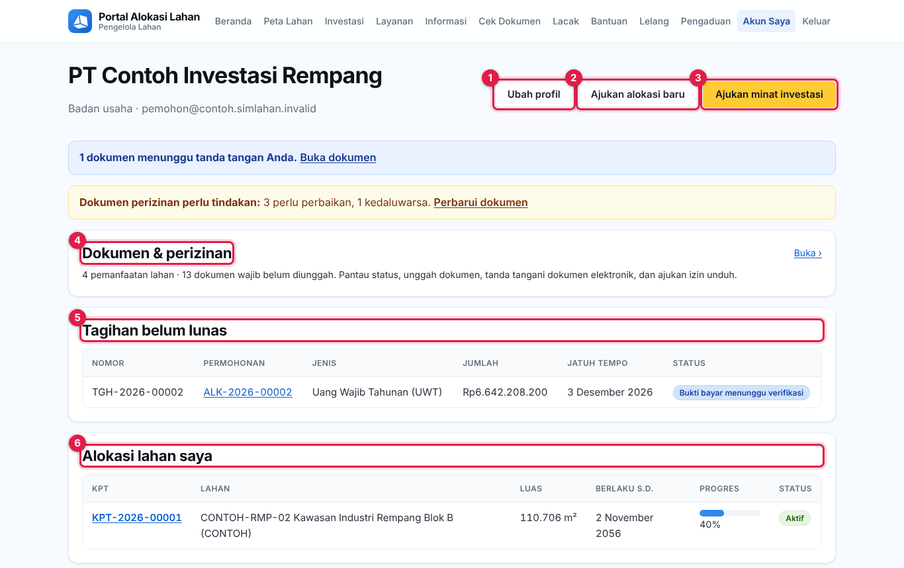

1. **Ubah profil** (nomor 1): ubah data pemohon ([13.10](#1310-profil-dan-kata-sandi)).
2. **Ajukan alokasi baru** (nomor 2): membuka peta lahan untuk memilih lahan ([13.3](#133-mengajukan-permohonan-alokasi)).
3. **Ajukan minat investasi** (nomor 3): lihat [Bab 14](52-portal-investor.md).
4. Kotak biru dan kuning di bawah judul adalah **pemberitahuan**, misalnya dokumen yang menunggu tanda tangan Anda atau dokumen perizinan yang perlu diperbaiki. Klik tautan di dalamnya.
5. **Dokumen & perizinan** (nomor 4): ringkasan dokumen perizinan wajib. Klik **Buka ›** ([Bab 15](53-portal-dokumen.md)).
6. **Tagihan belum lunas** (nomor 5): nomor tagihan, permohonan, jenis, jumlah, jatuh tempo, dan status.
7. **Alokasi lahan saya** (nomor 6): nomor KPT, lahan, luas, berlaku s.d., progres pembangunan, dan status. Klik nomor KPT untuk membukanya ([13.7](#137-alokasi-saya-progres-layanan-peralihan-hak)).

Gulir ke bawah:

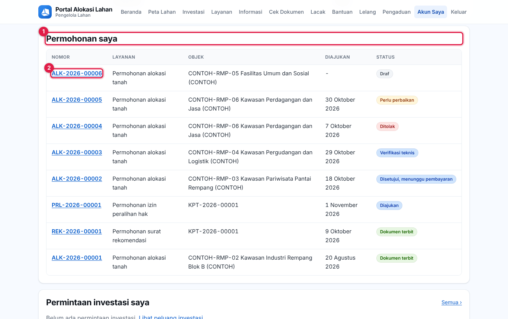

1. **Permohonan saya** (nomor 1): semua permohonan Anda dengan nomor, layanan, objek, tanggal diajukan, dan status.
2. Klik **nomor permohonan** (nomor 2) untuk membukanya.

Di bawahnya ada **Permintaan investasi saya**, **Lahan tersimpan**, dan (bila ada) **Peralihan hak kepada saya**, yaitu peralihan yang menunggu persetujuan Anda sebagai penerima.

## 13.3 Mengajukan permohonan alokasi

**Langkah 1 – Pilih lahan dan buat draf**

1. Klik **Ajukan alokasi baru** di **Akun saya** (atau **Peta Lahan** di menu atas), lalu klik kode lahan yang diinginkan.
2. Periksa data lahan, tarif, dan **Dokumen persyaratan permohonan alokasi** (lihat [Bab 12.2](50-portal-publik.md#122-peta-lahan-dan-detail-lahan)).
3. Gulir ke kotak **Tertarik dengan lahan ini?** (nomor 1 pada gambar di bawah).
4. Klik **Langsung ajukan permohonan alokasi** (nomor 3). Sistem membuat **draf**; lahan baru dipesan setelah permohonan diajukan. (**Ajukan minat investasi**, nomor 2, dipakai bila Anda ingin berkonsultasi dulu atau memilih skema sewa; lihat [Bab 14](52-portal-investor.md).)

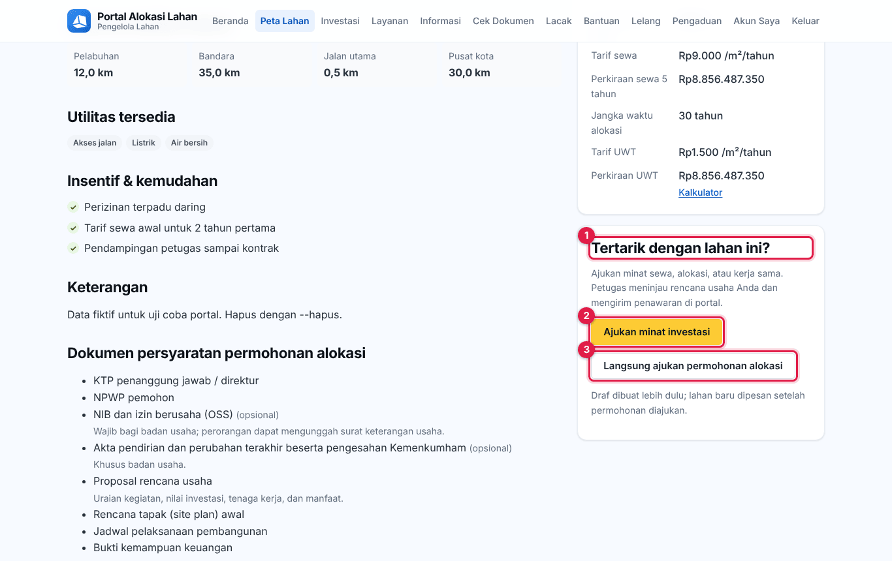

**Langkah 2 – Lengkapi data**

Halaman permohonan berstatus **Draf** terbuka.

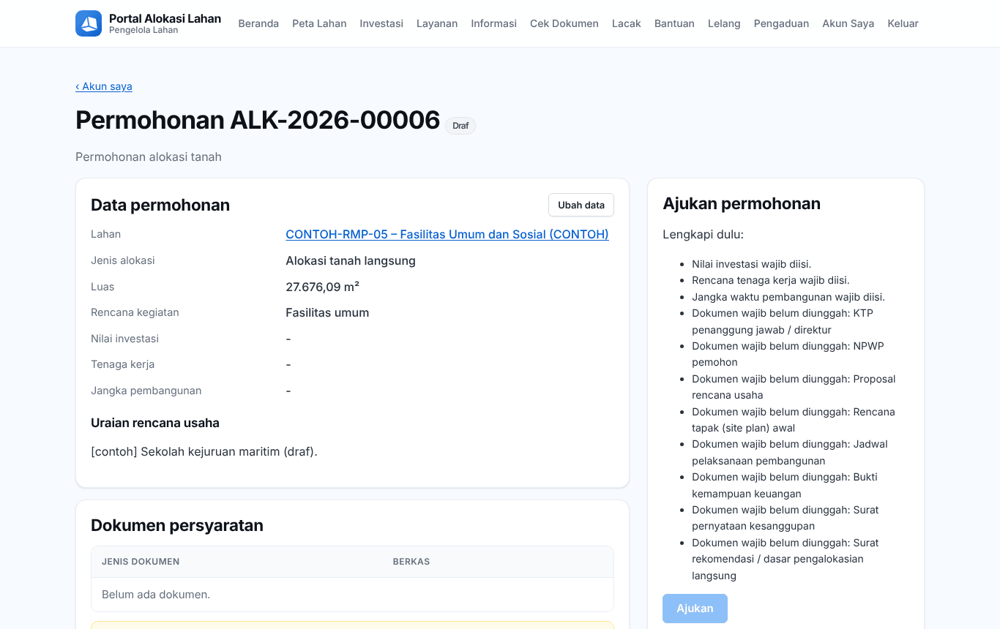

1. Klik **Ubah data** (nomor 1).

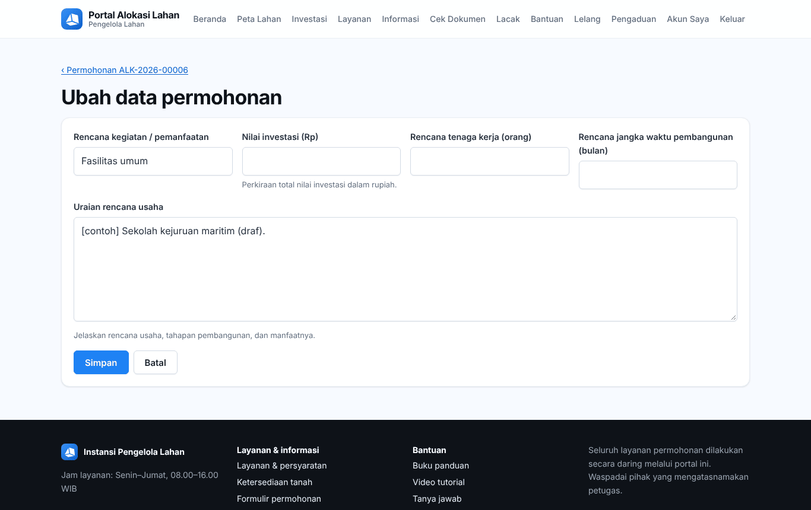

2. Isi **Rencana kegiatan / pemanfaatan** (nomor 1), **Nilai investasi (Rp)** (nomor 2, angka saja tanpa titik), **Rencana tenaga kerja (orang)** (nomor 3), dan **Rencana jangka waktu pembangunan (bulan)** (nomor 4).
3. Tulis **Uraian rencana usaha** (nomor 5): rencana usaha, tahapan pembangunan, dan manfaatnya.
4. Klik **Simpan** (nomor 6). Anda kembali ke halaman permohonan.

**Langkah 3 – Unggah dokumen persyaratan**

Di halaman permohonan, gulir ke **Dokumen persyaratan**.

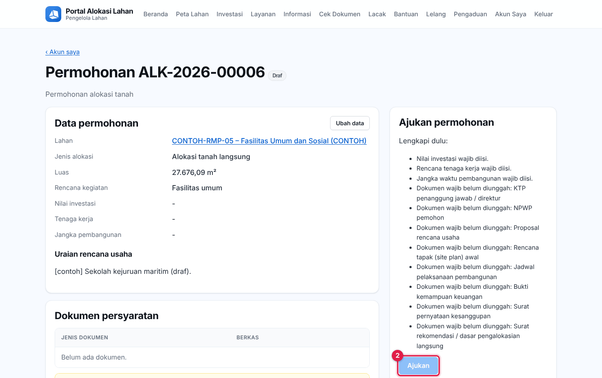

1. Kotak kuning di bawah **Dokumen persyaratan** (nomor 1) menyebut dokumen wajib yang belum diunggah.
2. Pilih **Jenis dokumen** (nomor 2).
3. Klik **Pilih File** di **Berkas** (nomor 3), lalu pilih berkasnya (PDF, JPG, atau PNG; maksimal 10 MB).
4. Klik **Unggah** (nomor 4). Dokumen tampil di tabel di atasnya.
5. Ulangi untuk setiap dokumen wajib. Dokumen yang salah dihapus dengan **Hapus** di barisnya, lalu unggah yang benar.

**Langkah 4 – Ajukan**

Kembali ke gambar **Permohonan berstatus Draf** di atas:

1. Kotak **Ajukan permohonan** di kanan menampilkan **Lengkapi dulu:** (nomor 3) bila masih ada data atau dokumen yang kurang. Selama daftar ini ada, tombol **Ajukan** (nomor 4) abu-abu dan tidak bisa diklik.
2. Setelah semua lengkap, daftar itu hilang. Klik **Ajukan** lalu konfirmasi. Setelah diajukan, data tidak dapat diubah kecuali petugas meminta perbaikan.
3. Catat **Nomor** dan **PIN** di kotak **Lacak tanpa login** (nomor 6) bila ingin memantau tanpa masuk (lihat [Bab 12.8](50-portal-publik.md#128-lacak-permohonan)).
4. Permohonan yang belum disetujui bisa dibatalkan dengan **Batalkan permohonan** (nomor 5).

**Status permohonan:**

| Status | Arti | Yang Anda lakukan |
|---|---|---|
| Draf | Belum diajukan. | Lengkapi data dan dokumen, lalu **Ajukan**. |
| Diajukan | Menunggu pemeriksaan petugas. | Tunggu. |
| Verifikasi teknis | Dinilai tim lintas unit. | Tunggu. |
| Perlu perbaikan | Ada yang harus diperbaiki. | Lihat [13.4](#134-memperbaiki-permohonan). |
| Disetujui, menunggu pembayaran | Tagihan sudah terbit. | Bayar dan unggah bukti ([13.5](#135-membayar-tagihan)). |
| Pembayaran terverifikasi | Pembayaran diterima. | Tunggu dokumen terbit. |
| Dokumen terbit | KPT dan PPT sudah terbit. | Unduh dokumen ([13.6](#136-mengunduh-kpt-dan-ppt)). |
| Ditolak / Dibatalkan pemohon | Proses berhenti. | Baca alasan di **Riwayat**. |

## 13.4 Memperbaiki permohonan

Anda menerima surel bila permohonan perlu diperbaiki. Buka permohonan dari **Akun saya → Permohonan saya** (statusnya **Perlu perbaikan**).

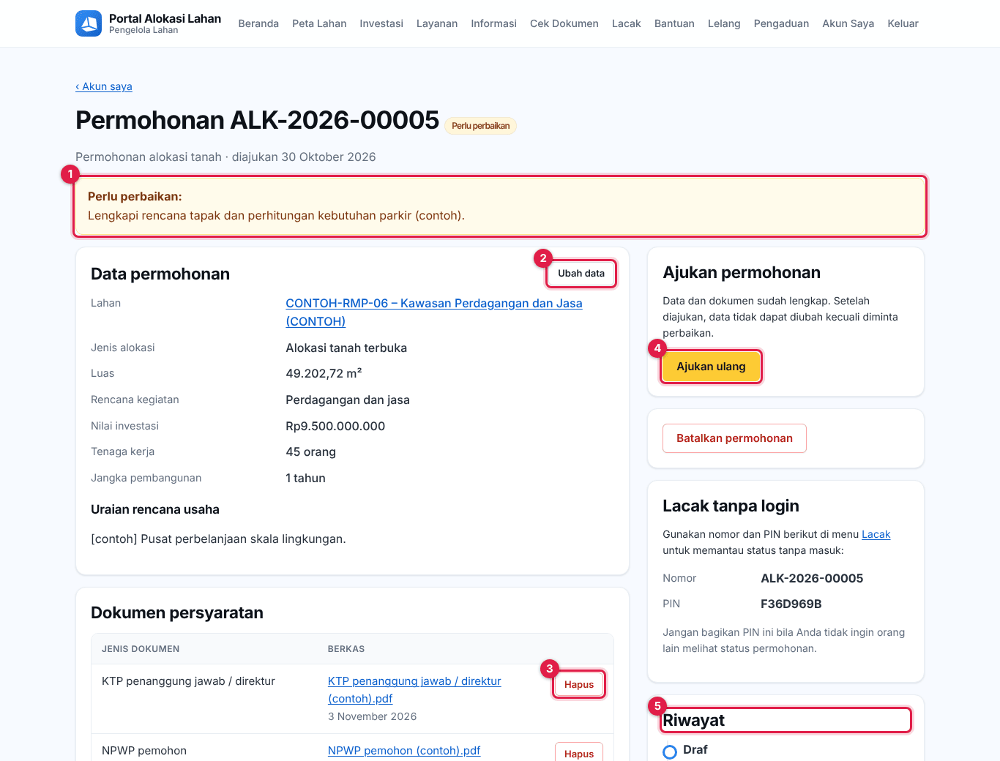

1. Baca catatan petugas di kotak kuning **Perlu perbaikan** (nomor 1). Catatan yang sama juga tercatat di **Riwayat** (nomor 5).
2. Bila datanya yang salah, klik **Ubah data** (nomor 2), perbaiki, lalu **Simpan**.
3. Bila dokumennya yang salah, klik **Hapus** (nomor 3) di baris dokumen itu, lalu unggah dokumen yang benar seperti [13.3](#133-mengajukan-permohonan-alokasi) langkah 3.
4. Klik **Ajukan ulang** (nomor 4) lalu konfirmasi.

## 13.5 Membayar tagihan

Setelah permohonan disetujui, statusnya menjadi **Disetujui, menunggu pembayaran** dan Anda menerima surel.

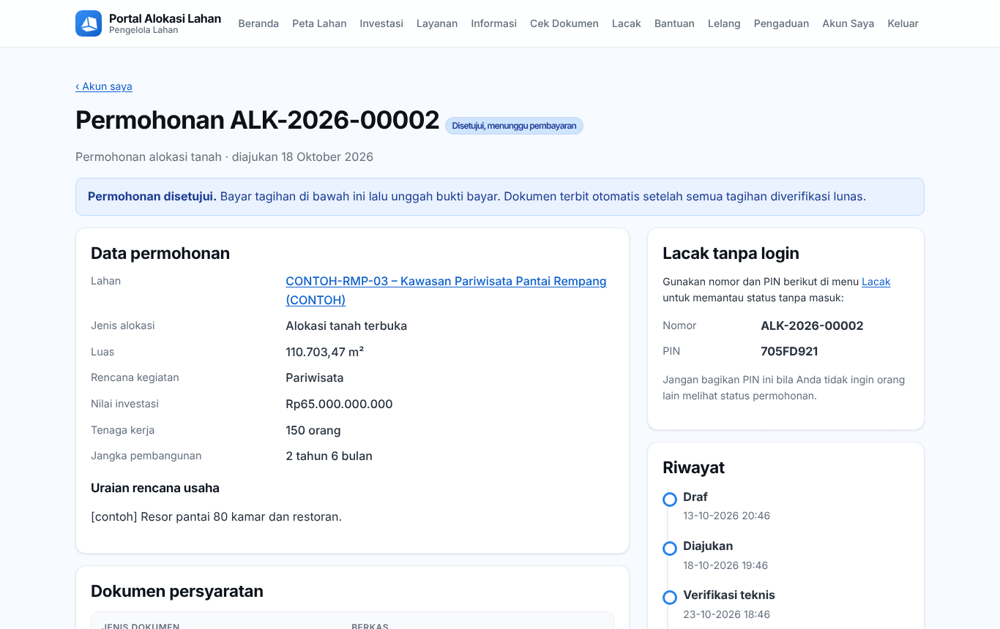

1. Status (nomor 1) dan kotak biru **Permohonan disetujui** (nomor 2) memberi tahu bahwa tagihan sudah terbit.
2. **Lacak tanpa login** (nomor 3) dan **Riwayat** (nomor 4) tetap tersedia.
3. Gulir ke bagian **Tagihan**.

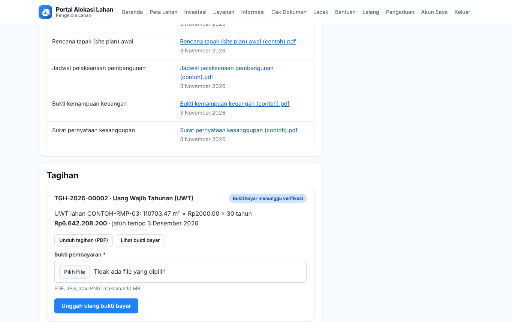

4. Setiap tagihan di **Tagihan** (nomor 1) menampilkan nomor, jenis (UWT atau biaya administrasi), rincian, jumlah, jatuh tempo, dan status. Tanda **Lewat jatuh tempo** muncul bila terlambat.
5. Klik **Unduh tagihan (PDF)** (nomor 2) dan bayar sesuai petunjuk pembayaran di halaman itu, hanya ke rekening resmi instansi.
6. Di **Bukti pembayaran**, klik **Pilih File** (nomor 4) dan pilih bukti bayar (PDF, JPG, atau PNG; maksimal 10 MB).
7. Klik **Unggah bukti bayar** (nomor 5). Status tagihan menjadi **Bukti bayar menunggu verifikasi**.
8. **Lihat bukti bayar** (nomor 3) membuka bukti yang sudah Anda kirim. Bila petugas menolak bukti bayar, baca **Catatan petugas**, lalu unggah lagi; tombolnya bernama **Unggah ulang bukti bayar**.

## 13.6 Mengunduh KPT dan PPT

Setelah semua tagihan diverifikasi lunas, status menjadi **Dokumen terbit**. Buka permohonan dan gulir ke bawah.

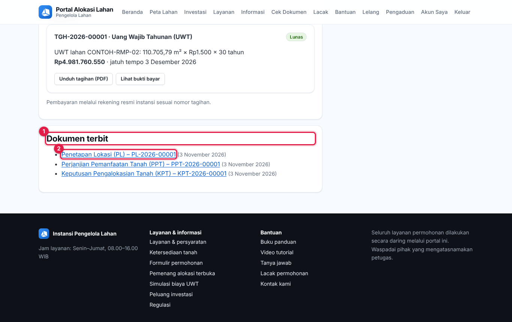

1. Bagian **Dokumen terbit** (nomor 1) berisi Penetapan Lokasi (PL), Perjanjian Pemanfaatan Tanah (PPT), dan Keputusan Pengalokasian Tanah (KPT).
2. Klik nama dokumen (nomor 2) untuk mengunduh PDF-nya.
3. Setiap dokumen ber-QR; siapa pun bisa memeriksa keasliannya di **Cek Dokumen** (lihat [Bab 12.9](50-portal-publik.md#129-cek-keaslian-dokumen)).

## 13.7 Alokasi saya: progres, layanan, peralihan hak

Buka alokasi dari **Akun saya → Alokasi lahan saya** (klik nomor KPT).

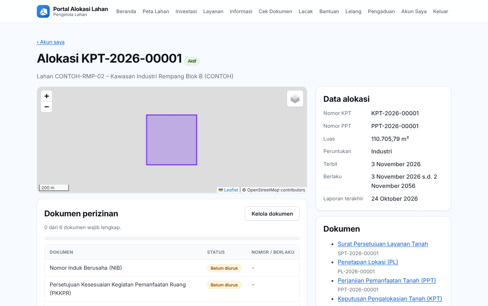

1. **Kelola dokumen** (nomor 1) di **Dokumen perizinan** membuka daftar dokumen perizinan wajib lahan ini ([Bab 15](53-portal-dokumen.md)).
2. **Data alokasi** (nomor 2): nomor KPT dan PPT, luas, peruntukan, tanggal terbit, masa berlaku, dan laporan terakhir.
3. **Dokumen** (nomor 3): unduh lagi dokumen yang sudah terbit.
4. **Layanan alokasi** (nomor 4): daftar layanan untuk alokasi ini. Klik nama layanan (nomor 5) untuk mengajukannya.

Di bawah peta ada **Progres pembangunan**, dan di kanan bawah **Peralihan hak**.

### Melaporkan progres pembangunan

Gulir ke **Progres pembangunan**.

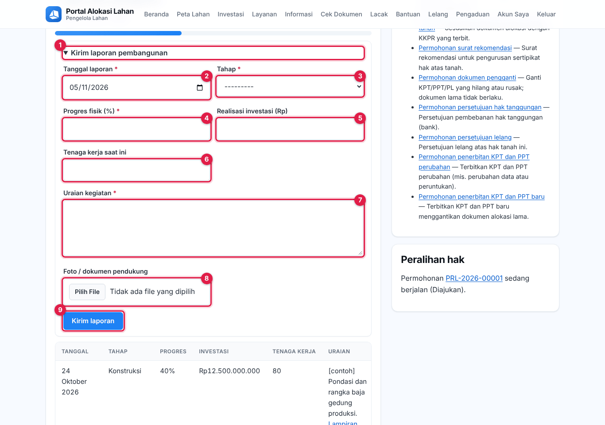

1. Klik **Kirim laporan pembangunan** (nomor 1) bila formulirnya belum terbuka.
2. Isi **Tanggal laporan** (nomor 2). Tidak boleh tanggal yang akan datang.
3. Pilih **Tahap** (nomor 3): Belum dimulai, Pematangan / persiapan lahan, Konstruksi, atau Sudah beroperasi.
4. Isi **Progres fisik (%)** (nomor 4), **Realisasi investasi (Rp)** (nomor 5), dan **Tenaga kerja saat ini** (nomor 6).
5. Tulis **Uraian kegiatan** (nomor 7).
6. Lampirkan foto lapangan di **Foto / dokumen pendukung** (nomor 8).
7. Klik **Kirim laporan** (nomor 9). Laporan tampil di tabel di bawahnya (Tanggal, Tahap, Progres, Investasi, Tenaga kerja, Uraian).

> Laporkan secara berkala. Lahan yang tidak dibangun dapat ditandai **lahan tidur** dan berisiko dicabut alokasinya.

### Mengajukan layanan alokasi

Klik nama layanan di **Layanan alokasi** (nomor 5 pada gambar halaman alokasi).

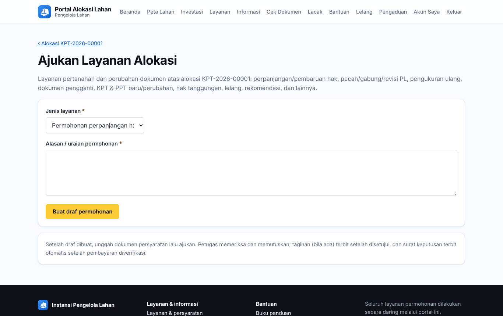

1. Periksa **Jenis layanan** (nomor 1). Pilihannya: perpanjangan hak, pembaruan hak, pemecahan PL, pengukuran ulang, revisi PL, penggabungan PL, penyesuaian dokumen alokasi, surat rekomendasi, pembukaan blokir PL, dokumen pengganti, persetujuan hak tanggungan, persetujuan lelang, KPT dan PPT perubahan, atau KPT dan PPT baru.
2. Tulis **Alasan / uraian permohonan** (nomor 2).
3. Klik **Buat draf permohonan** (nomor 3).
4. Unggah dokumen dan ajukan seperti [13.3](#133-mengajukan-permohonan-alokasi) langkah 3–4. Tagihan (bila ada) dan surel keputusan mengikuti seperti permohonan alokasi.

### Mengalihkan hak (peralihan hak)

1. Pastikan penerima hak sudah mendaftar di portal.
2. Di halaman alokasi, bagian **Peralihan hak**, klik **Ajukan peralihan hak**.

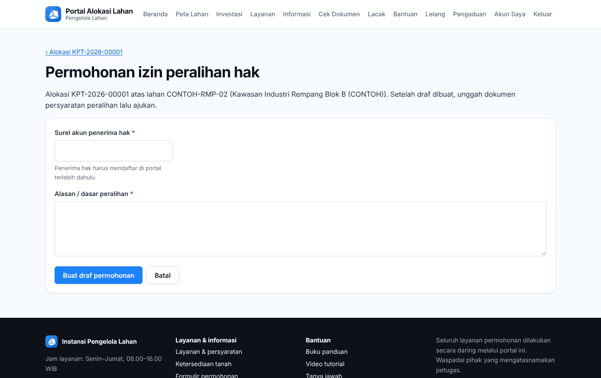

3. Isi **Surel akun penerima hak** (nomor 1), yaitu surel yang dipakai penerima untuk masuk portal.
4. Tulis **Alasan / dasar peralihan** (nomor 2), misalnya jual beli atau hibah.
5. Klik **Buat draf permohonan** (nomor 3).
6. Unggah dokumen dan ajukan. Penerima hak menerima surel dan harus menyetujui peralihan di portal.

**Bila Anda penerima hak:** buka **Akun saya → Peralihan hak kepada saya**, buka permohonannya, lalu klik **Setujui peralihan** di bagian **Persetujuan penerima hak**. Dengan menyetujui, Anda menerima seluruh kewajiban pemegang alokasi. Tanpa persetujuan Anda, petugas tidak bisa memproses peralihan.

## 13.8 Dokumen & perizinan

Menu **Dokumen & perizinan** (di **Akun saya**) untuk memantau dokumen perizinan wajib, mengunggah dokumen, menandatangani dokumen elektronik, dan meminta izin unduh. Caranya di [Bab 15](53-portal-dokumen.md).

## 13.9 Mengikuti lelang

1. Klik **Lelang** di menu atas, lalu klik lelang berstatus **Menerima penawaran**.
2. Klik **Ajukan penawaran** di kotak kanan (bila Anda sudah pernah menawar, tombolnya **Ubah penawaran**).

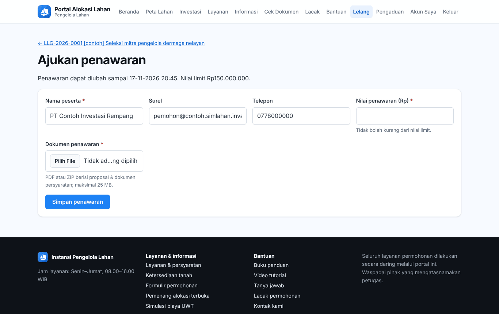

3. Periksa **Nama peserta** (nomor 1), **Surel** (nomor 2), dan **Telepon** (nomor 3). Ketiganya terisi dari profil Anda.
4. Isi **Nilai penawaran (Rp)** (nomor 4). Tidak boleh kurang dari nilai limit yang tertulis di atas formulir.
5. Klik **Pilih File** di **Dokumen penawaran** (nomor 5) dan pilih PDF atau ZIP berisi proposal dan dokumen persyaratan (maksimal 25 MB).
6. Klik **Simpan penawaran** (nomor 6).
7. Sebelum batas waktu, Anda bisa mengubah penawaran; unggah dokumen lagi hanya bila ingin menggantinya. Setelah penawaran ditutup dan dievaluasi, pemenang tampil di halaman lelang.

## 13.10 Profil dan kata sandi

Klik **Ubah profil** di **Akun saya**.

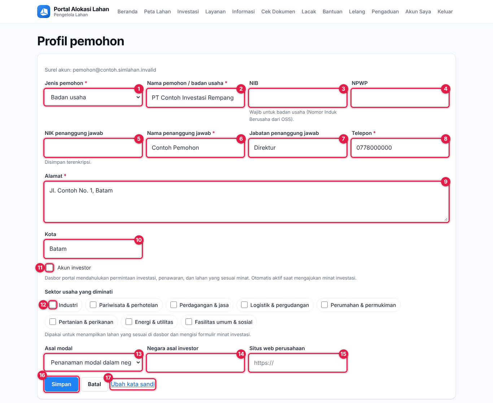

1. Ubah **Jenis pemohon** (nomor 1), **Nama pemohon / badan usaha** (nomor 2), **NIB** (nomor 3), **NPWP** (nomor 4), dan **NIK penanggung jawab** (nomor 5).
2. Ubah **Nama penanggung jawab** (nomor 6), **Jabatan penanggung jawab** (nomor 7), **Telepon** (nomor 8), **Alamat** (nomor 9), dan **Kota** (nomor 10).
3. Ingin memakai fitur investor? Centang **Akun investor** (nomor 11) dan pilih **Sektor usaha yang diminati** (nomor 12 dan seterusnya). Isi juga **Asal modal** (nomor 13), **Negara asal investor** (nomor 14, untuk modal asing), dan **Situs web perusahaan** (nomor 15).
4. Klik **Simpan** (nomor 16).
5. Untuk mengganti kata sandi, klik **Ubah kata sandi** (nomor 17).

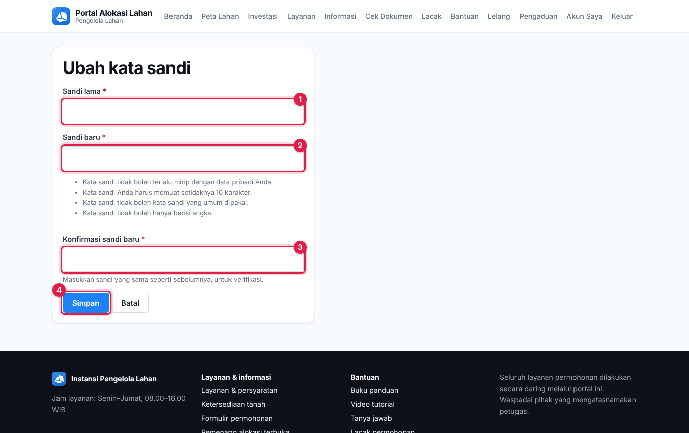

1. Isi **Sandi lama** (nomor 1).
2. Isi **Sandi baru** (nomor 2) sesuai aturan di bawah kotak itu, lalu ulangi di **Konfirmasi sandi baru** (nomor 3).
3. Klik **Simpan** (nomor 4).

## 13.11 Pertanyaan umum

**Tombol Ajukan tidak bisa diklik.** Baca daftar **Lengkapi dulu:** di kotak **Ajukan permohonan**; ada data atau dokumen wajib yang belum diisi.

**Lahan tidak bisa diajukan.** Lahan sedang diproses pemohon lain, sudah dialokasikan, atau ditutup. Klik **Cari lahan lain**.

**Surel aktivasi tidak datang.** Periksa folder spam, lalu klik **Kirim ulang** di halaman pendaftaran (atau **Kirim ulang aktivasi** di halaman masuk).
