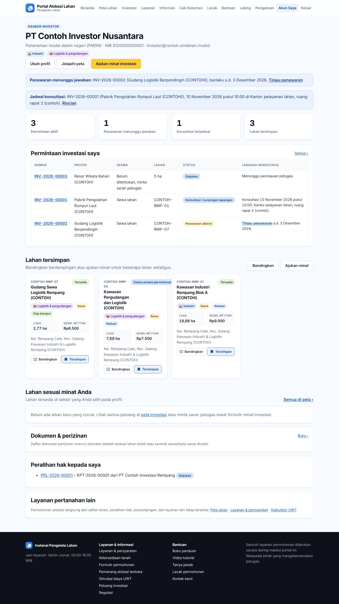
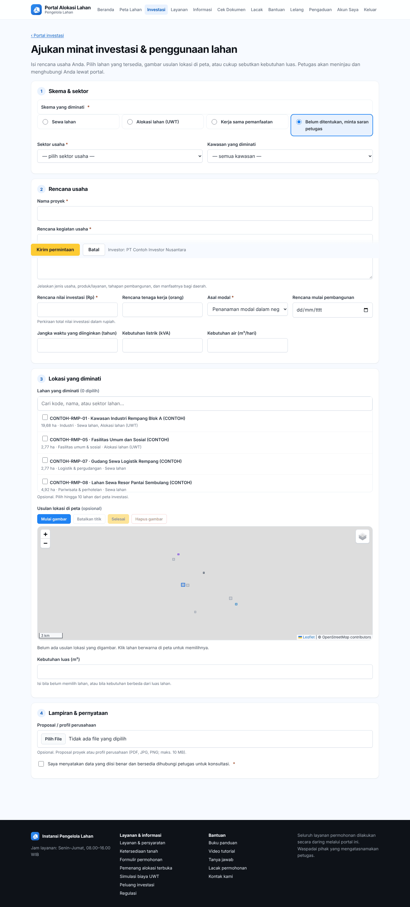
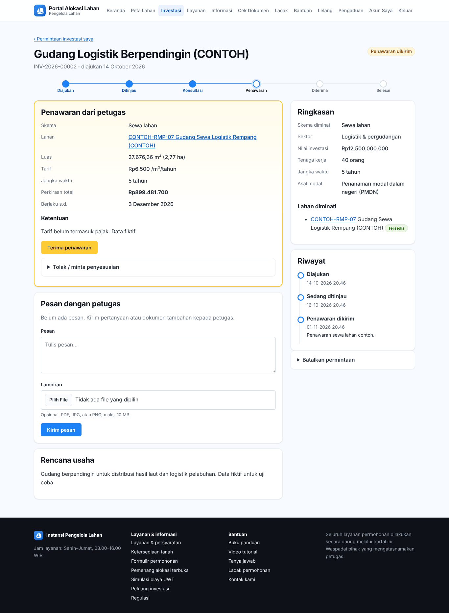

# Bab 14 – Portal untuk investor

Bab ini untuk **investor** dan pelaku usaha yang ingin **menyewa**, mendapat **alokasi (UWT)**, atau **bekerja sama** memanfaatkan lahan. Investor menjelajahi peta investasi, menyimpan dan membandingkan lahan, mengajukan minat, berkonsultasi dengan petugas, lalu menerima penawaran di portal.

Alur investasi:

```
Jelajahi peta → Ajukan minat → Konsultasi / kunjungan → Penawaran → Terima → Kontrak sewa/kerja sama, atau permohonan alokasi (KPT)
```

## 14.1 Mendaftar sebagai investor


1. Di portal, klik **Investasi → Daftar sebagai investor**.
2. Isi data akun dan pemohon seperti pendaftaran biasa ([Bab 12.11](50-portal-publik.md#1211-mendaftar-akun)).
3. Centang **Sektor usaha yang diminati** (Industri, Pariwisata & perhotelan, Perdagangan & jasa, Logistik & pergudangan, Perumahan & permukiman, Pertanian & perikanan, Energi & utilitas, Fasilitas umum & sosial).
4. Pilih **Asal modal** (PMDN atau PMA), isi **Negara asal investor** (untuk PMA) dan **Situs web perusahaan**.
5. Centang pernyataan, klik **Daftar sebagai investor**, lalu aktifkan akun lewat surel.

Pemohon yang sudah punya akun cukup mencentang **Akun investor** di **Ubah profil**.

## 14.2 Dasbor investor


**Akun saya** bagi investor menampilkan:

- Tombol **Ubah profil**, **Jelajahi peta**, **Ajukan minat investasi**.
- Ringkasan **Permintaan aktif**, **Penawaran menunggu jawaban**, dan **Konsultasi terjadwal**.
- Tabel permintaan (Nomor, Proyek, Skema, Lahan, Status, **Langkah berikutnya**).
- **Lahan tersimpan** (bandingkan berdampingan atau ajukan minat untuk beberapa lahan sekaligus) dan lahan baru yang cocok dengan sektor minat Anda.



## 14.3 Mencari, menyimpan, dan membandingkan lahan

1. Klik **Jelajahi peta**. Saring per skema dan sektor; buka **Filter lainnya** untuk **Kecamatan**, **Luas min./maks. (ha)**, **Siap bangun**, **Dokumen teknis tersedia**, **Tampilkan juga lahan yang sudah terikat**, dan **Hanya lahan tersimpan**. Pilih **Urutkan** (Unggulan, Luas terbesar, Luas terkecil, Tarif termurah, Kode lahan).
2. Klik lahan untuk membuka detailnya. Gunakan **Simulasi biaya** untuk memperkirakan biaya sewa atau UWT.
3. Klik **Simpan** untuk menyimpan lahan (muncul di **Lahan tersimpan**), atau **Bandingkan** untuk menambah ke perbandingan (hingga 4 lahan).
4. Di halaman **Bandingkan lahan**, klik **Ajukan minat** per lahan atau **Ajukan minat untuk semua lahan ini**.


## 14.4 Mengajukan minat investasi


1. Klik **Ajukan minat investasi** (dari dasbor, detail lahan, kawasan, atau perbandingan).
2. **Skema & sektor**: pilih **Skema yang diminati** (Sewa lahan, Alokasi lahan (UWT), Kerja sama pemanfaatan, atau Belum ditentukan, minta saran petugas), **Sektor usaha**, dan **Kawasan yang diminati**.
3. **Rencana usaha**: **Nama proyek**, **Rencana kegiatan usaha**, **Rencana nilai investasi (Rp)**, **Rencana tenaga kerja (orang)**, **Asal modal**, **Rencana mulai pembangunan**, **Jangka waktu yang diinginkan (tahun)**, **Kebutuhan listrik (kVA)**, **Kebutuhan air (m³/hari)**.
4. **Lokasi yang diminati**: centang lahan di daftar **Lahan yang diminati**, atau klik lahan berwarna di peta. Bila lahan yang cocok belum ada, gambar usulan lokasi: klik **Mulai gambar**, klik titik-titik sudut di peta, lalu **Selesai** (**Batalkan titik** untuk menghapus titik terakhir, **Hapus gambar** untuk mengulang). Atau cukup isi kebutuhan luas.
5. **Lampiran & pernyataan**: lampirkan profil perusahaan atau proposal bila ada, centang pernyataan.
6. Klik **Kirim permintaan**. Nomor permintaan (misalnya `INV-2026-00003`) muncul di **Permintaan investasi saya**.



## 14.5 Memantau permintaan


Buka **Permintaan investasi saya** (atau dari dasbor) lalu klik nomor permintaan. Halaman permintaan menampilkan tahapan (**Diajukan → Ditinjau → Konsultasi → Penawaran → Diterima → Selesai**), **Ringkasan**, **Rencana usaha**, **Usulan lokasi**, dan **Riwayat**.

**Konsultasi:** bila petugas menjadwalkan konsultasi atau kunjungan lapangan, **Jadwal konsultasi:** tampil beserta tempat atau tautan pertemuan. Anda juga menerima surel.


**Pesan dengan petugas:** tulis **Pesan**, lampirkan berkas bila perlu (**Lampiran**), lalu **Kirim pesan**. Jawaban petugas muncul di percakapan yang sama.

**Membatalkan:** klik **Batalkan permintaan** selama permintaan belum selesai.

## 14.6 Menjawab penawaran


1. Saat status **Penawaran dikirim**, bagian **Penawaran dari petugas** menampilkan skema, lahan, luas, **Tarif**, **Jangka waktu**, **Perkiraan total**, **Berlaku s.d.**, dan **Ketentuan**.
2. Klik **Terima penawaran** bila setuju.
3. Bila belum setuju, klik **Tolak / minta penyesuaian**, tulis alasan atau permintaan penyesuaian, lalu **Kirim**. Petugas dapat mengirim penawaran baru.
4. Bila penawaran **Kedaluwarsa**, kirim pesan untuk meminta penawaran baru.



## 14.7 Setelah penawaran diterima

Petugas menyelesaikan permintaan:

- **Sewa atau kerja sama**: petugas mencatat kontrak sewa atau perjanjian kerja sama. Daftar dokumen perizinan untuk kontrak itu muncul di **Dokumen & perizinan** ([Bab 15](53-portal-dokumen.md)).
- **Alokasi (UWT)**: sistem membuat **draf permohonan alokasi** atas nama Anda dengan rencana usaha terisi. Lengkapi dokumen dan ajukan seperti [Bab 13.3](51-portal-pemohon.md#133-mengajukan-permohonan-alokasi). Anda juga bisa langsung mengajukan dari detail lahan lewat **Langsung ajukan permohonan alokasi**.

## 14.8 Profil


Klik **Ubah profil** untuk memperbarui data perusahaan, sektor usaha yang diminati, asal modal, negara asal, dan situs web. Lahan baru yang cocok di dasbor mengikuti sektor yang Anda pilih.
