# Bab 14 – Portal untuk investor

Bab ini untuk **investor** dan pelaku usaha yang ingin **menyewa**, mendapat **alokasi (UWT)**, atau **bekerja sama** memanfaatkan lahan. Investor menjelajahi peta investasi, menyimpan dan membandingkan lahan, mengajukan minat, berkonsultasi dengan petugas, lalu menerima penawaran di portal.

Alur investasi:

```
Jelajahi peta → Ajukan minat → Konsultasi / kunjungan → Penawaran → Terima → Kontrak sewa/kerja sama, atau permohonan alokasi (KPT)
```

Angka merah pada gambar menunjukkan tempat yang Anda klik atau isi; "(nomor 2)" berarti angka 2 pada gambar tepat di atasnya.

## 14.1 Mendaftar sebagai investor

1. Di portal, klik **Investasi**, lalu **Daftar sebagai investor**.
2. Isi bagian atas formulir (surel, kata sandi, jenis pemohon, nama, NIB, NPWP, penanggung jawab, telepon, alamat, kota) persis seperti pendaftaran biasa ([Bab 12.11](50-portal-publik.md#1211-mendaftar-akun)).
3. Gulir ke bawah. Centang **Sektor usaha yang diminati** (boleh lebih dari satu): Industri, Pariwisata & perhotelan, Perdagangan & jasa, Logistik & pergudangan, Perumahan & permukiman, Pertanian & perikanan, Energi & utilitas, Fasilitas umum & sosial.
4. Pilih **Asal modal** (PMDN atau PMA), isi **Negara asal investor** (untuk PMA) dan **Situs web perusahaan**.
5. Centang pernyataan, klik **Daftar sebagai investor**, lalu aktifkan akun lewat tautan di surel.

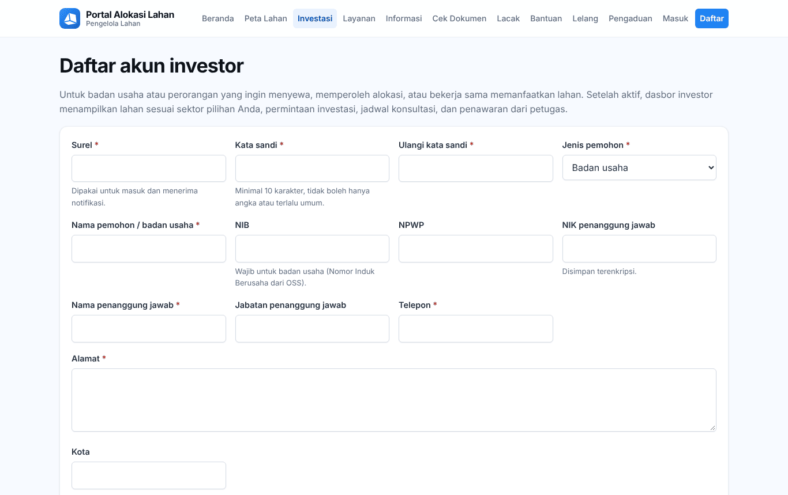

Sudah punya akun pemohon? Tidak perlu mendaftar lagi: centang **Akun investor** di **Ubah profil** ([14.8](#148-profil)).

## 14.2 Dasbor investor

Setelah masuk, **Akun Saya** menampilkan dasbor investor.

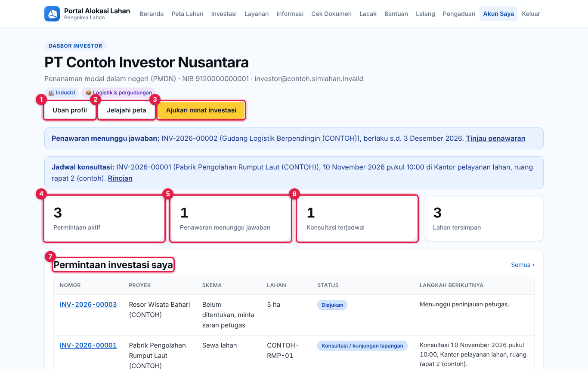

1. **Ubah profil** (nomor 1), **Jelajahi peta** (nomor 2), dan **Ajukan minat investasi** (nomor 3).
2. Kotak biru di bawahnya memberi tahu hal yang perlu Anda tindak lanjuti, misalnya **Penawaran menunggu jawaban** (klik **Tinjau penawaran**) atau **Jadwal konsultasi** (klik **Rincian**).
3. Kartu ringkasan: **Permintaan aktif** (nomor 4), **Penawaran menunggu jawaban** (nomor 5), **Konsultasi terjadwal** (nomor 6), dan **Lahan tersimpan**. Klik kartu untuk membuka daftarnya.
4. **Permintaan investasi saya** (nomor 7): nomor, proyek, skema, lahan, status, dan **Langkah berikutnya** yang harus terjadi. Klik nomor permintaan untuk membukanya.

Gulir ke bawah:

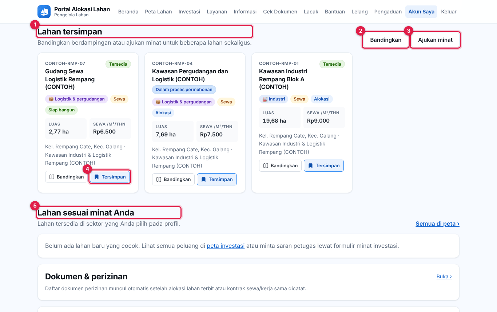

1. **Lahan tersimpan** (nomor 1): lahan yang Anda simpan.
2. **Bandingkan** (nomor 2) membandingkan lahan tersimpan berdampingan; **Ajukan minat** (nomor 3) membuka formulir minat untuk lahan-lahan itu sekaligus.
3. Tombol **Tersimpan** (nomor 4) di kartu lahan menghapus lahan dari daftar simpan.
4. **Lahan sesuai minat Anda** (nomor 5): lahan baru di sektor yang Anda pilih di profil.

Di bawahnya ada **Dokumen & perizinan** ([Bab 15](53-portal-dokumen.md)), **Peralihan hak kepada saya**, dan **Layanan pertanahan lain**.

## 14.3 Mencari, menyimpan, dan membandingkan lahan

1. Klik **Jelajahi peta**. Cara menyaring (skema, sektor, **Filter lainnya**, **Urutkan**) dijelaskan di [Bab 12.3](50-portal-publik.md#123-investasi). Investor juga mendapat centang **Hanya lahan tersimpan** di **Filter lainnya**.
2. Klik kartu lahan untuk membuka detailnya.

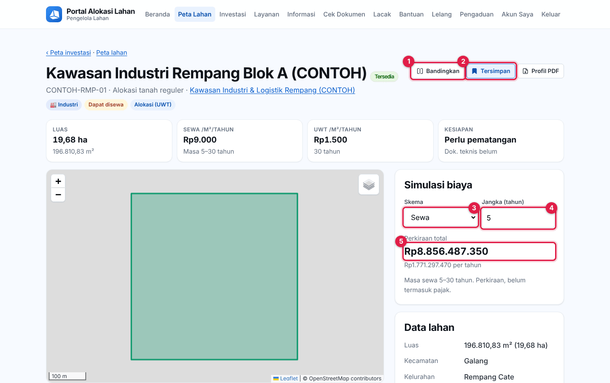

3. **Bandingkan** (nomor 1) menambah lahan ke perbandingan (hingga 4 lahan).
4. **Simpan** (nomor 2) menyimpan lahan ke **Lahan tersimpan**. Setelah disimpan, tombol berubah menjadi **Tersimpan**; klik lagi untuk menghapusnya.
5. Di **Simulasi biaya**, pilih **Skema** (nomor 3) dan isi **Jangka (tahun)** (nomor 4); **Perkiraan total** (nomor 5) langsung dihitung.
6. Di bawah halaman, kotak **Tertarik dengan lahan ini?** berisi **Ajukan minat investasi** (atau **Buka permintaan** bila Anda sudah mengajukan minat untuk lahan ini) dan **Langsung ajukan permohonan alokasi**.

Semua lahan yang disimpan ada di **Lahan tersimpan** (dari kartu dasbor atau tombol di **Permintaan investasi saya**):

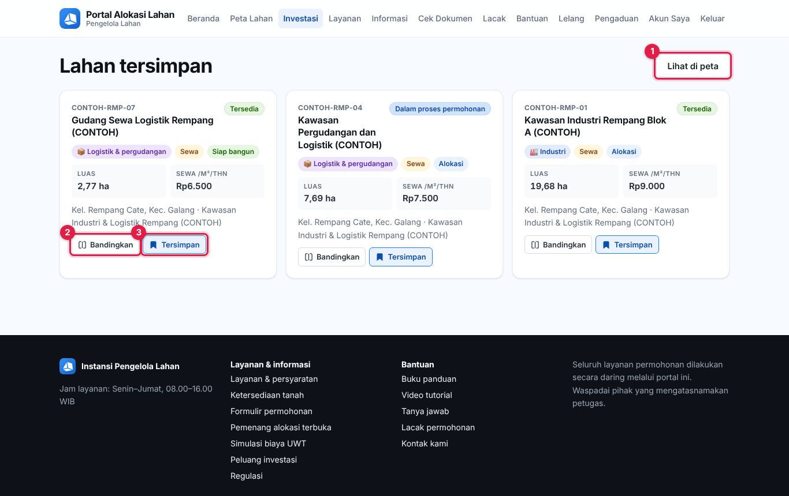

1. **Lihat di peta** (nomor 1) membuka peta investasi berisi lahan tersimpan saja.
2. **Bandingkan** (nomor 2) di kartu lahan menambahkannya ke perbandingan.
3. **Tersimpan** (nomor 3) menghapus lahan dari daftar.

Di halaman **Bandingkan lahan**, klik **Ajukan minat** per lahan atau **Ajukan minat untuk semua lahan ini**.

## 14.4 Mengajukan minat investasi

Klik **Ajukan minat investasi** (dari dasbor, detail lahan, kawasan, atau perbandingan). Formulirnya panjang dan terbagi empat bagian. Tombol **Kirim permintaan** selalu tampil di bawah layar.

**Bagian 1 dan 2 – Skema, sektor, dan rencana usaha**

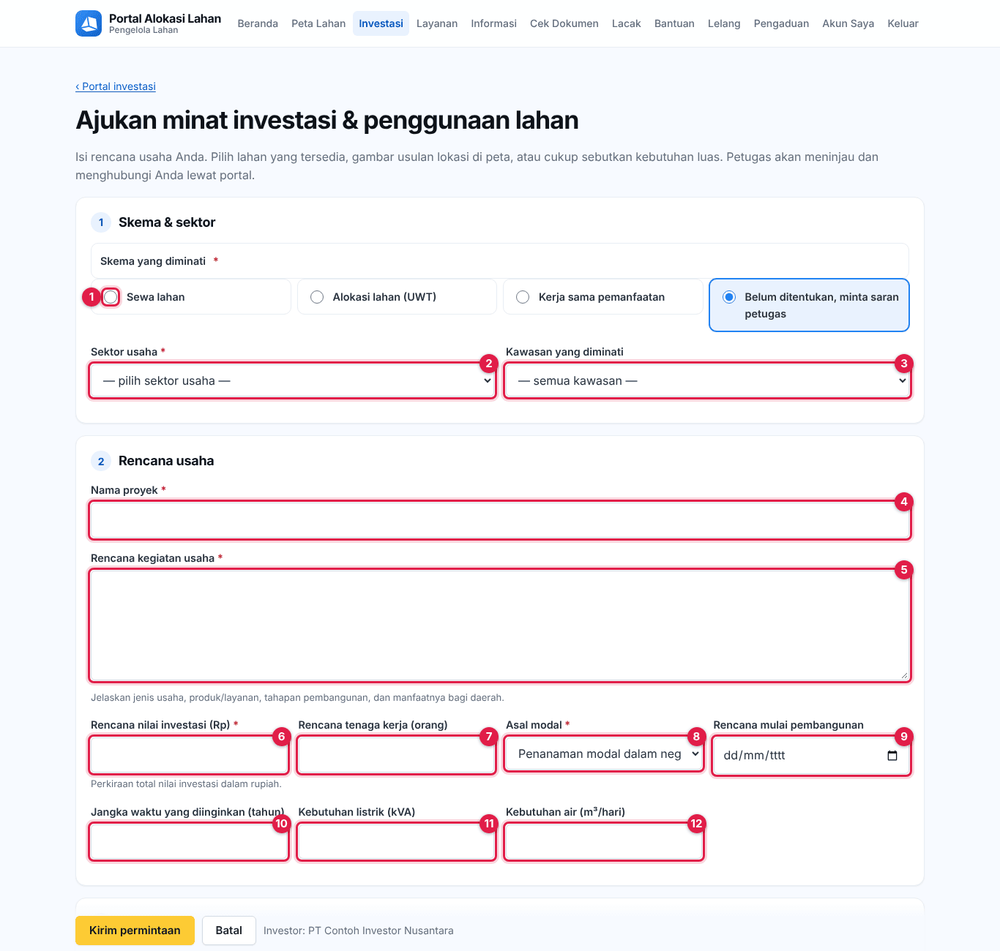

1. Pilih **Skema yang diminati** (nomor 1 dan pilihan di sebelahnya): **Sewa lahan**, **Alokasi lahan (UWT)**, **Kerja sama pemanfaatan**, atau **Belum ditentukan, minta saran petugas**.
2. Pilih **Sektor usaha** (nomor 2) dan, bila ada, **Kawasan yang diminati** (nomor 3).
3. Isi **Nama proyek** (nomor 4) dan **Rencana kegiatan usaha** (nomor 5): jenis usaha, produk atau layanan, tahapan pembangunan, dan manfaatnya.
4. Isi **Rencana nilai investasi (Rp)** (nomor 6), **Rencana tenaga kerja (orang)** (nomor 7), **Asal modal** (nomor 8), dan **Rencana mulai pembangunan** (nomor 9).
5. Isi **Jangka waktu yang diinginkan (tahun)** (nomor 10), **Kebutuhan listrik (kVA)** (nomor 11), dan **Kebutuhan air (m³/hari)** (nomor 12) bila sudah diketahui.

**Bagian 3 – Lokasi yang diminati**

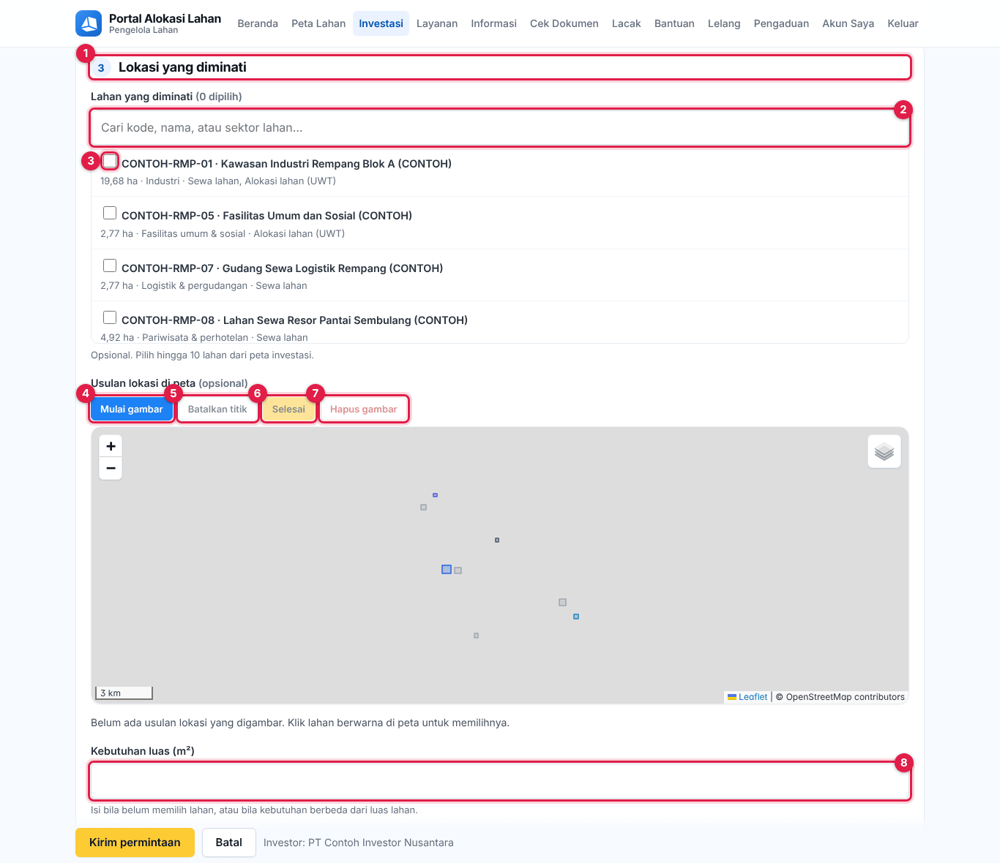

6. Di **Lokasi yang diminati** (nomor 1), ketik di kotak pencarian (nomor 2) untuk menyaring daftar lahan.
7. Centang lahan yang Anda minati (nomor 3), hingga 10 lahan. Anda juga bisa mengklik lahan berwarna di peta.
8. Lahan yang cocok belum ada? Gambar usulan lokasi di peta:
   - Klik **Mulai gambar** (nomor 4).
   - Klik titik-titik sudut lokasi di peta satu per satu.
   - Salah klik? **Batalkan titik** (nomor 5) menghapus titik terakhir.
   - Klik **Selesai** (nomor 6) setelah titik terakhir. **Hapus gambar** (nomor 7) mengulang dari awal.
9. Atau cukup isi **Kebutuhan luas (m²)** (nomor 8).

**Bagian 4 – Lampiran dan pernyataan**

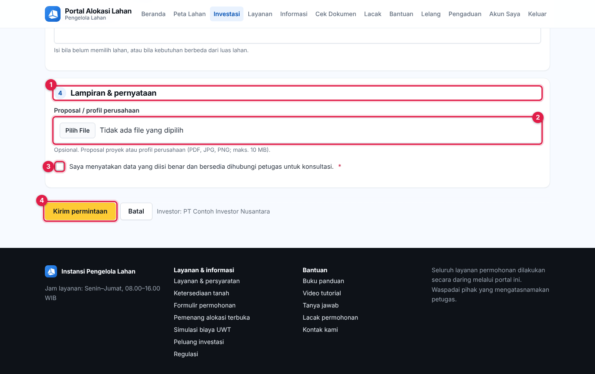

10. Di **Lampiran & pernyataan** (nomor 1), lampirkan **Proposal / profil perusahaan** (nomor 2) bila ada (PDF, JPG, atau PNG; maksimal 10 MB).
11. Centang pernyataan (nomor 3).
12. Klik **Kirim permintaan** (nomor 4). Nomor permintaan (misalnya `INV-2026-00003`) muncul di **Permintaan investasi saya**.

## 14.5 Memantau permintaan

Buka **Permintaan investasi saya** (dari dasbor atau menu **Investasi**).

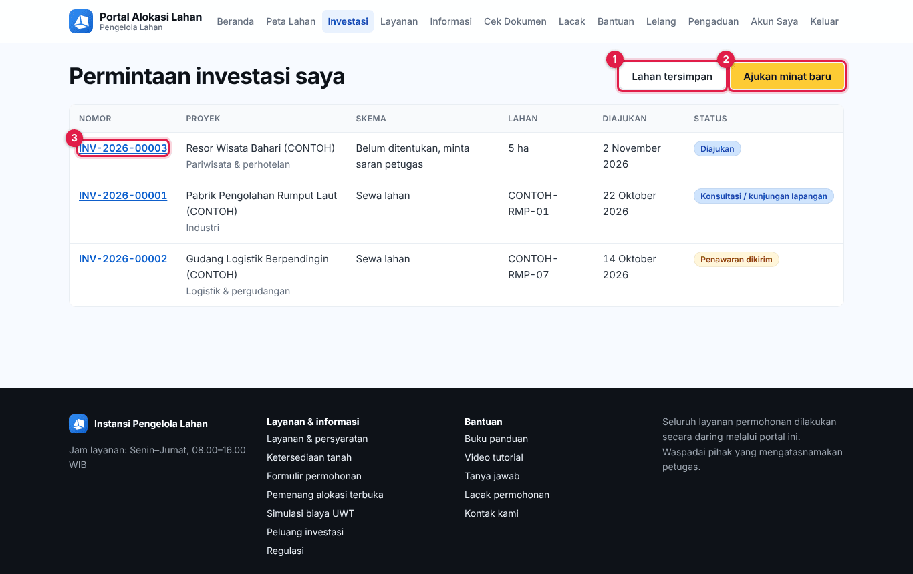

1. **Lahan tersimpan** (nomor 1) dan **Ajukan minat baru** (nomor 2).
2. Klik **nomor permintaan** (nomor 3) untuk membukanya.

Halaman permintaan menampilkan tahapan (**Diajukan → Ditinjau → Konsultasi → Penawaran → Diterima → Selesai**), **Ringkasan**, **Lahan diminati**, **Rencana usaha**, **Usulan lokasi**, dan **Riwayat**.

**Konsultasi:** bila petugas menjadwalkan konsultasi atau kunjungan lapangan, Anda menerima surel.

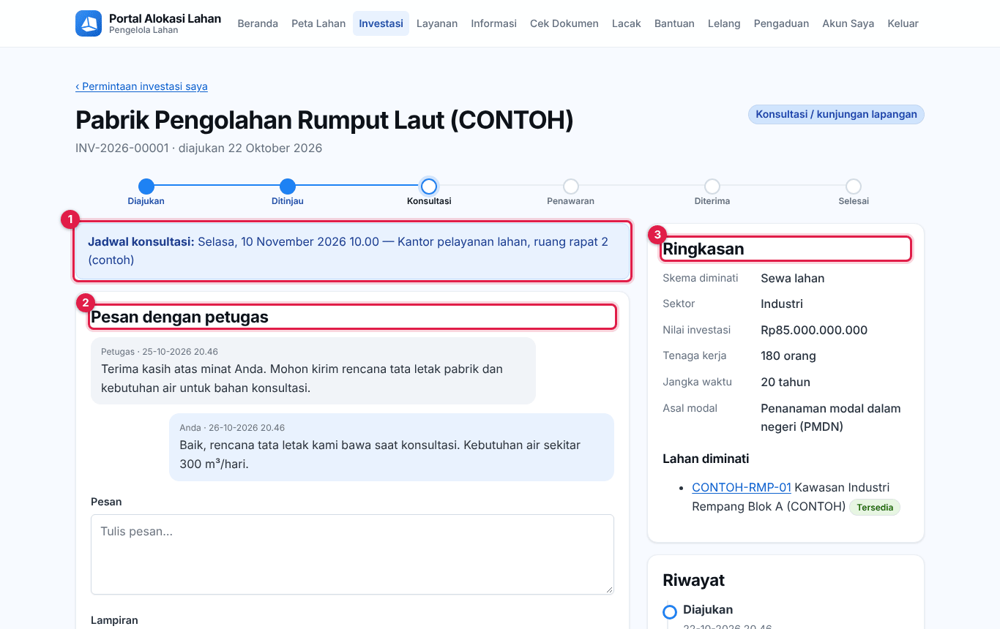

1. Kotak biru **Jadwal konsultasi:** (nomor 1) menampilkan hari, tanggal, jam, dan tempat atau tautan pertemuan.
2. **Pesan dengan petugas** (nomor 2) berisi percakapan dengan petugas.
3. **Ringkasan** (nomor 3) merangkum skema, sektor, nilai investasi, tenaga kerja, jangka waktu, dan asal modal.

**Mengirim pesan dan membatalkan:**

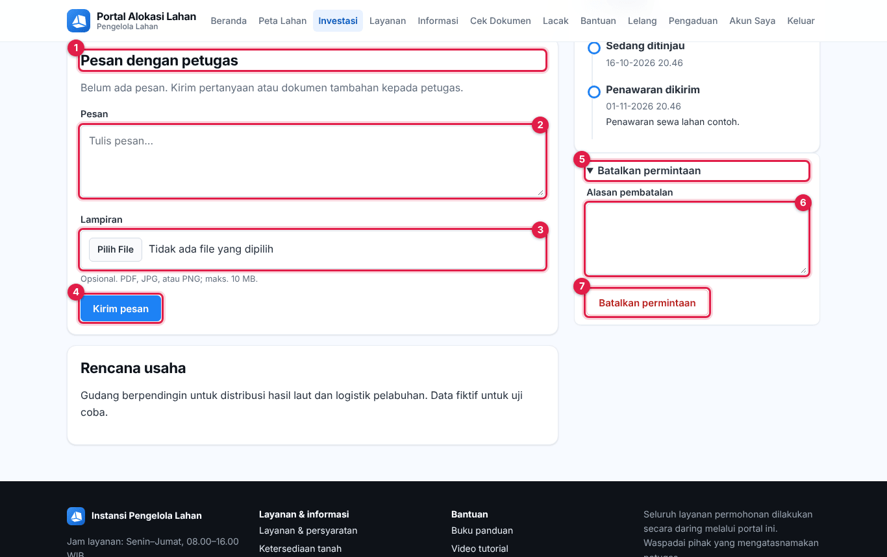

1. Di **Pesan dengan petugas** (nomor 1), tulis **Pesan** (nomor 2).
2. Lampirkan berkas bila perlu di **Lampiran** (nomor 3).
3. Klik **Kirim pesan** (nomor 4). Jawaban petugas muncul di percakapan yang sama, dan Anda menerima surel.
4. Untuk membatalkan permintaan yang belum selesai, buka **Batalkan permintaan** (nomor 5), tulis **Alasan pembatalan** (nomor 6), lalu klik tombol merah **Batalkan permintaan** (nomor 7).

## 14.6 Menjawab penawaran

Saat status menjadi **Penawaran dikirim**, Anda menerima surel. Buka permintaannya.

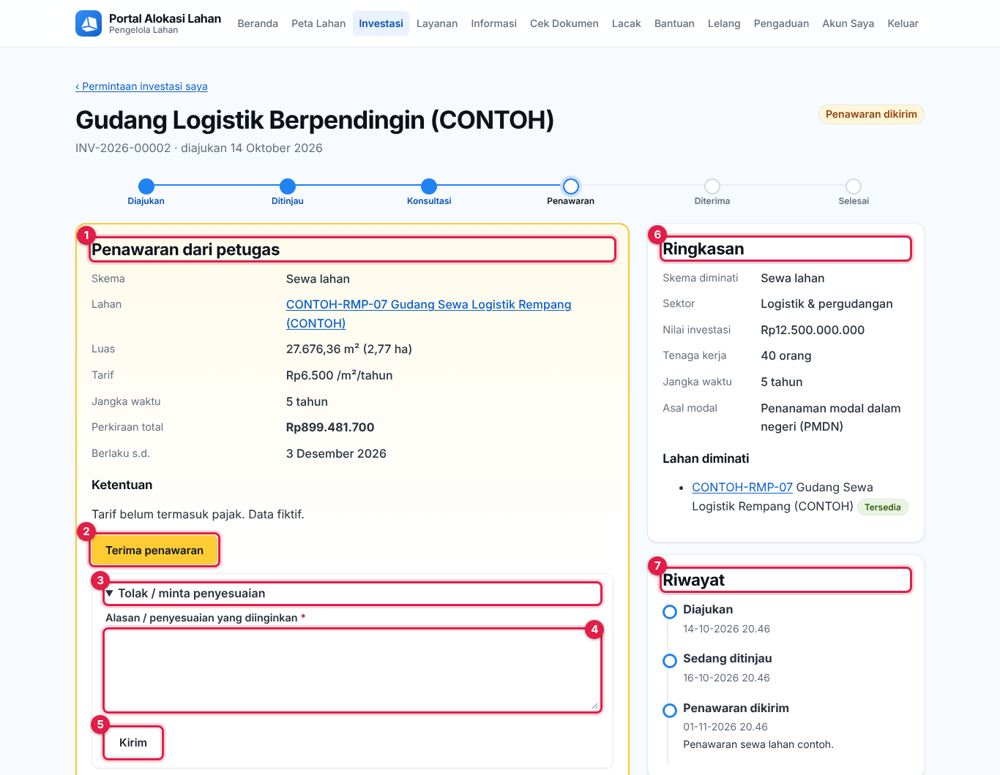

1. Baca **Penawaran dari petugas** (nomor 1): skema, lahan, luas, **Tarif**, **Jangka waktu**, **Perkiraan total**, **Berlaku s.d.**, dan **Ketentuan**.
2. Setuju? Klik **Terima penawaran** (nomor 2) lalu konfirmasi.
3. Belum setuju? Buka **Tolak / minta penyesuaian** (nomor 3), tulis alasan atau penyesuaian yang Anda inginkan (nomor 4), lalu klik **Kirim** (nomor 5). Petugas dapat mengirim penawaran baru.
4. **Ringkasan** (nomor 6) dan **Riwayat** (nomor 7) mencatat semua tahapan.
5. Bila masa berlaku penawaran sudah lewat, kirim pesan untuk meminta penawaran baru.

## 14.7 Setelah penawaran diterima

Petugas menyelesaikan permintaan:

- **Sewa atau kerja sama**: petugas mencatat kontrak sewa atau perjanjian kerja sama. Daftar dokumen perizinan untuk kontrak itu muncul di **Dokumen & perizinan** ([Bab 15](53-portal-dokumen.md)).
- **Alokasi (UWT)**: sistem membuat **draf permohonan alokasi** atas nama Anda dengan rencana usaha terisi. Lengkapi dokumen dan ajukan seperti [Bab 13.3](51-portal-pemohon.md#133-mengajukan-permohonan-alokasi). Anda juga bisa langsung mengajukan dari detail lahan lewat **Langsung ajukan permohonan alokasi**.

## 14.8 Profil

Klik **Ubah profil** di dasbor. Bagian atas sama dengan profil pemohon ([Bab 13.10](51-portal-pemohon.md#1310-profil-dan-kata-sandi)). Gulir ke bawah:

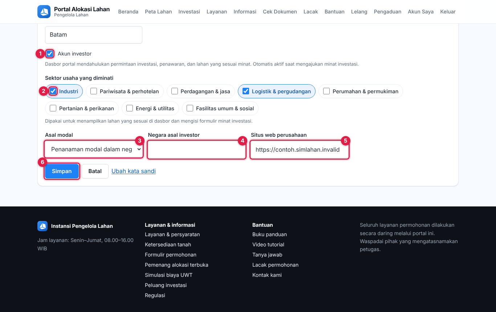

1. **Akun investor** (nomor 1) harus tercentang agar dasbor investor tampil.
2. Centang **Sektor usaha yang diminati** (nomor 2 dan seterusnya). **Lahan sesuai minat Anda** di dasbor mengikuti pilihan ini.
3. Pilih **Asal modal** (nomor 3), isi **Negara asal investor** (nomor 4) dan **Situs web perusahaan** (nomor 5).
4. Klik **Simpan** (nomor 6).
