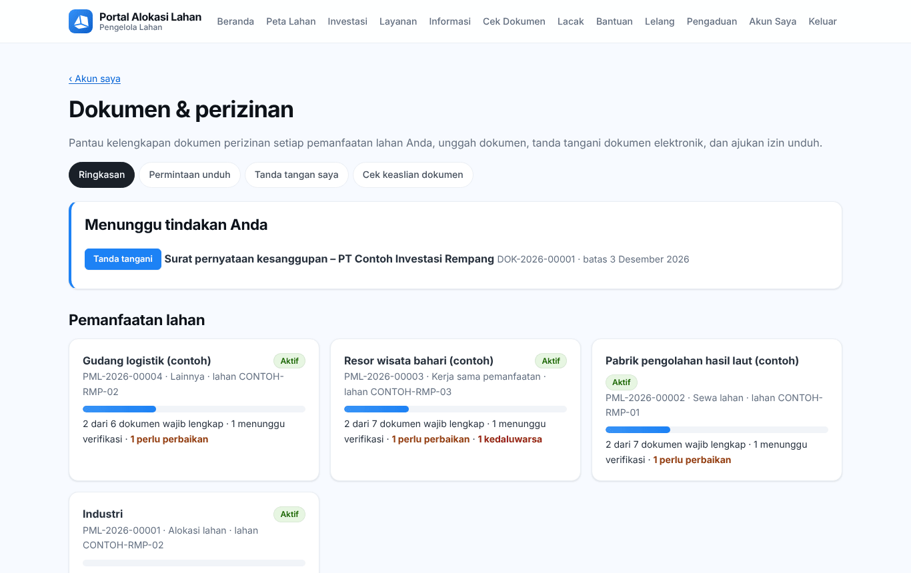
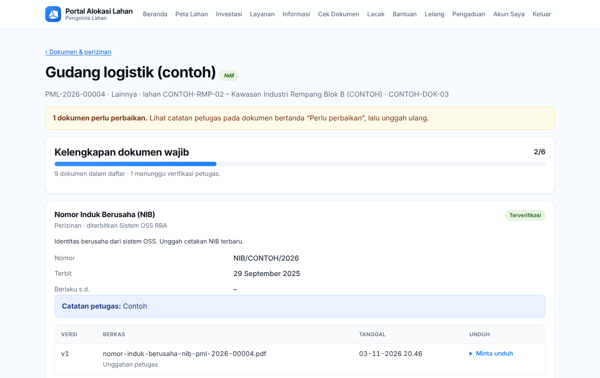
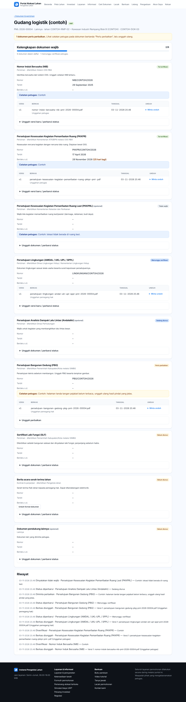
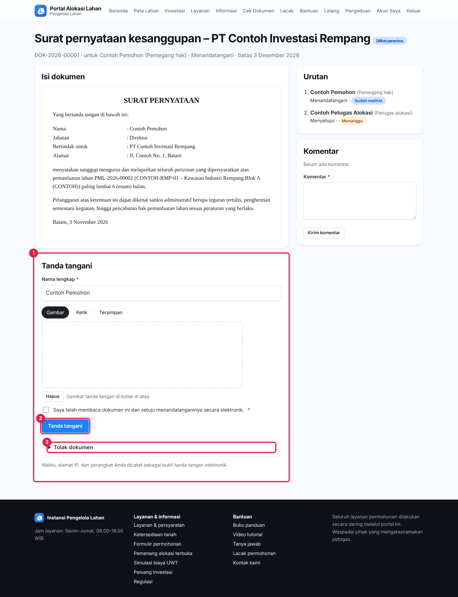
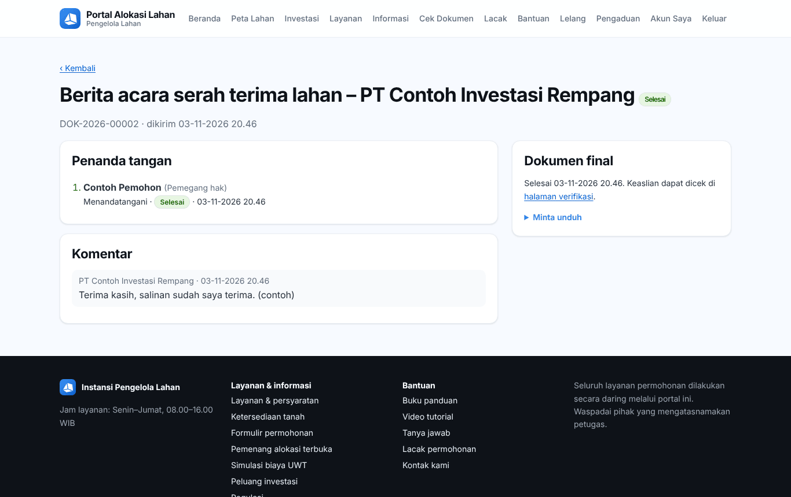
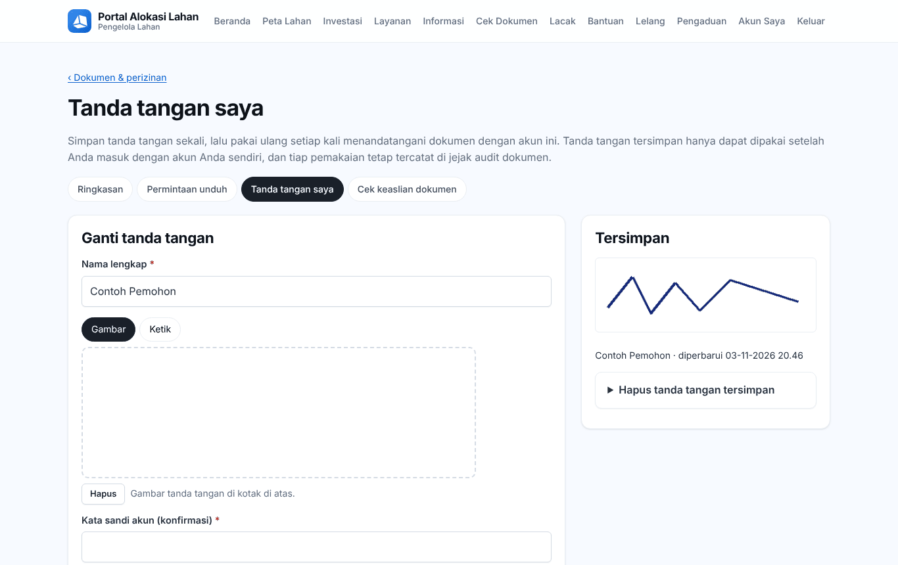
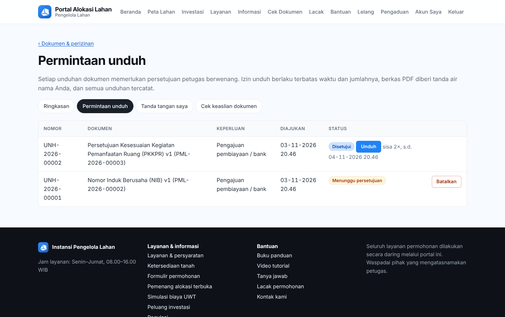

# Bab 15 – Dokumen & perizinan di portal (pemegang hak)

Setelah alokasi terbit atau kontrak sewa/kerja sama dicatat, pemegang hak (pemohon atau investor) mengelola dokumen perizinannya di **Akun saya → Dokumen & perizinan** (`/portal/dokumen/`): memantau dokumen wajib, mengunggah dokumen, menandatangani dokumen elektronik, dan meminta izin unduh.

Menu di halaman ini: **Ringkasan**, **Permintaan unduh**, **Tanda tangan saya**, **Cek keaslian dokumen**.

## 15.1 Ringkasan

- **Menunggu tindakan Anda**: dokumen yang harus diunggah, diperbaiki, diperpanjang, atau ditandatangani. Klik **Tanda tangani** untuk langsung menandatangani.
- **Pemanfaatan lahan**: setiap hak pakai lahan Anda beserta progres kelengkapan dokumen. Klik untuk membuka.
- **Dokumen tanda tangan** dan **Permintaan unduh terbaru**.

## 15.2 Melengkapi dokumen perizinan

Halaman pemanfaatan lahan menampilkan **Kelengkapan dokumen wajib** dan daftar dokumen. Setiap dokumen menampilkan status, **Nomor**, tanggal **Terbit**, **Berlaku s.d.**, **Catatan petugas**, dan daftar **Versi** berkas.

1. Bila tersedia, klik **Unduh format dokumen** untuk mengunduh formulir atau contoh.
2. Ubah **Status pengurusan** menjadi **Sedang diurus** saat mulai mengurus ke instansi penerbit.
3. Setelah dokumen terbit, isi **Nomor dokumen / izin**, **Tanggal terbit**, **Berlaku sampai** (kosongkan bila tidak ada masa berlaku), dan **Catatan untuk petugas**.
4. Pilih berkas di **Unggah dokumen** (PDF, JPG, PNG, DOCX, atau XLSX; maks. 20 MB), lalu klik **Simpan**. Mengunggah berarti mengajukan verifikasi; status menjadi **Menunggu verifikasi**.
5. Bila status **Perlu perbaikan**, baca **Catatan petugas**, lalu unggah ulang. Bila izin hampir habis atau **Kedaluwarsa**, perpanjang izin dan unggah dokumen terbaru.

Bagian **Dokumen tanda tangan** dan **Riwayat** di bawahnya mencatat semua aktivitas.

## 15.3 Menandatangani dokumen elektronik

Anda menerima surel berisi tautan saat ada dokumen yang perlu ditandatangani atau disetujui. Tautan juga ada di **Menunggu tindakan Anda**.

1. Buka tautan. Bila dokumen ditujukan ke akun portal, masuk dengan akun penerima; Anda langsung masuk ke halaman dokumen. (Masuk dengan akun lain menampilkan **Akun tidak sesuai**.)
2. Penerima tanpa akun portal melewati **Verifikasi penerima** lebih dulu: klik **Kirim kode ke surel**, masukkan kode 6 angka dari surel (berlaku 10 menit), dan **kode akses** dari petugas bila diminta, lalu klik **Lanjutkan**. Jangan berikan kode kepada siapa pun, termasuk yang mengaku petugas.
3. Baca **Isi dokumen** di kiri dan **Urutan** penanda tangan di kanan. Untuk PDF unggahan, klik **Buka PDF di tab baru** untuk tampilan penuh.
4. Isi **Isian Anda** bila ada (teks, tanggal, angka, centang, pilihan, paraf, atau lampiran maks. 20 MB).
5. Di kotak **Tanda tangani** (nomor 1 di gambar), periksa **Nama lengkap**, lalu buat tanda tangan: **Gambar** di kotak, **Ketik** nama, atau pakai **Tersimpan**. **Hapus** untuk mengulang.
6. Centang **Saya telah membaca dokumen ini dan setuju menandatanganinya secara elektronik**.
7. Klik **Tanda tangani** (nomor 2), atau **Setujui** bila Anda hanya diminta menyetujui. Waktu, alamat IP, dan perangkat Anda dicatat sebagai bukti tanda tangan elektronik.
8. Bila tidak setuju dengan isi dokumen, buka **Tolak dokumen** (nomor 3), tulis alasannya, lalu kirim.

Catatan:

- Bila muncul "Dokumen ini masih menunggu penanda tangan sebelumnya", tunggu surel saat giliran Anda tiba.
- Bila dokumen ditandai **Tanda tangan langsung**, datang ke loket layanan dengan membawa identitas; petugas membuka halaman tanda tangan di perangkat layanan.
- Setelah semua pihak selesai, **Dokumen final** tersedia di halaman dokumen beserta tautan **halaman verifikasi**. Gunakan **Komentar** untuk bertanya kepada petugas.

## 15.4 Tanda tangan tersimpan

Simpan tanda tangan sekali, lalu pakai ulang setiap kali menandatangani dengan akun ini:

1. Buka **Tanda tangan saya**.
2. Isi **Nama lengkap**, lalu **Gambar** atau **Ketik** tanda tangan.
3. Masukkan **Kata sandi akun (konfirmasi)**, lalu klik **Simpan tanda tangan**.
4. Untuk menghapus, klik **Hapus tanda tangan tersimpan**.

Tanda tangan tersimpan hanya dapat dipakai setelah Anda masuk dengan akun sendiri, dan setiap pemakaian tercatat.

## 15.5 Meminta izin unduh

Setiap unduhan dokumen memerlukan persetujuan petugas berwenang.

1. Di halaman dokumen perizinan atau dokumen tanda tangan, buka **Minta unduh**.
2. Pilih **Keperluan** (arsip, pengurusan izin ke instansi lain, pembiayaan/bank, hukum/pengadilan, audit, lainnya) dan tulis **Alasan**.
3. Klik **Kirim permintaan**. Pantau statusnya di **Permintaan unduh** (Menunggu persetujuan, Disetujui, Ditolak, Dibatalkan).
4. Setelah **Disetujui**, klik **Unduh** sebelum masa berlakunya habis. Izin unduh berlaku terbatas waktu dan jumlahnya, dan PDF diberi tanda air nama Anda.
5. Permintaan yang belum diputuskan bisa dibatalkan dengan **Batalkan**.

Tergantung pengaturan, permintaan pemegang hak atas dokumen biasanya sendiri bisa langsung disetujui sistem (tetap tercatat).

## 15.6 Cek keaslian dokumen

Klik **Cek keaslian dokumen** untuk memeriksa dokumen bertanda tangan elektronik (lihat [Bab 12.9](50-portal-publik.md#129-cek-keaslian-dokumen)).
