# Bab 16 – Superuser dan pemeliharaan sistem

Bab ini untuk **superuser** (pengelola sistem) dan petugas TI yang memasang SimLahan. Superuser memegang semua hak, termasuk hal yang tidak bisa dilakukan Administrator: mengelola akun dan peran, unit layanan, kunci sistem, dan tugas terjadwal.

> Jumlah superuser sebaiknya sedikit (1–2 orang). Pekerjaan harian dilakukan dengan akun ber-peran biasa.

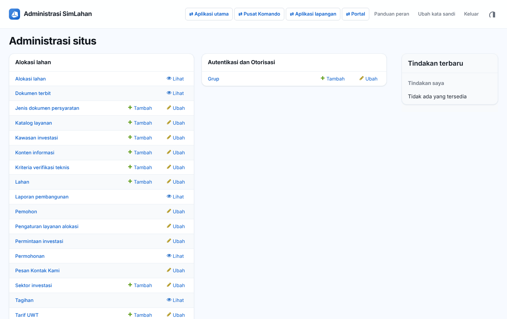

Halaman awal panel admin superuser menampilkan semua modul beserta tautan **Tambah**, **Ubah**, atau **Lihat**. Ketik nama menu di kotak **Mulai mengetik untuk menyaring...** di kiri untuk menemukannya dengan cepat. Menu yang dipakai di bab ini: **Pengguna**, **Grup**, **Unit layanan**, **Kunci hidup sistem**, dan **Tugas batch**.

## 16.1 Mengelola pengguna

Buka **Panel admin → Pengguna → Pengguna**.

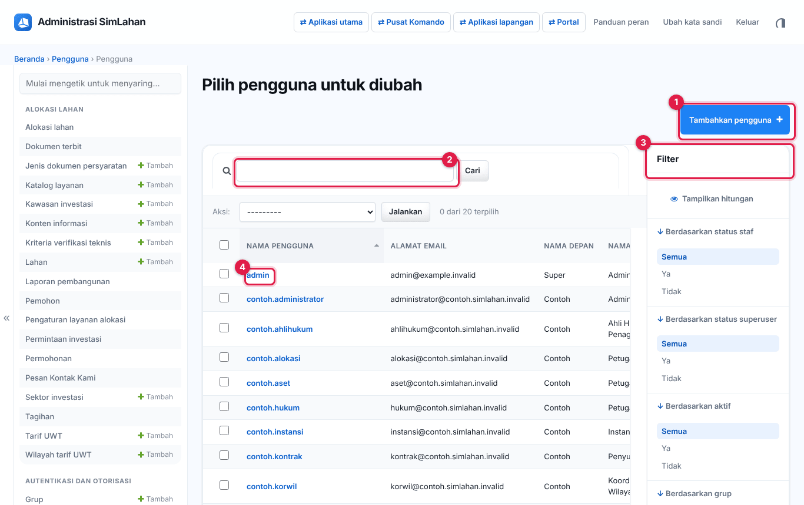

1. **Tambahkan pengguna** (nomor 1) membuat akun baru.
2. Cari akun dengan nama pengguna, nama, atau surel di kotak pencarian (nomor 2), lalu klik **Cari**.
3. **Filter** (nomor 3) menyaring menurut **status staf**, **status superuser**, **aktif**, dan **grup**.
4. Klik **nama pengguna** (nomor 4) untuk membuka dan mengubah akunnya.

**Membuat akun petugas:**

Klik **Tambahkan pengguna**.

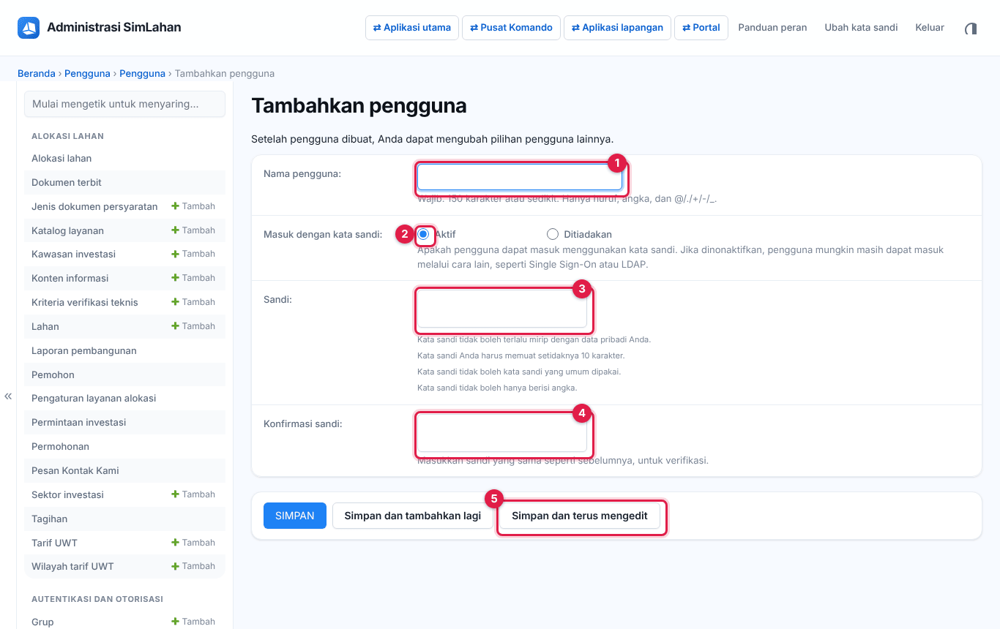

1. Isi **Nama pengguna** (nomor 1), misalnya `budi.santoso`.
2. Biarkan **Masuk dengan kata sandi** pada **Aktif** (nomor 2).
3. Isi **Sandi** (nomor 3) dan ulangi di **Konfirmasi sandi** (nomor 4). Minimal 10 karakter, tidak mirip nama, tidak umum, dan tidak hanya angka.
4. Klik **Simpan dan terus mengedit** (nomor 5). Halaman **Ubah pengguna** terbuka.

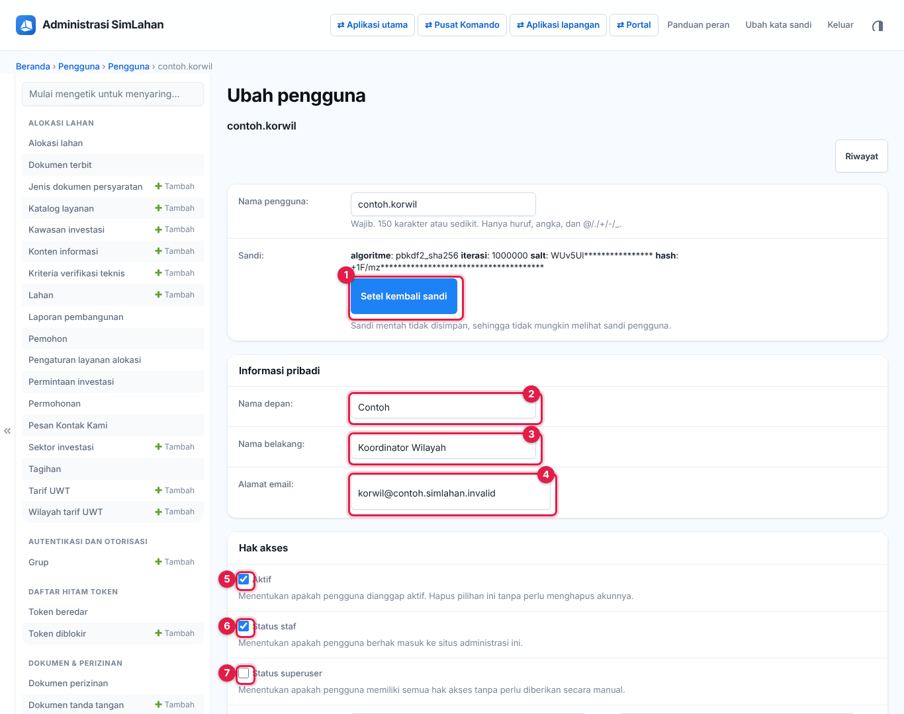

5. Isi **Nama depan** (nomor 2), **Nama belakang** (nomor 3), dan **Alamat email** (nomor 4). Surel dipakai untuk OTP, pemberitahuan, dan atur ulang sandi.
6. Di **Hak akses**, centang **Aktif** (nomor 5) dan **Status staf** (nomor 6, wajib untuk petugas). Jangan centang **Status superuser** (nomor 7) kecuali untuk pengelola sistem.
7. Gulir ke **Grup**:

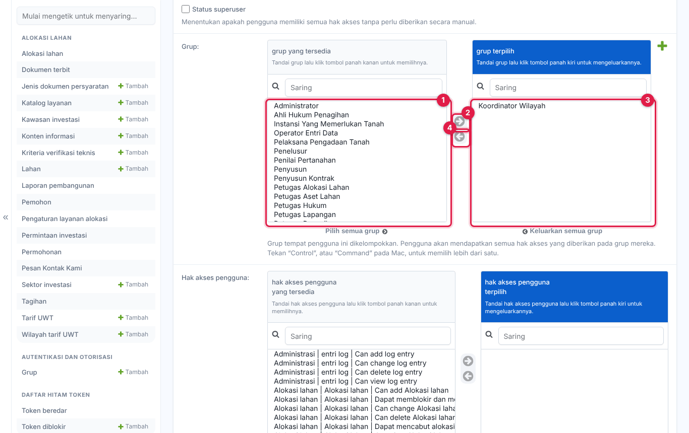

8. Klik satu peran di kotak **grup yang tersedia** (nomor 1), misalnya **Petugas Alokasi Lahan** atau **Koordinator Wilayah**, lalu klik panah kanan (nomor 2). Peran pindah ke kotak **grup terpilih** (nomor 3). Panah kiri (nomor 4) mengeluarkannya lagi. Peran menentukan menu dan hak akses; isinya dijelaskan di buku peran masing-masing. Jangan mengisi **Hak akses pengguna** di bawahnya; hak akses cukup lewat grup.
9. Gulir ke bawah:

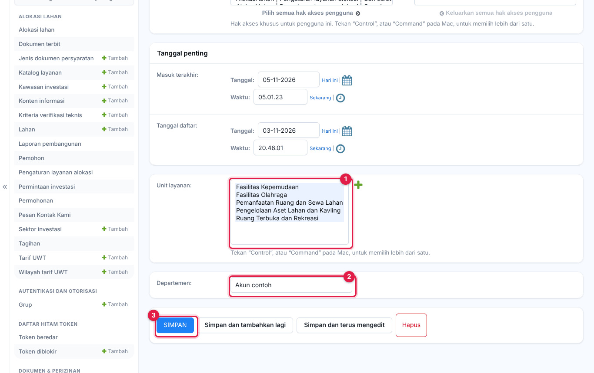

10. Pilih **Unit layanan** petugas (nomor 1). Tahan Ctrl (Cmd di Mac) untuk memilih lebih dari satu. Petugas hanya melihat data unit layanannya (data tanpa unit layanan terlihat semua).
11. Isi **Departemen** (nomor 2) bila perlu.
12. Klik **Simpan** (nomor 3). Sampaikan nama pengguna dan kata sandi awal secara pribadi, lalu minta petugas segera mengganti sandi ([Bab 2.8](02-dasar-penggunaan.md#28-mengganti-kata-sandi)).

**Tugas lain:**

- **Lupa sandi petugas:** buka akunnya, klik **Setel kembali sandi** (nomor 1 pada gambar **Ubah pengguna**), isi sandi baru dua kali, lalu simpan. Mengganti sandi mencabut sesi aplikasi yang sedang aktif.
- **Petugas pindah tugas:** ganti grup dan unit layanannya. Untuk petugas lapangan, pindahkan juga keanggotaannya di data Korwil ([Bab 11.1](41-panel-pusat-komando.md#111-korwil-koordinator-wilayah)) dan atasan langsungnya ([Bab 11.8](41-panel-pusat-komando.md#118-jabatan-tugas-dan-laporan-harian)).
- **Petugas berhenti:** hapus centang **Aktif** (jangan hapus akunnya agar jejak audit tetap utuh).
- **Akun pemohon dan investor** dibuat sendiri oleh mereka di portal. Data pemohonnya ada di **Alokasi lahan → Pemohon**.

## 16.2 Grup (peran)

Buka **Panel admin → Autentikasi dan Otorisasi → Grup**.

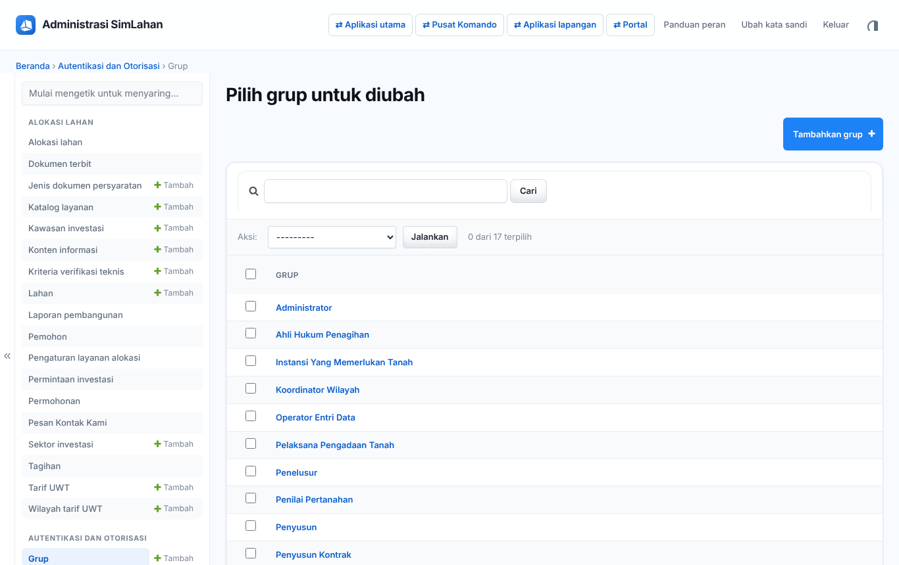

Setiap grup adalah satu peran (Administrator, Ahli Hukum Penagihan, …, Koordinator Wilayah). Klik nama grup (nomor 1) untuk melihat hak aksesnya. Hak akses tiap grup sudah diatur sistem. **Jangan mengubah hak akses grup secara manual**; bila tidak sengaja berubah, kembalikan dengan menjalankan `simlahan_bootstrap` ([16.7](#167-perintah-pemeliharaan-petugas-ti)). Daftar lengkap menu dan batas tiap peran ada di **Panduan peran** di dalam aplikasi dan di [buku peran](README.md#buku-per-peran).

## 16.3 Unit layanan

Buka **Panel admin → Sewa lahan → Unit layanan**.

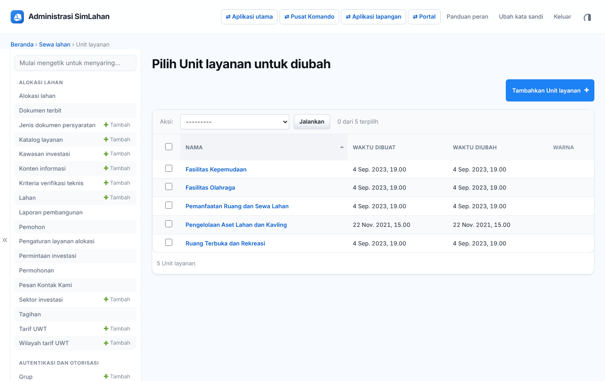

Unit layanan mencatat unit atau kantor layanan. Unit layanan dipakai untuk membatasi data per kantor: setiap aset, Korwil, dan data lain punya kolom **Unit layanan / lokasi**, dan setiap petugas diberi unit layanannya di akun pengguna ([16.1](#161-mengelola-pengguna)).

1. **Tambahkan Unit layanan** (nomor 1) membuat unit baru: isi namanya lalu klik **Simpan**.
2. Klik nama unit (nomor 2) untuk mengubahnya.

## 16.4 OTP surel untuk petugas

Bila diaktifkan, petugas harus memasukkan kode 6 angka yang dikirim ke surelnya setiap kali masuk (aplikasi utama, panel admin, pusat komando, aplikasi lapangan). Pengaturan ini dilakukan petugas TI di berkas `.env` server:

```
OFFICER_OTP_REQUIRED=True
```

Pastikan pengiriman surel (`EMAIL_URL`) sudah berfungsi dan setiap akun petugas punya **Alamat surel** sebelum menyalakannya.

Selama OTP diwajibkan, token API statis (`Authorization: Token ...`) ditolak karena tidak melewati OTP. Integrasi aplikasi lain memakai aplikasi OAuth2 dengan akun layanan. Setiap kali sandi pengguna diganti (dari jalur mana pun), token API lamanya (JWT, token statis, OAuth) otomatis dicabut.

## 16.5 Kunci hidup sistem

Fitur darurat untuk menghentikan seluruh aplikasi pada waktu tertentu (misalnya bila terjadi pelanggaran keamanan atau sengketa operasional). Buka **Panel admin → Pusat komando operasi lapangan → Kunci hidup sistem**.

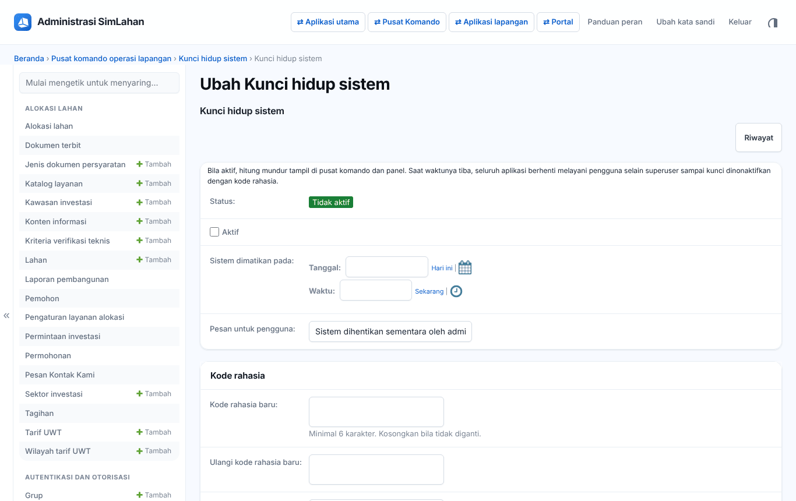

**Mengaktifkan:**

1. Isi **Kode rahasia baru** (nomor 5, minimal 6 karakter) dan ulangi di **Ulangi kode rahasia baru** (nomor 6). Simpan kode ini di tempat aman.
2. Centang **Aktif** (nomor 1).
3. Isi **Sistem dimatikan pada**: **Tanggal** (nomor 2) dan **Waktu** (nomor 3). **Hari ini** dan **Sekarang** di sebelahnya mengisi otomatis.
4. Tulis **Pesan untuk pengguna** (nomor 4), yaitu pesan yang dibaca pengguna saat sistem berhenti.
5. Klik **Simpan** (nomor 8). **Status** berubah, dan hitung mundur "KUNCI SISTEM AKTIF" tampil di pusat komando dan panel. Saat waktunya tiba, seluruh aplikasi berhenti melayani pengguna selain superuser.

**Mengubah atau menonaktifkan:** buka halaman yang sama, isi **Kode rahasia saat ini** (nomor 7), hapus centang **Aktif** (atau ubah waktunya), lalu klik **Simpan**. Di pusat komando, superuser juga bisa menekan **🛡 Nonaktifkan** pada bilah hitung mundur dan memasukkan kode rahasia. Bagian **Riwayat** di bawah formulir mencatat siapa dan kapan kunci diaktifkan atau dinonaktifkan.

> Kunci tidak aktif secara bawaan. Hanya superuser yang dapat membuka halaman ini.

## 16.6 Tugas terjadwal

Buka **Panel admin → Tugas batch**.

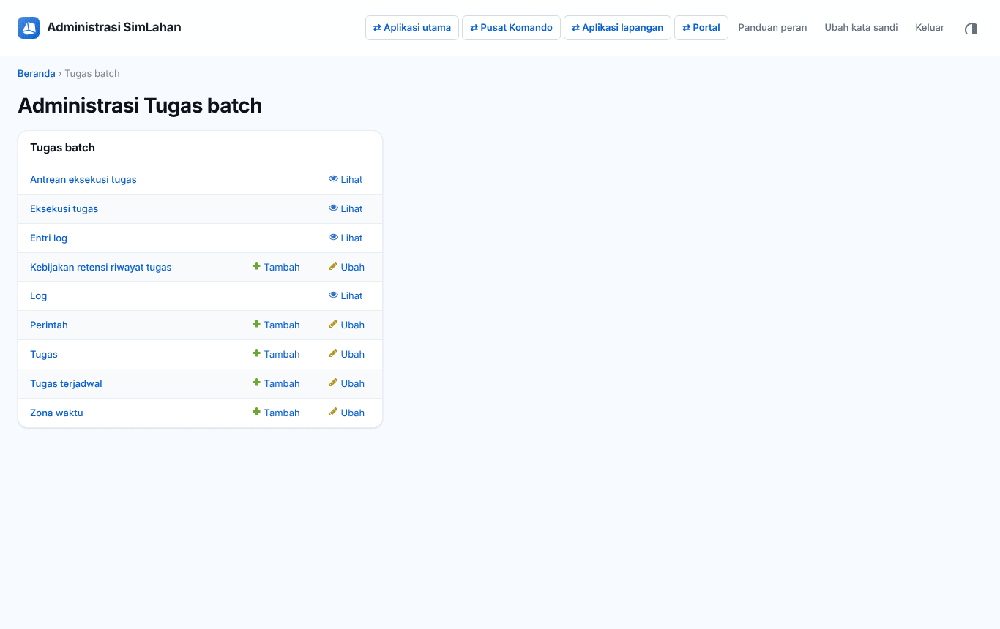

Menu terpenting: **Tugas terjadwal** (nomor 1, jadwal) dan **Eksekusi tugas** (nomor 2, riwayat jalan). Jadwal bawaan SimLahan:

| Jadwal | Pekerjaan |
|---|---|
| Setiap hari kerja pukul 07.00 WIB | Pemeriksaan tenggat pengadaan tanah (surel pengingat). |
| Setiap Senin pukul 07.30 WIB | Pemantauan alokasi lahan (lahan tidur, laporan pembangunan). |
| Setiap hari pukul 06.30 WIB | Pengingat tenggat aset lahan. |
| Setiap hari pukul 06.45 WIB | Pengingat dokumen & perizinan (izin hampir habis, tanda tangan tertunda). |
| Setiap hari pukul 00.30 WIB | Rekap harian pusat komando. |

**Tugas terjadwal:**

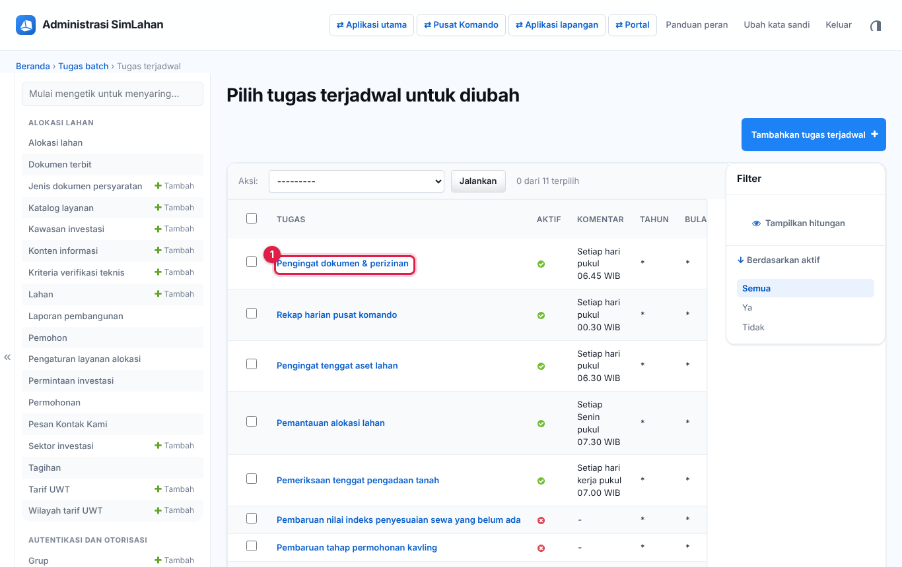

1. Kolom **Aktif** menunjukkan jadwal yang menyala (centang hijau) dan mati (tanda merah). Jadwal lain (pembuatan tagihan sewa, rotasi log) mati secara bawaan.
2. Klik nama tugas (nomor 1) untuk membuka jadwalnya. Centang atau hapus centang **Aktif** untuk menyalakan atau mematikan, ubah jam, menit, atau hari bila perlu, lalu klik **Simpan**.

**Eksekusi tugas** mencatat setiap kali tugas berjalan: waktu mulai, tugas, dan **kode keluar** (0 = berhasil). Klik baris untuk melihat lognya. Saring dengan **Berdasarkan waktu mulai** atau **Berdasarkan tugas** di kanan. Pada sistem yang baru dipasang, daftar ini masih kosong.

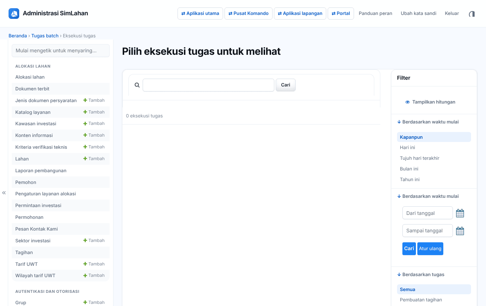

## 16.7 Perintah pemeliharaan (petugas TI)

Perintah dijalankan di server dari folder SimLahan:

```
docker compose exec backend python manage.py <perintah>
```

| Perintah | Kegunaan |
|---|---|
| `simlahan_bootstrap` | Membuat atau memulihkan data master, hak akses grup, jadwal bawaan, dan admin awal. Aman dijalankan ulang. |
| `data_contoh` | Membuat seluruh data contoh fiktif di semua modul (untuk pelatihan). `--cek` memeriksa cakupan, `--hapus` menghapusnya. |
| `pengguna_contoh` | Membuat akun contoh untuk setiap peran (`contoh.<peran>`, `pemohon@contoh.simlahan.invalid`, `investor@contoh.simlahan.invalid`). `--sandi` menetapkan satu sandi untuk semua, `--sandi-baru` membuat sandi acak baru, `--hapus` menghapus akun contoh. |
| `hapus_data_contoh` | Menghapus **semua** data contoh dan akun contoh sebelum dibuka untuk publik. Data kerja nyata tidak disentuh. |
| `cek_produksi` | Memeriksa kesiapan publik (pengaturan, surel, alamat publik, akun & data contoh, sandi admin awal). Harus mencetak "Siap dibuka untuk publik". |
| `panduan_peran` | Mencetak panduan peran dalam format Markdown (sumber `docs/panduan-peran.md`). |
| `impor_komando` | Mengimpor data pusat komando lama (berkas cadangan). `--coba` untuk uji coba tanpa menyimpan. Jalankan `hapus_data_contoh` lebih dulu. |

> Sebelum SimLahan dibuka untuk publik: jalankan `hapus_data_contoh`, lalu `cek_produksi`. Jangan membagikan sandi akun contoh.

## 16.8 Membuat ulang buku panduan ini

Buku panduan disimpan di folder `docs/panduan/` repositori. Cara membuat ulang gambar dan PDF dijelaskan di `docs/panduan/alat/README.md`.
