# Buku peran: Administrator

Buku ini untuk **Administrator**: pengelola semua modul dan data master SimLahan. Buku ini berisi semua langkah kerja peran Anda, lengkap dengan gambar, sehingga cukup dibaca sendiri. Dasar penggunaan yang berlaku untuk semua peran (mengenal layar, ganti sandi, memakai di HP) ada di [Bab 2](../02-dasar-penggunaan.md).

**Cara membaca buku ini.** Kotak merah bernomor pada gambar menunjuk tombol atau kolom yang disebut di langkah. Tulisan *(nomor 2)* berarti: lihat kotak merah bernomor 2 pada gambar tepat di atas langkah itu. Semua gambar memakai data contoh fiktif; isi di layar Anda berbeda, tetapi letak tombolnya sama. Judul bagian bernomor (misalnya *3.4*) sama dengan nomor bagian di buku lengkap.

## Masuk dan halaman awal

<!-- sisip: 02-dasar-penggunaan.md#a-aplikasi-utama-petugas-kantor -->

### A. Aplikasi utama (petugas kantor)


1. Buka alamat SimLahan, misalnya `https://simlahan.instansi-anda.go.id/`.
2. Ketik nama pengguna Anda di kotak **Nama pengguna** (nomor 1 di gambar).
3. Ketik kata sandi di kotak **Kata sandi** (nomor 2).
4. Klik tombol biru **Masuk** (nomor 3).
5. Anda langsung dibawa ke halaman kerja peran Anda (lihat bagian "Halaman awal" di buku peran Anda).

Tautan di bawah kotak masuk (nomor 4: **⇄ Pusat Komando**, **⇄ Panel admin**, **⇄ Portal**) membawa Anda ke halaman masuk aplikasi lain.

<!-- akhir sisip -->

### Halaman awal

Setelah masuk, Anda langsung melihat daftar **Sewa**:

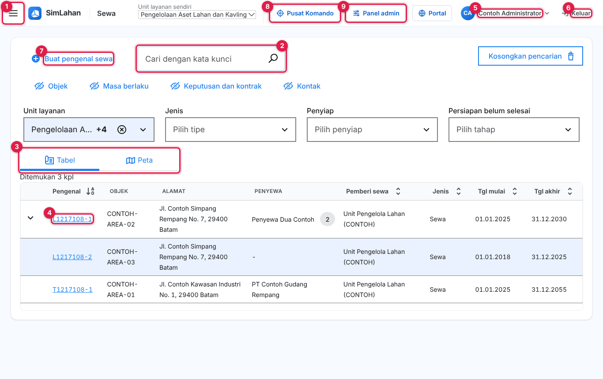

Nomor pada gambar:

1. **☰ Menu**: membuka menu samping berisi semua halaman yang boleh Anda buka.
2. **Cari dengan kata kunci**: ketik pengenal sewa, nama penyewa, atau alamat, lalu tekan Enter.
3. **Tabel** / **Peta**: ganti tampilan hasil menjadi tabel atau peta.
4. **Pengenal sewa** (misalnya *L1217108-1*): klik untuk membuka halaman sewa itu.
5. **Nama Anda**: membuka menu akun (**Panduan peran**, **Ganti sandi**, unit layanan).
6. **Keluar**: mengakhiri sesi di perangkat ini.
7. **Buat pengenal sewa**: membuat sewa baru.
8. **Pusat Komando** dan 9. **Panel admin**: membuka aplikasi itu tanpa masuk ulang. **Portal** di sebelahnya membuka portal publik.

### Menu Anda

Klik **☰** (nomor 1 pada gambar halaman awal) untuk membuka menu:

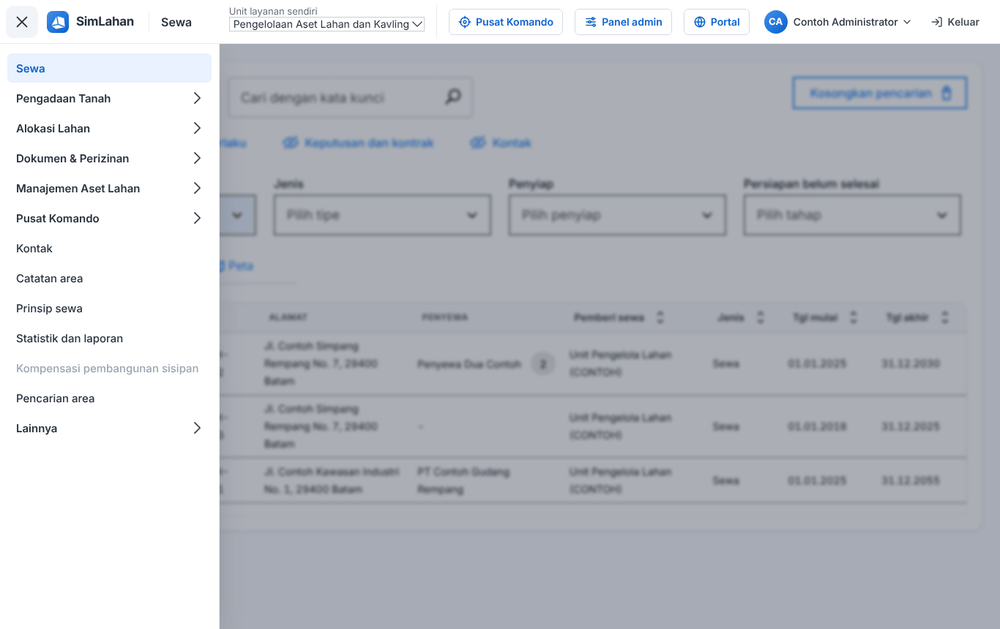

Anda melihat semua menu: Sewa, Pengadaan Tanah, Alokasi Lahan, Dokumen & Perizinan, Manajemen Aset Lahan, Pusat Komando, Kontak, Catatan area, Prinsip sewa, Statistik dan laporan, Kompensasi pembangunan sisipan, Pencarian area, dan Lainnya.

<!-- awal: dibuat dari backend/users/role_guide.py; perbarui dengan: cd backend && python manage.py panduan_buku -->

## Ringkasan peran

Mengelola seluruh modul dan data master SimLahan.

- **Cara masuk:** Alamat utama SimLahan (`/`) atau langsung di panel admin (`/admin/`); satu kali masuk berlaku untuk keduanya.
- **Halaman awal:** Sewa (daftar sewa); semua modul lain ada di menu samping.
- **Akun latihan** (hanya di sistem latihan berisi data contoh): `contoh.administrator`

### Menu yang Anda lihat

- Sewa
- Pengadaan Tanah: Dasbor & tenggat, Proyek pengadaan, Kalender & aturan tenggat
- Alokasi Lahan: Permohonan & verifikasi, Tagihan & pembayaran, Alokasi & lahan tidur, Data lahan, Portal investasi (permintaan investasi, sektor, kawasan), Portal publik (termasuk tarif UWT per wilayah dan pesan Kontak Kami)
- Manajemen Aset Lahan: Dasbor aset, Data aset & peta, Perkara & sidang, Okupasi & perambahan, Pengaduan masyarakat, Lelang & seleksi lahan, Laporan & asisten AI, Aplikasi lapangan
- Pusat Komando: Buka Pusat Komando (aplikasi tersendiri, juga lewat tombol **Pusat Komando** di bilah atas), Korwil, warga & laporan, temuan ilegal, patroli Taman Buru, jejak patroli SMART (impor .json), pengaturan poin usaha, jabatan & atasan petugas, riwayat & poin tugas, laporan harian berjenjang, bidang penguasaan lahan, zona ancaman, foto situs 360°, jejak GPS petugas, tiket & masukan (arsip), uji tanah PLTS (titik, foto, riwayat, unduh Excel)
- Dokumen & Perizinan: Dasbor dokumen, Pemanfaatan lahan, Dokumen perizinan, Dokumen tanda tangan, Templat dokumen, Permintaan unduh
- Kontak
- Catatan area
- Prinsip sewa
- Statistik dan laporan
- Kompensasi pembangunan sisipan
- Pencarian area
- Lainnya: Indeks biaya hidup, Tugas terjadwal, Catatan tagihan, Kalkulator sewa
- Panel admin (`/admin/`): semua modul dan data master

### Yang bisa Anda lakukan

- Membuat, mengubah, dan menghapus data di semua modul, termasuk validasi ganti kerugian dan data pribadi (NIK/rekening).
- Melihat data semua unit layanan dan semua Korwil, termasuk NIK warga.
- Mengatur jabatan dan atasan langsung petugas pusat komando (menentukan ke mana laporan harian dikirim dan siapa boleh memberi tugas); memverifikasi tugas mana pun dan menandai laporan harian selesai ditinjau.
- Mengatur data master (jenis, kategori, tarif, aturan tenggat, konten portal) dan pengaturan modul di panel admin.
- Dokumen & perizinan: mengatur jenis dokumen wajib, templat, dan pengaturan modul; menyetujui dokumen tanda tangan sebelum dikirim; menyetujui permintaan unduh, termasuk dokumen rahasia.
- Dokumen tanda tangan: kolom isian penerima (`{{ kolom.<kunci> }}`: teks, tanggal, angka, centang, pilihan, paraf, lampiran), kode akses tambahan, tanda tangan langsung di hadapan petugas (bukti identitas tercatat), ganti penerima yang belum bertindak, cap tanda tangan pada posisi PDF, dan kirim massal dari daftar Pemanfaatan lahan (aksi **Kirim dokumen tanda tangan massal**).
- Memblokir dan membuka blokir penetapan lokasi alokasi.
- Melihat daftar pengguna.
- Menangani tiket & masukan di pusat komando (Menu → Alat & tiket): memproses, menyelesaikan (poin untuk pengirim), atau menolak dengan alasan; menjalankan audit data seluruh wilayah.

### Batas akses

- Menambah pengguna, mengatur grup, dan mengganti sandi orang lain hanya bisa dilakukan superuser.
- Tugas terjadwal hanya bisa dilihat; mengubahnya dan kunci sistem hanya untuk superuser.
- Tidak bisa menyetujui permintaan unduh miliknya sendiri.

<!-- akhir: blok role_guide.py -->

## Urutan kerja Anda

Administrator bisa mengerjakan semua pekerjaan di semua modul. Langkah per modul ada di bab buku lengkap:

| Modul | Bab |
|---|---|
| Sewa | [Bab 3](../10-sewa.md) |
| Pengadaan tanah (termasuk validasi ganti kerugian) | [Bab 4](../11-pengadaan-tanah.md) |
| Alokasi lahan dan portal | [Bab 5](../20-alokasi-lahan.md) |
| Permintaan investasi | [Bab 6](../21-investasi-petugas.md) |
| Dokumen & perizinan | [Bab 7](../22-dokumen-perizinan.md) |
| Aset lahan | [Bab 8](../30-aset-lahan.md), [Bab 9](../31-aplikasi-lapangan.md) |
| Pusat komando | [Bab 10](../40-pusat-komando.md), [Bab 11](../41-panel-pusat-komando.md) |
| Portal (yang dilihat pemohon dan investor) | [Bab 12](../50-portal-publik.md)–[Bab 15](../53-portal-dokumen.md) |

Buku ini memuat pekerjaan yang **hanya** dikerjakan Administrator: data master, pengaturan modul, persetujuan khusus, dan penyiapan pusat komando.

## Bagian A – Data master dan pengaturan modul

<!-- sisip: 20-alokasi-lahan.md#59-konten-portal-dan-data-master -->

### 5.9 Konten portal dan data master

| Menu | Kegunaan |
|---|---|
| **Katalog layanan** | Daftar layanan yang tampil di portal (deskripsi, syarat, alur, durasi, tarif, dasar hukum) dan jenis permohonan daringnya. |
| **Jenis dokumen persyaratan** | Dokumen yang wajib/opsional diunggah per layanan dan jenis alokasi. |
| **Kriteria verifikasi teknis** | Kriteria dan bobot penilaian verifikasi teknis. |
| **Konten informasi** | Halaman informasi portal: regulasi, persyaratan, prosedur, pengumuman, video tutorial, buku panduan, unduhan, tanya jawab, panduan investasi. Centang **Sematkan di beranda** dan **Terbit**. |
| **Wilayah tarif UWT** dan **Tarif UWT** | Tarif UWT per wilayah dan jenis pengurusan, dipakai di **Simulasi biaya UWT** portal (termasuk denda per bulan keterlambatan dan batas maksimumnya). |
| **Pesan Kontak Kami** | Pesan yang dikirim masyarakat dari portal; ubah status setelah dijawab. |
| **Pengaturan layanan alokasi** *(Administrator)* | Otoritas & penandatangan, tarif & tagihan, ketentuan alokasi (nilai minimum, batas lahan tidur, interval lapor), kop surat, portal & Kontak Kami, simulasi UWT, portal investasi. |

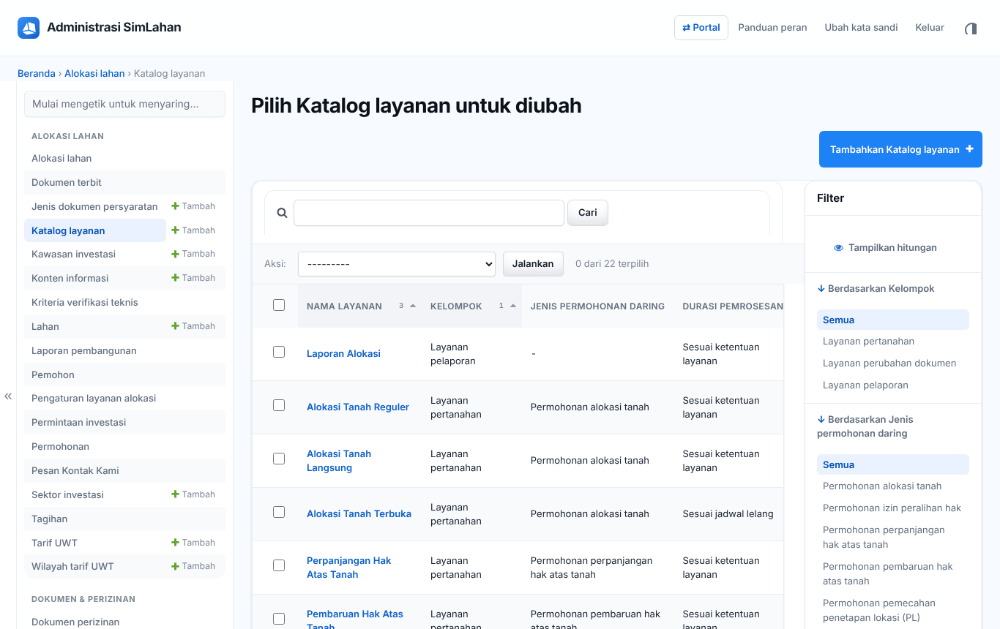

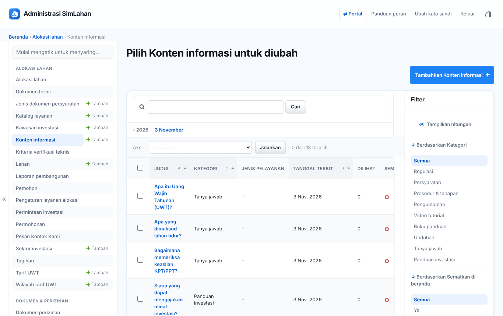

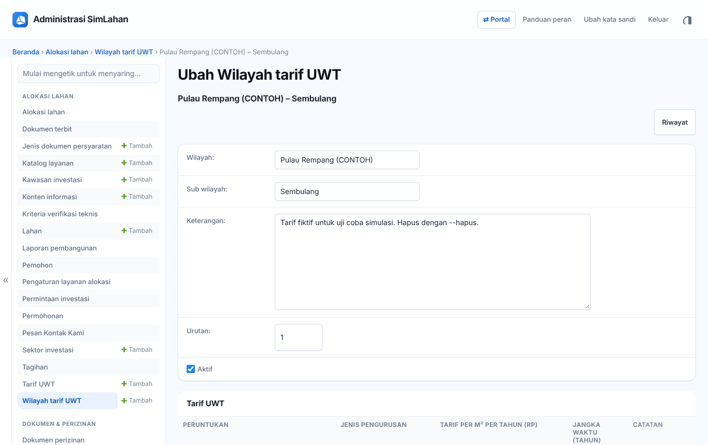

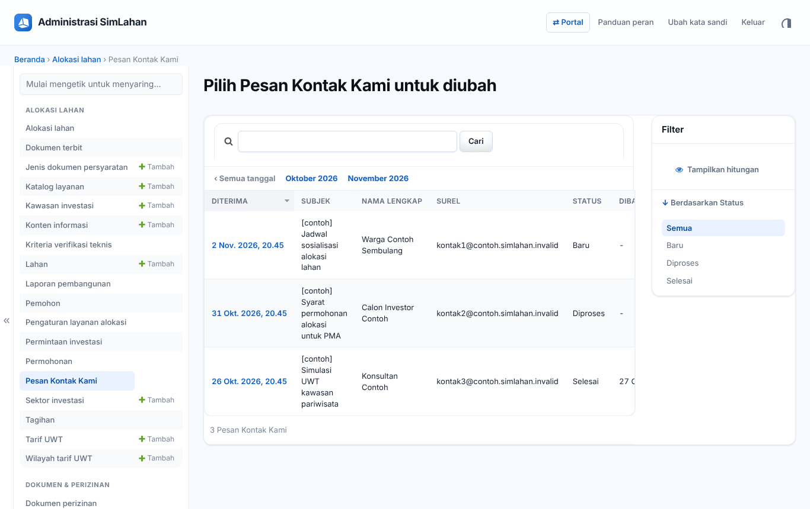

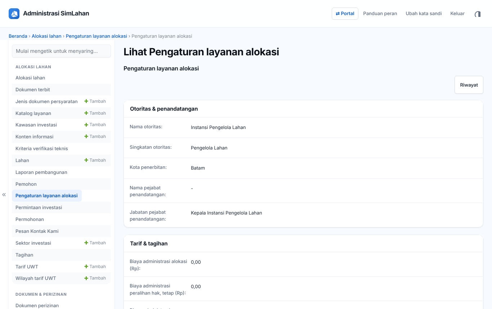

<!-- akhir sisip -->

### Contoh data master alokasi

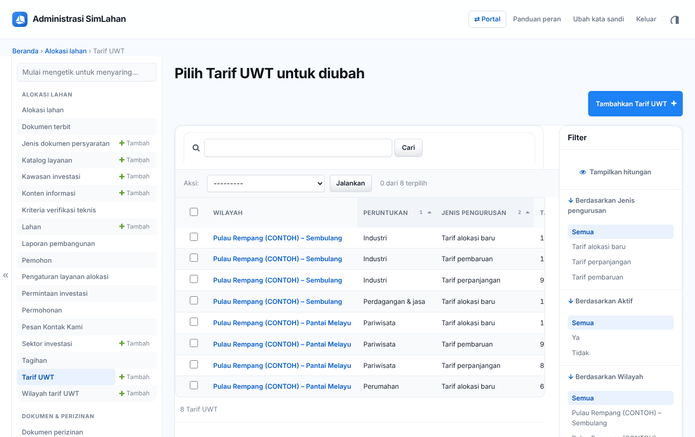

**Tarif UWT**: tarif uang wajib tahunan per peruntukan, dipakai untuk tagihan dan kalkulator UWT di portal.

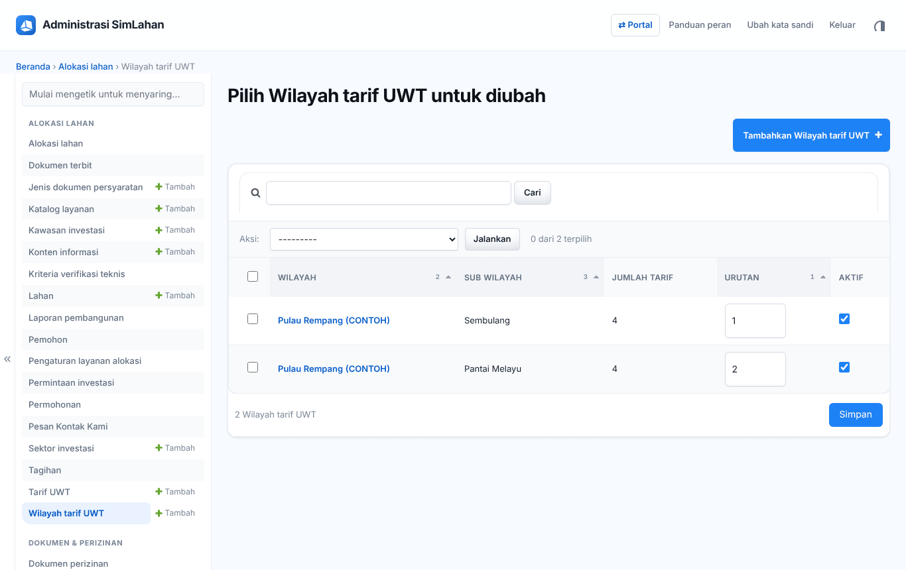

**Wilayah tarif UWT**: tarif per wilayah untuk simulasi biaya di portal.

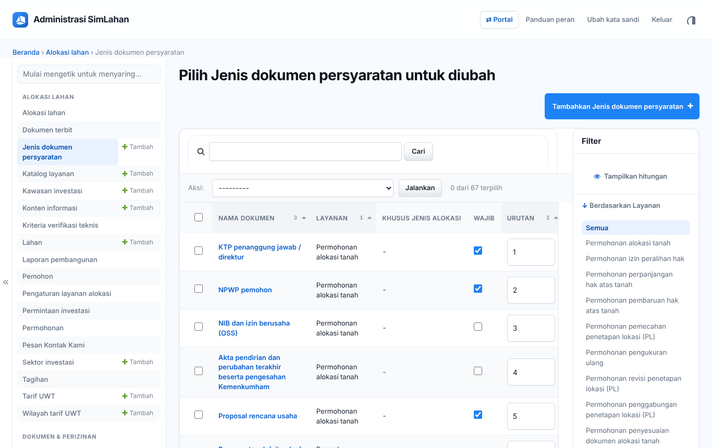

**Jenis dokumen persyaratan**: dokumen yang wajib diunggah pemohon per layanan.

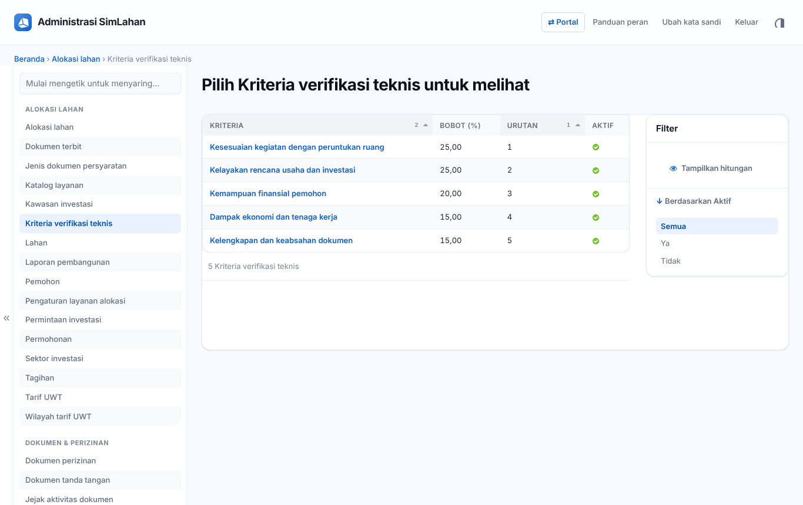

**Kriteria verifikasi teknis**: kriteria dan bobot yang dinilai Tim Verifikasi.

<!-- sisip: 22-dokumen-perizinan.md#76-jenis-dokumen-perizinan -->

### 7.6 Jenis dokumen perizinan

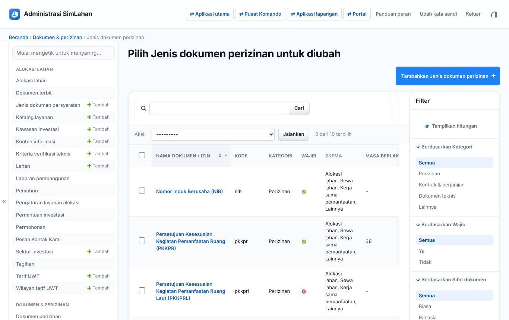

Menentukan dokumen apa saja yang wajib untuk setiap pemanfaatan lahan:

1. Klik **Tambahkan Jenis dokumen perizinan**.
2. Isi **Kode**, **Nama dokumen / izin**, **Kategori**, **Instansi penerbit**, dan **Persyaratan & cara mengurus** (tampil ke pemegang hak di portal).
3. Centang skema yang berlaku: **Berlaku untuk alokasi**, **sewa**, **kerja sama**, **pemanfaatan lainnya**. Batasi ke sektor tertentu di **Hanya untuk sektor** (kosong = semua sektor).
4. Isi **Wajib**, **Masa berlaku bawaan (bulan)** (kosong = tidak kedaluwarsa), **Sifat dokumen**, **Templat / format** (format yang bisa diunduh pemegang hak), dan **Urutan**.
5. Simpan. Untuk menambahkannya ke pemanfaatan lahan yang sudah ada, centang jenis dokumen di daftar, pilih aksi **Terapkan ke pemanfaatan lahan aktif**, lalu klik **Jalankan**.

<!-- akhir sisip -->

<!-- sisip: 22-dokumen-perizinan.md#79-pengaturan-dokumen-administrator -->

### 7.9 Pengaturan dokumen (Administrator)

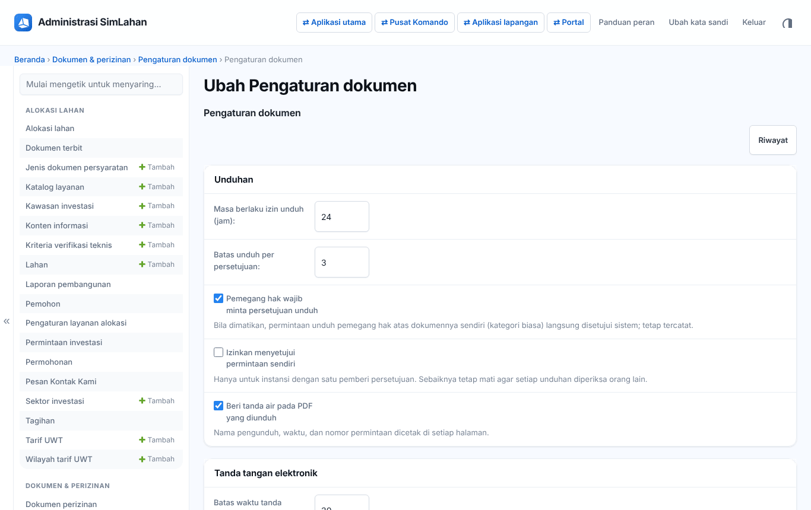

| Bagian | Isian |
|---|---|
| Unduhan | **Masa berlaku izin unduh (jam)**, **Batas unduh per persetujuan**, **Pemegang hak wajib minta persetujuan unduh** (bila dimatikan, unduhan pemegang hak atas dokumen biasanya sendiri langsung disetujui sistem, tetap tercatat), **Izinkan menyetujui permintaan sendiri** (sebaiknya tetap mati), **Beri tanda air pada PDF yang diunduh**. |
| Tanda tangan elektronik | **Batas waktu tanda tangan bawaan (hari)**, **Pengingat penanda tangan setiap (hari)**. |
| Masa berlaku izin | **Peringatan izin akan kedaluwarsa (hari sebelumnya)**. |

<!-- akhir sisip -->

<!-- sisip: 30-aset-lahan.md#814-kategori-dan-pengaturan-modul -->

### 8.14 Kategori dan pengaturan modul

**Kategori aset** (nama, **Warna peta** format #RRGGBB, aktif) dan **Kategori pengaduan** (dengan **Batas penyelesaian (hari)**; kosong = pengaturan modul).

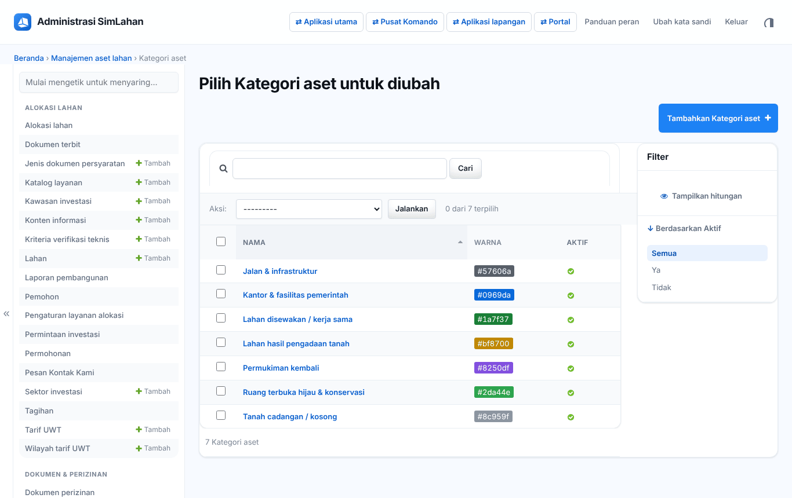

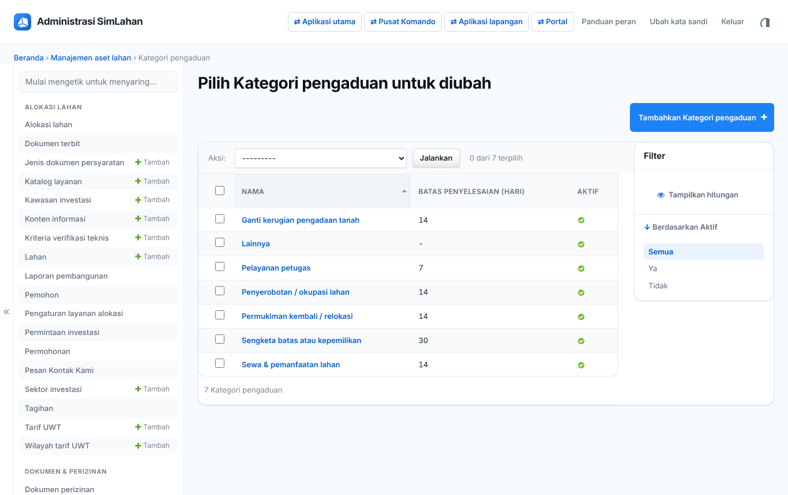

**Pengaturan modul aset lahan** (Administrator):

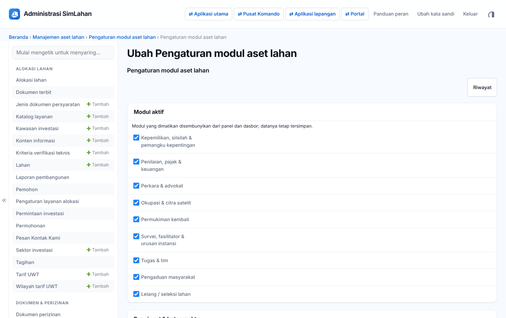

| Bagian | Isian |
|---|---|
| Modul aktif | Nyalakan/matikan: Kepemilikan, silsilah & pemangku kepentingan · Penilaian, pajak & keuangan · Perkara & advokat · Okupasi & citra satelit · Permukiman kembali · Survei, fasilitator & urusan instansi · Tugas & tim · Pengaduan masyarakat · Lelang / seleksi lahan. Menu yang dimatikan hilang dari panel. |
| Pengingat & batas waktu | Pengingat sewa berakhir, hak atas tanah berakhir, jatuh tempo pajak, sidang (hari sebelumnya); batas penyelesaian pengaduan (hari); okupasi tanpa tindak lanjut ditandai setelah (hari); pemantauan lapangan aset tiap (hari). |
| Jurnal ERP | Kode akun kas/bank untuk ekspor jurnal. |

<!-- akhir sisip -->

<!-- sisip: 11-pengadaan-tanah.md#415-kalender--aturan-tenggat -->

### 4.15 Kalender & aturan tenggat

*Mengubah: Pelaksana Pengadaan, Administrator. Peran lain hanya melihat.*

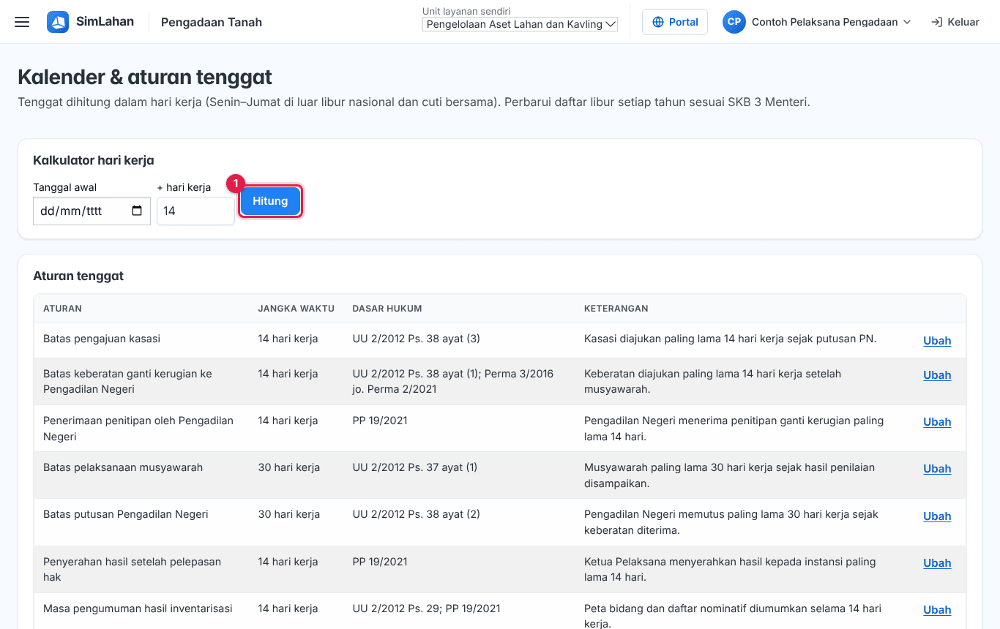

- **Kalkulator hari kerja**: isi tanggal awal dan jumlah hari kerja, lalu klik **Hitung** (nomor 1). Tanggal jatuh tempo tampil di sebelahnya.
- **Aturan tenggat**: jangka waktu setiap kewajiban beserta dasar hukumnya. Klik **Ubah** pada baris untuk menyesuaikan.
- **Hari libur & cuti bersama**: daftar libur yang tidak dihitung sebagai hari kerja.

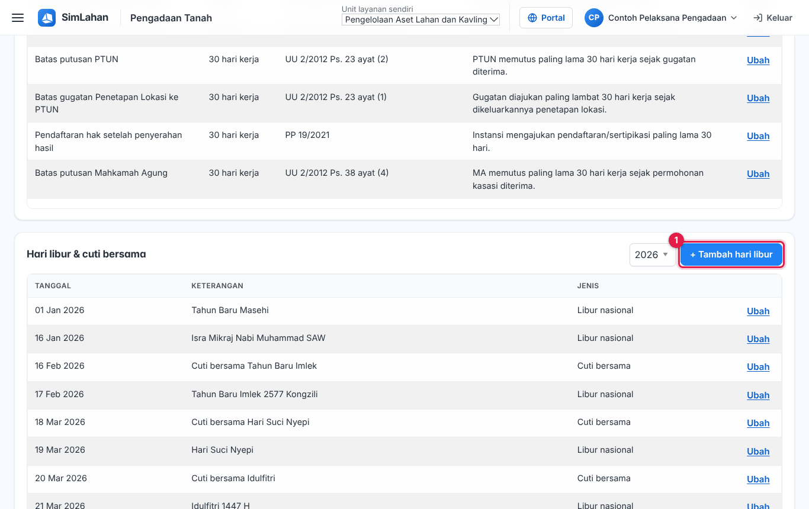

**Menambah hari libur** (lakukan setiap tahun sesuai SKB 3 Menteri):

1. Gulir ke bagian **Hari libur & cuti bersama**, lalu klik **+ Tambah hari libur** (nomor 1).
2. Isi **Tanggal** dan **Nama** liburnya (misalnya "Hari Raya Idulfitri"). Centang **Cuti bersama** bila tanggal itu cuti bersama, bukan libur nasional.
3. Klik **Simpan**.
4. Ulangi untuk setiap tanggal libur.
5. Untuk menghapus libur yang salah, klik **Hapus** pada barisnya.

<!-- akhir sisip -->

## Bagian B – Persetujuan khusus Administrator

Dokumen tanda tangan yang mencentang **Wajib persetujuan internal** harus disetujui pejabat lain sebelum dikirim. Anda menyetujuinya di halaman dokumen itu (langkah 3 di bawah: **Setujui** atau **Kembalikan ke draf**).

<!-- sisip: 22-dokumen-perizinan.md#74-dokumen-tanda-tangan-elektronik -->

### 7.4 Dokumen tanda tangan elektronik

Dokumen tanda tangan dipakai untuk kontrak, berita acara, surat pernyataan, dan dokumen lain yang perlu ditandatangani atau disetujui pihak lain. Nomornya berformat `DOK-2026-00001`.

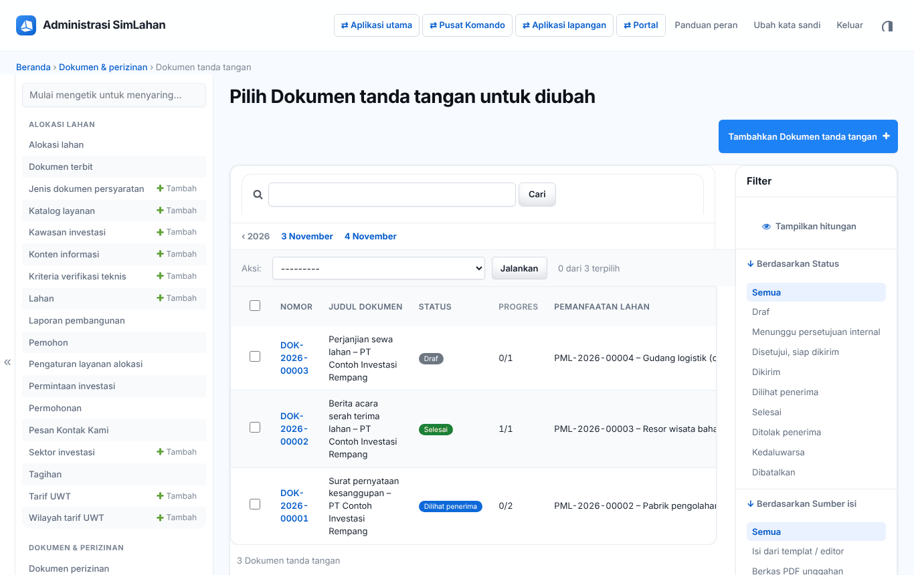

Alur status:

```
Draf → (Menunggu persetujuan internal → Disetujui, siap dikirim) → Dikirim → Dilihat penerima → Selesai
                                                                  ↘ Ditolak penerima / Kedaluwarsa / Dibatalkan
```

Tahap persetujuan internal hanya ada bila **Wajib persetujuan internal sebelum dikirim** dicentang.

#### Langkah 1 – Buat draf

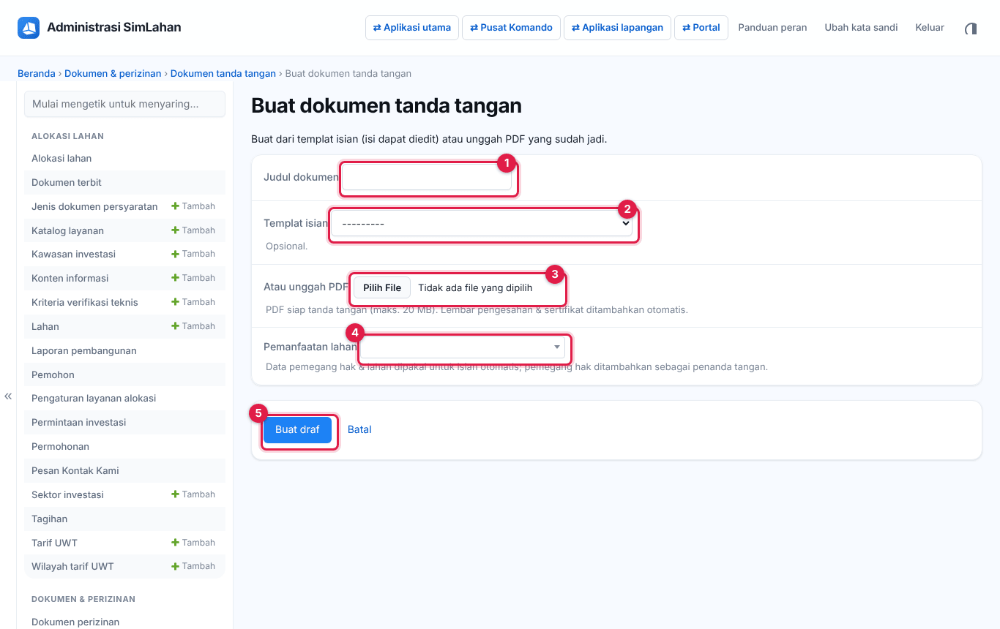

1. Buka **Dokumen tanda tangan**, lalu klik **Tambahkan Dokumen tanda tangan**. Cara lain: klik **Buat dokumen tanda tangan** di halaman pemanfaatan lahan atau di halaman templat.
2. Isi **Judul dokumen** (nomor 1).
3. Pilih isi dokumen, salah satu saja:
   - **Templat isian** (nomor 2): isi disusun dari templat dan masih bisa disunting.
   - **Atau unggah PDF** (nomor 3): klik **Pilih File** dan pilih PDF yang sudah jadi (maksimal 20 MB).
4. Pilih **Pemanfaatan lahan** (nomor 4): ketik nomor atau nama kegiatan, lalu klik pilihannya. Data pemegang hak dan lahan dipakai untuk isian otomatis, dan pemegang hak langsung ditambahkan sebagai penanda tangan.
5. Klik **Buat draf** (nomor 5). Halaman draf terbuka.

#### Langkah 2 – Lengkapi draf

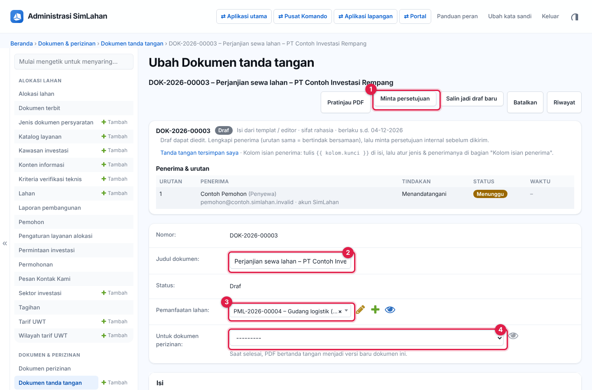

Bagian atas halaman draf menampilkan status **Draf** dan ringkasan penerima. Periksa dan lengkapi:

1. **Judul dokumen** (nomor 2) dan **Pemanfaatan lahan** (nomor 3).
2. Bila dokumen ini untuk memenuhi satu dokumen perizinan, pilih di **Untuk dokumen perizinan** (nomor 4). Setelah selesai ditandatangani, PDF-nya otomatis menjadi versi baru dokumen perizinan itu.
3. Gulir ke bagian **Isi**. Sunting **Isi dokumen** dengan bilah alat editor bila perlu. Isian otomatis seperti nama pemegang hak dan kode lahan sudah terisi sendiri.
4. Gulir ke bagian **Pengiriman**:

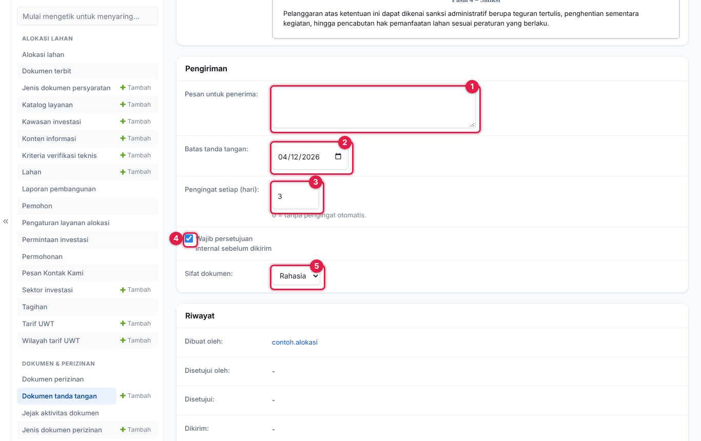

5. Tulis **Pesan untuk penerima** (nomor 1). Pesan ini ikut di surel undangan.
6. Atur **Batas tanda tangan** (nomor 2), yaitu tanggal terakhir penerima boleh bertindak.
7. Atur **Pengingat setiap (hari)** (nomor 3). Isi 0 bila tidak perlu pengingat otomatis.
8. Centang **Wajib persetujuan internal sebelum dikirim** (nomor 4) bila dokumen harus disetujui pejabat lain sebelum dikirim.
9. Pilih **Sifat dokumen** (nomor 5): **Biasa** atau **Rahasia**. Unduhan dokumen rahasia hanya dapat disetujui Administrator.
10. Gulir ke bagian **Penerima (urutan tanda tangan)**. Isi satu baris per orang. Tabelnya lebar; geser ke kanan untuk melihat semua kolom.

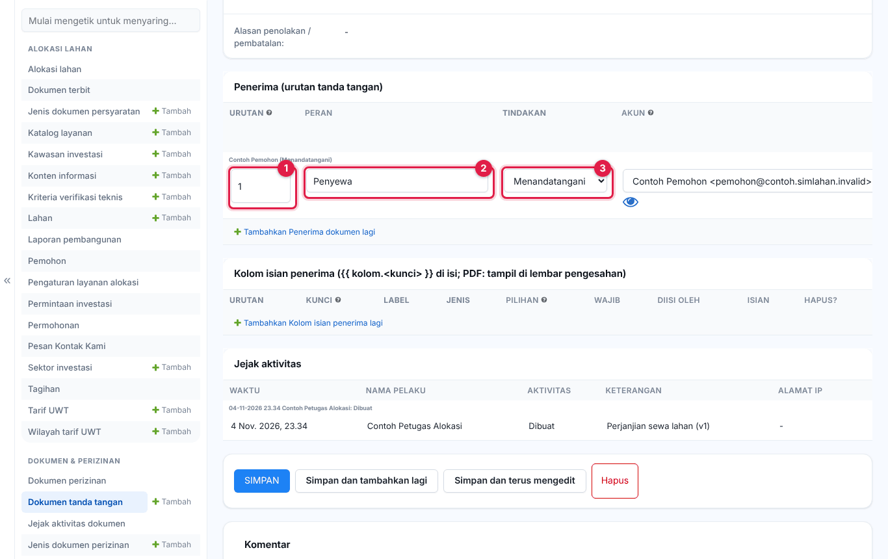

11. **Urutan** (nomor 1): penerima dengan urutan sama bertindak bersamaan; urutan berikutnya menunggu yang sebelumnya selesai.
12. **Peran** (nomor 2), misalnya "Pemegang hak" atau "Pejabat penandatangan".
13. **Tindakan** (nomor 3): **Menandatangani**, **Menyetujui**, atau **Menerima salinan**.

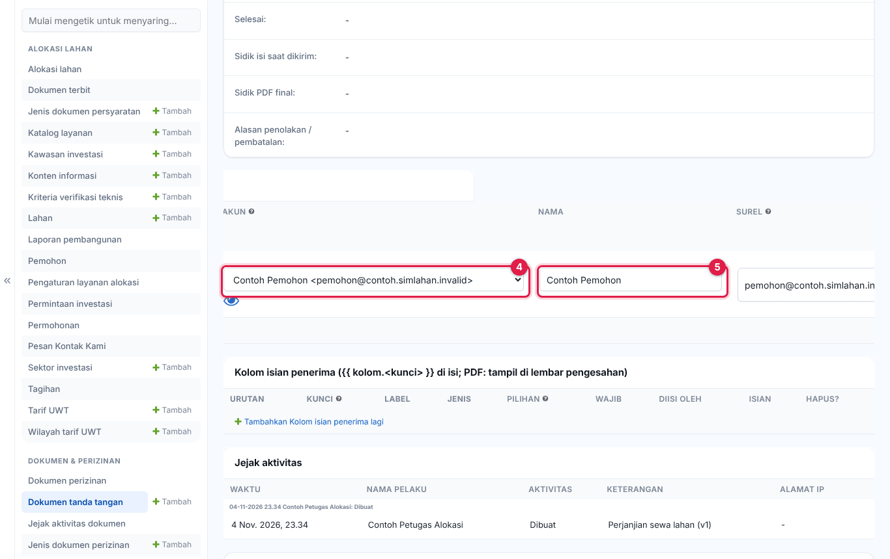

14. **Akun** (nomor 4): pilih akun bila penerima punya akun SimLahan atau portal. Penerima berakun wajib masuk dulu sebelum menandatangani.
15. **Nama** (nomor 5) penerima.

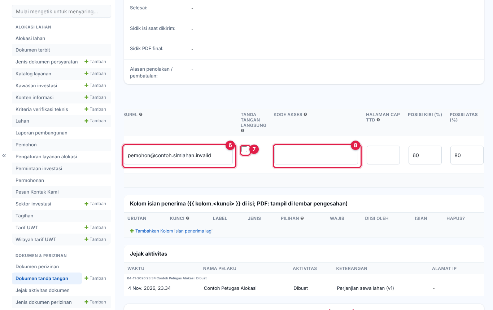

16. **Surel** (nomor 6): alamat tujuan undangan.
17. **Tanda tangan langsung** (nomor 7): centang bila penerima menandatangani di perangkat petugas setelah identitasnya diperiksa, misalnya warga tanpa surel. Surel undangan tidak dikirim.
18. **Kode akses** (nomor 8, opsional): kode tambahan yang Anda sampaikan lewat telepon. Isi `-` untuk menghapus kode yang ada.
19. Khusus PDF unggahan, kolom di kanannya menentukan letak gambar tanda tangan di PDF: **Halaman cap TTD** (1 = halaman pertama, -1 = terakhir), **Posisi kiri (%)**, **Posisi atas (%)**, dan **Lebar cap (%)**.
20. Untuk penerima berikutnya, klik **Tambahkan Penerima dokumen lagi**.
21. Bila penerima perlu mengisi sesuatu, isi tabel **Kolom isian penerima** di bawahnya: **Kunci**, **Label**, **Jenis** (Teks singkat, Teks panjang, Tanggal, Angka, Kotak centang, Pilihan, Paraf, Lampiran berkas), **Diisi oleh**, dan **Wajib**. Di isi dokumen, tulis `{{ kolom.<kunci> }}` di tempat isian itu harus muncul.
22. Klik **Simpan dan terus mengedit** di bagian bawah, lalu klik **Pratinjau PDF** di kanan atas untuk memeriksa hasilnya.

#### Langkah 3 – Kirim dan pantau

1. Bila **Wajib persetujuan internal** dicentang, klik **Minta persetujuan** (nomor 1 pada gambar draf). Pejabat lain (bukan pembuat) membuka dokumen lalu klik **Setujui**, atau **Kembalikan ke draf** dengan alasan.
2. Klik **Kirim untuk ditandatangani** di kanan atas. Tombol ini muncul setelah draf disetujui (atau langsung, bila tidak wajib persetujuan). Penerima urutan pertama menerima surel berisi tautan.

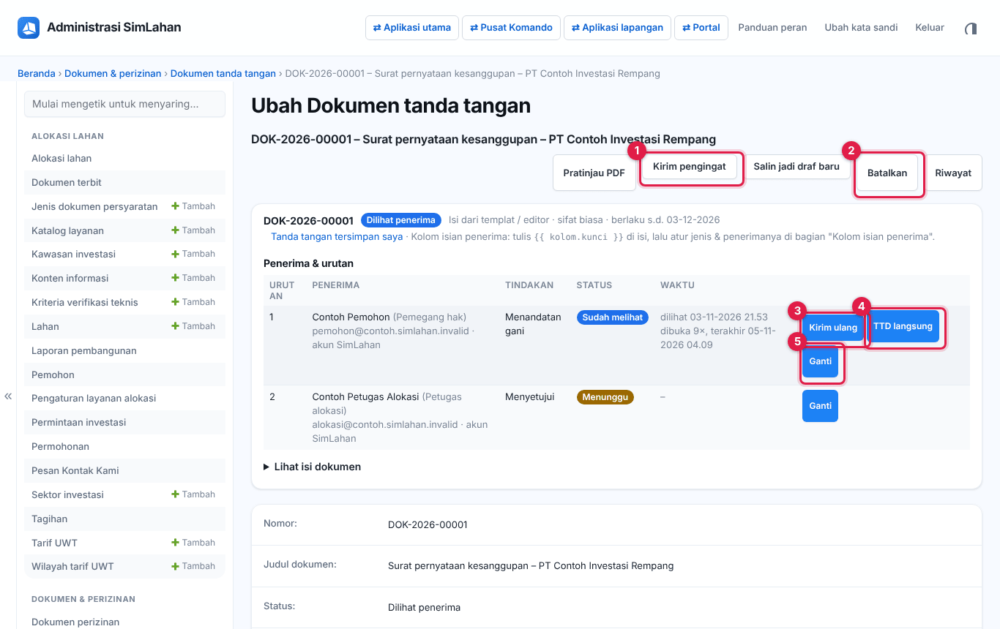

3. Pantau tabel **Penerima & urutan**: status tiap penerima (Menunggu, Sudah melihat, Selesai, Menolak) dan waktunya.
4. Untuk penerima yang belum bertindak:
   - **Kirim ulang** (nomor 3): mengirim ulang surel undangan.
   - **TTD langsung** (nomor 4): membuka sesi tanda tangan di perangkat Anda untuk penerima yang hadir. Catat bukti identitasnya, misalnya "KTP diperiksa".
   - **Ganti** (nomor 5): mengganti penerima, misalnya karena pejabatnya berganti.
5. **Kirim pengingat** (nomor 1) mengirim pengingat ke semua penerima yang belum bertindak.
6. **Batalkan** (nomor 2) menghentikan proses. Alasan wajib ditulis.
7. Gulir ke bawah ke **Komentar** untuk catatan bersama. Centang **Internal (hanya petugas)** bila komentar tidak boleh dilihat penerima.

Setelah semua penerima selesai, status menjadi **Selesai**:

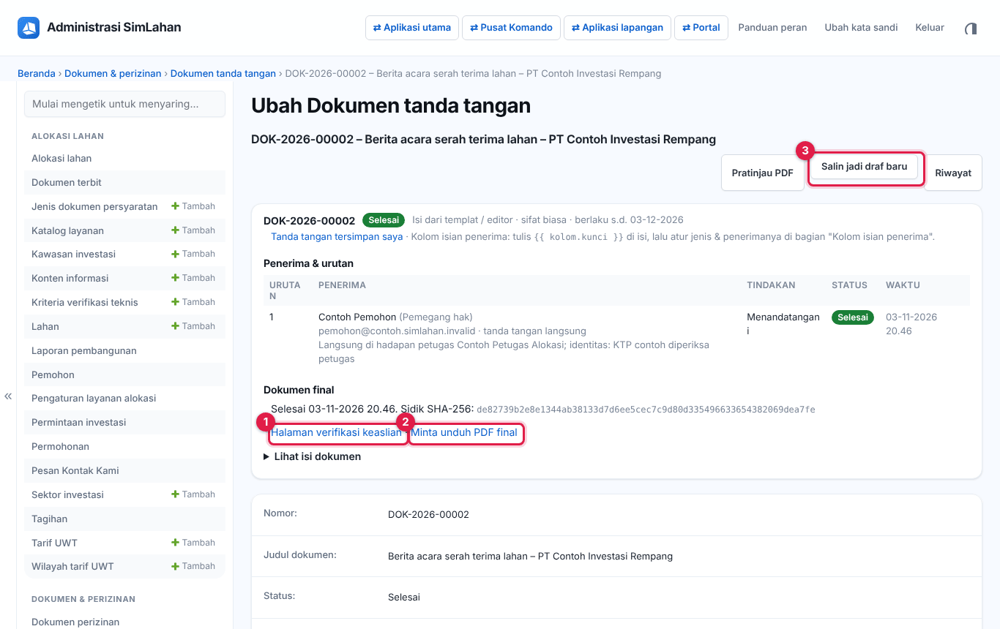

- Bagian **Dokumen final** menampilkan waktu selesai dan **Sidik SHA-256** (sidik digital PDF final).
- **Halaman verifikasi keaslian** (nomor 1): halaman publik untuk memeriksa keaslian PDF.
- **Minta unduh PDF final** (nomor 2): mengajukan permintaan unduh PDF final (lihat 7.7).
- **Salin jadi draf baru** (nomor 3): membuat salinan dokumen, misalnya untuk penerima lain atau setelah ditolak.

#### Yang dialami penerima

Penerima membuka tautan di surel. Penerima dengan akun portal cukup masuk dengan akunnya; penerima tanpa akun memasukkan **kode verifikasi 6 angka** yang dikirim ke surelnya (berlaku 10 menit) dan, bila diatur, **kode akses** dari petugas. Ia lalu membaca dokumen, mengisi kolom isian, mencentang persetujuan, menggambar atau mengetik tanda tangan (atau memakai tanda tangan tersimpan), dan klik **Tanda tangani** atau **Setujui**. Ia juga bisa **Tolak dokumen** dengan alasan. Alamat IP dan perangkat tercatat. Rinciannya untuk pemegang hak ada di [Bab 15](../53-portal-dokumen.md).

Siapa pun yang memegang PDF final bisa memeriksa keasliannya di portal (**Verifikasi dokumen**, lihat [Bab 12](../50-portal-publik.md)).

<!-- akhir sisip -->

<!-- sisip: 22-dokumen-perizinan.md#77-permintaan-unduh -->

### 7.7 Permintaan unduh

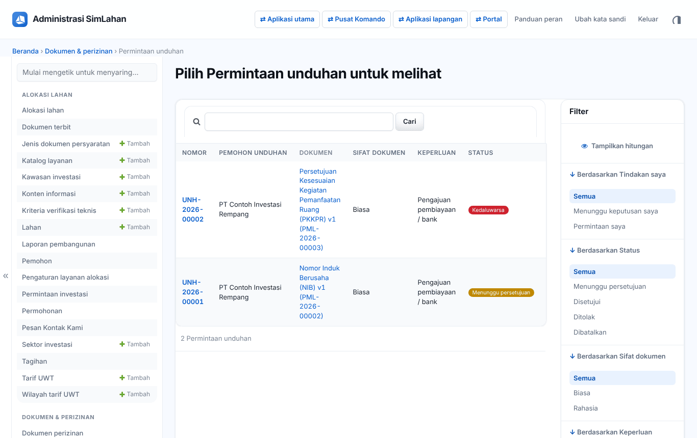

Saringan **Tindakan saya** menampilkan permintaan yang menunggu keputusan Anda.

**Mengajukan permintaan unduh:**

1. Di halaman dokumen perizinan atau dokumen tanda tangan, klik **Minta unduh** (atau **Minta unduh PDF final**).
2. Pilih **Keperluan**: Arsip / administrasi, Pengurusan izin ke instansi lain, Pengajuan pembiayaan / bank, Keperluan hukum / pengadilan, Pemeriksaan / audit, atau Lainnya. Tulis **Alasan**.
3. Kirim, lalu tunggu keputusan. Lihat statusnya di **Permintaan unduh saya**.
4. Setelah **Disetujui**, klik **Unduh sekarang** sebelum masa berlakunya habis. Permintaan yang belum diputuskan bisa dibatalkan dengan **Batalkan permintaan**.

**Memutuskan permintaan unduh:**

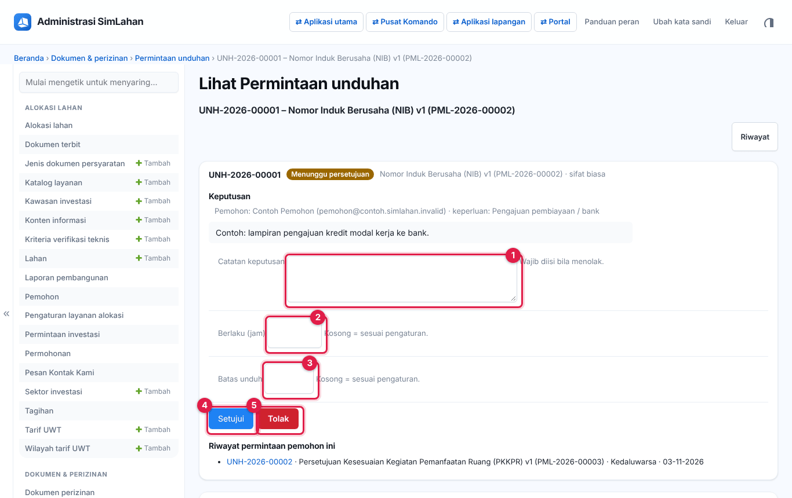

1. Buka permintaan berstatus **Menunggu persetujuan** dari saringan **Tindakan saya** atau dari kartu di dasbor.
2. Di bagian **Keputusan**, baca keperluan dan alasan pemohon. Periksa juga **Riwayat permintaan pemohon ini** di bawahnya.
3. Bila perlu, tulis **Catatan keputusan** (nomor 1). Catatan wajib diisi bila Anda menolak.
4. Bila perlu, ubah **Berlaku (jam)** (nomor 2), yaitu berapa jam izin unduh berlaku, dan **Batas unduh** (nomor 3), yaitu berapa kali berkas boleh diunduh. Kosongkan untuk memakai pengaturan umum.
5. Klik **Setujui** (nomor 4) atau **Tolak** (nomor 5). Pemohon diberi tahu.

Permintaan Anda sendiri harus diputuskan pejabat lain. Dokumen **rahasia** hanya dapat disetujui Administrator.

**Riwayat unduhan** mencatat setiap pratinjau dan unduhan (saringan **Pratinjau** dan **Bertanda air**).

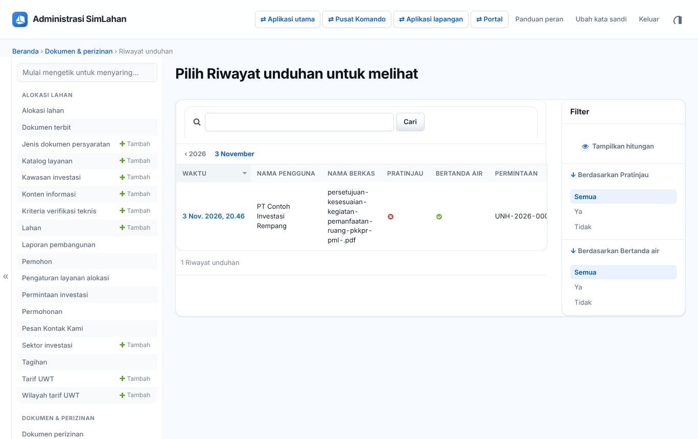

<!-- akhir sisip -->

> Anda menyetujui permintaan unduh dokumen **rahasia** dan permintaan petugas lain. Permintaan Anda sendiri harus diputuskan Administrator lain.

<!-- sisip: 20-alokasi-lahan.md#55-alokasi--lahan-tidur -->

### 5.5 Alokasi & lahan tidur

Buka **Panel admin → Alokasi lahan → Alokasi lahan**. Halaman ini berisi semua alokasi yang sudah terbit: nomor KPT, pemegang hak, lahan, masa berlaku, dan progres pembangunan.

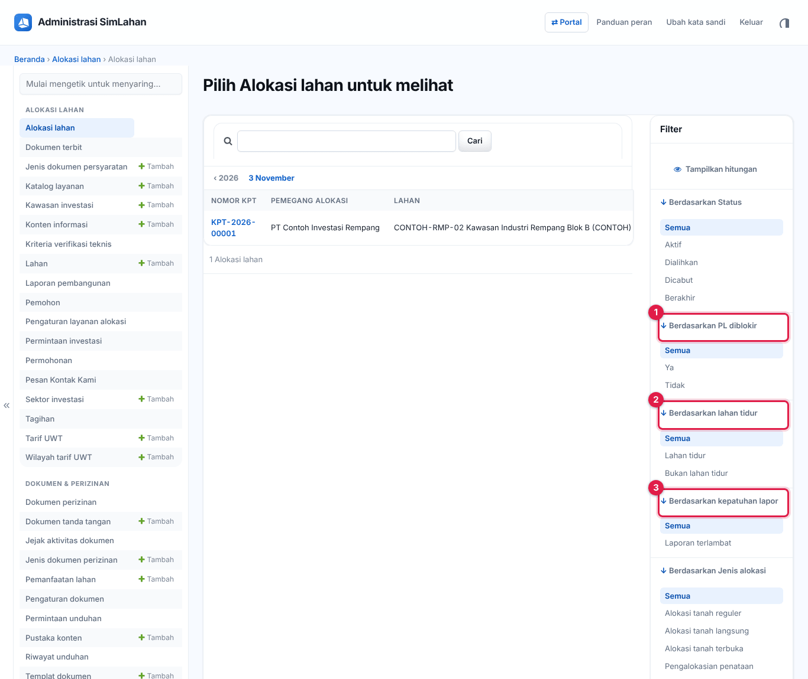

Filter penting di kanan:

- **Berdasarkan PL diblokir** (nomor 1): alokasi yang penetapan lokasinya sedang diblokir.
- **Berdasarkan lahan tidur** (nomor 2): alokasi aktif yang sudah lewat batas waktu (diatur di pengaturan) tetapi belum mulai konstruksi.
- **Berdasarkan kepatuhan lapor** (nomor 3): pemegang hak yang terlambat mengirim laporan progres pembangunan.

Klik nomor KPT untuk membuka alokasi.

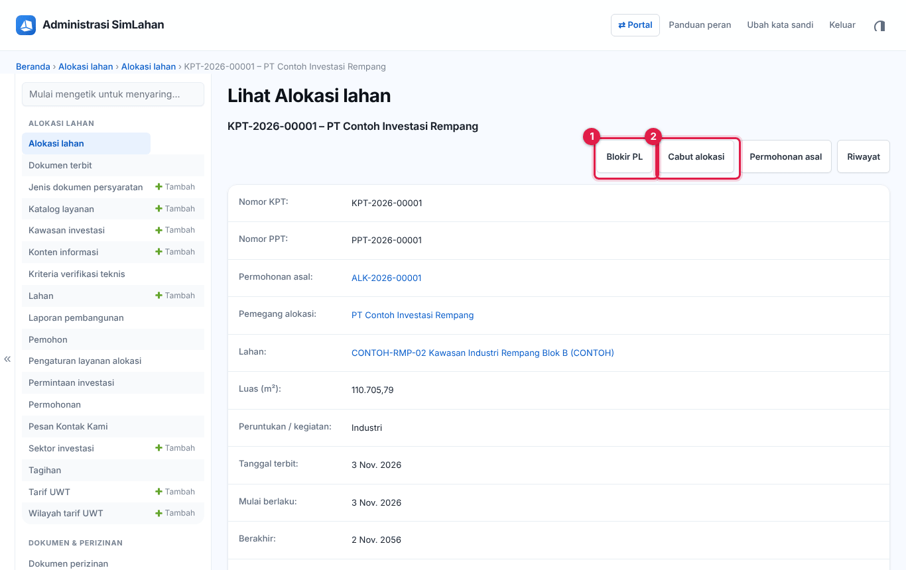

- **Blokir PL** (nomor 1): memblokir penetapan lokasi, misalnya karena sengketa. Selama diblokir, pemegang hak hanya bisa mengajukan layanan **pembukaan blokir**. Setelah diblokir, tombol ini berganti menjadi **Buka blokir PL**.
- **Cabut alokasi** (nomor 2): mencabut alokasi, misalnya karena lahan tidur atau pelanggaran. Lahan kembali tersedia untuk dimohon.
- **Permohonan asal**: membuka permohonan yang menghasilkan alokasi ini.

Kedua tindakan meminta konfirmasi. Contoh untuk **Blokir PL**:

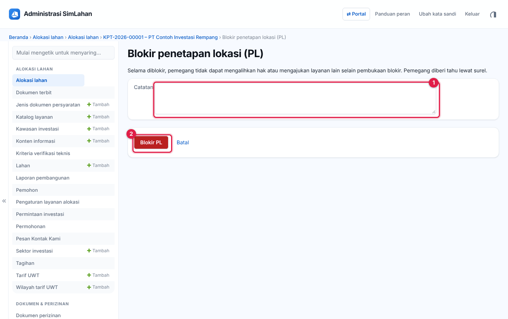

1. Tulis alasan di **Catatan** (nomor 1). Alasan ini dikirim lewat surel kepada pemegang hak.
2. Klik **Blokir PL** (nomor 2). Klik **Batal** bila tidak jadi.

Gulir ke bawah halaman alokasi untuk melihat **Dokumen terbit** (dokumen keputusan) dan **Progres pembangunan** (laporan dari pemegang hak).

Setiap Senin pukul 07.30 WIB sistem menjalankan **pemantauan mingguan**: alokasi yang berakhir, peringatan lahan tidur, laporan progres terlambat, dan tagihan yang segera atau sudah lewat jatuh tempo. Pengingat dikirim ke pemegang hak, dan ringkasannya ke surel petugas alokasi.

<!-- akhir sisip -->

## Bagian C – Menyiapkan pusat komando

Urutan penyiapan: buat Korwil dan anggotanya, atur jabatan dan atasan setiap petugas, lalu atur absensi, bobot KPI, dan poin usaha.

<!-- sisip: 41-panel-pusat-komando.md#111-korwil-koordinator-wilayah -->

### 11.1 Korwil (koordinator wilayah)

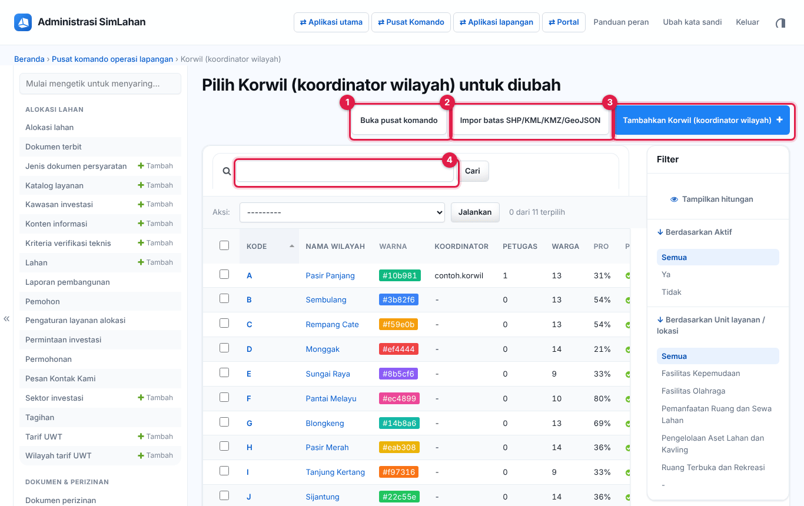

Nomor pada gambar:

1. **Buka pusat komando**: membuka peta Korwil di pusat komando.
2. **Impor batas SHP/KML/KMZ/GeoJSON**: mengimpor batas banyak Korwil sekaligus (lihat di bawah).
3. **Tambahkan Korwil (koordinator wilayah)**: membuat Korwil baru.
4. Kotak cari: ketik kode atau nama Korwil, lalu tekan Enter.

**Menambah atau mengubah Korwil:**

1. Klik **Tambahkan Korwil (koordinator wilayah)** (nomor 3 di atas), atau klik nama Korwil di daftar untuk mengubahnya.

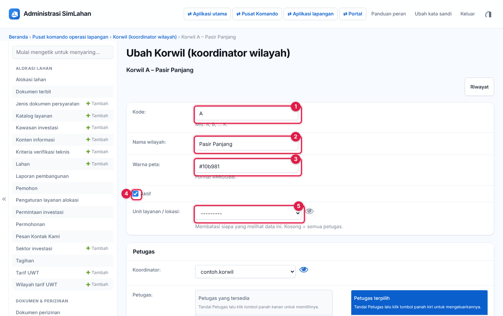

2. Isi **Kode** (nomor 1), misalnya A, B, sampai K.
3. Isi **Nama wilayah** (nomor 2) dan **Warna peta** (nomor 3) dalam format #RRGGBB, misalnya #1d82f5.
4. Biarkan **Aktif** tercentang (nomor 4). Hapus centangnya untuk menyembunyikan Korwil dari pusat komando.
5. Pilih **Unit layanan / lokasi** (nomor 5).
6. Gulir ke bagian **Petugas**:

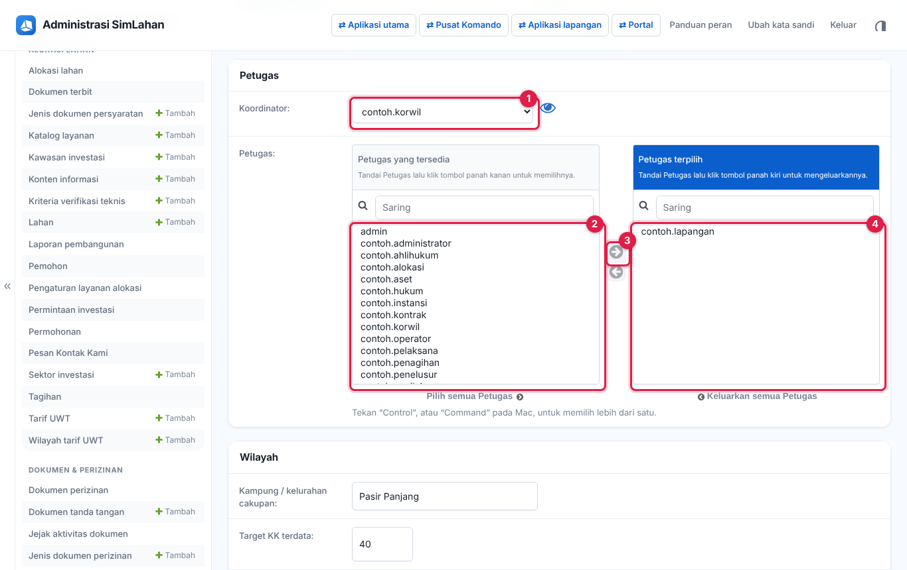

7. Pilih **Koordinator** (nomor 1), yaitu petugas yang memimpin Korwil ini.
8. Di kotak **Petugas yang tersedia** (nomor 2), klik nama anggota, lalu klik panah ke kanan (nomor 3). Nama pindah ke kotak **Petugas terpilih** (nomor 4). Tahan Ctrl (atau Command di Mac) untuk memilih beberapa nama sekaligus. Hanya anggota terpilih yang bisa melapor untuk Korwil ini.
9. Gulir ke bagian **Wilayah**:

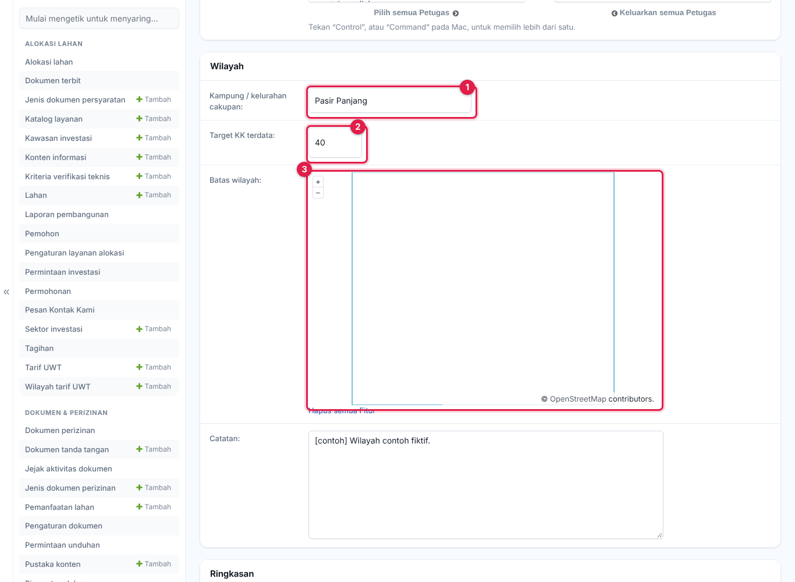

10. Isi **Kampung / kelurahan cakupan** (nomor 1) dan **Target KK terdata** (nomor 2).
11. Gambar **Batas wilayah** di peta (nomor 3): klik titik-titik batas satu per satu, lalu klik dua kali pada titik terakhir untuk menutup bidang. Untuk mengulang, klik **Hapus semua fitur** di bawah peta. Batas juga bisa diisi lewat impor (lihat di bawah). Pada gambar, latar peta tampil abu-abu karena peta dasar dari internet tidak dimuat saat gambar dibuat.
12. Klik **Simpan** di bagian bawah halaman.

**Mengimpor batas:**

1. Klik **Impor batas SHP/KML/KMZ/GeoJSON** (nomor 2 pada gambar daftar).
2. Pilih berkas GeoJSON, KML/KMZ, GeoPackage, atau Shapefile dalam ZIP yang berisi poligon. Atribut yang dikenali: `kode` (wajib), `nama`, `warna`, `kampung`.
3. Klik tombol impor. Korwil dengan kode yang sudah ada diperbarui batasnya; kode baru dibuat sebagai Korwil baru.

<!-- akhir sisip -->

<!-- sisip: 41-panel-pusat-komando.md#118-jabatan-tugas-dan-laporan-harian -->

### 11.8 Jabatan, tugas, dan laporan harian

**Jabatan & atasan petugas** (Administrator) menentukan ke mana laporan harian setiap petugas dikirim dan siapa boleh memberi tugas kepadanya:

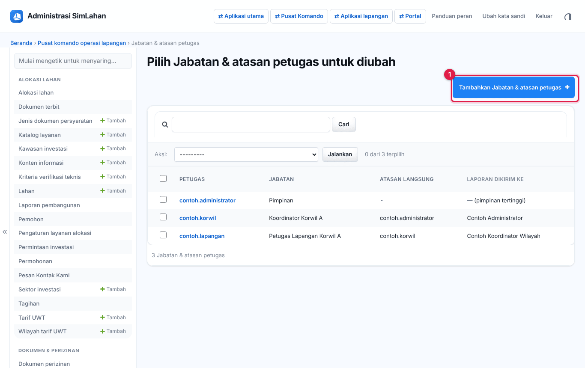

1. Klik **Tambahkan Jabatan & atasan petugas** (nomor 1).

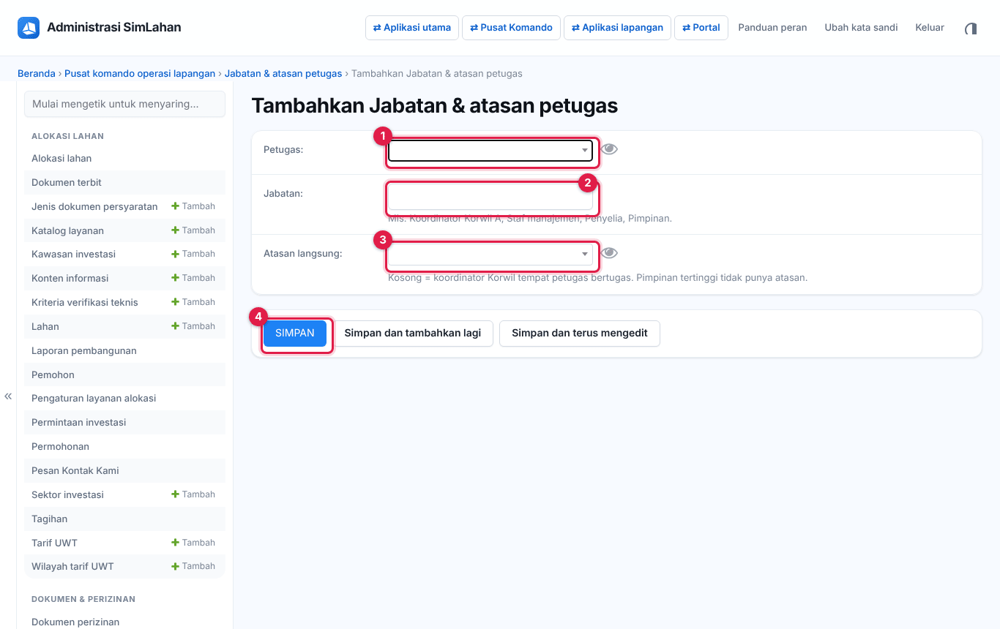

2. Pilih **Petugas** (nomor 1). Ketik sebagian nama untuk mencarinya.
3. Isi **Jabatan** (nomor 2), misalnya Koordinator Korwil A, Staf manajemen, Penyelia, atau Pimpinan.
4. Pilih **Atasan langsung** (nomor 3). Kosongkan untuk pimpinan puncak.
5. Klik **Simpan** (nomor 4). Ulangi untuk setiap petugas sampai pimpinan puncak.

Menu lain (baca saja untuk sebagian besar peran):

- **Riwayat tugas**: setiap peristiwa tugas (ditugaskan, mulai, dilaporkan selesai, terkendala, dilanjutkan, diverifikasi, dikembalikan, dibatalkan).
- **Poin tugas**: poin per peran (penerima utama, kontributor lapangan, pemberi tugas).
- **Laporan harian berjenjang**: saringan **Status**, **Korwil**, **Tanggal laporan**, **Disusun dengan AI**.

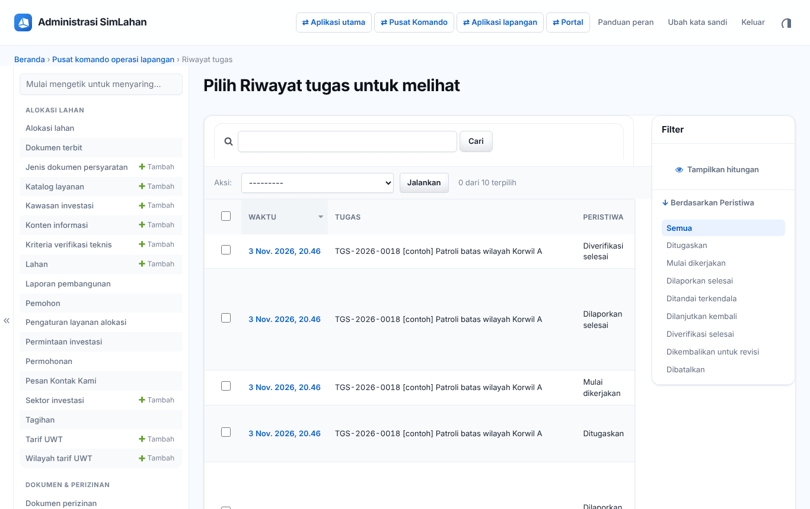

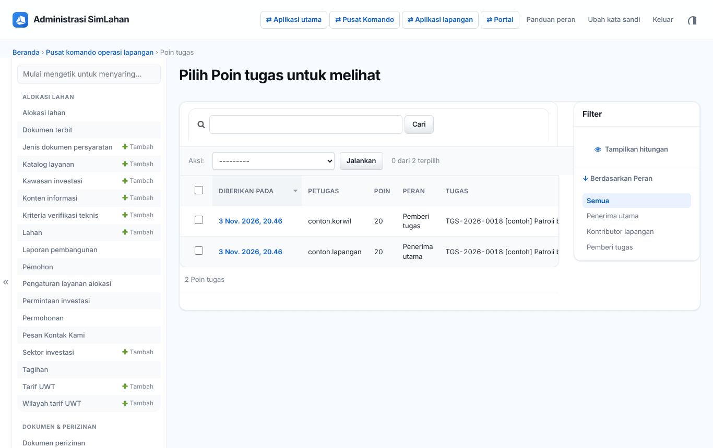

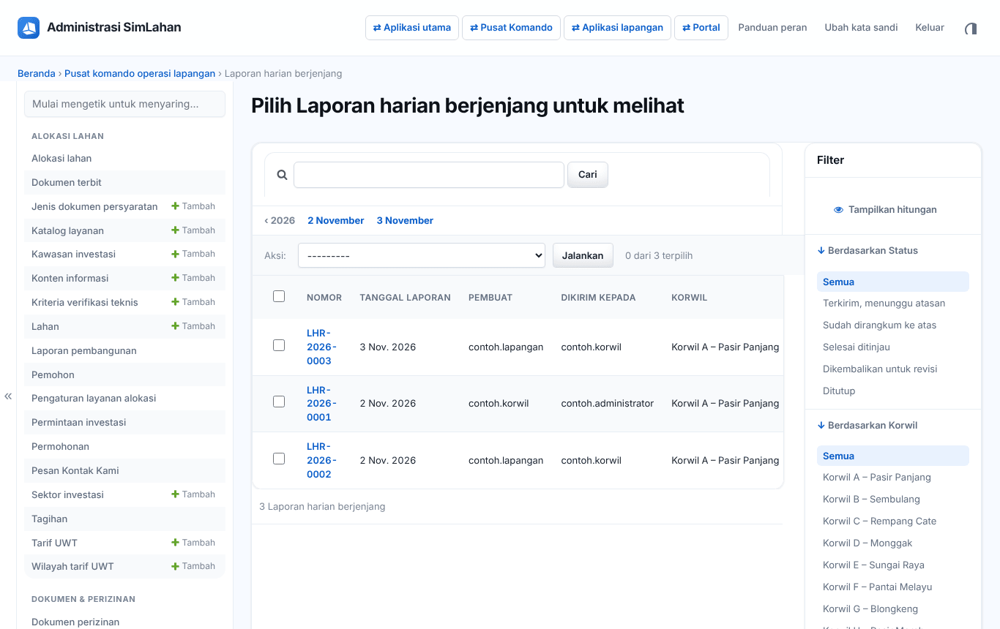

<!-- akhir sisip -->

<!-- sisip: 41-panel-pusat-komando.md#1110-pengaturan-pusat-komando-administrator -->

### 11.10 Pengaturan pusat komando (Administrator)

Buka **Pengaturan pusat komando**. Halaman ini hanya satu formulir; ubah isian yang perlu, lalu klik **Simpan** di bagian bawah.

**Absensi:**

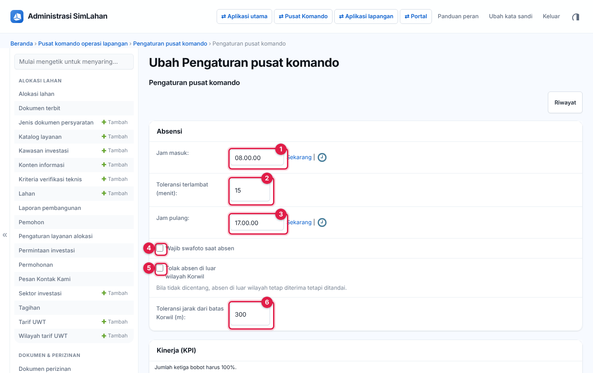

1. **Jam masuk** (nomor 1) dan **Jam pulang** (nomor 3): ketik jamnya, misalnya 08.00, atau klik ikon jam di sebelahnya untuk memilih.
2. **Toleransi terlambat (menit)** (nomor 2): absen masuk setelah jam masuk ditambah toleransi ini dicatat **Hadir terlambat**.
3. **Wajib swafoto saat absen** (nomor 4): centang bila petugas harus mengambil swafoto.
4. **Tolak absen di luar wilayah Korwil** (nomor 5) dan **Toleransi jarak dari batas Korwil (m)** (nomor 6): absen ditolak bila petugas lebih jauh dari jarak ini di luar batas Korwilnya.

**Kinerja (KPI):**

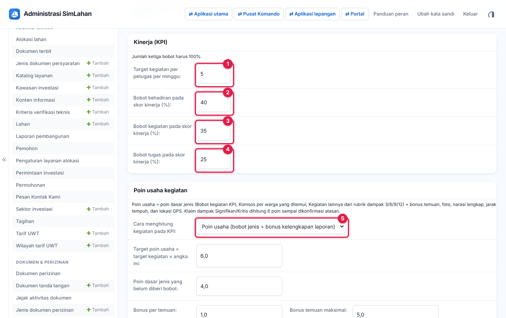

5. **Target kegiatan per petugas per minggu** (nomor 1).
6. **Bobot kehadiran**, **Bobot kegiatan**, dan **Bobot tugas pada skor kinerja (%)** (nomor 2–4). Jumlah ketiganya harus 100.
7. **Cara menghitung kegiatan pada KPI** (nomor 5): poin usaha, atau jumlah kegiatan × bobot jenis.

**Poin usaha kegiatan:**

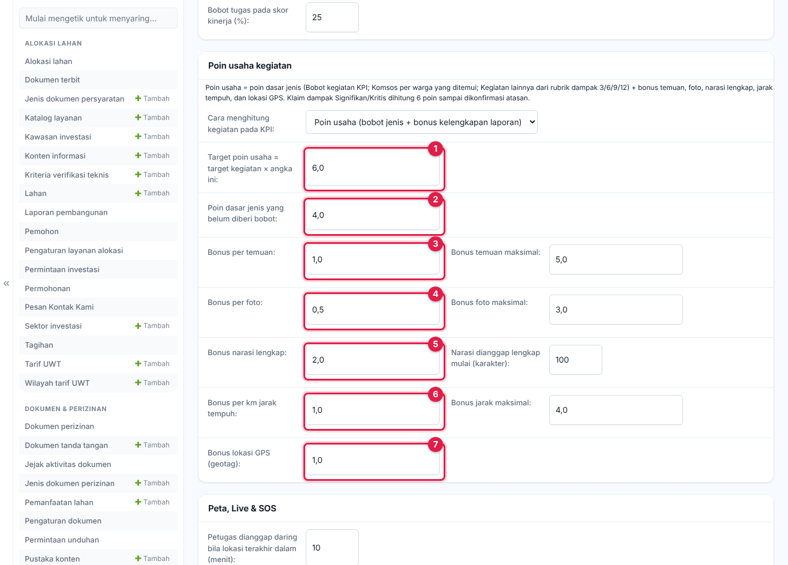

8. **Target poin usaha = target kegiatan × angka ini** (nomor 1).
9. **Poin dasar jenis yang belum diberi bobot** (nomor 2).
10. Bonus kelengkapan laporan, masing-masing dengan batas maksimal di sebelahnya: **Bonus per temuan** (nomor 3), **Bonus per foto** (nomor 4), **Bonus narasi lengkap** (nomor 5) beserta panjang minimal narasi, **Bonus per km jarak tempuh** (nomor 6), dan **Bonus lokasi GPS (geotag)** (nomor 7).

**Peta, Live & SOS:**

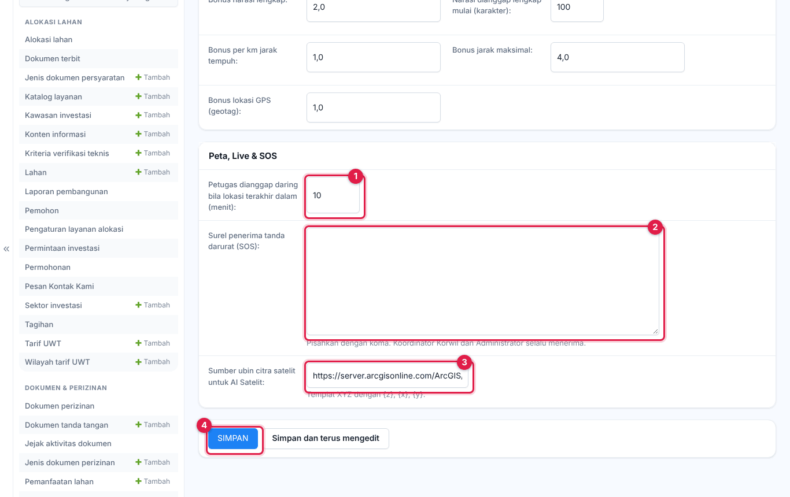

11. **Petugas dianggap daring bila lokasi terakhir dalam (menit)** (nomor 1).
12. **Surel penerima tanda darurat (SOS)** (nomor 2): satu alamat surel per baris.
13. **Sumber ubin citra satelit untuk AI Satelit** (nomor 3): templat XYZ dengan `{z}`, `{x}`, `{y}`.
14. Klik **Simpan** (nomor 4).

Bobot poin per jenis kegiatan diatur di menu **Bobot kegiatan (KPI)**.

**Kunci sistem** hanya bisa diatur superuser (lihat [Bab 16](../60-superuser.md)).

<!-- akhir sisip -->

<!-- sisip: 40-pusat-komando.md#alat--tiket -->

### Alat & tiket

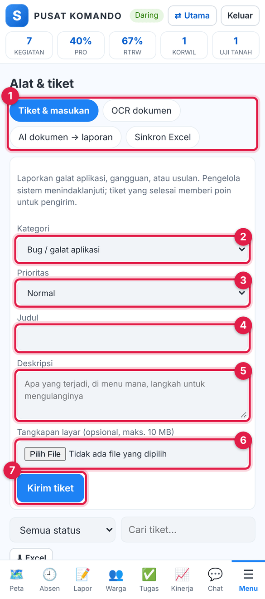

Pilih alat di nomor 1: **Tiket & masukan**, **OCR dokumen**, **AI dokumen → laporan**, **Sinkron Excel**, dan bagi koordinator **Audit data**. Bila layanan AI aktif, ada juga **AI foto lapangan**.

**Mengirim tiket (laporan galat, gangguan, atau usulan):**

1. Pilih **Kategori** (nomor 2): galat aplikasi, gangguan layanan, saran fitur, ulasan, atau lainnya.
2. Pilih **Prioritas** (nomor 3): Normal, Tinggi, atau Kritis.
3. Isi **Judul** (nomor 4) dan **Deskripsi** (nomor 5): apa yang terjadi, di menu mana, dan langkah untuk mengulanginya.
4. Lampirkan tangkapan layar bila ada (nomor 6).
5. Ketuk **Kirim tiket** (nomor 7). Daftar tiket Anda dan statusnya tampil di bawah. Tiket yang selesai memberi poin untuk pengirim.

**OCR dokumen** (membaca teks dari foto atau PDF):

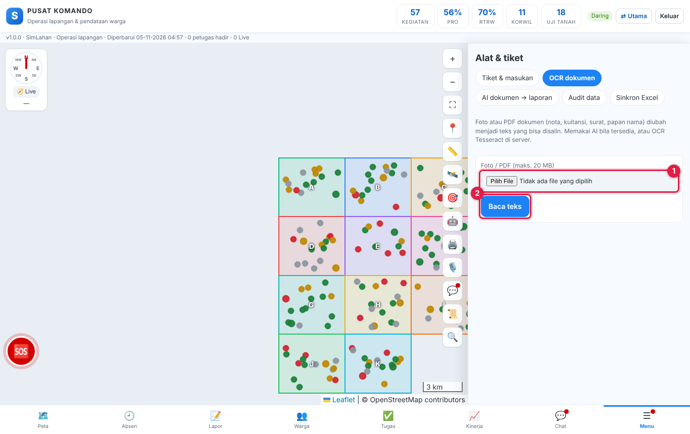

1. Ketuk **OCR dokumen**.
2. Pilih foto atau PDF, maks. 20 MB (nomor 1).
3. Ketuk **Baca teks** (nomor 2). Teks hasil bacaan tampil dan bisa disalin.

**AI dokumen → laporan:**

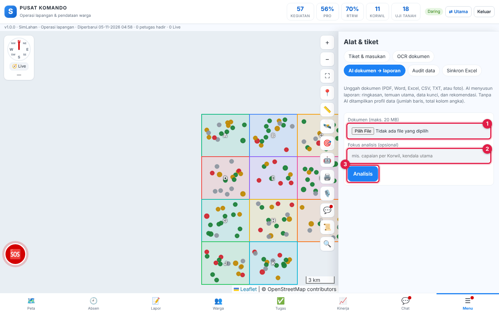

1. Ketuk **AI dokumen → laporan**.
2. Pilih dokumen: PDF, Word, Excel, CSV, TXT, atau foto (nomor 1).
3. Isi **Fokus analisis** bila perlu (nomor 2), misalnya "capaian per Korwil".
4. Ketuk **Analisis** (nomor 3). Hasilnya berupa ringkasan, temuan utama, data kunci, dan rekomendasi. Tanpa layanan AI, yang tampil hanya profil data dokumen.

**AI foto lapangan** (bila AI aktif): unggah foto lapangan atau drone, isi **Konteks**, lalu ketuk **Analisis foto**. AI menandai pembukaan lahan, bangunan, kebun, air, akses, dan alat berat. Wajah orang tidak dianalisis.

**Sinkron Excel:**

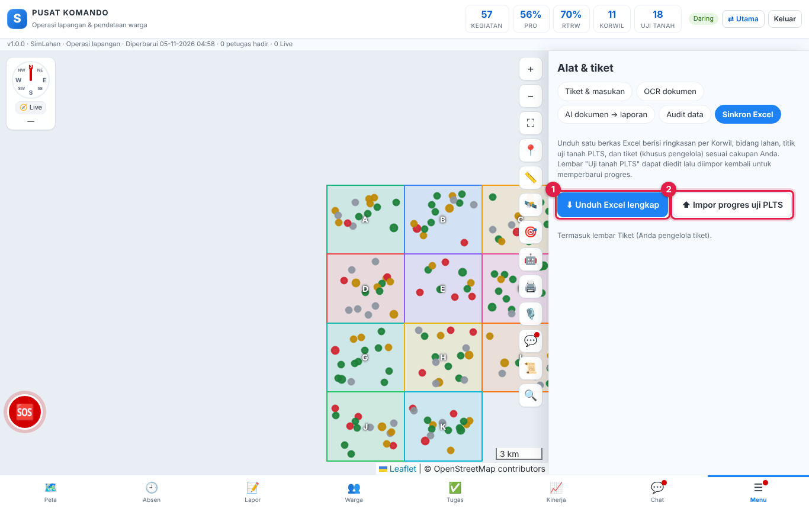

1. Ketuk **Sinkron Excel**.
2. Ketuk **⬇ Unduh Excel lengkap** (nomor 1): ringkasan Korwil, bidang lahan, titik uji PLTS, dan tiket.
3. Setelah lembar "Uji tanah PLTS" diedit, ketuk **⬆ Impor progres uji PLTS** (nomor 2) dan pilih berkasnya.

**Audit data** (koordinator):


1. Ketuk **Audit data**, lalu **Jalankan audit data** (nomor 1).
2. Hasilnya tampil di bawah: titik tanpa koordinat atau di luar wilayah, bidang ganda, warga tanpa lokasi, kegiatan tanpa GPS, dan petugas tanpa Korwil, masing-masing dengan contoh datanya.

**Cek perangkat:** di bagian bawah **Alat & tiket**, ketuk **Periksa perangkat** untuk memeriksa koneksi internet, antrean luring, penyimpanan luring, mode aplikasi luring, izin lokasi GPS, dan ruang penyimpanan terpakai di HP Anda.

<!-- akhir sisip -->

## Bila ada kendala

- **Menu atau tombol yang disebut di buku ini tidak ada di layar Anda.** Peran Anda memang tidak memerlukannya (lihat **Batas akses** di atas). Bila Anda membutuhkannya untuk pekerjaan, minta Administrator menambahkan peran yang sesuai.
- **Pesan "Tidak berhak" atau "Anda tidak berwenang melihat data ini".** Data itu di luar hak peran Anda, bukan kerusakan sistem.
- **Menambah pengguna, mengatur grup, mengganti sandi orang lain, tugas terjadwal, dan kunci sistem** hanya bisa dikerjakan superuser ([Bab 16](../60-superuser.md)).
- **Lupa kata sandi.** Hubungi superuser SimLahan untuk dibuatkan sandi baru, lalu ganti sandi itu setelah masuk (klik nama Anda → **Ganti sandi**, atau buka `/akun/sandi/`).
- **Terlalu banyak percobaan masuk.** Tunggu beberapa menit, lalu coba lagi dengan sandi yang benar.
- **Ringkasan peran di dalam aplikasi.** Isi bagian *Ringkasan peran* di atas juga bisa dibuka kapan saja lewat **Panduan peran** (`/akun/panduan/`).
