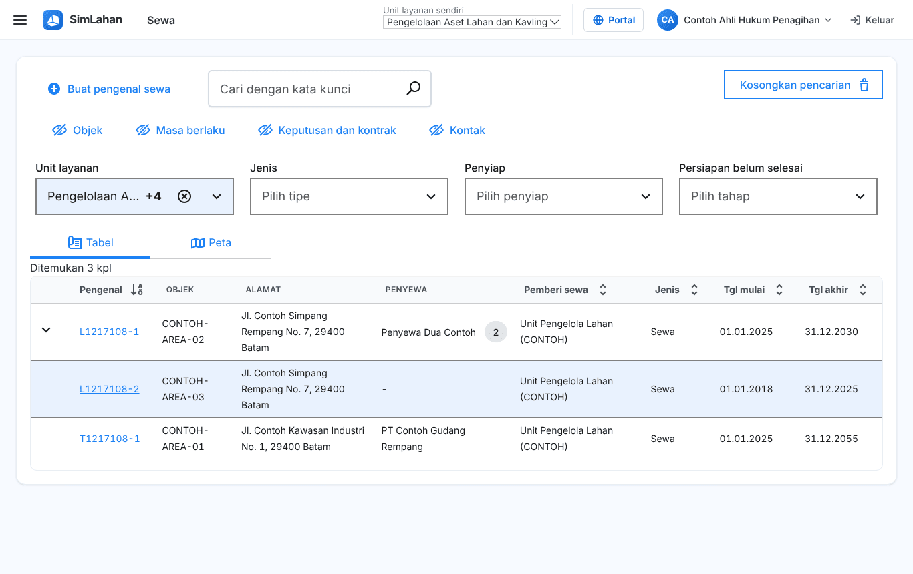
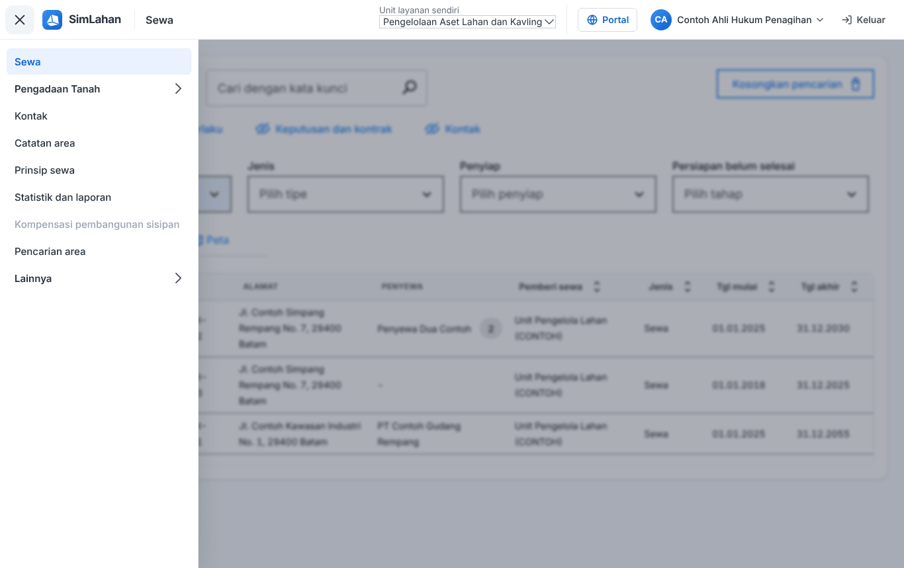

# Buku peran: Ahli Hukum Penagihan

Buku ini untuk **Ahli Hukum Penagihan**: petugas hukum penagihan sewa, sekaligus pencatat keberatan dan konsinyasi pengadaan tanah. Baca dulu [Bab 1](../01-mengenal-simlahan.md) dan [Bab 2](../02-dasar-penggunaan.md) bila baru pertama kali memakai SimLahan.

## Masuk

Buka alamat SimLahan, isi nama pengguna dan kata sandi, lalu klik **Masuk** ([Bab 2.2](../02-dasar-penggunaan.md#a-aplikasi-utama-petugas-kantor)).

<!-- awal: dibuat dari backend/users/role_guide.py; perbarui dengan: cd backend && python manage.py panduan_buku -->

## Ringkasan peran

Menangani penagihan hukum sewa serta keberatan dan konsinyasi pengadaan tanah.

- **Cara masuk:** Alamat utama SimLahan (`/`), dengan nama pengguna dan sandi.
- **Halaman awal:** Sewa (daftar sewa).
- **Akun latihan** (hanya di sistem latihan berisi data contoh): `contoh.ahlihukum`

### Menu yang Anda lihat

- Sewa
- Pengadaan Tanah: Dasbor & tenggat, Proyek pengadaan, Kalender & aturan tenggat
- Kontak
- Catatan area
- Prinsip sewa
- Statistik dan laporan
- Kompensasi pembangunan sisipan
- Pencarian area
- Lainnya: Indeks biaya hidup, Tugas terjadwal, Catatan tagihan, Kalkulator sewa

### Yang bisa Anda lakukan

- Membuat surat penagihan dan templatnya, putusan pengadilan penagihan, dan catatan penagihan; menghitung bunga denda.
- Mengubah data sewa yang terkait penagihan.
- Membuat laporan sewa, tagihan, dan jaminan.
- Mengelola pencarian kavling/area dan formulirnya.
- Pengadaan tanah: mencatat keberatan, konsinyasi, dan dokumen (data pribadi tersamar).

### Batas akses

- Tidak membuat atau menghapus tagihan dan pembayaran.
- Tidak bisa membuka panel admin, alokasi lahan, manajemen aset lahan, pusat komando, atau aplikasi lapangan.

<!-- akhir: blok role_guide.py -->

## Pekerjaan sehari-hari

### 1. Mencari dan membuka data sewa

1. Halaman awal Anda adalah daftar **Sewa** ([Bab 3.1](../10-sewa.md#31-daftar-sewa)).
2. Ketik pengenal sewa, nama penyewa, atau alamat di kotak cari, lalu tekan Enter. Gunakan saringan bila hasilnya banyak.
3. Klik baris sewa untuk membuka halamannya, lalu pindah antar-tab ([Bab 3.3](../10-sewa.md#33-halaman-data-sewa)).

### 2. Penagihan hukum sewa

1. Buka sewa, tab **Penagihan** ([Bab 3.4](../10-sewa.md#34-penagihan-sewa)).
2. Klik **Buat surat penagihan**, pilih penyewa dan jenis tuntutan.
3. Catat putusan dengan **Tambah putusan pengadilan** dan catatan dengan **Tambah catatan**. Bunga denda dihitung otomatis.

### 3. Keberatan dan konsinyasi pengadaan tanah

1. Buka proyek pengadaan, tab **Keberatan** atau **Konsinyasi** ([Bab 4.9](../11-pengadaan-tanah.md#49-keberatan--konsinyasi)).
2. Klik **+ Tambah**, isi data keberatan/konsinyasi, lalu simpan. Dokumen pendukung diunggah di tab **Dokumen**.

## Bab yang perlu dibaca

- [Bab 1 – Mengenal SimLahan](../01-mengenal-simlahan.md)
- [Bab 2 – Dasar penggunaan](../02-dasar-penggunaan.md)
- [Bab 3 – Sewa lahan](../10-sewa.md)
- [Bab 4 – Pengadaan tanah](../11-pengadaan-tanah.md)

## Bila ada kendala

- Menu atau tombol tidak ada: peran Anda memang tidak memerlukannya ([Bab 2.10](../02-dasar-penggunaan.md#210-batas-akses-dan-pesan-tidak-berhak)). Hubungi Administrator bila Anda memerlukannya untuk pekerjaan.
- Lupa kata sandi: hubungi Administrator atau superuser untuk menyetel ulang sandi.
- Ringkasan peran yang sama bisa dibuka di dalam aplikasi lewat **Panduan peran** (`/akun/panduan/`).
