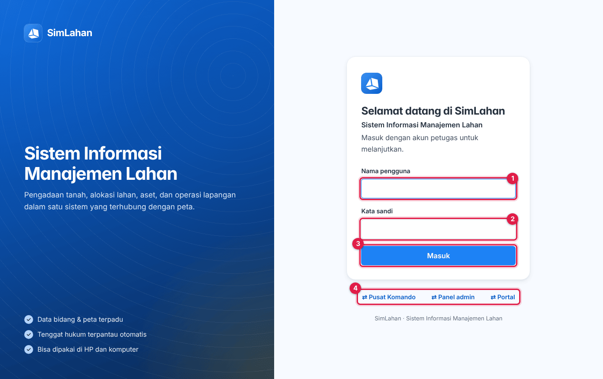
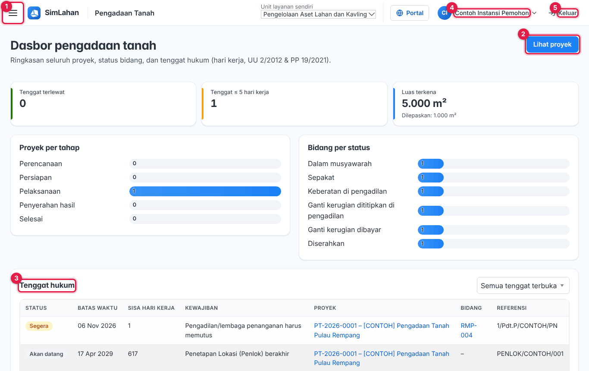
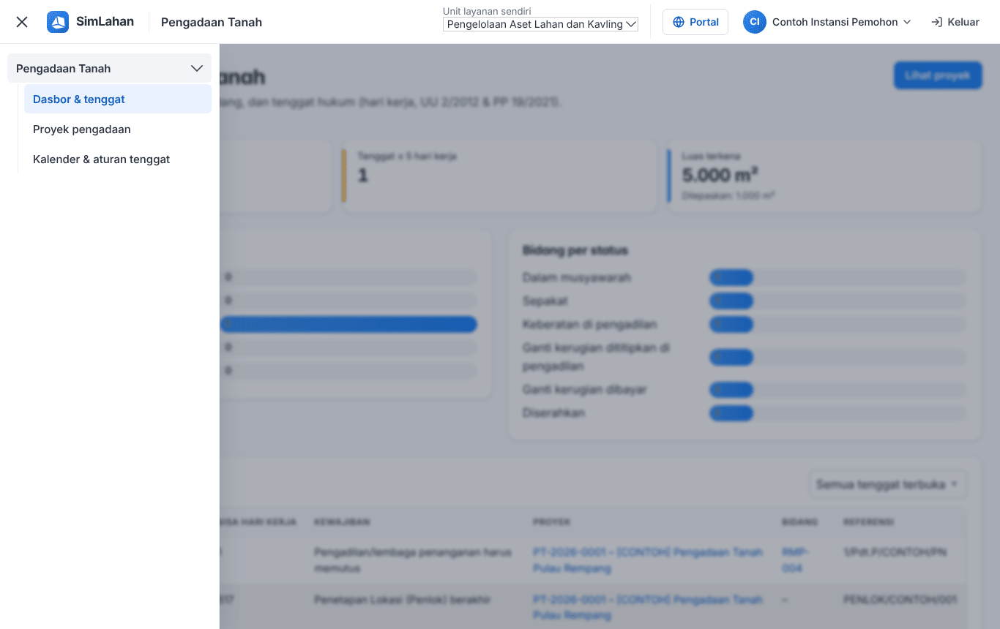
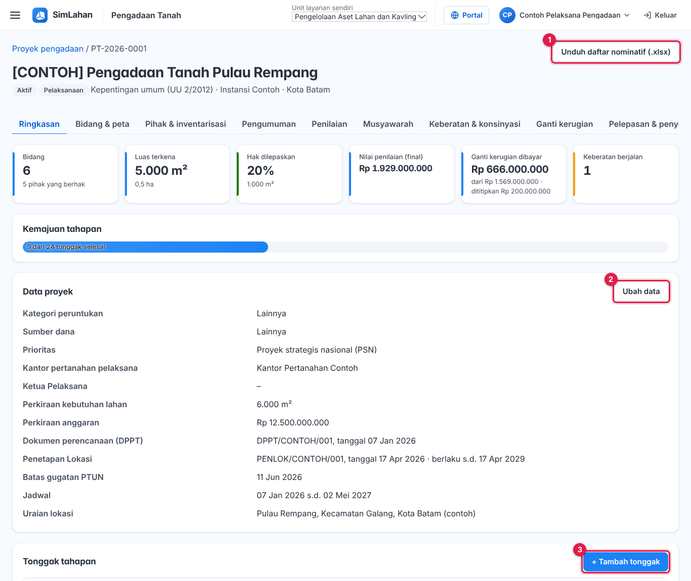
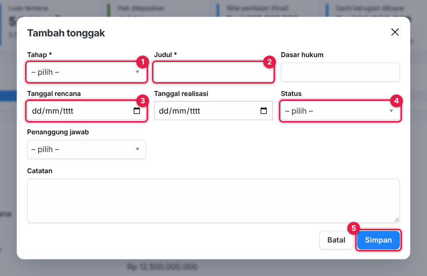
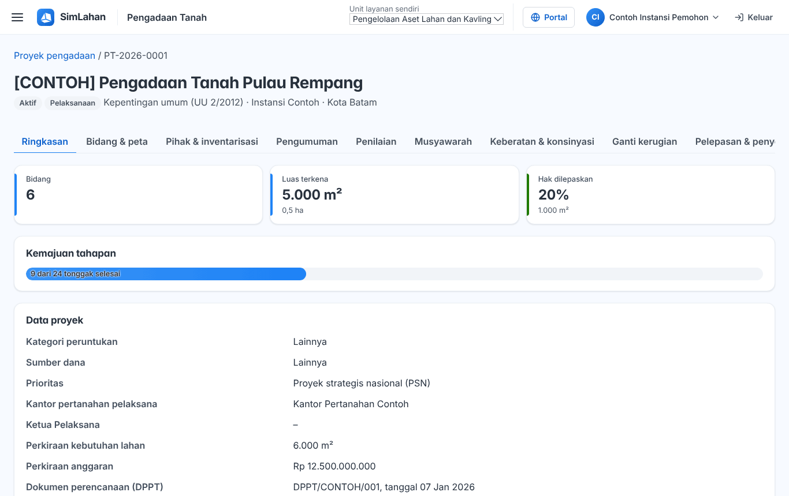
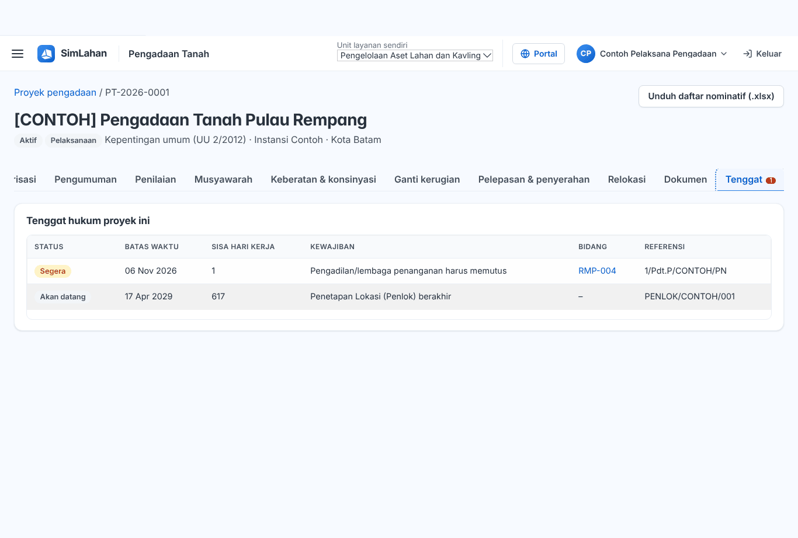
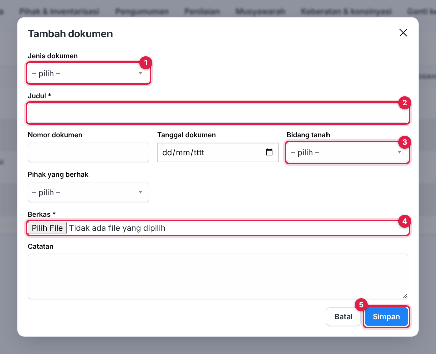
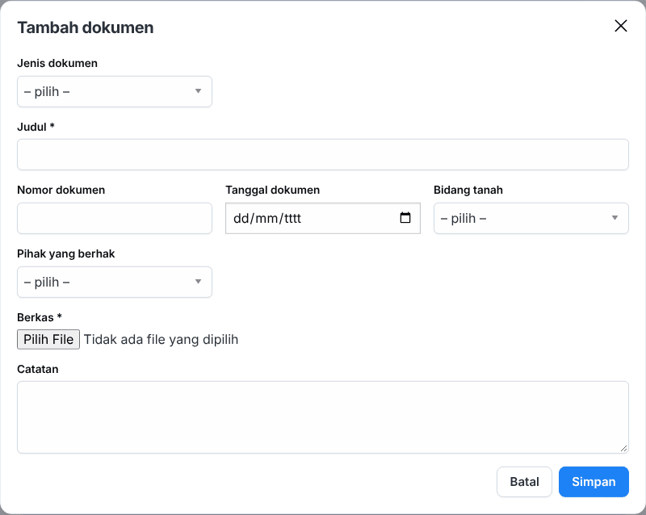

# Buku peran: Instansi Yang Memerlukan Tanah

Buku ini untuk **Instansi Yang Memerlukan Tanah**: instansi pemilik kebutuhan tanah yang memantau proyeknya. Buku ini berisi semua langkah kerja peran Anda, lengkap dengan gambar, sehingga cukup dibaca sendiri. Dasar penggunaan yang berlaku untuk semua peran (mengenal layar, ganti sandi, memakai di HP) ada di [Bab 2](../02-dasar-penggunaan.md).

**Cara membaca buku ini.** Kotak merah bernomor pada gambar menunjuk tombol atau kolom yang disebut di langkah. Tulisan *(nomor 2)* berarti: lihat kotak merah bernomor 2 pada gambar tepat di atas langkah itu. Semua gambar memakai data contoh fiktif; isi di layar Anda berbeda, tetapi letak tombolnya sama. Judul bagian bernomor (misalnya *3.4*) sama dengan nomor bagian di buku lengkap.

## Masuk dan halaman awal

<!-- sisip: 02-dasar-penggunaan.md#a-aplikasi-utama-petugas-kantor -->

### A. Aplikasi utama (petugas kantor)

1. Buka alamat SimLahan, misalnya `https://simlahan.instansi-anda.go.id/`.
2. Ketik nama pengguna Anda di kotak **Nama pengguna** (nomor 1 di gambar).
3. Ketik kata sandi di kotak **Kata sandi** (nomor 2).
4. Klik tombol biru **Masuk** (nomor 3).
5. Anda langsung dibawa ke halaman kerja peran Anda (lihat bagian "Halaman awal" di buku peran Anda).

Tautan di bawah kotak masuk (nomor 4: **⇄ Pusat Komando**, **⇄ Panel admin**, **⇄ Portal**) membawa Anda ke halaman masuk aplikasi lain.

<!-- akhir sisip -->

### Halaman awal

Setelah masuk, Anda langsung melihat **Dasbor pengadaan tanah**:

Nomor pada gambar:

1. **☰ Menu**: membuka menu **Pengadaan Tanah** (Dasbor & tenggat, Proyek pengadaan, Kalender & aturan tenggat).
2. **Lihat proyek**: membuka daftar proyek pengadaan.
3. **Tenggat hukum**: kewajiban yang batas waktunya dekat. Klik nama proyek di baris itu untuk membukanya.
4. **Nama Anda**: membuka menu akun (**Panduan peran**, **Ganti sandi**).
5. **Keluar**: mengakhiri sesi di perangkat ini.

Kartu **Ganti kerugian ditetapkan** tidak tampil untuk peran Anda.

### Menu Anda

Klik **☰** (nomor 1 pada gambar halaman awal) untuk membuka menu:

Menu **Pengadaan Tanah** berisi **Dasbor & tenggat**, **Proyek pengadaan**, dan **Kalender & aturan tenggat** (hanya membaca).

<!-- awal: dibuat dari backend/users/role_guide.py; perbarui dengan: cd backend && python manage.py panduan_buku -->

## Ringkasan peran

Memantau proyek pengadaan milik instansinya.

- **Cara masuk:** Alamat utama SimLahan (`/`), dengan nama pengguna dan sandi.
- **Halaman awal:** Pengadaan Tanah → Dasbor & tenggat.
- **Akun latihan** (hanya di sistem latihan berisi data contoh): `contoh.instansi`

### Menu yang Anda lihat

- Pengadaan Tanah: Dasbor & tenggat, Proyek pengadaan, Kalender & aturan tenggat

### Yang bisa Anda lakukan

- Membaca proyek, bidang, pengumuman, musyawarah, dan penyerahan.
- Mengunggah dokumen perencanaan (DPPT, studi kelayakan), BAST, foto, dan dokumen lain.

### Batas akses

- Hanya proyek yang mencantumkan akunnya di **Pengguna yang ditugaskan**; tidak melihat data pihak, penilaian, dan ganti kerugian.
- Hanya modul pengadaan tanah; modul sewa, alokasi, aset, pusat komando, dan panel admin tidak terbuka.

<!-- akhir: blok role_guide.py -->

## Urutan kerja Anda

1. Buka **Proyek pengadaan**. Anda hanya melihat proyek yang mencantumkan akun instansi Anda di **Pengguna yang ditugaskan** ([Proyek instansi Anda](#proyek-instansi-anda)).
2. Pantau kemajuan di tab **Ringkasan** dan tenggat di tab **Tenggat** ([4.3 Halaman proyek](#43-halaman-proyek)).
3. Unggah dokumen perencanaan (DPPT, studi kelayakan), BAST, foto, dan dokumen lain di tab **Dokumen** ([4.13 Dokumen proyek](#413-dokumen-proyek)).

## Langkah kerja Instansi

### Proyek instansi Anda

Klik **☰ → Pengadaan Tanah → Proyek pengadaan** (atau **Lihat proyek** di dasbor), lalu klik nama proyek. Daftar hanya berisi proyek yang mencantumkan akun instansi Anda di **Pengguna yang ditugaskan**; bila proyek Anda tidak muncul, minta Pelaksana menambahkannya. Proyek baru dibuat oleh Pelaksana, bukan oleh instansi.

<!-- sisip: 11-pengadaan-tanah.md#43-halaman-proyek -->

### 4.3 Halaman proyek

Bagian atas menampilkan nomor, nama, status, tahap, dasar hukum, instansi, dan lokasi proyek. Kartu angka di bawahnya menampilkan jumlah bidang, luas terkena, persentase hak dilepaskan, nilai penilaian final, ganti kerugian dibayar, dan keberatan berjalan.

- **Unduh daftar nominatif (.xlsx)** (nomor 1): mengunduh daftar bidang dan pihak yang berhak sebagai berkas Excel.
- **Ubah data** (nomor 2): mengubah data proyek, termasuk **Pengguna yang ditugaskan** (akun Penilai dan Instansi yang boleh melihat proyek ini).
- **+ Tambah tonggak** (nomor 3): menambah tonggak tahapan.

Deretan tab di bawah judul membagi pekerjaan per tahap: **Ringkasan**, **Bidang & peta**, **Pihak & inventarisasi**, **Pengumuman**, **Penilaian**, **Musyawarah**, **Keberatan & konsinyasi**, **Ganti kerugian**, **Pelepasan & penyerahan**, **Relokasi**, **Dokumen**, dan **Tenggat**. Angka di samping **Tenggat** adalah jumlah tenggat yang perlu perhatian.

> **Cara kerja yang sama di semua tab:**
> - Tombol **+ Tambah …** membuka jendela formulir. Isi formulir, lalu klik **Simpan**. Klik **Batal** atau **×** untuk menutup tanpa menyimpan.
> - Kolom yang labelnya diberi tanda **\*** wajib diisi. Bila ada yang kosong, formulir tidak tersimpan dan kolom itu diberi pesan merah.
> - Setiap baris tabel punya tautan **Ubah** (membuka formulir yang sama, sudah terisi) dan **Hapus** (meminta konfirmasi dulu).
> - Bila sebuah tombol atau tautan tidak tampil, peran Anda tidak berhak memakainya.
>
> Nomor merah pada gambar formulir di bawah menandai kolom terpenting. Kolom lain boleh diisi bila datanya ada.

#### Tonggak tahapan (tab Ringkasan)

Tonggak adalah kegiatan per tahap (perencanaan, persiapan, pelaksanaan, penyerahan) dengan tanggal rencana dan tanggal realisasi. Bilah **Kemajuan tahapan** menunjukkan berapa tonggak sudah selesai.

1. Klik **+ Tambah tonggak**. Untuk mengubah tonggak yang ada, klik **Ubah** pada barisnya.
2. Pilih **Tahap** (nomor 1) dan isi **Judul** kegiatan (nomor 2). Keduanya wajib.
3. Isi **Tanggal rencana** (nomor 3). Bila kegiatan sudah terlaksana, isi juga **Tanggal realisasi**.
4. Pilih **Status** (nomor 4): tertunda, sedang berjalan, selesai, atau tidak berlaku.
5. Bila perlu, isi dasar hukum, penanggung jawab, dan catatan.
6. Klik **Simpan** (nomor 5).

Satgas boleh memperbarui tonggak inventarisasi, musyawarah, dan pelepasan hak (status, tanggal realisasi, catatan).

<!-- akhir sisip -->

### Ringkasan proyek

Tab **Ringkasan** menampilkan jumlah bidang, luas terkena, persentase hak yang sudah dilepaskan, kemajuan tonggak, dan data proyek. Anda juga bisa membaca tab **Bidang & peta**, **Pengumuman**, **Musyawarah**, **Pelepasan & penyerahan** (bagian penyerahan hasil), dan **Tenggat**. Tab berisi data pihak, penilaian, dan ganti kerugian menampilkan "Anda tidak berwenang melihat data ini".

<!-- sisip: 11-pengadaan-tanah.md#414-tenggat-proyek -->

### 4.14 Tenggat proyek

Tab **Tenggat** berisi semua tenggat hukum proyek ini: kewajiban, batas waktu, sisa hari kerja, bidang, dan referensi dasar hukumnya.

<!-- akhir sisip -->

<!-- sisip: 11-pengadaan-tanah.md#413-dokumen-proyek -->

### 4.13 Dokumen proyek

*Semua peran pengadaan bisa mengunggah dokumen sesuai haknya. Instansi mengunggah dokumen perencanaan, BAST, foto, dan dokumen lain.*

1. Buka tab **Dokumen**, lalu klik **+ Tambah dokumen**.
2. Pilih **Jenis dokumen** (nomor 1), misalnya DPPT, laporan penilaian, berita acara musyawarah, atau bukti pembayaran.
3. Isi **Judul** (nomor 2). Wajib.
4. Bila dokumen khusus untuk satu bidang, pilih **Bidang tanah** (nomor 3), dan bila perlu pihak yang berhak. Isi juga nomor dan tanggal dokumen bila ada.
5. Klik **Pilih File** pada **Berkas** (nomor 4), lalu pilih berkas dari komputer. Wajib.
6. Klik **Simpan** (nomor 5).
7. Untuk membuka dokumen yang sudah diunggah, klik **Unduh** pada barisnya.

Jenis berkas diperiksa saat diunggah. Berkas yang isinya tidak sesuai ekstensinya (misalnya program yang diberi nama .pdf) ditolak.

<!-- akhir sisip -->

### Formulir dokumen untuk Instansi

Pilih **Jenis dokumen**, isi **Judul** (wajib), lalu pilih berkas di **Berkas** (wajib) dan klik **Simpan**. Kolom lain boleh dikosongkan.

<!-- sisip: 11-pengadaan-tanah.md#417-pertanyaan-umum -->

### 4.17 Pertanyaan umum

**Proyek tidak muncul di daftar (Penilai/Instansi).** Akun Anda belum dicantumkan di **Pengguna yang ditugaskan**. Minta Pelaksana menambahkannya lewat **Ubah data** proyek.

**Tombol Validasi tidak ada.** Hanya Pelaksana Pengadaan (Ketua Pelaksana) dan Administrator yang memvalidasi, dan hanya untuk baris berstatus **Ditetapkan**.

**Tanggal tenggat jatuh di hari libur.** Periksa daftar hari libur tahun berjalan di **Kalender & aturan tenggat**; tambahkan libur yang belum ada.

<!-- akhir sisip -->

## Bila ada kendala

- **Menu atau tombol yang disebut di buku ini tidak ada di layar Anda.** Peran Anda memang tidak memerlukannya (lihat **Batas akses** di atas). Bila Anda membutuhkannya untuk pekerjaan, minta Administrator menambahkan peran yang sesuai.
- **Pesan "Tidak berhak" atau "Anda tidak berwenang melihat data ini".** Data itu di luar hak peran Anda, bukan kerusakan sistem.
- **Lupa kata sandi.** Hubungi superuser SimLahan untuk dibuatkan sandi baru, lalu ganti sandi itu setelah masuk (klik nama Anda → **Ganti sandi**, atau buka `/akun/sandi/`).
- **Terlalu banyak percobaan masuk.** Tunggu beberapa menit, lalu coba lagi dengan sandi yang benar.
- **Ringkasan peran di dalam aplikasi.** Isi bagian *Ringkasan peran* di atas juga bisa dibuka kapan saja lewat **Panduan peran** (`/akun/panduan/`).
