# Buku peran: Investor

Buku ini untuk **Investor**: investor atau pelaku usaha yang mencari lahan untuk disewa, dialokasikan, atau dikerjasamakan. Buku ini berisi semua langkah kerja peran Anda, lengkap dengan gambar, sehingga cukup dibaca sendiri. Dasar penggunaan yang berlaku untuk semua peran (mengenal layar, ganti sandi, memakai di HP) ada di [Bab 2](../02-dasar-penggunaan.md).

**Cara membaca buku ini.** Kotak merah bernomor pada gambar menunjuk tombol atau kolom yang disebut di langkah. Tulisan *(nomor 2)* berarti: lihat kotak merah bernomor 2 pada gambar tepat di atas langkah itu. Semua gambar memakai data contoh fiktif; isi di layar Anda berbeda, tetapi letak tombolnya sama. Judul bagian bernomor (misalnya *3.4*) sama dengan nomor bagian di buku lengkap.

## Mendaftar dan masuk

Daftar sebagai investor (14.1). Setelah akun aktif, masuk lewat 13.1.

<!-- sisip: 52-portal-investor.md#141-mendaftar-sebagai-investor -->

### 14.1 Mendaftar sebagai investor

1. Di portal, klik **Investasi**, lalu **Daftar sebagai investor**.
2. Isi bagian atas formulir (surel, kata sandi, jenis pemohon, nama, NIB, NPWP, penanggung jawab, telepon, alamat, kota) persis seperti pendaftaran biasa ([Bab 12.11](../50-portal-publik.md#1211-mendaftar-akun)).
3. Gulir ke bawah. Centang **Sektor usaha yang diminati** (boleh lebih dari satu): Industri, Pariwisata & perhotelan, Perdagangan & jasa, Logistik & pergudangan, Perumahan & permukiman, Pertanian & perikanan, Energi & utilitas, Fasilitas umum & sosial.
4. Pilih **Asal modal** (PMDN atau PMA), isi **Negara asal investor** (untuk PMA) dan **Situs web perusahaan**.
5. Centang pernyataan, klik **Daftar sebagai investor**, lalu aktifkan akun lewat tautan di surel.

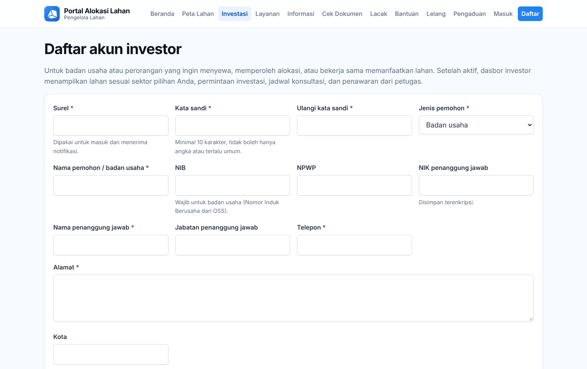

Sudah punya akun pemohon? Tidak perlu mendaftar lagi: centang **Akun investor** di **Ubah profil** ([14.8](../52-portal-investor.md#148-profil)).

<!-- akhir sisip -->

<!-- sisip: 51-portal-pemohon.md#131-masuk-ke-portal -->

### 13.1 Masuk ke portal

Klik **Masuk** di menu atas portal.

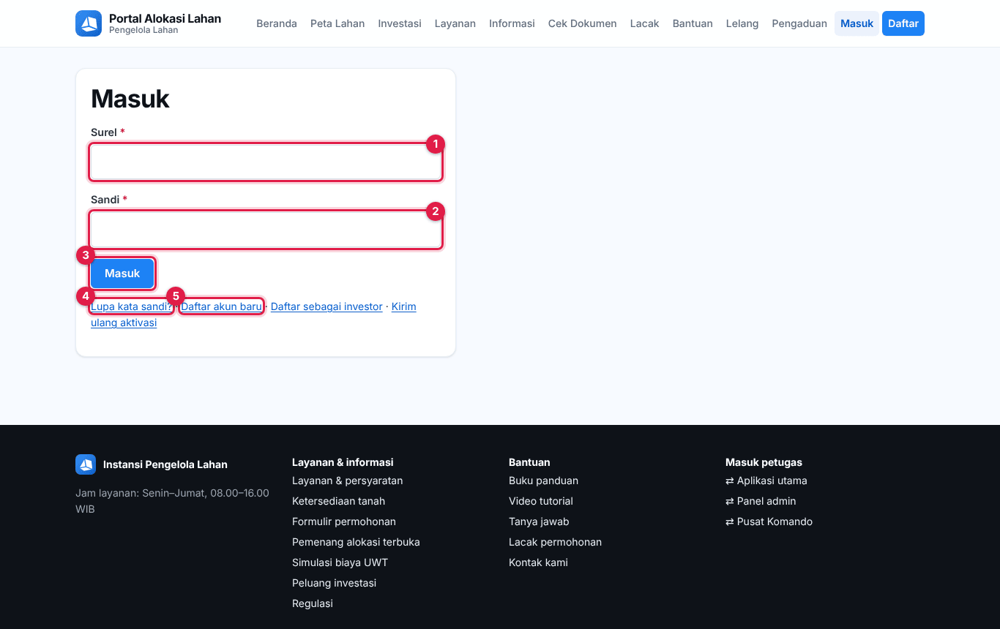

1. Isi surel akun Anda (nomor 1).
2. Isi kata sandi (nomor 2).
3. Klik **Masuk** (nomor 3). Anda diarahkan ke **Akun saya** ([13.2](../51-portal-pemohon.md#132-akun-saya)).
4. **Lupa kata sandi?** (nomor 4) dan **Daftar akun baru** (nomor 5) ada di bawah tombol.

#### Lupa kata sandi

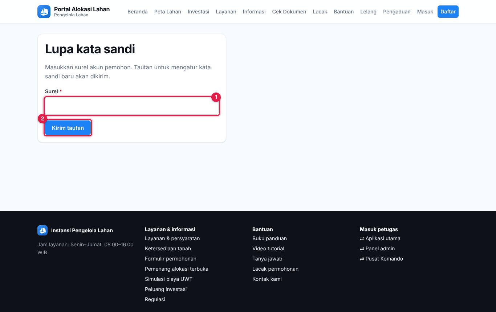

1. Di halaman masuk, klik **Lupa kata sandi?**.
2. Isi **Surel** akun Anda (nomor 1), lalu klik **Kirim tautan** (nomor 2).
3. Buka surel dari SimLahan dan klik tautan atur ulang sandi.
4. Di halaman **Atur kata sandi baru**, isi kata sandi baru dua kali, lalu klik **Simpan kata sandi**. Masuk dengan kata sandi baru. Bila tautan sudah tidak berlaku, klik **Minta tautan baru**.

<!-- akhir sisip -->

<!-- awal: dibuat dari backend/users/role_guide.py; perbarui dengan: cd backend && python manage.py panduan_buku -->

## Ringkasan peran

Akun pemohon portal dengan profil investor: mencari lahan, mengajukan minat sewa/alokasi/kerja sama, dan menanggapi penawaran petugas.

- **Cara masuk:** Portal (`/portal/masuk/`) dengan alamat surel; daftar sendiri di `/portal/investasi/daftar/`. Pemohon yang mengajukan minat investasi pertamanya otomatis menjadi investor.
- **Halaman awal:** Portal → Akun saya (dasbor investor).
- **Akun latihan** (hanya di sistem latihan berisi data contoh): `investor@contoh.simlahan.invalid`

### Menu yang Anda lihat

- Portal: Investasi (beranda peluang, peta, kawasan, bandingkan, ajukan minat), Peta Lahan, Layanan, Informasi, Bantuan → Panduan investor
- Dasbor investor: penawaran menunggu jawaban, jadwal konsultasi, permintaan aktif dengan langkah berikutnya, lahan tersimpan, lahan sesuai sektor minat, dokumen & perizinan
- Akun saya → Ubah profil (profil investor: sektor minat, asal modal, negara asal, situs web), Ubah kata sandi

### Yang bisa Anda lakukan

- Semua yang bisa dilakukan pemohon portal.
- Menyimpan dan membandingkan hingga 4 lahan, mengunduh profil lahan (PDF), dan menghitung simulasi biaya.
- Mengajukan minat dengan memilih lahan atau menggambar usulan lokasi; formulir terisi otomatis dari profil investor.
- Berkirim pesan dan lampiran dengan petugas, menerima atau menolak penawaran, serta membatalkan permintaan sebelum penawaran diterima.
- Setelah selesai: melengkapi draf permohonan alokasi atau mengelola dokumen perizinan kontrak sewa/kerja sama.

### Batas akses

- Hanya melihat permintaan, pesan, lampiran, dan lahan tersimpan miliknya sendiri; nomor milik investor lain tidak ditemukan.
- Tidak melihat catatan internal petugas dan tidak bisa mengubah status selain menerima/menolak penawaran atau membatalkan.
- Tidak bisa masuk ke aplikasi petugas, panel admin, pusat komando, atau API.

<!-- akhir: blok role_guide.py -->

## Urutan kerja Anda

1. Daftar sebagai investor ([14.1 Mendaftar sebagai investor](#141-mendaftar-sebagai-investor)), lalu masuk ([13.1 Masuk ke portal](#131-masuk-ke-portal)).
2. Cari lahan di peta investasi, simpan, dan bandingkan ([14.3 Mencari, menyimpan, dan membandingkan lahan](#143-mencari-menyimpan-dan-membandingkan-lahan)).
3. Ajukan minat investasi: skema, sektor, rencana usaha, dan lokasi ([14.4 Mengajukan minat investasi](#144-mengajukan-minat-investasi)).
4. Pantau jadwal konsultasi dan pesan petugas ([14.5 Memantau permintaan](#145-memantau-permintaan)); terima atau tolak penawaran ([14.6 Menjawab penawaran](#146-menjawab-penawaran)).
5. Setelah penawaran diterima, lanjutkan ke kontrak atau permohonan alokasi ([14.7 Setelah penawaran diterima](#147-setelah-penawaran-diterima)) dan kelola dokumen perizinan (Bagian B).

## Bagian A – Investasi

<!-- sisip: 52-portal-investor.md#142-dasbor-investor -->

### 14.2 Dasbor investor

Setelah masuk, **Akun Saya** menampilkan dasbor investor.

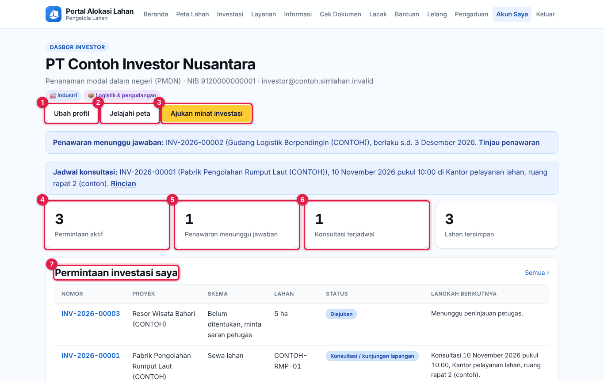

1. **Ubah profil** (nomor 1), **Jelajahi peta** (nomor 2), dan **Ajukan minat investasi** (nomor 3).
2. Kotak biru di bawahnya memberi tahu hal yang perlu Anda tindak lanjuti, misalnya **Penawaran menunggu jawaban** (klik **Tinjau penawaran**) atau **Jadwal konsultasi** (klik **Rincian**).
3. Kartu ringkasan: **Permintaan aktif** (nomor 4), **Penawaran menunggu jawaban** (nomor 5), **Konsultasi terjadwal** (nomor 6), dan **Lahan tersimpan**. Klik kartu untuk membuka daftarnya.
4. **Permintaan investasi saya** (nomor 7): nomor, proyek, skema, lahan, status, dan **Langkah berikutnya** yang harus terjadi. Klik nomor permintaan untuk membukanya.

Gulir ke bawah:

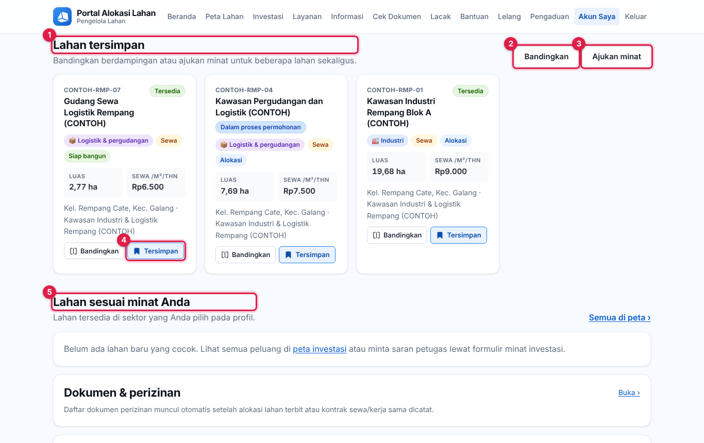

1. **Lahan tersimpan** (nomor 1): lahan yang Anda simpan.
2. **Bandingkan** (nomor 2) membandingkan lahan tersimpan berdampingan; **Ajukan minat** (nomor 3) membuka formulir minat untuk lahan-lahan itu sekaligus.
3. Tombol **Tersimpan** (nomor 4) di kartu lahan menghapus lahan dari daftar simpan.
4. **Lahan sesuai minat Anda** (nomor 5): lahan baru di sektor yang Anda pilih di profil.

Di bawahnya ada **Dokumen & perizinan** ([Bab 15](../53-portal-dokumen.md)), **Peralihan hak kepada saya**, dan **Layanan pertanahan lain**.

<!-- akhir sisip -->

<!-- sisip: 52-portal-investor.md#143-mencari-menyimpan-dan-membandingkan-lahan -->

### 14.3 Mencari, menyimpan, dan membandingkan lahan

1. Klik **Jelajahi peta**. Cara menyaring (skema, sektor, **Filter lainnya**, **Urutkan**) dijelaskan di [Bab 12.3](../50-portal-publik.md#123-investasi). Investor juga mendapat centang **Hanya lahan tersimpan** di **Filter lainnya**.
2. Klik kartu lahan untuk membuka detailnya.

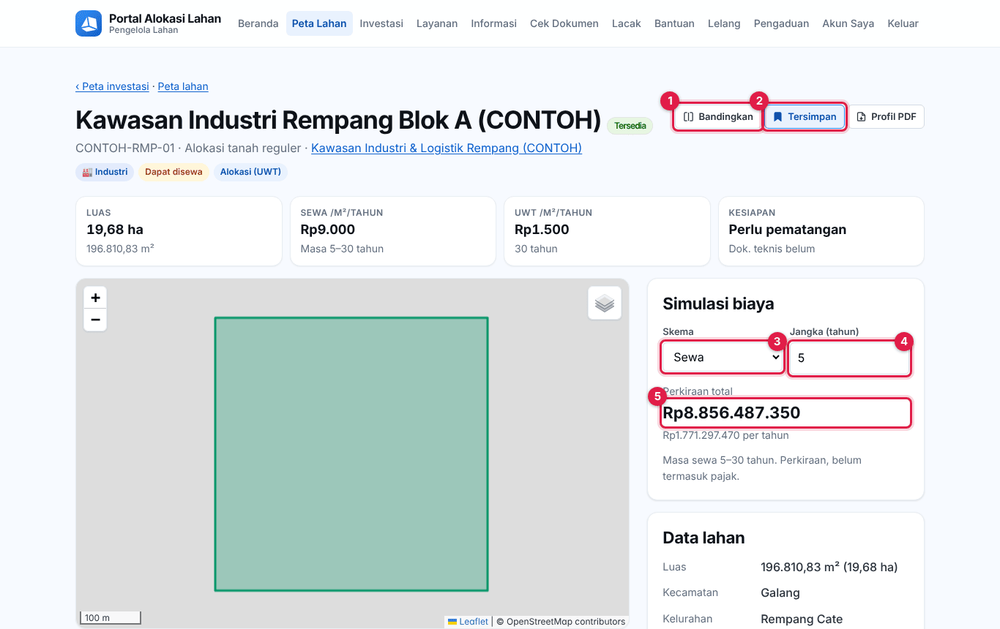

3. **Bandingkan** (nomor 1) menambah lahan ke perbandingan (hingga 4 lahan).
4. **Simpan** (nomor 2) menyimpan lahan ke **Lahan tersimpan**. Setelah disimpan, tombol berubah menjadi **Tersimpan**; klik lagi untuk menghapusnya.
5. Di **Simulasi biaya**, pilih **Skema** (nomor 3) dan isi **Jangka (tahun)** (nomor 4); **Perkiraan total** (nomor 5) langsung dihitung.
6. Di bawah halaman, kotak **Tertarik dengan lahan ini?** berisi **Ajukan minat investasi** (atau **Buka permintaan** bila Anda sudah mengajukan minat untuk lahan ini) dan **Langsung ajukan permohonan alokasi**.

Semua lahan yang disimpan ada di **Lahan tersimpan** (dari kartu dasbor atau tombol di **Permintaan investasi saya**):

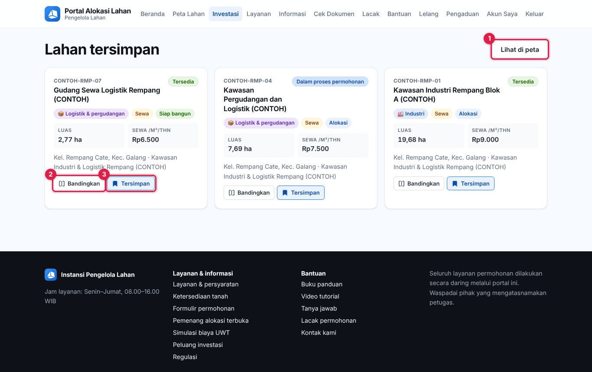

1. **Lihat di peta** (nomor 1) membuka peta investasi berisi lahan tersimpan saja.
2. **Bandingkan** (nomor 2) di kartu lahan menambahkannya ke perbandingan.
3. **Tersimpan** (nomor 3) menghapus lahan dari daftar.

Di halaman **Bandingkan lahan**, klik **Ajukan minat** per lahan atau **Ajukan minat untuk semua lahan ini**.

<!-- akhir sisip -->

<!-- sisip: 52-portal-investor.md#144-mengajukan-minat-investasi -->

### 14.4 Mengajukan minat investasi

Klik **Ajukan minat investasi** (dari dasbor, detail lahan, kawasan, atau perbandingan). Formulirnya panjang dan terbagi empat bagian. Tombol **Kirim permintaan** selalu tampil di bawah layar.

**Bagian 1 dan 2 – Skema, sektor, dan rencana usaha**

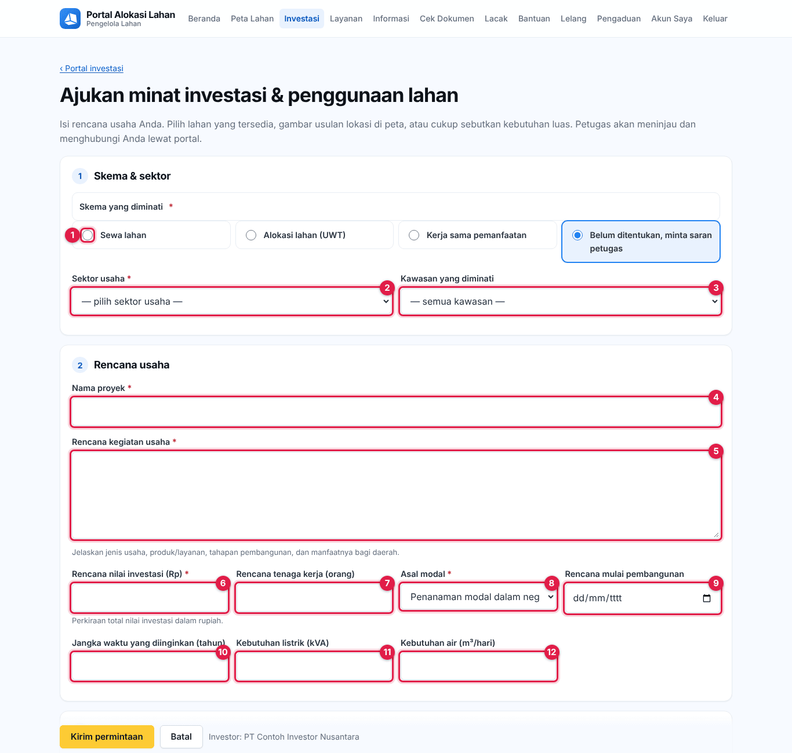

1. Pilih **Skema yang diminati** (nomor 1 dan pilihan di sebelahnya): **Sewa lahan**, **Alokasi lahan (UWT)**, **Kerja sama pemanfaatan**, atau **Belum ditentukan, minta saran petugas**.
2. Pilih **Sektor usaha** (nomor 2) dan, bila ada, **Kawasan yang diminati** (nomor 3).
3. Isi **Nama proyek** (nomor 4) dan **Rencana kegiatan usaha** (nomor 5): jenis usaha, produk atau layanan, tahapan pembangunan, dan manfaatnya.
4. Isi **Rencana nilai investasi (Rp)** (nomor 6), **Rencana tenaga kerja (orang)** (nomor 7), **Asal modal** (nomor 8), dan **Rencana mulai pembangunan** (nomor 9).
5. Isi **Jangka waktu yang diinginkan (tahun)** (nomor 10), **Kebutuhan listrik (kVA)** (nomor 11), dan **Kebutuhan air (m³/hari)** (nomor 12) bila sudah diketahui.

**Bagian 3 – Lokasi yang diminati**

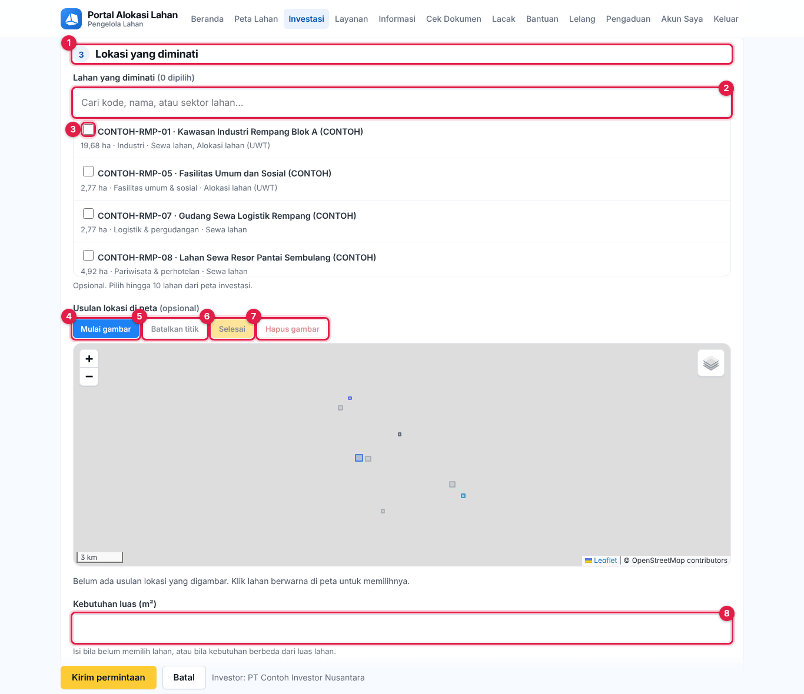

6. Di **Lokasi yang diminati** (nomor 1), ketik di kotak pencarian (nomor 2) untuk menyaring daftar lahan.
7. Centang lahan yang Anda minati (nomor 3), hingga 10 lahan. Anda juga bisa mengklik lahan berwarna di peta.
8. Lahan yang cocok belum ada? Gambar usulan lokasi di peta:
   - Klik **Mulai gambar** (nomor 4).
   - Klik titik-titik sudut lokasi di peta satu per satu.
   - Salah klik? **Batalkan titik** (nomor 5) menghapus titik terakhir.
   - Klik **Selesai** (nomor 6) setelah titik terakhir. **Hapus gambar** (nomor 7) mengulang dari awal.
9. Atau cukup isi **Kebutuhan luas (m²)** (nomor 8).

**Bagian 4 – Lampiran dan pernyataan**

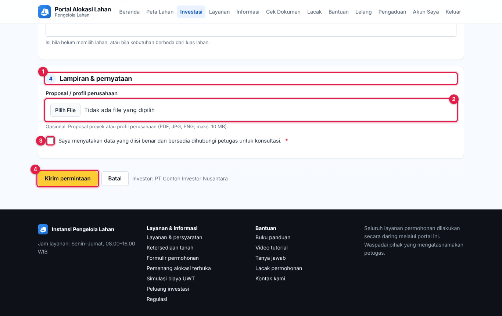

10. Di **Lampiran & pernyataan** (nomor 1), lampirkan **Proposal / profil perusahaan** (nomor 2) bila ada (PDF, JPG, atau PNG; maksimal 10 MB).
11. Centang pernyataan (nomor 3).
12. Klik **Kirim permintaan** (nomor 4). Nomor permintaan (misalnya `INV-2026-00003`) muncul di **Permintaan investasi saya**.

<!-- akhir sisip -->

<!-- sisip: 52-portal-investor.md#145-memantau-permintaan -->

### 14.5 Memantau permintaan

Buka **Permintaan investasi saya** (dari dasbor atau menu **Investasi**).

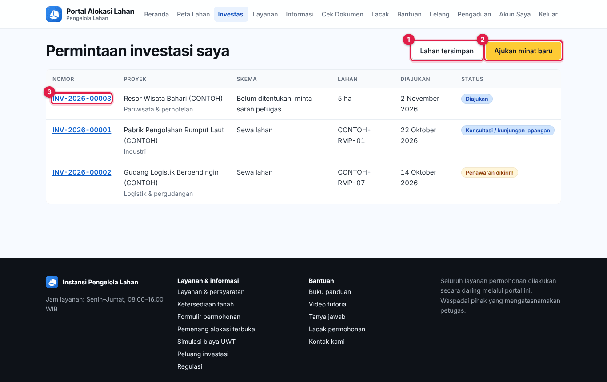

1. **Lahan tersimpan** (nomor 1) dan **Ajukan minat baru** (nomor 2).
2. Klik **nomor permintaan** (nomor 3) untuk membukanya.

Halaman permintaan menampilkan tahapan (**Diajukan → Ditinjau → Konsultasi → Penawaran → Diterima → Selesai**), **Ringkasan**, **Lahan diminati**, **Rencana usaha**, **Usulan lokasi**, dan **Riwayat**.

**Konsultasi:** bila petugas menjadwalkan konsultasi atau kunjungan lapangan, Anda menerima surel.

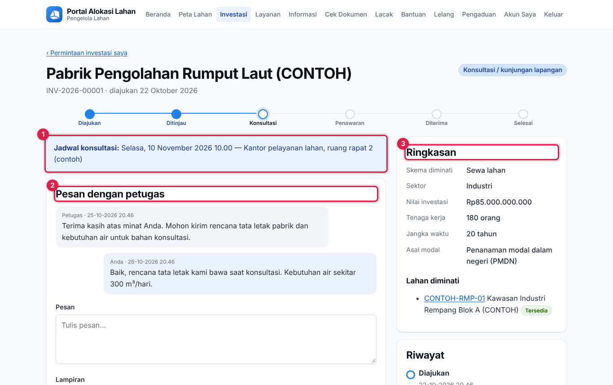

1. Kotak biru **Jadwal konsultasi:** (nomor 1) menampilkan hari, tanggal, jam, dan tempat atau tautan pertemuan.
2. **Pesan dengan petugas** (nomor 2) berisi percakapan dengan petugas.
3. **Ringkasan** (nomor 3) merangkum skema, sektor, nilai investasi, tenaga kerja, jangka waktu, dan asal modal.

**Mengirim pesan dan membatalkan:**

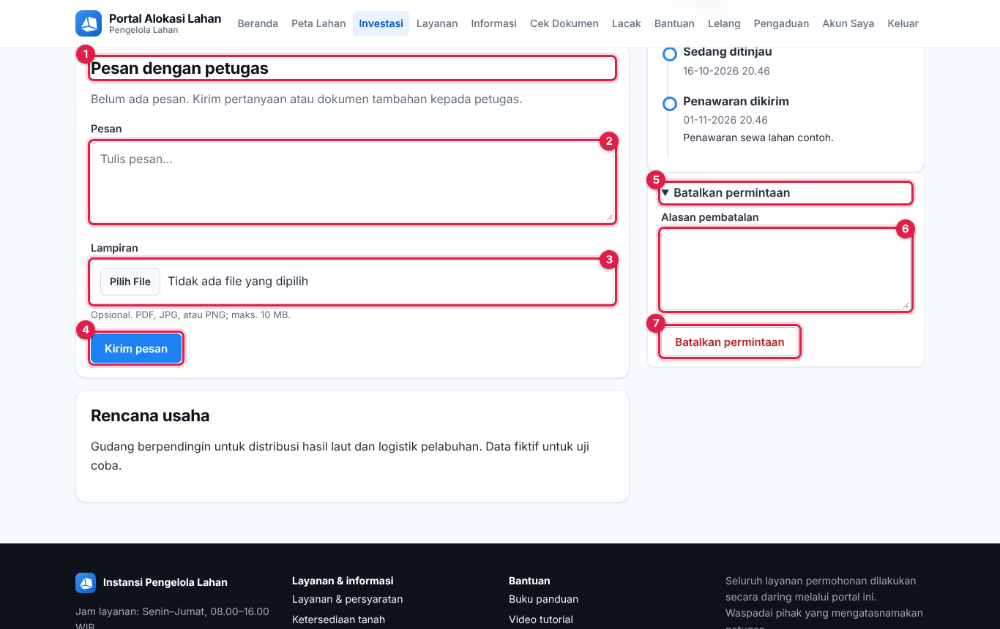

1. Di **Pesan dengan petugas** (nomor 1), tulis **Pesan** (nomor 2).
2. Lampirkan berkas bila perlu di **Lampiran** (nomor 3).
3. Klik **Kirim pesan** (nomor 4). Jawaban petugas muncul di percakapan yang sama, dan Anda menerima surel.
4. Untuk membatalkan permintaan yang belum selesai, buka **Batalkan permintaan** (nomor 5), tulis **Alasan pembatalan** (nomor 6), lalu klik tombol merah **Batalkan permintaan** (nomor 7).

<!-- akhir sisip -->

<!-- sisip: 52-portal-investor.md#146-menjawab-penawaran -->

### 14.6 Menjawab penawaran

Saat status menjadi **Penawaran dikirim**, Anda menerima surel. Buka permintaannya.

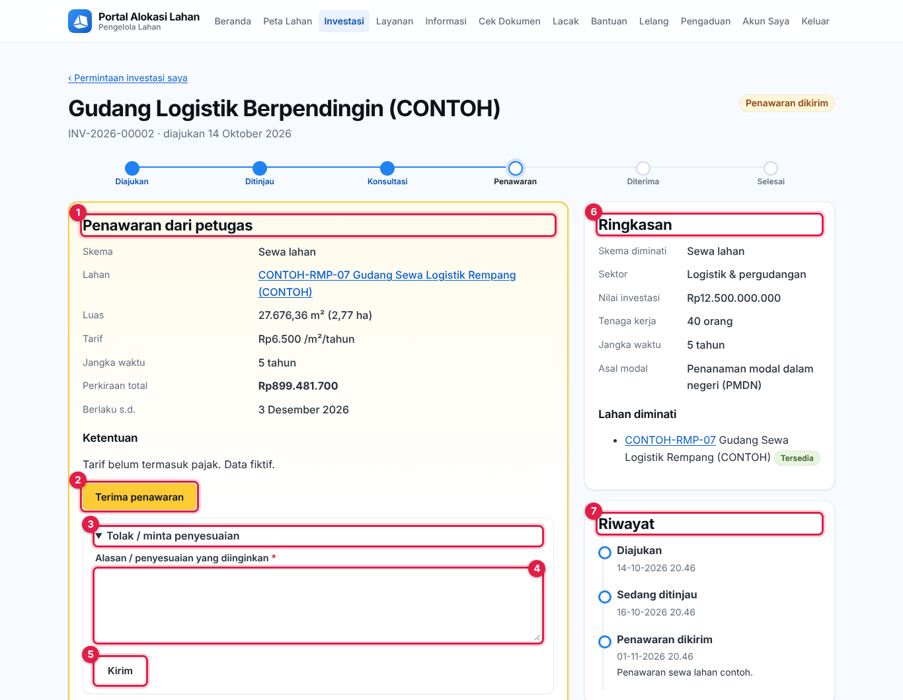

1. Baca **Penawaran dari petugas** (nomor 1): skema, lahan, luas, **Tarif**, **Jangka waktu**, **Perkiraan total**, **Berlaku s.d.**, dan **Ketentuan**.
2. Setuju? Klik **Terima penawaran** (nomor 2) lalu konfirmasi.
3. Belum setuju? Buka **Tolak / minta penyesuaian** (nomor 3), tulis alasan atau penyesuaian yang Anda inginkan (nomor 4), lalu klik **Kirim** (nomor 5). Petugas dapat mengirim penawaran baru.
4. **Ringkasan** (nomor 6) dan **Riwayat** (nomor 7) mencatat semua tahapan.
5. Bila masa berlaku penawaran sudah lewat, kirim pesan untuk meminta penawaran baru.

<!-- akhir sisip -->

<!-- sisip: 52-portal-investor.md#147-setelah-penawaran-diterima -->

### 14.7 Setelah penawaran diterima

Petugas menyelesaikan permintaan:

- **Sewa atau kerja sama**: petugas mencatat kontrak sewa atau perjanjian kerja sama. Daftar dokumen perizinan untuk kontrak itu muncul di **Dokumen & perizinan** ([Bab 15](../53-portal-dokumen.md)).
- **Alokasi (UWT)**: sistem membuat **draf permohonan alokasi** atas nama Anda dengan rencana usaha terisi. Lengkapi dokumen dan ajukan seperti [Bab 13.3](../51-portal-pemohon.md#133-mengajukan-permohonan-alokasi). Anda juga bisa langsung mengajukan dari detail lahan lewat **Langsung ajukan permohonan alokasi**.

<!-- akhir sisip -->

<!-- sisip: 52-portal-investor.md#148-profil -->

### 14.8 Profil

Klik **Ubah profil** di dasbor. Bagian atas sama dengan profil pemohon ([Bab 13.10](../51-portal-pemohon.md#1310-profil-dan-kata-sandi)). Gulir ke bawah:

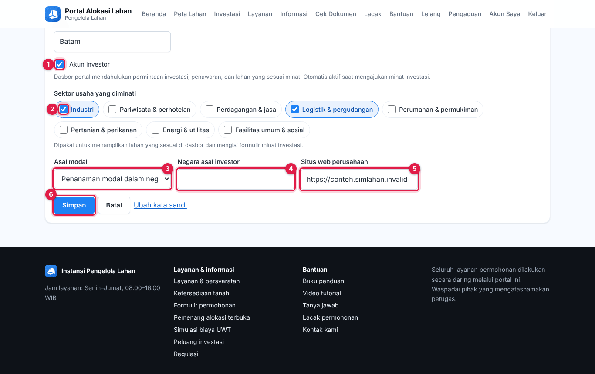

1. **Akun investor** (nomor 1) harus tercentang agar dasbor investor tampil.
2. Centang **Sektor usaha yang diminati** (nomor 2 dan seterusnya). **Lahan sesuai minat Anda** di dasbor mengikuti pilihan ini.
3. Pilih **Asal modal** (nomor 3), isi **Negara asal investor** (nomor 4) dan **Situs web perusahaan** (nomor 5).
4. Klik **Simpan** (nomor 6).

<!-- akhir sisip -->

## Bagian B – Dokumen & perizinan

<!-- sisip: 53-portal-dokumen.md#152-melengkapi-dokumen-perizinan -->

### 15.2 Melengkapi dokumen perizinan

Klik kartu pemanfaatan lahan di **Ringkasan**.

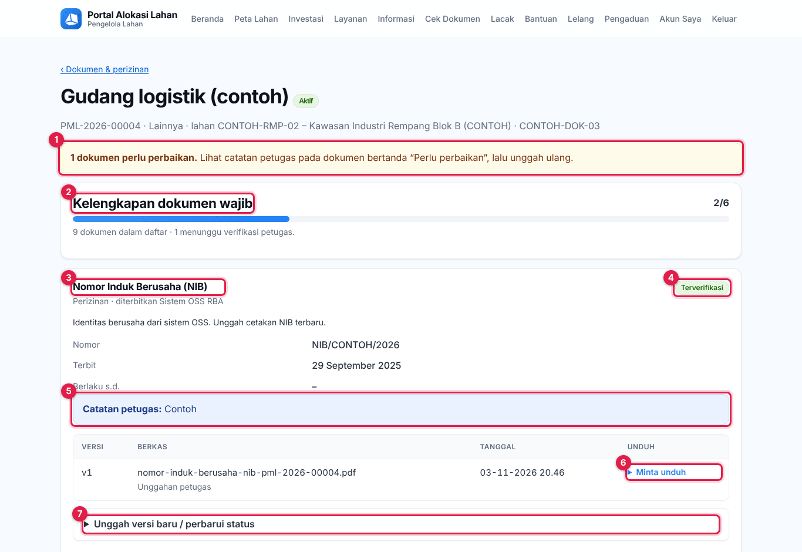

1. Kotak kuning di atas (nomor 1) memberi tahu dokumen yang perlu tindakan, misalnya "1 dokumen perlu perbaikan".
2. **Kelengkapan dokumen wajib** (nomor 2): berapa dokumen wajib yang sudah lengkap, misalnya 2/6.
3. Setiap dokumen punya kartu sendiri dengan nama (nomor 3) dan status (nomor 4): **Belum diurus**, **Sedang diurus**, **Menunggu verifikasi**, **Terverifikasi**, **Perlu perbaikan**, **Kedaluwarsa**, atau **Tidak wajib**. Kartu juga menampilkan **Nomor**, tanggal **Terbit**, dan **Berlaku s.d.**
4. **Catatan petugas** (nomor 5) berisi pesan petugas. Bila status **Perlu perbaikan**, di sinilah alasannya.
5. Tabel versi berkas menampilkan setiap berkas yang pernah diunggah. **Minta unduh** (nomor 6) meminta izin mengunduh versi itu ([15.5](../53-portal-dokumen.md#155-meminta-izin-unduh)).
6. Bila tersedia, klik **Unduh format dokumen** di kartu untuk mengunduh formulir atau contohnya.
7. Klik **Unggah dokumen / perbarui status** (pada dokumen yang sudah punya berkas: **Unggah versi baru / perbarui status**, nomor 7; pada dokumen yang perlu diperbaiki: **Unggah perbaikan**) untuk membuka formulirnya:

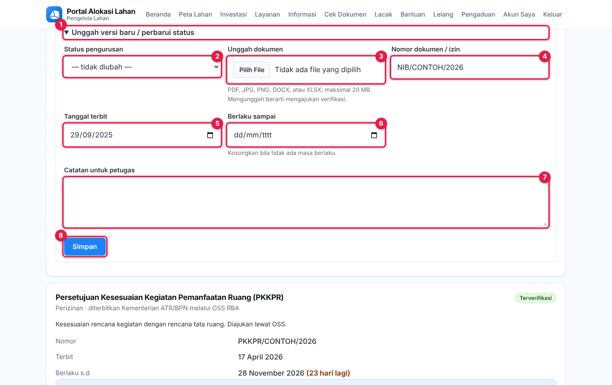

8. **Status pengurusan** (nomor 2): pilih **Sedang diurus** saat mulai mengurus ke instansi penerbit. Biarkan **— tidak diubah —** bila hanya mengunggah berkas.
9. **Unggah dokumen** (nomor 3): klik **Pilih File** dan pilih berkasnya (PDF, JPG, PNG, DOCX, atau XLSX; maksimal 20 MB). Mengunggah berarti mengajukan verifikasi; status menjadi **Menunggu verifikasi**.
10. Isi **Nomor dokumen / izin** (nomor 4), **Tanggal terbit** (nomor 5), dan **Berlaku sampai** (nomor 6). Kosongkan **Berlaku sampai** bila izin tidak punya masa berlaku.
11. Tulis **Catatan untuk petugas** (nomor 7) bila perlu.
12. Klik **Simpan** (nomor 8).

Bila izin hampir habis (tanda "(… hari lagi)" di **Berlaku s.d.**) atau sudah **Kedaluwarsa**, perpanjang izin ke instansi penerbit lalu unggah dokumen terbaru dengan cara yang sama. Bagian **Dokumen tanda tangan** dan **Riwayat** di bawah halaman mencatat semua aktivitas.

<!-- akhir sisip -->

<!-- sisip: 53-portal-dokumen.md#153-menandatangani-dokumen-elektronik -->

### 15.3 Menandatangani dokumen elektronik

Anda menerima surel berisi tautan saat ada dokumen yang perlu ditandatangani atau disetujui. Tautan juga ada di **Menunggu tindakan Anda** (tombol **Tanda tangani**).

1. Buka tautan. Bila dokumen ditujukan ke akun portal, masuk dengan akun penerima; Anda langsung masuk ke halaman dokumen. (Masuk dengan akun lain menampilkan **Akun tidak sesuai**.)
2. Penerima tanpa akun portal melewati **Verifikasi penerima** lebih dulu: klik **Kirim kode ke surel**, masukkan kode 6 angka dari surel (berlaku 10 menit) dan **kode akses** dari petugas bila diminta, lalu klik **Lanjutkan**. Jangan berikan kode kepada siapa pun, termasuk yang mengaku petugas.

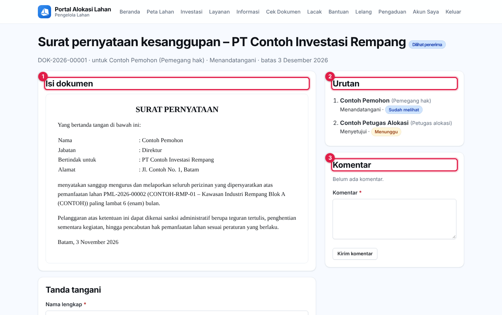

3. Baca **Isi dokumen** (nomor 1) sampai habis. Untuk PDF unggahan, klik **Buka PDF di tab baru** untuk tampilan penuh.
4. **Urutan** (nomor 2) menampilkan semua penanda tangan dan statusnya (**Menunggu**, **Sudah melihat**, **Selesai**).
5. Ada pertanyaan untuk petugas? Tulis di **Komentar** (nomor 3), lalu klik **Kirim komentar**.
6. Isi **Isian Anda** bila ada (teks, tanggal, angka, centang, pilihan, paraf, atau lampiran maksimal 20 MB).
7. Gulir ke kotak **Tanda tangani**:

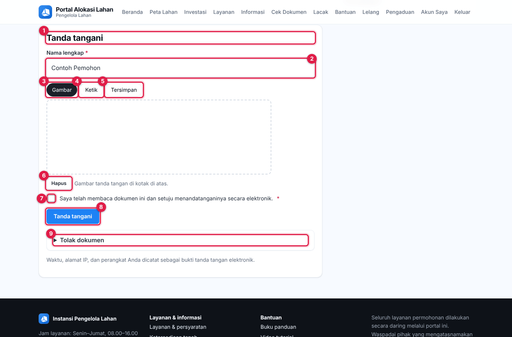

8. Di **Tanda tangani** (nomor 1), periksa **Nama lengkap** (nomor 2).
9. Buat tanda tangan dengan salah satu cara:
   - **Gambar** (nomor 3): tulis tanda tangan di kotak bergaris putus-putus dengan tetikus atau jari.
   - **Ketik** (nomor 4): ketik nama; sistem mengubahnya menjadi tanda tangan.
   - **Tersimpan** (nomor 5): pakai tanda tangan yang sudah disimpan ([15.4](../53-portal-dokumen.md#154-tanda-tangan-tersimpan)).
   - **Hapus** (nomor 6) mengosongkan kotak untuk mengulang.
10. Centang **Saya telah membaca dokumen ini dan setuju menandatanganinya secara elektronik** (nomor 7).
11. Klik **Tanda tangani** (nomor 8), atau **Setujui** bila Anda hanya diminta menyetujui. Waktu, alamat IP, dan perangkat Anda dicatat sebagai bukti tanda tangan elektronik.
12. Tidak setuju dengan isi dokumen? Buka **Tolak dokumen** (nomor 9), tulis alasannya, lalu klik **Tolak dokumen**.

Catatan:

- Bila muncul "Dokumen ini masih menunggu penanda tangan sebelumnya", tunggu surel saat giliran Anda tiba.
- Bila dokumen ditandai **Tanda tangan langsung**, datang ke loket layanan dengan membawa identitas; petugas membuka halaman tanda tangan di perangkat layanan.

**Setelah semua pihak selesai**, buka dokumen dari **Ringkasan → Dokumen tanda tangan**:

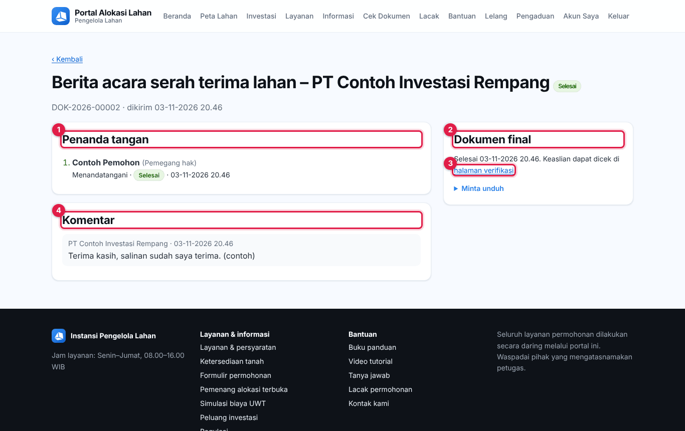

1. **Penanda tangan** (nomor 1): siapa menandatangani dan kapan.
2. **Dokumen final** (nomor 2): dokumen sudah selesai.
3. **halaman verifikasi** (nomor 3) membuka bukti keaslian dokumen ([Bab 12.9](../50-portal-publik.md#129-cek-keaslian-dokumen)).
4. **Komentar** (nomor 4) mencatat tanya jawab dengan petugas.
5. Untuk mengunduh PDF final, gunakan **Minta unduh** ([15.5](../53-portal-dokumen.md#155-meminta-izin-unduh)).

<!-- akhir sisip -->

<!-- sisip: 53-portal-dokumen.md#154-tanda-tangan-tersimpan -->

### 15.4 Tanda tangan tersimpan

Simpan tanda tangan sekali, lalu pakai ulang setiap kali menandatangani dengan akun ini. Klik tab **Tanda tangan saya**.

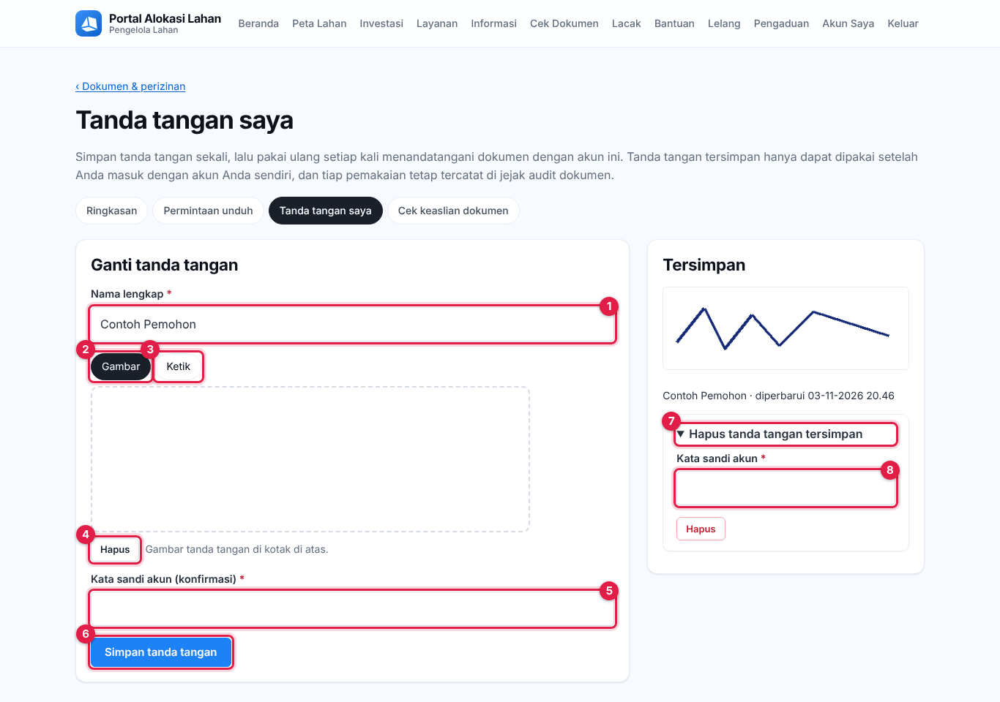

1. Isi **Nama lengkap** (nomor 1).
2. Pilih **Gambar** (nomor 2) lalu tulis tanda tangan di kotak, atau **Ketik** (nomor 3) lalu ketik nama. **Hapus** (nomor 4) mengulang.
3. Masukkan kata sandi akun Anda di **Kata sandi akun (konfirmasi)** (nomor 5).
4. Klik **Simpan tanda tangan** (nomor 6). Tanda tangan tampil di kotak **Tersimpan** di kanan.
5. Untuk menghapusnya, buka **Hapus tanda tangan tersimpan** (nomor 7), isi **Kata sandi akun** (nomor 8), lalu klik **Hapus**.

Tanda tangan tersimpan hanya dapat dipakai setelah Anda masuk dengan akun sendiri, dan setiap pemakaian tercatat.

<!-- akhir sisip -->

<!-- sisip: 53-portal-dokumen.md#155-meminta-izin-unduh -->

### 15.5 Meminta izin unduh

Setiap unduhan dokumen memerlukan persetujuan petugas berwenang.

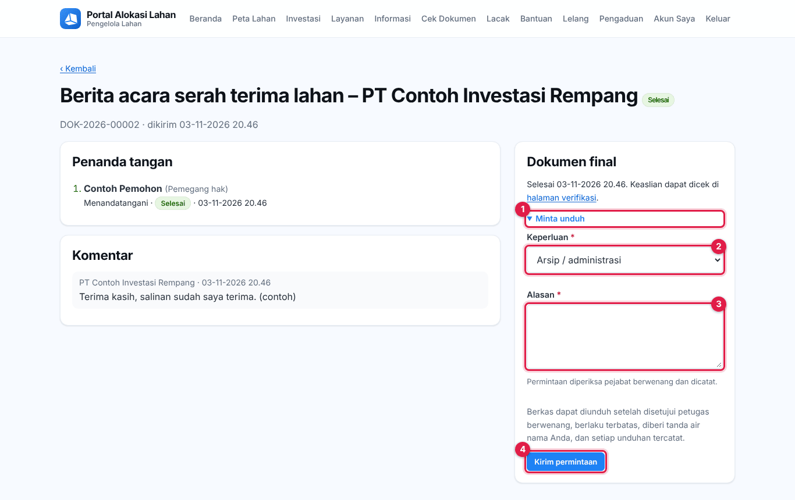

1. Di halaman dokumen perizinan (tabel versi berkas) atau dokumen tanda tangan (kotak **Dokumen final**), klik **Minta unduh** (nomor 1).
2. Pilih **Keperluan** (nomor 2): arsip/administrasi, pengurusan izin ke instansi lain, pembiayaan/bank, hukum/pengadilan, audit, atau lainnya.
3. Tulis **Alasan** (nomor 3).
4. Klik **Kirim permintaan** (nomor 4).

Pantau permintaan di tab **Permintaan unduh**:

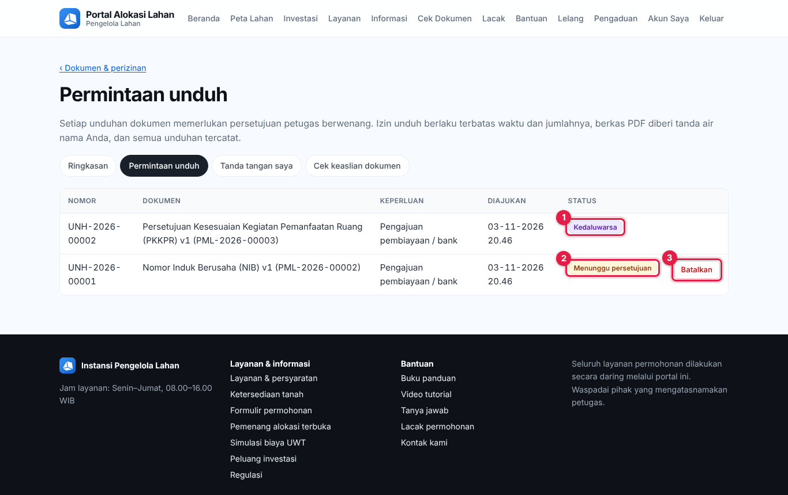

5. Kolom status (nomor 1 dan 2) menampilkan **Menunggu persetujuan**, **Disetujui**, **Ditolak**, **Dibatalkan**, atau **Kedaluwarsa** (izin unduh sudah habis masa berlakunya; ajukan lagi bila masih perlu).
6. Setelah **Disetujui**, tombol **Unduh** muncul di baris itu. Klik sebelum masa berlakunya habis. Izin unduh berlaku terbatas waktu dan jumlahnya, dan PDF diberi tanda air nama Anda.
7. Permintaan yang belum diputuskan bisa dibatalkan dengan **Batalkan** (nomor 3).

Tergantung pengaturan, permintaan pemegang hak atas dokumennya sendiri bisa langsung disetujui sistem (tetap tercatat).

<!-- akhir sisip -->

<!-- sisip: 53-portal-dokumen.md#156-cek-keaslian-dokumen -->

### 15.6 Cek keaslian dokumen

Klik tab **Cek keaslian dokumen** untuk memeriksa dokumen bertanda tangan elektronik (lihat [Bab 12.9](../50-portal-publik.md#129-cek-keaslian-dokumen), bagian B).

<!-- akhir sisip -->

## Bila ada kendala

- **Lupa kata sandi.** Klik **Lupa kata sandi?** di halaman masuk portal (lihat [Lupa kata sandi](#lupa-kata-sandi)).
- **Surel aktivasi atau surel lain tidak masuk.** Periksa folder *Spam*/*Promosi*. Bila tetap tidak ada, klik **Bantuan** → **Kirim pesan ke petugas** di portal.
- **Tombol yang disebut di buku ini tidak ada.** Tombol muncul sesuai status permohonan atau dokumen Anda. Contoh: tombol bayar baru muncul setelah tagihan terbit.
- **Pertanyaan lain.** Buka **Bantuan** di portal untuk tanya jawab, atau klik **Kirim pesan ke petugas**. Petugas membalas ke surel Anda.
