# Buku peran: Koordinator Wilayah

Buku ini untuk **Koordinator Wilayah**: koordinator yang memimpin tim lapangan di Korwil yang dipimpinnya. Buku ini berisi semua langkah kerja peran Anda, lengkap dengan gambar, sehingga cukup dibaca sendiri. Dasar penggunaan yang berlaku untuk semua peran (mengenal layar, ganti sandi, memakai di HP) ada di [Bab 2](../02-dasar-penggunaan.md).

**Cara membaca buku ini.** Kotak merah bernomor pada gambar menunjuk tombol atau kolom yang disebut di langkah. Tulisan *(nomor 2)* berarti: lihat kotak merah bernomor 2 pada gambar tepat di atas langkah itu. Semua gambar memakai data contoh fiktif; isi di layar Anda berbeda, tetapi letak tombolnya sama. Judul bagian bernomor (misalnya *3.4*) sama dengan nomor bagian di buku lengkap.

## Masuk dan halaman awal

<!-- sisip: 40-pusat-komando.md#101-masuk-dan-memasang-aplikasi -->

### 10.1 Masuk dan memasang aplikasi

1. Buka `https://<alamat-simlahan>/komando/masuk/` di HP.
2. Isi nama pengguna dan kata sandi, lalu ketuk **Masuk** (lihat [Bab 2](../02-dasar-penggunaan.md#c-pusat-komando-petugas-lapangan)).
3. Izinkan akses **lokasi**, **kamera**, dan **mikrofon** bila diminta. Lokasi wajib untuk absen dan laporan.
4. Agar aplikasi punya ikon sendiri di layar HP dan bisa dibuka tanpa sinyal, pasang ke layar utama: di Chrome Android ketuk menu ⋮ lalu **Tambahkan ke layar utama** (atau **Instal aplikasi**); di Safari iPhone ketuk tombol bagikan lalu **Tambahkan ke Layar Utama**.

Setelah masuk, tampil layar peta:

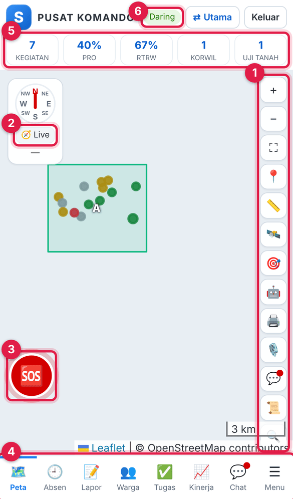

Nomor pada gambar:

1. **Tombol alat peta** di kanan (fungsinya di 10.2).
2. **Kompas** dan tombol **Live**: menyalakan pembagian posisi Anda ke pusat komando (10.2.3).
3. Tombol **SOS** darurat (10.2.3).
4. **Bilah tab** di bawah: **Peta, Absen, Lapor, Warga, Tugas, Kinerja, Chat, Menu**. Ketuk untuk berpindah layar.
5. **Kartu ringkasan**: jumlah **Kegiatan**, persentase warga **Pro** (mendukung), persentase **RTRW** sesuai, jumlah **Korwil**, dan **Uji tanah**. Ketuk kartu untuk mengganti warna peta atau menyalakan lapisannya.
6. Status **Daring** (ada sinyal) atau **Luring** (tanpa sinyal). Di sebelahnya: **⇄ Utama** untuk pindah ke aplikasi lain, dan **Keluar**.

<!-- akhir sisip -->

### Halaman awal di HP

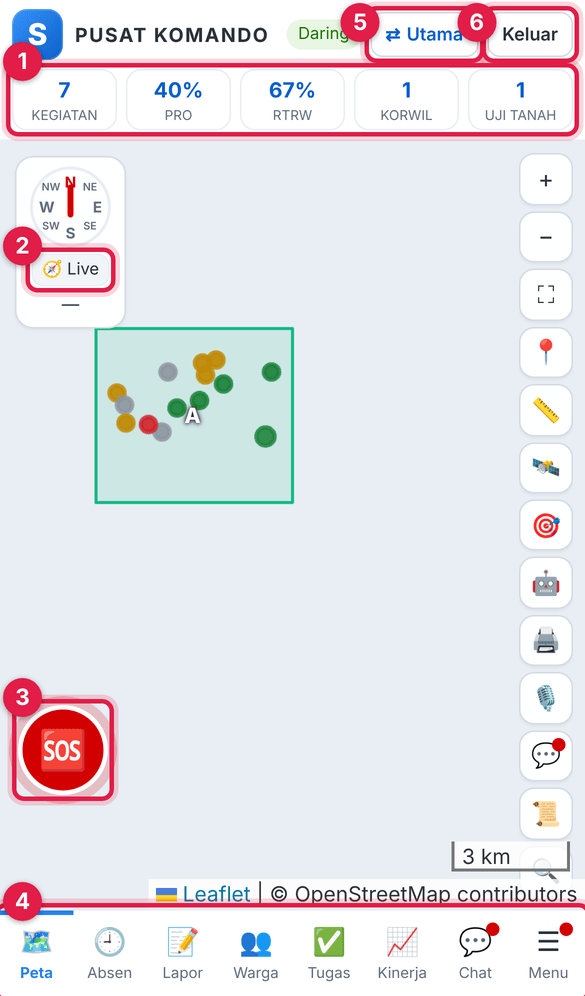

Nomor pada gambar:

1. **Kartu ringkasan**: jumlah kegiatan, persentase warga pro, persentase RTRW sesuai, jumlah Korwil, dan uji tanah di wilayah Anda.
2. **Live**: membagikan posisi Anda ke koordinator selama bertugas (lihat 10.2.3).
3. **🆘 SOS**: tanda darurat (lihat 10.2.3).
4. **Bilah tab**: **Peta**, **Absen**, **Lapor**, **Warga**, **Tugas**, **Kinerja**, **Chat**, dan **Menu**.
5. **⇄ Utama**: pindah ke aplikasi lain yang boleh Anda buka.
6. **Keluar**: mengakhiri sesi di perangkat ini.

### Menu lainnya

Ketuk **Menu** (nomor 1) di ujung kanan bilah tab:

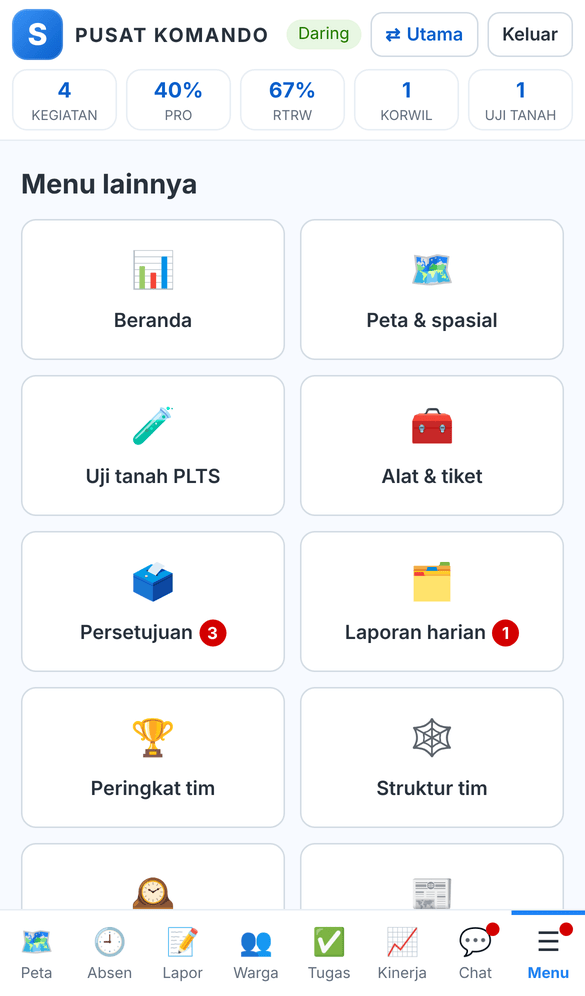

Isinya sama dengan petugas lapangan, ditambah hak koordinator: angka merah di **Persetujuan** dan **Laporan harian** adalah jumlah yang menunggu keputusan Anda. **Historis** juga tersedia untuk Anda.

### Panel admin

Data yang Anda kirim dari HP juga bisa dibuka di panel admin (`/admin/`, atau **⇄ Utama** → panel admin):

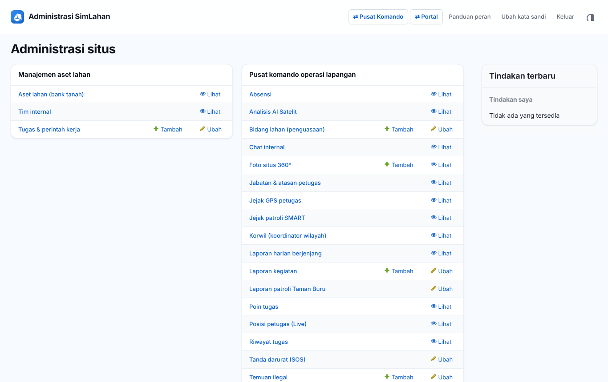

<!-- awal: dibuat dari backend/users/role_guide.py; perbarui dengan: cd backend && python manage.py panduan_buku -->

## Ringkasan peran

Memimpin tim lapangan di Korwil yang dipimpinnya.

- **Cara masuk:** Langsung di pusat komando (`/komando/masuk/`), atau di alamat utama SimLahan (`/`) lalu tombol **Pusat Komando**; satu kali masuk berlaku untuk keduanya.
- **Halaman awal:** Pusat komando (`/komando/`).
- **Akun latihan** (hanya di sistem latihan berisi data contoh): `contoh.korwil`

### Menu yang Anda lihat

- Pusat komando (`/komando/`): Peta (termasuk lapisan Temuan ilegal, Patroli SMART, Penguasaan lahan, Zona ancaman, Foto situs 360°, lapisan referensi seperti RTRW/hutan/kawasan proyek, dan gaya peta taktis), Absen, Lapor (Komsos, Topografi, Temuan ilegal, Patroli Taman Buru dengan impor SMART, Kegiatan lainnya, jenis lain, uji tanah, laporan saya), Warga, Tugas (saya, tim, verifikasi, terlambat, semua; tombol Beri tugas bagi koordinator), Kinerja (grafik harian/mingguan, radar, kalender 90 hari, sebaran titik kerja di peta, wawasan), Chat; Menu: Beranda (anomali & peringatan, skor risiko Korwil, ringkasan sikap, tren dukungan, detail Korwil), Peta & spasial (penguasaan lahan dengan skor prioritas dan impor KML/KMZ, tumpang tindih lapisan, audit RTRW, peta panas, jejak GPS bagi pimpinan, zona ancaman, foto 360°), Persetujuan, Laporan harian (buat, masuk, lacak, rekap Excel), Peringkat tim (periode, Korwil, tingkat, 10 teratas/terbawah, lencana, Excel, wawasan), Struktur tim, Historis (bagi koordinator dan atasan: komsos, perubahan sikap, luas lahan), Feed aktivitas, Asisten AI, Uji tanah PLTS (progres titik bor/sumur uji/resistivitas/sondir/termal, aksi cepat, foto, riwayat, impor & unduh Excel), Alat & tiket (tiket & masukan, OCR dokumen, AI dokumen → laporan, AI foto lapangan, audit data bagi koordinator, cek perangkat, sinkron Excel), pindah ke aplikasi lain (utama, panel admin, aplikasi lapangan, portal) sesuai hak; tombol **⇄ Utama** di bilah atas
- Panel admin: Korwil, warga, kegiatan, uji tanah, uji tanah PLTS, SOS, tugas, jabatan & atasan petugas, riwayat & poin tugas, laporan harian berjenjang (baca saja), tiket saya

### Yang bisa Anda lakukan

- Semua hak petugas lapangan di pusat komando.
- Memverifikasi laporan, menangani SOS, menyetujui izin anggota, melihat KPI anggota, dan membuat tugas wilayah.
- Memberi tugas berpoin kepada anggota (penerima utama dan kontributor), lalu memverifikasi atau mengembalikan tugas yang dilaporkan selesai.
- Menerima laporan harian anggota: mengembalikannya untuk revisi, atau merangkumnya ke laporan sendiri untuk atasan. Semua yang menunggu keputusan ada di Menu → Persetujuan.
- Mengonfirmasi klaim dampak tinggi Kegiatan lainnya milik anggota (bukan milik sendiri).
- Melihat Historis wilayahnya: komsos per petugas (warga baru dan kunjungan berulang), perubahan sikap warga, dan perubahan luas lahan.
- Menandai dan menonaktifkan zona ancaman di wilayahnya, menghapus foto 360° wilayahnya, dan melihat jejak GPS anggota (disimpan 60 hari).
- Menambah titik uji tanah PLTS (formulir atau impor Excel), menghapus foto titik, dan menjalankan audit data wilayahnya (bisa diringkas AI).

### Batas akses

- Hanya Korwil yang dipimpinnya dan tugas Korwil yang dipimpin/diikuti.
- Tidak membuka aplikasi lapangan aset atau modul lain; tidak melihat NIK warga.
- Tidak menangani tiket orang lain (hanya melihat tiket miliknya).

<!-- akhir: blok role_guide.py -->

## Urutan kerja Anda

Anda juga absen, melapor, mendata warga, dan mengerjakan tugas seperti petugas lapangan (Bagian A). Pekerjaan khusus koordinator:

1. **Setiap pagi:** buka **Menu → Persetujuan** dan selesaikan semua yang menunggu: izin anggota, konfirmasi dampak, verifikasi tugas, dan laporan harian ([Persetujuan](#persetujuan)).
2. **Memberi tugas:** tab **Tugas** → **＋ Beri tugas** ([10.6 Tugas](#106-tugas)); verifikasi atau kembalikan tugas yang dilaporkan selesai.
3. **Laporan harian:** kembalikan laporan anggota untuk revisi, atau rangkum ke laporan Anda lalu kirim ke atasan ([Laporan harian berjenjang](#laporan-harian-berjenjang)).
4. **Memantau wilayah:** **Beranda** (anomali, skor risiko), **Historis**, **Kinerja**, **Peringkat tim**, dan **Peta & spasial** (zona ancaman, jejak GPS anggota) ([Beranda](#beranda), [Historis (koordinator dan atasan)](#historis-koordinator-dan-atasan), [Peta & spasial](#peta--spasial)).
5. **SOS anggota:** tangani segera dan tandai selesai ([11.5 SOS](#115-sos)).
6. **Audit data:** jalankan dari **Menu → Alat & tiket** ([Alat & tiket](#alat--tiket)).

## Bagian A – Pusat komando

<!-- sisip: 40-pusat-komando.md#102-peta -->

### 10.2 Peta

Di komputer, peta tampil lebih lebar:

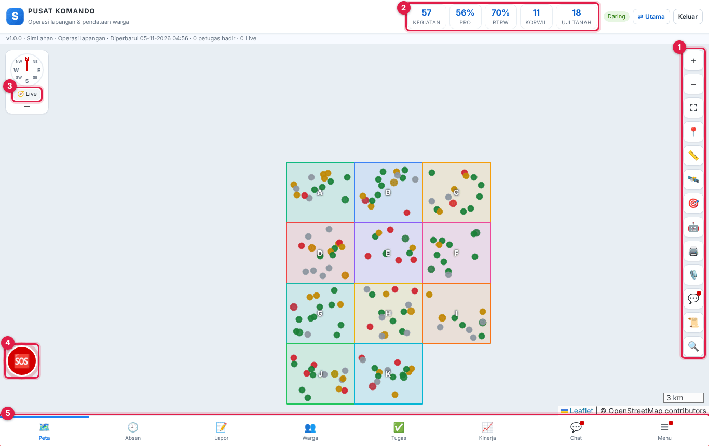

Nomor pada gambar: (1) tombol alat peta, (2) kartu ringkasan, (3) tombol **Live**, (4) tombol **SOS**, (5) bilah tab.

Tombol alat di kanan peta (nomor 1), dari atas:

| Tombol | Fungsi |
|---|---|
| + / − | Perbesar / perkecil. |
| ⛶ Layar penuh | Peta memenuhi layar. |
| 📍 Lokasi saya | Memusatkan peta ke posisi Anda. |
| 📏 Ukur jarak | Ketuk titik awal, lalu titik berikutnya; jarak tampil di bawah. **Ulang** untuk mulai lagi. |
| 🛰️ Citra satelit | Mengganti peta dasar ke citra satelit. |
| 🎯 Gaya peta taktis | Tampilan peta gelap untuk operasi. |
| 🤖 AI Satelit | Tahan lalu seret untuk menggambar kotak area; AI menganalisis tutupan lahan dan bangunan di kotak itu (hanya bila layanan AI aktif). |
| 🖨️ Cetak / export peta | Lihat 10.2.2. |
| 🎙️ Perintah suara | Ucapkan perintah, misalnya "korwil A" untuk memusatkan peta ke Korwil A, atau nama warga/tempat untuk mencarinya. Perlu izin mikrofon (paling baik di Chrome). |
| 💬 Chat internal | Membuka chat. |
| 📜 Legenda & lapisan | Lihat 10.2.1. |
| 🔍 Cari (Ctrl+K) | Mencari warga, Korwil, tugas, atau perintah. Awali dengan `>` untuk perintah. |

Ketuk titik atau wilayah di peta untuk membuka rinciannya (warga, Korwil, bidang, titik uji, foto 360°).

#### 10.2.1 Legenda dan lapisan

1. Ketuk 📜 di tombol alat peta. Panel **Legenda** terbuka.

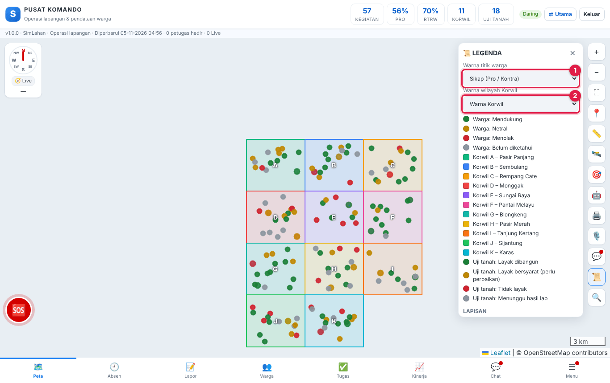

2. Pilih **Warna titik warga** (nomor 1): Sikap (Pro / Kontra), Status lahan (sudah / belum dibebaskan), atau Kesesuaian RTRW.
3. Pilih **Warna wilayah Korwil** (nomor 2): warna Korwil, persentase Pro, persentase RTRW sesuai, atau persentase lahan sudah. Arti setiap warna tampil di bawahnya.
4. Gulir panel ke bawah sampai bagian **Lapisan**:

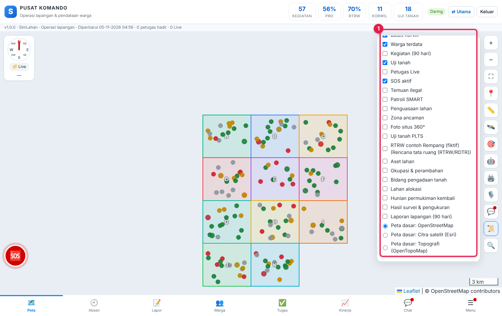

5. Centang lapisan yang ingin ditampilkan (nomor 1), misalnya Batas Korwil, Warga terdata, Kegiatan (90 hari), Uji tanah, Petugas Live, SOS aktif, Temuan ilegal, Patroli SMART, Penguasaan lahan, Zona ancaman, Foto situs 360°, Uji tanah PLTS, serta lapisan dari modul lain (RTRW, aset lahan, okupasi, bidang pengadaan, lahan alokasi, hunian permukiman kembali, hasil survei, laporan lapangan). Hapus centang untuk menyembunyikannya.
6. Di bagian paling bawah, pilih **Peta dasar**: OpenStreetMap, Citra satelit (Esri), atau Topografi.
7. Ketuk ✕ untuk menutup panel.

#### 10.2.2 Cetak peta

1. Nyalakan dulu lapisan yang ingin dicetak (10.2.1).
2. Ketuk 🖨️ di tombol alat peta.

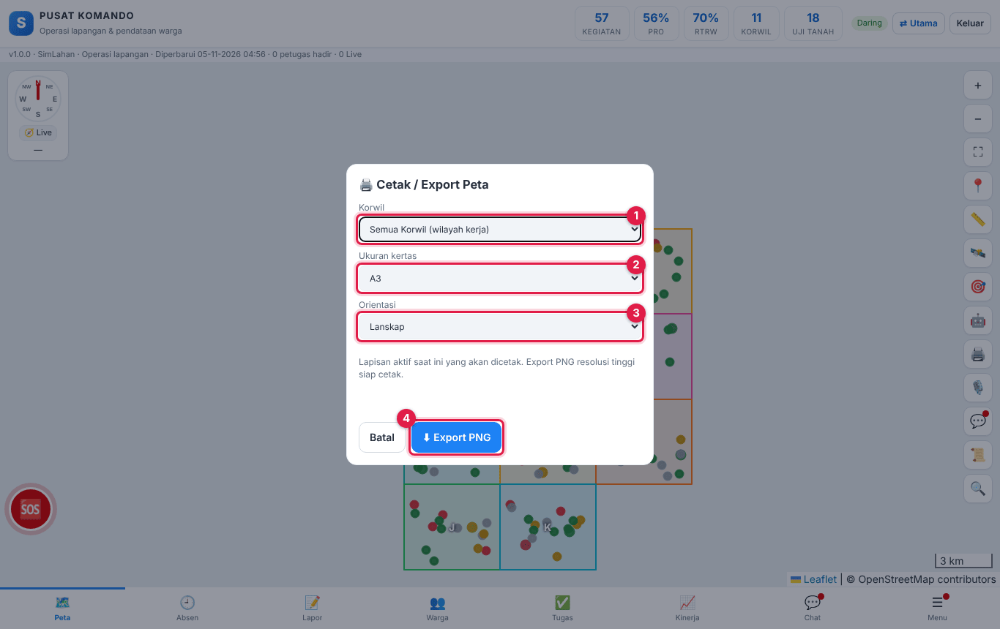

3. Pilih **Korwil** (nomor 1), atau **Semua Korwil (wilayah kerja)**.
4. Pilih **Ukuran kertas** (nomor 2): A3, A2, A1, atau A0.
5. Pilih **Orientasi** (nomor 3): Lanskap atau Potret.
6. Ketuk **⬇ Export PNG** (nomor 4). Berkas gambar resolusi tinggi siap cetak terunduh.

#### 10.2.3 Mode Live dan SOS

**Live:** ketuk **🧭 Live** (nomor 2 pada gambar 10.1) untuk membagikan posisi Anda ke pusat komando selama bertugas. Jejaknya tersimpan (titik tiap ±1 menit atau 25 m) selama 60 hari dan bisa dilihat koordinator. Ketuk lagi untuk mematikan.

**SOS** (keadaan darurat):

1. Ketuk tombol **SOS** merah (nomor 3 pada gambar 10.1).

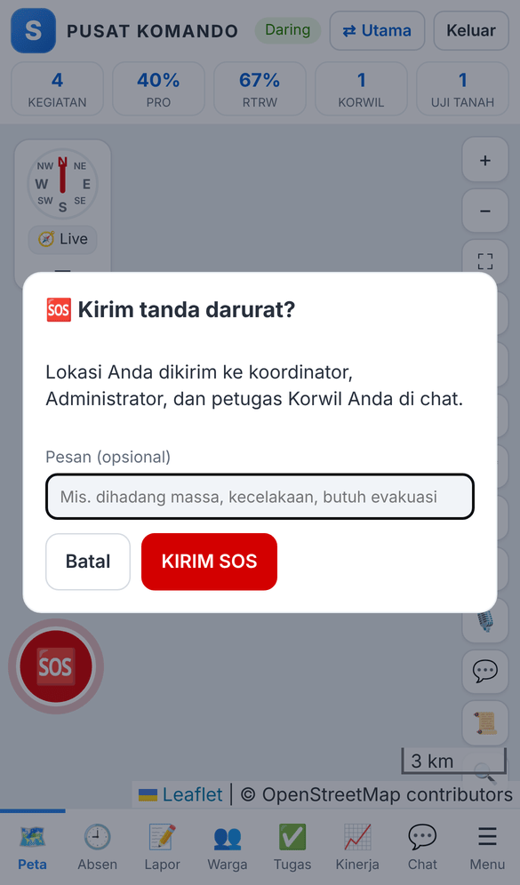

2. Tulis keadaan Anda di **Pesan (opsional)** (nomor 1), misalnya "dihadang massa" atau "butuh evakuasi".
3. Ketuk **KIRIM SOS** (nomor 2). Lokasi Anda dikirim ke koordinator, Administrator, dan petugas Korwil Anda lewat chat. Ketuk **Batal** (nomor 3) bila tidak jadi.
4. Tetap di lokasi aman bila memungkinkan. Koordinator menandai SOS sebagai ditangani atau selesai ([Bab 11.5](../41-panel-pusat-komando.md#115-sos)).

<!-- akhir sisip -->

<!-- sisip: 40-pusat-komando.md#103-absen -->

### 10.3 Absen

1. Ketuk tab **Absen**. Status hari ini tampil paling atas, misalnya "Belum absen hari ini" beserta jam masuk dan pulang.

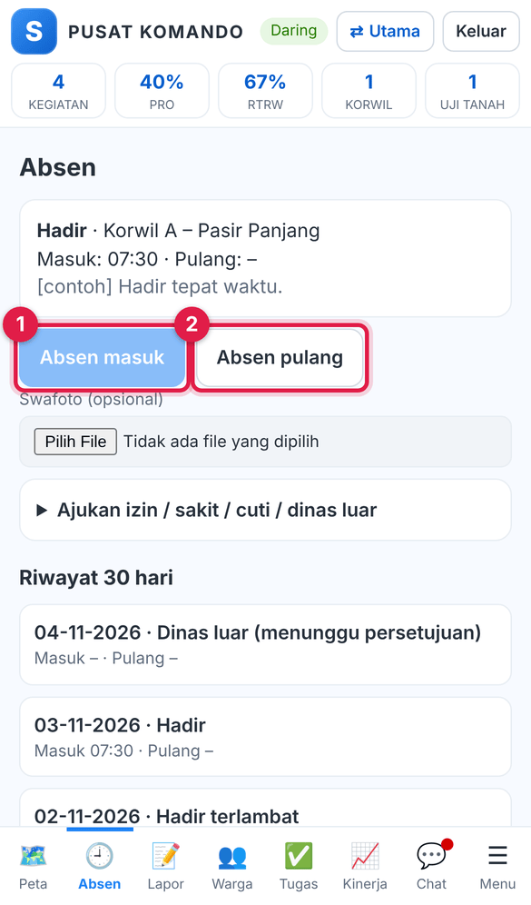

2. Bila diminta, ambil swafoto: ketuk **Pilih File** di **Swafoto** (nomor 3), lalu foto wajah Anda. Swafoto bisa wajib, tergantung pengaturan Administrator.
3. Saat mulai bekerja, ketuk **Absen masuk** (nomor 1). Saat selesai, ketuk **Absen pulang** (nomor 2). Lokasi GPS wajib dan absen butuh internet. Absen di luar wilayah Korwil bisa ditolak (tergantung pengaturan).
4. **Riwayat 30 hari** (nomor 5) menampilkan kehadiran Anda: Hadir, Hadir terlambat, Izin, Sakit, Cuti, atau Dinas luar.

**Mengajukan izin, sakit, cuti, atau dinas luar:**

1. Ketuk **Ajukan izin / sakit / cuti / dinas luar** (nomor 4 pada gambar di atas). Formulir terbuka:

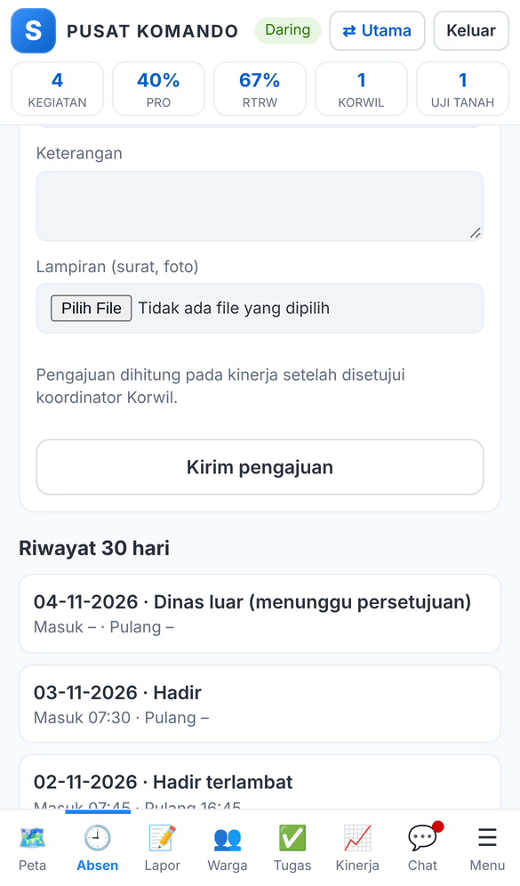

2. Pilih **Jenis** (nomor 1): Izin, Sakit, Cuti, atau Dinas luar.
3. Pilih **Tanggal** (nomor 2).
4. Tulis **Keterangan** (nomor 3), misalnya alasan atau tujuan dinas.
5. Bila ada, lampirkan surat atau foto di **Lampiran** (nomor 4).
6. Ketuk **Kirim pengajuan** (nomor 5). Pengajuan tampil di riwayat dengan tanda "menunggu persetujuan" dan dihitung pada kinerja setelah disetujui koordinator Korwil.

**Menyetujui izin anggota (koordinator):** di tab **Absen**, gulir ke **Persetujuan izin tim**.

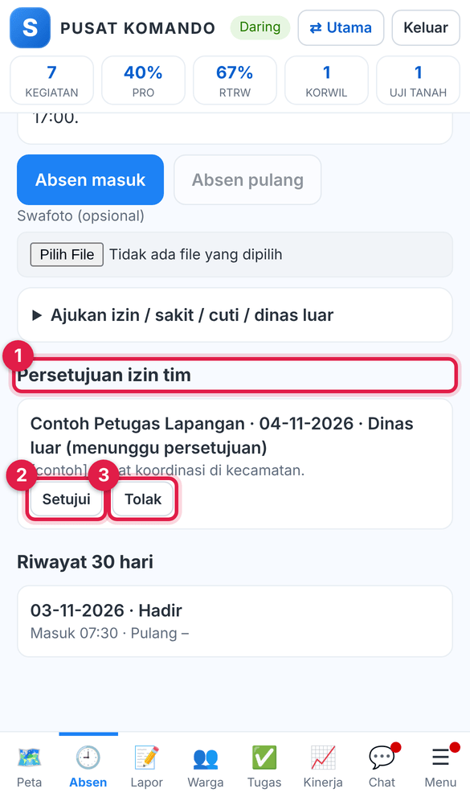

1. Baca pengajuan di bagian **Persetujuan izin tim** (nomor 1): nama petugas, tanggal, jenis, dan keterangan.
2. Ketuk **Setujui** (nomor 2) atau **Tolak** (nomor 3).

Pengajuan yang sama juga bisa diputus dari **Menu → Persetujuan** (10.9) atau di panel admin ([Bab 11.4](../41-panel-pusat-komando.md#114-absensi)).

<!-- akhir sisip -->

<!-- sisip: 40-pusat-komando.md#104-lapor-kegiatan -->

### 10.4 Lapor kegiatan

Tab **Lapor** punya tiga bagian: **Lapor kegiatan**, **Uji tanah**, dan **Laporan saya**.

#### Langkah umum

1. Ketuk tab **Lapor**.

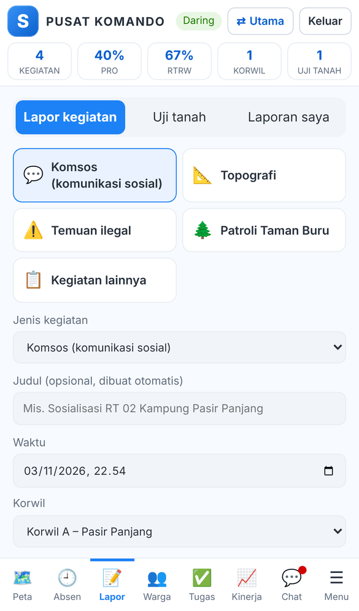

2. Pastikan bagian **Lapor kegiatan** (nomor 1) aktif. **Uji tanah** (nomor 2) dan **Laporan saya** (nomor 3) dibahas di bawah.
3. Ketuk kartu jenis kegiatan yang sering dipakai (nomor 4): Komsos, Topografi, Temuan ilegal, Patroli Taman Buru, atau Kegiatan lainnya. Jenis lain dipilih di kotak **Jenis kegiatan** (nomor 5): Pemetaan / penguasaan lahan, Sosialisasi, Pendataan warga, Kunjungan / pendekatan warga, Verifikasi data, Pengukuran / pematokan, Uji tanah, Patroli, Mediasi / musyawarah, Rapat koordinasi, atau Pendampingan relokasi. Isian di bawahnya menyesuaikan jenis yang dipilih.
4. Isi **Judul** (nomor 6). Boleh dikosongkan; judul dibuat otomatis.
5. Periksa **Waktu** (nomor 7). Isinya otomatis waktu sekarang; ubah bila kegiatan sudah lewat.
6. Periksa **Korwil** (nomor 8). Isinya otomatis dari lokasi Anda.
7. Gulir ke bawah:

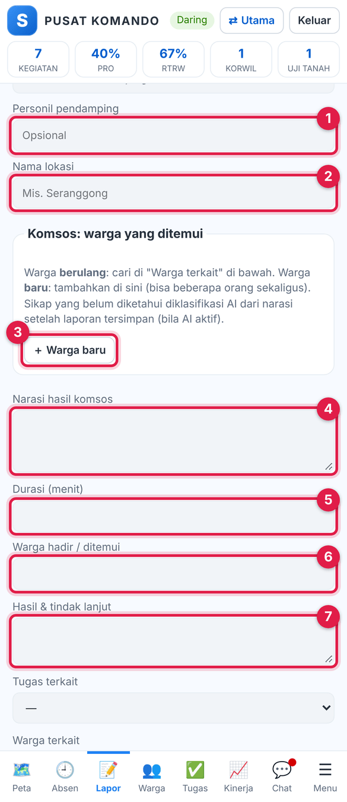

8. Isi **Personil pendamping** (nomor 1) bila ada, dan **Nama lokasi** (nomor 2), misalnya nama kampung.
9. Untuk jenis Komsos ada bagian warga yang ditemui (nomor 3; lihat langkah Komsos di bawah).
10. Isi **Narasi** atau uraian kegiatan (nomor 4), **Durasi (menit)** (nomor 5), **Warga hadir / ditemui** (nomor 6), dan **Hasil & tindak lanjut** (nomor 7).
11. Gulir lagi ke bawah:

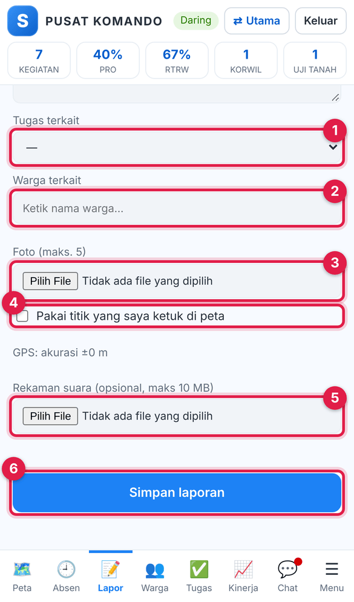

12. Bila kegiatan ini mengerjakan tugas, pilih **Tugas terkait** (nomor 1).
13. Di **Warga terkait** (nomor 2), ketik nama warga yang sudah terdata, lalu ketuk namanya. Ulangi untuk warga lain.
14. Tambah **Foto (maks. 5)** (nomor 3).
15. Lokasi diambil dari GPS. Bila kegiatan berlangsung di titik lain, ketuk titiknya di peta, lalu centang **Pakai titik yang saya ketuk di peta** (nomor 4).
16. Bila perlu, lampirkan **Rekaman suara (opsional, maks 10 MB)** (nomor 5).
17. Ketuk **Simpan laporan** (nomor 6). Saat luring, laporan masuk **Antrean kirim** dan terkirim otomatis saat ada sinyal (lihat **Laporan saya** di bawah).

> **Poin usaha:** setiap laporan memberi poin sesuai bobot jenis kegiatan, ditambah bonus kelengkapan (temuan, foto, narasi lengkap, jarak tempuh, lokasi GPS). Mengisi **Data tambahan (poin lebih)** menambah poin.

#### Komsos (komunikasi sosial)

1. Ketuk kartu **Komsos** (nomor 4 pada gambar tab Lapor).
2. Warga yang sudah pernah ditemui: cari di **Warga terkait** (langkah 13 di atas).
3. Warga baru: ketuk **＋ Warga baru** (nomor 3 pada gambar isian kegiatan). Formulir warga baru terbuka:

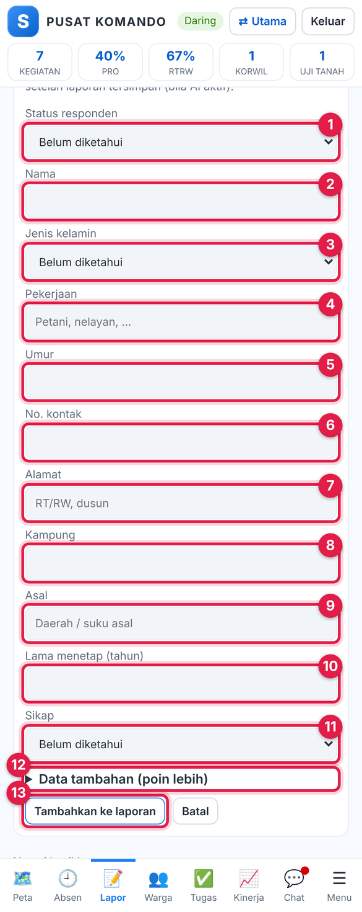

4. Isi **Status responden** (nomor 1: tempatan atau pendatang), **Nama** (nomor 2), **Jenis kelamin** (nomor 3), **Pekerjaan** (nomor 4), **Umur** (nomor 5), **No. kontak** (nomor 6), **Alamat** (nomor 7), **Kampung** (nomor 8), **Asal** (nomor 9), **Lama menetap (tahun)** (nomor 10), dan **Sikap** (nomor 11).
5. Untuk poin lebih, ketuk **Data tambahan (poin lebih)** (nomor 12), lalu isi Nama dan Pekerjaan pasangan, Jumlah anak, Luas lahan (m²), Status penggarapan, Data anak, dan Kondisi lahan.
6. Ketuk **Tambahkan ke laporan** (nomor 13). Ulangi langkah 3–6 untuk warga lain; beberapa warga baru bisa masuk dalam satu laporan.
7. Lanjutkan dengan langkah umum, lalu **Simpan laporan**. Sikap yang belum diketahui diklasifikasi AI dari narasi setelah laporan tersimpan (bila AI aktif).

#### Temuan ilegal

Pilih kartu **Temuan ilegal**, lalu pilih **Temuan baru** atau **Kunjungan berulang** (untuk lokasi yang pernah dilaporkan). Isi **Aktivitas** (pembalakan liar, tambang ilegal, perambahan, pembukaan lahan, pembangunan liar), **Lokasi temuan**, **Pemilik** dan kontaknya, **Pengurus**, **Luas lahan (ha)**, **Status hutan**, **Mulai usaha berjalan**, lalu **Data kunjungan ini**: Izin usaha, Kegiatan usaha, Oknum yang terlibat, Peralatan usaha, Bangunan, Tindak lanjut. Selesaikan dengan langkah umum.

#### Patroli Taman Buru

Pilih kartu **Patroli Taman Buru**, lalu pilih **Cara isi**: manual, unggah berkas **SMART Mobile / CyberTracker (.json)**, atau gabungan. Dari berkas SMART, jalur, observasi, foto, dan data tim terisi otomatis; periksa lalu simpan. Isi **Grid**, **Jarak tempuh (km)**, **Hasil temuan** (＋ Temuan: flora, fauna, aktivitas ilegal), dan **Bibit** (＋ Bibit dirawat / ＋ Bibit diproduksi). **Data tambahan**: situasi, kondisi personil dan materiil, cuaca pagi/siang/sore, objektif, ketua tim, regu, pos, transportasi, waktu mulai/selesai, kendala, saran.

#### Kegiatan lainnya: penilaian dampak

Untuk **Kegiatan lainnya**, isi **Penilaian dampak**: **Cakupan / siapa terdampak**, **Risiko / urgensi bila tidak dilakukan**, dan **Hasil konkret**. Poin ditentukan dari substansi kegiatan, bukan dari foto. Klaim **Signifikan** atau **Kritis** dihitung 6 poin sampai dikonfirmasi atasan.

#### Uji tanah

1. Di tab **Lapor**, ketuk **Uji tanah** (nomor 2 pada gambar tab Lapor).

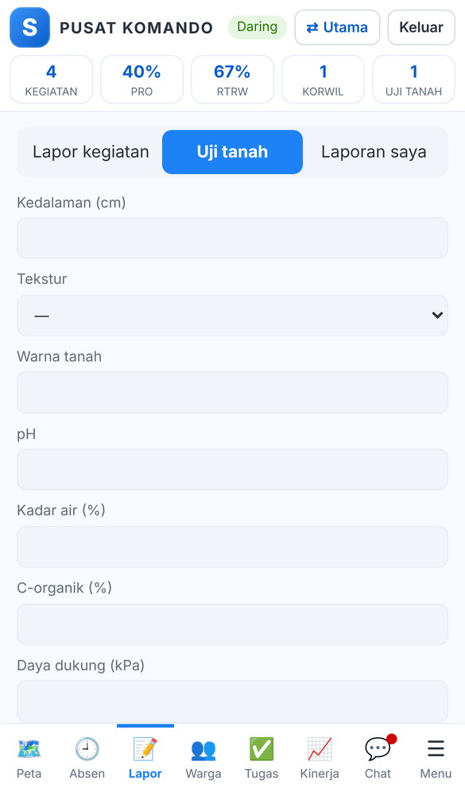

2. Isi hasil pengujian: **Kedalaman (cm)** (nomor 1), **Tekstur** (nomor 2: lempung, lanau, pasir, kerikil/batuan, gambut, laterit, campuran), **Warna tanah** (nomor 3), **pH** (nomor 4), **Kadar air (%)** (nomor 5), **C-organik (%)** (nomor 6), **Daya dukung (kPa)** (nomor 7), dan **CBR (%)** (nomor 8). Kosongkan yang tidak diukur.
3. Pilih **Kelayakan** (nomor 9): layak dibangun, layak bersyarat, tidak layak, atau menunggu hasil lab.
4. Gulir ke bawah:

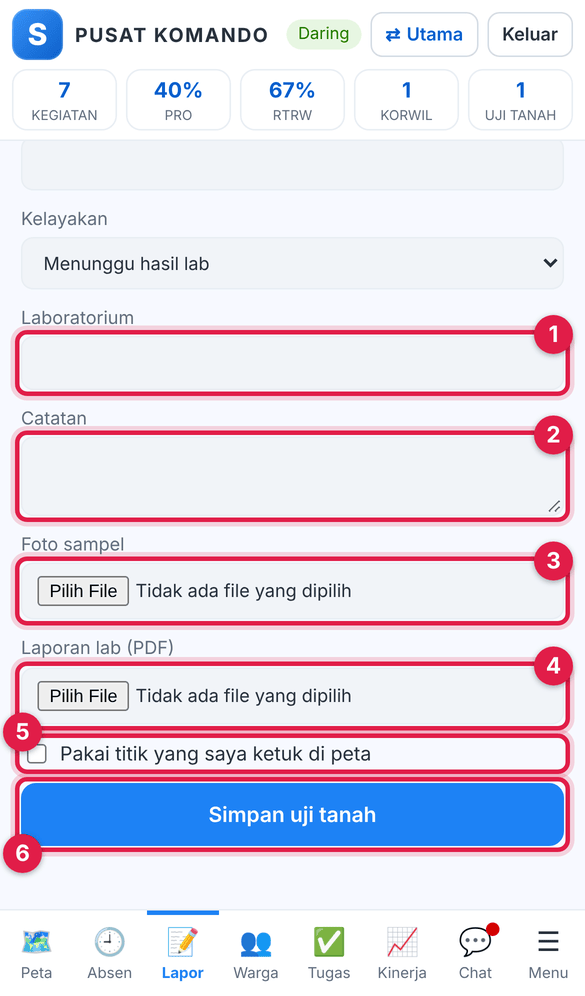

5. Isi **Laboratorium** (nomor 1) dan **Catatan** (nomor 2).
6. Lampirkan **Foto sampel** (nomor 3) dan **Laporan lab (PDF)** (nomor 4) bila ada.
7. Bila sampel diambil di titik lain, ketuk titiknya di peta lalu centang **Pakai titik yang saya ketuk di peta** (nomor 5).
8. Ketuk **Simpan uji tanah** (nomor 6).

#### Laporan saya

1. Di tab **Lapor**, ketuk **Laporan saya** (nomor 3 pada gambar tab Lapor).

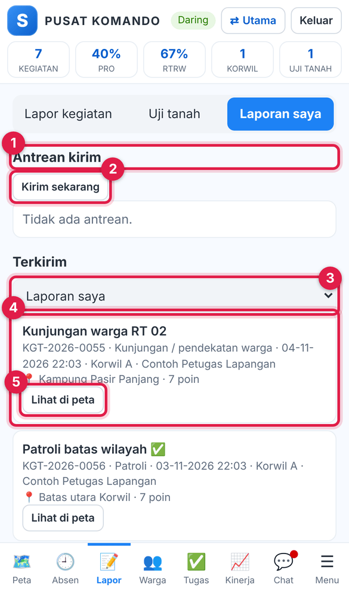

2. **Antrean kirim** (nomor 1) berisi laporan yang dibuat tanpa sinyal dan belum terkirim. Ketuk **Kirim sekarang** (nomor 2) begitu ada sinyal.
3. **Terkirim**: pilih tampilan di kotak nomor 3: **Laporan saya**, **Korwil saya**, atau **Semua** (sesuai hak).
4. Setiap laporan (nomor 4) menampilkan judul, nomor, jenis, waktu, Korwil, lokasi, dan poin. Tanda ✅ berarti sudah diverifikasi koordinator.
5. Ketuk **Lihat di peta** (nomor 5) untuk melihat lokasi laporan.

Koordinator melihat tombol **Verifikasi** pada laporan anggota yang belum diverifikasi.

<!-- akhir sisip -->

<!-- sisip: 40-pusat-komando.md#105-warga -->

### 10.5 Warga

1. Ketuk tab **Warga**.

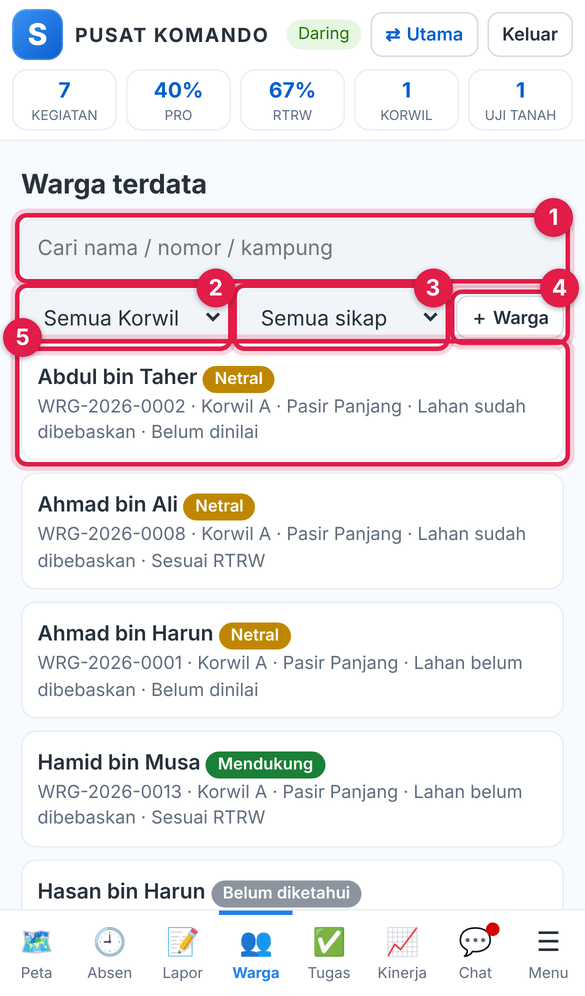

2. Cari warga dengan mengetik nama, nomor, atau kampung (nomor 1).
3. Saring per Korwil (nomor 2) atau per sikap (nomor 3): Mendukung, Netral, Menolak, Belum diketahui.
4. Ketuk kartu warga (nomor 5) untuk membuka **Dossier warga**: data, riwayat sikap, kegiatan yang terkait, dan lokasi di peta.

**Menambah warga:**

1. Ketuk **＋ Warga** (nomor 4 pada gambar di atas).

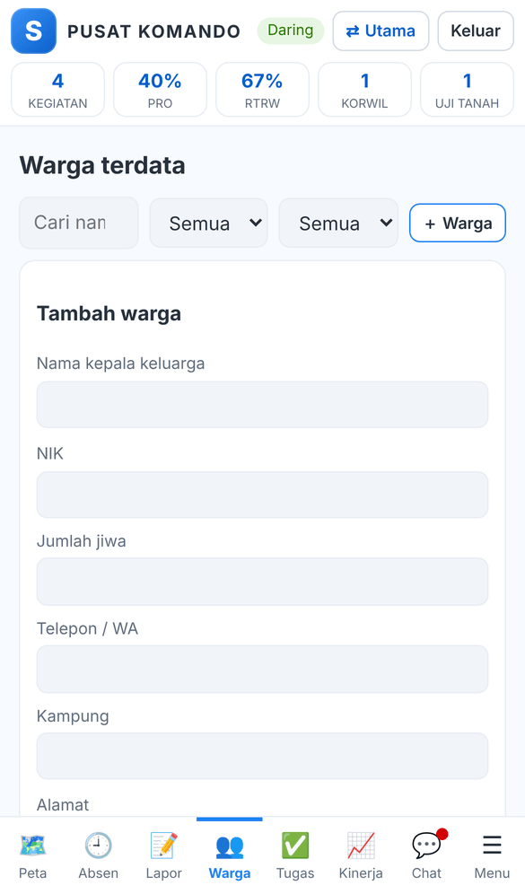

2. Isi **Nama kepala keluarga** (nomor 1).
3. Isi **NIK** (nomor 2). NIK hanya terlihat oleh Administrator.
4. Isi **Jumlah jiwa** (nomor 3), **Telepon / WA** (nomor 4), **Kampung** (nomor 5), dan **Alamat** (nomor 6).
5. Pilih **Sikap** (nomor 7), **Status lahan** (nomor 8: belum atau sudah dibebaskan), **RTRW** (nomor 9: sesuai, tidak sesuai, belum dinilai), **Zona RTRW** (nomor 10), dan **Pilihan** penyelesaian (nomor 11: belum memilih, relokasi, ganti kerugian uang, pergeseran dalam kampung, lainnya).
6. Gulir ke bawah:

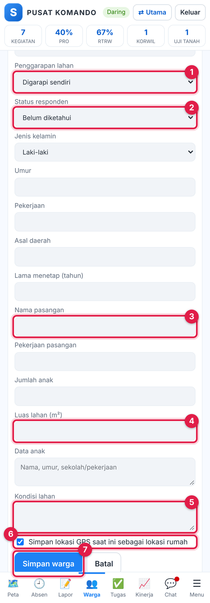

7. Pilih **Penggarapan lahan** (nomor 1) dan **Status responden** (nomor 2), lalu isi Jenis kelamin, Umur, Pekerjaan, Asal daerah, dan Lama menetap.
8. Bila diketahui, isi data keluarga mulai dari **Nama pasangan** (nomor 3), serta **Luas lahan (m²)** (nomor 4) dan **Kondisi lahan** (nomor 5).
9. Bila Anda sedang berada di rumah warga, centang **Simpan lokasi GPS saat ini sebagai lokasi rumah** (nomor 6).
10. Ketuk **Simpan warga** (nomor 7).

<!-- akhir sisip -->

<!-- sisip: 40-pusat-komando.md#106-tugas -->

### 10.6 Tugas

1. Ketuk tab **Tugas**.

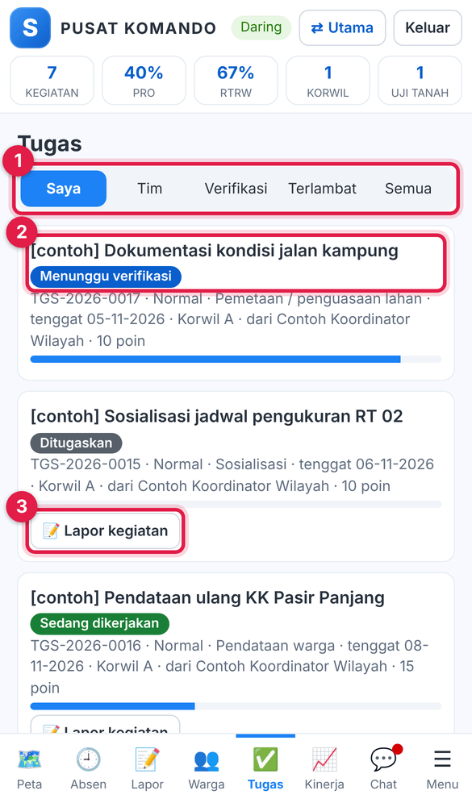

2. Saring daftar dengan tombol di nomor 1: **Saya** (tugas untuk Anda), **Tim**, **Verifikasi** (menunggu diverifikasi), **Terlambat**, atau **Semua**.
3. Setiap kartu tugas (nomor 2) menampilkan judul, status, nomor, prioritas, jenis, tenggat, Korwil, pemberi tugas, poin, dan garis progres.
4. Ketuk **📝 Lapor kegiatan** (nomor 3) untuk langsung membuat laporan kegiatan yang terkait dengan tugas itu (10.4).

**Mengerjakan tugas (petugas):**

1. Ketuk judul tugas. Rincian tugas terbuka:

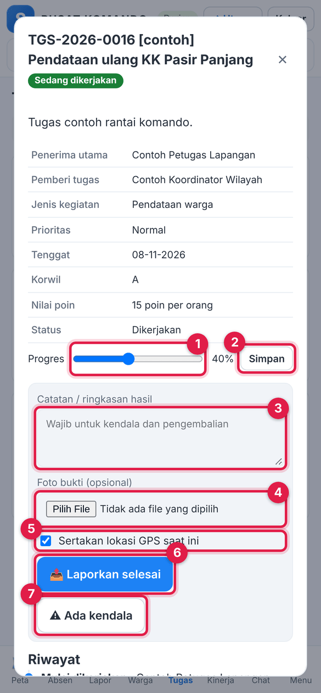

2. Untuk tugas baru, ketuk **▶ Mulai kerjakan**. Status berubah menjadi **Dikerjakan**.
3. Geser **Progres** (nomor 1) sesuai kemajuan pekerjaan, lalu ketuk **Simpan** (nomor 2).
4. Setelah selesai, tulis **Catatan / ringkasan hasil** (nomor 3), lampirkan **Foto bukti** (nomor 4), biarkan **Sertakan lokasi GPS saat ini** tercentang (nomor 5), lalu ketuk **📤 Laporkan selesai** (nomor 6).
5. Bila terhambat, tulis kendalanya di catatan (wajib), lalu ketuk **⚠ Ada kendala** (nomor 7). Setelah kendala teratasi, ketuk **▶ Mulai / lanjut**.
6. Tugas yang dilaporkan selesai menunggu verifikasi pemberi tugas atau atasan. Anda tidak bisa memverifikasi tugas sendiri. **Riwayat** di bagian bawah mencatat setiap langkah.

**Tab Tugas bagi koordinator:**

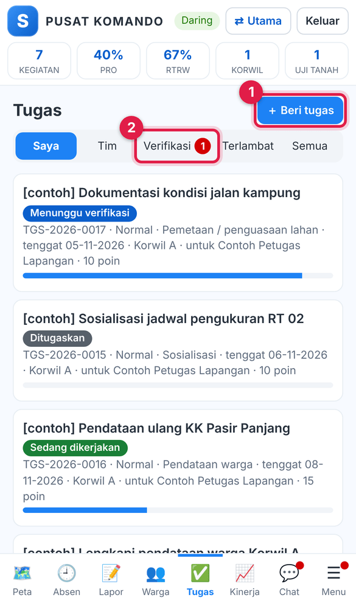

Koordinator melihat dua tombol tambahan: **＋ Beri tugas** (nomor 1) untuk memberi tugas baru, dan saringan **Verifikasi** (nomor 2) untuk tugas yang menunggu verifikasi. Angka merah di **Verifikasi** adalah jumlah tugas yang menunggu.

**Memberi tugas (koordinator):**

1. Di tab **Tugas**, ketuk **＋ Beri tugas**. Formulir terbuka:

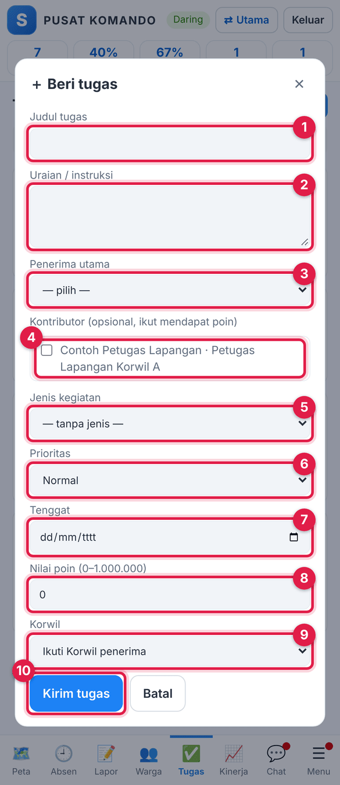

2. Isi **Judul tugas** (nomor 1) dan **Uraian / instruksi** (nomor 2).
3. Pilih **Penerima utama** (nomor 3).
4. Centang **Kontributor** (nomor 4) bila ada petugas lain yang membantu; mereka ikut mendapat poin.
5. Pilih **Jenis kegiatan** (nomor 5) dan **Prioritas** (nomor 6), lalu isi **Tenggat** (nomor 7).
6. Isi **Nilai poin (0–1.000.000)** (nomor 8).
7. Pilih **Korwil** (nomor 9), atau biarkan **Ikuti Korwil penerima**.
8. Ketuk **Kirim tugas** (nomor 10). Penerima mendapat pemberitahuan.

**Memverifikasi tugas (koordinator):**

1. Di tab **Tugas**, ketuk saringan **Verifikasi**.
2. Ketuk judul tugas yang dilaporkan selesai. Rincian tugas terbuka:

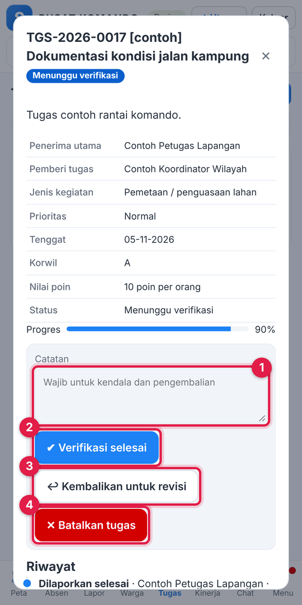

3. Periksa catatan, foto bukti, dan riwayatnya. Tulis **Catatan** bila perlu (nomor 1).
4. Ketuk **✔ Verifikasi selesai** (nomor 2). Poin tugas masuk KPI penerima, kontributor, dan pemberi tugas.
5. Bila belum sesuai, tulis catatan (wajib), lalu ketuk **↩ Kembalikan untuk revisi** (nomor 3). Untuk membatalkan tugas, ketuk **✕ Batalkan tugas** (nomor 4).

<!-- akhir sisip -->

<!-- sisip: 40-pusat-komando.md#107-kinerja-kpi -->

### 10.7 Kinerja (KPI)

1. Ketuk tab **Kinerja**.

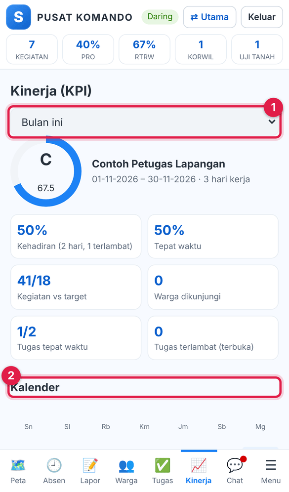

2. Pilih periode (nomor 1): Hari ini, Minggu ini, Bulan ini, Bulan lalu, Kuartal ini, atau Tahun ini.
3. Baca skor Anda di lingkaran (nilai A–D dan angkanya). Skor adalah gabungan kehadiran, kegiatan, dan tugas sesuai bobot di pengaturan. Kartu di bawahnya merinci kehadiran, tepat waktu, kegiatan dibanding target, warga dikunjungi, tugas tepat waktu, dan tugas terlambat.
4. Gulir ke bawah untuk **Kalender** aktivitas (nomor 2), grafik **Kegiatan harian**, **Poin usaha harian**, **Profil kinerja**, **Aktivitas 90 hari**, dan tombol **🗺️ Lihat sebaran di peta**.
5. Gulir sampai paling bawah:

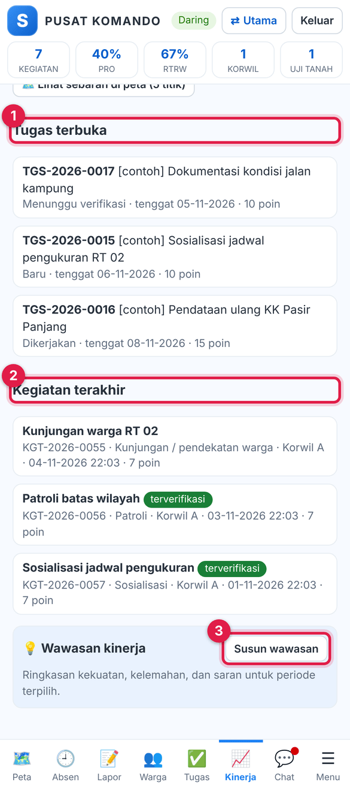

6. **Tugas terbuka** (nomor 1) dan **Kegiatan terakhir** (nomor 2) merangkum pekerjaan Anda.
7. Ketuk **Susun wawasan** (nomor 3) untuk ringkasan kekuatan, kelemahan, dan saran.

Koordinator dan atasan punya kotak tambahan di tab Kinerja:

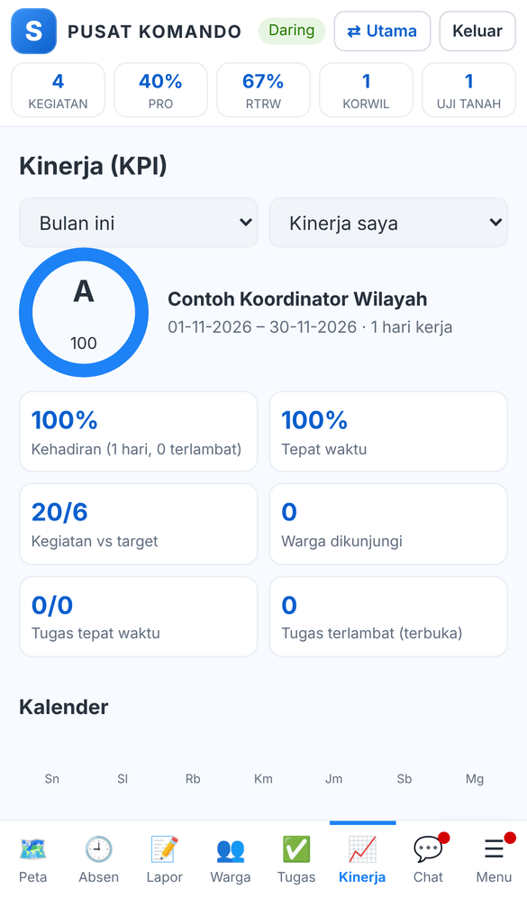

Pilih periode (nomor 1), lalu pilih petugas lain di kotak kedua (nomor 2) untuk melihat kinerjanya.

<!-- akhir sisip -->

<!-- sisip: 40-pusat-komando.md#108-chat -->

### 10.8 Chat

1. Ketuk tab **Chat**. Titik merah di tab berarti ada pesan baru.

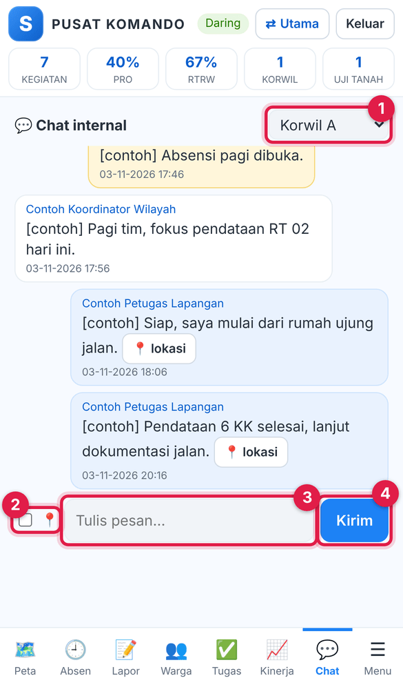

2. Pilih kanal (nomor 1): **Kanal umum** untuk semua petugas, atau kanal Korwil Anda.
3. Tulis pesan di kotak nomor 3.
4. Untuk menyertakan lokasi Anda, centang 📍 (nomor 2).
5. Ketuk **Kirim** (nomor 4). Pesan sistem (misalnya SOS atau absensi dibuka) juga muncul di sini.

<!-- akhir sisip -->

## Bagian B – Menu lainnya

<!-- sisip: 40-pusat-komando.md#beranda -->

### Beranda

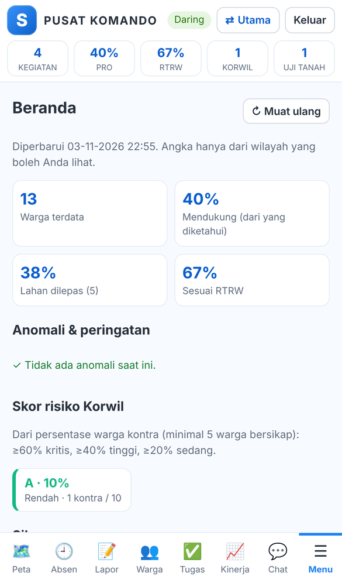

1. Ketuk **↻ Muat ulang** (nomor 1) untuk data terbaru. Angka hanya dari wilayah yang boleh Anda lihat.
2. Kartu atas: warga terdata, persentase mendukung, lahan dilepas, dan persentase sesuai RTRW.
3. **Anomali & peringatan** (nomor 2): hal yang perlu ditindaklanjuti, misalnya Korwil dengan warga kontra tinggi, tugas lewat tenggat, atau laporan harian belum ditinjau. Ketuk baris untuk melihat rinciannya.
4. **Skor risiko Korwil** (nomor 3): dari persentase warga kontra (minimal 5 warga bersikap): ≥60% kritis, ≥40% tinggi, ≥20% sedang.
5. Gulir ke bawah untuk **Sikap warga**, **Tren dukungan (12 pekan)**, **Per Korwil** (Warga/target, Sikap, Pro, Lepas, Kegiatan 7 hari; ketuk baris untuk detail Korwil), **Kegiatan 7 hari**, dan **Uji tanah**.

Di komputer, Beranda tampil di panel kanan peta:

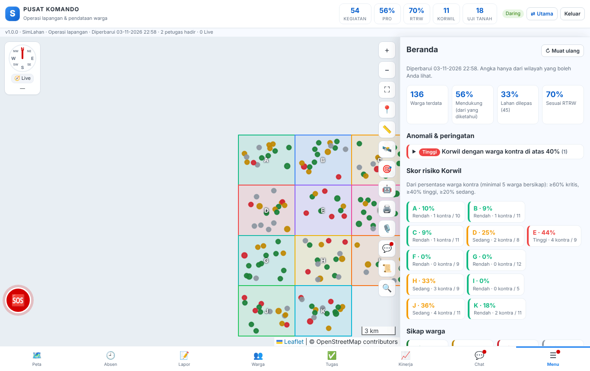

<!-- akhir sisip -->

<!-- sisip: 40-pusat-komando.md#peta--spasial -->

### Peta & spasial

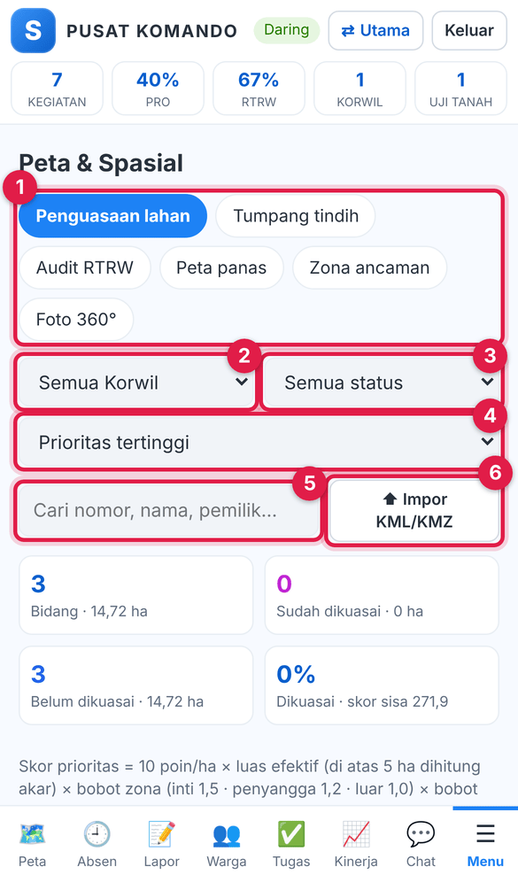

Pilih bagian di nomor 1: **Penguasaan lahan**, **Tumpang tindih**, **Audit RTRW**, **Peta panas**, **Jejak GPS** (koordinator), **Zona ancaman**, atau **Foto 360°**.

**Penguasaan lahan** (tampil pertama):

1. Saring per Korwil (nomor 2) dan status (nomor 3: belum atau sudah dikuasai), lalu pilih urutan (nomor 4): Prioritas tertinggi, Terluas, atau Nomor.
2. Cari bidang dengan nomor, nama, atau pemilik (nomor 5).
3. Kartu ringkasan menampilkan jumlah bidang, luas yang sudah dan belum dikuasai. **Skor prioritas** = 10 poin/ha × luas efektif × bobot zona × bobot urgensi.
4. Ketuk bidang di daftar untuk **Perbarui penguasaan**.
5. Untuk menambah bidang atau hasil penguasaan dari berkas, ketuk **⬆ Impor KML/KMZ** (nomor 6). Bidang dicocokkan otomatis dari namanya.

Di komputer, panel ini tampil di kanan peta:

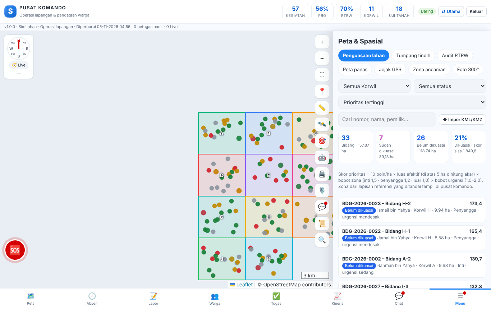

**Tumpang tindih:**

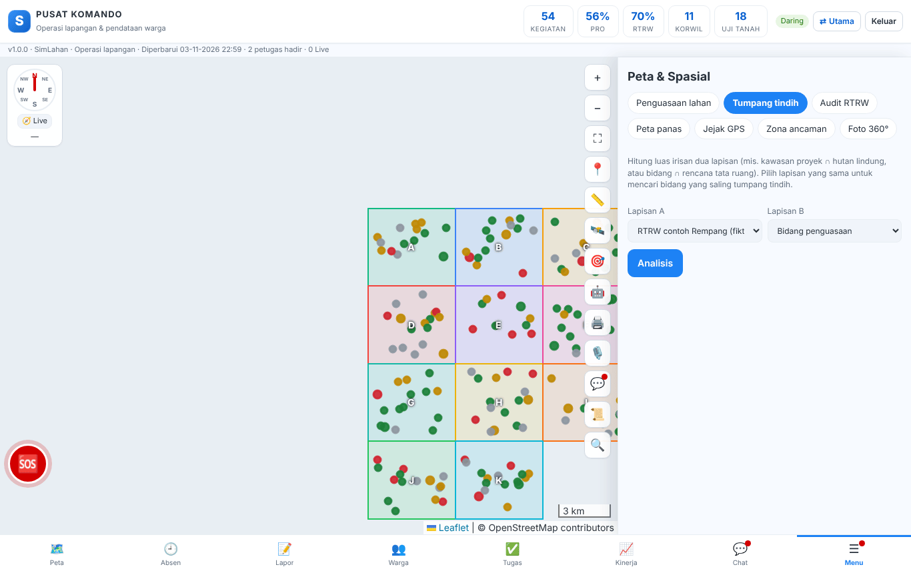

1. Ketuk **Tumpang tindih**.
2. Pilih **Lapisan A** (nomor 1) dan **Lapisan B** (nomor 2), misalnya RTRW dan bidang penguasaan. Pilih lapisan yang sama untuk mencari bidang yang saling tumpang tindih.
3. Ketuk **Analisis** (nomor 3). Luas irisan dan daftar pasangan tampil di bawah.
4. Ketuk **⬇ CSV** (nomor 4) untuk mengunduh hasilnya, atau **🗺️ Tampilkan irisan di peta** (nomor 5).

**Audit RTRW:**

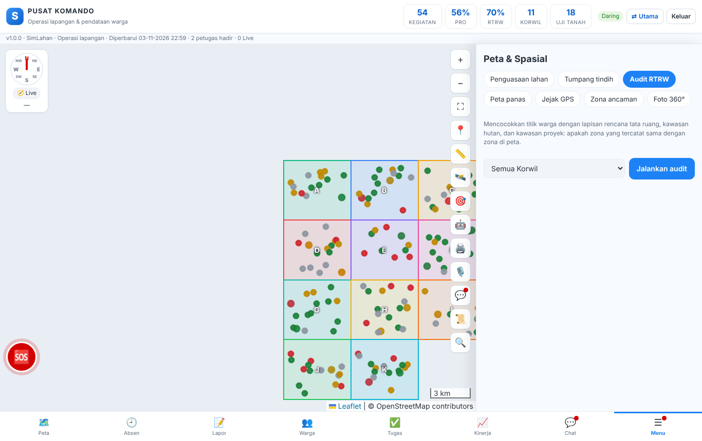

1. Ketuk **Audit RTRW**. Audit mencocokkan titik warga dengan lapisan tata ruang, hutan, dan kawasan proyek.
2. Pilih Korwil (nomor 1), lalu ketuk **Jalankan audit** (nomor 2).
3. Hasil tampil per kategori dan **Per Korwil** (nomor 4), lalu daftar **Perlu ditindaklanjuti**. Ketuk **⬇ CSV** (nomor 3) untuk mengunduh, atau **🗺️ Tampilkan hasil di peta**.

**Peta panas:**

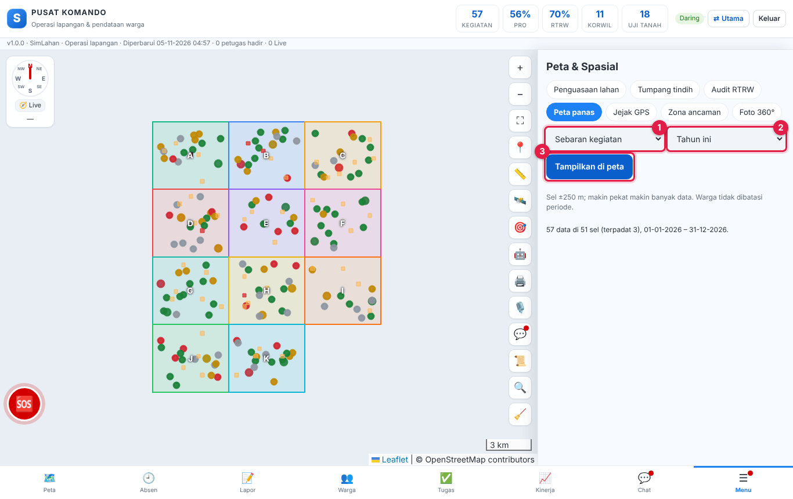

1. Ketuk **Peta panas**.
2. Pilih sumber data (nomor 1): Sebaran kegiatan, Jejak GPS petugas, atau Sebaran warga terdata.
3. Pilih periode (nomor 2).
4. Ketuk **Tampilkan di peta** (nomor 3). Peta diwarnai per sel ±250 m; makin pekat makin banyak data.

**Jejak GPS** (koordinator dan pimpinan):

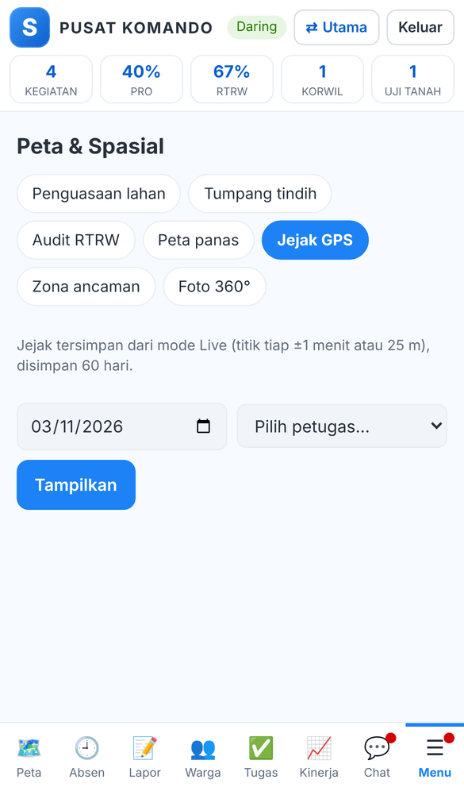

1. Ketuk **Jejak GPS**.
2. Pilih tanggal (nomor 1). Kotak petugas (nomor 2) berisi petugas yang punya jejak pada tanggal itu; pilih salah satu.
3. Ketuk **Tampilkan** (nomor 3). Peta menampilkan jalurnya: titik hijau awal, titik merah akhir.

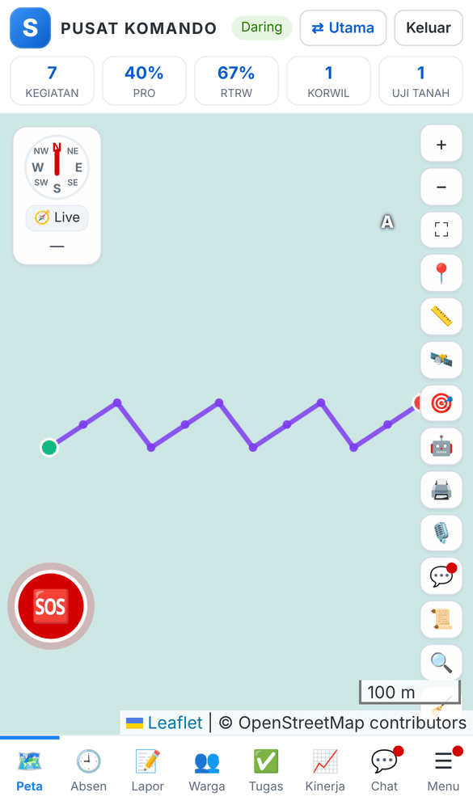

**Zona ancaman** (koordinator):

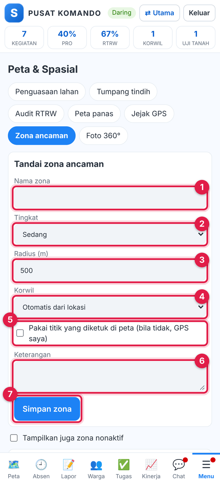

1. Ketuk **Zona ancaman**.
2. Isi **Nama zona** (nomor 1), pilih **Tingkat** (nomor 2: rendah, sedang, tinggi, kritis), dan isi **Radius (m)** (nomor 3).
3. Pilih **Korwil** (nomor 4), atau biarkan otomatis dari lokasi.
4. Titik pusat zona memakai GPS Anda. Untuk titik lain, ketuk titiknya di peta lalu centang **Pakai titik yang diketuk di peta** (nomor 5).
5. Isi **Keterangan** (nomor 6), lalu ketuk **Simpan zona** (nomor 7).

**Foto 360°:**

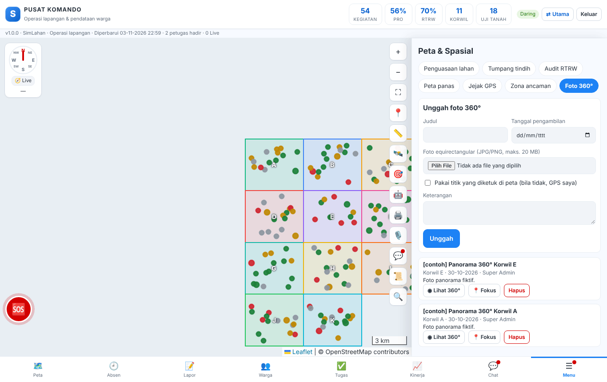

1. Ketuk **Foto 360°**.
2. Isi **Judul** (nomor 1) dan **Tanggal pengambilan** (nomor 2).
3. Pilih foto panorama equirectangular, JPG/PNG maks. 20 MB (nomor 3).
4. Lokasi foto memakai GPS Anda, atau centang **Pakai titik yang diketuk di peta** (nomor 4) setelah mengetuk titiknya.
5. Isi **Keterangan** bila perlu, lalu ketuk **Unggah** (nomor 5).
6. Pada daftar foto, ketuk **◉ Lihat 360°** (nomor 6) untuk memutar foto, atau **📍 Fokus** untuk melihat lokasinya.

<!-- akhir sisip -->

<!-- sisip: 40-pusat-komando.md#uji-tanah-plts -->

### Uji tanah PLTS

Progres penyelidikan tanah (bor, sumur uji, resistivitas, sondir, termal) per titik untuk perencanaan PLTS.

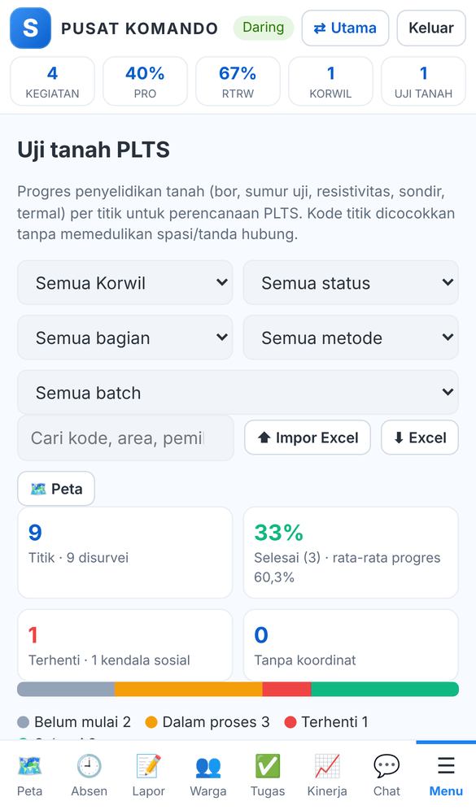

1. Saring per Korwil (nomor 1), status (nomor 2), bagian proyek (nomor 3), metode (nomor 4), atau batch (nomor 5). Kartu dan garis warna di bawahnya merangkum progres.
2. Ketuk titik di daftar untuk **Detail titik**. Di **Aksi cepat**, ubah status pekerjaan (Belum mulai, Dalam proses, Terhenti, Selesai), progres, status survei, dan kondisi sosial. Catatan wajib bila terhenti. Tambah foto bila perlu.
3. Ketuk **⬇ Excel** (nomor 7) untuk mengunduh data.
4. Untuk memperbarui banyak titik dari berkas Excel, ketuk **⬆ Impor Excel** (nomor 6), pilih **Perbarui titik terdaftar** atau **Perbarui + tambah titik baru**, ketuk **Pratinjau**, periksa, lalu **Terapkan pilihan**. Kolom yang dikenali antara lain Kode titik, Metode, Area/Paket, Batch, Korwil, Status survei, Kondisi sosial, Status pekerjaan, Progres, Kendala, tanggal, dan Lintang/Bujur. Sel kosong tidak mengubah data.
5. Ketuk **🗺️ Peta** (nomor 8) untuk melihat titik di peta. Koordinator dapat menambah titik dengan **＋ Titik**.

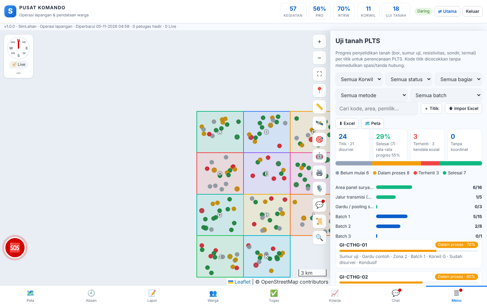

<!-- akhir sisip -->

<!-- sisip: 40-pusat-komando.md#alat--tiket -->

### Alat & tiket

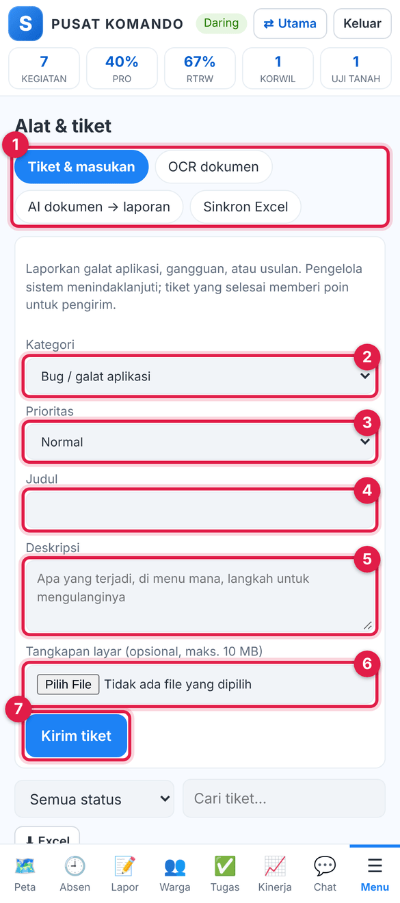

Pilih alat di nomor 1: **Tiket & masukan**, **OCR dokumen**, **AI dokumen → laporan**, **Sinkron Excel**, dan bagi koordinator **Audit data**. Bila layanan AI aktif, ada juga **AI foto lapangan**.

**Mengirim tiket (laporan galat, gangguan, atau usulan):**

1. Pilih **Kategori** (nomor 2): galat aplikasi, gangguan layanan, saran fitur, ulasan, atau lainnya.
2. Pilih **Prioritas** (nomor 3): Normal, Tinggi, atau Kritis.
3. Isi **Judul** (nomor 4) dan **Deskripsi** (nomor 5): apa yang terjadi, di menu mana, dan langkah untuk mengulanginya.
4. Lampirkan tangkapan layar bila ada (nomor 6).
5. Ketuk **Kirim tiket** (nomor 7). Daftar tiket Anda dan statusnya tampil di bawah. Tiket yang selesai memberi poin untuk pengirim.

**OCR dokumen** (membaca teks dari foto atau PDF):

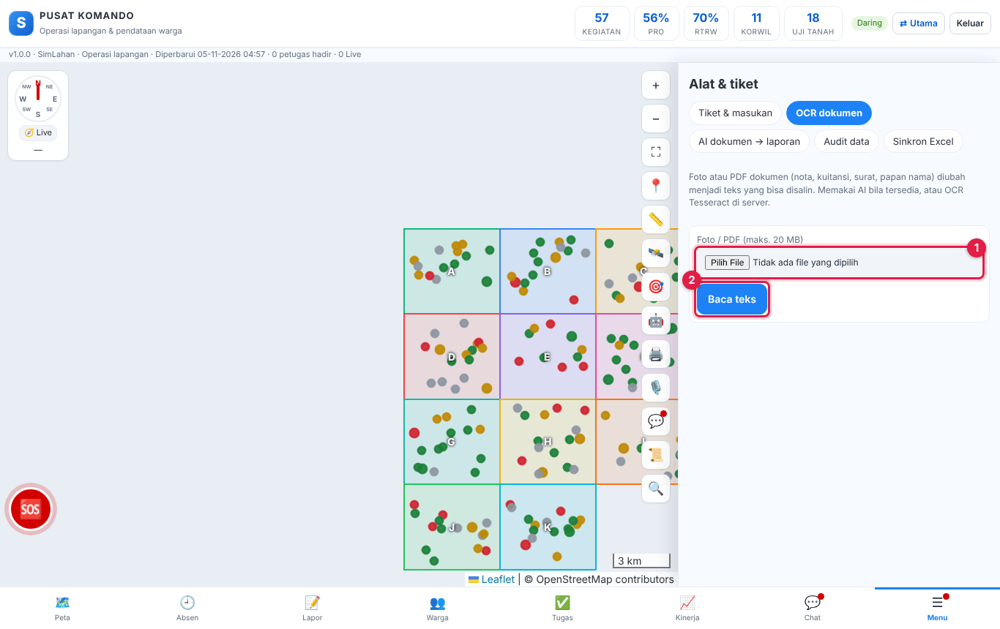

1. Ketuk **OCR dokumen**.
2. Pilih foto atau PDF, maks. 20 MB (nomor 1).
3. Ketuk **Baca teks** (nomor 2). Teks hasil bacaan tampil dan bisa disalin.

**AI dokumen → laporan:**

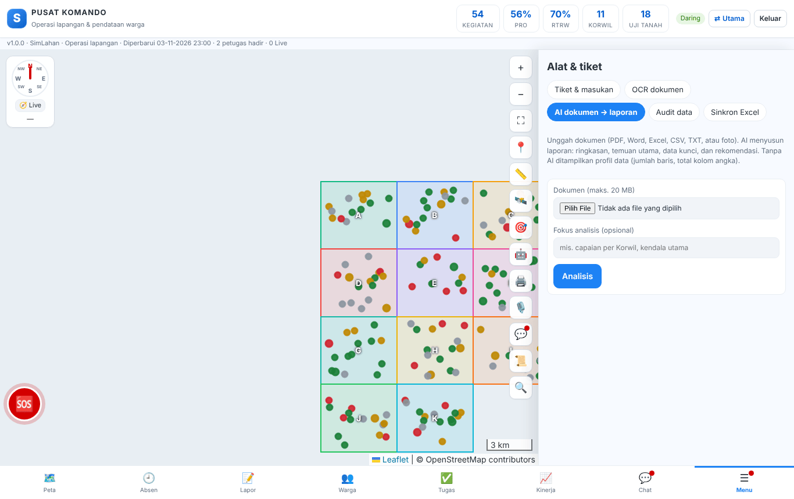

1. Ketuk **AI dokumen → laporan**.
2. Pilih dokumen: PDF, Word, Excel, CSV, TXT, atau foto (nomor 1).
3. Isi **Fokus analisis** bila perlu (nomor 2), misalnya "capaian per Korwil".
4. Ketuk **Analisis** (nomor 3). Hasilnya berupa ringkasan, temuan utama, data kunci, dan rekomendasi. Tanpa layanan AI, yang tampil hanya profil data dokumen.

**AI foto lapangan** (bila AI aktif): unggah foto lapangan atau drone, isi **Konteks**, lalu ketuk **Analisis foto**. AI menandai pembukaan lahan, bangunan, kebun, air, akses, dan alat berat. Wajah orang tidak dianalisis.

**Sinkron Excel:**

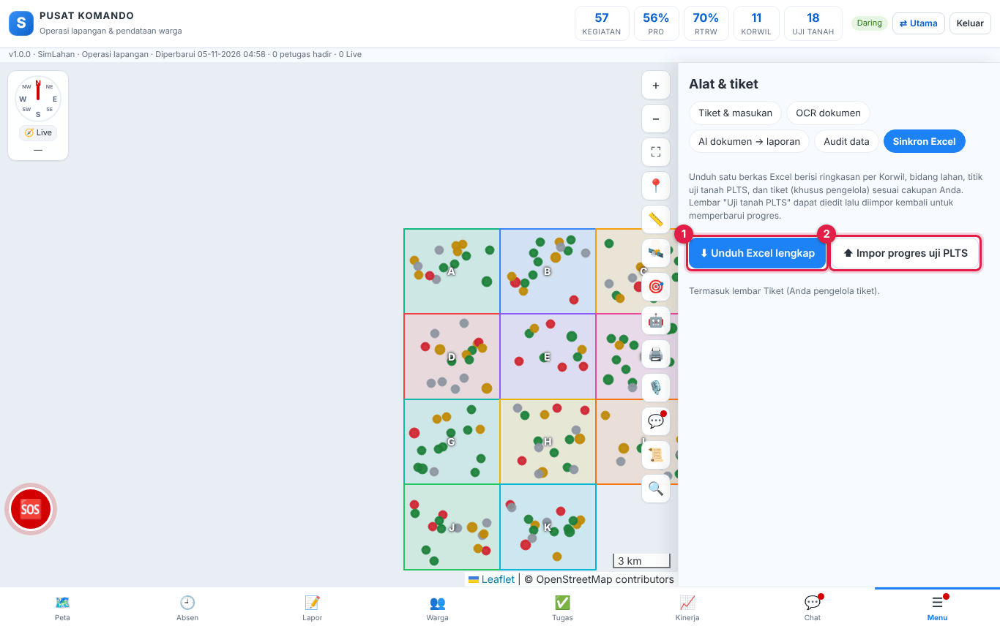

1. Ketuk **Sinkron Excel**.
2. Ketuk **⬇ Unduh Excel lengkap** (nomor 1): ringkasan Korwil, bidang lahan, titik uji PLTS, dan tiket.
3. Setelah lembar "Uji tanah PLTS" diedit, ketuk **⬆ Impor progres uji PLTS** (nomor 2) dan pilih berkasnya.

**Audit data** (koordinator):

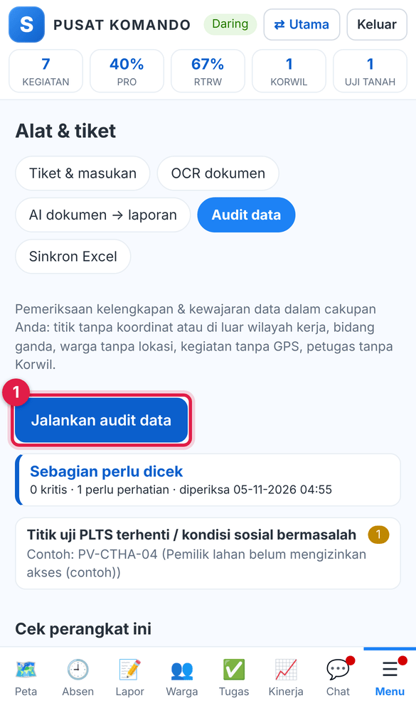

1. Ketuk **Audit data**, lalu **Jalankan audit data** (nomor 1).
2. Hasilnya tampil di bawah: titik tanpa koordinat atau di luar wilayah, bidang ganda, warga tanpa lokasi, kegiatan tanpa GPS, dan petugas tanpa Korwil, masing-masing dengan contoh datanya.

**Cek perangkat:** di bagian bawah **Alat & tiket**, ketuk **Periksa perangkat** untuk memeriksa koneksi internet, antrean luring, penyimpanan luring, mode aplikasi luring, izin lokasi GPS, dan ruang penyimpanan terpakai di HP Anda.

<!-- akhir sisip -->

<!-- sisip: 40-pusat-komando.md#persetujuan -->

### Persetujuan

Semua yang menunggu keputusan Anda ada di satu tempat. Petugas biasa melihat halaman ini kosong.

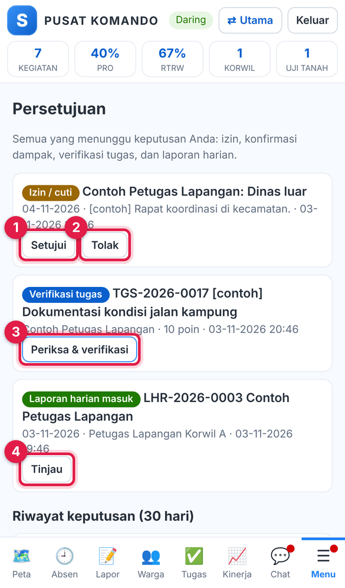

1. Buka **Menu → Persetujuan**.
2. **Izin / cuti** anggota: ketuk **Setujui** (nomor 1) atau **Tolak** (nomor 2).
3. **Verifikasi tugas**: ketuk **Periksa & verifikasi** (nomor 3) untuk membuka rincian tugas, lalu verifikasi seperti di 10.6.
4. **Laporan harian masuk**: ketuk **Tinjau** (nomor 4) untuk membukanya.
5. Konfirmasi dampak tinggi (Kegiatan lainnya) juga muncul di sini dengan tombol **Konfirmasi dampak**.
6. **Riwayat keputusan (30 hari)** tampil di bawah.

<!-- akhir sisip -->

<!-- sisip: 40-pusat-komando.md#laporan-harian-berjenjang -->

### Laporan harian berjenjang

Laporan harian dikirim ke **atasan langsung** (diatur di **Jabatan & atasan petugas**, [Bab 11.8](../41-panel-pusat-komando.md#118-jabatan-tugas-dan-laporan-harian)), lalu dirangkum ke atas sampai pimpinan. Baris **Posisi Anda** di atas menunjukkan jabatan Anda dan ke mana laporan dikirim.

**Membuat dan mengirim laporan harian:**

1. Buka **Menu → Laporan harian**.

2. Pastikan bagian **Buat** aktif (nomor 1). Bagian lain: **Masuk** (laporan dari bawahan), **Lacak** (posisi laporan 14 hari terakhir), dan **Rekap Excel**.
3. Pilih rentang kegiatan (nomor 2): Hari ini sampai 31 hari. Kegiatan yang belum pernah dilaporkan tampil tercentang di bawahnya; hapus centang yang tidak ingin dimasukkan.
4. Ketuk **✨ Susun otomatis** (nomor 3). **Isi laporan** (nomor 4) terisi dari kegiatan yang dicentang.
5. Periksa dan sunting **Isi laporan**: kegiatan, temuan, kendala, dan rencana besok.
6. Tambah **Lampiran (maks. 10 berkas)** bila perlu (nomor 5).
7. Ketuk **📤 Kirim ke atasan** (nomor 6). Laporan yang dikembalikan atasan tampil di **Perlu revisi dari Anda**; perbaiki lalu kirim lagi.

**Merangkum laporan bawahan (koordinator dan atasan):**

1. Angka merah pada **Masuk** (nomor 1) menunjukkan laporan bawahan yang belum ditinjau. Ketuk **Masuk** untuk membacanya. Dari sana, laporan bisa dikembalikan dengan **↩ Kembalikan untuk revisi** (catatan wajib).
2. Di bagian **Buat**, laporan bawahan yang belum dirangkum tampil di **Laporan bawahan yang dirangkum** (nomor 2), sudah tercentang. Ketuk **Buka** untuk membaca isinya.
3. Ketuk **✨ Susun otomatis** (nomor 3) agar kegiatan Anda dan laporan bawahan tersusun menjadi satu laporan, sunting, lalu **📤 Kirim ke atasan**.
4. Pimpinan puncak (tanpa atasan) menandai laporan dengan **✔ Tandai terpilih selesai ditinjau** di bagian **Masuk**.

**Rekap Excel:** ketuk **Rekap Excel**, pilih **Periode**, **Korwil**, dan **Jenis kegiatan**, lalu **⬇ Unduh Excel** (rekap kegiatan, ringkasan per Korwil/jenis/petugas, absensi, dan tugas).

<!-- akhir sisip -->

<!-- sisip: 40-pusat-komando.md#historis-koordinator-dan-atasan -->

### Historis (koordinator dan atasan)

1. Pilih periode (nomor 1) dan Korwil (nomor 2).
2. Pilih bagian (nomor 3): **Komsos** (warga baru dan kunjungan berulang per petugas), **Perubahan sikap**, atau **Luas lahan**.
3. Tabel hasil tampil di nomor 4. Warga baru = warga yang pertama kali didata lewat komsos itu; berulang = kunjungan ke warga yang sudah terdata.

<!-- akhir sisip -->

<!-- sisip: 40-pusat-komando.md#peringkat-tim -->

### Peringkat tim

1. Pilih periode (nomor 1). Koordinator dan atasan juga bisa memilih Korwil dan tingkat, serta tombol **Semua**, **10 teratas**, atau **10 terbawah**.
2. Kartu menampilkan jumlah petugas dinilai, rata-rata skor, dan sebaran nilai A–D. Setiap baris berisi peringkat, nama, skor, dan lencana (misalnya Hadir penuh, Selalu tepat waktu). Kolom tren membandingkan posisi dengan periode sebelumnya.
3. Ketuk **⬇ Excel** (nomor 2) untuk mengunduh.
4. Ketuk **Susun wawasan** di bagian **Wawasan tim** untuk ringkasan siapa yang menonjol dan siapa yang perlu didampingi.

<!-- akhir sisip -->

<!-- sisip: 40-pusat-komando.md#struktur-tim -->

### Struktur tim

Ketuk nama Korwil (nomor 1) untuk melihat koordinator, anggota, kinerja, dan warganya.

<!-- akhir sisip -->

<!-- sisip: 40-pusat-komando.md#feed-aktivitas -->

### Feed aktivitas

Aliran kejadian terbaru: kegiatan, perubahan sikap warga, SOS, uji tanah, dan lainnya. Saring per Korwil di nomor 1.

<!-- akhir sisip -->

<!-- sisip: 40-pusat-komando.md#asisten-ai -->

### Asisten AI

1. Ketik pertanyaan dengan bahasa sehari-hari (nomor 1), misalnya "Berapa warga yang mendukung di Korwil A?".
2. Ketuk **Tanya** (nomor 2). Jawaban tampil di atas kotak. Jawaban hanya dari data yang boleh Anda lihat. Tanpa layanan AI, asisten menampilkan rekap data yang cocok dengan pertanyaan.

<!-- akhir sisip -->

## Bagian C – Panel admin untuk koordinator

<!-- sisip: 41-panel-pusat-komando.md#115-sos -->

### 11.5 SOS

Daftar tanda darurat dengan status **Aktif – butuh bantuan**, **Sedang ditangani**, **Selesai**, atau **Alarm palsu**. Untuk memperbarui status (koordinator atau Administrator):

1. Centang SOS yang ditangani (nomor 1).
2. Pilih aksi **Tandai sedang ditangani**, **Tandai selesai**, atau **Tandai alarm palsu** (nomor 2).
3. Klik **Jalankan** (nomor 3).

<!-- akhir sisip -->

<!-- sisip: 41-panel-pusat-komando.md#118-jabatan-tugas-dan-laporan-harian -->

### 11.8 Jabatan, tugas, dan laporan harian

**Jabatan & atasan petugas** (Administrator) menentukan ke mana laporan harian setiap petugas dikirim dan siapa boleh memberi tugas kepadanya:

1. Klik **Tambahkan Jabatan & atasan petugas** (nomor 1).

2. Pilih **Petugas** (nomor 1). Ketik sebagian nama untuk mencarinya.
3. Isi **Jabatan** (nomor 2), misalnya Koordinator Korwil A, Staf manajemen, Penyelia, atau Pimpinan.
4. Pilih **Atasan langsung** (nomor 3). Kosongkan untuk pimpinan puncak.
5. Klik **Simpan** (nomor 4). Ulangi untuk setiap petugas sampai pimpinan puncak.

Menu lain (baca saja untuk sebagian besar peran):

- **Riwayat tugas**: setiap peristiwa tugas (ditugaskan, mulai, dilaporkan selesai, terkendala, dilanjutkan, diverifikasi, dikembalikan, dibatalkan).
- **Poin tugas**: poin per peran (penerima utama, kontributor lapangan, pemberi tugas).
- **Laporan harian berjenjang**: saringan **Status**, **Korwil**, **Tanggal laporan**, **Disusun dengan AI**.

<!-- akhir sisip -->

<!-- sisip: 40-pusat-komando.md#1010-pertanyaan-umum -->

### 10.10 Pertanyaan umum

**Absen ditolak karena di luar wilayah.** Pastikan GPS aktif dan Anda berada di wilayah Korwil. Bila bertugas di luar, ajukan **Dinas luar** (10.3).

**Laporan belum terkirim.** Lihat angka ⏳ di bilah atas. Laporan terkirim otomatis saat ada sinyal, atau ketuk **Kirim sekarang** di **Laporan saya** (10.4).

**Saya tidak melihat tombol Beri tugas.** Hanya koordinator dan atasan yang bisa memberi tugas.

**Muncul layar "KUNCI SISTEM AKTIF".** Fitur darurat yang hanya bisa dinonaktifkan superuser. Hubungi Administrator.

<!-- akhir sisip -->

## Bila ada kendala

- **Menu atau tombol yang disebut di buku ini tidak ada di layar Anda.** Peran Anda memang tidak memerlukannya (lihat **Batas akses** di atas). Bila Anda membutuhkannya untuk pekerjaan, minta Administrator menambahkan peran yang sesuai.
- **Pesan "Tidak berhak" atau "Anda tidak berwenang melihat data ini".** Data itu di luar hak peran Anda, bukan kerusakan sistem.
- **Lupa kata sandi.** Hubungi superuser SimLahan untuk dibuatkan sandi baru, lalu ganti sandi itu setelah masuk (klik nama Anda → **Ganti sandi**, atau buka `/akun/sandi/`).
- **Terlalu banyak percobaan masuk.** Tunggu beberapa menit, lalu coba lagi dengan sandi yang benar.
- **Ringkasan peran di dalam aplikasi.** Isi bagian *Ringkasan peran* di atas juga bisa dibuka kapan saja lewat **Panduan peran** (`/akun/panduan/`).
