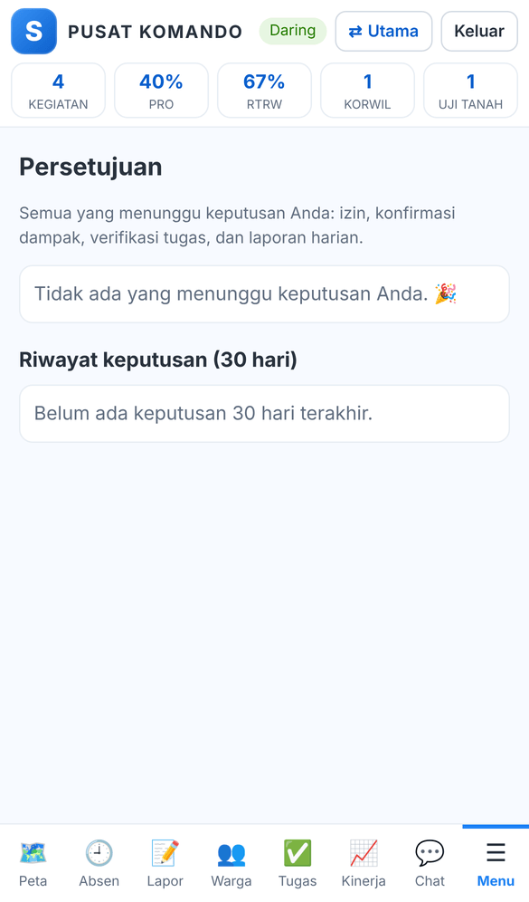
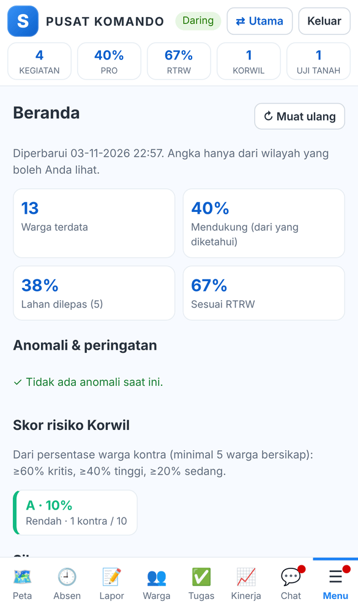
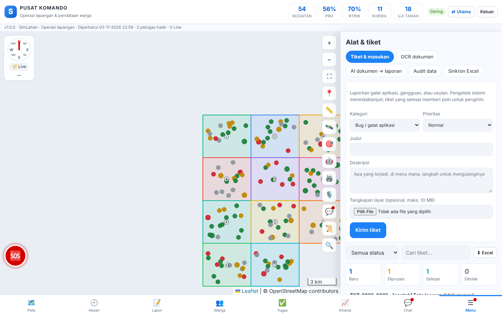

# Buku peran: Koordinator Wilayah

Buku ini untuk **Koordinator Wilayah**: koordinator yang memimpin tim lapangan di Korwil yang dipimpinnya. Baca dulu [Bab 1](../01-mengenal-simlahan.md) dan [Bab 2](../02-dasar-penggunaan.md) bila baru pertama kali memakai SimLahan.

## Masuk

Buka `/komando/masuk/` di HP, isi nama pengguna dan kata sandi, lalu ketuk **Masuk** ([Bab 10.1](../40-pusat-komando.md#101-masuk-dan-memasang-aplikasi)).

<!-- awal: dibuat dari backend/users/role_guide.py; perbarui dengan: cd backend && python manage.py panduan_buku -->

## Ringkasan peran

Memimpin tim lapangan di Korwil yang dipimpinnya.

- **Cara masuk:** Langsung di pusat komando (`/komando/masuk/`), atau di alamat utama SimLahan (`/`) lalu tombol **Pusat Komando**; satu kali masuk berlaku untuk keduanya.
- **Halaman awal:** Pusat komando (`/komando/`).
- **Akun latihan** (hanya di sistem latihan berisi data contoh): `contoh.korwil`

### Menu yang Anda lihat

- Pusat komando (`/komando/`): Peta (termasuk lapisan Temuan ilegal, Patroli SMART, Penguasaan lahan, Zona ancaman, Foto situs 360°, lapisan referensi seperti RTRW/hutan/kawasan proyek, dan gaya peta taktis), Absen, Lapor (Komsos, Topografi, Temuan ilegal, Patroli Taman Buru dengan impor SMART, Kegiatan lainnya, jenis lain, uji tanah, laporan saya), Warga, Tugas (saya, tim, verifikasi, terlambat, semua; tombol Beri tugas bagi koordinator), Kinerja (grafik harian/mingguan, radar, kalender 90 hari, sebaran titik kerja di peta, wawasan), Chat; Menu: Beranda (anomali & peringatan, skor risiko Korwil, ringkasan sikap, tren dukungan, detail Korwil), Peta & spasial (penguasaan lahan dengan skor prioritas dan impor KML/KMZ, tumpang tindih lapisan, audit RTRW, peta panas, jejak GPS bagi pimpinan, zona ancaman, foto 360°), Persetujuan, Laporan harian (buat, masuk, lacak, rekap Excel), Peringkat tim (periode, Korwil, tingkat, 10 teratas/terbawah, lencana, Excel, wawasan), Struktur tim, Historis (bagi koordinator dan atasan: komsos, perubahan sikap, luas lahan), Feed aktivitas, Asisten AI, Uji tanah PLTS (progres titik bor/sumur uji/resistivitas/sondir/termal, aksi cepat, foto, riwayat, impor & unduh Excel), Alat & tiket (tiket & masukan, OCR dokumen, AI dokumen → laporan, AI foto lapangan, audit data bagi koordinator, cek perangkat, sinkron Excel), pindah ke aplikasi lain (utama, panel admin, aplikasi lapangan, portal) sesuai hak; tombol **⇄ Utama** di bilah atas
- Panel admin: Korwil, warga, kegiatan, uji tanah, uji tanah PLTS, SOS, tugas, jabatan & atasan petugas, riwayat & poin tugas, laporan harian berjenjang (baca saja), tiket saya

### Yang bisa Anda lakukan

- Semua hak petugas lapangan di pusat komando.
- Memverifikasi laporan, menangani SOS, menyetujui izin anggota, melihat KPI anggota, dan membuat tugas wilayah.
- Memberi tugas berpoin kepada anggota (penerima utama dan kontributor), lalu memverifikasi atau mengembalikan tugas yang dilaporkan selesai.
- Menerima laporan harian anggota: mengembalikannya untuk revisi, atau merangkumnya ke laporan sendiri untuk atasan. Semua yang menunggu keputusan ada di Menu → Persetujuan.
- Mengonfirmasi klaim dampak tinggi Kegiatan lainnya milik anggota (bukan milik sendiri).
- Melihat Historis wilayahnya: komsos per petugas (warga baru dan kunjungan berulang), perubahan sikap warga, dan perubahan luas lahan.
- Menandai dan menonaktifkan zona ancaman di wilayahnya, menghapus foto 360° wilayahnya, dan melihat jejak GPS anggota (disimpan 60 hari).
- Menambah titik uji tanah PLTS (formulir atau impor Excel), menghapus foto titik, dan menjalankan audit data wilayahnya (bisa diringkas AI).

### Batas akses

- Hanya Korwil yang dipimpinnya dan tugas Korwil yang dipimpin/diikuti.
- Tidak membuka aplikasi lapangan aset atau modul lain; tidak melihat NIK warga.
- Tidak menangani tiket orang lain (hanya melihat tiket miliknya).

<!-- akhir: blok role_guide.py -->

## Pekerjaan sehari-hari

### 1. Semua pekerjaan petugas lapangan

1. Anda juga absen, melapor, mendata warga, dan mengerjakan tugas seperti petugas lapangan ([buku Petugas Lapangan](petugas-lapangan.md)).

### 2. Memberi dan memverifikasi tugas

1. Tab **Tugas** → **＋ Beri tugas**: isi judul, penerima, kontributor, prioritas, tenggat, dan nilai poin ([Bab 10.6](../40-pusat-komando.md#106-tugas)).
2. Saring **Verifikasi**, lalu **✔ Verifikasi selesai** atau **↩ Kembalikan untuk revisi**.

### 3. Persetujuan

1. **Menu → Persetujuan**: izin anggota, konfirmasi dampak, verifikasi tugas, dan laporan harian ([Bab 10.9](../40-pusat-komando.md#persetujuan)).

### 4. Laporan harian berjenjang

1. **Masuk**: kembalikan laporan anggota untuk revisi atau rangkum ke laporan Anda; **Buat** → **📤 Kirim ke atasan** ([Bab 10.9](../40-pusat-komando.md#laporan-harian-berjenjang)).

### 5. Memantau wilayah

1. **Beranda** (anomali, skor risiko, tren dukungan), **Historis**, **Kinerja**, **Peringkat tim** ([Bab 10.9](../40-pusat-komando.md#109-menu-lainnya)).
2. **Peta & spasial**: zona ancaman, jejak GPS anggota, audit RTRW, peta panas ([Peta & spasial](../40-pusat-komando.md#peta--spasial)).

### 6. SOS dan audit data

1. Tangani SOS anggota ([Bab 11.5](../41-panel-pusat-komando.md#115-sos)). Jalankan **Audit data** di **Menu → Alat & tiket** ([Bab 10.9](../40-pusat-komando.md#alat--tiket)).

## Bab yang perlu dibaca

- [Bab 1](../01-mengenal-simlahan.md)
- [Bab 2](../02-dasar-penggunaan.md)
- [Bab 10 – Pusat komando](../40-pusat-komando.md)
- [Bab 11 – Data pusat komando di panel admin](../41-panel-pusat-komando.md)

## Bila ada kendala

- Menu atau tombol tidak ada: peran Anda memang tidak memerlukannya ([Bab 2.10](../02-dasar-penggunaan.md#210-batas-akses-dan-pesan-tidak-berhak)). Hubungi Administrator bila Anda memerlukannya untuk pekerjaan.
- Lupa kata sandi: hubungi Administrator atau superuser untuk menyetel ulang sandi.
- Ringkasan peran yang sama bisa dibuka di dalam aplikasi lewat **Panduan peran** (`/akun/panduan/`).
