# Buku peran: Operator Entri Data

Buku ini untuk **Operator Entri Data**: petugas yang memasukkan dan memperbarui hampir semua data sewa, termasuk keputusan dan besaran sewa. Buku ini berisi semua langkah kerja peran Anda, lengkap dengan gambar, sehingga cukup dibaca sendiri. Dasar penggunaan yang berlaku untuk semua peran (mengenal layar, ganti sandi, memakai di HP) ada di [Bab 2](../02-dasar-penggunaan.md).

**Cara membaca buku ini.** Kotak merah bernomor pada gambar menunjuk tombol atau kolom yang disebut di langkah. Tulisan *(nomor 2)* berarti: lihat kotak merah bernomor 2 pada gambar tepat di atas langkah itu. Semua gambar memakai data contoh fiktif; isi di layar Anda berbeda, tetapi letak tombolnya sama. Judul bagian bernomor (misalnya *3.4*) sama dengan nomor bagian di buku lengkap.

## Masuk dan halaman awal

<!-- sisip: 02-dasar-penggunaan.md#a-aplikasi-utama-petugas-kantor -->

### A. Aplikasi utama (petugas kantor)

1. Buka alamat SimLahan, misalnya `https://simlahan.instansi-anda.go.id/`.
2. Ketik nama pengguna Anda di kotak **Nama pengguna** (nomor 1 di gambar).
3. Ketik kata sandi di kotak **Kata sandi** (nomor 2).
4. Klik tombol biru **Masuk** (nomor 3).
5. Anda langsung dibawa ke halaman kerja peran Anda (lihat bagian "Halaman awal" di buku peran Anda).

Tautan di bawah kotak masuk (nomor 4: **⇄ Pusat Komando**, **⇄ Panel admin**, **⇄ Portal**) membawa Anda ke halaman masuk aplikasi lain.

<!-- akhir sisip -->

### Halaman awal

Setelah masuk, Anda langsung melihat daftar **Sewa**:

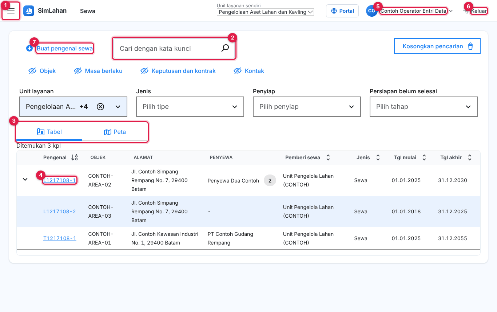

Nomor pada gambar:

1. **☰ Menu**: membuka menu samping berisi semua halaman yang boleh Anda buka.
2. **Cari dengan kata kunci**: ketik pengenal sewa, nama penyewa, atau alamat, lalu tekan Enter.
3. **Tabel** / **Peta**: ganti tampilan hasil menjadi tabel atau peta.
4. **Pengenal sewa** (misalnya *L1217108-1*): klik untuk membuka halaman sewa itu.
5. **Nama Anda**: membuka menu akun (**Panduan peran**, **Ganti sandi**, unit layanan).
6. **Keluar**: mengakhiri sesi di perangkat ini.
7. **Buat pengenal sewa**: membuat sewa baru (lihat 3.2 di bawah).

### Menu Anda

Klik **☰** (nomor 1 pada gambar halaman awal) untuk membuka menu:

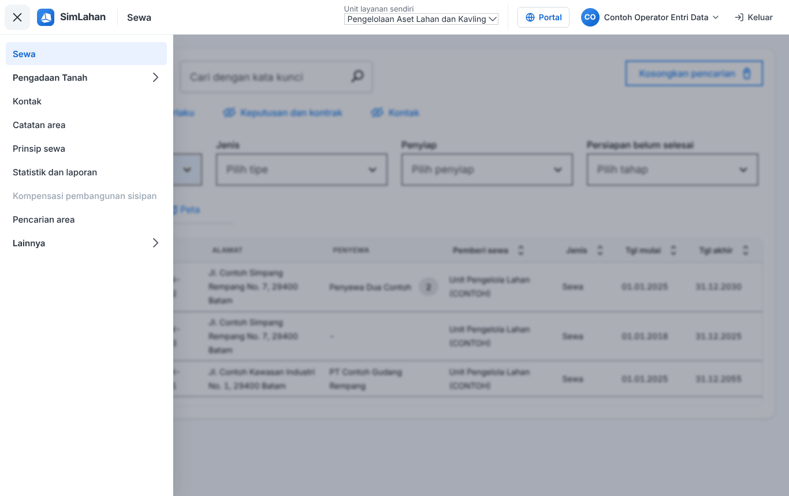

Menu Anda: **Sewa**, **Pengadaan Tanah ›** (hanya membaca), **Kontak**, **Catatan area**, **Prinsip sewa**, **Statistik dan laporan**, **Kompensasi pembangunan sisipan**, **Pencarian area**, dan **Lainnya ›**.

<!-- awal: dibuat dari backend/users/role_guide.py; perbarui dengan: cd backend && python manage.py panduan_buku -->

## Ringkasan peran

Memasukkan dan memperbarui data sewa secara lengkap.

- **Cara masuk:** Alamat utama SimLahan (`/`), dengan nama pengguna dan sandi.
- **Halaman awal:** Sewa (daftar sewa).
- **Akun latihan** (hanya di sistem latihan berisi data contoh): `contoh.operator`

### Menu yang Anda lihat

- Sewa
- Pengadaan Tanah: Dasbor & tenggat, Proyek pengadaan, Kalender & aturan tenggat
- Kontak
- Catatan area
- Prinsip sewa
- Statistik dan laporan
- Kompensasi pembangunan sisipan
- Pencarian area
- Lainnya: Indeks biaya hidup, Tugas terjadwal, Catatan tagihan, Kalkulator sewa

### Yang bisa Anda lakukan

- Membuat dan mengubah sewa, penyewa, kontrak dan perubahannya, keputusan dan syaratnya, besaran sewa dan jatuh tempo, dasar sewa beserta tarif dan keputusannya, inspeksi, kontak, dan catatan area.
- Membuat laporan sewa.
- Mengelola pencarian kavling/area dan formulirnya.

### Batas akses

- Tidak mengelola tagihan, pembayaran, atau penagihan hukum.
- Tidak bisa membuka panel admin, alokasi lahan, manajemen aset lahan, pusat komando, atau aplikasi lapangan.

<!-- akhir: blok role_guide.py -->

## Urutan kerja Anda

1. Buat sewa dengan **Buat pengenal sewa** ([3.2 Membuat sewa baru](#32-membuat-sewa-baru)).
2. Lengkapi semua tab: Ringkasan, Area sewa, Penyewa, Sewa (besaran sewa dan jatuh tempo), serta Keputusan dan kontrak ([3.3 Halaman data sewa](#33-halaman-data-sewa)).
3. Perbarui **Kontak**, **Catatan area**, dan **Prinsip sewa** beserta tarif dan keputusannya ([3.7 Prinsip sewa (dasar sewa)](#37-prinsip-sewa-dasar-sewa)).
4. Buat laporan sewa di **Statistik dan laporan** ([3.8 Statistik dan laporan](#38-statistik-dan-laporan)).

## Bagian A – Sewa

<!-- sisip: 10-sewa.md#31-daftar-sewa -->

### 3.1 Daftar sewa

Halaman **Sewa** adalah halaman awal peran sewa.

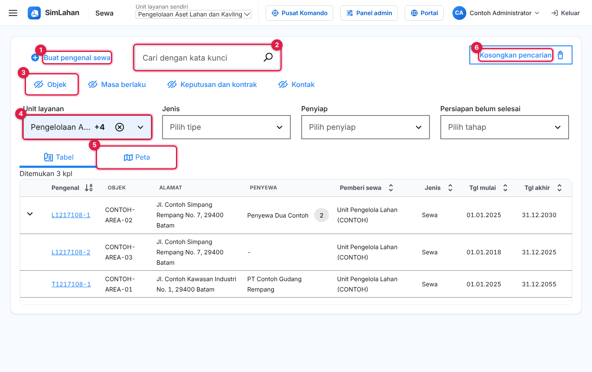

Nomor pada gambar:

1. **Buat pengenal sewa**: membuat sewa baru (lihat 3.2).
2. **Cari dengan kata kunci**: ketik pengenal sewa, nama penyewa, alamat, atau pengenal objek, lalu tekan Enter.
3. **Objek**, **Masa berlaku**, **Keputusan dan kontrak**, **Kontak**: klik salah satu untuk membuka kolom pencarian tambahan.
4. **Saringan**: Unit layanan, Jenis, Penyiap, dan Persiapan belum selesai. Klik kotak lalu pilih isinya.
5. **Peta**: mengganti tampilan daftar menjadi peta lokasi sewa. Klik **Tabel** untuk kembali.
6. **Kosongkan pencarian**: menghapus semua kata kunci dan saringan.

Klik **pengenal sewa** (misalnya `L1217108-1`) untuk membuka datanya. Tanda **˅** di awal baris menampilkan sewa lain yang terkait. Angka bulat di kolom Penyewa menunjukkan jumlah penyewa.

Tampilan peta:

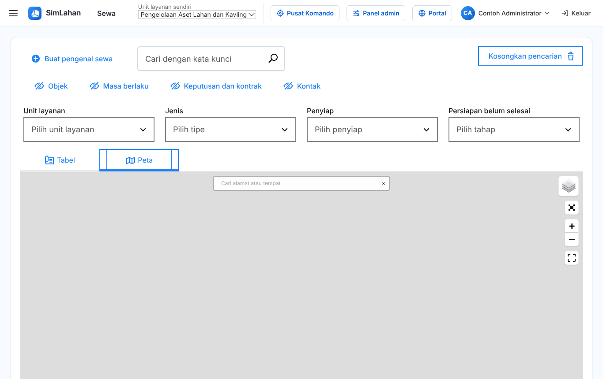

<!-- akhir sisip -->

<!-- sisip: 10-sewa.md#32-membuat-sewa-baru -->

### 3.2 Membuat sewa baru

*Peran: Penyusun, Operator Entri Data, Administrator.*

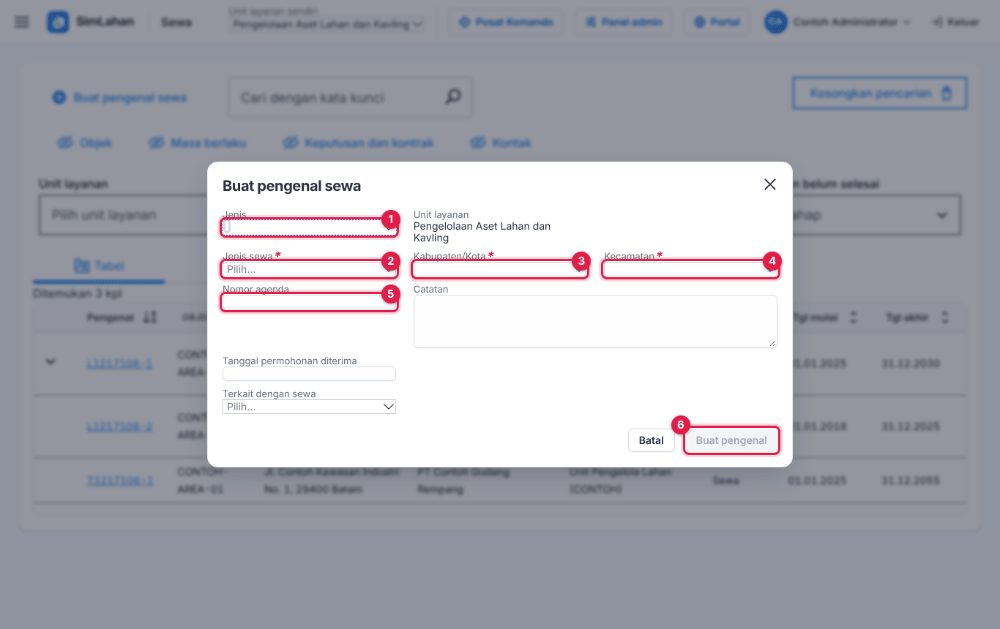

1. Di halaman Sewa, klik **Buat pengenal sewa**. Jendela seperti gambar di atas terbuka.
2. Pilih **Jenis** (nomor 1), misalnya Sewa.
3. Pilih **Jenis sewa** (nomor 2). Wajib.
4. Pilih **Kabupaten/Kota** (nomor 3) dan **Kecamatan** (nomor 4). Wajib. **Unit layanan** terisi otomatis dari unit aktif Anda.
5. Bila perlu isi **Nomor agenda** (nomor 5), **Catatan**, **Tanggal permohonan diterima**, dan **Terkait dengan sewa** (untuk perpanjangan atau pemecahan dari sewa lama).
6. Klik **Buat pengenal** (nomor 6). Tombol ini baru aktif setelah semua kolom wajib terisi. Sistem membuat pengenal sewa baru dan membuka halaman sewanya.
7. Lengkapi tab-tab sewa (lihat 3.3): klik **Ubah**, isi, lalu klik **Simpan**.

<!-- akhir sisip -->

<!-- sisip: 10-sewa.md#33-halaman-data-sewa -->

### 3.3 Halaman data sewa

Di bagian atas tampak ringkasan: pengenal sewa, jenis, tanggal mulai/akhir, kondisi, pengenal objek, dan alamat. Di bawahnya ada sembilan tab.

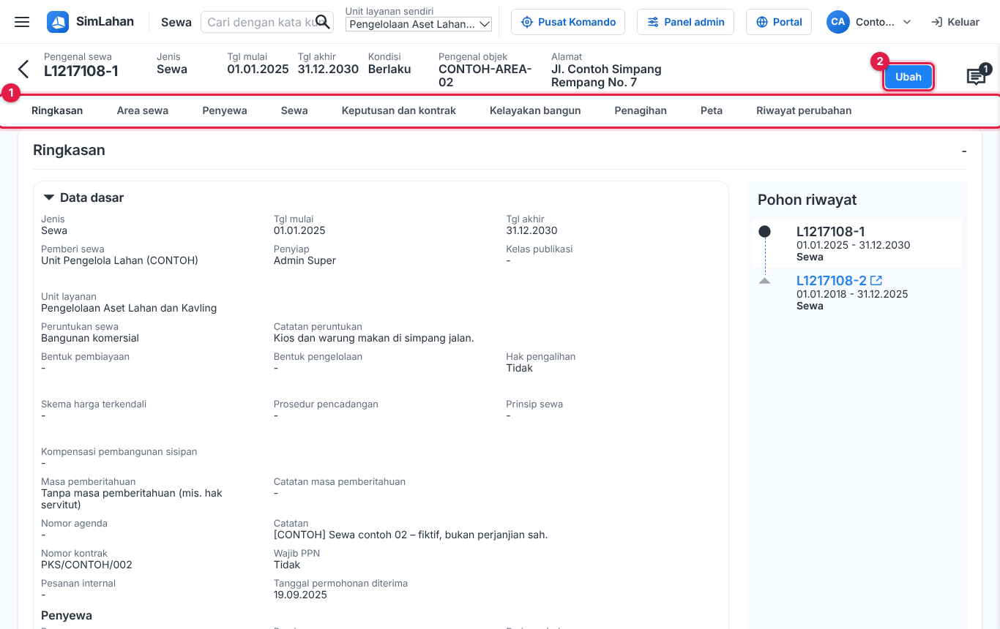

1. **Tab** (nomor 1): klik untuk berpindah bagian.
2. **Ubah** (nomor 2): masuk mode ubah untuk tab yang sedang dibuka.

#### Mengubah data sewa

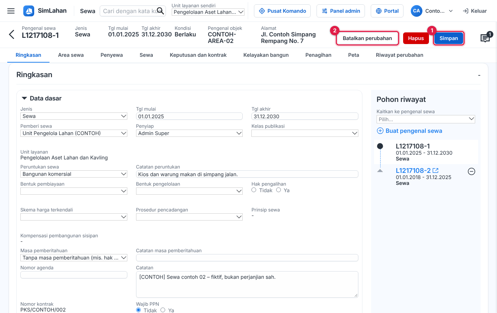

1. Buka tab yang akan diubah, lalu klik **Ubah** di kanan atas.
2. Ubah isian. Kolom bertanda **\*** wajib diisi.
3. Klik **Simpan** (nomor 1). Klik **Batalkan perubahan** (nomor 2) bila tidak jadi.
4. Tombol merah **Hapus** menghapus seluruh sewa (hanya untuk sewa yang belum berjalan dan bila Anda berhak).

#### Isi setiap tab

| Tab | Isi dan kegunaan |
|---|---|
| **Ringkasan** | Data dasar: jenis, tanggal, pemberi sewa, penyiap, peruntukan, bentuk pembiayaan/pengelolaan, masa pemberitahuan, nomor kontrak, wajib PPN, catatan. Kolom kanan **Pohon riwayat** menunjukkan sewa sebelumnya/berikutnya; tautkan sewa lain di **Kaitkan ke pengenal sewa**. |
| **Area sewa** | Objek yang disewa: pengenal objek, definisi, luas, lokasi, alamat, bidang tanah, unit rencana, rencana detail. Tombol **Tambah objek**, **Tambah alamat**, **Tambah bidang tanah**, **Tambah unit rencana**, dan **Salin ke kontrak**. |
| **Penyewa** | Siapa penyewanya, porsi bagian sewa (misalnya 1/2), penagih/kontak lain, dan masa berlakunya. Penyewa dipilih dari data **Kontak**. |
| **Sewa** | Jenis sewa (tetap/indeks), tanggal, pembagian tagihan, jatuh tempo, sewa kontrak per peruntukan, potongan dan kenaikan. **Perhitungan sewa**: pilih tahun atau periode tagihan lalu klik **Hitung** untuk melihat total terutang. Ada juga **Kalkulator sewa** di bawahnya. |
| **Keputusan dan kontrak** | Keputusan beserta syarat-syaratnya, kontrak dan perubahannya, jaminan, serta **Pemeriksaan dan catatan** (inspeksi). |
| **Kelayakan bangun** | Status kelayakan bangun/konstruksi lahan; tombol **Kirim email** untuk mengirim informasi kepada pihak terkait. |
| **Penagihan** | Daftar tagihan per periode, pembayaran, dan penagihan hukum (lihat 3.4). |
| **Peta** | Lokasi area sewa di peta. |
| **Riwayat perubahan** | Siapa mengubah apa: tanggal, nama, jenis perubahan, nilai lama dan baru. |

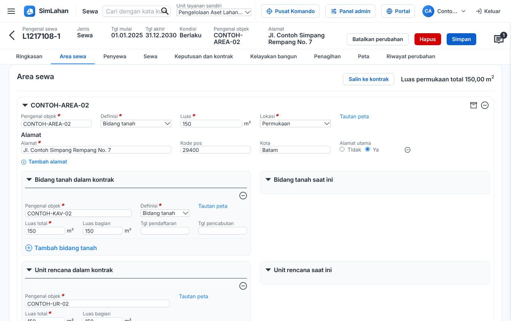

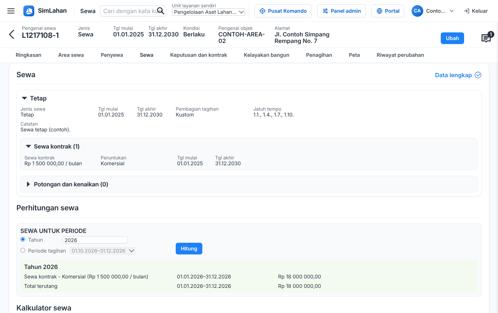

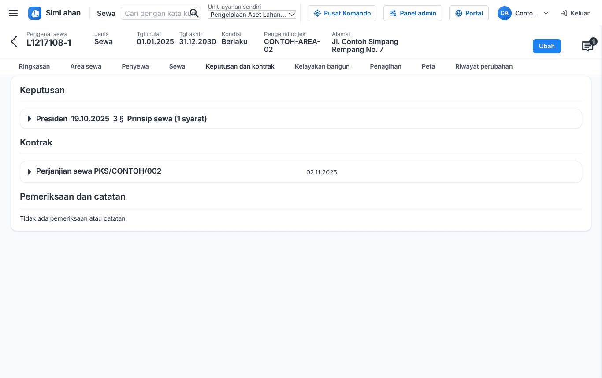

<!-- akhir sisip -->

> Peran Anda **tidak** mengelola tagihan, pembayaran, atau penagihan hukum (tab **Penagihan**).

<!-- sisip: 10-sewa.md#35-kontak -->

### 3.5 Kontak

Kontak adalah daftar orang, badan usaha, perkumpulan, atau unit yang menjadi penyewa, pemberi sewa, atau penagih.

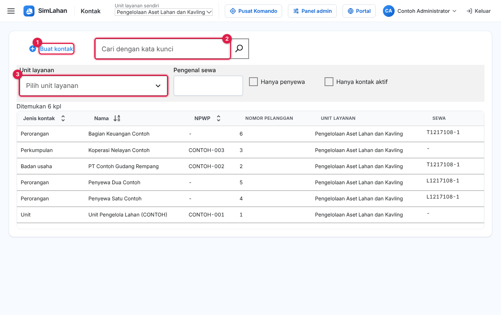

- **Buat kontak** (nomor 1): menambah kontak baru.
- **Cari dengan kata kunci** (nomor 2): ketik nama, NPWP, atau nomor pelanggan.
- Saringan **Unit layanan** (nomor 3), **Pengenal sewa**, **Hanya penyewa**, atau **Hanya kontak aktif**.
- Klik baris kontak untuk melihat datanya dan **Sewa kontak** (daftar sewa yang melibatkan kontak itu, beserta tunggakan).

**Menambah kontak** (Penyusun, Operator, Penagihan, Administrator)

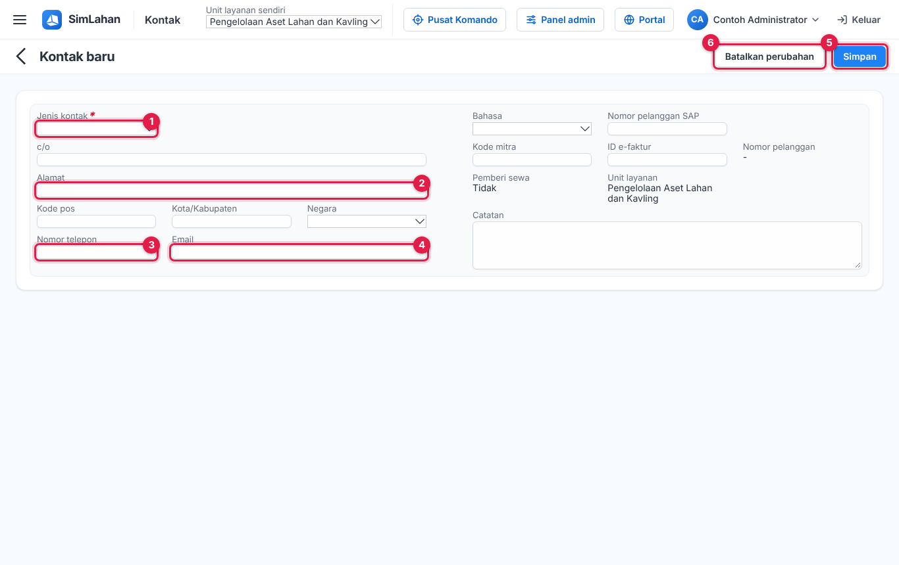

1. Di daftar kontak, klik **Buat kontak**.
2. Pilih **Jenis kontak** (nomor 1): perorangan, badan usaha, perkumpulan, atau unit. Kolom nama dan NIK/NPWP muncul sesuai jenisnya.
3. Isi nama dan NIK/NPWP, lalu **Alamat** (nomor 2), **Nomor telepon** (nomor 3), **Email** (nomor 4), dan kolom lain yang diperlukan.
4. Klik **Simpan** (nomor 5) di kanan atas. Klik **Batalkan perubahan** (nomor 6) bila tidak jadi.

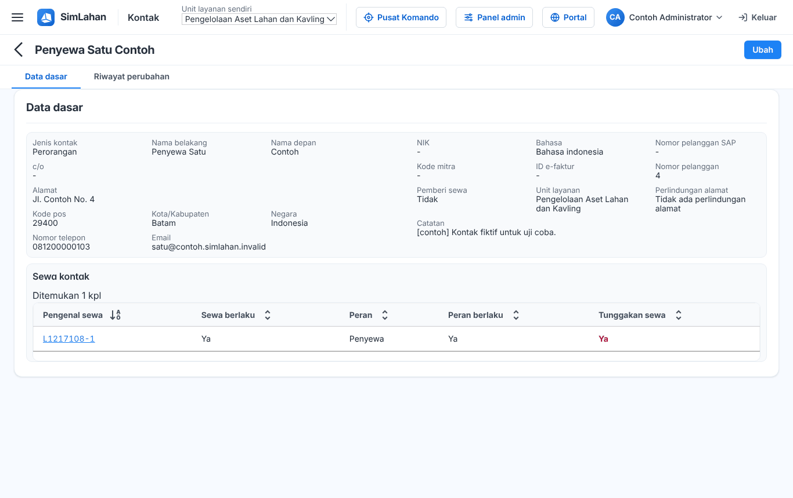

<!-- akhir sisip -->

<!-- sisip: 10-sewa.md#36-catatan-area -->

### 3.6 Catatan area

Catatan area adalah catatan yang ditandai langsung di peta, misalnya "lahan rawan banjir".

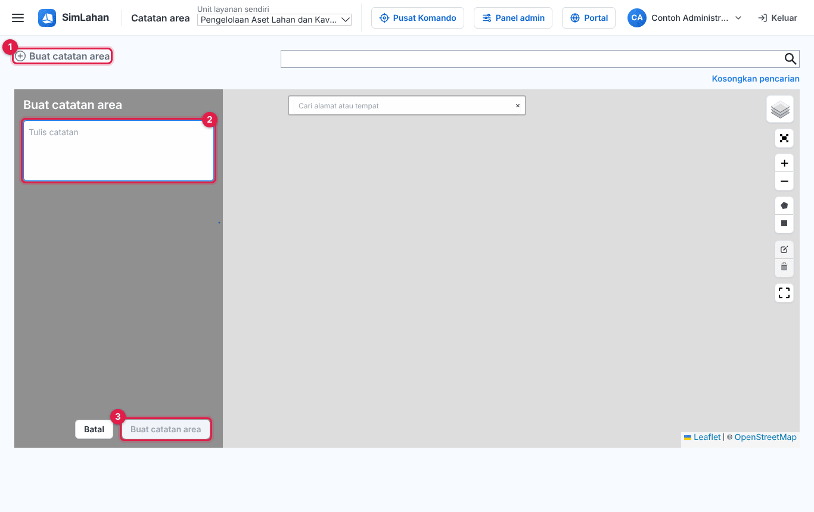

1. Buka **☰ → Catatan area**.
2. Klik **Buat catatan area** (nomor 1). Panel isian terbuka di kiri peta.
3. Gambar area di peta: klik ikon segi lima di kolom alat kanan peta, klik titik-titik batas area, lalu klik titik pertama untuk menutup bentuknya.
4. Tulis catatannya di kotak **Tulis catatan** (nomor 2).
5. Klik **Buat catatan area** (nomor 3) di bawah panel. Klik area di peta kapan saja untuk membaca atau mengubah catatannya.

<!-- akhir sisip -->

<!-- sisip: 10-sewa.md#37-prinsip-sewa-dasar-sewa -->

### 3.7 Prinsip sewa (dasar sewa)

Prinsip sewa adalah dasar penentuan tarif untuk satu objek atau kawasan.

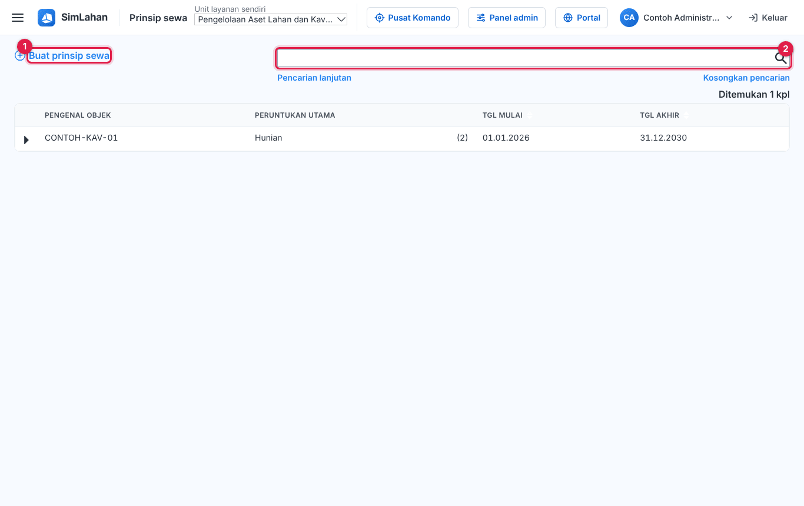

1. Buka **☰ → Prinsip sewa**. Klik **Buat prinsip sewa** (nomor 1) untuk menambah, atau cari di kotak cari (nomor 2) lalu klik pengenal objek untuk membuka.
2. Isi peruntukan utama, tanggal mulai/akhir, tarif dan keputusan terkait.
3. Klik **Simpan**.

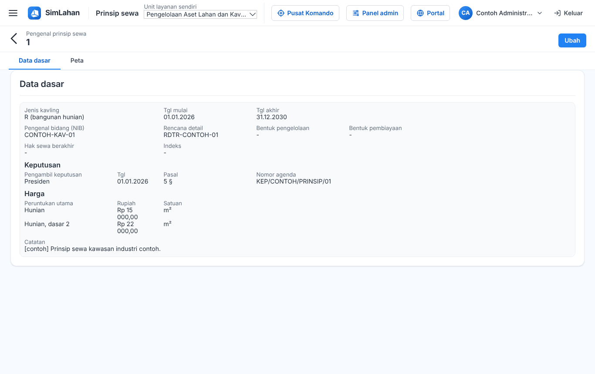

<!-- akhir sisip -->

<!-- sisip: 10-sewa.md#38-statistik-dan-laporan -->

### 3.8 Statistik dan laporan

*Peran: Penyusun, Penyusun Kontrak, Operator, Ahli Hukum Penagihan, Petugas Penagihan, Administrator (Penelusur tidak).*

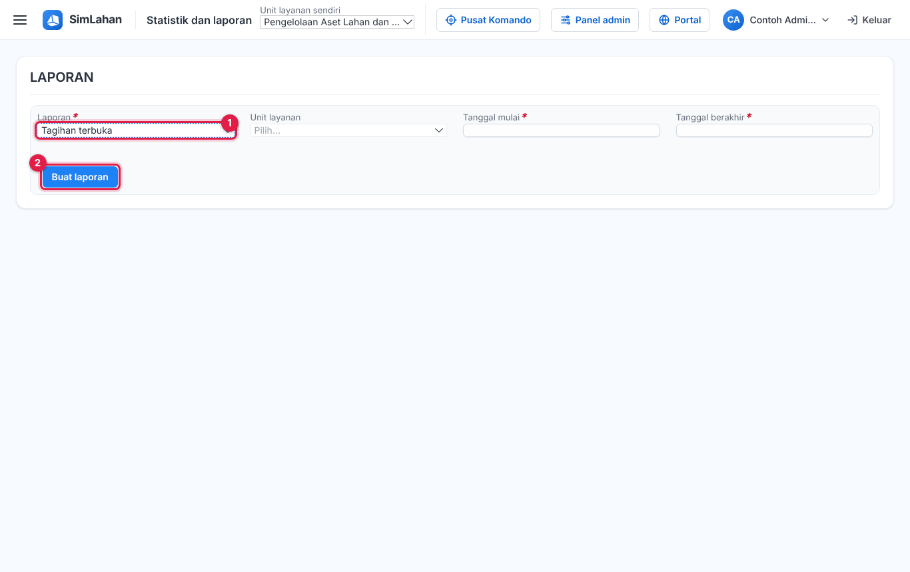

1. Buka **☰ → Statistik dan laporan**.
2. Pilih jenis laporan di kotak **Laporan** (nomor 1). Pada gambar dipilih **Tagihan terbuka**. Laporan yang tersedia: Tagihan terbuka, Tagihan dalam periode, Jaminan, Pembayaran tagihan, Tagihan yang dibayar kontak, Sewa dengan penagihan nonaktif, Sewa per jenis indeks, Sewa kontak, Persyaratan keputusan, Perbandingan sewa, Proyeksi sewa, Pencadangan, Laporan statistik sewa, Jumlah sewa, Penyesuaian sewa, Dasar sewa, dan Sewa per jenis sewa. Laporan tagihan hanya muncul untuk peran yang berhak.
3. Isi saringan laporan yang muncul (misalnya **Unit layanan**, **Tanggal mulai**, **Tanggal berakhir**).
4. Klik **Buat laporan** (nomor 2). Laporan kecil langsung tampil dan bisa diunduh; laporan besar dibuat di latar belakang dan dikirim ke surel Anda.

<!-- akhir sisip -->

<!-- sisip: 10-sewa.md#39-kompensasi-pembangunan-sisipan -->

### 3.9 Kompensasi pembangunan sisipan

Mencatat kompensasi atas pembangunan tambahan di lahan sewa (negosiasi dan keputusan).

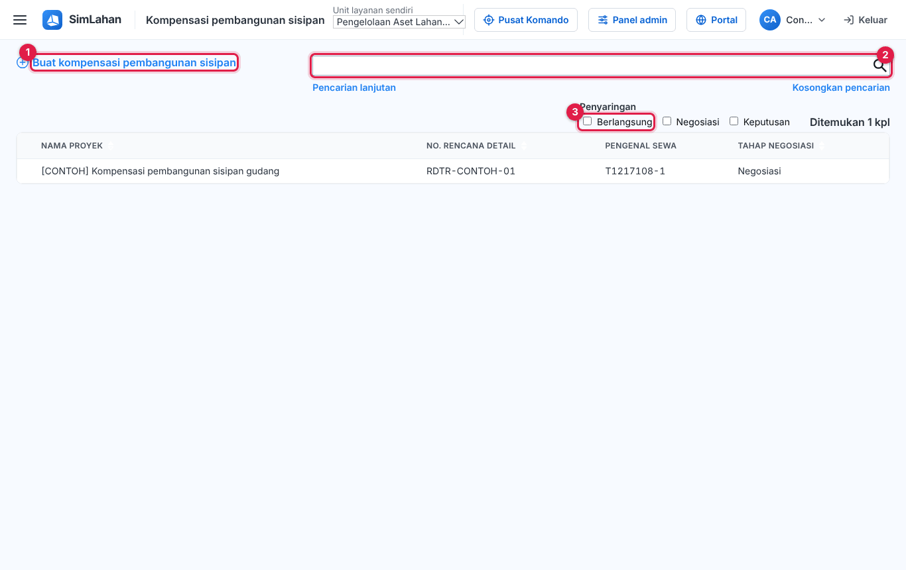

1. Saring dengan kotak centang **Berlangsung** (nomor 3), **Negosiasi**, atau **Keputusan**, atau cari di kotak cari (nomor 2).
2. Klik **Buat kompensasi pembangunan sisipan** (nomor 1) untuk data baru (Penyusun, Administrator).
3. Klik nama proyek untuk membuka, lalu **Ubah** dan **Simpan**.

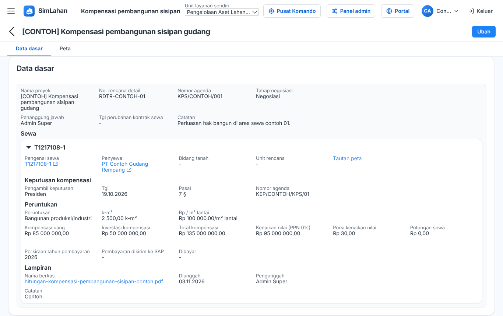

<!-- akhir sisip -->

<!-- sisip: 10-sewa.md#310-pencarian-area-permohonan-area -->

### 3.10 Pencarian area (permohonan area)

Menampung permohonan pemakaian area dari pemohon (misalnya untuk kegiatan sementara).

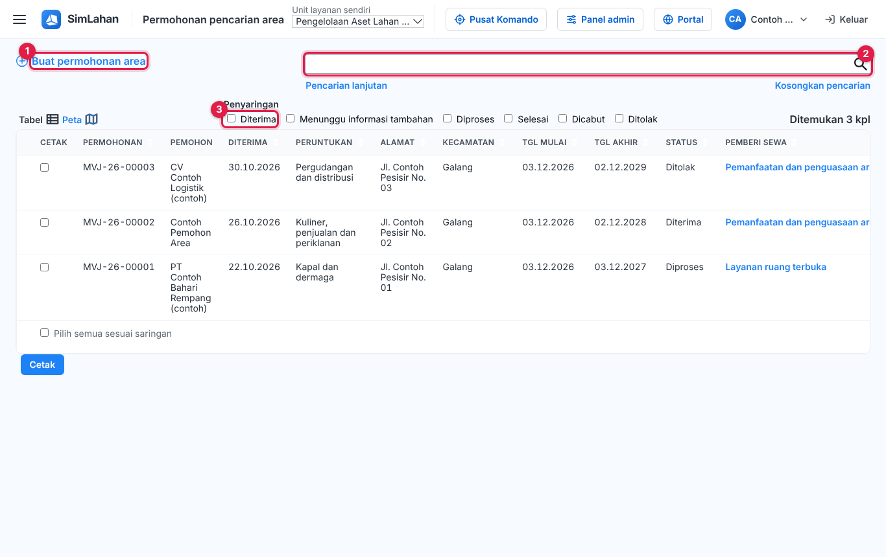

1. Cari di kotak cari (nomor 2) atau saring per status dengan kotak centang (nomor 3): Diterima, Menunggu informasi tambahan, Diproses, Selesai, Dicabut, Ditolak.
2. Klik nomor permohonan untuk membuka: data **Permohonan**, **Dokumen yang diperiksa**, dan **Data pemrosesan**.
3. Klik **Ubah** untuk memproses: isi petugas, status, dan keputusan, lalu **Simpan**.
4. Centang beberapa baris lalu klik **Cetak** untuk mencetak.
5. **Buat permohonan area** (nomor 1) untuk memasukkan permohonan yang datang lewat loket.

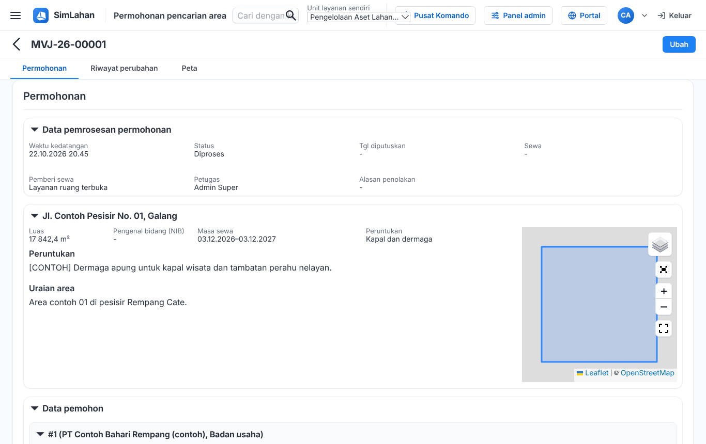

Halaman **Pencarian kavling** dan **Permohonan kavling** (bila ditampilkan untuk peran Anda) bekerja dengan cara yang sama untuk seleksi kavling.

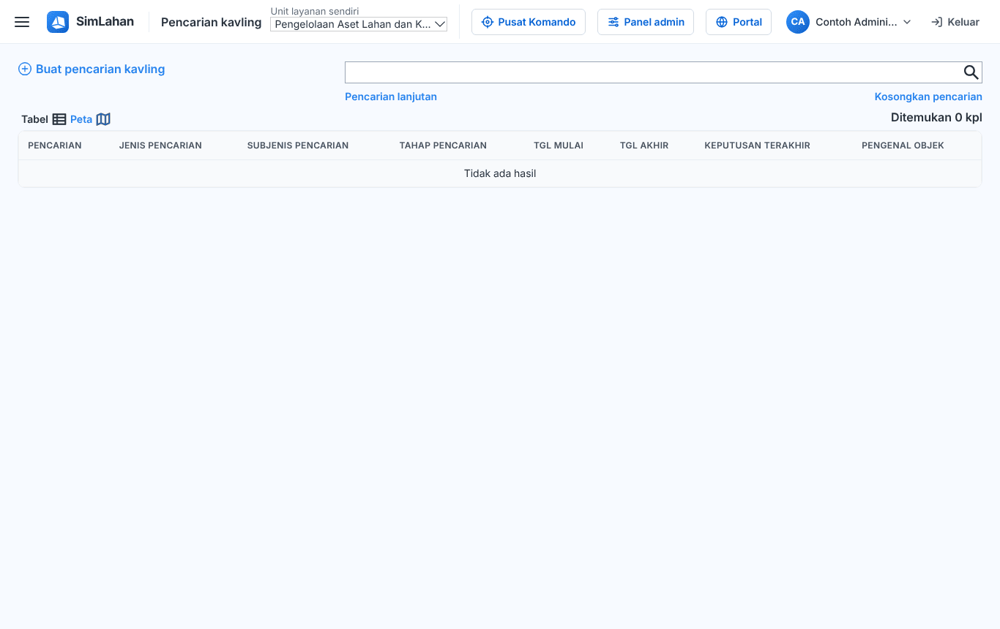

<!-- akhir sisip -->

<!-- sisip: 10-sewa.md#311-menu-lainnya -->

### 3.11 Menu "Lainnya"

Klik **☰ → Lainnya** untuk membuka empat halaman berikut. Peran yang tidak memerlukannya tidak melihat menunya.

> Di sistem latihan, tabel **Indeks biaya hidup**, **Tugas terjadwal**, dan **Pencarian kavling** tampak kosong karena data contoh belum berisi indeks, riwayat proses otomatis, atau seleksi kavling. Di sistem yang sudah berjalan, tabelnya terisi dengan kolom seperti pada gambar.

**Indeks biaya hidup**

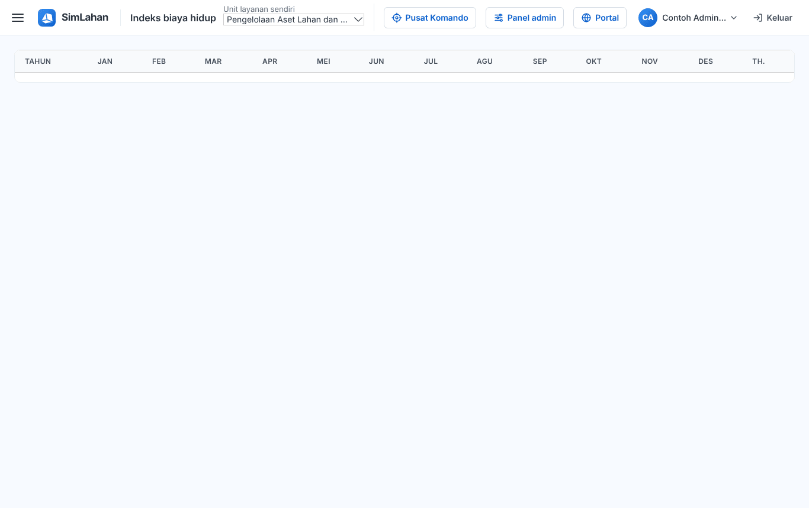

Tabel indeks per bulan dan tahun yang dipakai untuk penyesuaian sewa berindeks. Hanya dibaca.

**Tugas terjadwal**

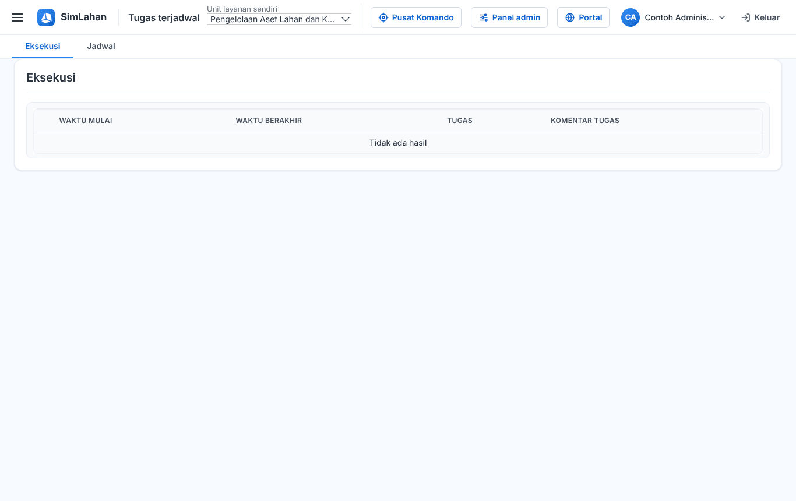

Riwayat (**Eksekusi**) dan **Jadwal** proses otomatis, misalnya pembuatan tagihan dan pengingat. Hanya dibaca; mengubah jadwal hanya oleh superuser.

**Catatan tagihan**

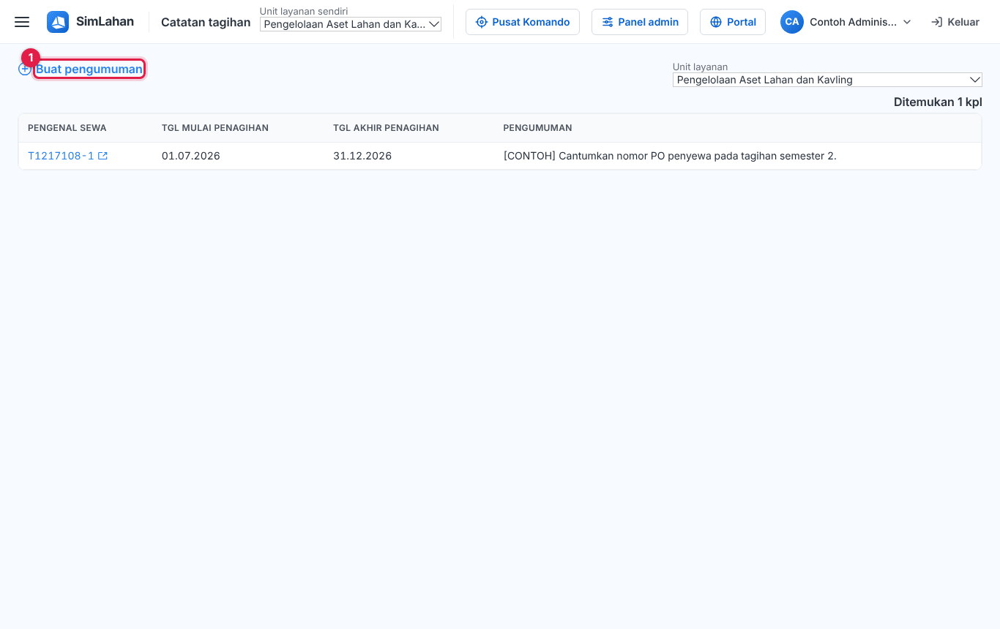

Pengumuman yang dicetak pada tagihan per sewa dan periode. Klik **Buat pengumuman** (nomor 1) untuk menambah, isi teks dan periodenya, lalu simpan.

**Kalkulator sewa**

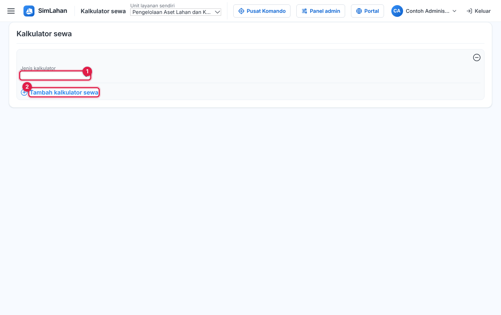

Menghitung perkiraan sewa tanpa menyimpan ke data sewa.

1. Pilih **Jenis kalkulator** (nomor 1).
2. Isi nilai yang muncul. Hasilnya langsung tampil.
3. Klik **Tambah kalkulator sewa** (nomor 2) bila ingin menambah perhitungan kedua untuk dibandingkan.

<!-- akhir sisip -->

<!-- sisip: 10-sewa.md#312-pertanyaan-umum -->

### 3.12 Pertanyaan umum

**Tombol Ubah abu-abu/tidak bisa diklik.** Bagian itu bukan tugas peran Anda, atau data sedang dikunci karena sudah final. Tanyakan kepada petugas yang berwenang.

**Sewa tidak ditemukan.** Periksa saringan **Unit layanan**; data sewa dibatasi per unit. Klik **Kosongkan pencarian** lalu cari lagi.

**Perubahan tidak tersimpan.** Pastikan Anda menekan **Simpan** sebelum pindah tab. Kolom wajib (tanda \*) yang kosong menyebabkan simpan gagal; periksa tulisan merah di bawah kolom.

<!-- akhir sisip -->

## Bagian B – Pengadaan tanah (membaca)

> **Pengadaan tanah untuk peran Anda: hanya membaca.** NIK dan rekening pihak tampil tersamar.

<!-- sisip: 11-pengadaan-tanah.md#42-daftar-proyek -->

### 4.2 Daftar proyek

Klik **☰ → Pengadaan Tanah → Proyek pengadaan**.

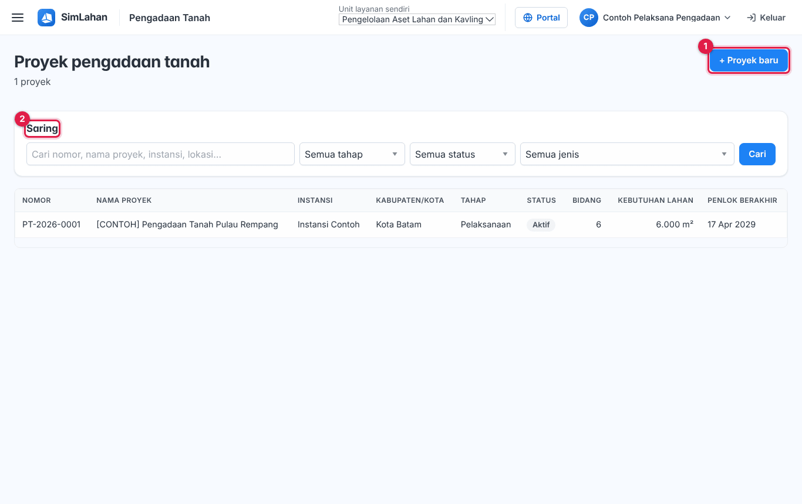

- Tombol **+ Proyek baru** (nomor 1) membuat proyek baru. Hanya Pelaksana dan Administrator yang melihat tombol ini.
- Tombol **Saring** (nomor 2) membuka kotak pencarian. Isi nomor atau nama proyek, tahap, status, atau kabupaten/kota, lalu klik **Cari**.
- Klik nama proyek di tabel untuk membuka halaman proyek.

Penilai dan Instansi hanya melihat proyek yang mencantumkan akunnya di **Pengguna yang ditugaskan**.

#### Membuat proyek baru

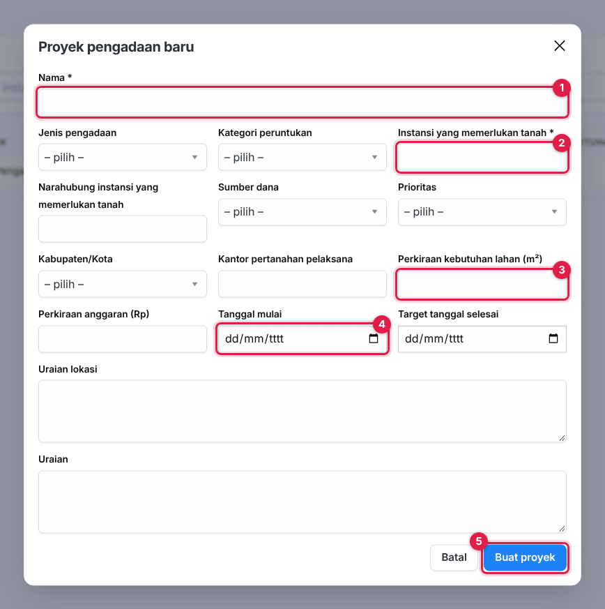

1. Klik **+ Proyek baru**. Jendela **Proyek pengadaan baru** terbuka.
2. Isi **Nama** proyek (nomor 1). Wajib.
3. Isi **Instansi yang memerlukan tanah** (nomor 2). Wajib.
4. Isi **Perkiraan kebutuhan lahan (m²)** (nomor 3) dan **Tanggal mulai** (nomor 4).
5. Lengkapi kolom lain bila datanya ada: jenis pengadaan, kategori peruntukan, narahubung instansi, sumber dana, prioritas, kabupaten/kota, kantor pertanahan pelaksana, perkiraan anggaran, target tanggal selesai, uraian lokasi, dan uraian.
6. Klik **Buat proyek** (nomor 5).

Hasilnya: nomor proyek (misalnya `PT-2026-0001`) dibuat otomatis, dan halaman proyek langsung terbuka dengan daftar tonggak tahapan standar.

<!-- akhir sisip -->

<!-- sisip: 11-pengadaan-tanah.md#43-halaman-proyek -->

### 4.3 Halaman proyek

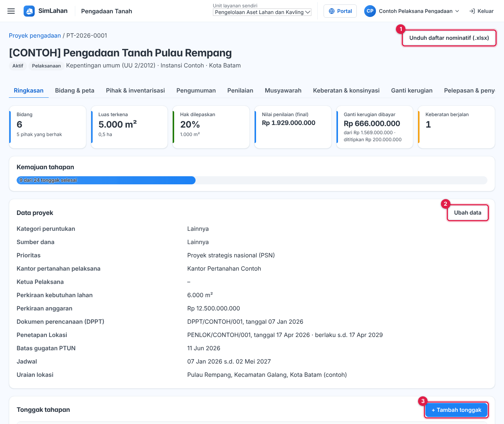

Bagian atas menampilkan nomor, nama, status, tahap, dasar hukum, instansi, dan lokasi proyek. Kartu angka di bawahnya menampilkan jumlah bidang, luas terkena, persentase hak dilepaskan, nilai penilaian final, ganti kerugian dibayar, dan keberatan berjalan.

- **Unduh daftar nominatif (.xlsx)** (nomor 1): mengunduh daftar bidang dan pihak yang berhak sebagai berkas Excel.
- **Ubah data** (nomor 2): mengubah data proyek, termasuk **Pengguna yang ditugaskan** (akun Penilai dan Instansi yang boleh melihat proyek ini).
- **+ Tambah tonggak** (nomor 3): menambah tonggak tahapan.

Deretan tab di bawah judul membagi pekerjaan per tahap: **Ringkasan**, **Bidang & peta**, **Pihak & inventarisasi**, **Pengumuman**, **Penilaian**, **Musyawarah**, **Keberatan & konsinyasi**, **Ganti kerugian**, **Pelepasan & penyerahan**, **Relokasi**, **Dokumen**, dan **Tenggat**. Angka di samping **Tenggat** adalah jumlah tenggat yang perlu perhatian.

> **Cara kerja yang sama di semua tab:**
> - Tombol **+ Tambah …** membuka jendela formulir. Isi formulir, lalu klik **Simpan**. Klik **Batal** atau **×** untuk menutup tanpa menyimpan.
> - Kolom yang labelnya diberi tanda **\*** wajib diisi. Bila ada yang kosong, formulir tidak tersimpan dan kolom itu diberi pesan merah.
> - Setiap baris tabel punya tautan **Ubah** (membuka formulir yang sama, sudah terisi) dan **Hapus** (meminta konfirmasi dulu).
> - Bila sebuah tombol atau tautan tidak tampil, peran Anda tidak berhak memakainya.
>
> Nomor merah pada gambar formulir di bawah menandai kolom terpenting. Kolom lain boleh diisi bila datanya ada.

#### Tonggak tahapan (tab Ringkasan)

Tonggak adalah kegiatan per tahap (perencanaan, persiapan, pelaksanaan, penyerahan) dengan tanggal rencana dan tanggal realisasi. Bilah **Kemajuan tahapan** menunjukkan berapa tonggak sudah selesai.

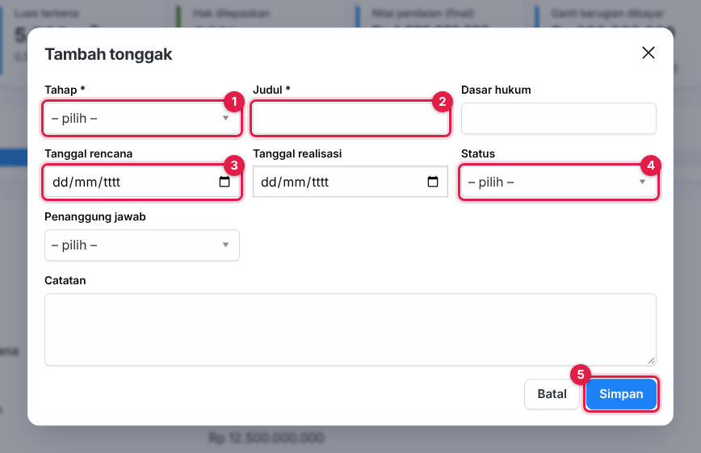

1. Klik **+ Tambah tonggak**. Untuk mengubah tonggak yang ada, klik **Ubah** pada barisnya.
2. Pilih **Tahap** (nomor 1) dan isi **Judul** kegiatan (nomor 2). Keduanya wajib.
3. Isi **Tanggal rencana** (nomor 3). Bila kegiatan sudah terlaksana, isi juga **Tanggal realisasi**.
4. Pilih **Status** (nomor 4): tertunda, sedang berjalan, selesai, atau tidak berlaku.
5. Bila perlu, isi dasar hukum, penanggung jawab, dan catatan.
6. Klik **Simpan** (nomor 5).

Satgas boleh memperbarui tonggak inventarisasi, musyawarah, dan pelepasan hak (status, tanggal realisasi, catatan).

<!-- akhir sisip -->

## Bila ada kendala

- **Menu atau tombol yang disebut di buku ini tidak ada di layar Anda.** Peran Anda memang tidak memerlukannya (lihat **Batas akses** di atas). Bila Anda membutuhkannya untuk pekerjaan, minta Administrator menambahkan peran yang sesuai.
- **Pesan "Tidak berhak" atau "Anda tidak berwenang melihat data ini".** Data itu di luar hak peran Anda, bukan kerusakan sistem.
- **Lupa kata sandi.** Hubungi superuser SimLahan untuk dibuatkan sandi baru, lalu ganti sandi itu setelah masuk (klik nama Anda → **Ganti sandi**, atau buka `/akun/sandi/`).
- **Terlalu banyak percobaan masuk.** Tunggu beberapa menit, lalu coba lagi dengan sandi yang benar.
- **Ringkasan peran di dalam aplikasi.** Isi bagian *Ringkasan peran* di atas juga bisa dibuka kapan saja lewat **Panduan peran** (`/akun/panduan/`).
