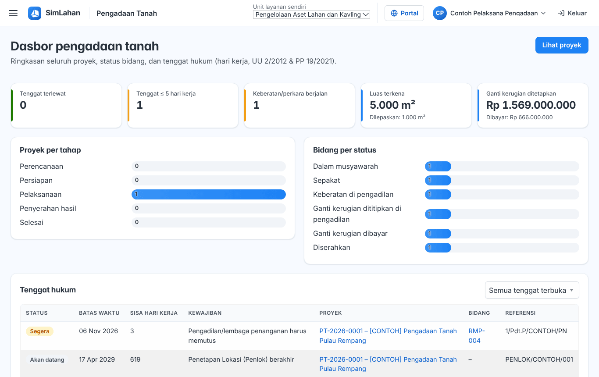
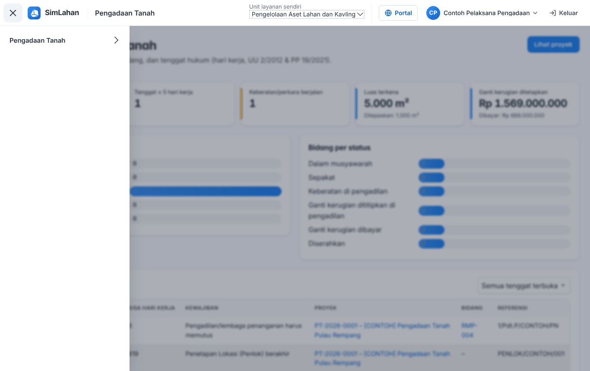

# Buku peran: Pelaksana Pengadaan Tanah

Buku ini untuk **Pelaksana Pengadaan Tanah**: pelaksana yang menjalankan seluruh tahapan pengadaan tanah. Baca dulu [Bab 1](../01-mengenal-simlahan.md) dan [Bab 2](../02-dasar-penggunaan.md) bila baru pertama kali memakai SimLahan.

## Masuk

Buka alamat SimLahan, isi nama pengguna dan kata sandi, lalu klik **Masuk** ([Bab 2.2](../02-dasar-penggunaan.md#a-aplikasi-utama-petugas-kantor)).

<!-- awal: dibuat dari backend/users/role_guide.py; perbarui dengan: cd backend && python manage.py panduan_buku -->

## Ringkasan peran

Menjalankan seluruh tahapan pengadaan tanah (UU 2/2012).

- **Cara masuk:** Alamat utama SimLahan (`/`), dengan nama pengguna dan sandi.
- **Halaman awal:** Pengadaan Tanah → Dasbor & tenggat.
- **Akun latihan** (hanya di sistem latihan berisi data contoh): `contoh.pelaksana`

### Menu yang Anda lihat

- Pengadaan Tanah: Dasbor & tenggat, Proyek pengadaan, Kalender & aturan tenggat

### Yang bisa Anda lakukan

- Mengelola proyek, bidang, inventarisasi, pihak, penilaian, musyawarah, ganti kerugian, pembayaran, pelepasan hak, dan dokumen.
- Memvalidasi ganti kerugian (Ketua Pelaksana) dan mengatur kalender libur serta aturan tenggat.
- Melihat data pribadi pihak (NIK/rekening).

### Batas akses

- Hanya modul pengadaan tanah; modul sewa, alokasi, aset, pusat komando, dan panel admin tidak terbuka.

<!-- akhir: blok role_guide.py -->

## Pekerjaan sehari-hari

### 1. Memantau tenggat setiap pagi

1. Halaman awal Anda adalah **Dasbor & tenggat** ([Bab 4.1](../11-pengadaan-tanah.md#41-dasbor--tenggat)). Tenggat dihitung dalam hari kerja.
2. Klik tenggat yang hampir lewat untuk membuka proyeknya. Pengingat surel dikirim otomatis setiap hari kerja pukul 07.00 WIB.

### 2. Membuat proyek dan tonggak

1. Buat proyek di **Proyek pengadaan → + Proyek baru** ([Bab 4.2](../11-pengadaan-tanah.md#membuat-proyek-baru)).
2. Isi tonggak tahapan di tab **Ringkasan** ([Bab 4.3](../11-pengadaan-tanah.md#tonggak-tahapan-tab-ringkasan)).

### 3. Bidang, pihak, dan inventarisasi

1. Tambah atau impor bidang ([Bab 4.4](../11-pengadaan-tanah.md#44-bidang--peta)).
2. Catat pihak yang berhak dan inventarisasi ([Bab 4.5](../11-pengadaan-tanah.md#45-pihak--inventarisasi)).

### 4. Pengumuman, penilaian, musyawarah

1. Catat pengumuman ([Bab 4.6](../11-pengadaan-tanah.md#46-pengumuman)), pantau penilaian KJPP ([Bab 4.7](../11-pengadaan-tanah.md#47-penilaian-kjpp)), dan catat musyawarah beserta hasilnya ([Bab 4.8](../11-pengadaan-tanah.md#48-musyawarah)).

### 5. Ganti kerugian dan validasi

1. Tetapkan ganti kerugian dan **validasi** sebagai Ketua Pelaksana ([Bab 4.10](../11-pengadaan-tanah.md#410-ganti-kerugian-dan-pembayaran)). Pembayaran dicatat Petugas Penagihan setelah validasi.

### 6. Pelepasan hak, penyerahan, relokasi, dokumen

1. Catat pelepasan hak dan penyerahan hasil ([Bab 4.11](../11-pengadaan-tanah.md#411-pelepasan-hak--penyerahan-hasil)), rumah tangga terdampak ([Bab 4.12](../11-pengadaan-tanah.md#412-relokasi-rumah-tangga-terdampak)), dan dokumen ([Bab 4.13](../11-pengadaan-tanah.md#413-dokumen-proyek)).

### 7. Kalender dan aturan tenggat

1. Atur hari libur dan aturan tenggat di **Kalender & aturan tenggat** ([Bab 4.15](../11-pengadaan-tanah.md#415-kalender--aturan-tenggat)).

## Bab yang perlu dibaca

- [Bab 1 – Mengenal SimLahan](../01-mengenal-simlahan.md)
- [Bab 2 – Dasar penggunaan](../02-dasar-penggunaan.md)
- [Bab 4 – Pengadaan tanah](../11-pengadaan-tanah.md)

## Bila ada kendala

- Menu atau tombol tidak ada: peran Anda memang tidak memerlukannya ([Bab 2.10](../02-dasar-penggunaan.md#210-batas-akses-dan-pesan-tidak-berhak)). Hubungi Administrator bila Anda memerlukannya untuk pekerjaan.
- Lupa kata sandi: hubungi Administrator atau superuser untuk menyetel ulang sandi.
- Ringkasan peran yang sama bisa dibuka di dalam aplikasi lewat **Panduan peran** (`/akun/panduan/`).
