# Buku peran: Pemohon portal

Buku ini untuk **Pemohon portal**: pemohon alokasi lahan (perorangan, badan usaha, atau instansi). Buku ini berisi semua langkah kerja peran Anda, lengkap dengan gambar, sehingga cukup dibaca sendiri. Dasar penggunaan yang berlaku untuk semua peran (mengenal layar, ganti sandi, memakai di HP) ada di [Bab 2](../02-dasar-penggunaan.md).

**Cara membaca buku ini.** Kotak merah bernomor pada gambar menunjuk tombol atau kolom yang disebut di langkah. Tulisan *(nomor 2)* berarti: lihat kotak merah bernomor 2 pada gambar tepat di atas langkah itu. Semua gambar memakai data contoh fiktif; isi di layar Anda berbeda, tetapi letak tombolnya sama. Judul bagian bernomor (misalnya *3.4*) sama dengan nomor bagian di buku lengkap.

## Mendaftar dan masuk

Bila belum punya akun, daftar dulu (12.11). Setelah akun aktif, masuk lewat 13.1.

<!-- sisip: 50-portal-publik.md#1211-mendaftar-akun -->

### 12.11 Mendaftar akun

Klik **Daftar** di menu atas. Calon investor sebaiknya memakai **Daftar sebagai investor** ([Bab 14](../52-portal-investor.md)) agar bisa langsung memilih sektor minat.

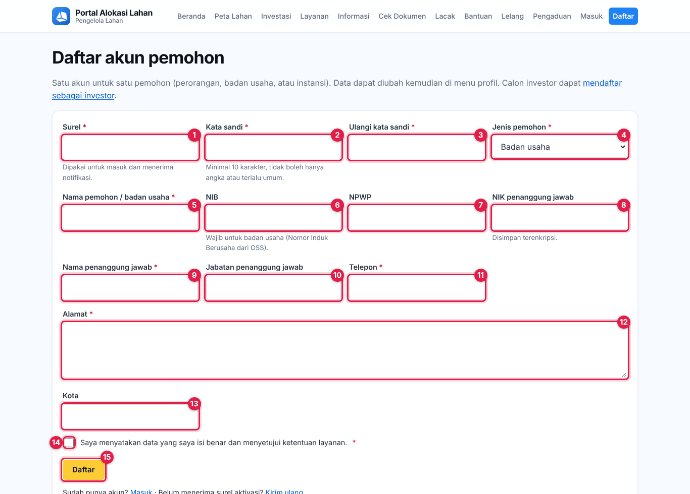

1. Isi **Surel** (nomor 1). Surel ini dipakai untuk masuk dan menerima pemberitahuan.
2. Isi **Kata sandi** (nomor 2) dan ulangi di **Ulangi kata sandi** (nomor 3). Minimal 10 karakter, tidak boleh hanya angka atau kata yang terlalu umum.
3. Pilih **Jenis pemohon** (nomor 4): **Perorangan**, **Badan usaha**, atau **Instansi pemerintah**.
4. Isi **Nama pemohon / badan usaha** (nomor 5).
5. Badan usaha wajib mengisi **NIB** (nomor 6). Isi juga **NPWP** (nomor 7) dan **NIK penanggung jawab** (nomor 8, disimpan terenkripsi).
6. Isi **Nama penanggung jawab** (nomor 9), **Jabatan penanggung jawab** (nomor 10), dan **Telepon** (nomor 11).
7. Isi **Alamat** (nomor 12) dan **Kota** (nomor 13).
8. Centang pernyataan **Saya menyatakan data yang saya isi benar dan menyetujui ketentuan layanan** (nomor 14).
9. Klik **Daftar** (nomor 15).
10. Buka kotak surel Anda dan klik tautan aktivasi (berlaku 3 hari). Tidak menerima surel? Periksa folder spam, atau klik **Kirim ulang** di bawah tombol Daftar.
11. Setelah aktif, klik **Masuk** dan isi surel serta kata sandi.

**Lupa kata sandi:** di halaman **Masuk**, klik **Lupa kata sandi?**.

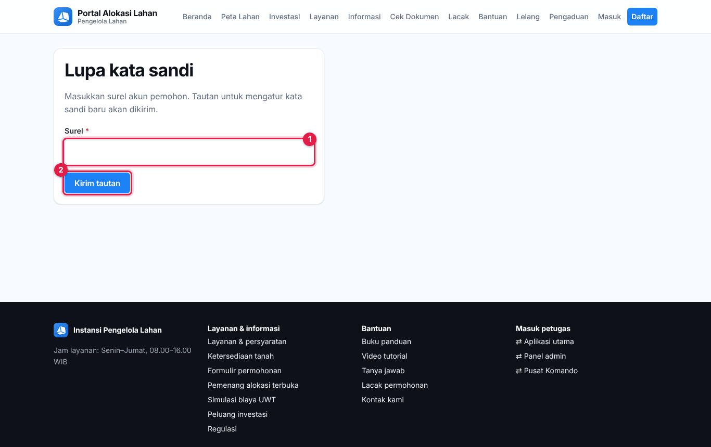

1. Isi **Surel** akun Anda (nomor 1).
2. Klik **Kirim tautan** (nomor 2).
3. Buka surel dari SimLahan, klik tautannya, lalu buat kata sandi baru. Langkah lengkapnya ada di [Bab 13.1](../51-portal-pemohon.md#lupa-kata-sandi).

<!-- akhir sisip -->

<!-- sisip: 51-portal-pemohon.md#131-masuk-ke-portal -->

### 13.1 Masuk ke portal

Klik **Masuk** di menu atas portal.

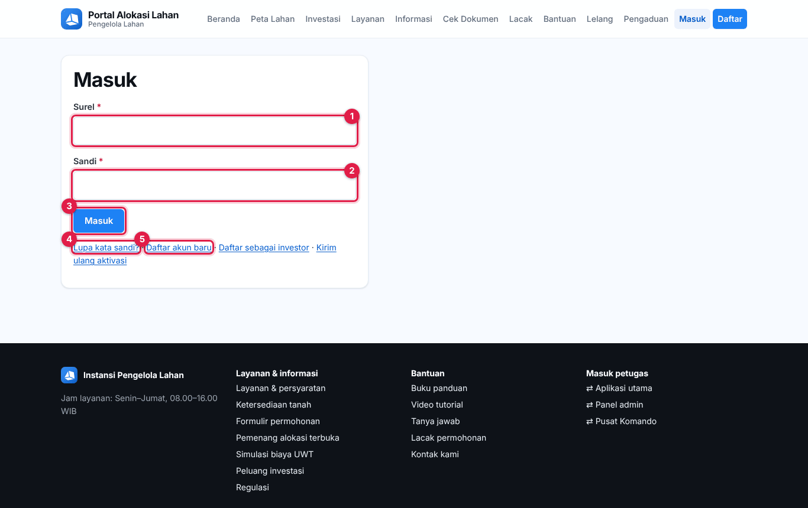

1. Isi surel akun Anda (nomor 1).
2. Isi kata sandi (nomor 2).
3. Klik **Masuk** (nomor 3). Anda diarahkan ke **Akun saya** ([13.2](../51-portal-pemohon.md#132-akun-saya)).
4. **Lupa kata sandi?** (nomor 4) dan **Daftar akun baru** (nomor 5) ada di bawah tombol.

#### Lupa kata sandi

1. Di halaman masuk, klik **Lupa kata sandi?**.
2. Isi **Surel** akun Anda (nomor 1), lalu klik **Kirim tautan** (nomor 2).
3. Buka surel dari SimLahan dan klik tautan atur ulang sandi.
4. Di halaman **Atur kata sandi baru**, isi kata sandi baru dua kali, lalu klik **Simpan kata sandi**. Masuk dengan kata sandi baru. Bila tautan sudah tidak berlaku, klik **Minta tautan baru**.

<!-- akhir sisip -->

<!-- awal: dibuat dari backend/users/role_guide.py; perbarui dengan: cd backend && python manage.py panduan_buku -->

## Ringkasan peran

Badan usaha, instansi, atau perorangan yang mengajukan alokasi, sewa, atau layanan pertanahan lain.

- **Cara masuk:** Portal (`/portal/masuk/`) dengan alamat surel; daftar sendiri di `/portal/daftar/`.
- **Halaman awal:** Portal → Akun saya.
- **Akun latihan** (hanya di sistem latihan berisi data contoh): `pemohon@contoh.simlahan.invalid`

### Menu yang Anda lihat

- Portal: Layanan, Lahan, Investasi (peta peluang, kawasan, bandingkan, ajukan minat), Lelang, Pengaduan, Lacak, Verifikasi dokumen, Bantuan, Akun saya (permohonan, permintaan investasi, lahan tersimpan, tagihan, profil, sandi)
- Layanan & informasi: Formulir permohonan, Pemenang alokasi terbuka, Simulasi biaya UWT (per lahan atau per wilayah dengan denda), Buku panduan; Bantuan → Kontak kami
- Akun saya → Dokumen & perizinan (`/portal/dokumen/`): pemanfaatan lahan, dokumen tanda tangan, permintaan unduh, tanda tangan saya

### Yang bisa Anda lakukan

- Mengajukan dan melengkapi permohonan, membayar tagihan, melacak status, dan mengunduh dokumen terbit (KPT, PPT, Penetapan Lokasi + sketsa bidang).
- Mengajukan layanan atas alokasinya: perpanjangan/pembaruan, pecah/gabung/revisi PL, pengukuran ulang, penyesuaian, rekomendasi, hak tanggungan, lelang, dokumen pengganti, KPT & PPT baru/perubahan, dan buka blokir (bila penetapan lokasi diblokir hanya buka blokir yang bisa diajukan).
- Menjelajah peta investasi tanpa masuk; setelah masuk: menyimpan lahan, mengajukan minat sewa/alokasi/kerja sama (memilih lahan atau menggambar usulan lokasi), berkirim pesan dengan petugas, serta menerima atau menolak penawaran.
- Melihat status setiap dokumen perizinan pemanfaatan lahannya, mengunduh format templat, mengunggah dokumen atau revisi, serta menandatangani dokumen secara elektronik (mengisi kolom isian, melampirkan berkas, dan memakai tanda tangan tersimpan yang diaktifkan dengan kata sandi).
- Mengajukan permintaan unduh dokumen; unduhan terbuka setelah disetujui petugas, diberi tanda air, dan tercatat.
- Mengubah profil dan sandi; memakai Lupa sandi bila lupa.

### Batas akses

- Tidak bisa masuk ke aplikasi petugas, panel admin, pusat komando, atau API.

<!-- akhir: blok role_guide.py -->

## Urutan kerja Anda

1. Daftar akun dan aktifkan lewat surel ([12.11 Mendaftar akun](#1211-mendaftar-akun)), lalu masuk ([13.1 Masuk ke portal](#131-masuk-ke-portal)).
2. Pilih lahan dan ajukan permohonan alokasi: **Ubah data** → **Unggah** dokumen → **Ajukan** ([13.3 Mengajukan permohonan alokasi](#133-mengajukan-permohonan-alokasi)).
3. Bila petugas meminta perbaikan, perbaiki lalu ajukan ulang ([13.4 Memperbaiki permohonan](#134-memperbaiki-permohonan)).
4. Setelah disetujui, bayar tagihan dan unggah bukti bayar ([13.5 Membayar tagihan](#135-membayar-tagihan)).
5. Unduh KPT dan PPT setelah terbit ([13.6 Mengunduh KPT dan PPT](#136-mengunduh-kpt-dan-ppt)).
6. Setelah alokasi berjalan: laporkan progres pembangunan, ajukan layanan, atau alihkan hak ([13.7 Alokasi saya: progres, layanan, peralihan hak](#137-alokasi-saya-progres-layanan-peralihan-hak)); lengkapi dokumen perizinan dan tanda tangani dokumen elektronik (Bagian C).

## Bagian A – Akun dan permohonan alokasi

<!-- sisip: 51-portal-pemohon.md#132-akun-saya -->

### 13.2 Akun saya

**Akun saya** adalah halaman utama pemohon. Bukalah setiap kali masuk.

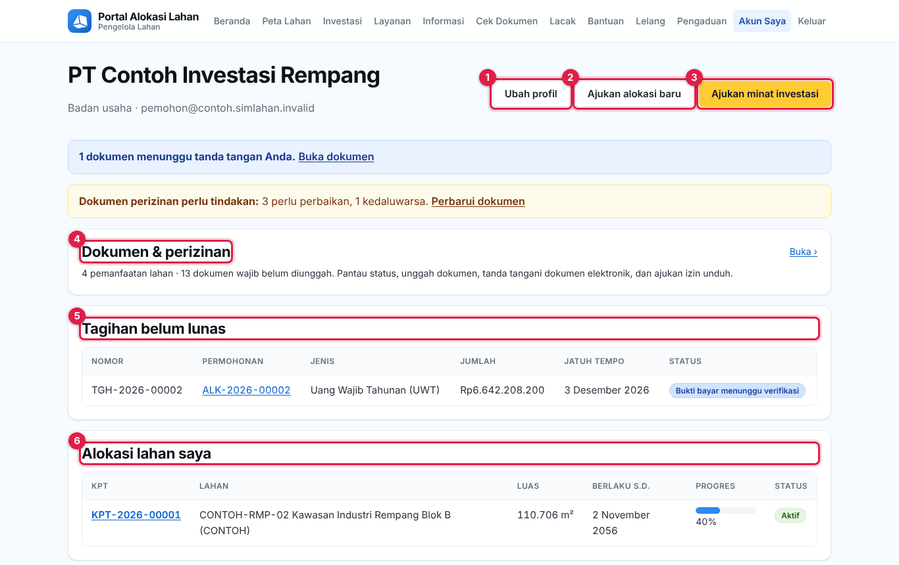

1. **Ubah profil** (nomor 1): ubah data pemohon ([13.10](../51-portal-pemohon.md#1310-profil-dan-kata-sandi)).
2. **Ajukan alokasi baru** (nomor 2): membuka peta lahan untuk memilih lahan ([13.3](../51-portal-pemohon.md#133-mengajukan-permohonan-alokasi)).
3. **Ajukan minat investasi** (nomor 3): lihat [Bab 14](../52-portal-investor.md).
4. Kotak biru dan kuning di bawah judul adalah **pemberitahuan**, misalnya dokumen yang menunggu tanda tangan Anda atau dokumen perizinan yang perlu diperbaiki. Klik tautan di dalamnya.
5. **Dokumen & perizinan** (nomor 4): ringkasan dokumen perizinan wajib. Klik **Buka ›** ([Bab 15](../53-portal-dokumen.md)).
6. **Tagihan belum lunas** (nomor 5): nomor tagihan, permohonan, jenis, jumlah, jatuh tempo, dan status.
7. **Alokasi lahan saya** (nomor 6): nomor KPT, lahan, luas, berlaku s.d., progres pembangunan, dan status. Klik nomor KPT untuk membukanya ([13.7](../51-portal-pemohon.md#137-alokasi-saya-progres-layanan-peralihan-hak)).

Gulir ke bawah:

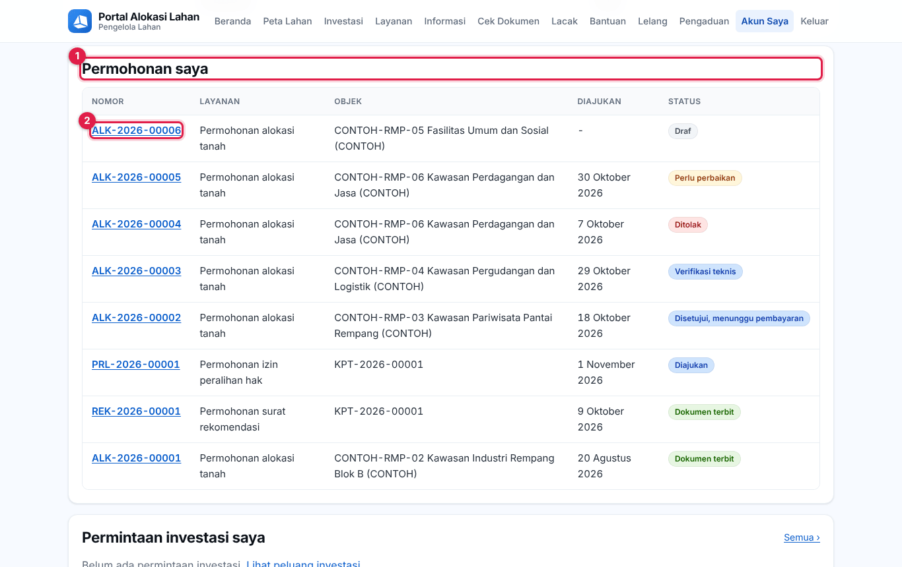

1. **Permohonan saya** (nomor 1): semua permohonan Anda dengan nomor, layanan, objek, tanggal diajukan, dan status.
2. Klik **nomor permohonan** (nomor 2) untuk membukanya.

Di bawahnya ada **Permintaan investasi saya**, **Lahan tersimpan**, dan (bila ada) **Peralihan hak kepada saya**, yaitu peralihan yang menunggu persetujuan Anda sebagai penerima.

<!-- akhir sisip -->

<!-- sisip: 51-portal-pemohon.md#133-mengajukan-permohonan-alokasi -->

### 13.3 Mengajukan permohonan alokasi

**Langkah 1 – Pilih lahan dan buat draf**

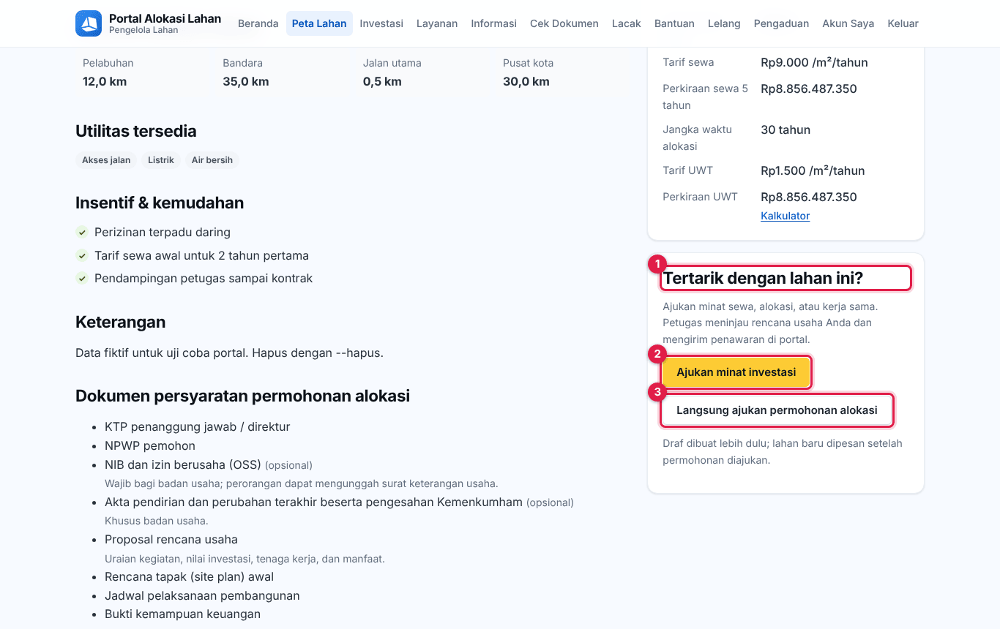

1. Klik **Ajukan alokasi baru** di **Akun saya** (atau **Peta Lahan** di menu atas), lalu klik kode lahan yang diinginkan.
2. Periksa data lahan, tarif, dan **Dokumen persyaratan permohonan alokasi** (lihat [Bab 12.2](../50-portal-publik.md#122-peta-lahan-dan-detail-lahan)).
3. Gulir ke kotak **Tertarik dengan lahan ini?** (nomor 1).
4. Klik **Langsung ajukan permohonan alokasi** (nomor 3). Sistem membuat **draf**; lahan baru dipesan setelah permohonan diajukan. (**Ajukan minat investasi**, nomor 2, dipakai bila Anda ingin berkonsultasi dulu atau memilih skema sewa; lihat [Bab 14](../52-portal-investor.md).)

**Langkah 2 – Lengkapi data**

Halaman permohonan berstatus **Draf** terbuka.

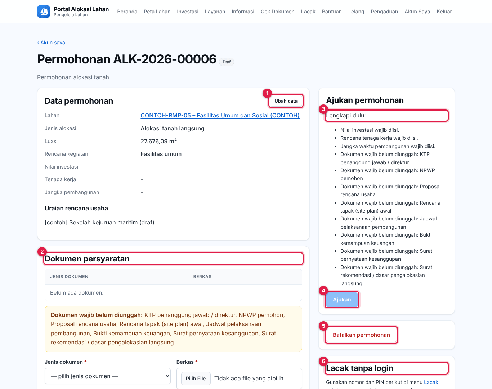

1. Klik **Ubah data** (nomor 1).

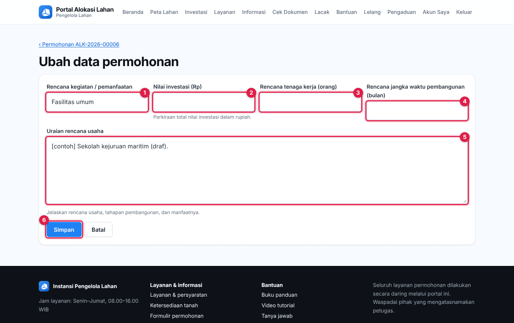

2. Isi **Rencana kegiatan / pemanfaatan** (nomor 1), **Nilai investasi (Rp)** (nomor 2, angka saja tanpa titik), **Rencana tenaga kerja (orang)** (nomor 3), dan **Rencana jangka waktu pembangunan (bulan)** (nomor 4).
3. Tulis **Uraian rencana usaha** (nomor 5): rencana usaha, tahapan pembangunan, dan manfaatnya.
4. Klik **Simpan** (nomor 6). Anda kembali ke halaman permohonan.

**Langkah 3 – Unggah dokumen persyaratan**

Di halaman permohonan, gulir ke **Dokumen persyaratan** (nomor 2 pada gambar Langkah 2).

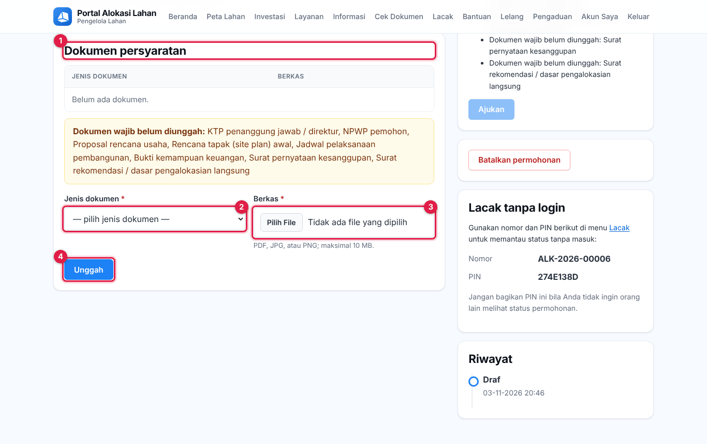

1. Kotak kuning di bawah **Dokumen persyaratan** (nomor 1) menyebut dokumen wajib yang belum diunggah.
2. Pilih **Jenis dokumen** (nomor 2).
3. Klik **Pilih File** di **Berkas** (nomor 3), lalu pilih berkasnya (PDF, JPG, atau PNG; maksimal 10 MB).
4. Klik **Unggah** (nomor 4). Dokumen tampil di tabel di atasnya.
5. Ulangi untuk setiap dokumen wajib. Dokumen yang salah dihapus dengan **Hapus** di barisnya, lalu unggah yang benar.

**Langkah 4 – Ajukan**

Kembali ke halaman permohonan (gambar yang sama dengan Langkah 2):

1. Kotak **Ajukan permohonan** di kanan menampilkan **Lengkapi dulu:** (nomor 3) bila masih ada data atau dokumen yang kurang. Selama daftar ini ada, tombol **Ajukan** (nomor 4) abu-abu dan tidak bisa diklik.
2. Setelah semua lengkap, daftar itu hilang. Klik **Ajukan** lalu konfirmasi. Setelah diajukan, data tidak dapat diubah kecuali petugas meminta perbaikan.
3. Catat **Nomor** dan **PIN** di kotak **Lacak tanpa login** (nomor 6) bila ingin memantau tanpa masuk (lihat [Bab 12.8](../50-portal-publik.md#128-lacak-permohonan)).
4. Permohonan yang belum disetujui bisa dibatalkan dengan **Batalkan permohonan** (nomor 5).

**Status permohonan:**

| Status | Arti | Yang Anda lakukan |
|---|---|---|
| Draf | Belum diajukan. | Lengkapi data dan dokumen, lalu **Ajukan**. |
| Diajukan | Menunggu pemeriksaan petugas. | Tunggu. |
| Verifikasi teknis | Dinilai tim lintas unit. | Tunggu. |
| Perlu perbaikan | Ada yang harus diperbaiki. | Lihat [13.4](../51-portal-pemohon.md#134-memperbaiki-permohonan). |
| Disetujui, menunggu pembayaran | Tagihan sudah terbit. | Bayar dan unggah bukti ([13.5](../51-portal-pemohon.md#135-membayar-tagihan)). |
| Pembayaran terverifikasi | Pembayaran diterima. | Tunggu dokumen terbit. |
| Dokumen terbit | KPT dan PPT sudah terbit. | Unduh dokumen ([13.6](../51-portal-pemohon.md#136-mengunduh-kpt-dan-ppt)). |
| Ditolak / Dibatalkan pemohon | Proses berhenti. | Baca alasan di **Riwayat**. |

<!-- akhir sisip -->

<!-- sisip: 51-portal-pemohon.md#134-memperbaiki-permohonan -->

### 13.4 Memperbaiki permohonan

Anda menerima surel bila permohonan perlu diperbaiki. Buka permohonan dari **Akun saya → Permohonan saya** (statusnya **Perlu perbaikan**).

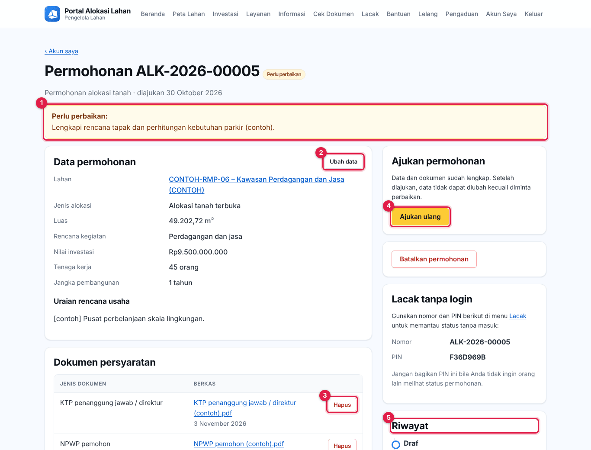

1. Baca catatan petugas di kotak kuning **Perlu perbaikan** (nomor 1). Catatan yang sama juga tercatat di **Riwayat** (nomor 5).
2. Bila datanya yang salah, klik **Ubah data** (nomor 2), perbaiki, lalu **Simpan**.
3. Bila dokumennya yang salah, klik **Hapus** (nomor 3) di baris dokumen itu, lalu unggah dokumen yang benar seperti [13.3](../51-portal-pemohon.md#133-mengajukan-permohonan-alokasi) langkah 3.
4. Klik **Ajukan ulang** (nomor 4) lalu konfirmasi.

<!-- akhir sisip -->

<!-- sisip: 51-portal-pemohon.md#135-membayar-tagihan -->

### 13.5 Membayar tagihan

Setelah permohonan disetujui, statusnya menjadi **Disetujui, menunggu pembayaran** dan Anda menerima surel.

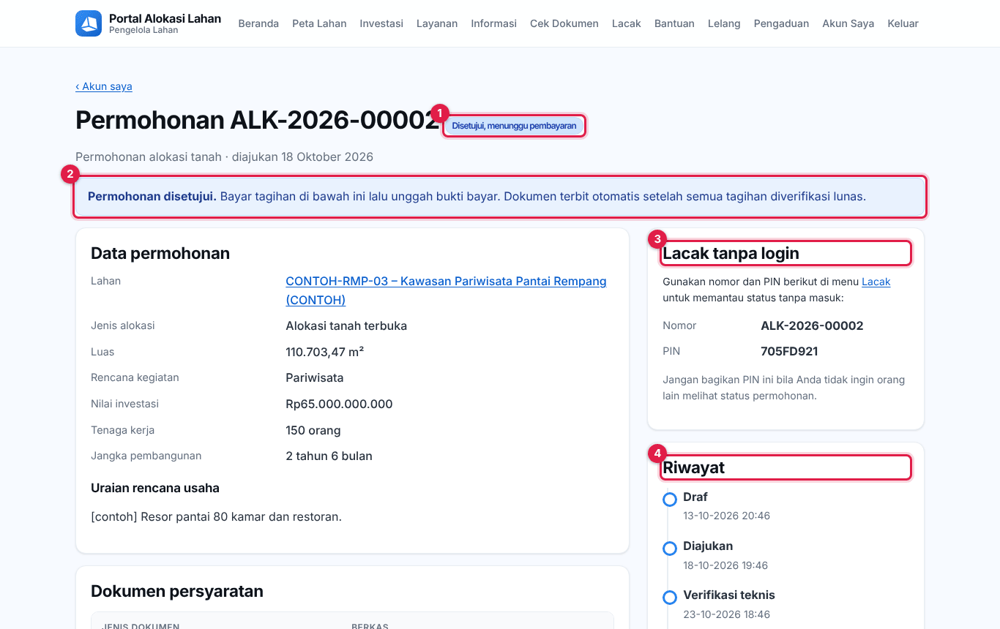

1. Status (nomor 1) dan kotak biru **Permohonan disetujui** (nomor 2) memberi tahu bahwa tagihan sudah terbit.
2. **Lacak tanpa login** (nomor 3) dan **Riwayat** (nomor 4) tetap tersedia.
3. Gulir ke bagian **Tagihan**.

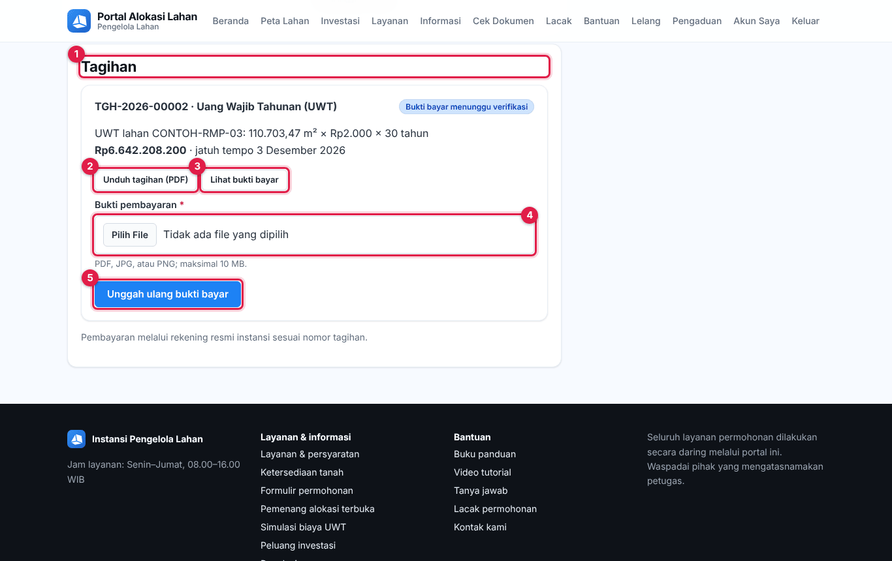

4. Setiap tagihan di **Tagihan** (nomor 1) menampilkan nomor, jenis (UWT atau biaya administrasi), rincian, jumlah, jatuh tempo, dan status. Tanda **Lewat jatuh tempo** muncul bila terlambat.
5. Klik **Unduh tagihan (PDF)** (nomor 2) dan bayar sesuai petunjuk pembayaran di halaman itu, hanya ke rekening resmi instansi.
6. Di **Bukti pembayaran**, klik **Pilih File** (nomor 4) dan pilih bukti bayar (PDF, JPG, atau PNG; maksimal 10 MB).
7. Klik **Unggah bukti bayar** (nomor 5). Status tagihan menjadi **Bukti bayar menunggu verifikasi**.
8. **Lihat bukti bayar** (nomor 3) membuka bukti yang sudah Anda kirim. Bila petugas menolak bukti bayar, baca **Catatan petugas**, lalu unggah lagi; tombolnya bernama **Unggah ulang bukti bayar**.

<!-- akhir sisip -->

<!-- sisip: 51-portal-pemohon.md#136-mengunduh-kpt-dan-ppt -->

### 13.6 Mengunduh KPT dan PPT

Setelah semua tagihan diverifikasi lunas, status menjadi **Dokumen terbit**. Buka permohonan dan gulir ke bawah.

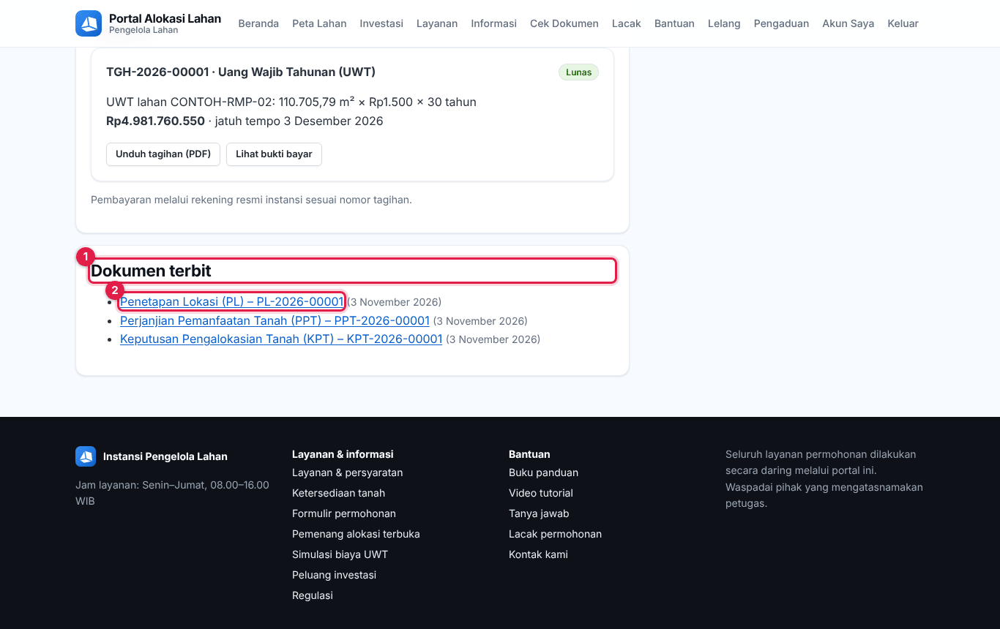

1. Bagian **Dokumen terbit** (nomor 1) berisi Penetapan Lokasi (PL), Perjanjian Pemanfaatan Tanah (PPT), dan Keputusan Pengalokasian Tanah (KPT).
2. Klik nama dokumen (nomor 2) untuk mengunduh PDF-nya.
3. Setiap dokumen ber-QR; siapa pun bisa memeriksa keasliannya di **Cek Dokumen** (lihat [Bab 12.9](../50-portal-publik.md#129-cek-keaslian-dokumen)).

<!-- akhir sisip -->

<!-- sisip: 51-portal-pemohon.md#137-alokasi-saya-progres-layanan-peralihan-hak -->

### 13.7 Alokasi saya: progres, layanan, peralihan hak

Buka alokasi dari **Akun saya → Alokasi lahan saya** (klik nomor KPT).

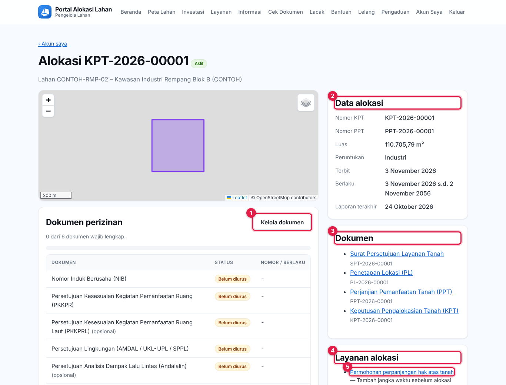

1. **Kelola dokumen** (nomor 1) di **Dokumen perizinan** membuka daftar dokumen perizinan wajib lahan ini ([Bab 15](../53-portal-dokumen.md)).
2. **Data alokasi** (nomor 2): nomor KPT dan PPT, luas, peruntukan, tanggal terbit, masa berlaku, dan laporan terakhir.
3. **Dokumen** (nomor 3): unduh lagi dokumen yang sudah terbit.
4. **Layanan alokasi** (nomor 4): daftar layanan untuk alokasi ini. Klik nama layanan (nomor 5) untuk mengajukannya.

Di bawah peta ada **Progres pembangunan**, dan di kanan bawah **Peralihan hak**.

#### Melaporkan progres pembangunan

Gulir ke **Progres pembangunan**.

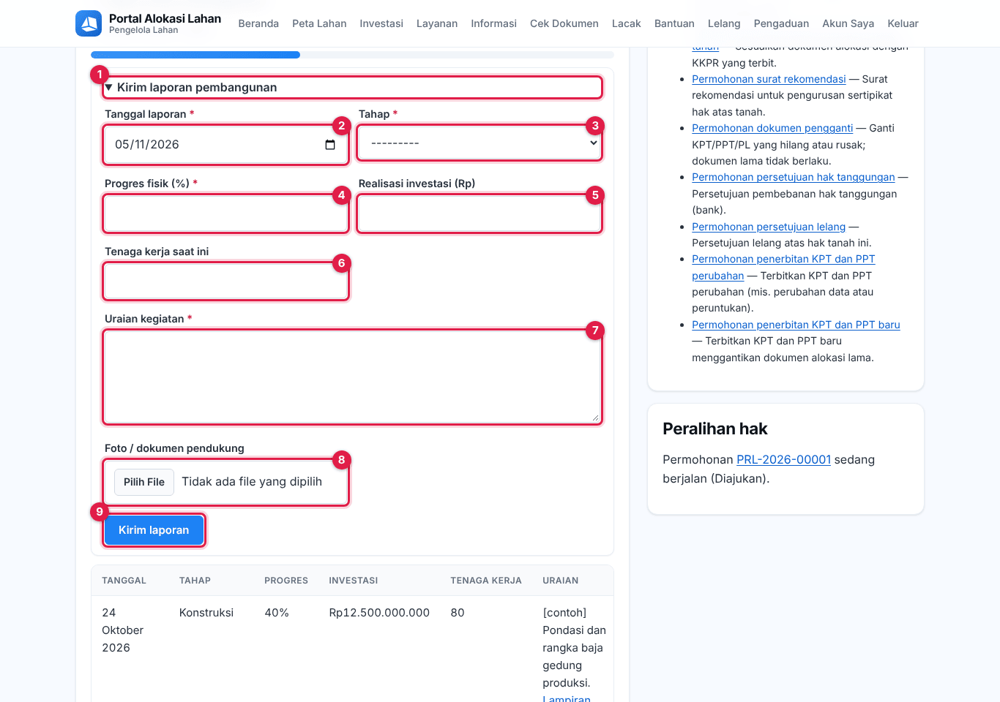

1. Klik **Kirim laporan pembangunan** (nomor 1) bila formulirnya belum terbuka.
2. Isi **Tanggal laporan** (nomor 2). Tidak boleh tanggal yang akan datang.
3. Pilih **Tahap** (nomor 3): Belum dimulai, Pematangan / persiapan lahan, Konstruksi, atau Sudah beroperasi.
4. Isi **Progres fisik (%)** (nomor 4), **Realisasi investasi (Rp)** (nomor 5), dan **Tenaga kerja saat ini** (nomor 6).
5. Tulis **Uraian kegiatan** (nomor 7).
6. Lampirkan foto lapangan di **Foto / dokumen pendukung** (nomor 8).
7. Klik **Kirim laporan** (nomor 9). Laporan tampil di tabel di bawahnya (Tanggal, Tahap, Progres, Investasi, Tenaga kerja, Uraian).

> Laporkan secara berkala. Lahan yang tidak dibangun dapat ditandai **lahan tidur** dan berisiko dicabut alokasinya.

#### Mengajukan layanan alokasi

Klik nama layanan di **Layanan alokasi** (nomor 5 pada gambar halaman alokasi).

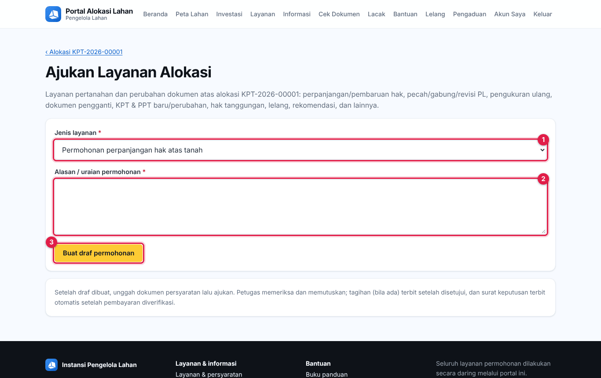

1. Periksa **Jenis layanan** (nomor 1). Pilihannya: perpanjangan hak, pembaruan hak, pemecahan PL, pengukuran ulang, revisi PL, penggabungan PL, penyesuaian dokumen alokasi, surat rekomendasi, pembukaan blokir PL, dokumen pengganti, persetujuan hak tanggungan, persetujuan lelang, KPT dan PPT perubahan, atau KPT dan PPT baru.
2. Tulis **Alasan / uraian permohonan** (nomor 2).
3. Klik **Buat draf permohonan** (nomor 3).
4. Unggah dokumen dan ajukan seperti [13.3](../51-portal-pemohon.md#133-mengajukan-permohonan-alokasi) langkah 3–4. Tagihan (bila ada) dan surel keputusan mengikuti seperti permohonan alokasi.

#### Mengalihkan hak (peralihan hak)

1. Pastikan penerima hak sudah mendaftar di portal.
2. Di halaman alokasi, bagian **Peralihan hak**, klik **Ajukan peralihan hak**.

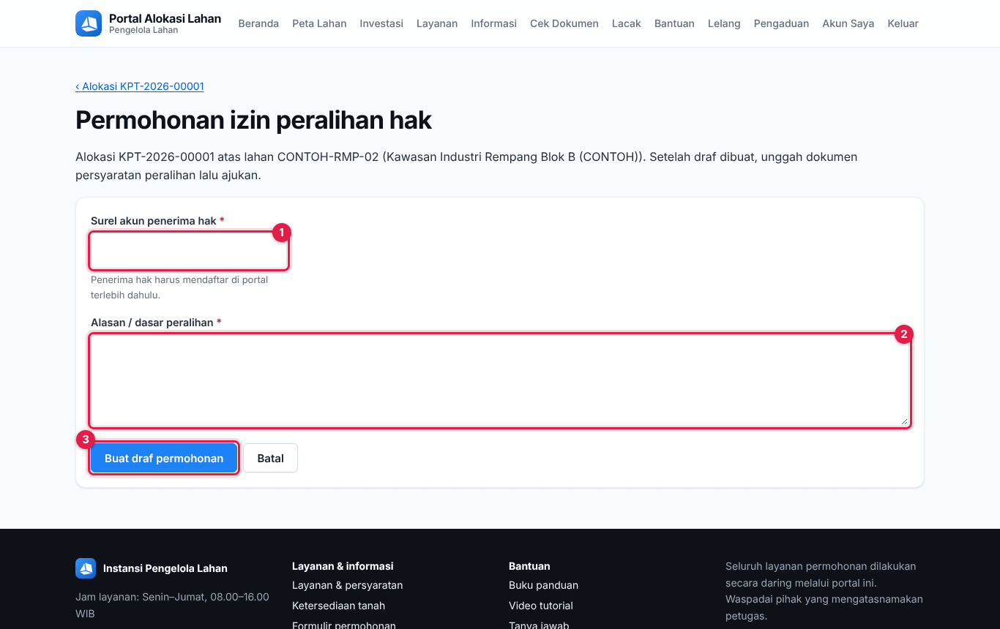

3. Isi **Surel akun penerima hak** (nomor 1), yaitu surel yang dipakai penerima untuk masuk portal.
4. Tulis **Alasan / dasar peralihan** (nomor 2), misalnya jual beli atau hibah.
5. Klik **Buat draf permohonan** (nomor 3).
6. Unggah dokumen dan ajukan. Penerima hak menerima surel dan harus menyetujui peralihan di portal.

**Bila Anda penerima hak:** buka **Akun saya → Peralihan hak kepada saya**, buka permohonannya, lalu klik **Setujui peralihan** di bagian **Persetujuan penerima hak**. Dengan menyetujui, Anda menerima seluruh kewajiban pemegang alokasi. Tanpa persetujuan Anda, petugas tidak bisa memproses peralihan.

<!-- akhir sisip -->

<!-- sisip: 51-portal-pemohon.md#1310-profil-dan-kata-sandi -->

### 13.10 Profil dan kata sandi

Klik **Ubah profil** di **Akun saya**.

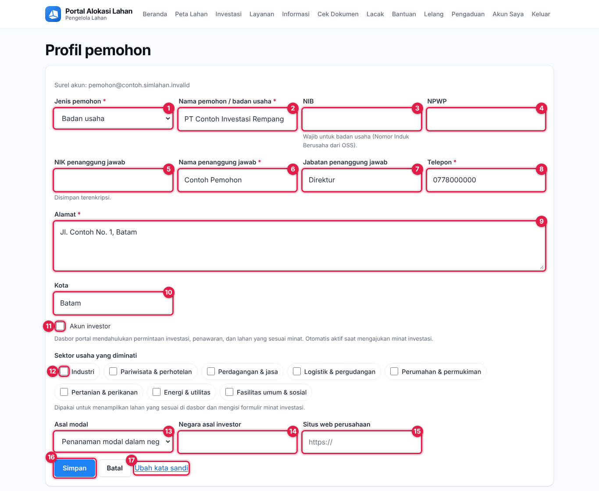

1. Ubah **Jenis pemohon** (nomor 1), **Nama pemohon / badan usaha** (nomor 2), **NIB** (nomor 3), **NPWP** (nomor 4), dan **NIK penanggung jawab** (nomor 5).
2. Ubah **Nama penanggung jawab** (nomor 6), **Jabatan penanggung jawab** (nomor 7), **Telepon** (nomor 8), **Alamat** (nomor 9), dan **Kota** (nomor 10).
3. Ingin memakai fitur investor? Centang **Akun investor** (nomor 11) dan pilih **Sektor usaha yang diminati** (nomor 12 dan seterusnya). Isi juga **Asal modal** (nomor 13), **Negara asal investor** (nomor 14, untuk modal asing), dan **Situs web perusahaan** (nomor 15).
4. Klik **Simpan** (nomor 16).
5. Untuk mengganti kata sandi, klik **Ubah kata sandi** (nomor 17).

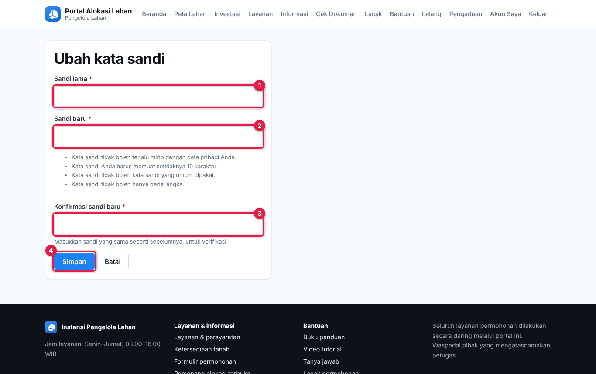

1. Isi **Sandi lama** (nomor 1).
2. Isi **Sandi baru** (nomor 2) sesuai aturan di bawah kotak itu, lalu ulangi di **Konfirmasi sandi baru** (nomor 3).
3. Klik **Simpan** (nomor 4).

<!-- akhir sisip -->

## Bagian B – Layanan portal lain

<!-- sisip: 50-portal-publik.md#124-layanan-ketentuan-umum-kalkulator-uwt -->

### 12.4 Layanan, ketentuan umum, kalkulator UWT

Klik **Layanan** di menu atas.

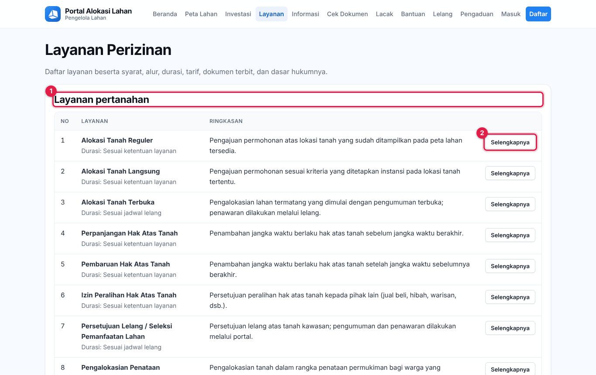

1. Layanan dikelompokkan, misalnya **Layanan pertanahan** (nomor 1), **Layanan perubahan dokumen**, dan **Layanan pelaporan**.
2. Klik **Selengkapnya** (nomor 2) di baris layanan untuk melihat persyaratannya.

Halaman detail layanan berisi syarat, alur, durasi, tarif, dokumen yang terbit, dasar hukum, dan tabel dokumen persyaratan (dokumen, keterangan, wajib atau tidak).

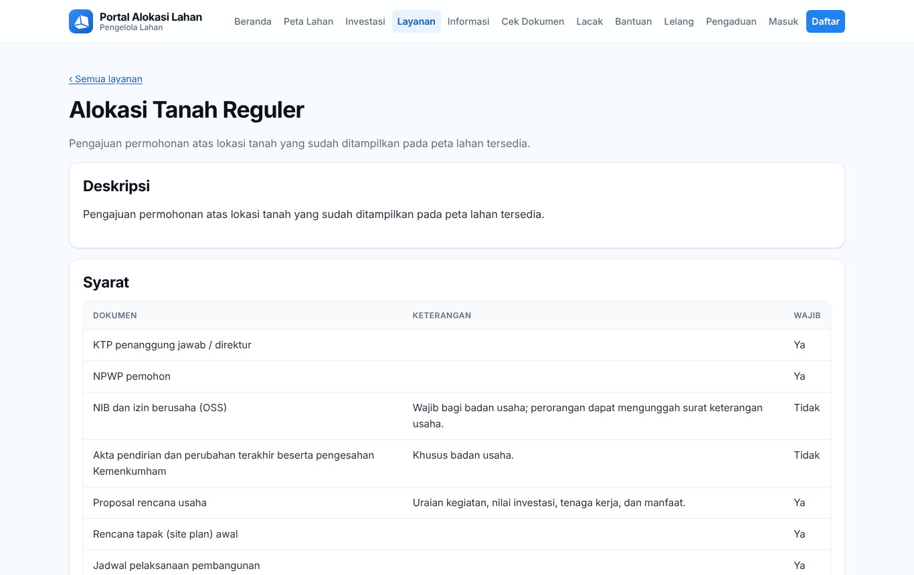

**Ketentuan umum** menjelaskan tahapan dan **kriteria penilaian** verifikasi teknis beserta bobotnya. Tombol **Cari lahan** membuka peta lahan.

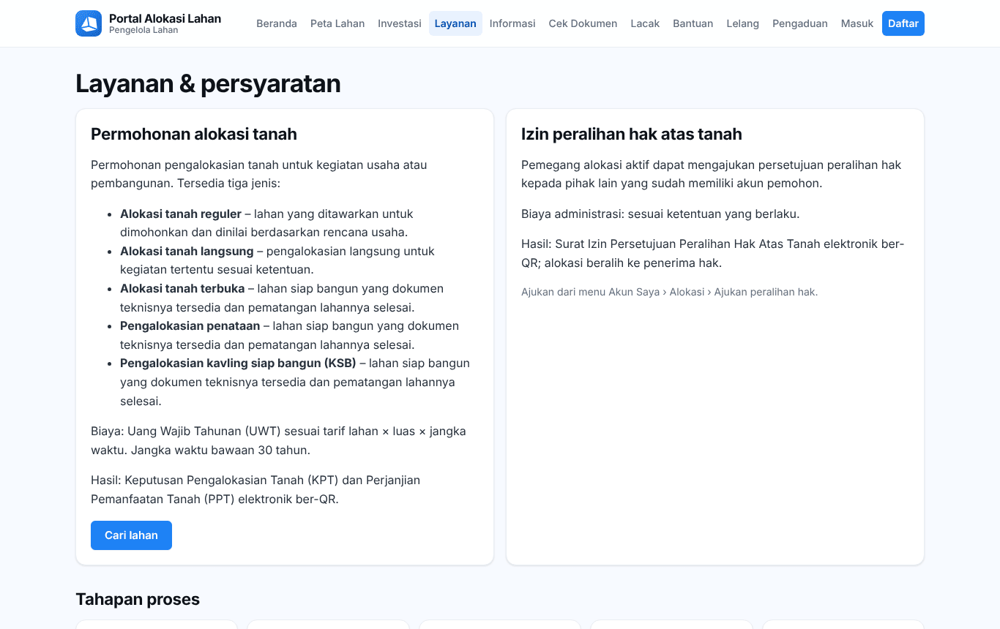

**Kalkulator UWT** (Uang Wajib Tahunan) menghitung perkiraan biaya. Buka dari tautan **Simulasi biaya UWT** di halaman Informasi, atau **Simulasi biaya UWT** di kaki halaman portal.

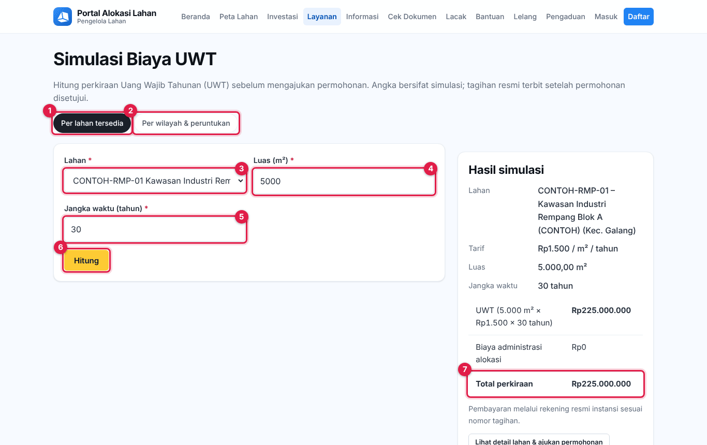

1. Pilih cara menghitung: **Per lahan tersedia** (nomor 1) atau **Per wilayah & peruntukan** (nomor 2).
2. Untuk **Per lahan tersedia**: pilih **Lahan** (nomor 3), isi **Luas (m²)** (nomor 4) dan **Jangka waktu (tahun)** (nomor 5).
3. Untuk **Per wilayah & peruntukan**: pilih **Wilayah**, **Sub wilayah**, **Peruntukan**, dan **Jenis pengurusan**, lalu isi **Luas**.
4. Klik **Hitung** (nomor 6).
5. **Hasil simulasi** tampil di kanan: tarif, luas, jangka waktu, rincian UWT, biaya administrasi, dan **Total perkiraan** (nomor 7). Angka ini simulasi; tagihan resmi terbit setelah permohonan disetujui.

<!-- akhir sisip -->

<!-- sisip: 50-portal-publik.md#128-lacak-permohonan -->

### 12.8 Lacak permohonan

Pemohon bisa melihat status permohonan tanpa masuk. Klik **Lacak** di menu atas.

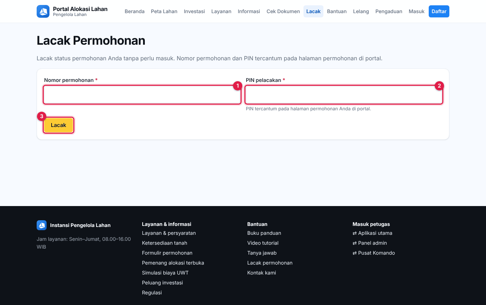

1. Isi **Nomor permohonan** (nomor 1), misalnya `ALK-2026-00001`.
2. Isi **PIN pelacakan** (nomor 2). PIN tercantum di halaman permohonan Anda di portal, bagian **Lacak tanpa login**.
3. Klik **Lacak** (nomor 3). Tampil layanan, lahan, status, tanggal diajukan, dan riwayat. Rincian lengkap, dokumen, dan tagihan hanya terlihat setelah masuk.

<!-- akhir sisip -->

<!-- sisip: 51-portal-pemohon.md#139-mengikuti-lelang -->

### 13.9 Mengikuti lelang

1. Klik **Lelang** di menu atas, lalu klik lelang berstatus **Menerima penawaran**.
2. Klik **Ajukan penawaran** di kotak kanan (bila Anda sudah pernah menawar, tombolnya **Ubah penawaran**).

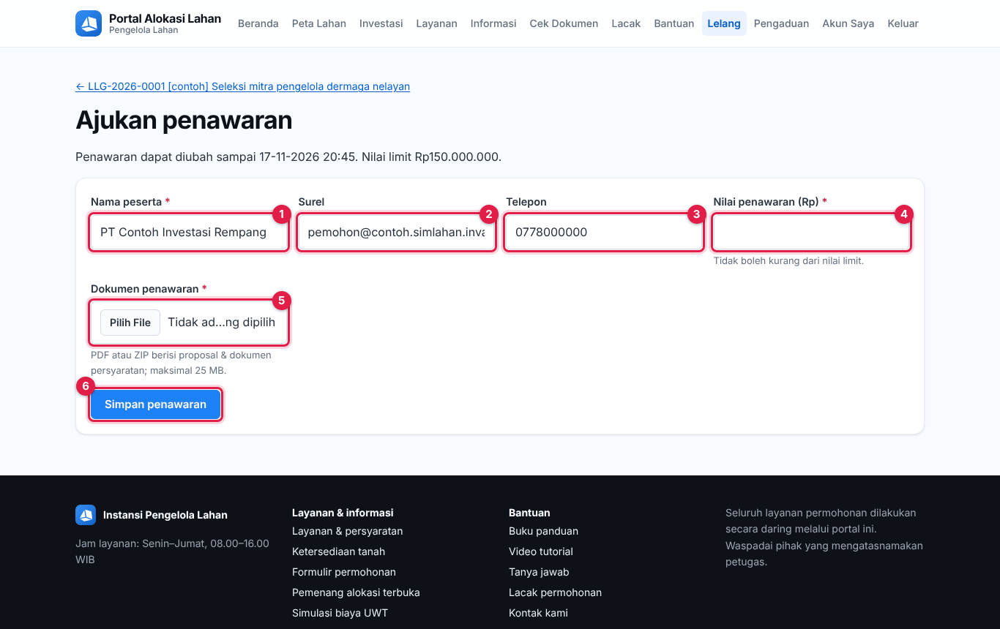

3. Periksa **Nama peserta** (nomor 1), **Surel** (nomor 2), dan **Telepon** (nomor 3). Ketiganya terisi dari profil Anda.
4. Isi **Nilai penawaran (Rp)** (nomor 4). Tidak boleh kurang dari nilai limit yang tertulis di atas formulir.
5. Klik **Pilih File** di **Dokumen penawaran** (nomor 5) dan pilih PDF atau ZIP berisi proposal dan dokumen persyaratan (maksimal 25 MB).
6. Klik **Simpan penawaran** (nomor 6).
7. Sebelum batas waktu, Anda bisa mengubah penawaran; unggah dokumen lagi hanya bila ingin menggantinya. Setelah penawaran ditutup dan dievaluasi, pemenang tampil di halaman lelang.

<!-- akhir sisip -->

<!-- sisip: 50-portal-publik.md#127-pengaduan-masyarakat -->

### 12.7 Pengaduan masyarakat

Klik **Pengaduan** di menu atas.

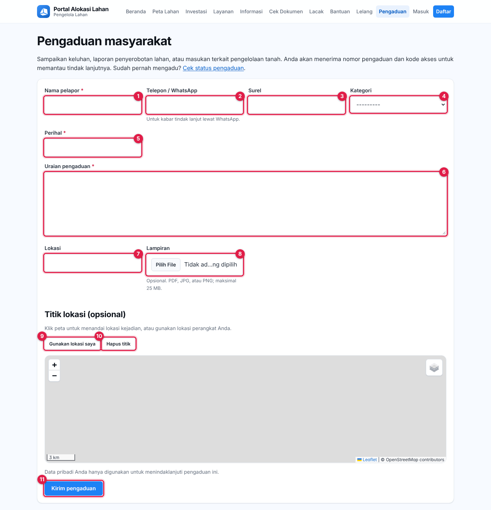

1. Isi **Nama pelapor** (nomor 1). Wajib.
2. Isi **Telepon / WhatsApp** (nomor 2) dan **Surel** (nomor 3) agar petugas bisa mengabari Anda.
3. Pilih **Kategori** (nomor 4).
4. Tulis **Perihal** (nomor 5), yaitu judul singkat, dan **Uraian pengaduan** (nomor 6), yaitu cerita lengkapnya. Keduanya wajib.
5. Isi **Lokasi** (nomor 7) dengan nama tempat, misalnya kampung atau RT.
6. Bila ada foto atau dokumen, klik **Pilih File** di **Lampiran** (nomor 8). Boleh PDF, JPG, atau PNG, paling besar 25 MB.
7. Di **Titik lokasi (opsional)**, klik peta di tempat kejadian, atau klik **Gunakan lokasi saya** (nomor 9) bila Anda sedang berada di sana. **Hapus titik** (nomor 10) mengulang.
8. Klik **Kirim pengaduan** (nomor 11).
9. Halaman berikutnya menampilkan **Nomor pengaduan**, **Kode akses**, dan **Batas penyelesaian**. **Catat atau foto nomor dan kode akses ini**; keduanya diperlukan untuk mengecek tanggapan.

**Mengecek tanggapan pengaduan:** klik tautan **Cek status pengaduan** di halaman pengaduan.

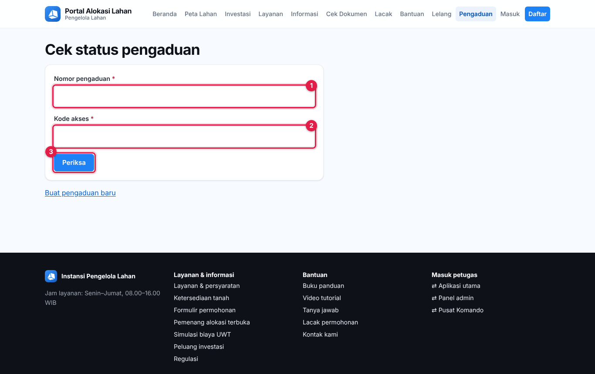

1. Isi **Nomor pengaduan** (nomor 1) dan **Kode akses** (nomor 2).
2. Klik **Periksa** (nomor 3). Status dan tanggapan petugas tampil di bawahnya.

<!-- akhir sisip -->

<!-- sisip: 50-portal-publik.md#1210-bantuan-dan-kontak -->

### 12.10 Bantuan dan kontak

Klik **Bantuan** di menu atas.

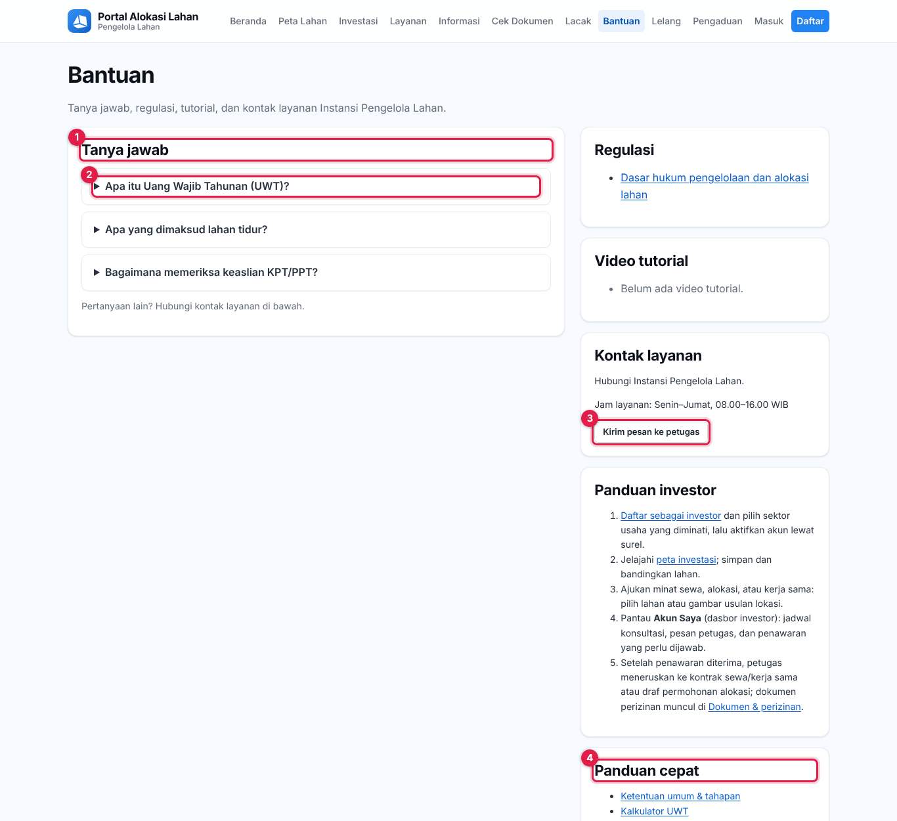

1. **Tanya jawab** (nomor 1): klik pertanyaan (nomor 2) untuk membuka jawabannya.
2. Kanan: **Regulasi**, **Video tutorial**, **Kontak layanan** (jam layanan), dan **Panduan investor**.
3. **Kirim pesan ke petugas** (nomor 3) membuka formulir Kontak Kami.
4. **Panduan cepat** (nomor 4) berisi tautan ke ketentuan umum, kalkulator UWT, formulir, pemenang alokasi terbuka, lacak, cek dokumen, dan verifikasi dokumen elektronik. Buku panduan yang bisa diunduh juga ada di halaman ini.

**Mengirim pesan ke petugas:**

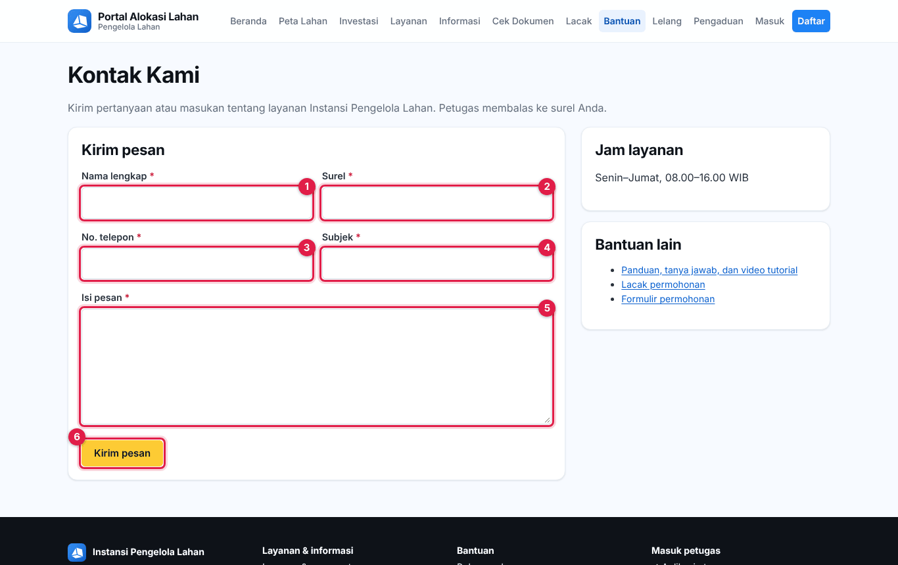

1. Isi **Nama lengkap** (nomor 1), **Surel** (nomor 2), **No. telepon** (nomor 3), dan **Subjek** (nomor 4).
2. Tulis pertanyaan Anda di **Isi pesan** (nomor 5).
3. Klik **Kirim pesan** (nomor 6). Petugas membalas ke surel Anda. (Bagi petugas: pesan masuk ke **Panel admin → Alokasi lahan → Pesan Kontak Kami**.)

<!-- akhir sisip -->

## Bagian C – Dokumen & perizinan

<!-- sisip: 53-portal-dokumen.md#151-ringkasan -->

### 15.1 Ringkasan

Buka **Akun saya**, lalu klik **Buka ›** di kotak **Dokumen & perizinan**.

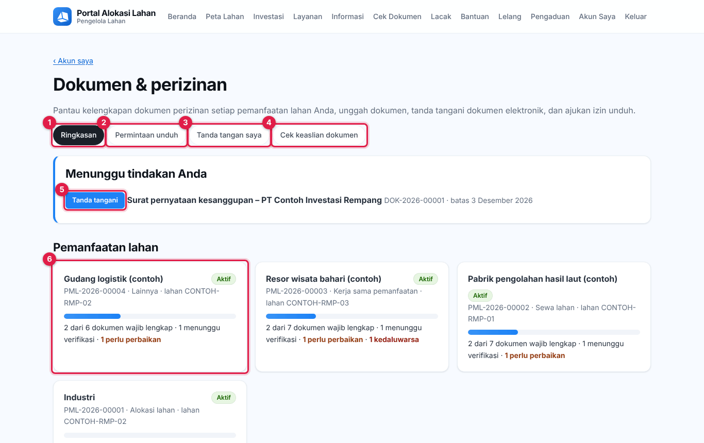

1. Tab di atas: **Ringkasan** (nomor 1), **Permintaan unduh** (nomor 2, [15.5](../53-portal-dokumen.md#155-meminta-izin-unduh)), **Tanda tangan saya** (nomor 3, [15.4](../53-portal-dokumen.md#154-tanda-tangan-tersimpan)), dan **Cek keaslian dokumen** (nomor 4, [15.6](../53-portal-dokumen.md#156-cek-keaslian-dokumen)).
2. **Menunggu tindakan Anda**: dokumen yang harus diunggah, diperbaiki, diperpanjang, atau ditandatangani. Klik **Tanda tangani** (nomor 5) untuk langsung menandatangani ([15.3](../53-portal-dokumen.md#153-menandatangani-dokumen-elektronik)).
3. **Pemanfaatan lahan**: satu kartu untuk setiap hak pakai lahan Anda, dengan garis kemajuan kelengkapan dokumen dan jumlah dokumen yang **perlu perbaikan** atau **kedaluwarsa**. Klik kartu (nomor 6) untuk membukanya ([15.2](../53-portal-dokumen.md#152-melengkapi-dokumen-perizinan)).
4. Di bawahnya ada **Dokumen tanda tangan** dan **Permintaan unduh terbaru**.

<!-- akhir sisip -->

<!-- sisip: 53-portal-dokumen.md#152-melengkapi-dokumen-perizinan -->

### 15.2 Melengkapi dokumen perizinan

Klik kartu pemanfaatan lahan di **Ringkasan**.

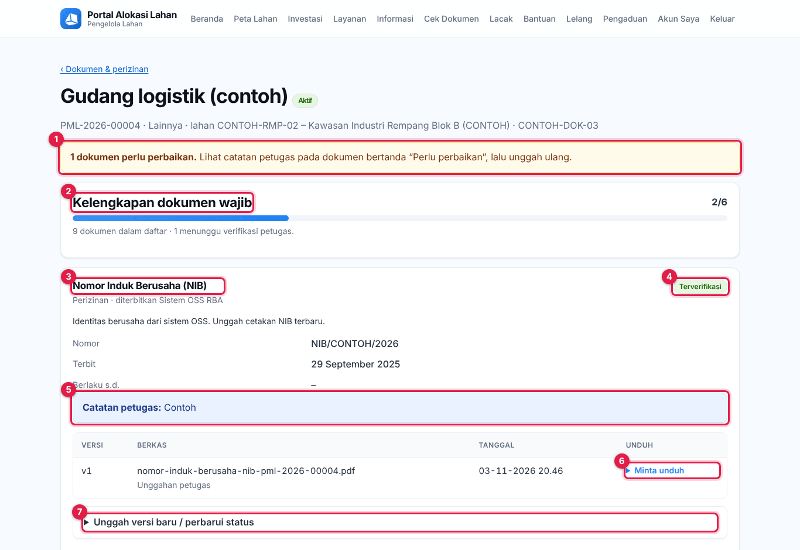

1. Kotak kuning di atas (nomor 1) memberi tahu dokumen yang perlu tindakan, misalnya "1 dokumen perlu perbaikan".
2. **Kelengkapan dokumen wajib** (nomor 2): berapa dokumen wajib yang sudah lengkap, misalnya 2/6.
3. Setiap dokumen punya kartu sendiri dengan nama (nomor 3) dan status (nomor 4): **Belum diurus**, **Sedang diurus**, **Menunggu verifikasi**, **Terverifikasi**, **Perlu perbaikan**, **Kedaluwarsa**, atau **Tidak wajib**. Kartu juga menampilkan **Nomor**, tanggal **Terbit**, dan **Berlaku s.d.**
4. **Catatan petugas** (nomor 5) berisi pesan petugas. Bila status **Perlu perbaikan**, di sinilah alasannya.
5. Tabel versi berkas menampilkan setiap berkas yang pernah diunggah. **Minta unduh** (nomor 6) meminta izin mengunduh versi itu ([15.5](../53-portal-dokumen.md#155-meminta-izin-unduh)).
6. Bila tersedia, klik **Unduh format dokumen** di kartu untuk mengunduh formulir atau contohnya.
7. Klik **Unggah dokumen / perbarui status** (pada dokumen yang sudah punya berkas: **Unggah versi baru / perbarui status**, nomor 7; pada dokumen yang perlu diperbaiki: **Unggah perbaikan**) untuk membuka formulirnya:

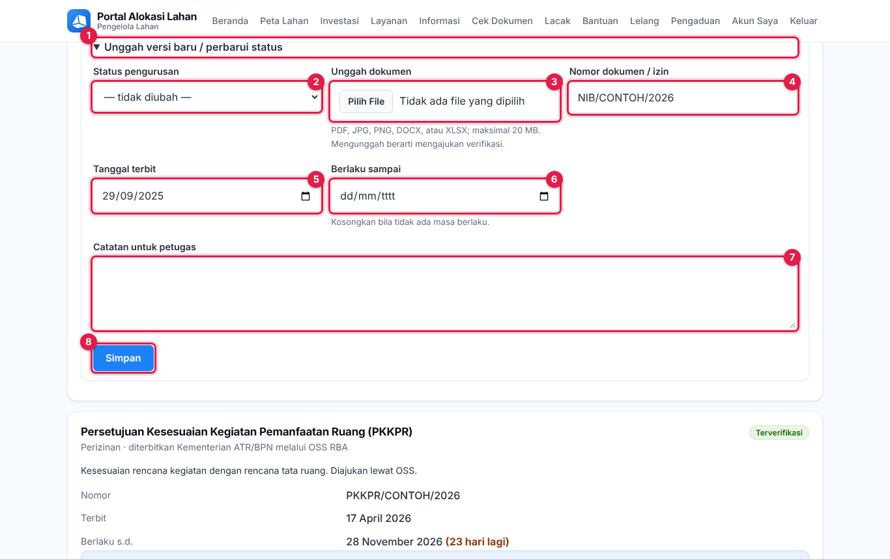

8. **Status pengurusan** (nomor 2): pilih **Sedang diurus** saat mulai mengurus ke instansi penerbit. Biarkan **— tidak diubah —** bila hanya mengunggah berkas.
9. **Unggah dokumen** (nomor 3): klik **Pilih File** dan pilih berkasnya (PDF, JPG, PNG, DOCX, atau XLSX; maksimal 20 MB). Mengunggah berarti mengajukan verifikasi; status menjadi **Menunggu verifikasi**.
10. Isi **Nomor dokumen / izin** (nomor 4), **Tanggal terbit** (nomor 5), dan **Berlaku sampai** (nomor 6). Kosongkan **Berlaku sampai** bila izin tidak punya masa berlaku.
11. Tulis **Catatan untuk petugas** (nomor 7) bila perlu.
12. Klik **Simpan** (nomor 8).

Bila izin hampir habis (tanda "(… hari lagi)" di **Berlaku s.d.**) atau sudah **Kedaluwarsa**, perpanjang izin ke instansi penerbit lalu unggah dokumen terbaru dengan cara yang sama. Bagian **Dokumen tanda tangan** dan **Riwayat** di bawah halaman mencatat semua aktivitas.

<!-- akhir sisip -->

<!-- sisip: 53-portal-dokumen.md#153-menandatangani-dokumen-elektronik -->

### 15.3 Menandatangani dokumen elektronik

Anda menerima surel berisi tautan saat ada dokumen yang perlu ditandatangani atau disetujui. Tautan juga ada di **Menunggu tindakan Anda** (tombol **Tanda tangani**).

1. Buka tautan. Bila dokumen ditujukan ke akun portal, masuk dengan akun penerima; Anda langsung masuk ke halaman dokumen. (Masuk dengan akun lain menampilkan **Akun tidak sesuai**.)
2. Penerima tanpa akun portal melewati **Verifikasi penerima** lebih dulu: klik **Kirim kode ke surel**, masukkan kode 6 angka dari surel (berlaku 10 menit) dan **kode akses** dari petugas bila diminta, lalu klik **Lanjutkan**. Jangan berikan kode kepada siapa pun, termasuk yang mengaku petugas.

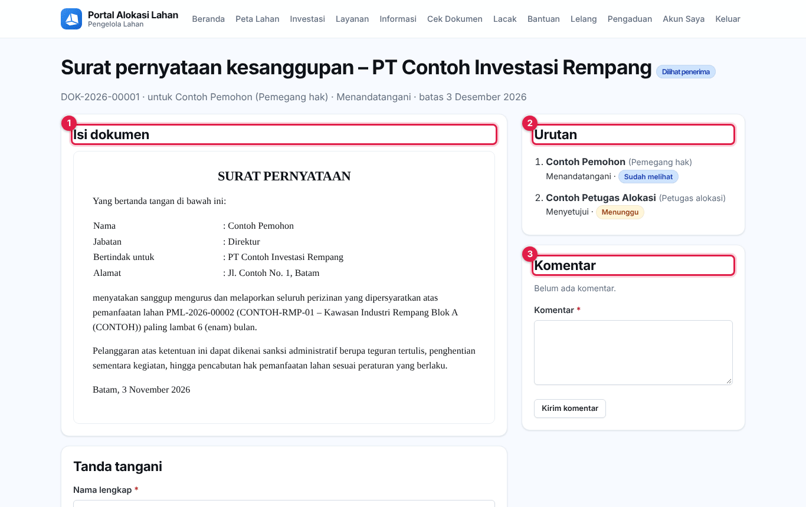

3. Baca **Isi dokumen** (nomor 1) sampai habis. Untuk PDF unggahan, klik **Buka PDF di tab baru** untuk tampilan penuh.
4. **Urutan** (nomor 2) menampilkan semua penanda tangan dan statusnya (**Menunggu**, **Sudah melihat**, **Selesai**).
5. Ada pertanyaan untuk petugas? Tulis di **Komentar** (nomor 3), lalu klik **Kirim komentar**.
6. Isi **Isian Anda** bila ada (teks, tanggal, angka, centang, pilihan, paraf, atau lampiran maksimal 20 MB).
7. Gulir ke kotak **Tanda tangani**:

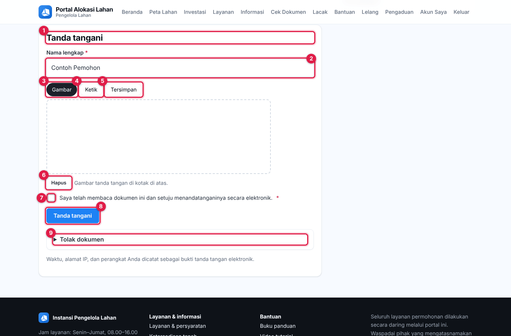

8. Di **Tanda tangani** (nomor 1), periksa **Nama lengkap** (nomor 2).
9. Buat tanda tangan dengan salah satu cara:
   - **Gambar** (nomor 3): tulis tanda tangan di kotak bergaris putus-putus dengan tetikus atau jari.
   - **Ketik** (nomor 4): ketik nama; sistem mengubahnya menjadi tanda tangan.
   - **Tersimpan** (nomor 5): pakai tanda tangan yang sudah disimpan ([15.4](../53-portal-dokumen.md#154-tanda-tangan-tersimpan)).
   - **Hapus** (nomor 6) mengosongkan kotak untuk mengulang.
10. Centang **Saya telah membaca dokumen ini dan setuju menandatanganinya secara elektronik** (nomor 7).
11. Klik **Tanda tangani** (nomor 8), atau **Setujui** bila Anda hanya diminta menyetujui. Waktu, alamat IP, dan perangkat Anda dicatat sebagai bukti tanda tangan elektronik.
12. Tidak setuju dengan isi dokumen? Buka **Tolak dokumen** (nomor 9), tulis alasannya, lalu klik **Tolak dokumen**.

Catatan:

- Bila muncul "Dokumen ini masih menunggu penanda tangan sebelumnya", tunggu surel saat giliran Anda tiba.
- Bila dokumen ditandai **Tanda tangan langsung**, datang ke loket layanan dengan membawa identitas; petugas membuka halaman tanda tangan di perangkat layanan.

**Setelah semua pihak selesai**, buka dokumen dari **Ringkasan → Dokumen tanda tangan**:

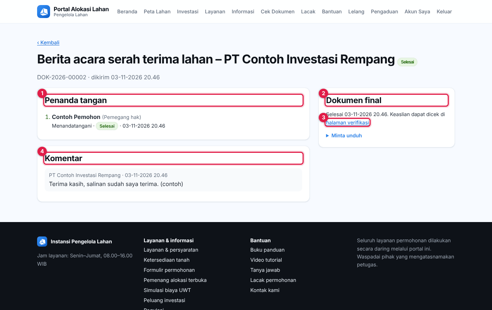

1. **Penanda tangan** (nomor 1): siapa menandatangani dan kapan.
2. **Dokumen final** (nomor 2): dokumen sudah selesai.
3. **halaman verifikasi** (nomor 3) membuka bukti keaslian dokumen ([Bab 12.9](../50-portal-publik.md#129-cek-keaslian-dokumen)).
4. **Komentar** (nomor 4) mencatat tanya jawab dengan petugas.
5. Untuk mengunduh PDF final, gunakan **Minta unduh** ([15.5](../53-portal-dokumen.md#155-meminta-izin-unduh)).

<!-- akhir sisip -->

<!-- sisip: 53-portal-dokumen.md#154-tanda-tangan-tersimpan -->

### 15.4 Tanda tangan tersimpan

Simpan tanda tangan sekali, lalu pakai ulang setiap kali menandatangani dengan akun ini. Klik tab **Tanda tangan saya**.

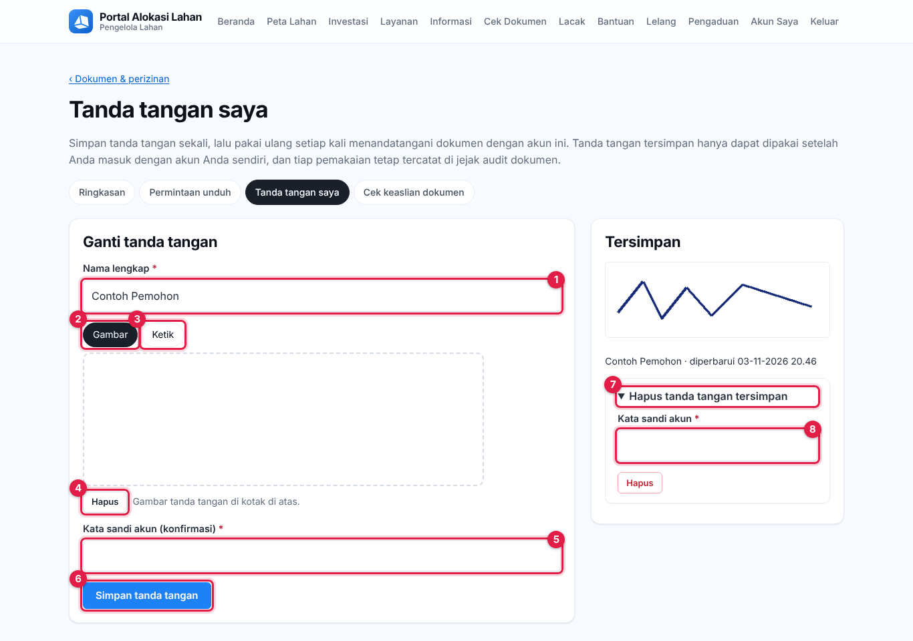

1. Isi **Nama lengkap** (nomor 1).
2. Pilih **Gambar** (nomor 2) lalu tulis tanda tangan di kotak, atau **Ketik** (nomor 3) lalu ketik nama. **Hapus** (nomor 4) mengulang.
3. Masukkan kata sandi akun Anda di **Kata sandi akun (konfirmasi)** (nomor 5).
4. Klik **Simpan tanda tangan** (nomor 6). Tanda tangan tampil di kotak **Tersimpan** di kanan.
5. Untuk menghapusnya, buka **Hapus tanda tangan tersimpan** (nomor 7), isi **Kata sandi akun** (nomor 8), lalu klik **Hapus**.

Tanda tangan tersimpan hanya dapat dipakai setelah Anda masuk dengan akun sendiri, dan setiap pemakaian tercatat.

<!-- akhir sisip -->

<!-- sisip: 53-portal-dokumen.md#155-meminta-izin-unduh -->

### 15.5 Meminta izin unduh

Setiap unduhan dokumen memerlukan persetujuan petugas berwenang.

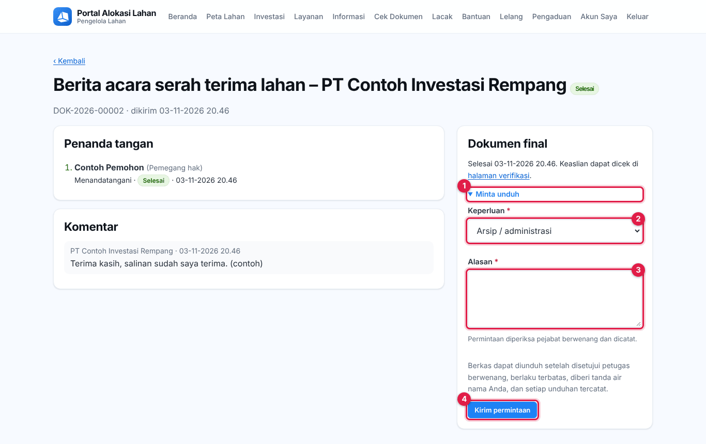

1. Di halaman dokumen perizinan (tabel versi berkas) atau dokumen tanda tangan (kotak **Dokumen final**), klik **Minta unduh** (nomor 1).
2. Pilih **Keperluan** (nomor 2): arsip/administrasi, pengurusan izin ke instansi lain, pembiayaan/bank, hukum/pengadilan, audit, atau lainnya.
3. Tulis **Alasan** (nomor 3).
4. Klik **Kirim permintaan** (nomor 4).

Pantau permintaan di tab **Permintaan unduh**:

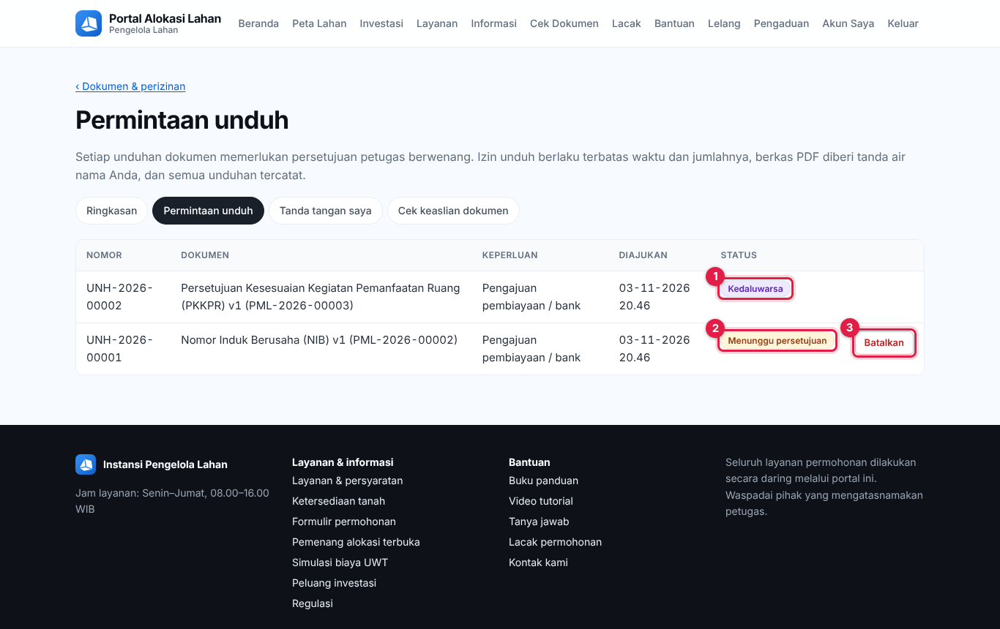

5. Kolom status (nomor 1 dan 2) menampilkan **Menunggu persetujuan**, **Disetujui**, **Ditolak**, **Dibatalkan**, atau **Kedaluwarsa** (izin unduh sudah habis masa berlakunya; ajukan lagi bila masih perlu).
6. Setelah **Disetujui**, tombol **Unduh** muncul di baris itu. Klik sebelum masa berlakunya habis. Izin unduh berlaku terbatas waktu dan jumlahnya, dan PDF diberi tanda air nama Anda.
7. Permintaan yang belum diputuskan bisa dibatalkan dengan **Batalkan** (nomor 3).

Tergantung pengaturan, permintaan pemegang hak atas dokumennya sendiri bisa langsung disetujui sistem (tetap tercatat).

<!-- akhir sisip -->

<!-- sisip: 53-portal-dokumen.md#156-cek-keaslian-dokumen -->

### 15.6 Cek keaslian dokumen

Klik tab **Cek keaslian dokumen** untuk memeriksa dokumen bertanda tangan elektronik (lihat [Bab 12.9](../50-portal-publik.md#129-cek-keaslian-dokumen), bagian B).

<!-- akhir sisip -->

<!-- sisip: 51-portal-pemohon.md#1311-pertanyaan-umum -->

### 13.11 Pertanyaan umum

**Tombol Ajukan tidak bisa diklik.** Baca daftar **Lengkapi dulu:** di kotak **Ajukan permohonan**; ada data atau dokumen wajib yang belum diisi.

**Lahan tidak bisa diajukan.** Lahan sedang diproses pemohon lain, sudah dialokasikan, atau ditutup. Klik **Cari lahan lain**.

**Surel aktivasi tidak datang.** Periksa folder spam, lalu klik **Kirim ulang** di halaman pendaftaran (atau **Kirim ulang aktivasi** di halaman masuk).

<!-- akhir sisip -->

## Bila ada kendala

- **Lupa kata sandi.** Klik **Lupa kata sandi?** di halaman masuk portal (lihat [Lupa kata sandi](#lupa-kata-sandi)).
- **Surel aktivasi atau surel lain tidak masuk.** Periksa folder *Spam*/*Promosi*. Bila tetap tidak ada, klik **Bantuan** → **Kirim pesan ke petugas** di portal.
- **Tombol yang disebut di buku ini tidak ada.** Tombol muncul sesuai status permohonan atau dokumen Anda. Contoh: tombol bayar baru muncul setelah tagihan terbit.
- **Pertanyaan lain.** Buka **Bantuan** di portal untuk tanya jawab, atau klik **Kirim pesan ke petugas**. Petugas membalas ke surel Anda.
