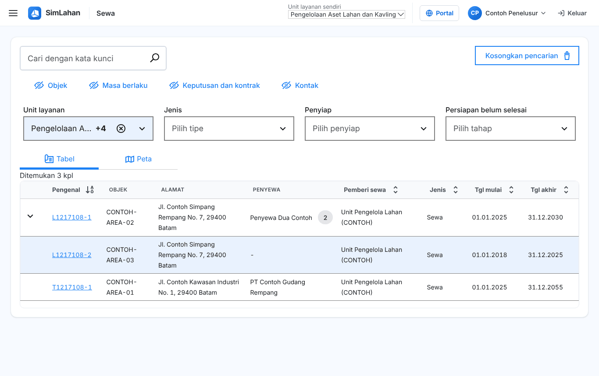
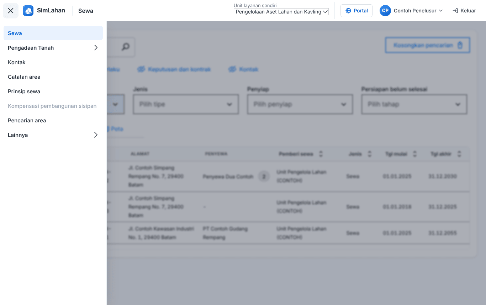
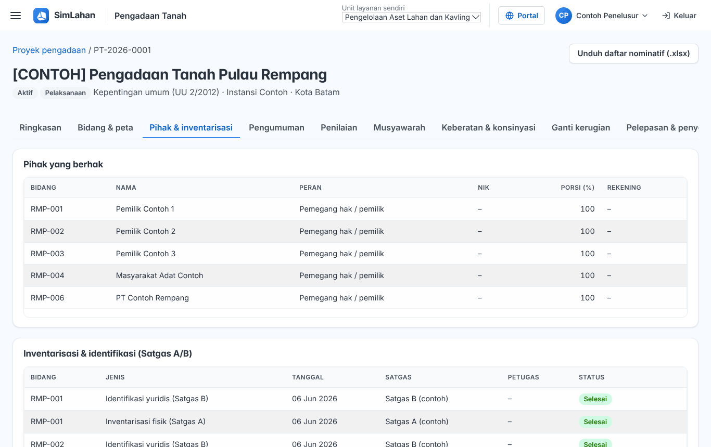

# Buku peran: Penelusur

Buku ini untuk **Penelusur**: petugas yang menelusuri dan membaca data sewa serta pengadaan tanah tanpa mengubahnya. Baca dulu [Bab 1](../01-mengenal-simlahan.md) dan [Bab 2](../02-dasar-penggunaan.md) bila baru pertama kali memakai SimLahan.

## Masuk

Buka alamat SimLahan, isi nama pengguna dan kata sandi, lalu klik **Masuk** ([Bab 2.2](../02-dasar-penggunaan.md#a-aplikasi-utama-petugas-kantor)).

<!-- awal: dibuat dari backend/users/role_guide.py; perbarui dengan: cd backend && python manage.py panduan_buku -->

## Ringkasan peran

Menelusuri data sewa dan pengadaan tanah tanpa mengubahnya.

- **Cara masuk:** Alamat utama SimLahan (`/`), dengan nama pengguna dan sandi.
- **Halaman awal:** Sewa (daftar sewa).
- **Akun latihan** (hanya di sistem latihan berisi data contoh): `contoh.penelusur`

### Menu yang Anda lihat

- Sewa
- Pengadaan Tanah: Dasbor & tenggat, Proyek pengadaan, Kalender & aturan tenggat
- Kontak
- Catatan area
- Prinsip sewa
- Kompensasi pembangunan sisipan
- Pencarian area
- Lainnya: Indeks biaya hidup, Tugas terjadwal

### Yang bisa Anda lakukan

- Mencari dan membuka semua data sewa, penyewa, kontrak, keputusan, kontak, catatan area, prinsip sewa, dan pencarian area.
- Melihat proyek pengadaan, bidang, dan tenggat (data pribadi tersamar).
- Melihat riwayat tugas terjadwal.

### Batas akses

- Tidak bisa menambah, mengubah, atau menghapus data.
- Tidak melihat tagihan dan laporan statistik.
- Tidak bisa membuka panel admin, alokasi lahan, manajemen aset lahan, pusat komando, atau aplikasi lapangan.

<!-- akhir: blok role_guide.py -->

## Pekerjaan sehari-hari

### 1. Mencari dan membuka data sewa

1. Halaman awal Anda adalah daftar **Sewa** ([Bab 3.1](../10-sewa.md#31-daftar-sewa)).
2. Ketik pengenal sewa, nama penyewa, atau alamat di kotak cari, lalu tekan Enter. Gunakan saringan bila hasilnya banyak.
3. Klik baris sewa untuk membuka halamannya, lalu pindah antar-tab ([Bab 3.3](../10-sewa.md#33-halaman-data-sewa)).

### 2. Melihat laporan

1. Buka **☰ → Statistik dan laporan** ([Bab 3.8](../10-sewa.md#38-statistik-dan-laporan)).
2. Pilih laporan, isi saringan, lalu tampilkan atau unduh. Laporan besar dikirim ke surel Anda.

### 3. Melihat proyek pengadaan tanah

1. Buka **☰ → Pengadaan Tanah → Proyek pengadaan** ([Bab 4.2](../11-pengadaan-tanah.md#42-daftar-proyek)).
2. Data pribadi pihak (NIK, rekening) tampil tersamar untuk peran Anda.

### 4. Melihat kontak, catatan area, dan prinsip sewa

1. Buka menu **Kontak**, **Catatan area**, atau **Prinsip sewa** ([Bab 3.5](../10-sewa.md#35-kontak), [3.6](../10-sewa.md#36-catatan-area), [3.7](../10-sewa.md#37-prinsip-sewa-dasar-sewa)).

## Bab yang perlu dibaca

- [Bab 1 – Mengenal SimLahan](../01-mengenal-simlahan.md)
- [Bab 2 – Dasar penggunaan](../02-dasar-penggunaan.md)
- [Bab 3 – Sewa lahan](../10-sewa.md)
- [Bab 4 – Pengadaan tanah](../11-pengadaan-tanah.md)

## Bila ada kendala

- Menu atau tombol tidak ada: peran Anda memang tidak memerlukannya ([Bab 2.10](../02-dasar-penggunaan.md#210-batas-akses-dan-pesan-tidak-berhak)). Hubungi Administrator bila Anda memerlukannya untuk pekerjaan.
- Lupa kata sandi: hubungi Administrator atau superuser untuk menyetel ulang sandi.
- Ringkasan peran yang sama bisa dibuka di dalam aplikasi lewat **Panduan peran** (`/akun/panduan/`).
