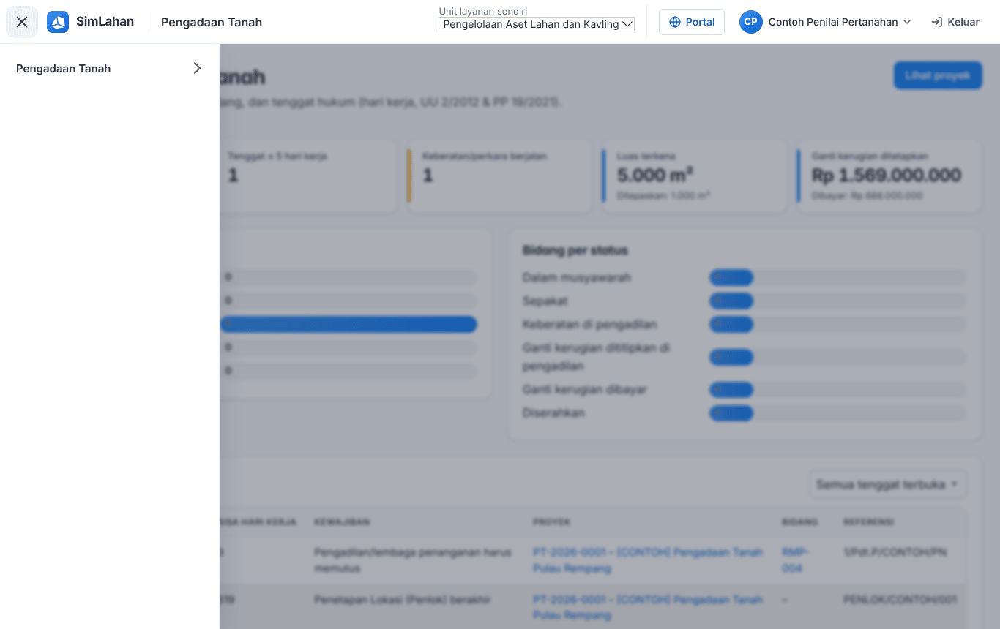
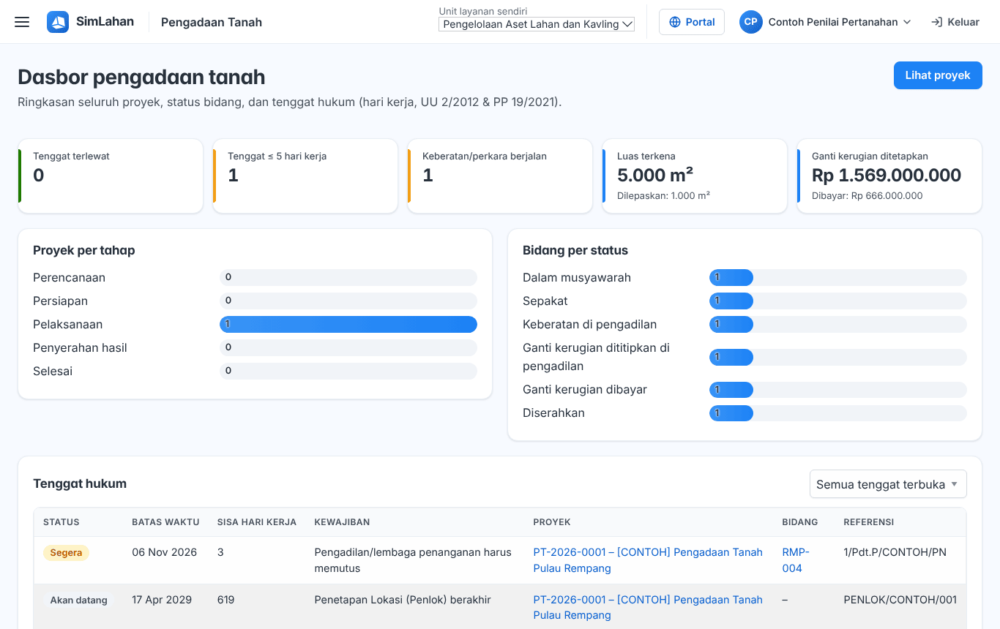
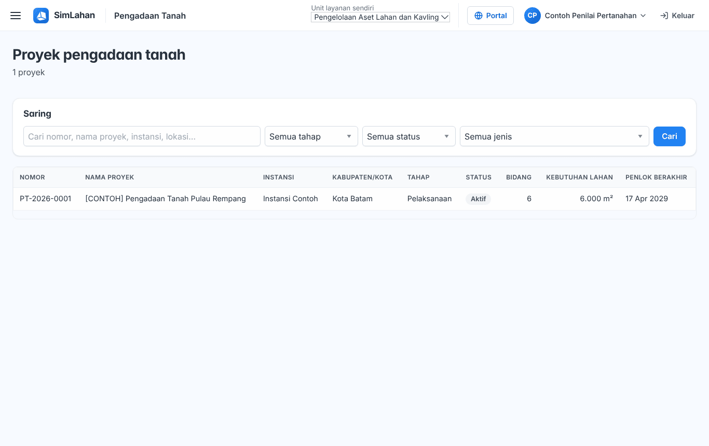
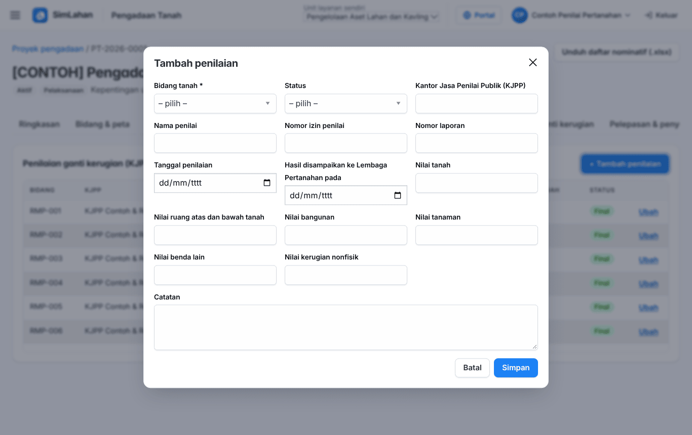
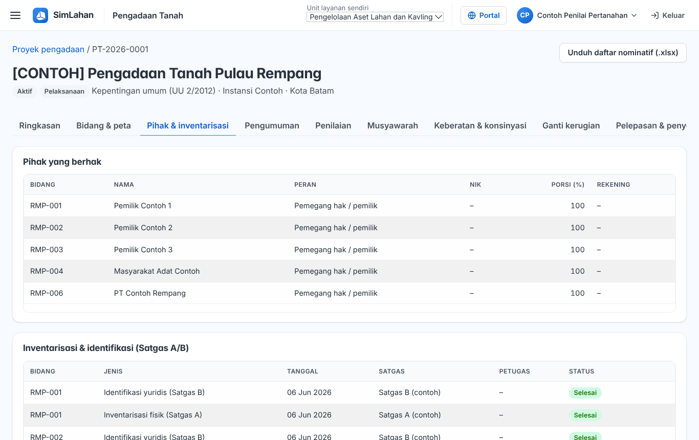

# Buku peran: Penilai Pertanahan

Buku ini untuk **Penilai Pertanahan**: penilai (KJPP) yang mengisi nilai ganti kerugian pada proyek yang ditugaskan. Baca dulu [Bab 1](../01-mengenal-simlahan.md) dan [Bab 2](../02-dasar-penggunaan.md) bila baru pertama kali memakai SimLahan.

## Masuk

Buka alamat SimLahan, isi nama pengguna dan kata sandi, lalu klik **Masuk** ([Bab 2.2](../02-dasar-penggunaan.md#a-aplikasi-utama-petugas-kantor)).

<!-- awal: dibuat dari backend/users/role_guide.py; perbarui dengan: cd backend && python manage.py panduan_buku -->

## Ringkasan peran

Mengisi penilaian ganti kerugian pada proyek yang ditugaskan.

- **Cara masuk:** Alamat utama SimLahan (`/`), dengan nama pengguna dan sandi.
- **Halaman awal:** Pengadaan Tanah → Dasbor & tenggat.
- **Akun latihan** (hanya di sistem latihan berisi data contoh): `contoh.penilai`

### Menu yang Anda lihat

- Pengadaan Tanah: Dasbor & tenggat, Proyek pengadaan, Kalender & aturan tenggat

### Yang bisa Anda lakukan

- Mencatat penilaian dan mengunggah dokumen penilaian.
- Membaca data proyek yang ditugaskan.

### Batas akses

- Hanya melihat proyek yang mencantumkan akunnya di **Pengguna yang ditugaskan**.
- Data pribadi pihak tersamar; penilaian final tidak bisa diubah.
- Hanya modul pengadaan tanah; modul sewa, alokasi, aset, pusat komando, dan panel admin tidak terbuka.

<!-- akhir: blok role_guide.py -->

## Pekerjaan sehari-hari

### 1. Membuka proyek yang ditugaskan

1. Buka **Proyek pengadaan**. Anda hanya melihat proyek yang menugaskan Anda ([Bab 4.2](../11-pengadaan-tanah.md#42-daftar-proyek)).

### 2. Mengisi penilaian

1. Buka tab **Penilaian**, klik **+ Tambah penilaian** ([Bab 4.7](../11-pengadaan-tanah.md#47-penilaian-kjpp)).
2. Pilih bidang, isi nilai tanah, bangunan, tanaman, dan kerugian lain, unggah laporan penilaian, lalu simpan.
3. Data pihak (NIK, rekening) tampil tersamar ([Bab 4.16](../11-pengadaan-tanah.md#416-perbedaan-tampilan-per-peran)).

## Bab yang perlu dibaca

- [Bab 1 – Mengenal SimLahan](../01-mengenal-simlahan.md)
- [Bab 2 – Dasar penggunaan](../02-dasar-penggunaan.md)
- [Bab 4 – Pengadaan tanah](../11-pengadaan-tanah.md)

## Bila ada kendala

- Menu atau tombol tidak ada: peran Anda memang tidak memerlukannya ([Bab 2.10](../02-dasar-penggunaan.md#210-batas-akses-dan-pesan-tidak-berhak)). Hubungi Administrator bila Anda memerlukannya untuk pekerjaan.
- Lupa kata sandi: hubungi Administrator atau superuser untuk menyetel ulang sandi.
- Ringkasan peran yang sama bisa dibuka di dalam aplikasi lewat **Panduan peran** (`/akun/panduan/`).
