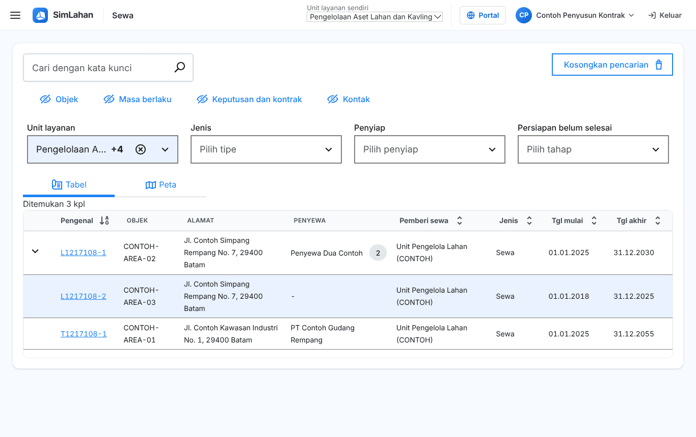
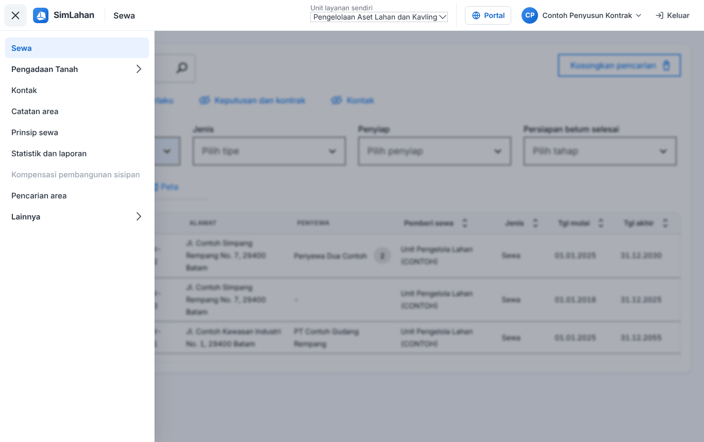

# Buku peran: Penyusun Kontrak

Buku ini untuk **Penyusun Kontrak**: petugas yang menyusun kontrak sewa, perubahan kontrak, dan jaminan. Baca dulu [Bab 1](../01-mengenal-simlahan.md) dan [Bab 2](../02-dasar-penggunaan.md) bila baru pertama kali memakai SimLahan.

## Masuk

Buka alamat SimLahan, isi nama pengguna dan kata sandi, lalu klik **Masuk** ([Bab 2.2](../02-dasar-penggunaan.md#a-aplikasi-utama-petugas-kantor)).

<!-- awal: dibuat dari backend/users/role_guide.py; perbarui dengan: cd backend && python manage.py panduan_buku -->

## Ringkasan peran

Menyusun kontrak sewa dan perubahannya.

- **Cara masuk:** Alamat utama SimLahan (`/`), dengan nama pengguna dan sandi.
- **Halaman awal:** Sewa (daftar sewa).
- **Akun latihan** (hanya di sistem latihan berisi data contoh): `contoh.kontrak`

### Menu yang Anda lihat

- Sewa
- Pengadaan Tanah: Dasbor & tenggat, Proyek pengadaan, Kalender & aturan tenggat
- Kontak
- Catatan area
- Prinsip sewa
- Statistik dan laporan
- Kompensasi pembangunan sisipan
- Pencarian area
- Lainnya: Indeks biaya hidup, Tugas terjadwal, Catatan tagihan

### Yang bisa Anda lakukan

- Membuat dan mengubah kontrak, perubahan kontrak, jaminan, subsidi pengelolaan dan sementara, serta penyesuaian sewa.
- Membuat laporan sewa (laporan tagihan tidak termasuk).
- Membaca seluruh data sewa dan pengadaan (data pribadi tersamar).

### Batas akses

- Tidak membuat sewa atau penyewa baru dan tidak mengelola tagihan.
- Tidak bisa membuka panel admin, alokasi lahan, manajemen aset lahan, pusat komando, atau aplikasi lapangan.

<!-- akhir: blok role_guide.py -->

## Pekerjaan sehari-hari

### 1. Mencari dan membuka data sewa

1. Halaman awal Anda adalah daftar **Sewa** ([Bab 3.1](../10-sewa.md#31-daftar-sewa)).
2. Ketik pengenal sewa, nama penyewa, atau alamat di kotak cari, lalu tekan Enter. Gunakan saringan bila hasilnya banyak.
3. Klik baris sewa untuk membuka halamannya, lalu pindah antar-tab ([Bab 3.3](../10-sewa.md#33-halaman-data-sewa)).

### 2. Mencatat kontrak

1. Buka sewa, tab **Keputusan dan kontrak**, klik **Ubah** ([Bab 3.3](../10-sewa.md#isi-setiap-tab)).
2. Tambah kontrak (nomor, tanggal tanda tangan, pihak), perubahan kontrak, dan jaminan bila ada.
3. Klik **Simpan**.

### 3. Menyalin area ke kontrak

1. Di tab **Area sewa**, gunakan **Salin ke kontrak** agar data area masuk ke kontrak ([Bab 3.3](../10-sewa.md#isi-setiap-tab)).

## Bab yang perlu dibaca

- [Bab 1 – Mengenal SimLahan](../01-mengenal-simlahan.md)
- [Bab 2 – Dasar penggunaan](../02-dasar-penggunaan.md)
- [Bab 3 – Sewa lahan](../10-sewa.md)
- [Bab 4 – Pengadaan tanah](../11-pengadaan-tanah.md)

## Bila ada kendala

- Menu atau tombol tidak ada: peran Anda memang tidak memerlukannya ([Bab 2.10](../02-dasar-penggunaan.md#210-batas-akses-dan-pesan-tidak-berhak)). Hubungi Administrator bila Anda memerlukannya untuk pekerjaan.
- Lupa kata sandi: hubungi Administrator atau superuser untuk menyetel ulang sandi.
- Ringkasan peran yang sama bisa dibuka di dalam aplikasi lewat **Panduan peran** (`/akun/panduan/`).
