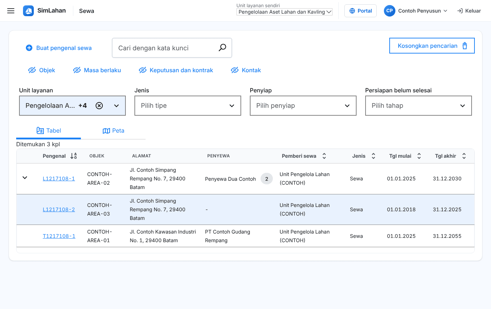
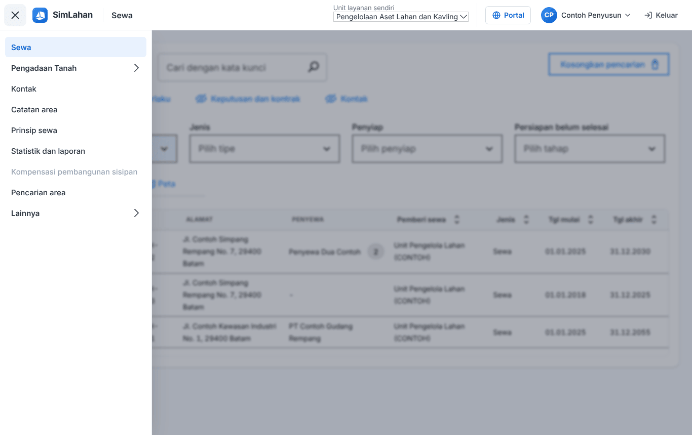
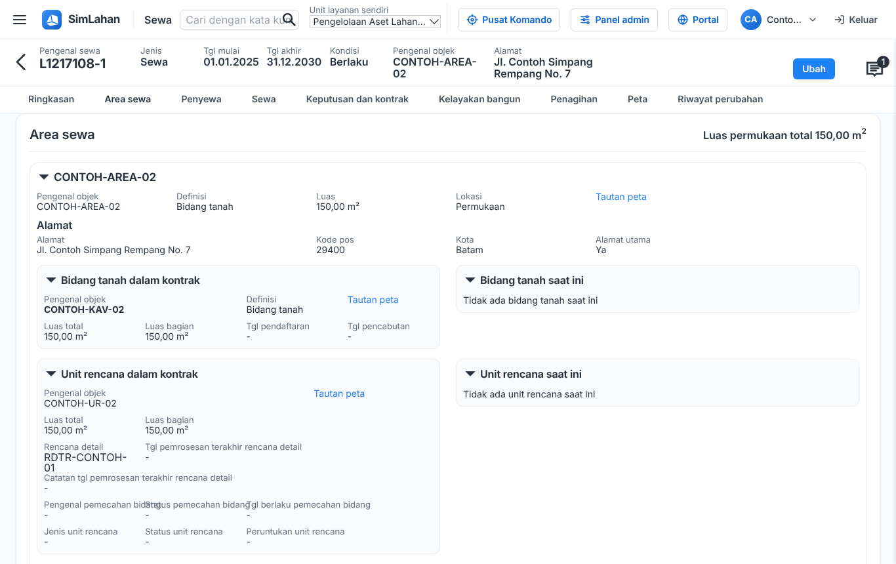
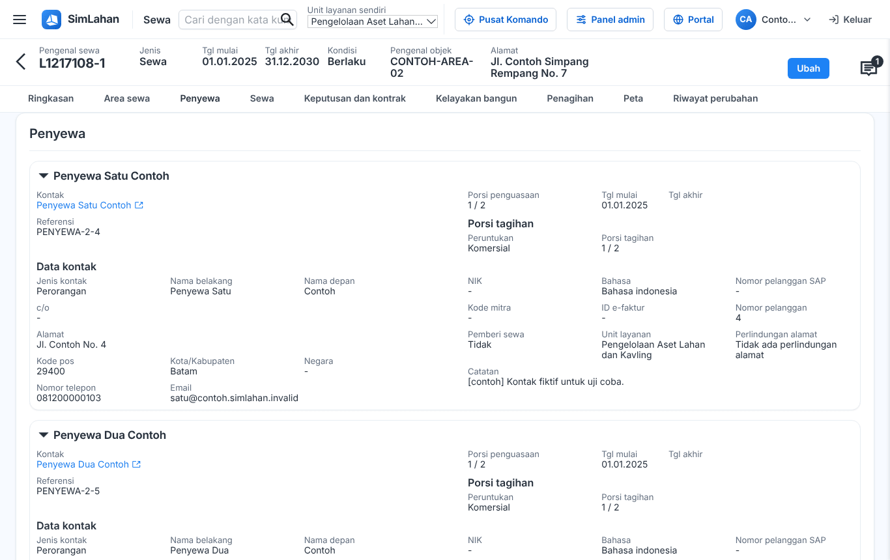

# Buku peran: Penyusun

Buku ini untuk **Penyusun**: petugas yang menyiapkan data sewa: sewa baru, penyewa, area, inspeksi, kontak, dan catatan area. Baca dulu [Bab 1](../01-mengenal-simlahan.md) dan [Bab 2](../02-dasar-penggunaan.md) bila baru pertama kali memakai SimLahan.

## Masuk

Buka alamat SimLahan, isi nama pengguna dan kata sandi, lalu klik **Masuk** ([Bab 2.2](../02-dasar-penggunaan.md#a-aplikasi-utama-petugas-kantor)).

<!-- awal: dibuat dari backend/users/role_guide.py; perbarui dengan: cd backend && python manage.py panduan_buku -->

## Ringkasan peran

Menyiapkan sewa: data sewa, penyewa, area, dasar sewa, dan inspeksi.

- **Cara masuk:** Alamat utama SimLahan (`/`), dengan nama pengguna dan sandi.
- **Halaman awal:** Sewa (daftar sewa).
- **Akun latihan** (hanya di sistem latihan berisi data contoh): `contoh.penyusun`

### Menu yang Anda lihat

- Sewa
- Pengadaan Tanah: Dasbor & tenggat, Proyek pengadaan, Kalender & aturan tenggat
- Kontak
- Catatan area
- Prinsip sewa
- Statistik dan laporan
- Kompensasi pembangunan sisipan
- Pencarian area
- Lainnya: Indeks biaya hidup, Tugas terjadwal, Catatan tagihan, Kalkulator sewa

### Yang bisa Anda lakukan

- Membuat dan mengubah sewa, penyewa dan bagian sewanya, area sewa beserta alamat dan lampiran, dasar sewa dan subsidi, penyesuaian sewa, inspeksi, kontak, catatan area, dan komentar.
- Mengelola kompensasi pembangunan sisipan.
- Membuat laporan sewa dan tagihan di Statistik dan laporan.
- Mengelola pencarian kavling/area dan formulirnya.
- Melihat pengadaan tanah (data pribadi tersamar).

### Batas akses

- Tidak mengubah kontrak, jaminan, keputusan, tagihan, atau pembayaran.
- Tidak bisa membuka panel admin, alokasi lahan, manajemen aset lahan, pusat komando, atau aplikasi lapangan.

<!-- akhir: blok role_guide.py -->

## Pekerjaan sehari-hari

### 1. Mencari dan membuka data sewa

1. Halaman awal Anda adalah daftar **Sewa** ([Bab 3.1](../10-sewa.md#31-daftar-sewa)).
2. Ketik pengenal sewa, nama penyewa, atau alamat di kotak cari, lalu tekan Enter. Gunakan saringan bila hasilnya banyak.
3. Klik baris sewa untuk membuka halamannya, lalu pindah antar-tab ([Bab 3.3](../10-sewa.md#33-halaman-data-sewa)).

### 2. Membuat sewa baru

1. Di daftar sewa, klik **Buat pengenal sewa** ([Bab 3.2](../10-sewa.md#32-membuat-sewa-baru)).
2. Isi jenis, kota, unit layanan, dan data lain yang diminta, lalu simpan.
3. Lengkapi tab **Ringkasan**, **Area sewa**, dan **Penyewa**.

### 3. Mengubah data sewa

1. Buka tab yang akan diubah, klik **Ubah**, ubah isian, lalu klik **Simpan** ([Bab 3.3](../10-sewa.md#mengubah-data-sewa)).
2. Kolom bertanda **\*** wajib diisi. Klik **Batalkan perubahan** bila tidak jadi.

### 4. Mengelola kontak dan catatan area

1. Tambah atau ubah penyewa di menu **Kontak** ([Bab 3.5](../10-sewa.md#35-kontak)).
2. Catat informasi area di **Catatan area** ([Bab 3.6](../10-sewa.md#36-catatan-area)).

### 5. Mencatat inspeksi

1. Buka tab **Keputusan dan kontrak** → **Pemeriksaan dan catatan**, klik **Ubah**, tambah inspeksi, lalu simpan ([Bab 3.3](../10-sewa.md#isi-setiap-tab)).

## Bab yang perlu dibaca

- [Bab 1 – Mengenal SimLahan](../01-mengenal-simlahan.md)
- [Bab 2 – Dasar penggunaan](../02-dasar-penggunaan.md)
- [Bab 3 – Sewa lahan](../10-sewa.md)
- [Bab 4 – Pengadaan tanah](../11-pengadaan-tanah.md)

## Bila ada kendala

- Menu atau tombol tidak ada: peran Anda memang tidak memerlukannya ([Bab 2.10](../02-dasar-penggunaan.md#210-batas-akses-dan-pesan-tidak-berhak)). Hubungi Administrator bila Anda memerlukannya untuk pekerjaan.
- Lupa kata sandi: hubungi Administrator atau superuser untuk menyetel ulang sandi.
- Ringkasan peran yang sama bisa dibuka di dalam aplikasi lewat **Panduan peran** (`/akun/panduan/`).
