# Buku peran: Petugas Alokasi Lahan

Buku ini untuk **Petugas Alokasi Lahan**: petugas yang memproses permohonan alokasi, tagihan, dokumen terbit, permintaan investasi, dan dokumen perizinan. Buku ini berisi semua langkah kerja peran Anda, lengkap dengan gambar, sehingga cukup dibaca sendiri. Dasar penggunaan yang berlaku untuk semua peran (mengenal layar, ganti sandi, memakai di HP) ada di [Bab 2](../02-dasar-penggunaan.md).

**Cara membaca buku ini.** Kotak merah bernomor pada gambar menunjuk tombol atau kolom yang disebut di langkah. Tulisan *(nomor 2)* berarti: lihat kotak merah bernomor 2 pada gambar tepat di atas langkah itu. Semua gambar memakai data contoh fiktif; isi di layar Anda berbeda, tetapi letak tombolnya sama. Judul bagian bernomor (misalnya *3.4*) sama dengan nomor bagian di buku lengkap.

## Masuk dan halaman awal

<!-- sisip: 02-dasar-penggunaan.md#b-panel-admin -->

### B. Panel admin


1. Buka alamat SimLahan diikuti `/admin/`, misalnya `https://simlahan.instansi-anda.go.id/admin/`.
2. Isi **Nama pengguna** (nomor 1) dan **Sandi** (nomor 2).
3. Klik **Masuk** (nomor 3).

Bila Anda sudah masuk di aplikasi utama, panel admin langsung terbuka tanpa masuk ulang.

<!-- akhir sisip -->

### Halaman awal

Setelah masuk, Anda langsung melihat daftar **Permohonan** alokasi di panel admin:

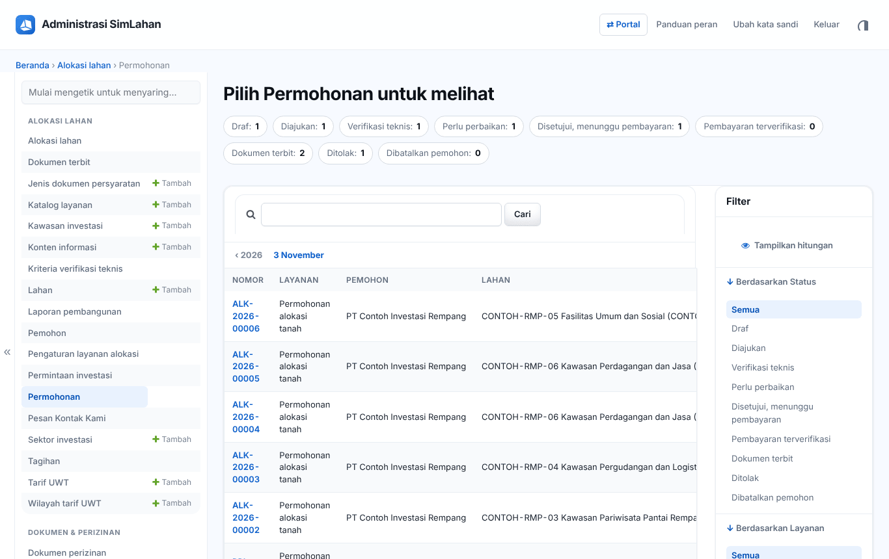

Nomor pada gambar:

1. **Saring menu**: ketik sebagian nama menu (misalnya *tagihan*) untuk menemukannya cepat di menu samping.
2. **Kotak cari**: ketik nomor permohonan atau nama pemohon, lalu klik **Cari**.
3. **Filter**: saring daftar berdasarkan status atau layanan. Deretan angka di atas tabel (Draf, Diajukan, Verifikasi teknis, dan seterusnya) adalah jumlah permohonan per status.
4. **Nomor permohonan** (misalnya *ALK-2026-00006*): klik untuk membuka permohonan.
5. **Panduan peran**: ringkasan peran Anda.
6. **Keluar**: mengakhiri sesi di semua aplikasi petugas pada perangkat ini.

### Beranda panel admin

Klik **Administrasi SimLahan** di kiri atas untuk membuka beranda panel admin. Isinya kotak per modul yang boleh Anda buka:

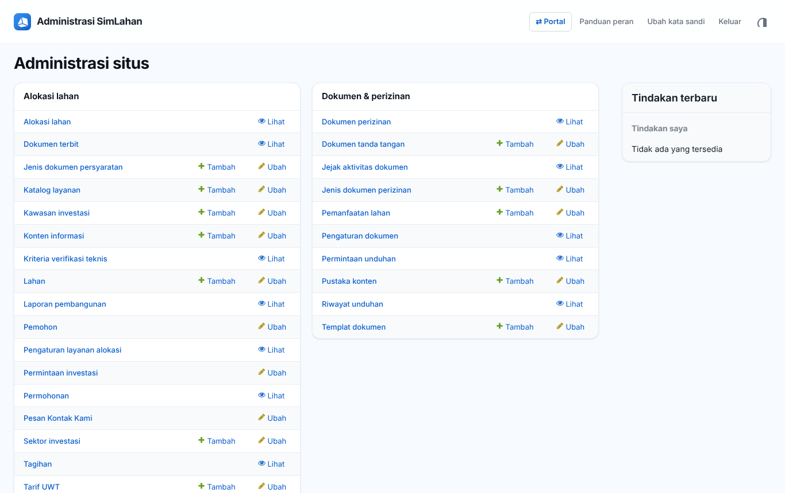

Anda melihat modul **Alokasi lahan** dan **Dokumen & perizinan**. Tautan **Lihat** hanya membaca; **Ubah** dan **Tambah** berarti Anda boleh mengubah atau menambah data itu. Cara memakai halaman daftar dan formulir panel admin dijelaskan di [Bab 2.4](../02-dasar-penggunaan.md#24-mengenal-layar-panel-admin).

<!-- awal: dibuat dari backend/users/role_guide.py; perbarui dengan: cd backend && python manage.py panduan_buku -->

## Ringkasan peran

Memproses permohonan alokasi lahan dari portal sampai terbit.

- **Cara masuk:** Alamat utama SimLahan (`/`) atau langsung di panel admin (`/admin/`); satu kali masuk berlaku untuk keduanya.
- **Halaman awal:** Panel admin → Permohonan alokasi.
- **Akun latihan** (hanya di sistem latihan berisi data contoh): `contoh.alokasi`

### Menu yang Anda lihat

- Panel admin, Alokasi lahan: Permohonan, Tagihan, Alokasi, Data lahan (termasuk impor peta dan profil investasi), Pemohon, Laporan pembangunan, konten portal, Wilayah & tarif UWT, Pesan Kontak Kami
- Panel admin, Alokasi lahan: Permintaan investasi, Sektor investasi, Kawasan investasi
- Panel admin, Dokumen & Perizinan: Dasbor dokumen, Pemanfaatan lahan, Dokumen perizinan, Dokumen tanda tangan, Templat dokumen, Permintaan unduh, Jenis dokumen, Riwayat unduhan

### Yang bisa Anda lakukan

- Memeriksa kelengkapan, meminta perbaikan, menyetujui/menolak permohonan, memverifikasi pembayaran, dan mencabut alokasi.
- Memproses permintaan investasi: tinjau, jadwalkan konsultasi, kirim penawaran sewa/alokasi/kerja sama, balas pesan investor, lalu selesaikan (kontrak atau draf permohonan alokasi) atau tolak.
- Mengelola data lahan (termasuk tarif sewa, sektor, kawasan, insentif) dan konten portal.
- Mencatat pemanfaatan lahan, menentukan dokumen perizinan wajib, mengunggah/mengimpor templat (Word, PDF, HTML), memverifikasi atau meminta revisi dokumen, dan mengirim dokumen untuk ditandatangani (berurutan, OTP surel, sertifikat & kode QR verifikasi).
- Dokumen tanda tangan: kolom isian penerima (`{{ kolom.<kunci> }}`: teks, tanggal, angka, centang, pilihan, paraf, lampiran), kode akses tambahan, tanda tangan langsung di hadapan petugas (bukti identitas tercatat), ganti penerima yang belum bertindak, cap tanda tangan pada posisi PDF, dan kirim massal dari daftar Pemanfaatan lahan (aksi **Kirim dokumen tanda tangan massal**).
- Memblokir dan membuka blokir penetapan lokasi alokasi; mengelola tarif UWT per wilayah (simulasi di portal) dan menjawab pesan Kontak Kami.
- Menyetujui atau menolak permintaan unduh dokumen biasa.
- Menerima ringkasan pemantauan mingguan lewat surel.

### Batas akses

- Tidak membuka modul sewa, pengadaan, aset lahan, atau pusat komando.
- Tidak menyetujui unduhan dokumen rahasia, tidak menyetujui permintaan unduh miliknya sendiri, dan tidak mengubah pengaturan modul dokumen.
- Tidak bisa membuka data akun pengguna.

<!-- akhir: blok role_guide.py -->

## Urutan kerja Anda

1. Proses permohonan baru: periksa kelengkapan, teruskan ke verifikasi teknis, lalu setujui atau tolak ([5.2 Memproses permohonan (Petugas Alokasi)](#52-memproses-permohonan-petugas-alokasi)).
2. Periksa bukti bayar dan nyatakan lunas; KPT dan PPT terbit otomatis ([5.4 Tagihan dan pembayaran](#54-tagihan-dan-pembayaran)).
3. Pantau alokasi, blokir/buka blokir penetapan lokasi, dan lahan tidur ([5.5 Alokasi & lahan tidur](#55-alokasi--lahan-tidur)); kelola data lahan ([5.6 Data lahan](#56-data-lahan)).
4. Proses permintaan investasi: balas pesan, jadwalkan konsultasi, kirim penawaran, dan selesaikan ([6.2 Halaman permintaan](#62-halaman-permintaan)).
5. Kelola dokumen perizinan: pemanfaatan lahan, pemeriksaan dokumen, dokumen tanda tangan, dan permintaan unduh ([7.1 Dasbor dokumen & perizinan](#71-dasbor-dokumen--perizinan)).
6. Perbarui konten portal, tarif UWT, dan balas **Pesan Kontak Kami** ([5.9 Konten portal dan data master](#59-konten-portal-dan-data-master)).

## Bagian A – Alokasi lahan

<!-- sisip: 20-alokasi-lahan.md#51-daftar-permohonan -->

### 5.1 Daftar permohonan

Halaman awal Petugas Alokasi dan Tim Verifikasi. Buka **Panel admin → Alokasi lahan → Permohonan**.


Nomor pada gambar:

1. **Jumlah per status**: banyaknya permohonan di setiap status. Klik salah satu, misalnya **Diajukan: 1**, untuk menampilkan permohonan berstatus itu saja.
2. **Kotak cari**: ketik nomor permohonan, nama pemohon, atau kode lahan, lalu klik **Cari**.
3. **Filter** di kanan: saring per **Status**, **Layanan**, atau **Jenis alokasi**. Bagi Tim Verifikasi ada juga filter **Berdasarkan penilaian saya** (sudah atau belum saya nilai).

Klik nomor permohonan (misalnya `ALK-2026-00003`) untuk membukanya.

<!-- akhir sisip -->

<!-- sisip: 20-alokasi-lahan.md#52-memproses-permohonan-petugas-alokasi -->

### 5.2 Memproses permohonan (Petugas Alokasi)

Halaman permohonan menampilkan status di bagian atas. Bila ada dokumen wajib yang belum diunggah, daftarnya tampil di kotak status dengan tulisan merah. Di bawahnya berturut-turut: data permohonan, data alokasi tanah (lahan, rencana kegiatan, nilai investasi, tenaga kerja, jangka waktu pembangunan), peralihan hak (khusus layanan peralihan), keputusan, dokumen persyaratan, nilai verifikasi teknis, tagihan, dokumen terbit, dan riwayat.

#### Langkah 1 – Periksa kelengkapan (status *Diajukan*)

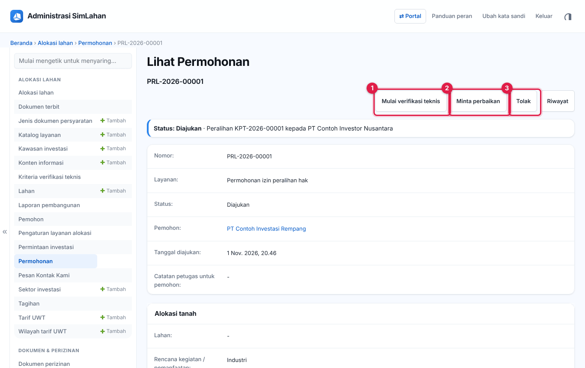

1. Di daftar permohonan, klik **Diajukan** di baris jumlah per status, lalu buka permohonannya.
2. Gulir ke bawah dan periksa data serta setiap **dokumen persyaratan**. Klik nama berkas untuk membukanya.
3. Gulir kembali ke atas dan klik salah satu tombol di kanan atas:
   - **Mulai verifikasi teknis** (nomor 1) bila data lengkap dan benar. Permohonan diteruskan ke Tim Verifikasi.
   - **Minta perbaikan** (nomor 2) bila ada data atau dokumen yang kurang atau salah. Pemohon menerima surel dan bisa memperbaikinya di portal.
   - **Tolak** (nomor 3) bila permohonan tidak dapat diproses. Lahan kembali tersedia dan alasan Anda dikirim ke pemohon.
4. Halaman konfirmasi terbuka. Contoh untuk **Mulai verifikasi teknis**:

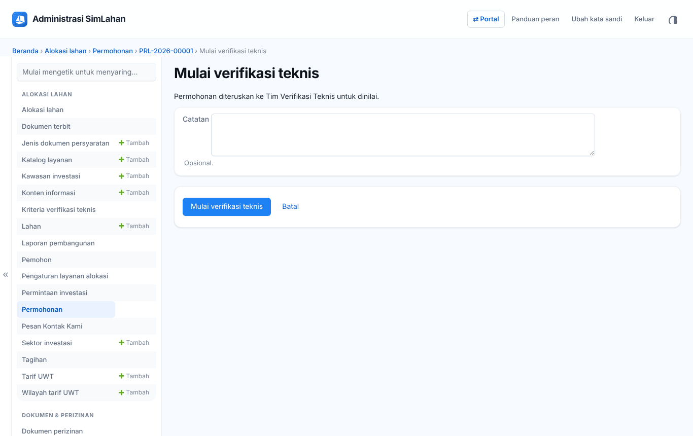

5. Tulis **Catatan** (nomor 1). Untuk **Mulai verifikasi teknis** dan **Setujui**, catatan boleh dikosongkan (tertulis "Opsional"). Untuk **Minta perbaikan** dan **Tolak**, catatan wajib diisi karena dikirim kepada pemohon sebagai alasan.
6. Klik tombol biru di bawahnya (nomor 2) untuk menegaskan. Klik **Batal** bila tidak jadi.

#### Langkah 2 – Verifikasi teknis (Tim Verifikasi)

Tim Verifikasi menilai permohonan (lihat 5.3). Petugas Alokasi menunggu sampai semua kriteria dinilai. Selama belum lengkap, kotak status menampilkan pesan "Nilai akhir belum lengkap" beserta jumlah kriteria yang sudah dinilai.

#### Langkah 3 – Putuskan (status *Verifikasi teknis*)

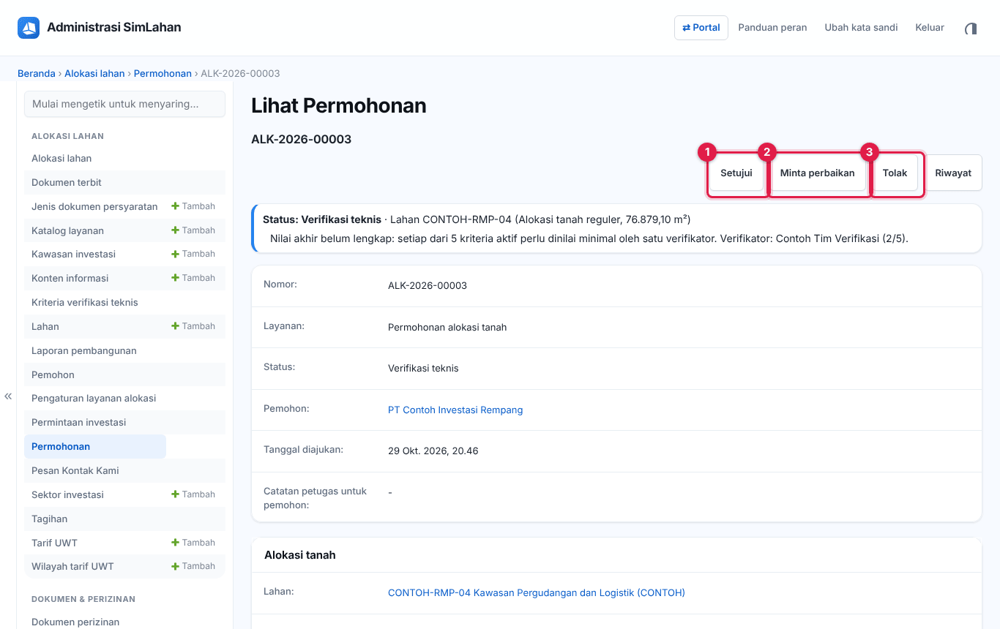

1. Buka permohonan berstatus **Verifikasi teknis**. Gulir ke bagian **Nilai verifikasi teknis** untuk melihat nilai per kriteria dan nilai akhir.
2. Klik salah satu tombol di kanan atas:
   - **Setujui** (nomor 1) bila nilai memenuhi syarat.
   - **Minta perbaikan** (nomor 2) bila pemohon harus melengkapi sesuatu.
   - **Tolak** (nomor 3) bila permohonan tidak layak.
3. Di halaman konfirmasi, isi **Catatan** (nomor 1) dan klik tombol biru (nomor 2).

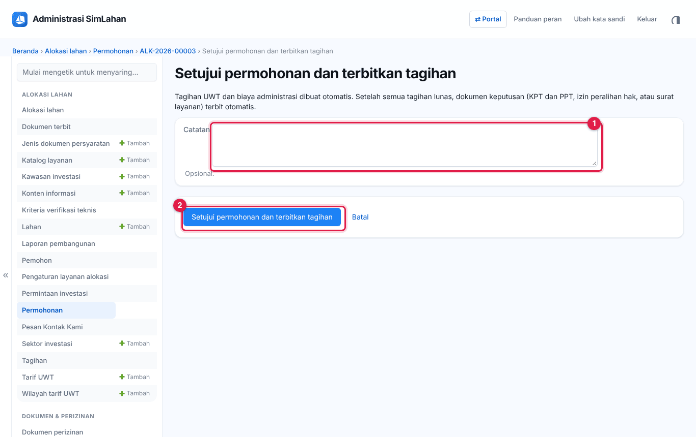

Saat Anda menyetujui, sistem otomatis membuat **tagihan UWT** dan **biaya administrasi**, lalu mengirimkannya kepada pemohon. Persetujuan ditolak sistem (muncul pesan merah) bila:

- belum semua kriteria verifikasi teknis dinilai;
- nilai akhir di bawah **nilai minimum** yang diatur di **Pengaturan layanan alokasi**;
- untuk peralihan hak: penerima hak belum menyetujui peralihan di portal.

Halaman konfirmasi **Minta perbaikan** terlihat seperti ini:

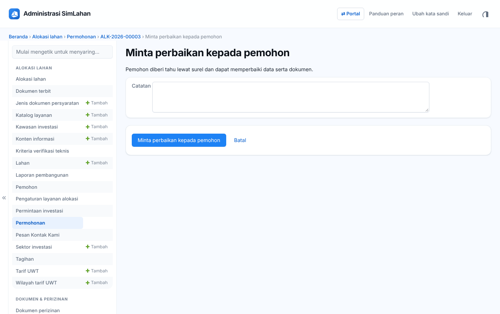

Kolom **Catatan** (nomor 1) wajib diisi dengan hal yang harus diperbaiki pemohon, lalu klik **Minta perbaikan kepada pemohon** (nomor 2).

#### Langkah 4 – Verifikasi pembayaran

Periksa bukti bayar pemohon (lihat 5.4). Setelah **semua tagihan lunas**, dokumen keputusan (KPT dan PPT, PL dengan sketsa bidang, izin peralihan hak, atau surat layanan) **terbit otomatis** lengkap dengan kode QR verifikasi. Pemohon langsung bisa mengunduhnya di portal.

<!-- akhir sisip -->

<!-- sisip: 20-alokasi-lahan.md#53-menilai-verifikasi-teknis-tim-verifikasi -->

### 5.3 Menilai verifikasi teknis (Tim Verifikasi)


1. Buka **Panel admin → Alokasi lahan → Permohonan**. Di filter kanan, klik **Verifikasi teknis** pada **Berdasarkan Status**, lalu **belum dinilai** pada **Berdasarkan penilaian saya**.
2. Klik nomor permohonan, lalu klik **Nilai verifikasi** (nomor 1) di kanan atas.
3. Halaman penilaian terbuka. Kotak paling atas berisi ringkasan lahan dan rencana usaha pemohon. Klik nama dokumen di baris **Dokumen** untuk membaca berkas pemohon.


4. Untuk setiap kriteria, isi nilai **0 sampai 100** di kotak sebelah nama kriteria (nomor 1). Bobot kriteria tertulis dalam kurung, misalnya "(bobot 25.00%)".
5. Tulis alasan penilaian di **Catatan** di bawahnya (nomor 2).
6. Ulangi untuk semua kriteria, lalu gulir ke bawah dan klik **Simpan nilai**.

Nilai akhir = rata-rata nilai semua verifikator untuk setiap kriteria, dikalikan bobotnya, lalu dijumlahkan. Selama permohonan masih berstatus *Verifikasi teknis*, Anda bisa membuka lagi halaman ini untuk memperbaiki nilai.

<!-- akhir sisip -->

<!-- sisip: 20-alokasi-lahan.md#54-tagihan-dan-pembayaran -->

### 5.4 Tagihan dan pembayaran

Buka **Panel admin → Alokasi lahan → Tagihan**.

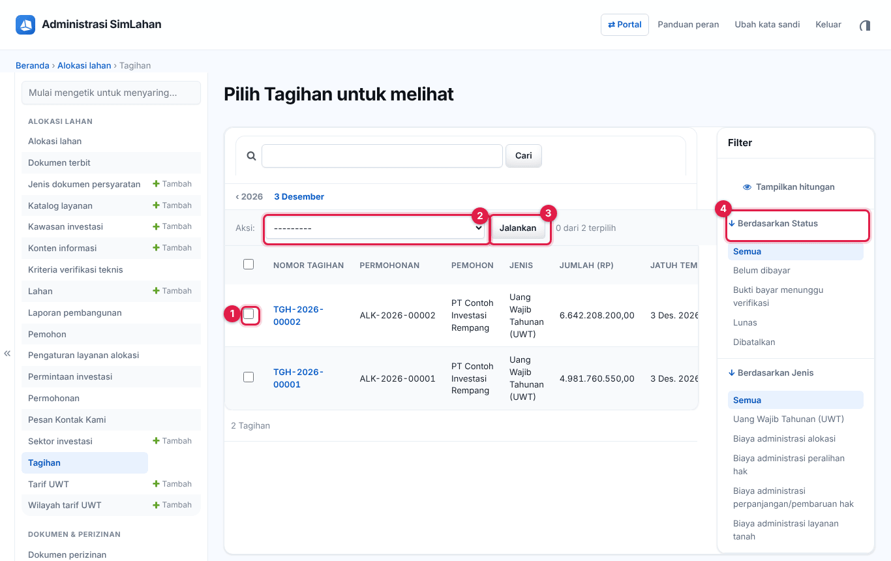

Di filter kanan (nomor 4), saring per **Status** (Belum dibayar, Bukti bayar menunggu verifikasi, Lunas, Dibatalkan) atau **Jenis** (UWT, biaya administrasi alokasi, biaya administrasi peralihan hak, dan lainnya).

**Memverifikasi satu tagihan**

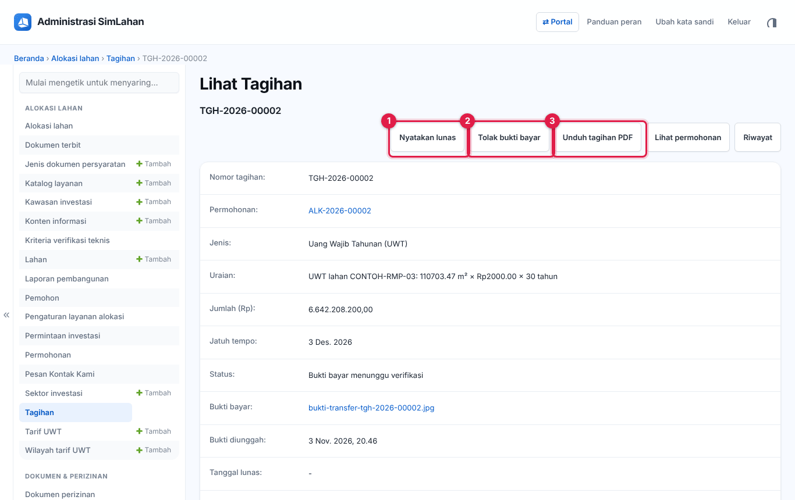

1. Di filter, klik **Bukti bayar menunggu verifikasi**, lalu klik nomor tagihan.
2. Klik nama berkas di baris **Bukti bayar** untuk membuka bukti transfer dari pemohon. Cocokkan jumlah dan tanggalnya dengan rekening penerimaan.
3. Bila sesuai, klik **Nyatakan lunas** (nomor 1). Di halaman konfirmasi, isi catatan bila perlu, lalu klik **Nyatakan lunas** sekali lagi.
4. Bila tidak sesuai, klik **Tolak bukti bayar** (nomor 2), tulis alasannya (wajib), lalu tegaskan. Pemohon diminta mengunggah ulang bukti bayar.
5. Klik **Unduh tagihan PDF** (nomor 3) bila perlu mencetak tagihan.

**Memverifikasi banyak tagihan sekaligus** (gambar daftar tagihan di atas):

1. Centang kotak di awal baris setiap tagihan yang buktinya sudah diperiksa (nomor 1).
2. Di **Aksi** (nomor 2), pilih **Verifikasi lunas (bukti bayar sudah diunggah)**.
3. Klik **Jalankan** (nomor 3).

<!-- akhir sisip -->

<!-- sisip: 20-alokasi-lahan.md#55-alokasi--lahan-tidur -->

### 5.5 Alokasi & lahan tidur

Buka **Panel admin → Alokasi lahan → Alokasi lahan**. Halaman ini berisi semua alokasi yang sudah terbit: nomor KPT, pemegang hak, lahan, masa berlaku, dan progres pembangunan.

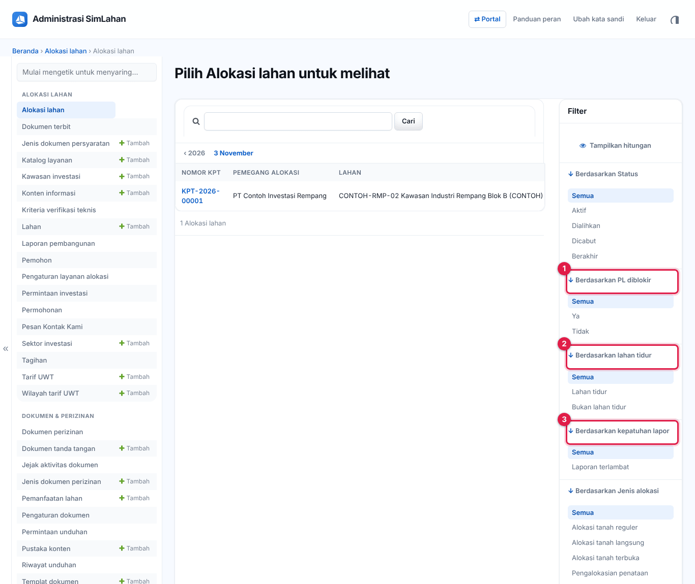

Filter penting di kanan:

- **Berdasarkan PL diblokir** (nomor 1): alokasi yang penetapan lokasinya sedang diblokir.
- **Berdasarkan lahan tidur** (nomor 2): alokasi aktif yang sudah lewat batas waktu (diatur di pengaturan) tetapi belum mulai konstruksi.
- **Berdasarkan kepatuhan lapor** (nomor 3): pemegang hak yang terlambat mengirim laporan progres pembangunan.

Klik nomor KPT untuk membuka alokasi.

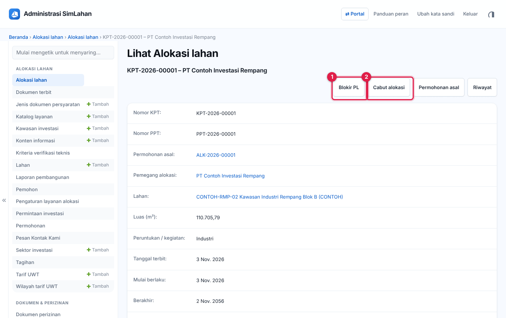

- **Blokir PL** (nomor 1): memblokir penetapan lokasi, misalnya karena sengketa. Selama diblokir, pemegang hak hanya bisa mengajukan layanan **pembukaan blokir**. Setelah diblokir, tombol ini berganti menjadi **Buka blokir PL**.
- **Cabut alokasi** (nomor 2): mencabut alokasi, misalnya karena lahan tidur atau pelanggaran. Lahan kembali tersedia untuk dimohon.
- **Permohonan asal**: membuka permohonan yang menghasilkan alokasi ini.

Kedua tindakan meminta konfirmasi. Contoh untuk **Blokir PL**:

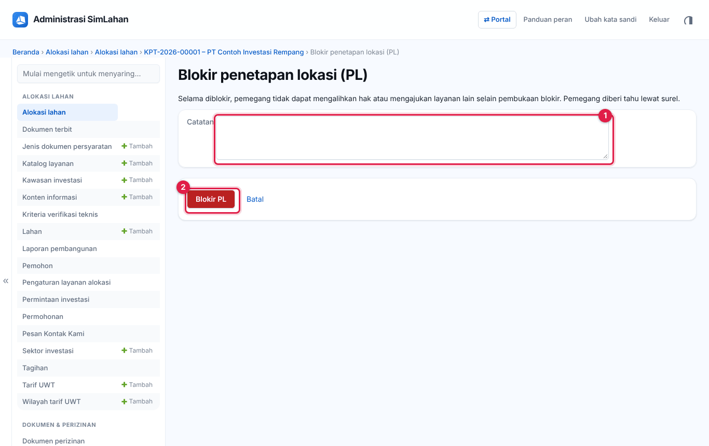

1. Tulis alasan di **Catatan** (nomor 1). Alasan ini dikirim lewat surel kepada pemegang hak.
2. Klik **Blokir PL** (nomor 2). Klik **Batal** bila tidak jadi.

Gulir ke bawah halaman alokasi untuk melihat **Dokumen terbit** (dokumen keputusan) dan **Progres pembangunan** (laporan dari pemegang hak).

Setiap Senin pukul 07.30 WIB sistem menjalankan **pemantauan mingguan**: alokasi yang berakhir, peringatan lahan tidur, laporan progres terlambat, dan tagihan yang segera atau sudah lewat jatuh tempo. Pengingat dikirim ke pemegang hak, dan ringkasannya ke surel petugas alokasi.

<!-- akhir sisip -->

<!-- sisip: 20-alokasi-lahan.md#56-data-lahan -->

### 5.6 Data lahan

Buka **Panel admin → Alokasi lahan → Lahan**. Di sini dikelola lahan yang tampil di peta portal dan dapat dimohon.

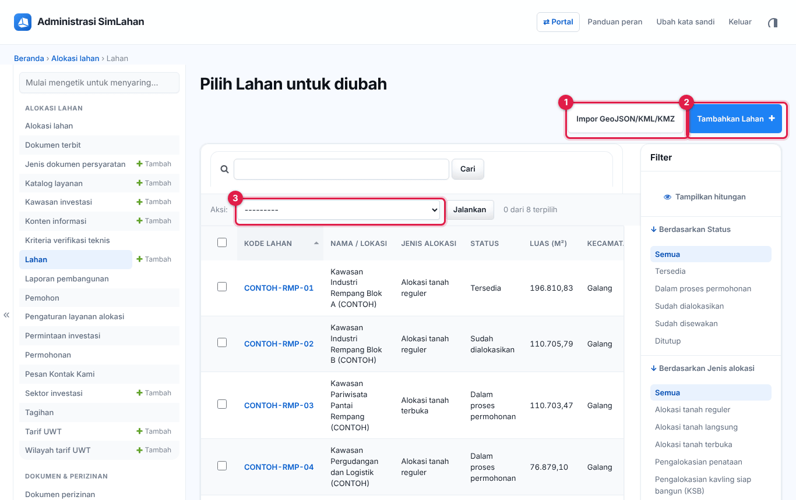

- **Impor GeoJSON/KML/KMZ** (nomor 1): menambah atau memperbarui banyak lahan sekaligus dari berkas peta.
- **Tambahkan Lahan** (nomor 2): menambah satu lahan.
- **Aksi** (nomor 3): centang lahan di tabel, pilih aksi, lalu klik **Jalankan**. Pilihannya: Tampilkan di portal, Sembunyikan dari portal, Tutup lahan (tidak menerima permohonan), Buka kembali lahan yang ditutup, Tandai sebagai lahan unggulan portal investasi, dan Akhiri sewa (lahan kembali tersedia).

#### Menambah atau mengubah lahan

Klik **Tambahkan Lahan**, atau klik kode lahan di tabel untuk mengubahnya.

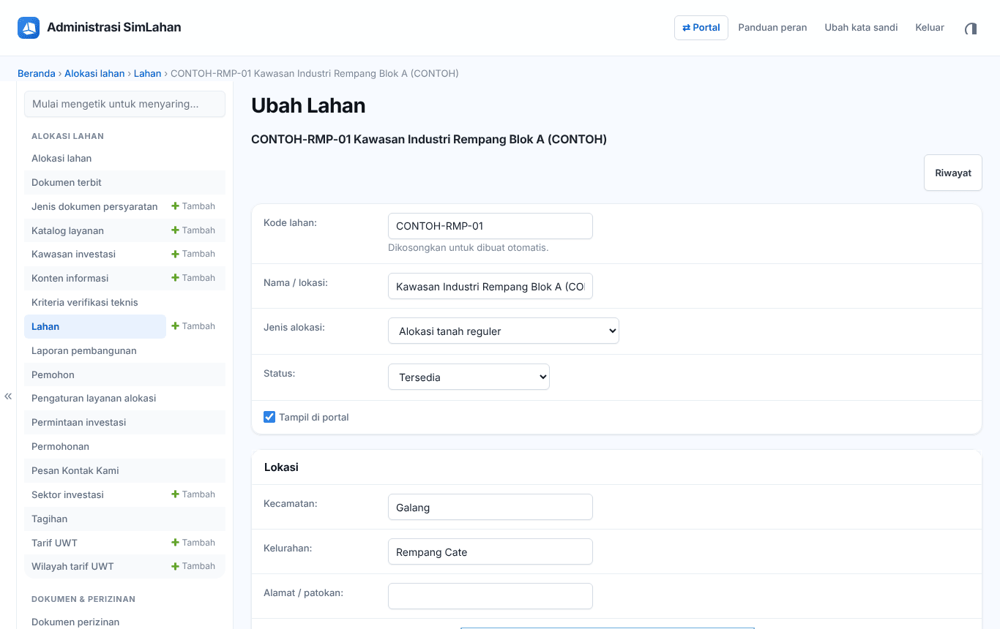

1. Isi **Kode lahan** (nomor 1). Kosongkan bila ingin dibuat otomatis.
2. Isi **Nama / lokasi** (nomor 2), misalnya "Kawasan Industri Blok A".
3. Pilih **Jenis alokasi** (nomor 3) dan **Status** (nomor 4): Tersedia, Dalam proses permohonan, Sudah dialokasikan, Sudah disewakan, atau Ditutup. Lahan baru biasanya **Tersedia**.
4. Centang **Tampil di portal** (nomor 5) agar lahan terlihat oleh masyarakat di peta portal.
5. Gulir ke bagian **Lokasi**: isi kecamatan, kelurahan, dan alamat, lalu gambar batas lahan di peta.
6. Bagian **Data teknis**: isi **Luas (m²)**, peruntukan (RTRW/RDTR), arahan pemanfaatan, kelengkapan dokumen teknis, infrastruktur, uraian, dan foto.
7. Bagian **Tarif**: isi tarif UWT per m² per tahun dan jangka waktu (tahun).
8. Bagian **Profil investasi** (untuk portal investasi): pilih sektor dan kawasan, centang **unggulan** bila perlu, pilih skema yang ditawarkan (alokasi dan/atau sewa) beserta tarif dan masa sewa, lalu isi keunggulan lokasi, insentif, utilitas yang tersedia, dan jarak ke pelabuhan, bandara, jalan, dan kota.
9. Klik **Simpan** di bagian paling bawah.

> Lahan yang sudah terikat permohonan, alokasi, atau sewa dikunci ukuran dan tarifnya, dan impor tidak menimpanya.

#### Mengimpor lahan dari berkas peta

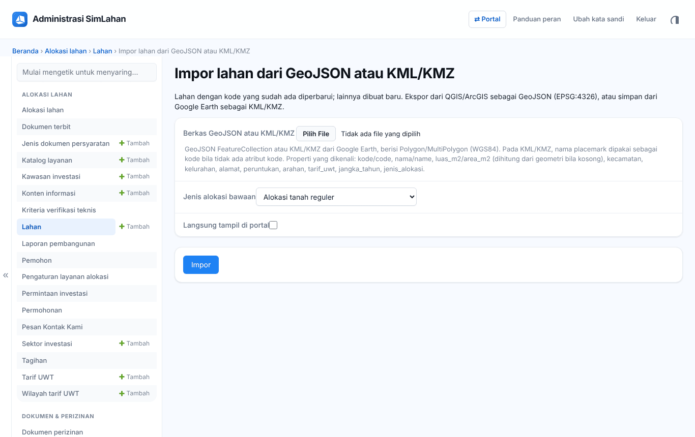

1. Di daftar lahan, klik **Impor GeoJSON/KML/KMZ**.
2. Klik **Pilih File** (nomor 1) dan pilih berkas peta: GeoJSON atau KML/KMZ (misalnya dari Google Earth) berisi poligon dalam koordinat WGS84.
   - Pada KML/KMZ, nama *placemark* dipakai sebagai kode lahan bila tidak ada atribut kode.
   - Impor ulang dengan kode yang sama memperbarui lahan itu, bukan menggandakannya.
   - Luas dihitung dari bentuk poligon bila tidak diisi di berkas.
3. Pilih **Jenis alokasi bawaan** (nomor 2) untuk lahan yang tidak menyebutkan jenisnya.
4. Centang **Langsung tampil di portal** (nomor 3) bila lahan boleh langsung dilihat masyarakat.
5. Klik **Impor** (nomor 4). Pesan "Impor selesai: … lahan baru, … diperbarui" menandakan berhasil.

<!-- akhir sisip -->

<!-- sisip: 20-alokasi-lahan.md#57-pemohon -->

### 5.7 Pemohon

Buka **Panel admin → Alokasi lahan → Pemohon**. Isinya daftar akun pemohon portal (badan usaha, instansi, perorangan, investor).

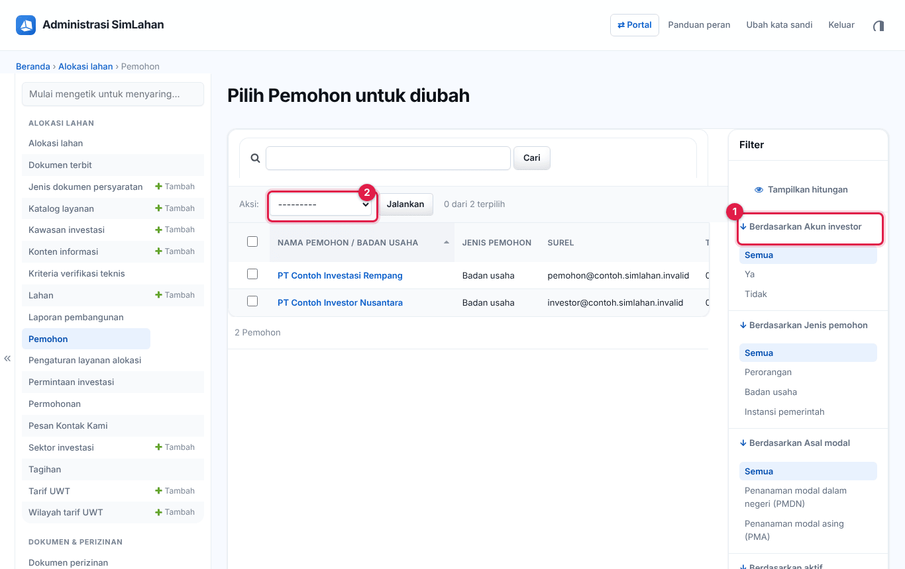

- **Filter** (nomor 1): saring per **Akun investor**, **Jenis pemohon**, **Asal modal**, atau **aktif**.
- **Aksi** (nomor 2): centang pemohon, pilih **Aktifkan akun** atau **Nonaktifkan akun**, lalu klik **Jalankan**. Pakai **Aktifkan akun** bila surel aktivasi tidak sampai ke pemohon.
- Klik nama pemohon untuk melihat profil, permohonan, dan permintaan investasinya.

<!-- akhir sisip -->

<!-- sisip: 20-alokasi-lahan.md#58-laporan-pembangunan-dan-dokumen-terbit -->

### 5.8 Laporan pembangunan dan dokumen terbit

- **Laporan pembangunan**: laporan progres yang dikirim pemegang hak dari portal (tahap, progres %, nilai investasi, tenaga kerja, foto/lampiran). Saring per **Tahap**.
- **Dokumen terbit**: semua KPT, PPT, PL, izin peralihan, dan surat layanan yang terbit, beserta PDF dan **halaman verifikasi** QR-nya. Dokumen yang diganti (karena layanan revisi/pengganti) ditandai **Diganti pada**.

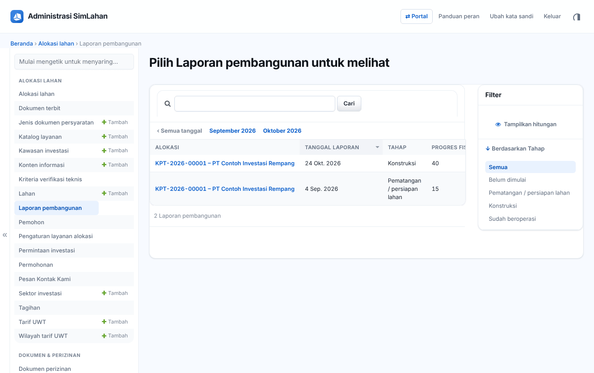

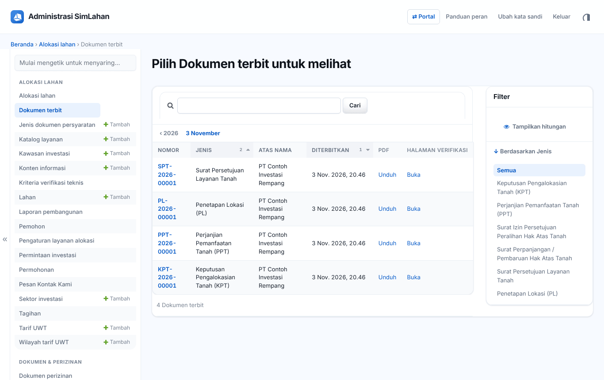

<!-- akhir sisip -->

<!-- sisip: 20-alokasi-lahan.md#59-konten-portal-dan-data-master -->

### 5.9 Konten portal dan data master

| Menu | Kegunaan |
|---|---|
| **Katalog layanan** | Daftar layanan yang tampil di portal (deskripsi, syarat, alur, durasi, tarif, dasar hukum) dan jenis permohonan daringnya. |
| **Jenis dokumen persyaratan** | Dokumen yang wajib/opsional diunggah per layanan dan jenis alokasi. |
| **Kriteria verifikasi teknis** | Kriteria dan bobot penilaian verifikasi teknis. |
| **Konten informasi** | Halaman informasi portal: regulasi, persyaratan, prosedur, pengumuman, video tutorial, buku panduan, unduhan, tanya jawab, panduan investasi. Centang **Sematkan di beranda** dan **Terbit**. |
| **Wilayah tarif UWT** dan **Tarif UWT** | Tarif UWT per wilayah dan jenis pengurusan, dipakai di **Simulasi biaya UWT** portal (termasuk denda per bulan keterlambatan dan batas maksimumnya). |
| **Pesan Kontak Kami** | Pesan yang dikirim masyarakat dari portal; ubah status setelah dijawab. |
| **Pengaturan layanan alokasi** *(Administrator)* | Otoritas & penandatangan, tarif & tagihan, ketentuan alokasi (nilai minimum, batas lahan tidur, interval lapor), kop surat, portal & Kontak Kami, simulasi UWT, portal investasi. |

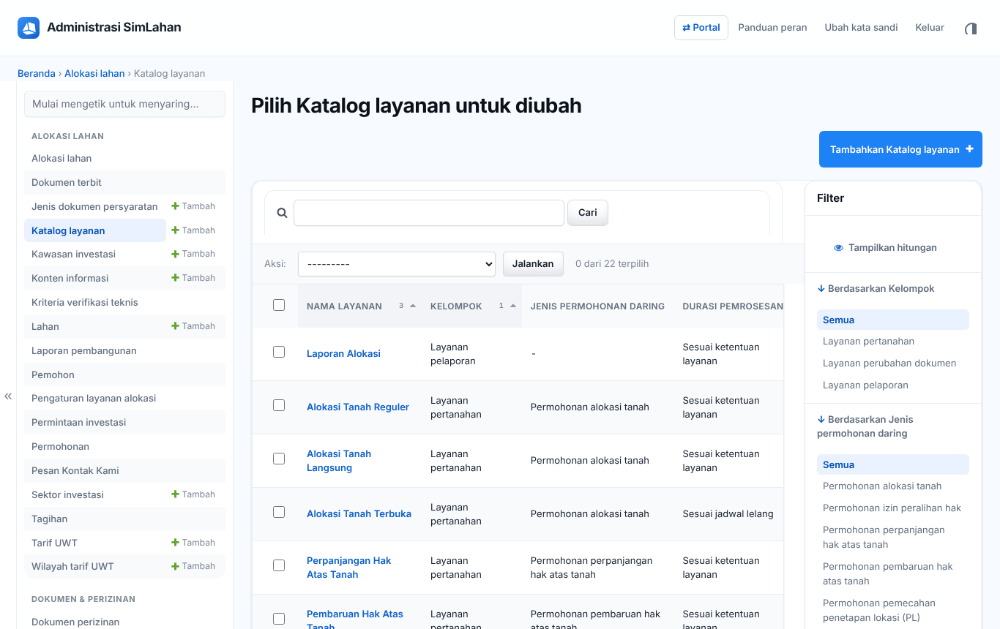

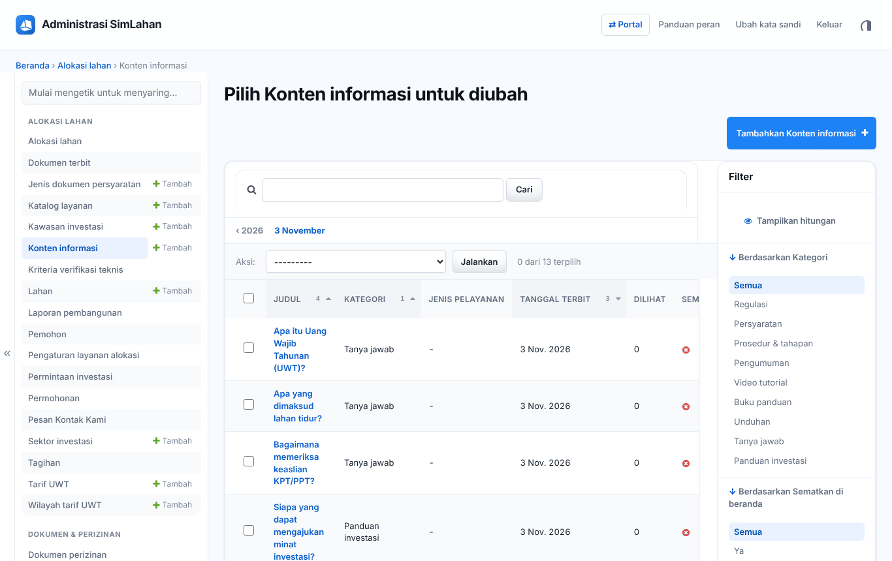

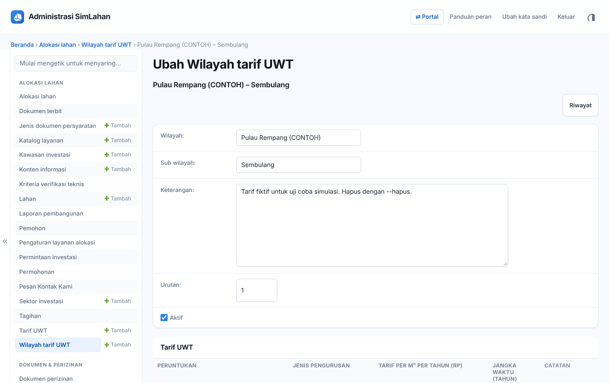

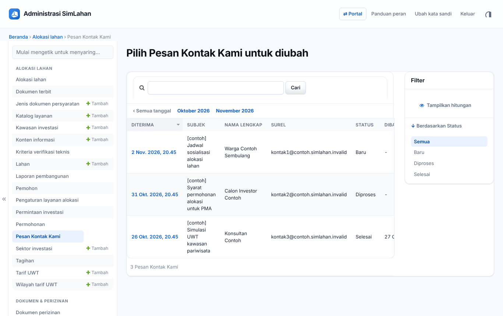

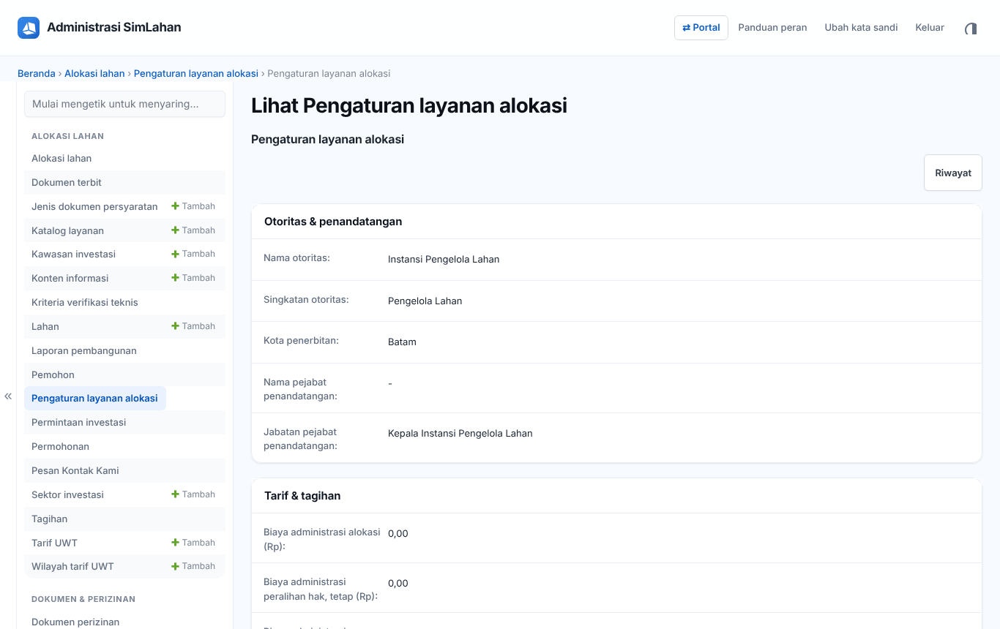

<!-- akhir sisip -->

<!-- sisip: 20-alokasi-lahan.md#510-pertanyaan-umum -->

### 5.10 Pertanyaan umum

**Tombol Setujui tidak muncul.** Permohonan belum berstatus *Verifikasi teknis*. Untuk permohonan *Diajukan*, klik **Mulai verifikasi teknis** dulu.

**Muncul pesan "Semua kriteria verifikasi teknis harus dinilai".** Minta Tim Verifikasi melengkapi nilai di halaman **Nilai verifikasi**.

**Dokumen keputusan belum terbit padahal sudah disetujui.** Dokumen terbit otomatis setelah **semua** tagihan berstatus **Lunas**. Periksa tagihan yang masih menunggu verifikasi.

**Pemohon tidak menerima surel aktivasi.** Aktifkan akunnya lewat **Pemohon → aksi Aktifkan akun**, dan minta pengelola memeriksa pengaturan surel (SMTP).

<!-- akhir sisip -->

## Bagian B – Permintaan investasi

<!-- sisip: 21-investasi-petugas.md#61-daftar-permintaan -->

### 6.1 Daftar permintaan

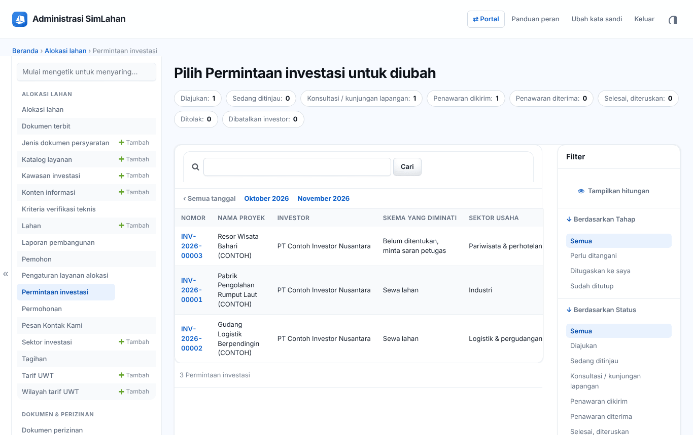

Saring per **Tahap**, **Status**, **Skema yang diminati** (sewa, alokasi/UWT, kerja sama, belum ditentukan), **Sektor usaha**, **Kawasan**, atau **Asal modal**. Klik nomor (misalnya `INV-2026-00003`) untuk membuka.

<!-- akhir sisip -->

<!-- sisip: 21-investasi-petugas.md#62-halaman-permintaan -->

### 6.2 Halaman permintaan

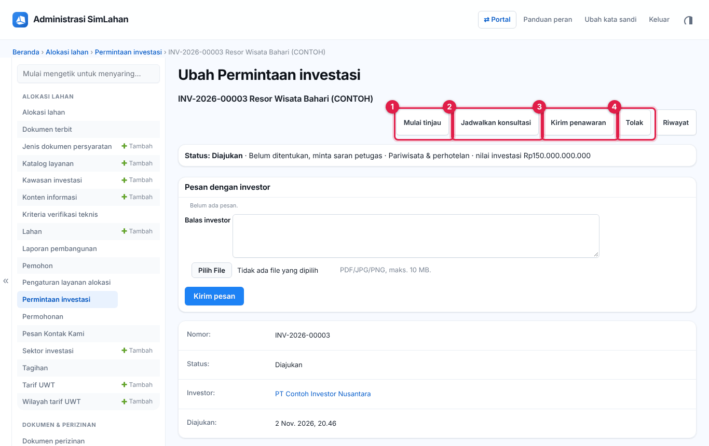

Isi halaman dari atas ke bawah:

- **Status** dan ringkasan (skema, sektor, nilai investasi).
- **Pesan dengan investor**: percakapan dua arah beserta lampiran (lihat 6.3).
- **Penanganan**: petugas penanggung jawab dan **catatan internal**. Catatan internal tidak terlihat oleh investor.
- **Rencana investasi**: nama proyek, kegiatan, nilai, tenaga kerja, jadwal.
- **Lokasi**: lahan yang dipilih investor, atau area yang digambar investor di peta.
- **Konsultasi**, **Penawaran**, **Penutupan**, dan **Riwayat status**.

Tombol tindakan di kanan atas muncul sesuai status:

- **Mulai tinjau** (nomor 1): menandai permintaan sedang ditinjau dan menjadikan Anda petugas penanggung jawab (bila belum ada). Investor diberi tahu lewat surel.
- **Jadwalkan konsultasi** (nomor 2): mengirim undangan konsultasi atau kunjungan lapangan (lihat 6.4).
- **Kirim penawaran** (nomor 3): mengirim penawaran sewa, alokasi, atau kerja sama (lihat 6.5). Bila sudah pernah dikirim, tombolnya bernama **Perbarui penawaran**.
- **Tolak** (nomor 4): menutup permintaan. Alasan wajib ditulis dan dikirim ke investor.

Setelah investor menerima penawaran, muncul tombol **Selesaikan** (lihat 6.6).

**Mengisi penanggung jawab dan catatan internal:** gulir ke bagian **Penanganan**, pilih petugas di **Petugas penanggung jawab**, tulis catatan di **Catatan internal petugas**, lalu klik **Simpan** di bagian bawah halaman.

<!-- akhir sisip -->

<!-- sisip: 21-investasi-petugas.md#63-membalas-pesan-investor -->

### 6.3 Membalas pesan investor

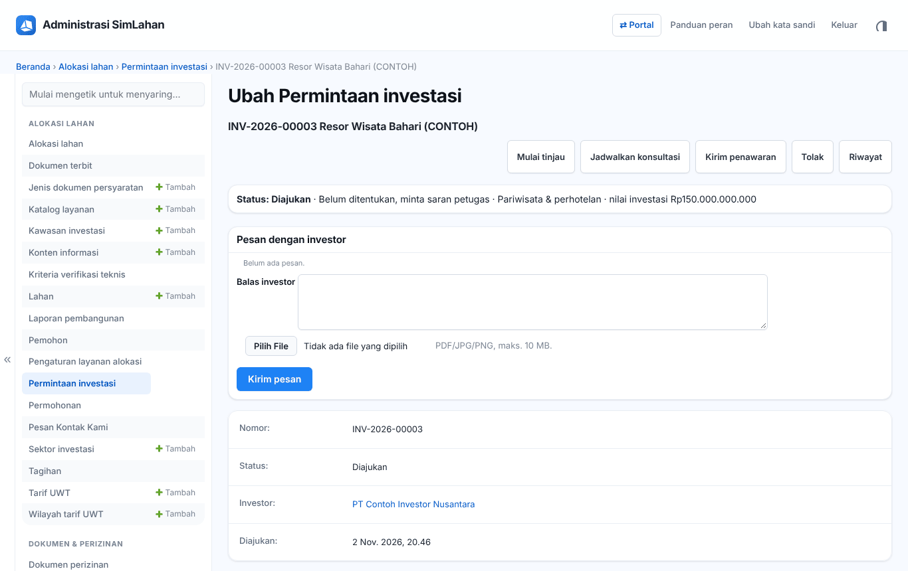

1. Gulir ke bagian **Pesan dengan investor**. Pesan lama tampil berurutan dari yang terlama.
2. Tulis balasan di kotak **Balas investor** (nomor 1).
3. Bila perlu, klik **Pilih File** (nomor 2) untuk melampirkan berkas PDF, JPG, atau PNG (maksimal 10 MB).
4. Klik **Kirim pesan** (nomor 3). Investor menerima pemberitahuan dan bisa membalas dari portal.

<!-- akhir sisip -->

<!-- sisip: 21-investasi-petugas.md#64-menjadwalkan-konsultasi -->

### 6.4 Menjadwalkan konsultasi

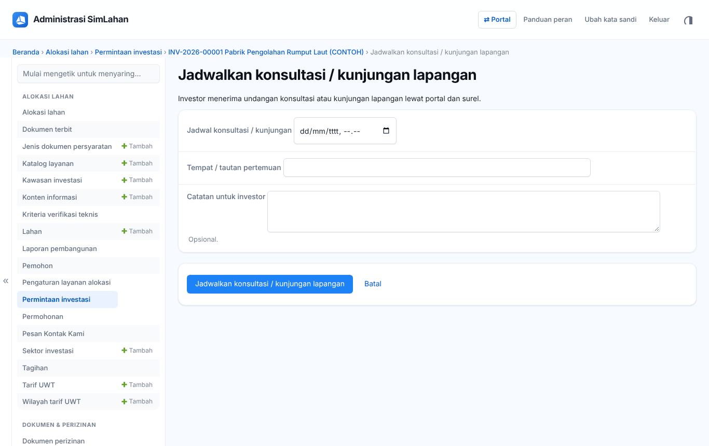

1. Klik **Jadwalkan konsultasi** di kanan atas halaman permintaan.
2. Isi **Jadwal konsultasi / kunjungan** (nomor 1): tanggal dan jam pertemuan.
3. Isi **Tempat / tautan pertemuan** (nomor 2): alamat kantor, titik kumpul kunjungan lapangan, atau tautan rapat daring.
4. Tulis **Catatan untuk investor** (nomor 3), misalnya dokumen yang perlu dibawa.
5. Klik **Jadwalkan konsultasi / kunjungan lapangan** (nomor 4). Investor menerima undangan di portal dan lewat surel.

<!-- akhir sisip -->

<!-- sisip: 21-investasi-petugas.md#65-mengirim-penawaran -->

### 6.5 Mengirim penawaran

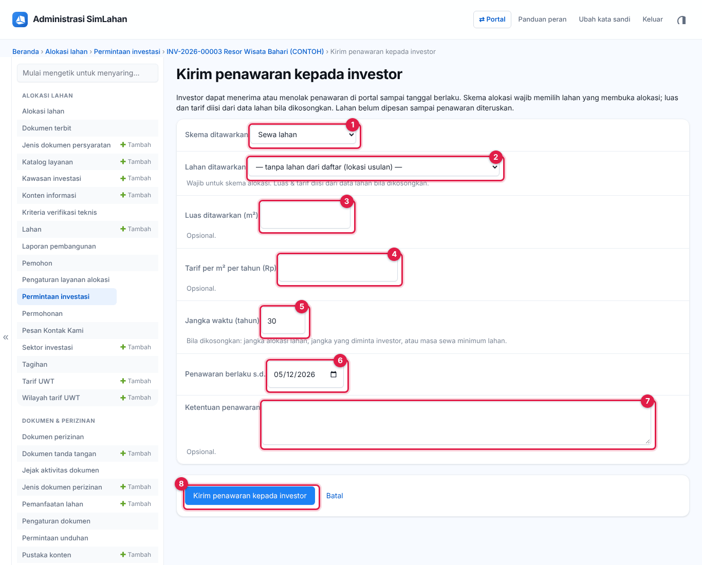

1. Klik **Kirim penawaran** di kanan atas halaman permintaan.
2. Pilih **Skema ditawarkan** (nomor 1): sewa lahan, alokasi lahan (UWT), atau kerja sama pemanfaatan.
3. Pilih **Lahan ditawarkan** (nomor 2). Skema alokasi wajib memakai lahan yang membuka skema alokasi. Pilih "tanpa lahan dari daftar" bila yang ditawarkan adalah lokasi usulan investor.
4. Isi **Luas ditawarkan (m²)** (nomor 3) dan **Tarif per m² per tahun (Rp)** (nomor 4). Bila dikosongkan, keduanya diambil dari data lahan.
5. Isi **Jangka waktu (tahun)** (nomor 5) dan **Penawaran berlaku s.d.** (nomor 6), yaitu batas waktu investor menjawab.
6. Tulis **Ketentuan penawaran** (nomor 7), misalnya syarat pembayaran dan kewajiban investor.
7. Klik **Kirim penawaran kepada investor** (nomor 8).

Investor dapat **menerima** atau **menolak** penawaran di portal sampai tanggal berlaku. Lahan belum dipesan sampai permintaan diselesaikan. Status permintaan kini **Penawaran dikirim**:

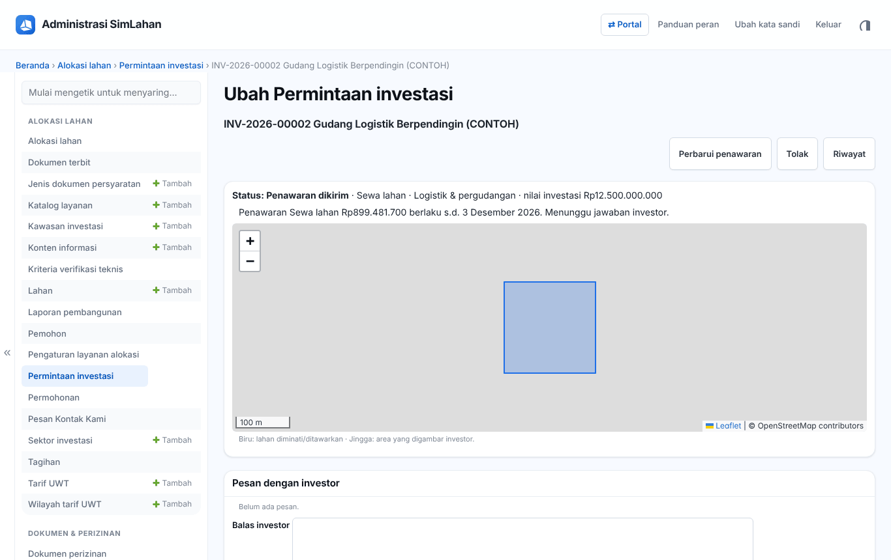

<!-- akhir sisip -->

<!-- sisip: 21-investasi-petugas.md#66-menyelesaikan-permintaan -->

### 6.6 Menyelesaikan permintaan

Hanya untuk penawaran yang sudah **diterima** investor.

1. Buka permintaan berstatus **Penawaran diterima**, lalu klik **Selesaikan** di kanan atas.
2. Bila skemanya **alokasi**: klik tombol penegasan. Sistem membuat **draf permohonan alokasi** atas nama investor dengan rencana usaha yang sudah terisi. Investor melengkapi dokumen lalu mengajukannya di portal; prosesnya berlanjut seperti [Bab 5](../20-alokasi-lahan.md).
3. Bila skemanya **sewa** atau **kerja sama**: isi **nomor kontrak** sewa atau perjanjian kerja sama, lalu klik tombol penegasan. Lahan yang ditawarkan ditandai **Sudah disewakan**.
4. Status menjadi **Selesai, diteruskan**. Investor dapat mengelola dokumen perizinan kontraknya di portal (lihat [Bab 15](../53-portal-dokumen.md)).

<!-- akhir sisip -->

<!-- sisip: 21-investasi-petugas.md#67-sektor-dan-kawasan-investasi -->

### 6.7 Sektor dan kawasan investasi

- **Sektor investasi**: daftar sektor (industri, pariwisata, logistik, dsb.) beserta ikon yang dipakai sebagai saringan di peta investasi.
- **Kawasan investasi**: kawasan yang ditampilkan di portal (deskripsi, insentif, infrastruktur, foto, sektor unggulan). Centang **Tampil di portal** dan **Unggulan** sesuai kebutuhan.

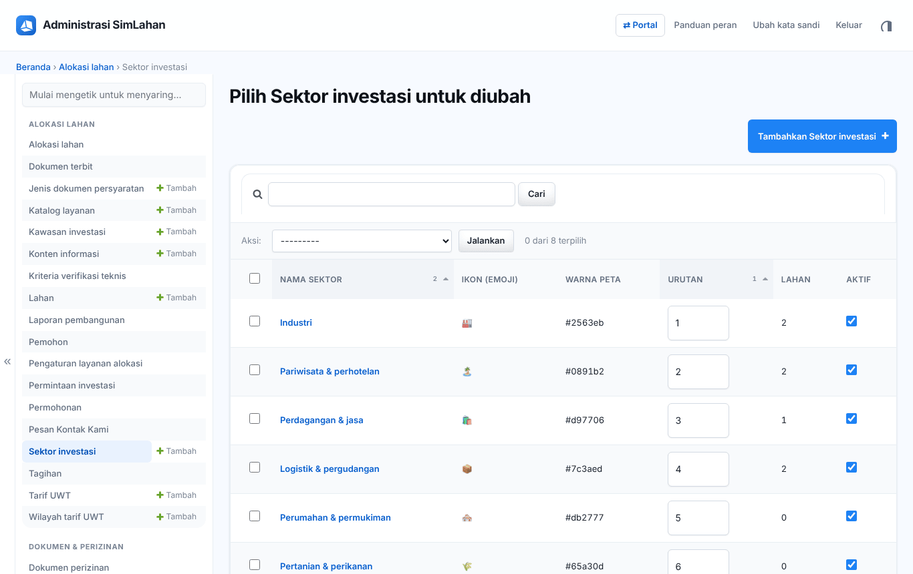

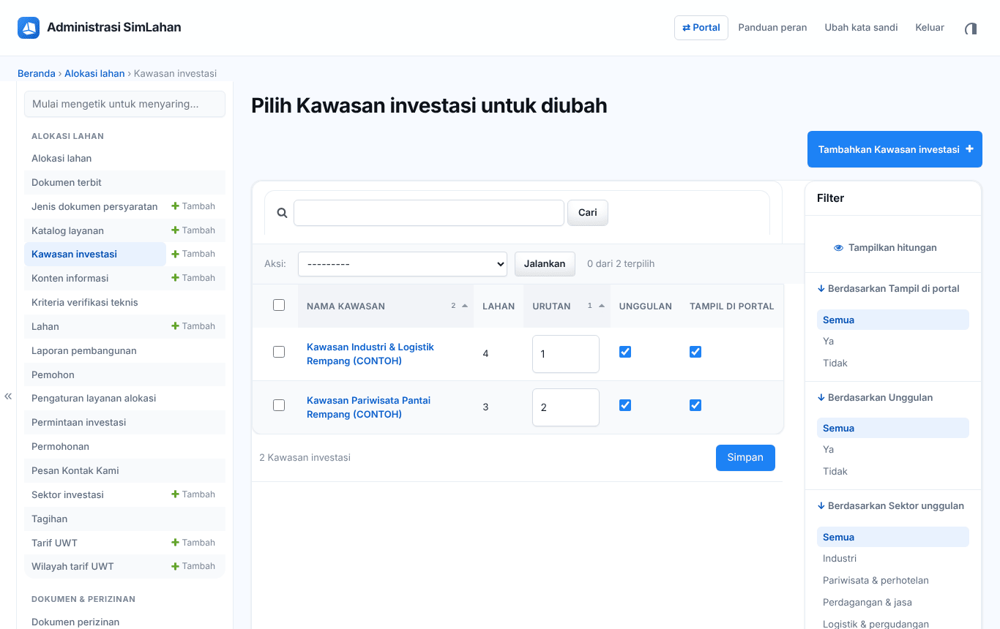

<!-- akhir sisip -->

<!-- sisip: 21-investasi-petugas.md#68-pertanyaan-umum -->

### 6.8 Pertanyaan umum

**Tombol Selesaikan tidak muncul.** Investor belum menerima penawaran. Tunggu jawaban investor atau perbarui penawarannya.

**Investor tidak melihat catatan saya.** Catatan di bagian **Penanganan** memang internal. Gunakan **Pesan dengan investor** untuk berkomunikasi.

<!-- akhir sisip -->

## Bagian C – Dokumen & perizinan

<!-- sisip: 22-dokumen-perizinan.md#71-dasbor-dokumen--perizinan -->

### 7.1 Dasbor dokumen & perizinan


Buka **Dokumen & perizinan → Dasbor dokumen & perizinan**. Baris tombol di atas (**Dasbor, Pemanfaatan lahan, Dokumen perizinan, Tanda tangan elektronik, Templat, Permintaan unduh, Jejak aktivitas**) adalah jalan pintas ke tiap daftar.

Kartu angka di atas:

- **Pemanfaatan lahan aktif**, **Dokumen wajib belum lengkap**, **Menunggu verifikasi**.
- **Izin habis ≤ 30 hari · ≤ 90 hari** dan **Izin kedaluwarsa**.
- **Menunggu tanda tangan** (beserta jumlah selesai bulan ini dan rata-rata hari penyelesaian).
- **Permintaan unduh menunggu keputusan Anda** dan **Unduhan 30 hari**.

Panel di bawahnya:

- **Dokumen perizinan per status**: Belum diurus, Sedang diurus, Menunggu verifikasi, Perlu perbaikan, Terverifikasi, Kedaluwarsa, Tidak wajib.
- **Antrean verifikasi**: dokumen yang sudah diunggah pemegang hak dan menunggu diperiksa. Klik judulnya untuk langsung memeriksa.
- **Izin segera habis (≤ 60 hari)**: tanggal merah berarti perlu segera diperpanjang.
- **Pemanfaatan aktif per skema**, **Dokumen tanda tangan per status**, dan **Aktivitas terbaru** (gulir ke bawah).

Gulir sedikit ke bawah untuk melihat panel-panel itu:


- **Antrean verifikasi** (nomor 1): klik judul dokumen untuk langsung memeriksanya (lihat 7.3).
- **Izin segera habis** (nomor 2): tanggal merah di kanan adalah tanggal izin berakhir. Hubungi pemegang hak agar segera memperpanjang.

<!-- akhir sisip -->

<!-- sisip: 22-dokumen-perizinan.md#72-pemanfaatan-lahan -->

### 7.2 Pemanfaatan lahan

Satu **pemanfaatan lahan** mewakili satu hak pakai lahan: alokasi, sewa, kerja sama, atau lainnya. Nomornya berformat `PML-2026-00001`. Pemanfaatan dari alokasi dan permintaan investasi dibuat otomatis oleh sistem; pemanfaatan lain bisa dibuat manual.


- **Tambahkan Pemanfaatan lahan** (nomor 1): membuat pemanfaatan lahan baru.
- **Filter** (nomor 2): saring per **Status** (Aktif, Berakhir, Dicabut), **Skema**, **Kelengkapan** dokumen, dan **Sektor**.
- **Aksi** (nomor 3): tindakan untuk baris yang dicentang, misalnya kirim dokumen tanda tangan massal (lihat di bawah).

#### Menambah pemanfaatan lahan

1. Di daftar **Pemanfaatan lahan**, klik **Tambahkan Pemanfaatan lahan** di kanan atas.
2. Isi **Nama kegiatan / proyek**, **Skema**, dan **Status**.
3. Isi pemegang hak: pilih **Pemegang hak (akun portal)** bila ia punya akun portal (ia lalu bisa melihat dan mengunggah dokumennya sendiri), atau isi **Nama pemegang hak** secara manual.
4. Isi **Lahan**, **Sektor**, **Nomor dasar hak / kontrak**, **Luas (m²)**, **Mulai**, **Berakhir**, dan **Petugas penanggung jawab**. Bila berasal dari alokasi atau permintaan investasi, isi juga kolom **Alokasi** atau **Permintaan investasi**.
5. Klik **Simpan**. Sistem otomatis membuat daftar **dokumen perizinan wajib** sesuai skema dan sektor (lihat 7.6).

#### Halaman pemanfaatan lahan

Klik nomor pemanfaatan di daftar untuk membukanya.


- **Kelengkapan dokumen wajib** (nomor 1): berapa dokumen wajib sudah terverifikasi, beserta jumlah yang menunggu verifikasi atau perlu perbaikan. Di bawahnya tampil dokumen tanda tangan milik pemanfaatan ini.
- **Tambah dokumen ke daftar** (nomor 2): menambah dokumen yang tidak otomatis masuk daftar, misalnya izin khusus.
- **Buat dokumen tanda tangan** (nomor 3): membuat dokumen tanda tangan dengan data pemanfaatan ini terisi otomatis (lihat 7.4).
- Tautan **Lihat alokasi** atau **Lihat permintaan investasi** muncul bila pemanfaatan berasal dari sana.

Gulir ke bawah sampai bagian **Dokumen perizinan**. Di sini tampil semua dokumen wajib beserta status, nomor izin, dan tanggal berlakunya. Klik nama dokumen untuk memeriksanya.


#### Kirim dokumen tanda tangan massal

Untuk mengirim dokumen yang sama (misalnya surat pernyataan) ke banyak pemegang hak sekaligus:

1. Di daftar pemanfaatan lahan, centang pemanfaatan yang dituju (maksimal 200).
2. Pilih aksi **Kirim dokumen tanda tangan massal (satu per pemanfaatan)**, lalu klik **Jalankan**.
3. Pilih **Templat**, isi **Judul dokumen** dan **Pesan untuk penerima**.
4. Bila perlu, pilih **Penanda tangan kedua (petugas)** dan isi **Peran penanda tangan kedua**. Ia menandatangani setelah pemegang hak.
5. Kirim. Sistem membuat satu dokumen per pemanfaatan dan mengirimkannya ke masing-masing pemegang hak.

<!-- akhir sisip -->

<!-- sisip: 22-dokumen-perizinan.md#73-dokumen-perizinan -->

### 7.3 Dokumen perizinan

Setiap baris adalah satu dokumen wajib untuk satu pemanfaatan lahan, misalnya PKKPR atau persetujuan lingkungan.


Saringan: **Status**, **Masa berlaku**, **Kategori**, **Jenis dokumen**, **Skema**.

Arti status:

| Status | Arti |
|---|---|
| Belum diurus | Pemegang hak belum mulai. |
| Sedang diurus | Pemegang hak sedang mengurus ke instansi penerbit. |
| Menunggu verifikasi | Berkas sudah diunggah, menunggu diperiksa petugas. |
| Perlu perbaikan | Petugas meminta revisi; pemegang hak mengunggah ulang. |
| Terverifikasi | Berkas sah dan diterima. |
| Kedaluwarsa | Tanggal **Berlaku sampai** sudah lewat. |
| Tidak wajib | Dikecualikan untuk pemanfaatan ini. |

#### Memeriksa dokumen


1. Buka dokumen berstatus **Menunggu verifikasi** dari **Antrean verifikasi** di dasbor, atau dari daftar dengan filter status itu.
2. Di bagian **Versi berkas**, klik **Pratinjau** (nomor 7) untuk melihat berkas yang diunggah. Pratinjau diberi tanda air dan tercatat.
3. Bila berkas sah, klik **Verifikasi** (nomor 1). Halaman verifikasi terbuka (lihat **Menyatakan terverifikasi** di bawah).

Tombol lain di halaman ini:

- **Minta perbaikan** (nomor 2): tulis apa yang harus diperbaiki, lalu kirim. Pemegang hak diberi tahu dan mengunggah ulang.
- **Unggah versi** (nomor 3): petugas mengunggah berkas atas nama pemegang hak, misalnya bila berkas dikirim lewat surel.
- **Buat dari templat** (nomor 4): membuat berkas dari templat jenis dokumen ini.
- **Minta tanda tangan** (nomor 5): membuat dokumen tanda tangan untuk dokumen ini. Setelah selesai ditandatangani, PDF-nya otomatis menjadi versi baru dokumen ini.
- **Tidak wajib** (nomor 6): mengecualikan dokumen ini untuk pemanfaatan ini, dengan alasan.
- **Buka kembali**: muncul pada dokumen yang sudah terverifikasi atau tidak wajib, untuk membukanya lagi dengan alasan.

**Menyatakan terverifikasi**


1. Periksa atau isi **Nomor dokumen / izin** (nomor 1) sesuai berkas.
2. Isi **Tanggal terbit** (nomor 2) dan **Berlaku sampai** (nomor 3). Bila **Berlaku sampai** dikosongkan, sistem menghitungnya dari masa berlaku bawaan jenis dokumen.
3. Bila perlu, tulis **Catatan verifikasi** (nomor 4).
4. Klik **Nyatakan terverifikasi** (nomor 5). Status menjadi **Terverifikasi**.

Setiap tindakan tercatat di **Riwayat** dan **Jejak aktivitas**. Sistem mengirim peringatan otomatis sebelum izin kedaluwarsa (jumlah harinya diatur di **Pengaturan dokumen**).

<!-- akhir sisip -->

<!-- sisip: 22-dokumen-perizinan.md#74-dokumen-tanda-tangan-elektronik -->

### 7.4 Dokumen tanda tangan elektronik

Dokumen tanda tangan dipakai untuk kontrak, berita acara, surat pernyataan, dan dokumen lain yang perlu ditandatangani atau disetujui pihak lain. Nomornya berformat `DOK-2026-00001`.


Alur status:

```
Draf → (Menunggu persetujuan internal → Disetujui, siap dikirim) → Dikirim → Dilihat penerima → Selesai
                                                                  ↘ Ditolak penerima / Kedaluwarsa / Dibatalkan
```

Tahap persetujuan internal hanya ada bila **Wajib persetujuan internal sebelum dikirim** dicentang.

#### Langkah 1 – Buat draf


1. Buka **Dokumen tanda tangan**, lalu klik **Tambahkan Dokumen tanda tangan**. Cara lain: klik **Buat dokumen tanda tangan** di halaman pemanfaatan lahan atau di halaman templat.
2. Isi **Judul dokumen** (nomor 1).
3. Pilih isi dokumen, salah satu saja:
   - **Templat isian** (nomor 2): isi disusun dari templat dan masih bisa disunting.
   - **Atau unggah PDF** (nomor 3): klik **Pilih File** dan pilih PDF yang sudah jadi (maksimal 20 MB).
4. Pilih **Pemanfaatan lahan** (nomor 4): ketik nomor atau nama kegiatan, lalu klik pilihannya. Data pemegang hak dan lahan dipakai untuk isian otomatis, dan pemegang hak langsung ditambahkan sebagai penanda tangan.
5. Klik **Buat draf** (nomor 5). Halaman draf terbuka.

#### Langkah 2 – Lengkapi draf


Bagian atas halaman draf menampilkan status **Draf** dan ringkasan penerima. Periksa dan lengkapi:

1. **Judul dokumen** (nomor 2) dan **Pemanfaatan lahan** (nomor 3).
2. Bila dokumen ini untuk memenuhi satu dokumen perizinan, pilih di **Untuk dokumen perizinan** (nomor 4). Setelah selesai ditandatangani, PDF-nya otomatis menjadi versi baru dokumen perizinan itu.
3. Gulir ke bagian **Isi**. Sunting **Isi dokumen** dengan bilah alat editor bila perlu. Isian otomatis seperti nama pemegang hak dan kode lahan sudah terisi sendiri.
4. Gulir ke bagian **Pengiriman**:


5. Tulis **Pesan untuk penerima** (nomor 1). Pesan ini ikut di surel undangan.
6. Atur **Batas tanda tangan** (nomor 2), yaitu tanggal terakhir penerima boleh bertindak.
7. Atur **Pengingat setiap (hari)** (nomor 3). Isi 0 bila tidak perlu pengingat otomatis.
8. Centang **Wajib persetujuan internal sebelum dikirim** (nomor 4) bila dokumen harus disetujui pejabat lain sebelum dikirim.
9. Pilih **Sifat dokumen** (nomor 5): **Biasa** atau **Rahasia**. Unduhan dokumen rahasia hanya dapat disetujui Administrator.
10. Gulir ke bagian **Penerima (urutan tanda tangan)**. Isi satu baris per orang. Tabelnya lebar; geser ke kanan untuk melihat semua kolom.


11. **Urutan** (nomor 1): penerima dengan urutan sama bertindak bersamaan; urutan berikutnya menunggu yang sebelumnya selesai.
12. **Peran** (nomor 2), misalnya "Pemegang hak" atau "Pejabat penandatangan".
13. **Tindakan** (nomor 3): **Menandatangani**, **Menyetujui**, atau **Menerima salinan**.


14. **Akun** (nomor 4): pilih akun bila penerima punya akun SimLahan atau portal. Penerima berakun wajib masuk dulu sebelum menandatangani.
15. **Nama** (nomor 5) penerima.


16. **Surel** (nomor 6): alamat tujuan undangan.
17. **Tanda tangan langsung** (nomor 7): centang bila penerima menandatangani di perangkat petugas setelah identitasnya diperiksa, misalnya warga tanpa surel. Surel undangan tidak dikirim.
18. **Kode akses** (nomor 8, opsional): kode tambahan yang Anda sampaikan lewat telepon. Isi `-` untuk menghapus kode yang ada.
19. Khusus PDF unggahan, kolom di kanannya menentukan letak gambar tanda tangan di PDF: **Halaman cap TTD** (1 = halaman pertama, -1 = terakhir), **Posisi kiri (%)**, **Posisi atas (%)**, dan **Lebar cap (%)**.
20. Untuk penerima berikutnya, klik **Tambahkan Penerima dokumen lagi**.
21. Bila penerima perlu mengisi sesuatu, isi tabel **Kolom isian penerima** di bawahnya: **Kunci**, **Label**, **Jenis** (Teks singkat, Teks panjang, Tanggal, Angka, Kotak centang, Pilihan, Paraf, Lampiran berkas), **Diisi oleh**, dan **Wajib**. Di isi dokumen, tulis `{{ kolom.<kunci> }}` di tempat isian itu harus muncul.
22. Klik **Simpan dan terus mengedit** di bagian bawah, lalu klik **Pratinjau PDF** di kanan atas untuk memeriksa hasilnya.

#### Langkah 3 – Kirim dan pantau

1. Bila **Wajib persetujuan internal** dicentang, klik **Minta persetujuan** (nomor 1 pada gambar draf). Pejabat lain (bukan pembuat) membuka dokumen lalu klik **Setujui**, atau **Kembalikan ke draf** dengan alasan.
2. Klik **Kirim untuk ditandatangani** di kanan atas. Tombol ini muncul setelah draf disetujui (atau langsung, bila tidak wajib persetujuan). Penerima urutan pertama menerima surel berisi tautan.


3. Pantau tabel **Penerima & urutan**: status tiap penerima (Menunggu, Sudah melihat, Selesai, Menolak) dan waktunya.
4. Untuk penerima yang belum bertindak:
   - **Kirim ulang** (nomor 3): mengirim ulang surel undangan.
   - **TTD langsung** (nomor 4): membuka sesi tanda tangan di perangkat Anda untuk penerima yang hadir. Catat bukti identitasnya, misalnya "KTP diperiksa".
   - **Ganti** (nomor 5): mengganti penerima, misalnya karena pejabatnya berganti.
5. **Kirim pengingat** (nomor 1) mengirim pengingat ke semua penerima yang belum bertindak.
6. **Batalkan** (nomor 2) menghentikan proses. Alasan wajib ditulis.
7. Gulir ke bawah ke **Komentar** untuk catatan bersama. Centang **Internal (hanya petugas)** bila komentar tidak boleh dilihat penerima.

Setelah semua penerima selesai, status menjadi **Selesai**:


- Bagian **Dokumen final** menampilkan waktu selesai dan **Sidik SHA-256** (sidik digital PDF final).
- **Halaman verifikasi keaslian** (nomor 1): halaman publik untuk memeriksa keaslian PDF.
- **Minta unduh PDF final** (nomor 2): mengajukan permintaan unduh PDF final (lihat 7.7).
- **Salin jadi draf baru** (nomor 3): membuat salinan dokumen, misalnya untuk penerima lain atau setelah ditolak.

#### Yang dialami penerima

Penerima membuka tautan di surel. Penerima dengan akun portal cukup masuk dengan akunnya; penerima tanpa akun memasukkan **kode verifikasi 6 angka** yang dikirim ke surelnya (berlaku 10 menit) dan, bila diatur, **kode akses** dari petugas. Ia lalu membaca dokumen, mengisi kolom isian, mencentang persetujuan, menggambar atau mengetik tanda tangan (atau memakai tanda tangan tersimpan), dan klik **Tanda tangani** atau **Setujui**. Ia juga bisa **Tolak dokumen** dengan alasan. Alamat IP dan perangkat tercatat. Rinciannya untuk pemegang hak ada di [Bab 15](../53-portal-dokumen.md).

Siapa pun yang memegang PDF final bisa memeriksa keasliannya di portal (**Verifikasi dokumen**, lihat [Bab 12](../50-portal-publik.md)).

<!-- akhir sisip -->

<!-- sisip: 22-dokumen-perizinan.md#75-templat-dokumen-dan-pustaka-konten -->

### 7.5 Templat dokumen dan pustaka konten


Jenis templat:

- **Dokumen isian (bisa ditandatangani elektronik)**: disusun di editor SimLahan.
- **Word dengan isian otomatis**: berkas .docx yang isiannya diganti otomatis.
- **Format / formulir siap unduh**: berkas apa adanya, untuk diunduh pemegang hak.

#### Menyusun templat di editor


1. Klik **Tambahkan Templat dokumen**. Isi **Nama templat**, **Kategori**, **Jenis templat**, dan **Keterangan**.
2. Tulis **Isi dokumen** dengan bilah alat editor (**B**, **I**, **U**, **H2**, **H3**, **¶**, **• Daftar**, **1. Daftar**, **Kiri**, **Tengah**, **Rata**, **Tabel**, **—** garis, **HTML** untuk melihat kode).
3. Sisipkan isian otomatis, misalnya `{{ pemohon.nama }}` atau `{{ lahan.kode }}`. Sisipkan blok dari pustaka konten dengan `{{ blok.<kode> }}`.
4. Isi **Peran penerima bawaan** (satu peran per baris, berurutan, misalnya "Pemegang hak" lalu "Pejabat penandatangan"), **Sifat dokumen**, **Wajib persetujuan internal sebelum dikirim**, dan **Batas waktu tanda tangan (hari)** (kosong = pengaturan umum).
5. Klik **Simpan dan terus mengedit**. Gunakan **Pratinjau** atau **Unduh contoh** untuk melihat hasil dengan data contoh. Setiap perubahan isi menaikkan **Versi**.
6. Dari templat yang siap, klik **Buat dokumen tanda tangan**.

#### Mengimpor templat


1. Di daftar templat, klik **Impor templat**.
2. Pilih satu atau beberapa berkas (DOCX, HTML, PDF, atau ZIP berisi berkas-berkas itu) dan **Kategori**.
3. Pilih **Berkas Word dijadikan**: **Templat Word dengan isian otomatis** (hasil .docx) atau **Dokumen isian yang dapat diedit & ditandatangani elektronik**.
4. Klik impor. Sistem melaporkan berapa templat diimpor dan berkas mana yang dilewati.

#### Pustaka konten


**Pustaka konten** berisi blok teks yang dipakai ulang (misalnya pasal sanksi, kop surat). Isi **Kode** (huruf kecil, angka, garis bawah), **Nama**, dan **Isi**. Di templat, tulis `{{ blok.<kode> }}`. Kolom **Isian** menunjukkan isian otomatis yang dipakai blok itu.

<!-- akhir sisip -->

<!-- sisip: 22-dokumen-perizinan.md#76-jenis-dokumen-perizinan -->

### 7.6 Jenis dokumen perizinan


Menentukan dokumen apa saja yang wajib untuk setiap pemanfaatan lahan:

1. Klik **Tambahkan Jenis dokumen perizinan**.
2. Isi **Kode**, **Nama dokumen / izin**, **Kategori**, **Instansi penerbit**, dan **Persyaratan & cara mengurus** (tampil ke pemegang hak di portal).
3. Centang skema yang berlaku: **Berlaku untuk alokasi**, **sewa**, **kerja sama**, **pemanfaatan lainnya**. Batasi ke sektor tertentu di **Hanya untuk sektor** (kosong = semua sektor).
4. Isi **Wajib**, **Masa berlaku bawaan (bulan)** (kosong = tidak kedaluwarsa), **Sifat dokumen**, **Templat / format** (format yang bisa diunduh pemegang hak), dan **Urutan**.
5. Simpan. Untuk menambahkannya ke pemanfaatan lahan yang sudah ada, centang jenis dokumen di daftar, pilih aksi **Terapkan ke pemanfaatan lahan aktif**, lalu klik **Jalankan**.

<!-- akhir sisip -->

<!-- sisip: 22-dokumen-perizinan.md#77-permintaan-unduh -->

### 7.7 Permintaan unduh


Saringan **Tindakan saya** menampilkan permintaan yang menunggu keputusan Anda.

**Mengajukan permintaan unduh:**

1. Di halaman dokumen perizinan atau dokumen tanda tangan, klik **Minta unduh** (atau **Minta unduh PDF final**).
2. Pilih **Keperluan**: Arsip / administrasi, Pengurusan izin ke instansi lain, Pengajuan pembiayaan / bank, Keperluan hukum / pengadilan, Pemeriksaan / audit, atau Lainnya. Tulis **Alasan**.
3. Kirim, lalu tunggu keputusan. Lihat statusnya di **Permintaan unduh saya**.
4. Setelah **Disetujui**, klik **Unduh sekarang** sebelum masa berlakunya habis. Permintaan yang belum diputuskan bisa dibatalkan dengan **Batalkan permintaan**.

**Memutuskan permintaan unduh:**


1. Buka permintaan berstatus **Menunggu persetujuan** dari saringan **Tindakan saya** atau dari kartu di dasbor.
2. Di bagian **Keputusan**, baca keperluan dan alasan pemohon. Periksa juga **Riwayat permintaan pemohon ini** di bawahnya.
3. Bila perlu, tulis **Catatan keputusan** (nomor 1). Catatan wajib diisi bila Anda menolak.
4. Bila perlu, ubah **Berlaku (jam)** (nomor 2), yaitu berapa jam izin unduh berlaku, dan **Batas unduh** (nomor 3), yaitu berapa kali berkas boleh diunduh. Kosongkan untuk memakai pengaturan umum.
5. Klik **Setujui** (nomor 4) atau **Tolak** (nomor 5). Pemohon diberi tahu.

Permintaan Anda sendiri harus diputuskan pejabat lain. Dokumen **rahasia** hanya dapat disetujui Administrator.

**Riwayat unduhan** mencatat setiap pratinjau dan unduhan (saringan **Pratinjau** dan **Bertanda air**).


<!-- akhir sisip -->

> Anda menyetujui atau menolak permintaan unduh dokumen **biasa**. Dokumen **rahasia** dan permintaan Anda sendiri diputuskan Administrator.

<!-- sisip: 22-dokumen-perizinan.md#78-jejak-aktivitas -->

### 7.8 Jejak aktivitas


Catatan lengkap semua kejadian di modul ini: dibuat, diubah, berkas diunggah, diverifikasi, diminta perbaikan, dikirim, dilihat, ditandatangani, ditolak, unduhan diminta/disetujui/ditolak, diunduh, dan lainnya. Saring per **Aktivitas**. Catatan ini tidak bisa diubah atau dihapus.

<!-- akhir sisip -->

<!-- sisip: 22-dokumen-perizinan.md#710-pertanyaan-umum -->

### 7.10 Pertanyaan umum

**Tombol Kirim untuk ditandatangani tidak muncul.** Dokumen wajib persetujuan internal dan belum disetujui. Klik **Minta persetujuan** dan minta pejabat lain menyetujuinya.

**Saya tidak bisa menyetujui permintaan unduh.** Permintaan itu milik Anda sendiri, dokumennya rahasia (hanya Administrator), atau peran Anda tidak berhak menyetujui.

**Penerima tidak menerima surel.** Periksa alamat **Surel**, lalu klik **Kirim ulang**. Bila penerima hadir di kantor, gunakan **TTD langsung**.

**Dokumen baru wajib tidak muncul di pemanfaatan lama.** Jalankan aksi **Terapkan ke pemanfaatan lahan aktif** pada jenis dokumen itu.

<!-- akhir sisip -->

## Bila ada kendala

- **Menu atau tombol yang disebut di buku ini tidak ada di layar Anda.** Peran Anda memang tidak memerlukannya (lihat **Batas akses** di atas). Bila Anda membutuhkannya untuk pekerjaan, minta Administrator menambahkan peran yang sesuai.
- **Pesan "Tidak berhak" atau "Anda tidak berwenang melihat data ini".** Data itu di luar hak peran Anda, bukan kerusakan sistem.
- **Lupa kata sandi.** Hubungi superuser SimLahan untuk dibuatkan sandi baru, lalu ganti sandi itu setelah masuk (klik nama Anda → **Ganti sandi**, atau buka `/akun/sandi/`).
- **Terlalu banyak percobaan masuk.** Tunggu beberapa menit, lalu coba lagi dengan sandi yang benar.
- **Ringkasan peran di dalam aplikasi.** Isi bagian *Ringkasan peran* di atas juga bisa dibuka kapan saja lewat **Panduan peran** (`/akun/panduan/`).
