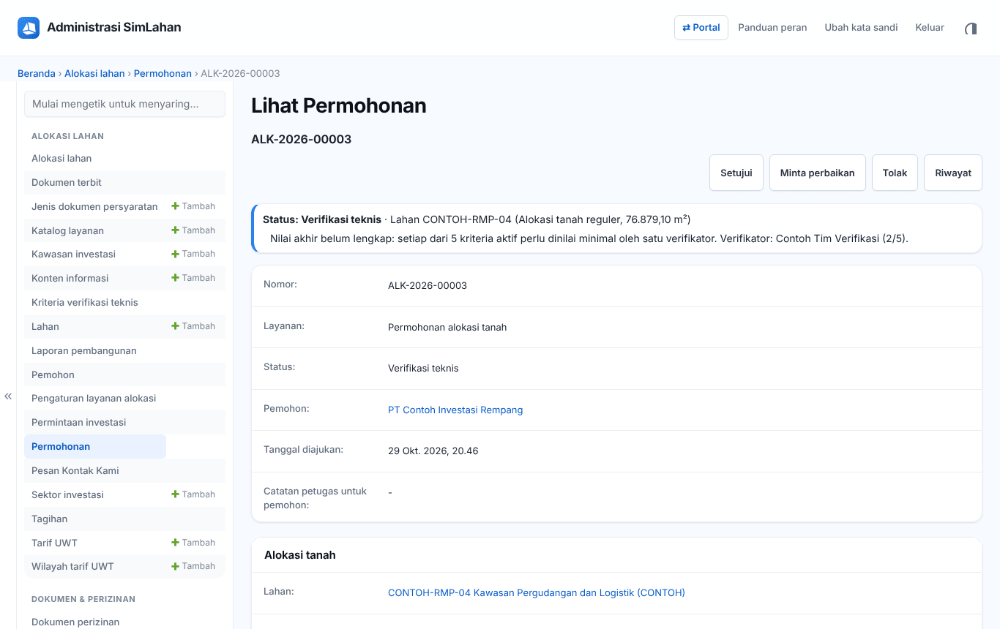
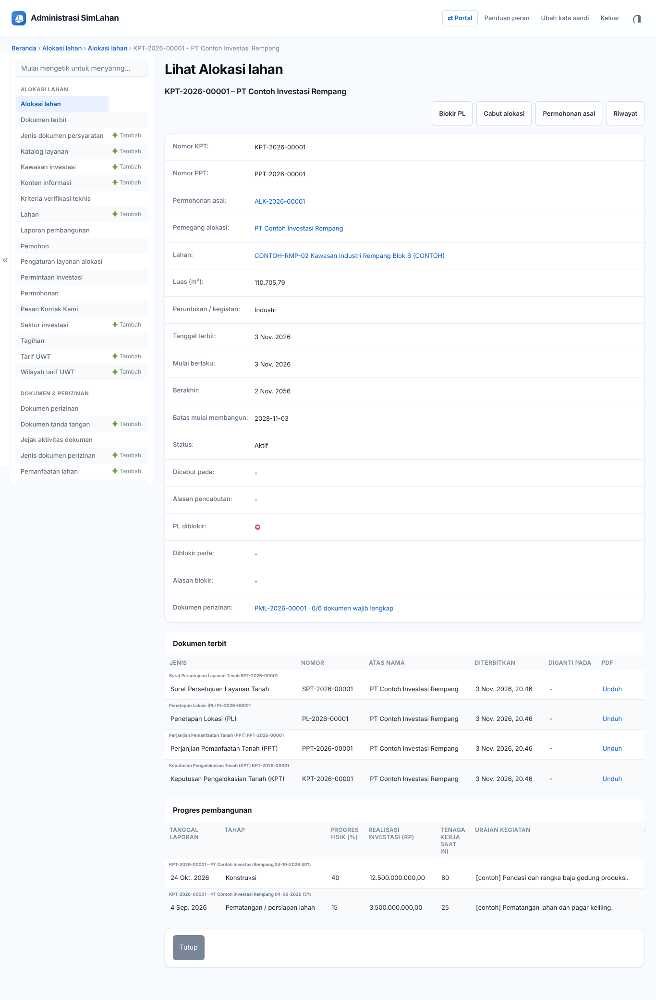
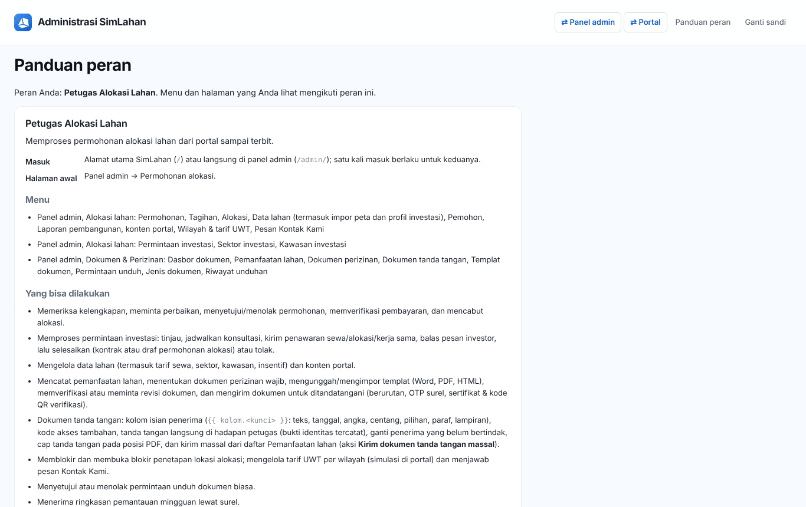

# Buku peran: Petugas Alokasi Lahan

Buku ini untuk **Petugas Alokasi Lahan**: petugas yang memproses permohonan alokasi, tagihan, dokumen terbit, permintaan investasi, dan dokumen perizinan. Baca dulu [Bab 1](../01-mengenal-simlahan.md) dan [Bab 2](../02-dasar-penggunaan.md) bila baru pertama kali memakai SimLahan.

## Masuk

Buka alamat SimLahan atau `/admin/`, isi nama pengguna dan kata sandi, lalu klik **Masuk** ([Bab 2.2](../02-dasar-penggunaan.md#b-panel-admin)).

<!-- awal: dibuat dari backend/users/role_guide.py; perbarui dengan: cd backend && python manage.py panduan_buku -->

## Ringkasan peran

Memproses permohonan alokasi lahan dari portal sampai terbit.

- **Cara masuk:** Alamat utama SimLahan (`/`) atau langsung di panel admin (`/admin/`); satu kali masuk berlaku untuk keduanya.
- **Halaman awal:** Panel admin → Permohonan alokasi.
- **Akun latihan** (hanya di sistem latihan berisi data contoh): `contoh.alokasi`

### Menu yang Anda lihat

- Panel admin, Alokasi lahan: Permohonan, Tagihan, Alokasi, Data lahan (termasuk impor peta dan profil investasi), Pemohon, Laporan pembangunan, konten portal, Wilayah & tarif UWT, Pesan Kontak Kami
- Panel admin, Alokasi lahan: Permintaan investasi, Sektor investasi, Kawasan investasi
- Panel admin, Dokumen & Perizinan: Dasbor dokumen, Pemanfaatan lahan, Dokumen perizinan, Dokumen tanda tangan, Templat dokumen, Permintaan unduh, Jenis dokumen, Riwayat unduhan

### Yang bisa Anda lakukan

- Memeriksa kelengkapan, meminta perbaikan, menyetujui/menolak permohonan, memverifikasi pembayaran, dan mencabut alokasi.
- Memproses permintaan investasi: tinjau, jadwalkan konsultasi, kirim penawaran sewa/alokasi/kerja sama, balas pesan investor, lalu selesaikan (kontrak atau draf permohonan alokasi) atau tolak.
- Mengelola data lahan (termasuk tarif sewa, sektor, kawasan, insentif) dan konten portal.
- Mencatat pemanfaatan lahan, menentukan dokumen perizinan wajib, mengunggah/mengimpor templat (Word, PDF, HTML), memverifikasi atau meminta revisi dokumen, dan mengirim dokumen untuk ditandatangani (berurutan, OTP surel, sertifikat & kode QR verifikasi).
- Dokumen tanda tangan: kolom isian penerima (`{{ kolom.<kunci> }}`: teks, tanggal, angka, centang, pilihan, paraf, lampiran), kode akses tambahan, tanda tangan langsung di hadapan petugas (bukti identitas tercatat), ganti penerima yang belum bertindak, cap tanda tangan pada posisi PDF, dan kirim massal dari daftar Pemanfaatan lahan (aksi **Kirim dokumen tanda tangan massal**).
- Memblokir dan membuka blokir penetapan lokasi alokasi; mengelola tarif UWT per wilayah (simulasi di portal) dan menjawab pesan Kontak Kami.
- Menyetujui atau menolak permintaan unduh dokumen biasa.
- Menerima ringkasan pemantauan mingguan lewat surel.

### Batas akses

- Tidak membuka modul sewa, pengadaan, aset lahan, atau pusat komando.
- Tidak menyetujui unduhan dokumen rahasia, tidak menyetujui permintaan unduh miliknya sendiri, dan tidak mengubah pengaturan modul dokumen.
- Tidak bisa membuka data akun pengguna.

<!-- akhir: blok role_guide.py -->

## Pekerjaan sehari-hari

### 1. Memproses permohonan

1. Halaman awal: **Permohonan** ([Bab 5.1](../20-alokasi-lahan.md#51-daftar-permohonan)).
2. Periksa kelengkapan, minta perbaikan atau teruskan ke verifikasi teknis, lalu setujui atau tolak ([Bab 5.2](../20-alokasi-lahan.md#52-memproses-permohonan-petugas-alokasi)).

### 2. Tagihan dan pembayaran

1. Periksa bukti bayar, lalu **Nyatakan lunas** atau **Tolak bukti bayar** ([Bab 5.4](../20-alokasi-lahan.md#54-tagihan-dan-pembayaran)). KPT dan PPT terbit otomatis setelah lunas.

### 3. Alokasi, lahan tidur, dan data lahan

1. Pantau alokasi, blokir/buka blokir PL, dan lahan tidur ([Bab 5.5](../20-alokasi-lahan.md#55-alokasi--lahan-tidur)). Kelola data lahan dan impor peta ([Bab 5.6](../20-alokasi-lahan.md#56-data-lahan)).

### 4. Permintaan investasi

1. Tinjau, jadwalkan konsultasi, kirim penawaran, dan selesaikan permintaan investor ([Bab 6](../21-investasi-petugas.md)).

### 5. Dokumen & perizinan

1. Catat pemanfaatan lahan, periksa dokumen perizinan, kirim dokumen tanda tangan, dan putuskan permintaan unduh dokumen biasa ([Bab 7](../22-dokumen-perizinan.md)).

### 6. Konten portal

1. Perbarui katalog layanan, konten informasi, tarif UWT, dan balas **Pesan Kontak Kami** ([Bab 5.9](../20-alokasi-lahan.md#59-konten-portal-dan-data-master)).

## Bab yang perlu dibaca

- [Bab 1](../01-mengenal-simlahan.md)
- [Bab 2](../02-dasar-penggunaan.md)
- [Bab 5 – Alokasi lahan](../20-alokasi-lahan.md)
- [Bab 6 – Permintaan investasi](../21-investasi-petugas.md)
- [Bab 7 – Dokumen & perizinan](../22-dokumen-perizinan.md)
- [Bab 12–15 – Portal (agar tahu yang dilihat pemohon)](../50-portal-publik.md)

## Bila ada kendala

- Menu atau tombol tidak ada: peran Anda memang tidak memerlukannya ([Bab 2.10](../02-dasar-penggunaan.md#210-batas-akses-dan-pesan-tidak-berhak)). Hubungi Administrator bila Anda memerlukannya untuk pekerjaan.
- Lupa kata sandi: hubungi Administrator atau superuser untuk menyetel ulang sandi.
- Ringkasan peran yang sama bisa dibuka di dalam aplikasi lewat **Panduan peran** (`/akun/panduan/`).
