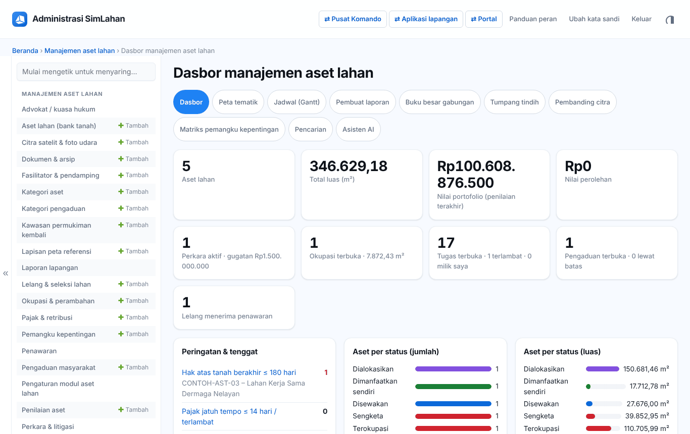
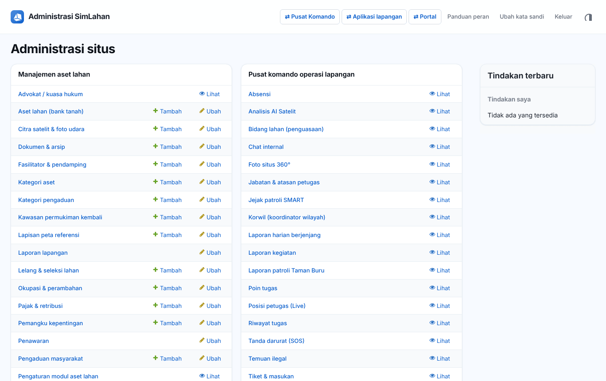
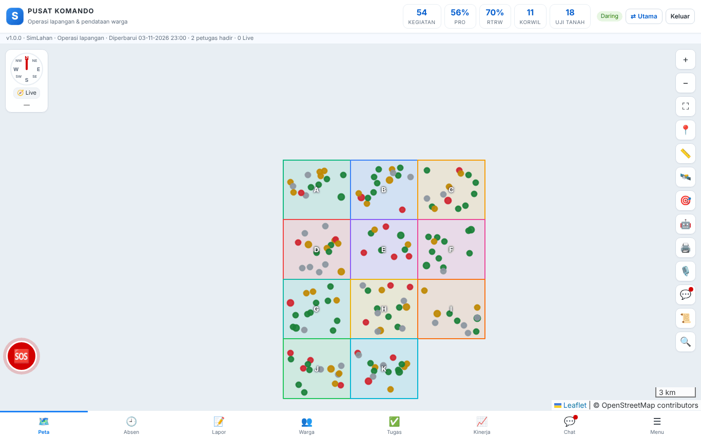
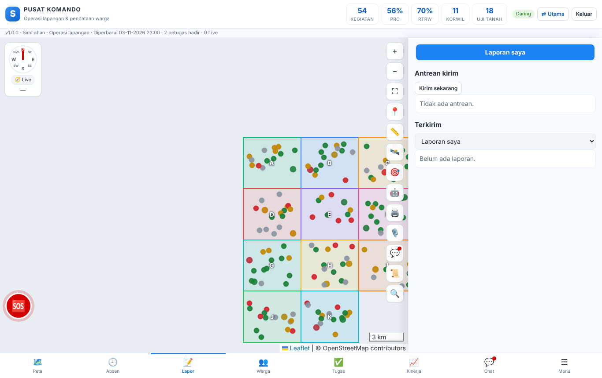
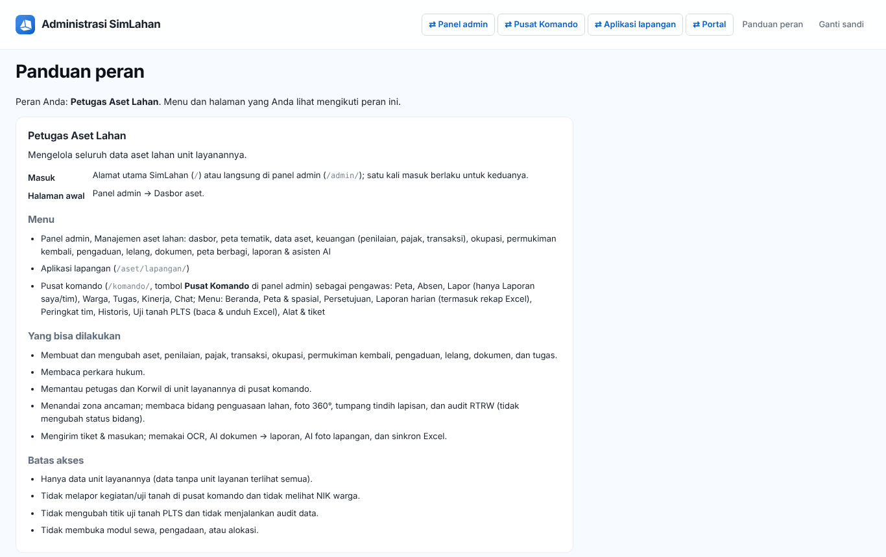

# Buku peran: Petugas Aset Lahan

Buku ini untuk **Petugas Aset Lahan**: pengelola data aset lahan (bank tanah) unit layanannya. Baca dulu [Bab 1](../01-mengenal-simlahan.md) dan [Bab 2](../02-dasar-penggunaan.md) bila baru pertama kali memakai SimLahan.

## Masuk

Buka alamat SimLahan atau `/admin/`, isi nama pengguna dan kata sandi, lalu klik **Masuk** ([Bab 2.2](../02-dasar-penggunaan.md#b-panel-admin)).

<!-- awal: dibuat dari backend/users/role_guide.py; perbarui dengan: cd backend && python manage.py panduan_buku -->

## Ringkasan peran

Mengelola seluruh data aset lahan unit layanannya.

- **Cara masuk:** Alamat utama SimLahan (`/`) atau langsung di panel admin (`/admin/`); satu kali masuk berlaku untuk keduanya.
- **Halaman awal:** Panel admin → Dasbor aset.
- **Akun latihan** (hanya di sistem latihan berisi data contoh): `contoh.aset`

### Menu yang Anda lihat

- Panel admin, Manajemen aset lahan: dasbor, peta tematik, data aset, keuangan (penilaian, pajak, transaksi), okupasi, permukiman kembali, pengaduan, lelang, dokumen, peta berbagi, laporan & asisten AI
- Aplikasi lapangan (`/aset/lapangan/`)
- Pusat komando (`/komando/`, tombol **Pusat Komando** di panel admin) sebagai pengawas: Peta, Absen, Lapor (hanya Laporan saya/tim), Warga, Tugas, Kinerja, Chat; Menu: Beranda, Peta & spasial, Persetujuan, Laporan harian (termasuk rekap Excel), Peringkat tim, Historis, Uji tanah PLTS (baca & unduh Excel), Alat & tiket

### Yang bisa Anda lakukan

- Membuat dan mengubah aset, penilaian, pajak, transaksi, okupasi, permukiman kembali, pengaduan, lelang, dokumen, dan tugas.
- Membaca perkara hukum.
- Memantau petugas dan Korwil di unit layanannya di pusat komando.
- Menandai zona ancaman; membaca bidang penguasaan lahan, foto 360°, tumpang tindih lapisan, dan audit RTRW (tidak mengubah status bidang).
- Mengirim tiket & masukan; memakai OCR, AI dokumen → laporan, AI foto lapangan, dan sinkron Excel.

### Batas akses

- Hanya data unit layanannya (data tanpa unit layanan terlihat semua).
- Tidak melapor kegiatan/uji tanah di pusat komando dan tidak melihat NIK warga.
- Tidak mengubah titik uji tanah PLTS dan tidak menjalankan audit data.
- Tidak membuka modul sewa, pengadaan, atau alokasi.

<!-- akhir: blok role_guide.py -->

## Pekerjaan sehari-hari

### 1. Memantau dasbor

1. Halaman awal: **Dasbor aset** ([Bab 8.1](../30-aset-lahan.md#81-dasbor-aset-lahan)). Tangani baris **Peringatan & tenggat** lebih dulu.

### 2. Mengelola aset

1. Tambah, ubah, atau impor aset ([Bab 8.2](../30-aset-lahan.md#82-data-aset-lahan)); lihat di **Peta tematik** ([Bab 8.3](../30-aset-lahan.md#83-peta-tematik)).
2. Catat penilaian, pajak, dan transaksi ([Bab 8.4](../30-aset-lahan.md#84-keuangan-penilaian-pajak-transaksi-buku-besar)).

### 3. Okupasi, pengaduan, lelang, permukiman

1. Tangani okupasi ([Bab 8.6](../30-aset-lahan.md#86-okupasi--perambahan)), pengaduan ([Bab 8.7](../30-aset-lahan.md#87-pengaduan-masyarakat)), lelang ([Bab 8.8](../30-aset-lahan.md#88-lelang--seleksi-lahan)), dan permukiman kembali ([Bab 8.9](../30-aset-lahan.md#89-permukiman-kembali)).

### 4. Survei, dokumen, tugas, laporan

1. Kelola survei dan citra ([Bab 8.11](../30-aset-lahan.md#811-survei-citra-lapisan-peta-fasilitator-urusan-instansi)), dokumen dan tugas ([Bab 8.12](../30-aset-lahan.md#812-dokumen--arsip-tugas-tim-laporan-lapangan)), serta laporan, pencarian, asisten AI, dan peta berbagi ([Bab 8.13](../30-aset-lahan.md#813-alat-analisis)).

### 5. Di lapangan

1. Kirim laporan lapangan dari **Aplikasi lapangan** ([Bab 9](../31-aplikasi-lapangan.md)).

### 6. Mengawasi tim di pusat komando

1. Klik **⇄ Pusat Komando** untuk memantau peta, absen, laporan tim, tugas, kinerja, persetujuan, dan laporan harian ([Bab 10](../40-pusat-komando.md)). Anda tidak melapor kegiatan sendiri.

## Bab yang perlu dibaca

- [Bab 1](../01-mengenal-simlahan.md)
- [Bab 2](../02-dasar-penggunaan.md)
- [Bab 8 – Aset lahan](../30-aset-lahan.md)
- [Bab 9 – Aplikasi lapangan](../31-aplikasi-lapangan.md)
- [Bab 10 – Pusat komando](../40-pusat-komando.md)

## Bila ada kendala

- Menu atau tombol tidak ada: peran Anda memang tidak memerlukannya ([Bab 2.10](../02-dasar-penggunaan.md#210-batas-akses-dan-pesan-tidak-berhak)). Hubungi Administrator bila Anda memerlukannya untuk pekerjaan.
- Lupa kata sandi: hubungi Administrator atau superuser untuk menyetel ulang sandi.
- Ringkasan peran yang sama bisa dibuka di dalam aplikasi lewat **Panduan peran** (`/akun/panduan/`).
