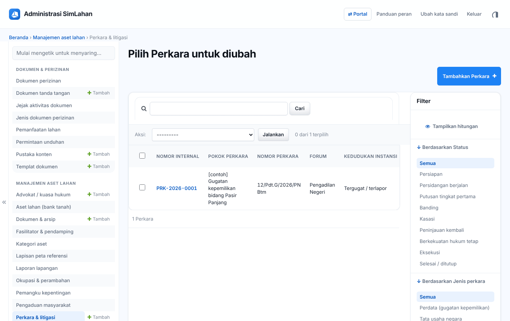
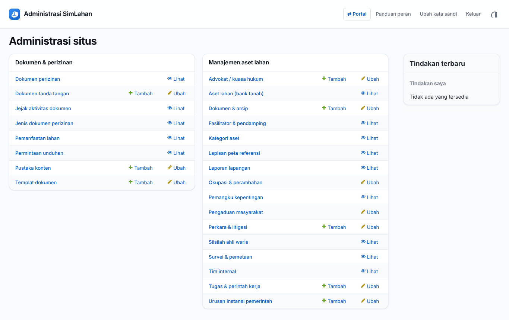
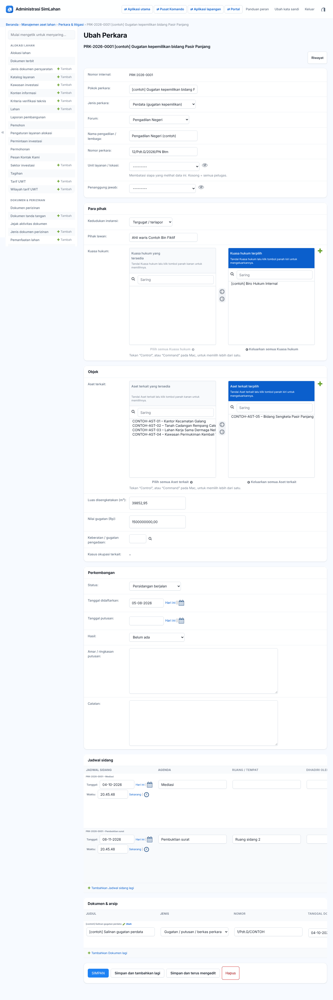
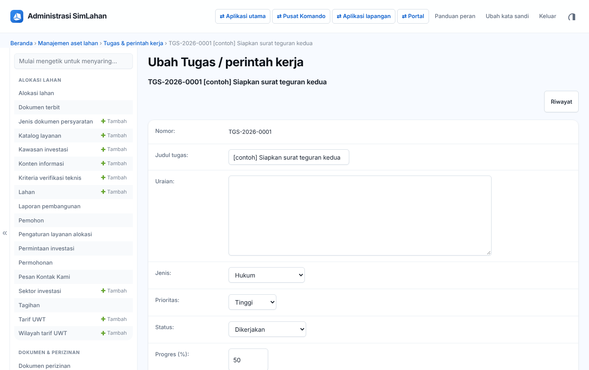
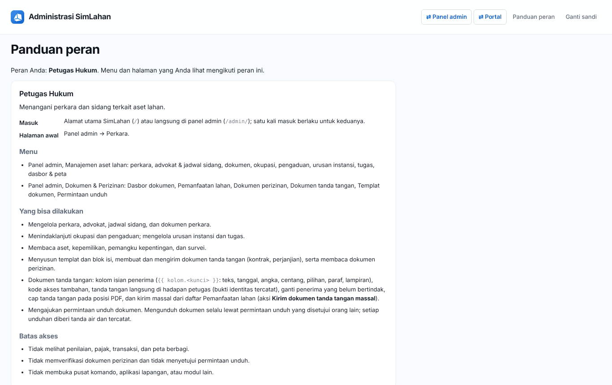

# Buku peran: Petugas Hukum

Buku ini untuk **Petugas Hukum**: petugas yang menangani perkara, sidang, okupasi, pengaduan, dan dokumen hukum terkait aset lahan. Baca dulu [Bab 1](../01-mengenal-simlahan.md) dan [Bab 2](../02-dasar-penggunaan.md) bila baru pertama kali memakai SimLahan.

## Masuk

Buka alamat SimLahan atau `/admin/`, isi nama pengguna dan kata sandi, lalu klik **Masuk** ([Bab 2.2](../02-dasar-penggunaan.md#b-panel-admin)).

<!-- awal: dibuat dari backend/users/role_guide.py; perbarui dengan: cd backend && python manage.py panduan_buku -->

## Ringkasan peran

Menangani perkara dan sidang terkait aset lahan.

- **Cara masuk:** Alamat utama SimLahan (`/`) atau langsung di panel admin (`/admin/`); satu kali masuk berlaku untuk keduanya.
- **Halaman awal:** Panel admin → Perkara.
- **Akun latihan** (hanya di sistem latihan berisi data contoh): `contoh.hukum`

### Menu yang Anda lihat

- Panel admin, Manajemen aset lahan: perkara, advokat & jadwal sidang, dokumen, okupasi, pengaduan, urusan instansi, tugas, dasbor & peta
- Panel admin, Dokumen & Perizinan: Dasbor dokumen, Pemanfaatan lahan, Dokumen perizinan, Dokumen tanda tangan, Templat dokumen, Permintaan unduh

### Yang bisa Anda lakukan

- Mengelola perkara, advokat, jadwal sidang, dan dokumen perkara.
- Menindaklanjuti okupasi dan pengaduan; mengelola urusan instansi dan tugas.
- Membaca aset, kepemilikan, pemangku kepentingan, dan survei.
- Menyusun templat dan blok isi, membuat dan mengirim dokumen tanda tangan (kontrak, perjanjian), serta membaca dokumen perizinan.
- Dokumen tanda tangan: kolom isian penerima (`{{ kolom.<kunci> }}`: teks, tanggal, angka, centang, pilihan, paraf, lampiran), kode akses tambahan, tanda tangan langsung di hadapan petugas (bukti identitas tercatat), ganti penerima yang belum bertindak, cap tanda tangan pada posisi PDF, dan kirim massal dari daftar Pemanfaatan lahan (aksi **Kirim dokumen tanda tangan massal**).
- Mengajukan permintaan unduh dokumen. Mengunduh dokumen selalu lewat permintaan unduh yang disetujui orang lain; setiap unduhan diberi tanda air dan tercatat.

### Batas akses

- Tidak melihat penilaian, pajak, transaksi, dan peta berbagi.
- Tidak memverifikasi dokumen perizinan dan tidak menyetujui permintaan unduh.
- Tidak membuka pusat komando, aplikasi lapangan, atau modul lain.

<!-- akhir: blok role_guide.py -->

## Pekerjaan sehari-hari

### 1. Mengelola perkara dan sidang

1. Halaman awal: **Perkara** ([Bab 8.5](../30-aset-lahan.md#85-perkara--litigasi)). Tambah perkara, para pihak, aset terkait, jadwal sidang, dan dokumen.
2. Kelola **Advokat / kuasa hukum**. Sistem mengingatkan sebelum sidang.

### 2. Okupasi dan pengaduan

1. Tindak lanjuti okupasi ([Bab 8.6](../30-aset-lahan.md#86-okupasi--perambahan)); limpahkan ke perkara bila perlu. Tindak lanjuti pengaduan ([Bab 8.7](../30-aset-lahan.md#87-pengaduan-masyarakat)).

### 3. Urusan instansi dan tugas

1. Kelola urusan instansi pemerintah ([Bab 8.11](../30-aset-lahan.md#811-survei-citra-lapisan-peta-fasilitator-urusan-instansi)) dan tugas ([Bab 8.12](../30-aset-lahan.md#812-dokumen--arsip-tugas-tim-laporan-lapangan)).

### 4. Templat dan dokumen tanda tangan

1. Susun templat dan blok isi ([Bab 7.5](../22-dokumen-perizinan.md#75-templat-dokumen-dan-pustaka-konten)), buat dan kirim dokumen tanda tangan kontrak/perjanjian ([Bab 7.4](../22-dokumen-perizinan.md#74-dokumen-tanda-tangan-elektronik)).

## Bab yang perlu dibaca

- [Bab 1](../01-mengenal-simlahan.md)
- [Bab 2](../02-dasar-penggunaan.md)
- [Bab 7 – Dokumen & perizinan](../22-dokumen-perizinan.md)
- [Bab 8 – Aset lahan](../30-aset-lahan.md)

## Bila ada kendala

- Menu atau tombol tidak ada: peran Anda memang tidak memerlukannya ([Bab 2.10](../02-dasar-penggunaan.md#210-batas-akses-dan-pesan-tidak-berhak)). Hubungi Administrator bila Anda memerlukannya untuk pekerjaan.
- Lupa kata sandi: hubungi Administrator atau superuser untuk menyetel ulang sandi.
- Ringkasan peran yang sama bisa dibuka di dalam aplikasi lewat **Panduan peran** (`/akun/panduan/`).
