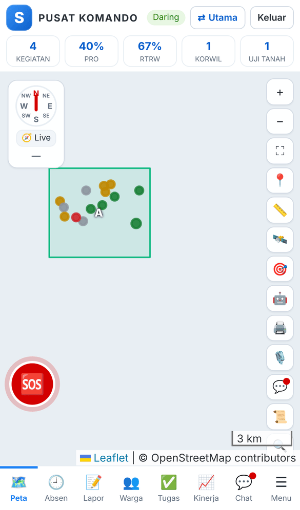
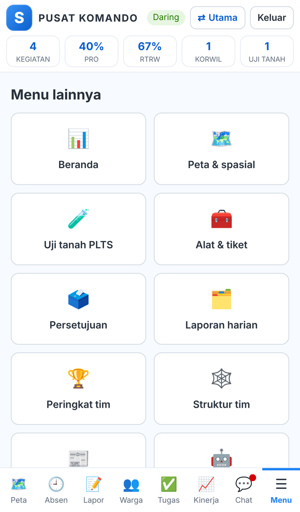
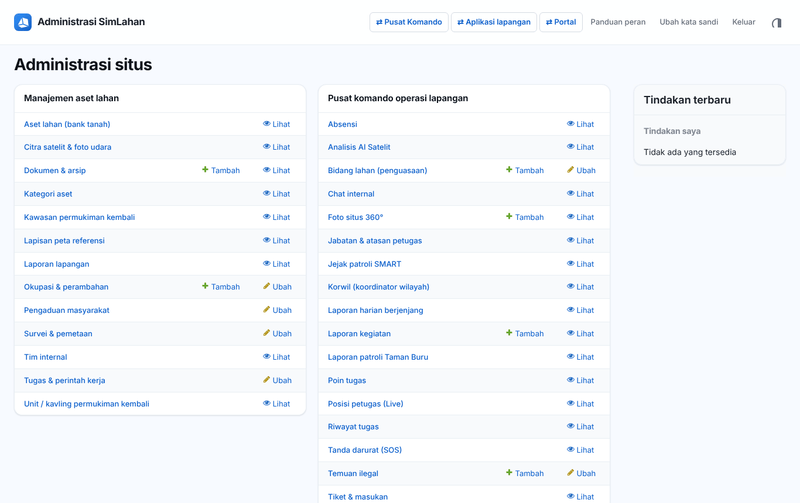

# Buku peran: Petugas Lapangan

Buku ini untuk **Petugas Lapangan**: petugas lapangan yang bekerja untuk Korwil tempatnya menjadi anggota. Baca dulu [Bab 1](../01-mengenal-simlahan.md) dan [Bab 2](../02-dasar-penggunaan.md) bila baru pertama kali memakai SimLahan.

## Masuk

Buka `/komando/masuk/` di HP, isi nama pengguna dan kata sandi, lalu ketuk **Masuk** ([Bab 10.1](../40-pusat-komando.md#101-masuk-dan-memasang-aplikasi)).

<!-- awal: dibuat dari backend/users/role_guide.py; perbarui dengan: cd backend && python manage.py panduan_buku -->

## Ringkasan peran

Bekerja di lapangan untuk Korwil tempatnya menjadi anggota.

- **Cara masuk:** Langsung di pusat komando (`/komando/masuk/`), atau di alamat utama SimLahan (`/`) lalu tombol **Pusat Komando**; satu kali masuk berlaku untuk keduanya.
- **Halaman awal:** Pusat komando (`/komando/`).
- **Akun latihan** (hanya di sistem latihan berisi data contoh): `contoh.lapangan`

### Menu yang Anda lihat

- Pusat komando (`/komando/`): Peta (termasuk lapisan Temuan ilegal, Patroli SMART, Penguasaan lahan, Zona ancaman, Foto situs 360°, lapisan referensi seperti RTRW/hutan/kawasan proyek, dan gaya peta taktis), Absen, Lapor (Komsos, Topografi, Temuan ilegal, Patroli Taman Buru dengan impor SMART, Kegiatan lainnya, jenis lain, uji tanah, laporan saya), Warga, Tugas (saya, tim, verifikasi, terlambat, semua; tombol Beri tugas bagi koordinator), Kinerja (grafik harian/mingguan, radar, kalender 90 hari, sebaran titik kerja di peta, wawasan), Chat; Menu: Beranda (anomali & peringatan, skor risiko Korwil, ringkasan sikap, tren dukungan, detail Korwil), Peta & spasial (penguasaan lahan dengan skor prioritas dan impor KML/KMZ, tumpang tindih lapisan, audit RTRW, peta panas, jejak GPS bagi pimpinan, zona ancaman, foto 360°), Persetujuan, Laporan harian (buat, masuk, lacak, rekap Excel), Peringkat tim (periode, Korwil, tingkat, 10 teratas/terbawah, lencana, Excel, wawasan), Struktur tim, Historis (bagi koordinator dan atasan: komsos, perubahan sikap, luas lahan), Feed aktivitas, Asisten AI, Uji tanah PLTS (progres titik bor/sumur uji/resistivitas/sondir/termal, aksi cepat, foto, riwayat, impor & unduh Excel), Alat & tiket (tiket & masukan, OCR dokumen, AI dokumen → laporan, AI foto lapangan, audit data bagi koordinator, cek perangkat, sinkron Excel), pindah ke aplikasi lain (utama, panel admin, aplikasi lapangan, portal) sesuai hak; tombol **⇄ Utama** di bilah atas
- Aplikasi lapangan (`/aset/lapangan/`): laporan & foto lapangan
- Panel admin: okupasi, pengaduan, survei, tugas, Korwil, warga, kegiatan, temuan ilegal, patroli Taman Buru, jejak patroli SMART, uji tanah, uji tanah PLTS, jabatan & atasan petugas, riwayat & poin tugas, laporan harian berjenjang (baca saja), tiket saya

### Yang bisa Anda lakukan

- Absen, melapor kegiatan dan uji tanah, mendata warga, chat, dan SOS di pusat komando.
- Komsos dengan beberapa warga baru sekaligus; mencatat temuan ilegal (baru atau kunjungan berulang) dan patroli Taman Buru (temuan, bibit, impor berkas SMART); menilai dampak Kegiatan lainnya.
- Membuat laporan lapangan, okupasi dan tindakan teguran; menindaklanjuti pengaduan dan survei.
- Mengerjakan tugas: mulai, laporkan selesai (catatan, foto bukti, GPS), atau tandai ada kendala; poin tugas yang diverifikasi masuk KPI penerima, kontributor, dan pemberi tugas.
- Mengirim laporan harian ke atasan langsung (bisa disusun otomatis dari kegiatan yang belum dilaporkan, dengan lampiran), memperbaiki laporan yang dikembalikan, melacak posisinya, dan mengunduh rekap Excel.
- Mengimpor bidang dari KML/KMZ/GeoJSON (bidang baru atau hasil penguasaan yang dicocokkan otomatis) dan memperbarui status penguasaan bidang di Korwilnya; mengunggah foto situs 360°.
- Melihat zona ancaman, tumpang tindih lapisan, audit RTRW, dan peta panas di Menu → Peta & spasial.
- Memperbarui progres titik uji tanah PLTS di Korwilnya (aksi cepat, formulir, foto, impor Excel untuk titik terdaftar).
- Mengirim tiket & masukan (poin bila selesai ditangani); memakai OCR, AI dokumen → laporan, AI foto lapangan, cek perangkat, dan sinkron Excel.
- Bekerja luring; data terkirim otomatis saat ada sinyal.

### Batas akses

- Hanya Korwil tempatnya menjadi anggota (diatur di data Korwil).
- Tidak memverifikasi laporan, tidak melihat NIK warga, dan tidak membuka modul lain.
- Klaim dampak Signifikan/Kritis dihitung 6 poin sampai dikonfirmasi atasan.
- Tidak bisa memverifikasi tugasnya sendiri; tugas yang dilaporkan selesai menunggu verifikasi pemberi tugas atau atasan.
- Peringkat dan detail Korwil hanya menampilkan skor dirinya sendiri; Historis tidak tersedia kecuali ia menjadi atasan petugas lain.
- Tidak menandai zona ancaman, tidak menghapus foto 360°, dan tidak melihat jejak GPS petugas.
- Tidak menambah titik uji tanah PLTS baru dan tidak menjalankan audit data; hanya melihat tiket miliknya.

<!-- akhir: blok role_guide.py -->

## Pekerjaan sehari-hari

### 1. Memulai hari

1. Pasang aplikasi di HP sekali ([Bab 10.1](../40-pusat-komando.md#101-masuk-dan-memasang-aplikasi)).
2. Buka tab **Absen**, lalu **Absen masuk** ([Bab 10.3](../40-pusat-komando.md#103-absen)). Nyalakan **Live** bila diminta koordinator ([Bab 10.2.3](../40-pusat-komando.md#1023-mode-live-dan-sos)).

### 2. Melapor kegiatan

1. Tab **Lapor** → pilih jenis kegiatan, isi, tambah foto, lalu **Simpan laporan** ([Bab 10.4](../40-pusat-komando.md#104-lapor-kegiatan)).
2. Komsos: tambah warga baru atau pilih warga terkait ([Komsos](../40-pusat-komando.md#komsos-komunikasi-sosial)). Temuan ilegal dan patroli Taman Buru punya isian khusus.

### 3. Mendata warga

1. Tab **Warga** → **＋ Warga** ([Bab 10.5](../40-pusat-komando.md#105-warga)).

### 4. Mengerjakan tugas

1. Tab **Tugas** → **▶ Mulai kerjakan** → **📤 Laporkan selesai** dengan foto bukti ([Bab 10.6](../40-pusat-komando.md#106-tugas)).

### 5. Laporan harian

1. **Menu → Laporan harian → Buat** → **✨ Susun otomatis** → **📤 Kirim ke atasan** ([Bab 10.9](../40-pusat-komando.md#laporan-harian-berjenjang)).

### 6. Akhir hari

1. Pastikan antrean kirim (⏳) kosong, lalu **Absen pulang**.

### 7. Aplikasi lapangan aset

1. Untuk laporan kondisi aset, patok, atau okupasi, gunakan **Aplikasi lapangan** ([Bab 9](../31-aplikasi-lapangan.md)).

### 8. Darurat

1. Ketuk **🆘 SOS**, isi pesan bila sempat, lalu **KIRIM SOS** ([Bab 10.2.3](../40-pusat-komando.md#1023-mode-live-dan-sos)).

## Bab yang perlu dibaca

- [Bab 1](../01-mengenal-simlahan.md)
- [Bab 2](../02-dasar-penggunaan.md)
- [Bab 9 – Aplikasi lapangan](../31-aplikasi-lapangan.md)
- [Bab 10 – Pusat komando](../40-pusat-komando.md)

## Bila ada kendala

- Menu atau tombol tidak ada: peran Anda memang tidak memerlukannya ([Bab 2.10](../02-dasar-penggunaan.md#210-batas-akses-dan-pesan-tidak-berhak)). Hubungi Administrator bila Anda memerlukannya untuk pekerjaan.
- Lupa kata sandi: hubungi Administrator atau superuser untuk menyetel ulang sandi.
- Ringkasan peran yang sama bisa dibuka di dalam aplikasi lewat **Panduan peran** (`/akun/panduan/`).
