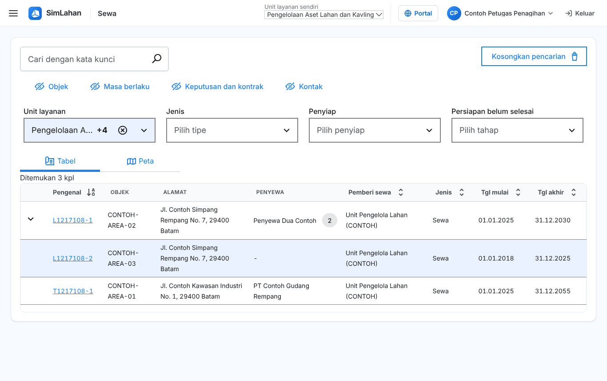
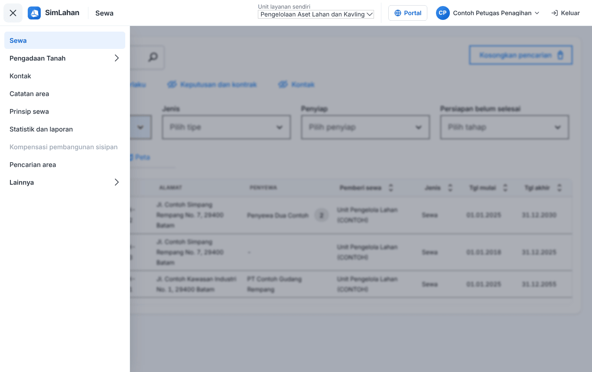

# Buku peran: Petugas Penagihan

Buku ini untuk **Petugas Penagihan**: petugas yang mengelola tagihan dan pembayaran sewa, serta mencatat pembayaran ganti kerugian pengadaan tanah. Baca dulu [Bab 1](../01-mengenal-simlahan.md) dan [Bab 2](../02-dasar-penggunaan.md) bila baru pertama kali memakai SimLahan.

## Masuk

Buka alamat SimLahan, isi nama pengguna dan kata sandi, lalu klik **Masuk** ([Bab 2.2](../02-dasar-penggunaan.md#a-aplikasi-utama-petugas-kantor)).

<!-- awal: dibuat dari backend/users/role_guide.py; perbarui dengan: cd backend && python manage.py panduan_buku -->

## Ringkasan peran

Mengelola tagihan sewa dan pembayaran ganti kerugian pengadaan tanah.

- **Cara masuk:** Alamat utama SimLahan (`/`), dengan nama pengguna dan sandi.
- **Halaman awal:** Sewa (daftar sewa).
- **Akun latihan** (hanya di sistem latihan berisi data contoh): `contoh.penagihan`

### Menu yang Anda lihat

- Sewa
- Pengadaan Tanah: Dasbor & tenggat, Proyek pengadaan, Kalender & aturan tenggat
- Kontak
- Catatan area
- Prinsip sewa
- Statistik dan laporan
- Kompensasi pembangunan sisipan
- Pencarian area
- Lainnya: Indeks biaya hidup, Tugas terjadwal, Catatan tagihan

### Yang bisa Anda lakukan

- Membuat dan mengubah tagihan, baris dan set tagihan, pembayaran, catatan tagihan, jatuh tempo sewa, jaminan, dan kontak penyewa.
- Membuat laporan tagihan dan pembayaran.
- Pengadaan tanah: mencatat pembayaran dan penyerahan ganti kerugian yang sudah divalidasi (data pribadi tersamar).

### Batas akses

- Tidak mengubah isi sewa, kontrak, atau keputusan.
- Tidak bisa membuka panel admin, alokasi lahan, manajemen aset lahan, pusat komando, atau aplikasi lapangan.

<!-- akhir: blok role_guide.py -->

## Pekerjaan sehari-hari

### 1. Mencari dan membuka data sewa

1. Halaman awal Anda adalah daftar **Sewa** ([Bab 3.1](../10-sewa.md#31-daftar-sewa)).
2. Ketik pengenal sewa, nama penyewa, atau alamat di kotak cari, lalu tekan Enter. Gunakan saringan bila hasilnya banyak.
3. Klik baris sewa untuk membuka halamannya, lalu pindah antar-tab ([Bab 3.3](../10-sewa.md#33-halaman-data-sewa)).

### 2. Mengelola tagihan sewa

1. Buka sewa, tab **Penagihan** ([Bab 3.4](../10-sewa.md#34-penagihan-sewa)).
2. Buat tagihan manual dengan **Buat tagihan**; catat pembayaran dengan **Tambah pembayaran** di panel rincian tagihan.
3. Kreditkan atau hapus tagihan yang salah; hentikan atau jalankan penagihan otomatis bila perlu.

### 3. Catatan tagihan dan jaminan

1. Isi **Catatan tagihan** di menu **Lainnya** ([Bab 3.11](../10-sewa.md#311-menu-lainnya)). Jaminan sewa ada di tab **Keputusan dan kontrak**.

### 4. Pembayaran ganti kerugian pengadaan tanah

1. Buka proyek pengadaan, tab **Ganti kerugian** ([Bab 4.10](../11-pengadaan-tanah.md#410-ganti-kerugian-dan-pembayaran)).
2. Pada ganti kerugian yang sudah divalidasi, klik **Tambah pembayaran**, isi jumlah, tanggal, dan bukti, lalu simpan.

## Bab yang perlu dibaca

- [Bab 1 – Mengenal SimLahan](../01-mengenal-simlahan.md)
- [Bab 2 – Dasar penggunaan](../02-dasar-penggunaan.md)
- [Bab 3 – Sewa lahan](../10-sewa.md)
- [Bab 4 – Pengadaan tanah](../11-pengadaan-tanah.md)

## Bila ada kendala

- Menu atau tombol tidak ada: peran Anda memang tidak memerlukannya ([Bab 2.10](../02-dasar-penggunaan.md#210-batas-akses-dan-pesan-tidak-berhak)). Hubungi Administrator bila Anda memerlukannya untuk pekerjaan.
- Lupa kata sandi: hubungi Administrator atau superuser untuk menyetel ulang sandi.
- Ringkasan peran yang sama bisa dibuka di dalam aplikasi lewat **Panduan peran** (`/akun/panduan/`).
