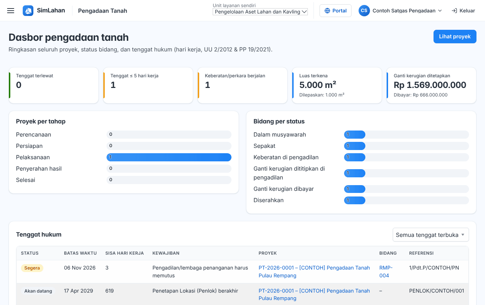
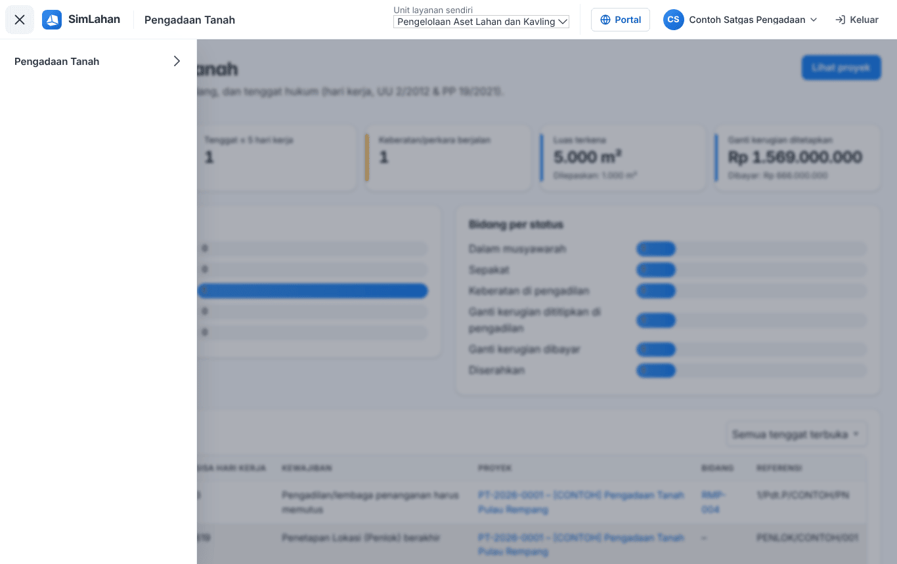
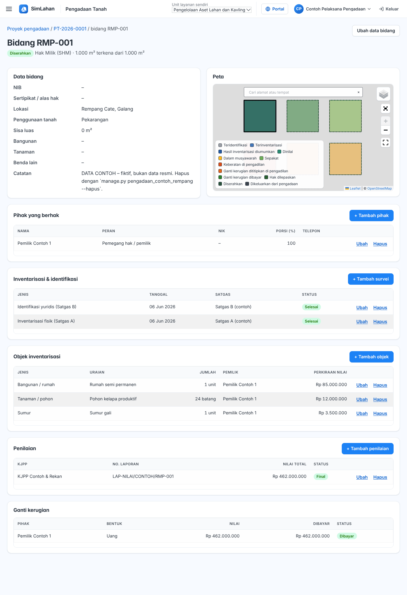
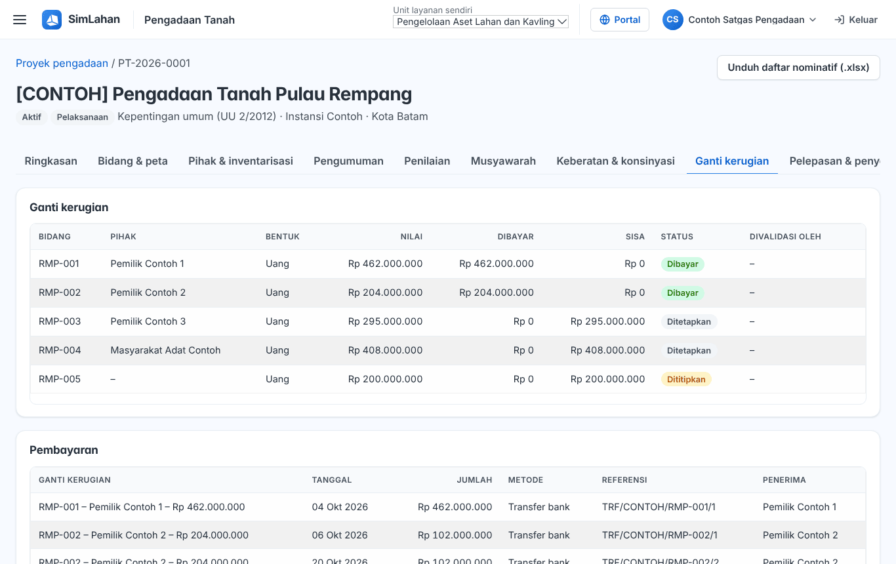

# Buku peran: Satgas Pengadaan Tanah

Buku ini untuk **Satgas Pengadaan Tanah**: satuan tugas yang mendata bidang, pihak, dan inventarisasi di lapangan. Baca dulu [Bab 1](../01-mengenal-simlahan.md) dan [Bab 2](../02-dasar-penggunaan.md) bila baru pertama kali memakai SimLahan.

## Masuk

Buka alamat SimLahan, isi nama pengguna dan kata sandi, lalu klik **Masuk** ([Bab 2.2](../02-dasar-penggunaan.md#a-aplikasi-utama-petugas-kantor)).

<!-- awal: dibuat dari backend/users/role_guide.py; perbarui dengan: cd backend && python manage.py panduan_buku -->

## Ringkasan peran

Melakukan pendataan lapangan pengadaan tanah.

- **Cara masuk:** Alamat utama SimLahan (`/`), dengan nama pengguna dan sandi.
- **Halaman awal:** Pengadaan Tanah → Dasbor & tenggat.
- **Akun latihan** (hanya di sistem latihan berisi data contoh): `contoh.satgas`

### Menu yang Anda lihat

- Pengadaan Tanah: Dasbor & tenggat, Proyek pengadaan, Kalender & aturan tenggat

### Yang bisa Anda lakukan

- Mencatat bidang, inventarisasi, pihak, pengumuman, musyawarah, pelepasan hak, dan rumah tangga terdampak.
- Memperbarui tonggak inventarisasi, musyawarah, dan pelepasan hak (status, tanggal realisasi, catatan).
- Melihat data pribadi pihak (NIK/rekening).

### Batas akses

- Tidak memvalidasi ganti kerugian dan tidak mengubah kalender/aturan tenggat.
- Hanya modul pengadaan tanah; modul sewa, alokasi, aset, pusat komando, dan panel admin tidak terbuka.

<!-- akhir: blok role_guide.py -->

## Pekerjaan sehari-hari

### 1. Melihat tenggat

1. Halaman awal: **Dasbor & tenggat** ([Bab 4.1](../11-pengadaan-tanah.md#41-dasbor--tenggat)).

### 2. Mendata bidang dan pihak

1. Buka proyek, tab **Bidang**, klik **+ Tambah** atau impor batas bidang ([Bab 4.4](../11-pengadaan-tanah.md#44-bidang--peta)).
2. Di tab **Pihak**, tambah pihak yang berhak ([Bab 4.5](../11-pengadaan-tanah.md#menambah-pihak-yang-berhak)).

### 3. Inventarisasi (Satgas A/B)

1. Di tab **Survei/Inventarisasi**, catat objek per bidang ([Bab 4.5](../11-pengadaan-tanah.md#mencatat-inventarisasi-satgas-ab)).

### 4. Pengumuman, musyawarah, pelepasan hak, rumah tangga

1. Catat pengumuman ([Bab 4.6](../11-pengadaan-tanah.md#46-pengumuman)), musyawarah ([Bab 4.8](../11-pengadaan-tanah.md#48-musyawarah)), pelepasan hak ([Bab 4.11](../11-pengadaan-tanah.md#411-pelepasan-hak--penyerahan-hasil)), dan rumah tangga terdampak ([Bab 4.12](../11-pengadaan-tanah.md#412-relokasi-rumah-tangga-terdampak)).

### 5. Yang tidak Anda lakukan

1. Satgas tidak memvalidasi ganti kerugian ([Bab 4.16](../11-pengadaan-tanah.md#416-perbedaan-tampilan-per-peran)).

## Bab yang perlu dibaca

- [Bab 1 – Mengenal SimLahan](../01-mengenal-simlahan.md)
- [Bab 2 – Dasar penggunaan](../02-dasar-penggunaan.md)
- [Bab 4 – Pengadaan tanah](../11-pengadaan-tanah.md)

## Bila ada kendala

- Menu atau tombol tidak ada: peran Anda memang tidak memerlukannya ([Bab 2.10](../02-dasar-penggunaan.md#210-batas-akses-dan-pesan-tidak-berhak)). Hubungi Administrator bila Anda memerlukannya untuk pekerjaan.
- Lupa kata sandi: hubungi Administrator atau superuser untuk menyetel ulang sandi.
- Ringkasan peran yang sama bisa dibuka di dalam aplikasi lewat **Panduan peran** (`/akun/panduan/`).
