# Buku peran: Tim Verifikasi Teknis

Buku ini untuk **Tim Verifikasi Teknis**: anggota tim lintas unit yang menilai permohonan alokasi dan memeriksa dokumen perizinan. Buku ini berisi semua langkah kerja peran Anda, lengkap dengan gambar, sehingga cukup dibaca sendiri. Dasar penggunaan yang berlaku untuk semua peran (mengenal layar, ganti sandi, memakai di HP) ada di [Bab 2](../02-dasar-penggunaan.md).

**Cara membaca buku ini.** Kotak merah bernomor pada gambar menunjuk tombol atau kolom yang disebut di langkah. Tulisan *(nomor 2)* berarti: lihat kotak merah bernomor 2 pada gambar tepat di atas langkah itu. Semua gambar memakai data contoh fiktif; isi di layar Anda berbeda, tetapi letak tombolnya sama. Judul bagian bernomor (misalnya *3.4*) sama dengan nomor bagian di buku lengkap.

## Masuk dan halaman awal

<!-- sisip: 02-dasar-penggunaan.md#b-panel-admin -->

### B. Panel admin

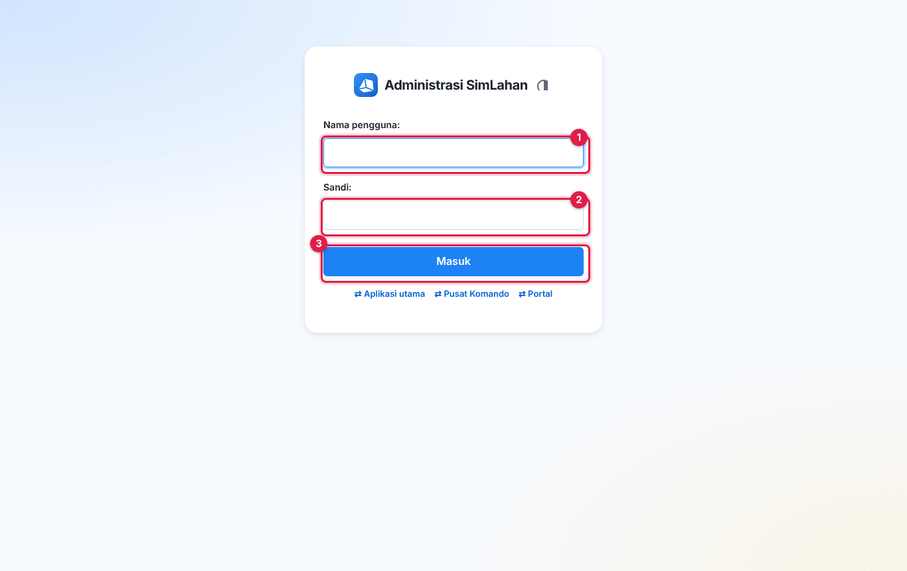

1. Buka alamat SimLahan diikuti `/admin/`, misalnya `https://simlahan.instansi-anda.go.id/admin/`.
2. Isi **Nama pengguna** (nomor 1) dan **Sandi** (nomor 2).
3. Klik **Masuk** (nomor 3).

Bila Anda sudah masuk di aplikasi utama, panel admin langsung terbuka tanpa masuk ulang.

<!-- akhir sisip -->

### Halaman awal

Setelah masuk, Anda langsung melihat daftar **Permohonan** alokasi di panel admin:

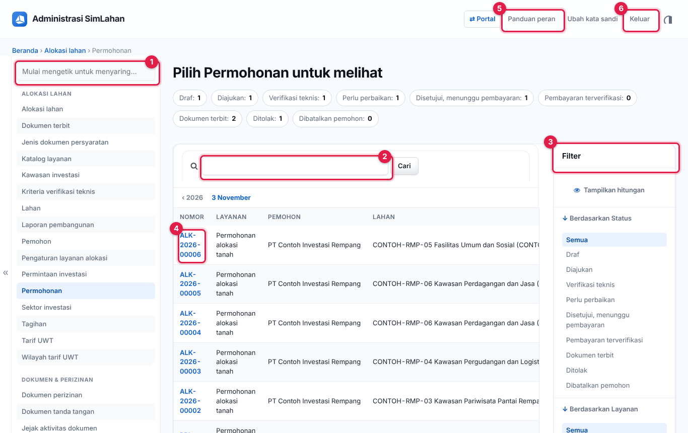

Nomor pada gambar:

1. **Saring menu**: ketik sebagian nama menu (misalnya *tagihan*) untuk menemukannya cepat di menu samping.
2. **Kotak cari**: ketik nomor permohonan atau nama pemohon, lalu klik **Cari**.
3. **Filter**: saring berdasarkan status, layanan, atau **penilaian saya** (belum/sudah). Pilih **Verifikasi teknis** untuk melihat yang menunggu penilaian.
4. **Nomor permohonan**: klik untuk membuka permohonan.
5. **Panduan peran**: ringkasan peran Anda.
6. **Keluar**: mengakhiri sesi di semua aplikasi petugas pada perangkat ini.

### Beranda panel admin

Klik **Administrasi SimLahan** di kiri atas untuk membuka beranda panel admin. Isinya kotak per modul yang boleh Anda buka:

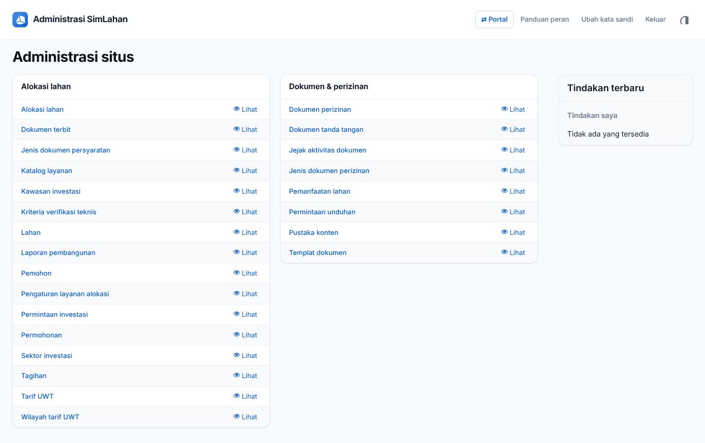

Anda melihat modul **Alokasi lahan** dan **Dokumen & perizinan** (hanya **Lihat**); penilaian diisi dari halaman permohonan. Tautan **Lihat** hanya membaca; **Ubah** dan **Tambah** berarti Anda boleh mengubah atau menambah data itu. Cara memakai halaman daftar dan formulir panel admin dijelaskan di [Bab 2.4](../02-dasar-penggunaan.md#24-mengenal-layar-panel-admin).

<!-- awal: dibuat dari backend/users/role_guide.py; perbarui dengan: cd backend && python manage.py panduan_buku -->

## Ringkasan peran

Memberi penilaian teknis atas permohonan alokasi lahan.

- **Cara masuk:** Alamat utama SimLahan (`/`) atau langsung di panel admin (`/admin/`); satu kali masuk berlaku untuk keduanya.
- **Halaman awal:** Panel admin → Permohonan alokasi.
- **Akun latihan** (hanya di sistem latihan berisi data contoh): `contoh.verifikasi`

### Menu yang Anda lihat

- Panel admin, Alokasi lahan: Permohonan, Tagihan, Alokasi, Data lahan, Pemohon, Laporan pembangunan, Permintaan investasi (baca)
- Panel admin, Dokumen & Perizinan: Dasbor dokumen, Pemanfaatan lahan, Dokumen perizinan, Dokumen tanda tangan, Templat dokumen, Permintaan unduh (baca dan verifikasi)

### Yang bisa Anda lakukan

- Membaca permohonan, tagihan, alokasi, dan permintaan investasi.
- Mengisi penilaian teknis per kriteria.
- Memverifikasi atau meminta revisi dokumen perizinan.
- Mengajukan permintaan unduh dokumen. Mengunduh dokumen selalu lewat permintaan unduh yang disetujui orang lain; setiap unduhan diberi tanda air dan tercatat.

### Batas akses

- Tidak memutuskan permohonan, tidak memproses permintaan investasi, dan tidak mengubah data lahan.
- Tidak membuat templat atau dokumen tanda tangan dan tidak menyetujui permintaan unduh.
- Tidak membuka modul lain.

<!-- akhir: blok role_guide.py -->

## Urutan kerja Anda

1. Buka permohonan berstatus **Verifikasi teknis** yang belum Anda nilai ([5.1 Daftar permohonan](#51-daftar-permohonan)).
2. Beri nilai per kriteria beserta catatan, lalu simpan ([5.3 Menilai verifikasi teknis (Tim Verifikasi)](#53-menilai-verifikasi-teknis-tim-verifikasi)). Petugas Alokasi memutuskan setelah semua anggota menilai.
3. Periksa dokumen perizinan di antrean verifikasi: **Verifikasi** atau **Minta perbaikan** ([7.3 Dokumen perizinan](#73-dokumen-perizinan)).
4. Bila perlu berkas asli, ajukan permintaan unduh ([7.7 Permintaan unduh](#77-permintaan-unduh)).

## Bagian A – Menilai permohonan alokasi

<!-- sisip: 20-alokasi-lahan.md#51-daftar-permohonan -->

### 5.1 Daftar permohonan

Halaman awal Petugas Alokasi dan Tim Verifikasi. Buka **Panel admin → Alokasi lahan → Permohonan**.

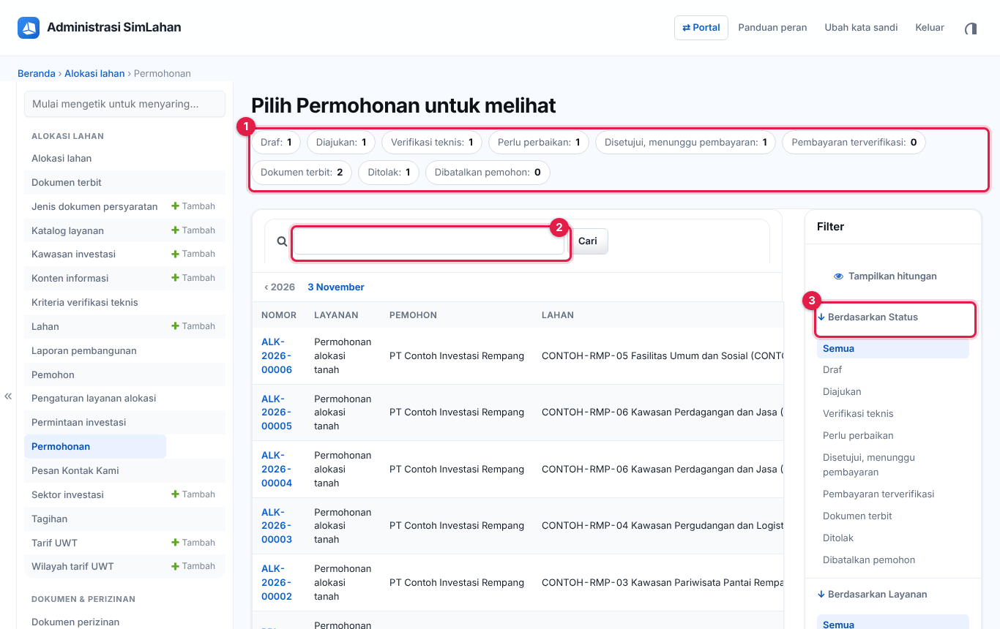

Nomor pada gambar:

1. **Jumlah per status**: banyaknya permohonan di setiap status. Klik salah satu, misalnya **Diajukan: 1**, untuk menampilkan permohonan berstatus itu saja.
2. **Kotak cari**: ketik nomor permohonan, nama pemohon, atau kode lahan, lalu klik **Cari**.
3. **Filter** di kanan: saring per **Status**, **Layanan**, atau **Jenis alokasi**. Bagi Tim Verifikasi ada juga filter **Berdasarkan penilaian saya** (sudah atau belum saya nilai).

Klik nomor permohonan (misalnya `ALK-2026-00003`) untuk membukanya.

<!-- akhir sisip -->

### Daftar permohonan untuk Tim Verifikasi

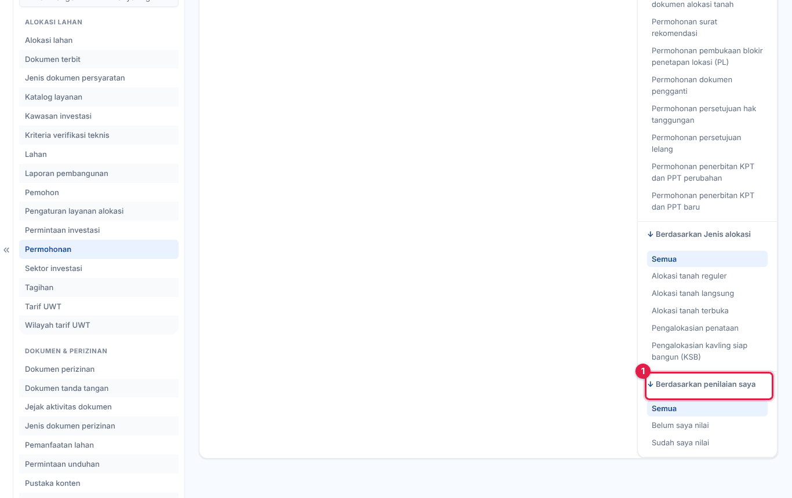

<!-- sisip: 20-alokasi-lahan.md#53-menilai-verifikasi-teknis-tim-verifikasi -->

### 5.3 Menilai verifikasi teknis (Tim Verifikasi)

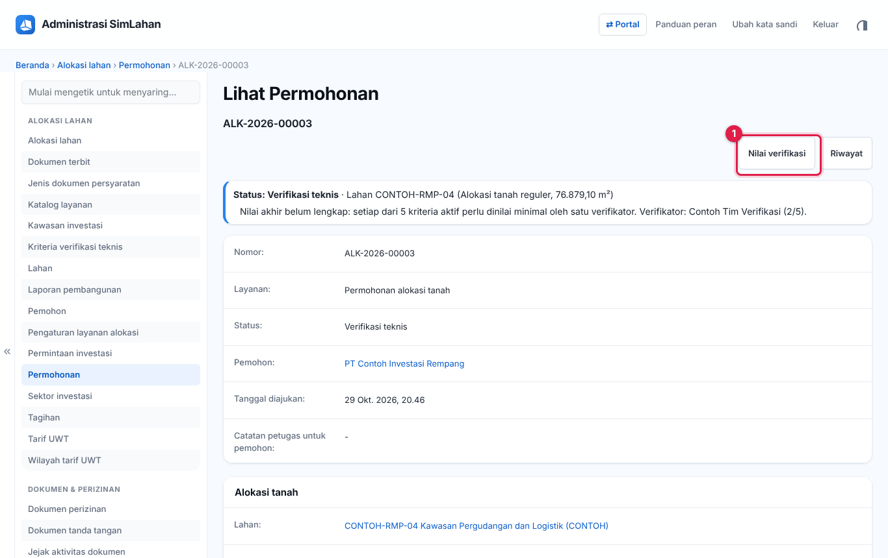

1. Buka **Panel admin → Alokasi lahan → Permohonan**. Di filter kanan, klik **Verifikasi teknis** pada **Berdasarkan Status**, lalu **belum dinilai** pada **Berdasarkan penilaian saya**.
2. Klik nomor permohonan, lalu klik **Nilai verifikasi** (nomor 1) di kanan atas.
3. Halaman penilaian terbuka. Kotak paling atas berisi ringkasan lahan dan rencana usaha pemohon. Klik nama dokumen di baris **Dokumen** untuk membaca berkas pemohon.

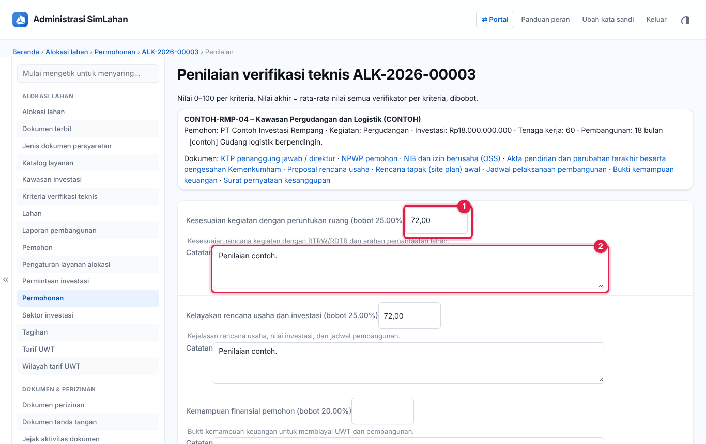

4. Untuk setiap kriteria, isi nilai **0 sampai 100** di kotak sebelah nama kriteria (nomor 1). Bobot kriteria tertulis dalam kurung, misalnya "(bobot 25.00%)".
5. Tulis alasan penilaian di **Catatan** di bawahnya (nomor 2).
6. Ulangi untuk semua kriteria, lalu gulir ke bawah dan klik **Simpan nilai**.

Nilai akhir = rata-rata nilai semua verifikator untuk setiap kriteria, dikalikan bobotnya, lalu dijumlahkan. Selama permohonan masih berstatus *Verifikasi teknis*, Anda bisa membuka lagi halaman ini untuk memperbaiki nilai.

<!-- akhir sisip -->

### Kriteria penilaian

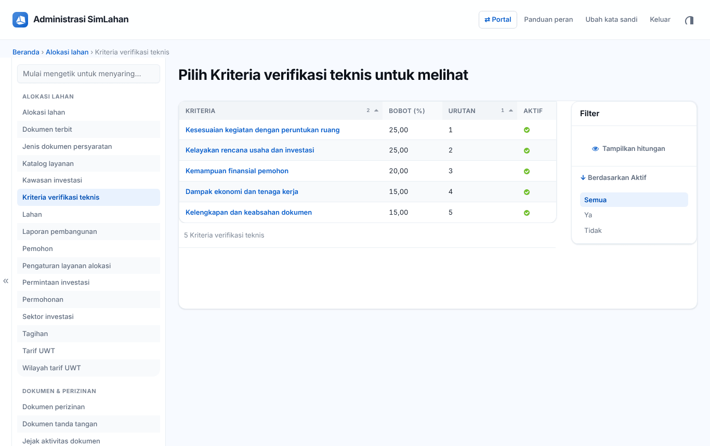

Daftar **Kriteria verifikasi teknis** (menu samping) menampilkan kriteria yang dinilai beserta bobotnya. Kriteria diatur Administrator; Anda hanya membacanya.

## Bagian B – Memeriksa dokumen perizinan

<!-- sisip: 22-dokumen-perizinan.md#71-dasbor-dokumen--perizinan -->

### 7.1 Dasbor dokumen & perizinan

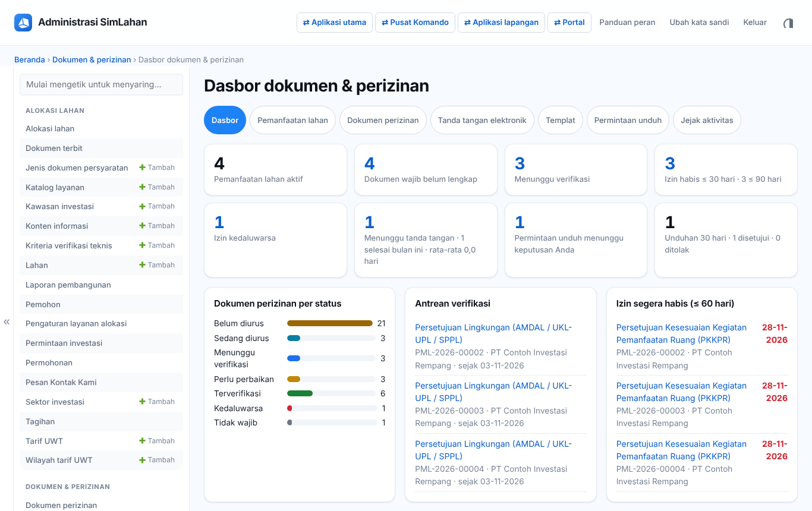

Buka **Dokumen & perizinan → Dasbor dokumen & perizinan**. Baris tombol di atas (**Dasbor, Pemanfaatan lahan, Dokumen perizinan, Tanda tangan elektronik, Templat, Permintaan unduh, Jejak aktivitas**) adalah jalan pintas ke tiap daftar.

Kartu angka di atas:

- **Pemanfaatan lahan aktif**, **Dokumen wajib belum lengkap**, **Menunggu verifikasi**.
- **Izin habis ≤ 30 hari · ≤ 90 hari** dan **Izin kedaluwarsa**.
- **Menunggu tanda tangan** (beserta jumlah selesai bulan ini dan rata-rata hari penyelesaian).
- **Permintaan unduh menunggu keputusan Anda** dan **Unduhan 30 hari**.

Panel di bawahnya:

- **Dokumen perizinan per status**: Belum diurus, Sedang diurus, Menunggu verifikasi, Perlu perbaikan, Terverifikasi, Kedaluwarsa, Tidak wajib.
- **Antrean verifikasi**: dokumen yang sudah diunggah pemegang hak dan menunggu diperiksa. Klik judulnya untuk langsung memeriksa.
- **Izin segera habis (≤ 60 hari)**: tanggal merah berarti perlu segera diperpanjang.
- **Pemanfaatan aktif per skema**, **Dokumen tanda tangan per status**, dan **Aktivitas terbaru** (gulir ke bawah).

Gulir sedikit ke bawah untuk melihat panel-panel itu:

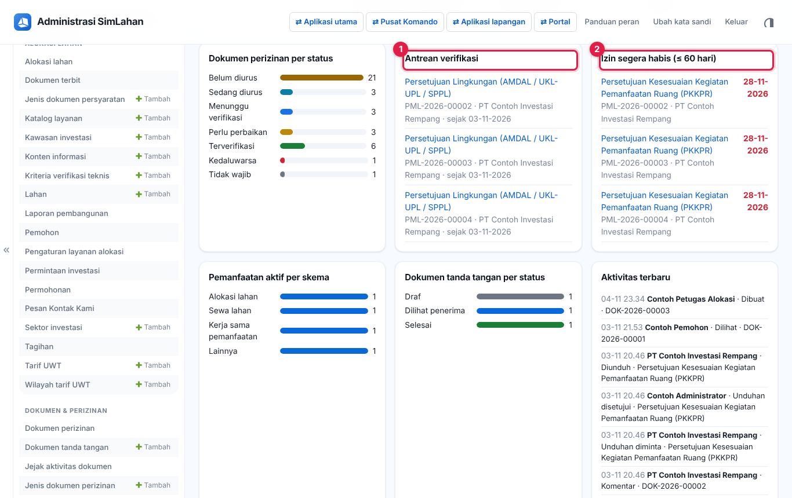

- **Antrean verifikasi** (nomor 1): klik judul dokumen untuk langsung memeriksanya (lihat 7.3).
- **Izin segera habis** (nomor 2): tanggal merah di kanan adalah tanggal izin berakhir. Hubungi pemegang hak agar segera memperpanjang.

<!-- akhir sisip -->

<!-- sisip: 22-dokumen-perizinan.md#73-dokumen-perizinan -->

### 7.3 Dokumen perizinan

Setiap baris adalah satu dokumen wajib untuk satu pemanfaatan lahan, misalnya PKKPR atau persetujuan lingkungan.

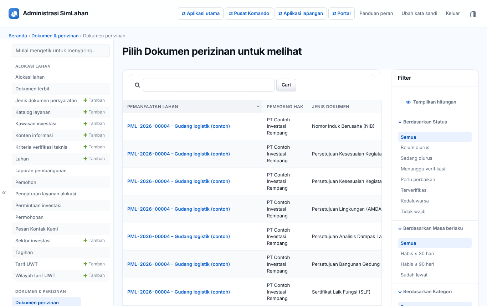

Saringan: **Status**, **Masa berlaku**, **Kategori**, **Jenis dokumen**, **Skema**.

Arti status:

| Status | Arti |
|---|---|
| Belum diurus | Pemegang hak belum mulai. |
| Sedang diurus | Pemegang hak sedang mengurus ke instansi penerbit. |
| Menunggu verifikasi | Berkas sudah diunggah, menunggu diperiksa petugas. |
| Perlu perbaikan | Petugas meminta revisi; pemegang hak mengunggah ulang. |
| Terverifikasi | Berkas sah dan diterima. |
| Kedaluwarsa | Tanggal **Berlaku sampai** sudah lewat. |
| Tidak wajib | Dikecualikan untuk pemanfaatan ini. |

#### Memeriksa dokumen

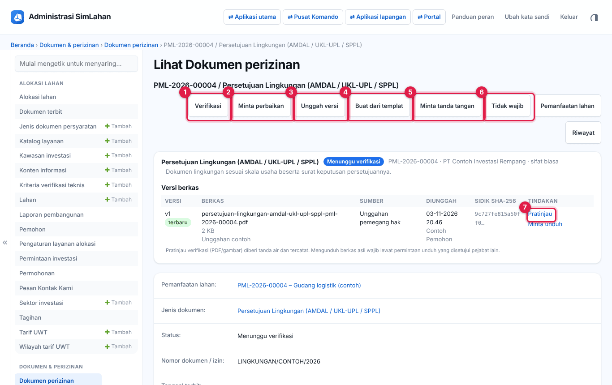

1. Buka dokumen berstatus **Menunggu verifikasi** dari **Antrean verifikasi** di dasbor, atau dari daftar dengan filter status itu.
2. Di bagian **Versi berkas**, klik **Pratinjau** (nomor 7) untuk melihat berkas yang diunggah. Pratinjau diberi tanda air dan tercatat.
3. Bila berkas sah, klik **Verifikasi** (nomor 1). Halaman verifikasi terbuka (lihat **Menyatakan terverifikasi** di bawah).

Tombol lain di halaman ini:

- **Minta perbaikan** (nomor 2): tulis apa yang harus diperbaiki, lalu kirim. Pemegang hak diberi tahu dan mengunggah ulang.
- **Unggah versi** (nomor 3): petugas mengunggah berkas atas nama pemegang hak, misalnya bila berkas dikirim lewat surel.
- **Buat dari templat** (nomor 4): membuat berkas dari templat jenis dokumen ini.
- **Minta tanda tangan** (nomor 5): membuat dokumen tanda tangan untuk dokumen ini. Setelah selesai ditandatangani, PDF-nya otomatis menjadi versi baru dokumen ini.
- **Tidak wajib** (nomor 6): mengecualikan dokumen ini untuk pemanfaatan ini, dengan alasan.
- **Buka kembali**: muncul pada dokumen yang sudah terverifikasi atau tidak wajib, untuk membukanya lagi dengan alasan.

**Menyatakan terverifikasi**

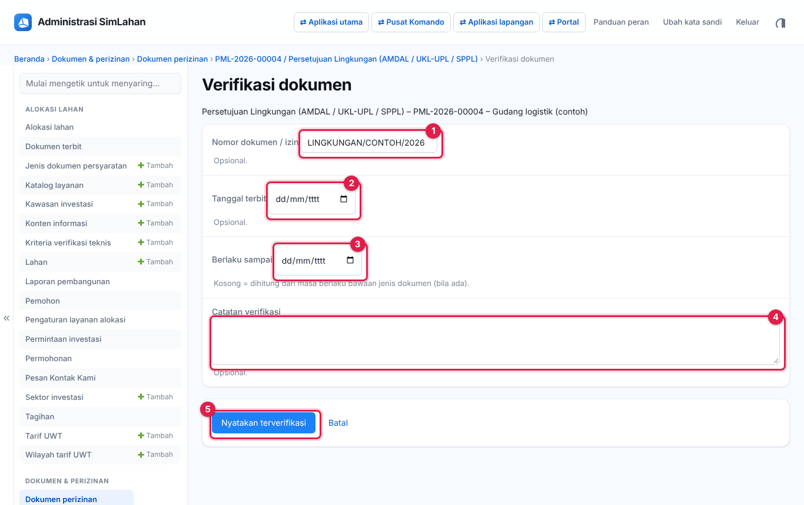

1. Periksa atau isi **Nomor dokumen / izin** (nomor 1) sesuai berkas.
2. Isi **Tanggal terbit** (nomor 2) dan **Berlaku sampai** (nomor 3). Bila **Berlaku sampai** dikosongkan, sistem menghitungnya dari masa berlaku bawaan jenis dokumen.
3. Bila perlu, tulis **Catatan verifikasi** (nomor 4).
4. Klik **Nyatakan terverifikasi** (nomor 5). Status menjadi **Terverifikasi**.

Setiap tindakan tercatat di **Riwayat** dan **Jejak aktivitas**. Sistem mengirim peringatan otomatis sebelum izin kedaluwarsa (jumlah harinya diatur di **Pengaturan dokumen**).

<!-- akhir sisip -->

<!-- sisip: 22-dokumen-perizinan.md#77-permintaan-unduh -->

### 7.7 Permintaan unduh

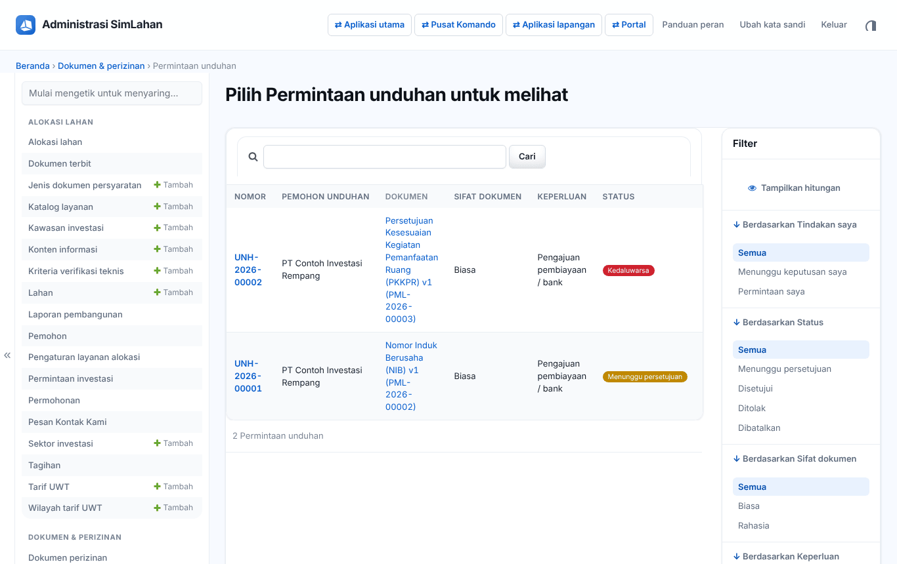

Saringan **Tindakan saya** menampilkan permintaan yang menunggu keputusan Anda.

**Mengajukan permintaan unduh:**

1. Di halaman dokumen perizinan atau dokumen tanda tangan, klik **Minta unduh** (atau **Minta unduh PDF final**).
2. Pilih **Keperluan**: Arsip / administrasi, Pengurusan izin ke instansi lain, Pengajuan pembiayaan / bank, Keperluan hukum / pengadilan, Pemeriksaan / audit, atau Lainnya. Tulis **Alasan**.
3. Kirim, lalu tunggu keputusan. Lihat statusnya di **Permintaan unduh saya**.
4. Setelah **Disetujui**, klik **Unduh sekarang** sebelum masa berlakunya habis. Permintaan yang belum diputuskan bisa dibatalkan dengan **Batalkan permintaan**.

**Memutuskan permintaan unduh:**

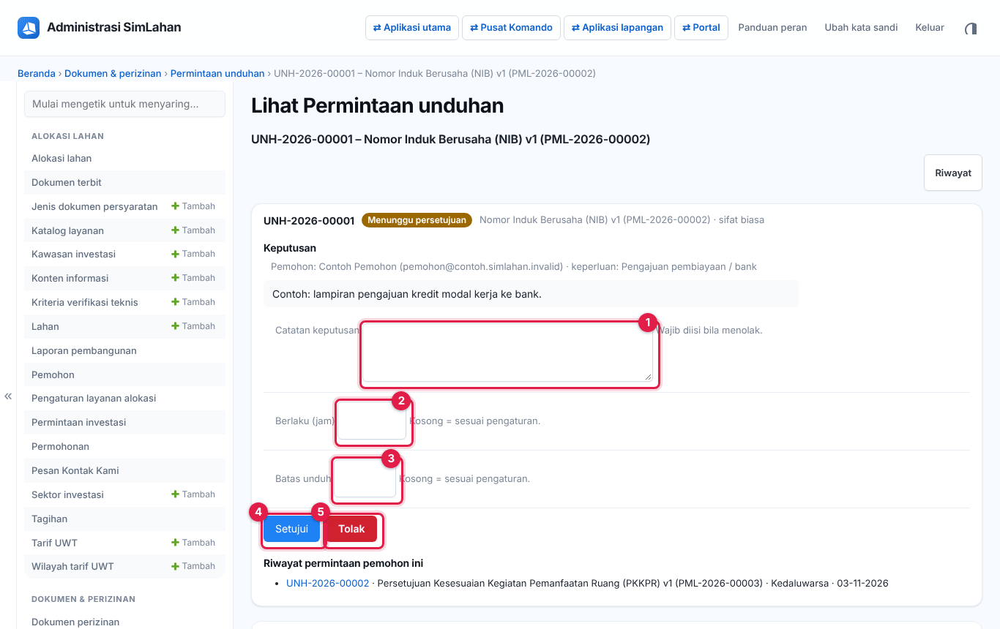

1. Buka permintaan berstatus **Menunggu persetujuan** dari saringan **Tindakan saya** atau dari kartu di dasbor.
2. Di bagian **Keputusan**, baca keperluan dan alasan pemohon. Periksa juga **Riwayat permintaan pemohon ini** di bawahnya.
3. Bila perlu, tulis **Catatan keputusan** (nomor 1). Catatan wajib diisi bila Anda menolak.
4. Bila perlu, ubah **Berlaku (jam)** (nomor 2), yaitu berapa jam izin unduh berlaku, dan **Batas unduh** (nomor 3), yaitu berapa kali berkas boleh diunduh. Kosongkan untuk memakai pengaturan umum.
5. Klik **Setujui** (nomor 4) atau **Tolak** (nomor 5). Pemohon diberi tahu.

Permintaan Anda sendiri harus diputuskan pejabat lain. Dokumen **rahasia** hanya dapat disetujui Administrator.

**Riwayat unduhan** mencatat setiap pratinjau dan unduhan (saringan **Pratinjau** dan **Bertanda air**).

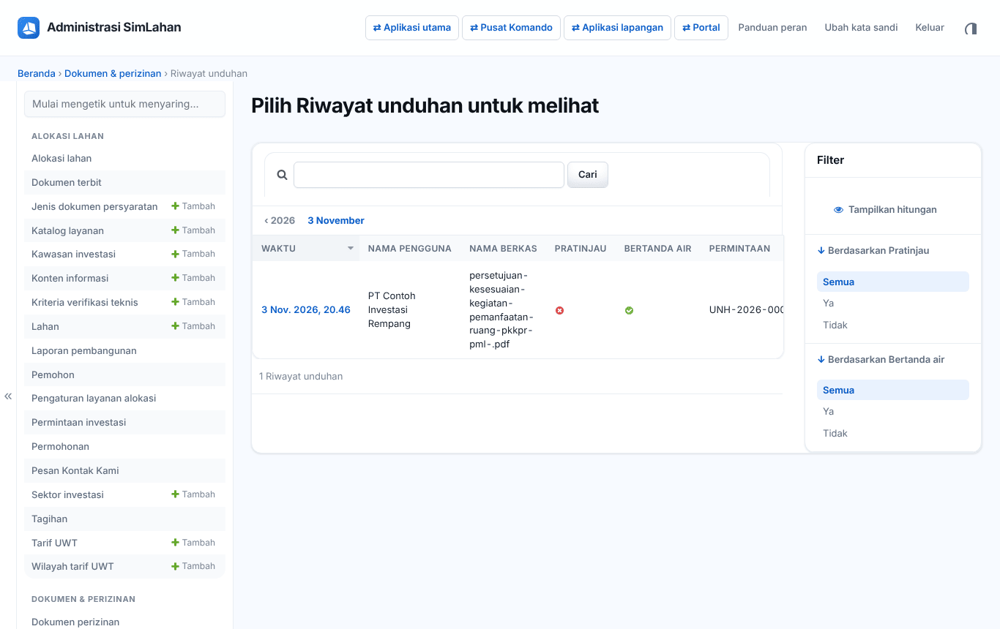

<!-- akhir sisip -->

<!-- sisip: 22-dokumen-perizinan.md#710-pertanyaan-umum -->

### 7.10 Pertanyaan umum

**Tombol Kirim untuk ditandatangani tidak muncul.** Dokumen wajib persetujuan internal dan belum disetujui. Klik **Minta persetujuan** dan minta pejabat lain menyetujuinya.

**Saya tidak bisa menyetujui permintaan unduh.** Permintaan itu milik Anda sendiri, dokumennya rahasia (hanya Administrator), atau peran Anda tidak berhak menyetujui.

**Penerima tidak menerima surel.** Periksa alamat **Surel**, lalu klik **Kirim ulang**. Bila penerima hadir di kantor, gunakan **TTD langsung**.

**Dokumen baru wajib tidak muncul di pemanfaatan lama.** Jalankan aksi **Terapkan ke pemanfaatan lahan aktif** pada jenis dokumen itu.

<!-- akhir sisip -->

## Bila ada kendala

- **Menu atau tombol yang disebut di buku ini tidak ada di layar Anda.** Peran Anda memang tidak memerlukannya (lihat **Batas akses** di atas). Bila Anda membutuhkannya untuk pekerjaan, minta Administrator menambahkan peran yang sesuai.
- **Pesan "Tidak berhak" atau "Anda tidak berwenang melihat data ini".** Data itu di luar hak peran Anda, bukan kerusakan sistem.
- **Lupa kata sandi.** Hubungi superuser SimLahan untuk dibuatkan sandi baru, lalu ganti sandi itu setelah masuk (klik nama Anda → **Ganti sandi**, atau buka `/akun/sandi/`).
- **Terlalu banyak percobaan masuk.** Tunggu beberapa menit, lalu coba lagi dengan sandi yang benar.
- **Ringkasan peran di dalam aplikasi.** Isi bagian *Ringkasan peran* di atas juga bisa dibuka kapan saja lewat **Panduan peran** (`/akun/panduan/`).
