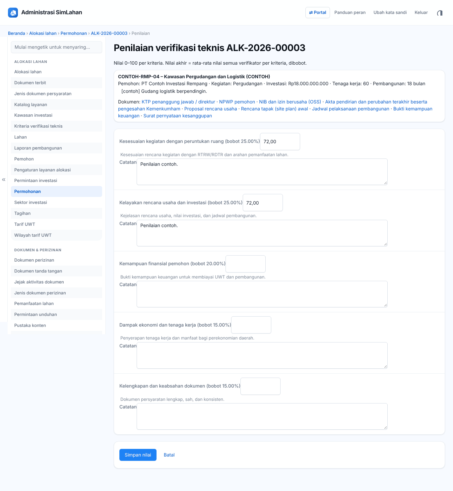
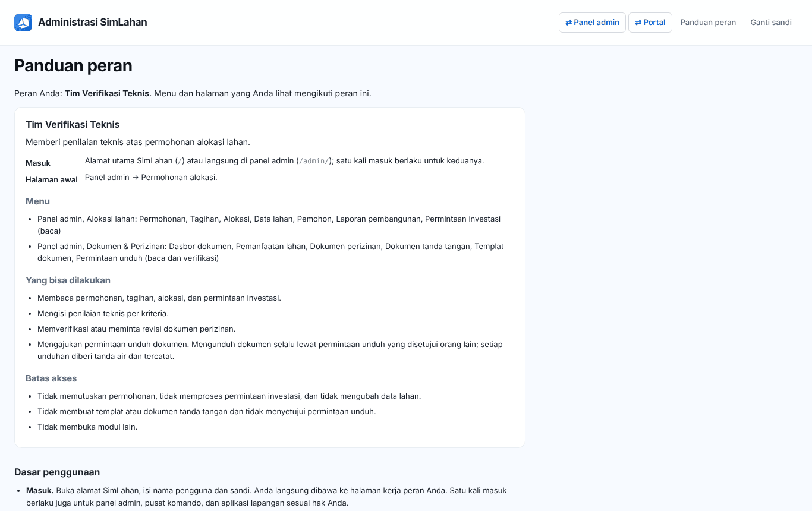

# Buku peran: Tim Verifikasi Teknis

Buku ini untuk **Tim Verifikasi Teknis**: anggota tim lintas unit yang menilai permohonan alokasi dan memeriksa dokumen perizinan. Baca dulu [Bab 1](../01-mengenal-simlahan.md) dan [Bab 2](../02-dasar-penggunaan.md) bila baru pertama kali memakai SimLahan.

## Masuk

Buka alamat SimLahan atau `/admin/`, isi nama pengguna dan kata sandi, lalu klik **Masuk** ([Bab 2.2](../02-dasar-penggunaan.md#b-panel-admin)).

<!-- awal: dibuat dari backend/users/role_guide.py; perbarui dengan: cd backend && python manage.py panduan_buku -->

## Ringkasan peran

Memberi penilaian teknis atas permohonan alokasi lahan.

- **Cara masuk:** Alamat utama SimLahan (`/`) atau langsung di panel admin (`/admin/`); satu kali masuk berlaku untuk keduanya.
- **Halaman awal:** Panel admin → Permohonan alokasi.
- **Akun latihan** (hanya di sistem latihan berisi data contoh): `contoh.verifikasi`

### Menu yang Anda lihat

- Panel admin, Alokasi lahan: Permohonan, Tagihan, Alokasi, Data lahan, Pemohon, Laporan pembangunan, Permintaan investasi (baca)
- Panel admin, Dokumen & Perizinan: Dasbor dokumen, Pemanfaatan lahan, Dokumen perizinan, Dokumen tanda tangan, Templat dokumen, Permintaan unduh (baca dan verifikasi)

### Yang bisa Anda lakukan

- Membaca permohonan, tagihan, alokasi, dan permintaan investasi.
- Mengisi penilaian teknis per kriteria.
- Memverifikasi atau meminta revisi dokumen perizinan.
- Mengajukan permintaan unduh dokumen. Mengunduh dokumen selalu lewat permintaan unduh yang disetujui orang lain; setiap unduhan diberi tanda air dan tercatat.

### Batas akses

- Tidak memutuskan permohonan, tidak memproses permintaan investasi, dan tidak mengubah data lahan.
- Tidak membuat templat atau dokumen tanda tangan dan tidak menyetujui permintaan unduh.
- Tidak membuka modul lain.

<!-- akhir: blok role_guide.py -->

## Pekerjaan sehari-hari

### 1. Menilai permohonan

1. Buka **Permohonan**, saring **penilaian saya → belum** ([Bab 5.1](../20-alokasi-lahan.md#51-daftar-permohonan)).
2. Buka permohonan berstatus **Verifikasi teknis**, beri nilai per kriteria beserta catatan, lalu simpan ([Bab 5.3](../20-alokasi-lahan.md#53-menilai-verifikasi-teknis-tim-verifikasi)).

### 2. Memeriksa dokumen perizinan

1. Buka **Dokumen perizinan** atau **Antrean verifikasi** di dasbor dokumen, lalu **Verifikasi** atau **Minta perbaikan** ([Bab 7.3](../22-dokumen-perizinan.md#memeriksa-dokumen)).

### 3. Meminta izin unduh

1. Ajukan **Minta unduh** bila perlu berkas asli ([Bab 7.7](../22-dokumen-perizinan.md#77-permintaan-unduh)).

## Bab yang perlu dibaca

- [Bab 1](../01-mengenal-simlahan.md)
- [Bab 2](../02-dasar-penggunaan.md)
- [Bab 5 – Alokasi lahan](../20-alokasi-lahan.md)
- [Bab 7 – Dokumen & perizinan](../22-dokumen-perizinan.md)

## Bila ada kendala

- Menu atau tombol tidak ada: peran Anda memang tidak memerlukannya ([Bab 2.10](../02-dasar-penggunaan.md#210-batas-akses-dan-pesan-tidak-berhak)). Hubungi Administrator bila Anda memerlukannya untuk pekerjaan.
- Lupa kata sandi: hubungi Administrator atau superuser untuk menyetel ulang sandi.
- Ringkasan peran yang sama bisa dibuka di dalam aplikasi lewat **Panduan peran** (`/akun/panduan/`).
